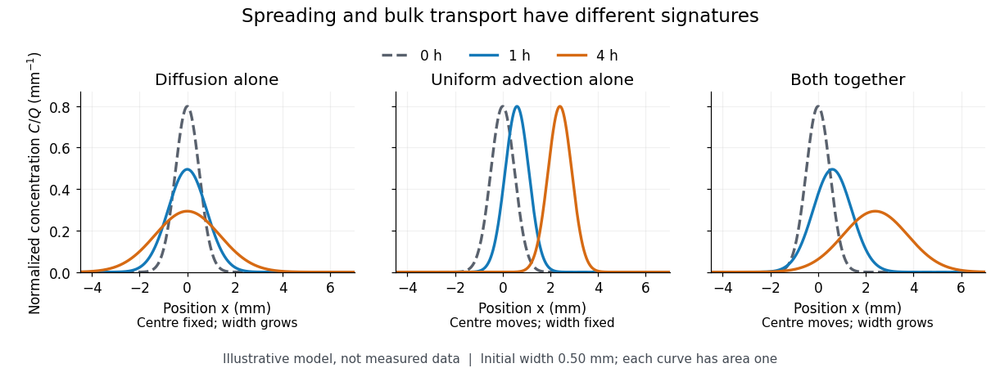

# Diffusion

↑ **Parent:** [Thermodynamics](thermodynamics-split.md)

Diffusion is net transport associated with random microscopic motion. A localized patch of a dilute [solute](solute.md) can spread through a stationary [solvent](solvent.md): individual [molecules](molecule-split.md) move in both directions, but more cross from the crowded side of an imaginary surface than from the less crowded side. This imbalance gives a net [diffusive flux](diffusive-flux.md) down the [concentration](concentration.md) [gradient](gradient.md); the [molecules](molecule-split.md) do not need to sense which direction has lower [concentration](concentration.md). At uniform [concentration](concentration.md), microscopic exchanges continue even though the net [diffusive flux](diffusive-flux.md) vanishes. [Heidi Nepf, MIT: random motion and Fick's law](https://ocw.mit.edu/courses/1-061-transport-processes-in-the-environment-fall-2008/8260e3e1577cd739ce85143510d9c165_lec_01.pdf)

The distinction from [advection](advection.md) is easiest to see in a dye patch. Uniform bulk motion carries its centre downstream; [diffusion](diffusion.md) broadens it relative to that centre. Both can happen together. A moving or spreading patch by itself does not identify the mechanism: a nonuniform [velocity field](velocity-field.md) can also stretch a patch. [Nepf, MIT: advection and diffusion of a release](https://ocw.mit.edu/courses/1-061-transport-processes-in-the-environment-fall-2008/c96f9a75576238ac2c4e0e73b84e8072_lec_05.pdf)

**[Figure 15](#image-diffusion-broadens-a-patch-uniform-advection-translates-it). Diffusion broadens a patch; uniform advection translates it**. Original model curves, not measured data. Each panel starts with the same [Gaussian distribution](normal-distribution.md) of dye, with [standard deviation](standard-deviation.md) $\sigma_0=0.50\,\mathrm{mm}$. The chosen [diffusion coefficient](diffusion-coefficient.md) is $D=0.20\,\mathrm{mm^2\,h^{-1}}$ where enabled; the chosen bulk speed is $u=0.60\,\mathrm{mm\,h^{-1}}$ where enabled. The vertical axis is [concentration](concentration.md) divided by its spatial integral, so every curve has area one. Pure uniform [advection](advection.md) preserves width and peak height; [diffusion](diffusion.md) lowers the peak while preserving the total dye.

For a dilute nonreacting [solute](solute.md) in a uniform medium at fixed [temperature](temperature-split.md), [Fick's first law](fick-s-first-law.md) models the relative [diffusive flux](diffusive-flux.md) as $\mathbf j=-D\nabla C$, with scalar [diffusion coefficient](diffusion-coefficient.md) $D>0$ of units $\mathrm{m^2\,s^{-1}}$. Here $C$ is the [amount of substance](amount-of-substance.md) per unit [volume](volume-thermodynamics.md), so $\mathbf j$ has units $\mathrm{mol\,m^{-2}\,s^{-1}}$. With carrier [velocity field](velocity-field.md) $\mathbf u$, the total [flux](flux.md) is $C\mathbf u+\mathbf j$. The [continuity equation](continuity-equation.md), with no sources or [chemical reactions](chemical-reaction-split.md), gives

$$
\frac{\partial C}{\partial t}+\nabla\cdot(C\mathbf u)=\nabla\cdot(D\nabla C).
$$

For constant $D$ and [incompressible flow](incompressible-flow.md), this reduces to $C_t+\mathbf u\cdot\nabla C=D\nabla^2C$, where $\nabla^2$ is the [Laplacian](laplacian.md). In a stationary carrier it is the [diffusion equation](diffusion-equation-split.md). These assumptions matter: variable $D$ must remain inside the [divergence](divergence.md), and changing sources require extra terms. [Nepf, MIT: conservation with advective and diffusive fluxes](https://ocw.mit.edu/courses/1-061-transport-processes-in-the-environment-fall-2008/5536a0bf7f3bd0b21fde2169b93a4b5a_lec_02.pdf)

The useful surprise is the common mathematics: [thermal conduction](thermal-conduction.md) smooths [temperature](temperature-split.md) through the analogous [heat equation](heat-equation.md), while [molecular diffusion](molecular-diffusion.md) smooths composition. This analogy already motivated the original formulation of [Fick's laws](fick-s-laws.md). [Fick (1855), On liquid diffusion: the analogy with heat conduction](https://doi.org/10.1080/14786445508641925) However, the [thermal diffusivity](thermal-diffusivity.md) and the [solutal diffusivity](solutal-diffusivity.md) need not be equal. A [diffusive time scale](diffusive-time-scale.md) $t_D\sim L^2/D$ means that crossing ten times the distance requires roughly one hundred times the time. This is why [molecular diffusion](molecular-diffusion.md) is especially effective across thin layers, and why [chaotic advection](chaotic-advection.md) can assist mixing by making those layers thinner. Physical [diffusion](diffusion.md) is a transport mechanism, distinct from the broader probabilistic class of [Markov diffusion](markov-diffusion.md).

**Table of contents**

- [Collective diffusion](collective-diffusion.md)
- [Self-diffusion](self-diffusion.md)
- [Diffusion-distance convention](diffusion-distance-convention.md)
- [Einstein diffusion relation](einstein-diffusion-relation.md)
- [Diffusion approximation](diffusion-approximation.md)
  - [One-group neutron diffusion equation](one-group-neutron-diffusion-equation.md)
    - [Geometric buckling](geometric-buckling.md)
    - [Neutron diffusion coefficient](neutron-diffusion-coefficient.md)
- [Mass transport](mass-transport.md)
- [Tracer diffusion](tracer-diffusion.md)
- [Diffusion jump correlation factor](diffusion-jump-correlation-factor.md)
- [Direct interstitial diffusion](direct-interstitial-diffusion.md)
- [Vacancy diffusion](vacancy-diffusion.md)
- [Molecular diffusion](molecular-diffusion.md)
- [Rotational diffusion](rotational-diffusion.md)
  - [Planar rotational diffusion](planar-rotational-diffusion.md)
  - [Isotropic rotational diffusion in three dimensions](isotropic-rotational-diffusion-in-three-dimensions.md)
  - [Rotational diffusion of a sphere](rotational-diffusion-of-a-sphere.md)
  - [Ellipsoid rotational diffusion microscopy experiment](ellipsoid-rotational-diffusion-microscopy-experiment.md)
- [Translational diffusion](translational-diffusion.md)

## ↑ Ancestors (5)

1. [Thermodynamics](thermodynamics-split.md)
2. [Statistical physics](statistical-physics-split.md)
3. [Branches of physics](branches-of-physics.md)
4. [Physics](physics-split.md)
5. [Codex Wiki](split.md)

## ← Incoming links (242)

- [Airy global modes of a linearly confined Ginzburg-Landau equation](airy-global-modes-of-a-linearly-confined-ginzburg-landau-equation.md)
- [Analytical ultracentrifugation](analytical-ultracentrifugation.md)
- [Anderson localization](anderson-localization.md)
- [Annual ground-temperature wave](annual-ground-temperature-wave.md)
- [Antibody surface plasmon resonance experiment](antibody-surface-plasmon-resonance-experiment.md)
- [Backgrounder on Uranium Enrichment by the United States Nuclear Regulatory Commission](backgrounder-on-uranium-enrichment-by-the-united-states-nuclear-regulatory-commission.md)
- [Ballistic transport](ballistic-transport.md)
- [Benjamin-Feir stability condition](benjamin-feir-stability-condition.md)
- [Blackett-Occhialini triggered cloud-chamber experiment](blackett-occhialini-triggered-cloud-chamber-experiment.md)
- [Brownian displacement conventions](brownian-displacement-conventions.md)
- [Brownian motion](brownian-motion-split.md)
- [Burgers' equation](burgers-equation.md)
- [Calibrated two-wire charge centroid](calibrated-two-wire-charge-centroid.md)
- [Catalyst deactivation](catalyst-deactivation.md)
- [Catalyst particle size and accessible area](catalyst-particle-size-and-accessible-area.md)
- [Cell conservation in a swimming suspension](cell-conservation-in-a-swimming-suspension.md)
- [Cell membrane](cell-membrane-split.md)
- [Chaotic advection](chaotic-advection.md)
- [Chemical potential](chemical-potential-split.md)
- [Chemical synapse](chemical-synapse.md)
- [Cloud chamber](cloud-chamber.md)
- [Cytosol dialysis](cytosol-dialysis.md)
- [Deterministic alignment of an initially isotropic orientation distribution](deterministic-alignment-of-an-initially-isotropic-orientation-distribution.md)
- [Dialysis (biochemistry)](dialysis-biochemistry.md)
- [Diffusion](diffusion.md)
- [Diffusion attenuation of a spin echo](diffusion-attenuation-of-a-spin-echo.md)
- [Diffusion-distance convention](diffusion-distance-convention.md)
- [Diffusion on a graph](diffusion-on-a-graph.md)
- [Diffusive broadening of electrophoretic bands](diffusive-broadening-of-electrophoretic-bands.md)
- [Direct interstitial diffusion](direct-interstitial-diffusion.md)
- [Displacive transformation](displacive-transformation.md)
- [Doppler cooling limit](doppler-cooling-limit.md)
- [DOSY](dosy.md)
- [Drift current](drift-current.md)
- [Electrolyte](electrolyte.md)
- [Electrophoretic transit time in a conical pore](electrophoretic-transit-time-in-a-conical-pore.md)
- [Equal diffusion cannot destabilize a stable reaction Jacobian](equal-diffusion-cannot-destabilize-a-stable-reaction-jacobian.md)
- [Error function](error-function.md)
- [Error-function diffusion front](error-function-diffusion-front.md)
- [Finite-time rate-zonal separation](finite-time-rate-zonal-separation.md)
- [Fluid mosaic model](fluid-mosaic-model.md)
- [Free-draining polymer friction](free-draining-polymer-friction.md)
- [Frozen-temperature approximation](frozen-temperature-approximation.md)
- [Gas centrifuge enrichment](gas-centrifuge-enrichment.md)
- [Gaussian diffusion of a smooth initial profile](gaussian-diffusion-of-a-smooth-initial-profile.md)
- [Gravitational Peclet number](gravitational-peclet-number.md)
- [Gyrotactic orientation Fokker-Planck equation](gyrotactic-orientation-fokker-planck-equation.md)
- [Hahn spin echo experiment](hahn-spin-echo-experiment.md)
- [Heterogeneous catalysis](heterogeneous-catalysis.md)
- [Ice layer between freshwater and cold brine](ice-layer-between-freshwater-and-cold-brine.md)
- [Instantaneous interface kinetics](instantaneous-interface-kinetics.md)
- [Isoelectric point](isoelectric-point.md)
- [Isopycnic centrifugation](isopycnic-centrifugation.md)
- [Kinetic theory](kinetic-theory-split.md)
- [Kuramoto-Sivashinsky equation](kuramoto-sivashinsky-equation.md)
- [Langmuir mica adsorption experiment](langmuir-mica-adsorption-experiment.md)
- [Lateral mobility of membrane proteins](lateral-mobility-of-membrane-proteins.md)
- [Limiting current density](limiting-current-density.md)
- [Linear-gradient isopycnic focusing](linear-gradient-isopycnic-focusing.md)
- [Marginal equilibrium at a mush-liquid boundary](marginal-equilibrium-at-a-mush-liquid-boundary.md)
- [Mass spectrograph](mass-spectrograph.md)
- [Mass transport](mass-transport.md)
- [Mean displacement](mean-displacement.md)
- [Mean squared displacement](mean-squared-displacement.md)
- [Membrane permeability](membrane-permeability.md)
- [Membrane potential](membrane-potential-split.md)
- [Morphogen](morphogen.md)
- [Morphogen gradient](morphogen-gradient.md)
- [Morphogen source-diffusion-degradation model](morphogen-source-diffusion-degradation-model.md)
- [Nernst-Einstein relation](nernst-einstein-relation.md)
- [Neurotransmitter clearance](neurotransmitter-clearance.md)
- [Notes on the Turing Instability and Chemical Instabilities by Michael Cross](notes-on-the-turing-instability-and-chemical-instabilities-by-michael-cross.md)
- [Nuclear pore complex](nuclear-pore-complex.md)
- [On the Movement of Small Particles Suspended in a Stationary Liquid Demanded by the Molecular-Kinetic Theory of Heat by Albert Einstein](on-the-movement-of-small-particles-suspended-in-a-stationary-liquid-demanded-by-the-molecular-kinetic-theory-of-heat-by-albert-einstein.md)
- [Optical molasses](optical-molasses.md)
- [Oseen approximation](oseen-approximation.md)
- [P-n junction](p-n-junction.md)
- [Solution](past-exam-of-the-biochemistry-course-of-the-university-of-cambridge/2025/paper-1/section-ii/5/solution.md)
- [Solution](past-exam-of-the-biochemistry-course-of-the-university-of-cambridge/2025/paper-1/section-ii/7/solution.md)
- [Solution](past-exam-of-the-biochemistry-course-of-the-university-of-cambridge/2025/paper-2/section-ii/5/solution.md)
- [Solution](past-exam-of-the-chemistry-course-of-the-year-3-of-the-natural-sciences-course-of-the-university-of-cambridge/2022/paper-4/51/a/i/solution.md)
- [Solution](past-exam-of-the-chemistry-course-of-the-year-3-of-the-natural-sciences-course-of-the-university-of-cambridge/2022/paper-4/51/a/ii/solution.md)
- [Solution](past-exam-of-the-chemistry-course-of-the-year-3-of-the-natural-sciences-course-of-the-university-of-cambridge/2022/paper-4/51/b/solution.md)
- [Solution](past-exam-of-the-chemistry-course-of-the-year-4-of-the-natural-sciences-course-of-the-university-of-cambridge/2022/paper-1/13/c/solution.md)
- [Solution](past-exam-of-the-chemistry-course-of-the-year-4-of-the-natural-sciences-course-of-the-university-of-cambridge/2022/paper-3/section-d/43/a/solution.md)
- [Solution](past-exam-of-the-genetics-course-of-the-university-of-cambridge/2024/paper-2/4/solution.md)
- [Solution](past-exam-of-the-materials-science-course-of-the-university-of-cambridge/2015/paper-1/3/c/solution.md)
- [Solution](past-exam-of-the-materials-science-course-of-the-university-of-cambridge/2016/paper-1/2/a/solution.md)
- [Solution](past-exam-of-the-materials-science-course-of-the-university-of-cambridge/2016/paper-1/4/e/solution.md)
- [Solution](past-exam-of-the-materials-science-course-of-the-university-of-cambridge/2016/paper-1/7/a/solution.md)
- [Solution](past-exam-of-the-materials-science-course-of-the-university-of-cambridge/2016/paper-1/7/b/solution.md)
- [Solution](past-exam-of-the-materials-science-course-of-the-university-of-cambridge/2017/paper-1/4/b/solution.md)
- [Solution](past-exam-of-the-materials-science-course-of-the-university-of-cambridge/2017/paper-1/7/b/solution.md)
- [Solution](past-exam-of-the-materials-science-course-of-the-university-of-cambridge/2022/paper-1/4/a/solution.md)
- [Solution](past-exam-of-the-materials-science-course-of-the-university-of-cambridge/2022/paper-1/4/b/i/solution.md)
- [Solution](past-exam-of-the-mathematical-and-computational-biology-course-of-the-university-of-cambridge/2024/paper-1/d7/b/solution.md)
- [Solution](past-exam-of-the-mathematical-and-computational-biology-course-of-the-university-of-cambridge/2025/paper-2/7/c/solution.md)
- [Solution](past-exam-of-the-mathematics-course-of-the-university-of-cambridge/2001/iii/paper-44/3/solution.md)
- [Solution](past-exam-of-the-mathematics-course-of-the-university-of-cambridge/2001/iii/paper-44/4/i/solution.md)
- [Solution](past-exam-of-the-mathematics-course-of-the-university-of-cambridge/2001/iii/paper-46/1/i/solution.md)
- [Solution](past-exam-of-the-mathematics-course-of-the-university-of-cambridge/2001/iii/paper-46/1/ii/solution.md)
- [Solution](past-exam-of-the-mathematics-course-of-the-university-of-cambridge/2001/iii/paper-46/3/ii/solution.md)
- [Solution](past-exam-of-the-mathematics-course-of-the-university-of-cambridge/2001/iii/paper-46/3/iv/solution.md)
- [Solution](past-exam-of-the-mathematics-course-of-the-university-of-cambridge/2002/iii/paper-43/1/solution.md)
- [Solution](past-exam-of-the-mathematics-course-of-the-university-of-cambridge/2002/iii/paper-43/4/solution.md)
- [Solution](past-exam-of-the-mathematics-course-of-the-university-of-cambridge/2002/iii/paper-46/2/i/solution.md)
- [Solution](past-exam-of-the-mathematics-course-of-the-university-of-cambridge/2002/iii/paper-46/3/solution.md)
- [Solution](past-exam-of-the-mathematics-course-of-the-university-of-cambridge/2002/iii/paper-51/1/solution.md)
- [Solution](past-exam-of-the-mathematics-course-of-the-university-of-cambridge/2002/iii/paper-51/3/solution.md)
- [Solution](past-exam-of-the-mathematics-course-of-the-university-of-cambridge/2003/iii/paper-71/4/b/solution.md)
- [Solution](past-exam-of-the-mathematics-course-of-the-university-of-cambridge/2003/iii/paper-71/7/b/solution.md)
- [Solution](past-exam-of-the-mathematics-course-of-the-university-of-cambridge/2004/iii/paper-76/4/b/solution.md)
- [Solution](past-exam-of-the-mathematics-course-of-the-university-of-cambridge/2004/iii/paper-76/5/a/iii/solution.md)
- [Solution](past-exam-of-the-mathematics-course-of-the-university-of-cambridge/2004/iii/paper-76/5/b/solution.md)
- [Solution](past-exam-of-the-mathematics-course-of-the-university-of-cambridge/2004/iii/paper-77/3/ii/solution.md)
- [Solution](past-exam-of-the-mathematics-course-of-the-university-of-cambridge/2005/ii/paper-2/13e/a/solution.md)
- [Solution](past-exam-of-the-mathematics-course-of-the-university-of-cambridge/2005/ii/paper-2/13e/d/solution.md)
- [Solution](past-exam-of-the-mathematics-course-of-the-university-of-cambridge/2005/ii/paper-2/13e/e/solution.md)
- [Solution](past-exam-of-the-mathematics-course-of-the-university-of-cambridge/2005/iii/paper-75/3/1/solution.md)
- [Solution](past-exam-of-the-mathematics-course-of-the-university-of-cambridge/2005/iii/paper-75/3/4/solution.md)
- [Solution](past-exam-of-the-mathematics-course-of-the-university-of-cambridge/2006/iii/paper-75/1/solution.md)
- [Solution](past-exam-of-the-mathematics-course-of-the-university-of-cambridge/2006/iii/paper-75/2/solution.md)
- [Solution](past-exam-of-the-mathematics-course-of-the-university-of-cambridge/2006/iii/paper-79/1/iv/solution.md)
- [Solution](past-exam-of-the-mathematics-course-of-the-university-of-cambridge/2007/ii/paper-3/13b/i/solution.md)
- [Solution](past-exam-of-the-mathematics-course-of-the-university-of-cambridge/2007/iii/paper-81/4/iii/solution.md)
- [Solution](past-exam-of-the-mathematics-course-of-the-university-of-cambridge/2007/iii/paper-81/4/solution.md)
- [Solution](past-exam-of-the-mathematics-course-of-the-university-of-cambridge/2008/iii/paper-74/2/solution.md)
- [Solution](past-exam-of-the-mathematics-course-of-the-university-of-cambridge/2008/iii/paper-74/4/solution.md)
- [Solution](past-exam-of-the-mathematics-course-of-the-university-of-cambridge/2008/iii/paper-84/3/a/solution.md)
- [Solution](past-exam-of-the-mathematics-course-of-the-university-of-cambridge/2008/iii/paper-84/3/b/solution.md)
- [Solution](past-exam-of-the-mathematics-course-of-the-university-of-cambridge/2008/iii/paper-86/3/solution.md)
- [Solution](past-exam-of-the-mathematics-course-of-the-university-of-cambridge/2008/iii/paper-87/2/i/solution.md)
- [Solution](past-exam-of-the-mathematics-course-of-the-university-of-cambridge/2008/iii/paper-87/2/ii/solution.md)
- [Solution](past-exam-of-the-mathematics-course-of-the-university-of-cambridge/2008/iii/paper-87/2/iii/solution.md)
- [Solution](past-exam-of-the-mathematics-course-of-the-university-of-cambridge/2008/iii/paper-87/2/iv/solution.md)
- [Solution](past-exam-of-the-mathematics-course-of-the-university-of-cambridge/2009/iii/paper-75/1/solution.md)
- [Solution](past-exam-of-the-mathematics-course-of-the-university-of-cambridge/2009/iii/paper-81/3/b/solution.md)
- [Solution](past-exam-of-the-mathematics-course-of-the-university-of-cambridge/2009/iii/paper-81/3/c/solution.md)
- [Solution](past-exam-of-the-mathematics-course-of-the-university-of-cambridge/2011/ii/paper-3/13b/i/solution.md)
- [Solution](past-exam-of-the-mathematics-course-of-the-university-of-cambridge/2013/iii/paper-35/1/c/i/solution.md)
- [Solution](past-exam-of-the-mathematics-course-of-the-university-of-cambridge/2013/iii/paper-66/2/solution.md)
- [Solution](past-exam-of-the-mathematics-course-of-the-university-of-cambridge/2013/iii/paper-68/3/solution.md)
- [Solution](past-exam-of-the-mathematics-course-of-the-university-of-cambridge/2014/iii/paper-78/3/solution.md)
- [Solution](past-exam-of-the-mathematics-course-of-the-university-of-cambridge/2016/iii/paper-332/1/solution.md)
- [Solution](past-exam-of-the-mathematics-course-of-the-university-of-cambridge/2016/iii/paper-332/2/solution.md)
- [Solution](past-exam-of-the-mathematics-course-of-the-year-2-of-the-natural-sciences-course-of-the-university-of-cambridge/2010/paper-1/2/solution.md)
- [Solution](past-exam-of-the-mathematics-course-of-the-year-2-of-the-natural-sciences-course-of-the-university-of-cambridge/2012/paper-1/2/solution.md)
- [Solution](past-exam-of-the-mathematics-course-of-the-year-2-of-the-natural-sciences-course-of-the-university-of-cambridge/2012/paper-1/4/solution.md)
- [Solution](past-exam-of-the-mphil-in-micro-and-nanotechnology-enterprise-course-of-the-university-of-cambridge/2017/paper-2/section-a-iii/19/iii/solution.md)
- [Solution](past-exam-of-the-mphil-in-micro-and-nanotechnology-enterprise-course-of-the-university-of-cambridge/2017/paper-2/section-b/23b/i/solution.md)
- [Solution](past-exam-of-the-mphil-in-micro-and-nanotechnology-enterprise-course-of-the-university-of-cambridge/2017/paper-2/section-b/23b/ii/solution.md)
- [Solution](past-exam-of-the-mphil-in-micro-and-nanotechnology-enterprise-course-of-the-university-of-cambridge/2019/paper-1/section-a-ii/3/ii/solution.md)
- [Solution](past-exam-of-the-mphil-in-micro-and-nanotechnology-enterprise-course-of-the-university-of-cambridge/2019/paper-1/section-a-iii/7/ii/solution.md)
- [Solution](past-exam-of-the-mphil-in-micro-and-nanotechnology-enterprise-course-of-the-university-of-cambridge/2019/paper-1/section-b/9/i/solution.md)
- [Solution](past-exam-of-the-mphil-in-micro-and-nanotechnology-enterprise-course-of-the-university-of-cambridge/2019/paper-2/section-a-i/13/i/solution.md)
- [Solution](past-exam-of-the-mphil-in-micro-and-nanotechnology-enterprise-course-of-the-university-of-cambridge/2019/paper-2/section-a-i/14/i/solution.md)
- [Solution](past-exam-of-the-mphil-in-micro-and-nanotechnology-enterprise-course-of-the-university-of-cambridge/2020/paper-1/section-b/9/iii/a/solution.md)
- [Solution](past-exam-of-the-mphil-in-micro-and-nanotechnology-enterprise-course-of-the-university-of-cambridge/2021/paper-1/10/ii/d/solution.md)
- [Solution](past-exam-of-the-mphil-in-micro-and-nanotechnology-enterprise-course-of-the-university-of-cambridge/2021/paper-1/6/ii/solution.md)
- [Solution](past-exam-of-the-mphil-in-micro-and-nanotechnology-enterprise-course-of-the-university-of-cambridge/2021/paper-1/6/iii/solution.md)
- [Solution](past-exam-of-the-mphil-in-micro-and-nanotechnology-enterprise-course-of-the-university-of-cambridge/2021/paper-1/9/ii/b/solution.md)
- [Solution](past-exam-of-the-mphil-in-micro-and-nanotechnology-enterprise-course-of-the-university-of-cambridge/2021/paper-2/section-b/22/ii/solution.md)
- [Solution](past-exam-of-the-mphil-in-micro-and-nanotechnology-enterprise-course-of-the-university-of-cambridge/2021/paper-2/section-b/22/iii/solution.md)
- [Solution](past-exam-of-the-mphil-in-nuclear-energy-course-of-the-university-of-cambridge/2019/paper-ne4/3/d/solution.md)
- [Solution](past-exam-of-the-mphil-in-nuclear-energy-course-of-the-university-of-cambridge/2020/paper-ne3/1/c/solution.md)
- [Solution](past-exam-of-the-mphil-in-nuclear-energy-course-of-the-university-of-cambridge/2021/paper-ne1/3/b/solution.md)
- [Solution](past-exam-of-the-mphil-in-nuclear-energy-course-of-the-university-of-cambridge/2021/paper-ne3/2/b/solution.md)
- [Solution](past-exam-of-the-mphil-in-nuclear-energy-course-of-the-university-of-cambridge/2021/paper-ne3/3/b/solution.md)
- [Solution](past-exam-of-the-mphil-in-nuclear-energy-course-of-the-university-of-cambridge/2021/paper-ne3/4/a/solution.md)
- [Solution](past-exam-of-the-physics-a-course-of-the-university-of-cambridge/2011/paper-1/section-d/d13/a/solution.md)
- [Solution](past-exam-of-the-physics-a-course-of-the-university-of-cambridge/2011/paper-1/section-d/d13/c/solution.md)
- [Solution](past-exam-of-the-physics-a-course-of-the-university-of-cambridge/2014/paper-2/section-d/d13/solution.md)
- [Solution](past-exam-of-the-physics-a-course-of-the-university-of-cambridge/2019/paper-1/section-c/c10/solution.md)
- [Solution](past-exam-of-the-physics-a-course-of-the-university-of-cambridge/2022/paper-2/section-a/4/solution.md)
- [Solution](past-exam-of-the-physics-b-course-of-the-university-of-cambridge/2013/paper-2/section-c/c12/solution.md)
- [Solution](past-exam-of-the-physics-b-course-of-the-university-of-cambridge/2017/paper-2/section-c/c13/solution.md)
- [Solution](past-exam-of-the-physics-b-course-of-the-university-of-cambridge/2018/paper-2/section-c/c12/diffusion-with-a-heat-source/solution.md)
- [Solution](past-exam-of-the-physics-b-course-of-the-university-of-cambridge/2019/paper-2/section-c/c13/solution.md)
- [Solution](past-exam-of-the-physics-of-the-earth-as-a-planet-course-of-the-university-of-cambridge/2013/paper-1/1/a/solution.md)
- [Solution](past-exam-of-the-physics-of-the-earth-as-a-planet-course-of-the-university-of-cambridge/2013/paper-1/2/a/solution.md)
- [Solution](past-exam-of-the-quantum-condensed-matter-course-of-the-university-of-cambridge/2004/section-a/3/solution.md)
- [Solution](past-exam-of-the-quantum-condensed-matter-course-of-the-university-of-cambridge/2004/section-b/b9/b/solution.md)
- [Solution](past-exam-of-the-quantum-condensed-matter-course-of-the-university-of-cambridge/2007/section-a/a3/e/solution.md)
- [Solution](past-exam-of-the-quantum-condensed-matter-course-of-the-university-of-cambridge/2008/section-a/a3/f/solution.md)
- [Solution](past-exam-of-the-quantum-condensed-matter-course-of-the-university-of-cambridge/2012/2/a/solution.md)
- [Solution](past-exam-of-the-quantum-condensed-matter-course-of-the-university-of-cambridge/2013/3/solution.md)
- [Solution](past-exam-of-the-quantum-condensed-matter-course-of-the-university-of-cambridge/2014/4/solution.md)
- [Solution](past-exam-of-the-quantum-condensed-matter-course-of-the-university-of-cambridge/2021/section-b/6/b/solution.md)
- [Solution](past-exam-of-the-quantum-condensed-matter-field-theory-course-of-the-university-of-cambridge/2015/paper-1/2/b/solution.md)
- [Solution](past-exam-of-the-relativistic-astrophysics-and-cosmology-course-of-the-university-of-cambridge/2014/paper-1/3/b/solution.md)
- [Solution](past-exam-of-the-soft-condensed-matter-course-of-the-university-of-cambridge/2015/paper-1/2/a/solution.md)
- [Solution](past-exam-of-the-soft-condensed-matter-course-of-the-university-of-cambridge/2016/paper-1/3/solution.md)
- [Solution](past-exam-of-the-soft-condensed-matter-course-of-the-university-of-cambridge/2019/section-b/b4/solution.md)
- [Solution](past-exam-of-the-soft-condensed-matter-course-of-the-university-of-cambridge/2022/section-b/5/a/solution.md)
- [Solution](past-exam-of-the-soft-condensed-matter-course-of-the-university-of-cambridge/2022/section-b/5/f/solution.md)
- [Solution](past-exam-of-the-soft-matter-and-biological-physics-course-of-the-university-of-cambridge/2012/paper-1/1/solution.md)
- [Solution](past-exam-of-the-soft-matter-and-biological-physics-course-of-the-university-of-cambridge/2012/paper-1/3/c/solution.md)
- [Solution](past-exam-of-the-soft-matter-and-biological-physics-course-of-the-university-of-cambridge/2013/paper-1/3/a/solution.md)
- [Solution](past-exam-of-the-soft-matter-and-biological-physics-course-of-the-university-of-cambridge/2014/paper-1/1/solution.md)
- [Solution](past-exam-of-the-soft-matter-and-biological-physics-course-of-the-university-of-cambridge/2014/paper-1/2/c/solution.md)
- [Solution](past-exam-of-the-soft-matter-and-biological-physics-course-of-the-university-of-cambridge/2014/paper-1/3/solution.md)
- [Solution](past-exam-of-the-soft-matter-and-biological-physics-course-of-the-university-of-cambridge/2015/paper-1/2/c/solution.md)
- [Solution](past-exam-of-the-systems-biology-course-of-the-university-of-cambridge/2024/paper-1/section-i/1-1/solution.md)
- [Solution](past-exam-of-the-systems-biology-course-of-the-university-of-cambridge/2024/paper-1/section-i/1-3/solution.md)
- [Solution](past-exam-of-the-theoretical-physics-ii-course-of-the-university-of-cambridge/2015/paper-1/2/c/solution.md)
- [Solution](past-exam-of-the-thermal-and-statistical-physics-course-of-the-university-of-cambridge/2012/paper-1/2/b/solution.md)
- [Solution](past-exam-of-the-thermal-and-statistical-physics-course-of-the-university-of-cambridge/2014/paper-1/2/a/solution.md)
- [Solution](past-exam-of-the-thermal-and-statistical-physics-course-of-the-university-of-cambridge/2016/paper-1/2/b/solution.md)
- [Solution](past-exam-of-the-thermal-and-statistical-physics-course-of-the-university-of-cambridge/2021/section-b/6/b/solution.md)
- [Solution](past-exam-of-the-thermal-and-statistical-physics-course-of-the-university-of-cambridge/2021/section-b/6/f/solution.md)
- [Periodic heat and transport comparison](periodic-heat-and-transport-comparison.md)
- [Phospholipid](phospholipid.md)
- [Photodiode](photodiode.md)
- [Porous gravity current with background flow](porous-gravity-current-with-background-flow.md)
- [Quasistatic temperature of a conductively cooled film](quasistatic-temperature-of-a-conductively-cooled-film.md)
- [Radial Brownian displacement](radial-brownian-displacement.md)
- [Radiation-enhanced creep](radiation-enhanced-creep.md)
- [Residence time in planar extension](residence-time-in-planar-extension.md)
- [Reynolds pipe-and-dye experiment](reynolds-pipe-and-dye-experiment.md)
- [Salt bridge](salt-bridge.md)
- [SEC pore access](sec-pore-access.md)
- [Sedimentation](sedimentation.md)
- [Self-diffusion](self-diffusion.md)
- [Semiconductor](semiconductor-split.md)
- [Single-particle tracking](single-particle-tracking.md)
- [Smoluchowski diffusion-controlled encounter rate](smoluchowski-diffusion-controlled-encounter-rate.md)
- [Spherical reaction-diffusion growth threshold](spherical-reaction-diffusion-growth-threshold.md)
- [Stagnant mushy-layer model](stagnant-mushy-layer-model.md)
- [Static inhomogeneity refocusing](static-inhomogeneity-refocusing.md)
- [Stochastic Processes by David Tong](stochastic-processes-by-david-tong.md)
- [Stokes-Einstein experimental consistency test](stokes-einstein-experimental-consistency-test.md)
- [Streakline](streakline.md)
- [Surface-reaction-controlled particle growth](surface-reaction-controlled-particle-growth.md)
- [Symmetric absorbing-interval survival probability](symmetric-absorbing-interval-survival-probability.md)
- [Taylor dispersion in a parabolic porous-layer velocity profile](taylor-dispersion-in-a-parabolic-porous-layer-velocity-profile.md)
- [Time-sliced diffusion path integral](time-sliced-diffusion-path-integral.md)
- [Tracer diffusion](tracer-diffusion.md)
- [Translational diffusion](translational-diffusion.md)
- [Tunnel diode](tunnel-diode.md)
- [Uniform wall charge and polymer entry scaling](uniform-wall-charge-and-polymer-entry-scaling.md)
- [Viscous Burgers equation](viscous-burgers-equation.md)
- [Viscous Burgers travelling shock](viscous-burgers-travelling-shock.md)
