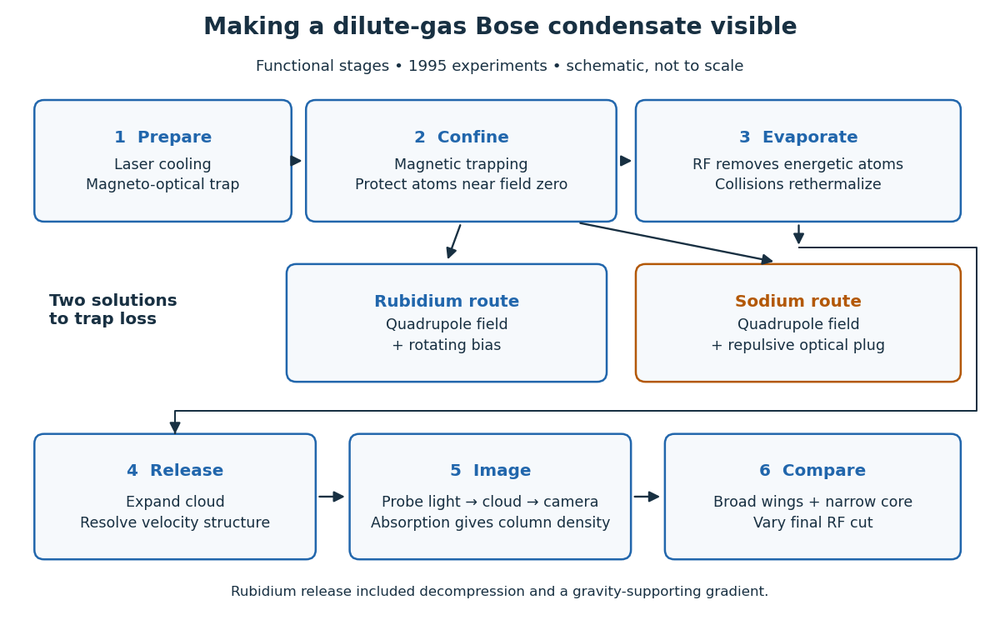

# Dilute-gas Bose-Einstein condensation

↑ **Parent:** [Bose-Einstein condensation](bose-einstein-condensation.md)

In a dilute gas, [Bose-Einstein condensation](bose-einstein-condensation.md) makes a single [one-particle state](one-particle-state.md) hold a substantial fraction of the [bosons](boson.md). This is a population effect: cooling reduces the number that the excited [energy eigenstates](energy-eigenstate.md) can accommodate at [thermal equilibrium](thermal-equilibrium-split.md). The surplus accumulates in a [Bose-Einstein condensate](bose-einstein-condensate.md). For an [ideal gas](ideal-gas-split.md) the occupied mode is the trap [ground state](ground-state.md); interactions can deform that mode, as described by the [Gross–Pitaevskii equation](gross-pitaevskii-equation.md). Dilute does not mean classical: a small [number density](number-density.md) can still give overlapping [thermal de Broglie wavelengths](thermal-de-broglie-wavelength.md) at sufficiently low [temperature](temperature-split.md).

The appeal is that changing the trap changes a calculable [Quantum Hamiltonian](hamiltonian-quantum-mechanics.md), while [absorption imaging](absorption-imaging.md) makes its population distribution visible. The [Bose condensation in a three-dimensional harmonic trap](bose-condensation-in-a-three-dimensional-harmonic-trap.md) below turns [density of states](density-of-states.md) into a prediction for a [critical temperature](critical-temperature.md) and [condensate fraction](condensate-fraction.md). These are separate questions from measuring [matter-wave coherence](matter-wave-coherence.md) or [superfluidity](superfluidity.md).

[Eric A. Cornell](eric-a-cornell.md) and [Carl E. Wieman](carl-wieman.md)'s joint lecture emphasizes the competition between useful [elastic collisions](elastic-collision.md), which restore [thermal equilibrium](thermal-equilibrium-split.md) during [evaporative cooling](evaporative-cooling-atomic-physics.md), and collisions that remove or heat the trapped sample. A long trap lifetime alone is insufficient: reequilibration must keep up with evaporation.[pp. 878–879 and 890, collisional requirements](nobel-lecture-bose-einstein-condensation-in-a-dilute-gas-the-first-70-years-and-some-recent-experiments-by-eric-a-cornell-and-carl-wieman.md)

**[Figure 5](#image-functional-stages-of-the-1995-dilute-gas-condensation-experiments). Functional stages of the 1995 dilute-gas condensation experiments**. Original schematic of preparation, trapping, [evaporative cooling](evaporative-cooling-atomic-physics.md), release and [absorption imaging](absorption-imaging.md). The two trapping routes differ; the boxes represent functions rather than physical component locations.

**Table of contents**

- [Phase-space density of an atomic gas](phase-space-density-of-an-atomic-gas.md)
  - [Harmonic-trap phase-space density](harmonic-trap-phase-space-density.md)
- [Bose condensation in a three-dimensional harmonic trap](bose-condensation-in-a-three-dimensional-harmonic-trap.md)
  - [Harmonic-trap critical-temperature prefactor](harmonic-trap-critical-temperature-prefactor.md)
  - [Saturation of harmonic-trap excited states](saturation-of-harmonic-trap-excited-states.md)
  - [Harmonic-trap chemical-potential pinning](harmonic-trap-chemical-potential-pinning.md)
  - [Harmonic-trap energy-zero convention](harmonic-trap-energy-zero-convention.md)
  - [Condensate fraction](condensate-fraction.md)
- [Synthetic bimodal profile of a Bose gas](synthetic-bimodal-profile-of-a-bose-gas.md)
- [Observation of Bose-Einstein condensation in rubidium in 1995](observation-of-bose-einstein-condensation-in-rubidium-in-1995.md)
- [Observation of Bose-Einstein condensation in sodium in 1995](observation-of-bose-einstein-condensation-in-sodium-in-1995.md)
- [Condensation, matter-wave coherence and superfluidity](condensation-matter-wave-coherence-and-superfluidity.md)

## ↑ Ancestors (8)

1. [Bose-Einstein condensation](bose-einstein-condensation.md)
2. [Bose-Einstein distribution](bose-einstein-distribution.md)
3. [Bose-Einstein statistics](bose-einstein-statistics.md)
4. [Quantum ideal-gas statistics](quantum-ideal-gas-statistics-split.md)
5. [Statistical physics](statistical-physics-split.md)
6. [Branches of physics](branches-of-physics.md)
7. [Physics](physics-split.md)
8. [Codex Wiki](split.md)
