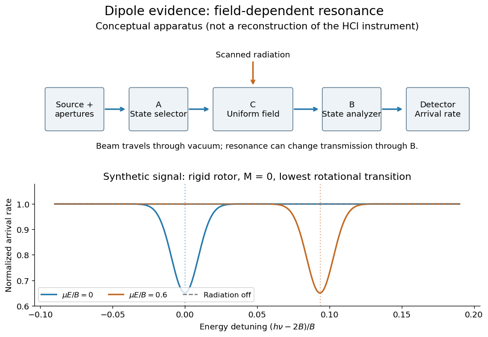

# Dipole evidence for bond polarization

↑ **Parent:** [Electronegativity](electronegativity-split.md)

A permanent [electric dipole moment](electric-dipole-moment.md) gives evidence of separated positive and negative [electric charge](electric-charge-split.md) in an overall neutral [molecule](molecule-split.md). This is a more direct probe of [chemical polarity](chemical-polarity.md) than an [electronegativity](electronegativity-split.md) table. For [hydrogen chloride](hydrogen-chloride.md), NIST lists about $1.109$ [debye](debye-unit.md) for the lowest vibrational state and $1.093$ [debye](debye-unit.md) for the equilibrium value. They describe different averaging conventions, not two contradictory measurements. The NIST WebBook traces the vibrational value $1.1085$ [debye](debye-unit.md) to molecular-beam electric-resonance measurements in 1970.[HCl (Hydrogen chloride): experimental data by National Institute of Standards and Technology](hcl-hydrogen-chloride-experimental-data-by-national-institute-of-standards-and-technology.md)[Hydrogen chloride: Constants of diatomic molecules by Klaus P. Huber and others](hydrogen-chloride-constants-of-diatomic-molecules-by-klaus-p-huber-and-others.md)

How does [molecular beam electric resonance](molecular-beam-electric-resonance.md) reveal an [electric dipole moment](electric-dipole-moment.md)? A source and apertures form a beam of [molecules](molecule-split.md) in [vacuum](vacuum.md). A first nonuniform [electric field](electric-field-split.md), A, selects [quantum states](quantum-state.md) through their different [Stark effects](stark-effect.md). In a central region, C, electrodes supply a nearly uniform [electric field](electric-field-split.md) and applied radiation drives transitions at selected [frequencies](frequency.md). A second nonuniform [electric field](electric-field-split.md), B, analyzes the outgoing [quantum states](quantum-state.md); a detector measures the rate of arriving [molecules](molecule-split.md). In a transmission-loss arrangement, resonant radiation transfers some [molecules](molecule-split.md) to a [quantum state](quantum-state.md) rejected by B, so the measured arrival rate dips. The observable is a change in detected [molecules](molecule-split.md) as the radiation [frequency](frequency.md) is scanned, rather than light absorption itself. This general apparatus description is documented in a later experimental thesis; it is not a reconstruction of the exact 1970 HCl instrument.[§2, printed pp. 11–14: fields A, C and B, detected flux, parallel plates, radiation and detector](high-resolution-molecular-beam-study-of-alkali-cyanides-by-johannes-jacobus-van-vaals.md)

**[Figure 5](#bond-dipole-beam-resonance). Molecular beam electric resonance: schematic state selection and a synthetic Stark effect signal from a rigid rotor model; neither apparatus dimensions nor signal curves are measured HCl data**.

The inference comes from how transition [frequencies](frequency.md) change with the known [electric field](electric-field-split.md). The interaction $-\boldsymbol\mu\cdot\mathbf E$ couples the [electric dipole moment](electric-dipole-moment.md) to the [electric field](electric-field-split.md); fitting the [quantum mechanics](quantum-mechanics-split.md) of the relevant rotational states extracts its magnitude. A free rotating [molecule](molecule-split.md) need not show a first-order shift proportional to $|\mathbf E|$: the weak-field [Stark effect](stark-effect.md) can be quadratic. The diagram uses a simplified [rigid rotor](rigid-rotor.md), with $B$ an [energy](energy-split.md) constant, to illustrate this behavior. It omits the fine details of actual spectra.

Useful controls include scans with the radiation off to measure the baseline arrival rate, repeated scans at several calibrated [electric fields](electric-field-split.md), and agreement between independently assigned transitions. These are methodological checks, not claims about undocumented steps of the 1970 experiment. Field calibration and state assignment limit the inferred [electric dipole moment](electric-dipole-moment.md). The published 1970 abstract confirms analysis of HCl and DCl beam-resonance spectra and combination with [infrared spectroscopy](infrared-spectroscopy.md) intensities to obtain a distance-dependent [electric dipole moment](electric-dipole-moment.md); its full apparatus and calibration record were unavailable here.[pp. 1686–1703, authored abstract; full text unavailable](dipole-moment-and-hyperfine-parameters-of-h35cl-and-d35cl-by-e-w-kaiser.md)

Even an accurately measured [electric dipole moment](electric-dipole-moment.md) is not an absolute [partial atomic charge](partial-atomic-charge.md). Replacing a [hydrogen chloride](hydrogen-chloride.md) [molecule](molecule-split.md) by two point [electric charges](electric-charge-split.md) $\pm q$ separated by [bond length](bond-length.md) $r$ gives $|\mu|=|q|r$. Using $1.109$ [debye](debye-unit.md) and $r=1.27455\times10^{-10}\,\mathrm m$ gives $|q|\approx0.181$ times the elementary [electric charge](electric-charge-split.md). This is an effective two-point model, combining a vibrationally averaged [electric dipole moment](electric-dipole-moment.md) with an equilibrium [bond length](bond-length.md), not a unique partition of the actual [electron density](electron-density.md) or a measured “18.1 percent ionic bond”.[Hydrogen chloride: Constants of diatomic molecules by Klaus P. Huber and others](hydrogen-chloride-constants-of-diatomic-molecules-by-klaus-p-huber-and-others.md)

For a [molecule](molecule-split.md) with several [chemical bonds](chemical-bond-split.md), [molecular geometry](molecular-geometry.md) can cancel opposing contributions to the total [electric dipole moment](electric-dipole-moment.md). [Carbon dioxide](carbon-dioxide.md) illustrates why an overall [nonpolar molecule](nonpolar-molecule.md) need not have unpolarized individual [chemical bonds](chemical-bond-split.md). An [electronegativity](electronegativity-split.md) comparison helps anticipate local [bond polarization](bond-polarization.md); the measured molecular [electric dipole moment](electric-dipole-moment.md) tests the entire [electric charge](electric-charge-split.md) distribution.

**Table of contents**

- [Debye (unit)](debye-unit.md)
- [Molecular beam electric resonance](molecular-beam-electric-resonance.md)

## ↑ Ancestors (4)

1. [Electronegativity](electronegativity-split.md)
2. [Chemical bond](chemical-bond-split.md)
3. [Chemistry](chemistry-split.md)
4. [Codex Wiki](split.md)

## ← Incoming links (2)

- [Chemical environment dependence of electronegativity](chemical-environment-dependence-of-electronegativity.md)
- [Molecular beam electric resonance](molecular-beam-electric-resonance.md)
