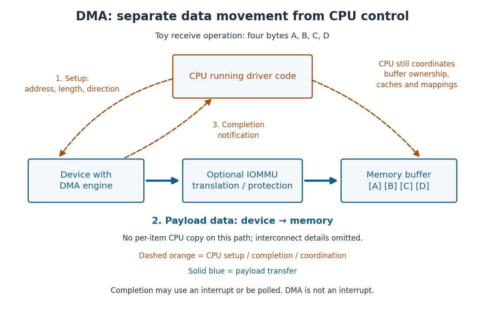

# Direct memory access

↑ **Parent:** [Computer bus](computer-bus.md)

[Direct memory access](direct-memory-access.md) transfers data between a device and [computer memory](computer-memory.md) without the [CPU](central-processing-unit.md) executing a copy instruction for each item. The [CPU](central-processing-unit.md) still sets up the operation and observes completion. [DMA](direct-memory-access.md) answers who moves the data; an [interrupt](interrupt.md) answers how a need for attention is announced. A [DMA](direct-memory-access.md) transfer can therefore finish with [interrupt-driven input-output](interrupt-driven-input-output.md) or with [polled input-output](polled-input-output.md). [Arpaci-Dusseau and Arpaci-Dusseau, OSTEP chapter 36, section 36.5: DMA](https://pages.cs.wisc.edu/~remzi/OSTEP/file-devices.pdf)

For a toy receive operation, the [CPU](central-processing-unit.md) arranges a four-[byte](byte.md) [DMA buffer](dma-buffer.md) and tells the device its [DMA address](dma-address.md), length and direction. The device writes the [bytes](byte.md) `A`, `B`, `C`, `D` into that [DMA buffer](dma-buffer.md). After completion and any required [DMA buffer synchronization](dma-buffer-synchronization.md), the [CPU](central-processing-unit.md) can read those four [bytes](byte.md). There are four payload [bytes](byte.md), but no four-item [CPU](central-processing-unit.md) copy loop on the device-to-[computer memory](computer-memory.md) path. This is a schematic example, not an instruction to operate real hardware.

**[Figure 19](#image-dma-separates-the-device-to-computer-memory-data-path-from-cpu-setup-and-completion-control). DMA separates the device-to-computer memory data path from CPU setup and completion control**.

The useful separation is that the [CPU](central-processing-unit.md) can perform other work while a larger transfer proceeds. The reasoning is a division of responsibilities: setup specifies the destination and extent once; the transfer engine advances through the payload; completion reports the result. The data still crosses an interconnect such as a [computer bus](computer-bus.md), which must share access among competing initiators. Setup, mapping, synchronization and completion cost work, so [DMA](direct-memory-access.md) does not promise a speedup for every transfer size. [James E. J. Bottomley, Linux DMA API, parts Ic–Id: mapping costs, addressing constraints and transfer directions](https://docs.kernel.org/core-api/dma-api.html)

Correctness also requires keeping the [DMA buffer](dma-buffer.md) alive and coordinating its ownership until the device is finished. A [DMA address](dma-address.md) need not equal a [CPU](central-processing-unit.md) [virtual address](virtual-address.md) or [physical address](physical-address.md). An [IOMMU](input-output-memory-management-unit.md), when present and configured, translates device addresses and can restrict access to authorized [computer memory](computer-memory.md); it is not the [CPU](central-processing-unit.md)'s [memory management unit](memory-management-unit.md). [Operating-system process](process-computing.md) isolation through [virtual memory](virtual-memory.md) alone does not establish those device-access restrictions. [Linux kernel documentation, Dynamic DMA mapping Guide: CPU and DMA addresses](https://docs.kernel.org/core-api/dma-api-howto.html)[Linux kernel documentation, VFIO: IOMMU protection and device isolation](https://docs.kernel.org/driver-api/vfio.html)

**Table of contents**

- [DMA buffer](dma-buffer.md)
- [DMA address](dma-address.md)
- [DMA buffer synchronization](dma-buffer-synchronization.md)

## ↑ Ancestors (3)

1. [Computer bus](computer-bus.md)
2. [Computer science](computer-science-split.md)
3. [Codex Wiki](split.md)

## ← Incoming links (2)

- [Direct memory access](direct-memory-access.md)
- [Solution](past-exam-of-the-mathematics-course-of-the-university-of-cambridge/2006/ia/paper-5/8/a/iii/solution.md)
