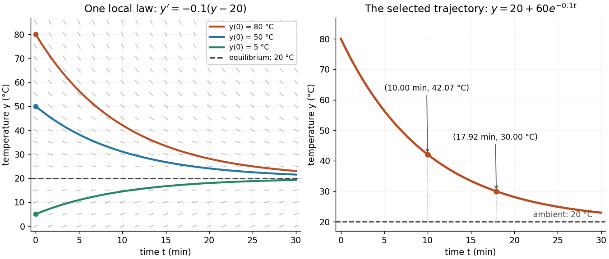

# Direction field

↑ **Parent:** [Differential equation](differential-equation-split.md)

A [direction field](direction-field.md) for $y'=f(t,y)$ places a short segment with slope $f(t,y)$ at each sampled point where $f$ is defined. A [function graph](graph-of-a-function.md) of a [solution of a differential equation](solution-of-a-differential-equation.md) follows these segments: its [tangent line](tangent-line.md) has exactly the prescribed slope. Segment length is a drawing choice, rather than a speed; arrows, if used, point toward increasing $t$. An [isocline](isocline.md) collects points with one common slope.

For [Newton's law of cooling](newton-s-law-of-cooling.md), $y'=-0.1(y-20)$ with time in minutes and [temperature](temperature-split.md) in degrees Celsius, the slopes at $y=80,40,20,10$ are respectively $-6,-2,0,1$ degrees Celsius per minute. Each horizontal row is an [isocline](isocline.md), because this [autonomous differential equation](autonomous-system-mathematics.md) has no explicit time dependence. Above $20$ the [solutions of a differential equation](solution-of-a-differential-equation.md) descend, below $20$ they rise, and $y=20$ is an [equilibrium point](equilibrium-point-of-a-dynamical-system.md).

**[Figure 1](#image-cooling-trajectories-follow-the-direction-field-toward-the-ambient-temperature). Cooling trajectories follow the direction field toward the ambient temperature**.

The highlighted [initial condition](initial-condition.md) $y(0)=80$ selects one curve from the family. The picture reveals approach to the [equilibrium point](equilibrium-point-of-a-dynamical-system.md) before any algebra is done. Under the hypotheses of the [Picard-Lindelöf theorem](picard-lindelof-theorem.md), distinct [function graphs](graph-of-a-function.md) of solutions cannot cross or even meet in the time-state plane. A [direction field](direction-field.md) alone does not guarantee uniqueness: several curves can share a [tangent line](tangent-line.md) at the same point when those hypotheses fail. See the delayed-start example under [initial value problem](initial-value-problem.md).

This geometric interpretation is developed in [Direction Fields, Isoclines, Integral Curves](18-03sc-differential-equations-fall-2011/direction-fields-isoclines-integral-curves.md).

## ↑ Ancestors (5)

1. [Differential equation](differential-equation-split.md)
2. [Analysis](analysis-split.md)
3. [Area of mathematics](area-of-mathematics.md)
4. [Mathematics](mathematics-split.md)
5. [Codex Wiki](split.md)

## ← Incoming links (10)

- [Direction field](direction-field.md)
- [Integrating factor](integrating-factor.md)
- [Isocline](isocline.md)
- [Newton's law of cooling](newton-s-law-of-cooling.md)
- [Solution](past-exam-of-the-mathematics-course-of-the-university-of-cambridge/2002/ia/paper-2/2d/solution.md)
- [Solution](past-exam-of-the-mathematics-course-of-the-university-of-cambridge/2002/ia/paper-2/5d/solution.md)
- [Solution](past-exam-of-the-mathematics-course-of-the-university-of-cambridge/2003/ia/paper-2/1d/ii/solution.md)
- [Solution](past-exam-of-the-mathematics-course-of-the-university-of-cambridge/2003/ia/paper-2/1d/solution.md)
- [Solution](past-exam-of-the-mathematics-course-of-the-university-of-cambridge/2003/ia/paper-2/5d/a/solution.md)
- [Reciprocal Bernoulli equation with finite-time blowup](reciprocal-bernoulli-equation-with-finite-time-blowup.md)
