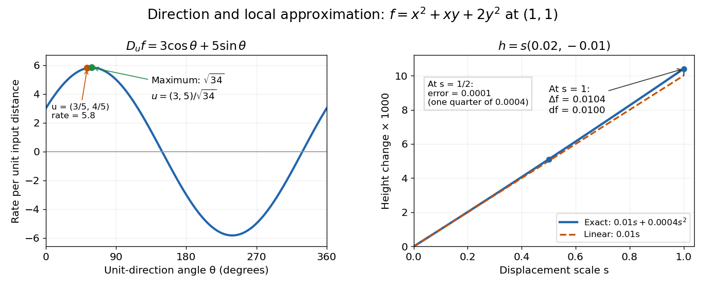

# Directional derivative

↑ **Parent:** [Partial derivative](partial-derivative.md)  
ⓦ [Wiki](https://en.wikipedia.org/wiki/Directional_derivative)

The [directional derivative](directional-derivative.md) tests a [function](function-split.md) along a chosen [straight line](straight-line.md), including lines that follow neither coordinate axis. For a fixed [vector](vector.md) $v$ and a point $a$ in an [open subset](open-set.md) of $\mathbb R^n$, define

$$
D_vf(a)=\lim_{t\to0}\frac{f(a+tv)-f(a)}{t}
=\left.\frac d{dt}f(a+tv)\right|_{t=0},
$$

if the [limit](limit-of-a-function.md) exists. With a [unit vector](unit-vector.md) $v$, the parameter $t$ measures signed distance in the input [Euclidean space](euclidean-norm.md), so the [directional derivative](directional-derivative.md) is change per unit distance. For a general $v$, it is change per unit parameter; the [norm](norm.md) of $v$ also sets the rate of travel.[Calculus Volume 3, §4.6, definition (4.36), unit-direction convention](calculus-volume-3-by-gilbert-strang-and-others/4-6-directional-derivatives-and-the-gradient.md)

For a [differentiable](differentiable-function.md) real-valued [function](function-split.md), the [multivariable chain rule](multivariable-chain-rule.md) gives

$$
D_vf(a)=\nabla f(a)\cdot v.
$$

Thus one [gradient](gradient.md) predicts the local response in every direction. This formula requires [differentiability](differentiability.md), rather than merely separate [partial derivatives](partial-derivative.md).[Calculus Volume 3, §4.6, Theorem 4.12 and the gradient formulation](calculus-volume-3-by-gilbert-strang-and-others/4-6-directional-derivatives-and-the-gradient.md)

Return to $f(x,y)=x^2+xy+2y^2$ at $a=(1,1)$. Its [gradient](gradient.md) is $(3,5)$. In the [unit direction](unit-vector.md) $u=(3/5,4/5)$,

$$
D_uf(a)=3\frac35+5\frac45=\boxed{\frac{29}{5}}.
$$

One can check this without invoking the [gradient](gradient.md) formula: substitution gives

$$
f\left(1+\frac35t,1+\frac45t\right)
=4+\frac{29}{5}t+\frac{53}{25}t^2.
$$

The [difference quotient](difference-quotient.md) is $29/5+(53/25)t$, whose [limit](limit-of-a-function.md) is $29/5$. This calculation separates the exact change along a finite path from its first-order rate at the starting point.

Changing the travel speed changes the parameter rate. Taking $v=(3,4)=5u$ gives $D_vf(a)=29$, because the input travels five distance units per parameter unit. For a [differentiable function](differentiable-function.md), $D_{cv}f(a)=cD_vf(a)$ for any real $c$: negative $c$ reverses the orientation as well as scaling the rate. Normalizing $v$ before comparing different slopes avoids confusing direction with speed.

**[Figure 2](#image-directional-derivatives-compare-directions-a-total-differential-predicts-small-finite-changes). Directional derivatives compare directions; a total differential predicts small finite changes**. Left: for $f=x^2+xy+2y^2$ at $(1,1)$, the rate in the [unit direction](unit-vector.md) $(\cos\theta,\sin\theta)$ is $3\cos\theta+5\sin\theta$. Right: along the displacement $s(0.02,-0.01)$, the exact height change is $0.01s+0.0004s^2$, compared with its [linear approximation](linear-approximation.md) $0.01s$. All curves are exact calculations for the example, rather than measured data.

The [Cauchy-Schwarz inequality](cauchy-schwarz-inequality.md) bounds the rate in any [unit direction](unit-vector.md) by $\|\nabla f(a)\|$. Here the largest rate is $\sqrt{34}\approx5.831$, attained in the direction $(3,5)/\sqrt{34}$; the chosen $(3/5,4/5)$ gives the slightly smaller rate $5.8$. The perpendicular [unit direction](unit-vector.md) $(-5,3)/\sqrt{34}$ gives zero. That means no first-order height change, rather than no change at all: along this direction the example has $f(a+tu)=4+(28/34)t^2$.

This is useful for following a height or [temperature](temperature-split.md) [scalar field](scalar-field.md), choosing a local search direction in [mathematical optimization](mathematical-optimization-split.md), and distinguishing a coordinate sensitivity from a response along an actual path. For a curved path, [derivative along a curve](derivative-along-a-curve.md) uses its instantaneous [tangent vector](tangent-vector-split.md). Even existence of all [directional derivatives](directional-derivative.md) does not guarantee one common [linear approximation](linear-approximation.md); [directional derivatives do not imply differentiability](directional-derivatives-do-not-imply-differentiability.md) gives a concrete counterexample.

**Table of contents**

- [Directional derivatives do not imply differentiability](directional-derivatives-do-not-imply-differentiability.md)
- [Directional derivative of a convex function is sublinear](directional-derivative-of-a-convex-function-is-sublinear.md)

## ↑ Ancestors (8)

1. [Partial derivative](partial-derivative.md)
2. [Multivariable calculus](multivariable-calculus-split.md)
3. [Calculus](calculus-split.md)
4. [Real analysis](real-analysis-split.md)
5. [Analysis](analysis-split.md)
6. [Area of mathematics](area-of-mathematics.md)
7. [Mathematics](mathematics-split.md)
8. [Codex Wiki](split.md)

## ← Incoming links (46)

- [Bernoulli's principle](bernoulli-s-principle.md)
- [Complex differentiability](complex-differentiability.md)
- [Continuous supporting functional for a locally bounded convex function](continuous-supporting-functional-for-a-locally-bounded-convex-function.md)
- [Critical point](critical-point.md)
- [Derivative along a curve](derivative-along-a-curve.md)
- [Directional derivative](directional-derivative.md)
- [Directional derivatives do not imply differentiability](directional-derivatives-do-not-imply-differentiability.md)
- [Gradient](gradient.md)
- [Gradient descent](gradient-descent-split.md)
- [Lagrange multiplier](lagrange-multiplier.md)
- [Normal derivative](normal-derivative.md)
- [Solution](past-exam-of-the-mathematics-course-of-the-university-of-cambridge/2003/ia/paper-3/11a/a/solution.md)
- [Solution](past-exam-of-the-mathematics-course-of-the-university-of-cambridge/2003/iii/paper-37/4/solution.md)
- [Solution](past-exam-of-the-mathematics-course-of-the-university-of-cambridge/2005/iii/paper-60/1/solution.md)
- [Solution](past-exam-of-the-mathematics-course-of-the-university-of-cambridge/2006/iii/paper-34/3/solution.md)
- [Solution](past-exam-of-the-mathematics-course-of-the-university-of-cambridge/2006/iii/paper-34/4/solution.md)
- [Solution](past-exam-of-the-mathematics-course-of-the-university-of-cambridge/2008/ib/paper-3/3f/solution.md)
- [Solution](past-exam-of-the-mathematics-course-of-the-university-of-cambridge/2009/ib/paper-3/13e/solution.md)
- [Solution](past-exam-of-the-mathematics-course-of-the-university-of-cambridge/2009/iii/paper-10/1/b/solution.md)
- [Solution](past-exam-of-the-mathematics-course-of-the-university-of-cambridge/2009/iii/paper-10/1/c/solution.md)
- [Solution](past-exam-of-the-mathematics-course-of-the-university-of-cambridge/2011/ia/paper-2/6a/b/ii/solution.md)
- [Solution](past-exam-of-the-mathematics-course-of-the-university-of-cambridge/2012/iii/paper-39/3/solution.md)
- [Solution](past-exam-of-the-mathematics-course-of-the-university-of-cambridge/2016/iii/paper-309/3/b/i/solution.md)
- [Solution](past-exam-of-the-mathematics-course-of-the-university-of-cambridge/2017/ia/paper-3/11b/c/solution.md)
- [Solution](past-exam-of-the-mathematics-course-of-the-university-of-cambridge/2025/iii/paper-323/3/ii/c/solution.md)
- [Solution](past-exam-of-the-mathematics-course-of-the-year-1-of-the-natural-sciences-course-of-the-university-of-cambridge/2011/paper-2/13/b/solution.md)
- [Solution](past-exam-of-the-mathematics-course-of-the-year-1-of-the-natural-sciences-course-of-the-university-of-cambridge/2012/paper-1/16/a/solution.md)
- [Solution](past-exam-of-the-mathematics-course-of-the-year-1-of-the-natural-sciences-course-of-the-university-of-cambridge/2013/paper-2/16/a/ii/solution.md)
- [Solution](past-exam-of-the-mathematics-course-of-the-year-1-of-the-natural-sciences-course-of-the-university-of-cambridge/2013/paper-2/4/solution.md)
- [Solution](past-exam-of-the-mathematics-course-of-the-year-1-of-the-natural-sciences-course-of-the-university-of-cambridge/2014/paper-2/17/c/i/solution.md)
- [Solution](past-exam-of-the-mathematics-course-of-the-year-1-of-the-natural-sciences-course-of-the-university-of-cambridge/2014/paper-2/17/c/ii/solution.md)
- [Solution](past-exam-of-the-mathematics-course-of-the-year-1-of-the-natural-sciences-course-of-the-university-of-cambridge/2018/paper-2/12/e/iii/solution.md)
- [Solution](past-exam-of-the-mathematics-course-of-the-year-1-of-the-natural-sciences-course-of-the-university-of-cambridge/2021/paper-1/14/b/solution.md)
- [Solution](past-exam-of-the-mathematics-course-of-the-year-1-of-the-natural-sciences-course-of-the-university-of-cambridge/2021/paper-2/12/a/solution.md)
- [Solution](past-exam-of-the-mathematics-course-of-the-year-1-of-the-natural-sciences-course-of-the-university-of-cambridge/2022/paper-2/12/b/solution.md)
- [Solution](past-exam-of-the-mathematics-course-of-the-year-1-of-the-natural-sciences-course-of-the-university-of-cambridge/2022/paper-2/19/a/solution.md)
- [Solution](past-exam-of-the-mathematics-course-of-the-year-1-of-the-natural-sciences-course-of-the-university-of-cambridge/2023/paper-2/7/b/solution.md)
- [Solution](past-exam-of-the-mathematics-course-of-the-year-1-of-the-natural-sciences-course-of-the-university-of-cambridge/2025/paper-2/16/b/solution.md)
- [Solution](past-exam-of-the-mathematics-course-of-the-year-2-of-the-natural-sciences-course-of-the-university-of-cambridge/2001/paper-1/1/solution.md)
- [Solution](past-exam-of-the-mathematics-course-of-the-year-2-of-the-natural-sciences-course-of-the-university-of-cambridge/2009/paper-1/1/a/solution.md)
- [Solution](past-exam-of-the-mathematics-course-of-the-year-2-of-the-natural-sciences-course-of-the-university-of-cambridge/2011/paper-1/1/solution.md)
- [Solution](past-exam-of-the-mathematics-course-of-the-year-2-of-the-natural-sciences-course-of-the-university-of-cambridge/2012/paper-1/1/solution.md)
- [Solution](past-exam-of-the-mathematics-course-of-the-year-2-of-the-natural-sciences-course-of-the-university-of-cambridge/2013/paper-2/6/vii/solution.md)
- [Solution](past-exam-of-the-mathematics-course-of-the-year-2-of-the-natural-sciences-course-of-the-university-of-cambridge/2025/paper-1/1/a/solution.md)
- [Quadratic density derivative functional](quadratic-density-derivative-functional.md)
- [Total differential](total-differential.md)
