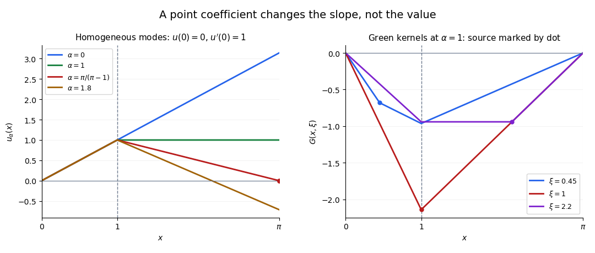

# Dirichlet Green function for a point interaction

↑ **Parent:** [Dirichlet Green function](dirichlet-green-function.md)

For the [point interaction in a second-order differential equation](point-interaction-in-a-second-order-differential-equation.md) $L_\alpha=\partial_x^2+\alpha\delta_c$ on $(0,\ell)$, use homogeneous [Dirichlet boundary conditions](dirichlet-boundary-condition.md). The unperturbed [Green function](green-s-function-split.md) is

$$
G_0(x,\xi)=-\frac{\min(x,\xi)\bigl(\ell-\max(x,\xi)\bigr)}\ell,
$$

with a positive unit derivative jump at $x=\xi$. Whenever $1+\alpha G_0(c,c)\ne0$,

$$
G_\alpha(x,\xi)=G_0(x,\xi)-\frac{\alpha G_0(x,c)G_0(c,\xi)}{1+\alpha G_0(c,c)}.
$$

To derive this [rank-one operator](rank-one-operator.md) correction, move the delta coefficient to the right-hand side and apply the unperturbed inverse: $G_\alpha(x,\xi)=G_0(x,\xi)-\alpha G_0(x,c)G_\alpha(c,\xi)$. Setting $x=c$ determines $G_\alpha(c,\xi)$ and gives the formula. Its denominator vanishes exactly at [Dirichlet resonance for a point interaction](dirichlet-resonance-for-a-point-interaction.md).

The kernel is symmetric. It is continuous at $x=c$ and $x=\xi$, satisfies $[\partial_xG_\alpha]_\xi=1$ when $\xi\ne c$, and satisfies $[\partial_xG_\alpha]_c=-\alpha G_\alpha(c,\xi)$ away from the source. When $\xi=c$, the single combined condition is $[\partial_xG_\alpha]_c=1-\alpha G_\alpha(c,c)$. These are the [transmission conditions for a delta coefficient](transmission-conditions-for-a-delta-coefficient.md), including a source at the interaction.

**[Figure 1](#image-resonance-and-source-jumps-for-a-one-dimensional-point-interaction). Resonance and source jumps for a one-dimensional point interaction**. An original example with an interaction at $c=1$ and endpoint $\ell=\pi$. The left panel compares homogeneous solutions with the same initial data; the right panel shows Green kernels at coefficient one. A source placed at the interaction combines both derivative-jump contributions.

## ↑ Ancestors (6)

1. [Dirichlet Green function](dirichlet-green-function.md)
2. [Green's function](green-s-function-split.md)
3. [Analysis](analysis-split.md)
4. [Area of mathematics](area-of-mathematics.md)
5. [Mathematics](mathematics-split.md)
6. [Codex Wiki](split.md)

## ← Incoming links (1)

- [Solution](past-exam-of-the-differential-equations-2-course-of-the-university-of-oxford/2017/1/b/ii/solution.md)
