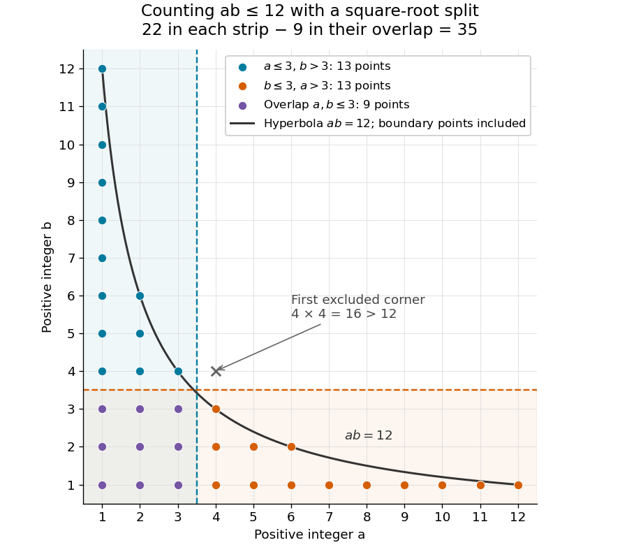

# Dirichlet hyperbola method

↑ **Parent:** [Dirichlet convolution](dirichlet-convolution.md)  
ⓦ [Wiki](https://en.wikipedia.org/wiki/Dirichlet_hyperbola_method)

The [Dirichlet hyperbola method](dirichlet-hyperbola-method.md) turns a long [summation](summation.md) over a [Dirichlet convolution](dirichlet-convolution.md) into two short ones by covering the [lattice points](lattice-point.md) below a [hyperbola](hyperbola.md) with two overlapping strips. Its simplest application is an exact count: for a [positive integer](positive-integer.md) $N$, every positive [integer divisor](divisor.md) $a$ of $n\le N$ corresponds to the [ordered pair](ordered-pair.md) $(a,n/a)$. Thus the [divisor summatory function](divisor-summatory-function.md) counts precisely the [ordered pairs](ordered-pair.md) of [positive integers](positive-integer.md) with $ab\le N$:

$$
D(N)=\sum_{n=1}^N\tau(n)
=\#\{(a,b)\in\mathbb Z_{>0}^2:ab\le N\}
=\sum_{a=1}^N\left\lfloor\frac Na\right\rfloor.
$$

Here $\tau$ is the [divisor function](divisor-function.md), and the [floor function](floor-function.md) gives the number of allowed values of $b$ for each $a$. The axes are excluded, while points on $ab=N$ are included.

Set $r=\lfloor\sqrt N\rfloor$, using the [floor function](floor-function.md) and the positive [square root](square-root.md). **Every counted pair has $a\le r$ or $b\le r$.** Otherwise $ab\ge(r+1)^2>N$. The first strip contains $\sum_{a=1}^r\lfloor N/a\rfloor$ points; swapping the two coordinates gives the same count for the second. Their overlap contains all $r^2$ pairs with $1\le a,b\le r$, since $r^2\le N$. The [inclusion-exclusion principle](inclusion-exclusion-principle.md) therefore gives the exact identity

$$
\boxed{D(N)=2\sum_{a=1}^r\left\lfloor\frac Na\right\rfloor-r^2,
\qquad r=\lfloor\sqrt N\rfloor.}
$$

The subtraction is for the whole overlap square, rather than only the diagonal. The same [Dirichlet hyperbola method](dirichlet-hyperbola-method.md) identity holds for real $x\ge1$, with $D(x)=\sum_{n\le x}\tau(n)$ and $r=\lfloor\sqrt x\rfloor$. [Andrew Granville and K. Soundararajan, Multiplicative number theory: The pretentious approach, §1.1.4, pp. 7–8: divisor pairing and the hyperbola split](multiplicative-number-theory-the-pretentious-approach-by-andrew-granville-and-k-soundararajan.md)

**[Figure 16](#image-the-dirichlet-hyperbola-method-counts-35-positive-lattice-points-with-ab-le12-two-strips-of-22-points-overlap-in-a-square-of-nine-points). The Dirichlet hyperbola method counts 35 positive lattice points with $ab\le12$: two strips of 22 points overlap in a square of nine points**.

**Table of contents**

- [Divisor summatory function](divisor-summatory-function.md)
- [Asymmetric Dirichlet hyperbola split](asymmetric-dirichlet-hyperbola-split.md)
- [Arithmetic work of the Dirichlet hyperbola method](arithmetic-work-of-the-dirichlet-hyperbola-method.md)
- [Divisor summatory asymptotic](divisor-summatory-asymptotic.md)
- [Harmonic divisor sum](harmonic-divisor-sum.md)

## ↑ Ancestors (6)

1. [Dirichlet convolution](dirichlet-convolution.md)
2. [Arithmetic function](arithmetic-function.md)
3. [Number theory](number-theory-split.md)
4. [Area of mathematics](area-of-mathematics.md)
5. [Mathematics](mathematics-split.md)
6. [Codex Wiki](split.md)

## ← Incoming links (9)

- [Arithmetic work of the Dirichlet hyperbola method](arithmetic-work-of-the-dirichlet-hyperbola-method.md)
- [Asymmetric Dirichlet hyperbola split](asymmetric-dirichlet-hyperbola-split.md)
- [Dirichlet hyperbola method](dirichlet-hyperbola-method.md)
- [Divisor summatory asymptotic](divisor-summatory-asymptotic.md)
- [Divisor summatory function](divisor-summatory-function.md)
- [Harmonic divisor sum](harmonic-divisor-sum.md)
- [Solution](past-exam-of-the-mathematics-course-of-the-university-of-cambridge/2010/iii/paper-25/1/solution.md)
- [Solution](past-exam-of-the-mathematics-course-of-the-university-of-cambridge/2015/iii/paper-27/5/b/solution.md)
- [Solution](past-exam-of-the-mathematics-course-of-the-university-of-cambridge/2026/iii/paper-150/1/b/solution.md)
