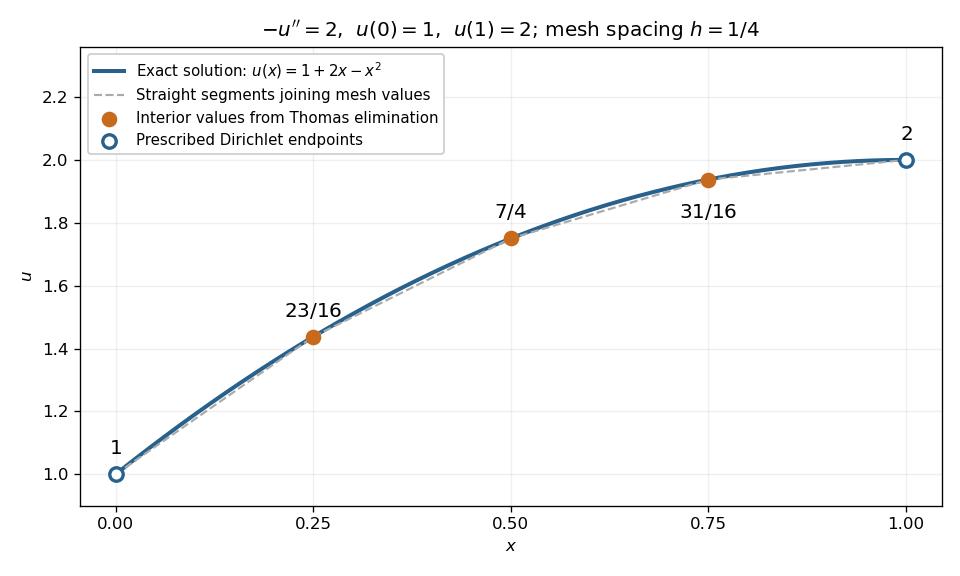

# Dirichlet Poisson solution by tridiagonal elimination

↑ **Parent:** [Tridiagonal matrix algorithm](tridiagonal-matrix-algorithm.md)

Consider the original small [Poisson equation](poisson-s-equation.md) example

$$
-u''(x)=2\quad(0<x<1),\qquad u(0)=1,\qquad u(1)=2.
$$

Its exact solution is the [quadratic polynomial](quadratic-polynomial.md) $u(x)=1+2x-x^2$. Use a uniform [mesh](finite-element-mesh.md) $x_i=ih$ with $h=1/4$ and three interior unknowns $U_1,U_2,U_3$. The [finite difference method](finite-difference-method.md) replaces the negative [second derivative](second-derivative.md) by

$$
\frac{-U_{i-1}+2U_i-U_{i+1}}{h^2}=2.
$$

Multiplying by $h^2$ and moving the prescribed [Dirichlet boundary conditions](dirichlet-boundary-condition.md) to the right gives

$$
\begin{pmatrix}2&-1&0\\-1&2&-1\\0&-1&2\end{pmatrix}
\begin{pmatrix}U_1\\U_2\\U_3\end{pmatrix}
=\begin{pmatrix}1+2h^2\\2h^2\\2+2h^2\end{pmatrix}
=\begin{pmatrix}9/8\\1/8\\17/8\end{pmatrix}.
$$

The endpoint values contribute $1$ and $2$ to the first and last equations; they are not additional unknowns. The [Thomas algorithm](tridiagonal-matrix-algorithm.md) gives

$$
\begin{array}{c|c|c|c}
i&m_i&p_i&g_i\\\hline
1&\text{unused}&2&9/8\\
2&-1/2&3/2&11/16\\
3&-2/3&4/3&31/12
\end{array}
$$

and [back substitution](back-substitution.md) yields

$$
U_3=\frac{31}{16},\qquad U_2=\frac74,\qquad U_1=\frac{23}{16}.
$$

All three values equal $u(x_i)$ exactly: the centered [finite difference](finite-difference-split.md) for the [second derivative](second-derivative.md) is exact on a [quadratic polynomial](quadratic-polynomial.md). This special nodal exactness does not assert exactness for arbitrary forcing or for the piecewise-linear curve joining the nodes.

**[Figure 16](#image-exact-quadratic-dirichlet-poisson-solution-and-the-three-interior-values-recovered-by-tridiagonal-elimination). Exact quadratic Dirichlet Poisson solution and the three interior values recovered by tridiagonal elimination**.

For any $n$ interior points with $h=1/(n+1)$, the scaled [tridiagonal matrix](tridiagonal-matrix.md) has $b_i=2$ and $a_i=c_i=-1$. Its [pivot elements](pivot-element.md) are $p_i=(i+1)/i$: start at $p_1=2$ and use $p_i=2-1/p_{i-1}$. All are positive. Interior rows have equality in [diagonal dominance](diagonal-dominance.md), so [strict diagonal dominance](strictly-diagonally-dominant-matrix.md) is not the reason this example works. Instead it is a [symmetric positive-definite matrix](symmetric-positive-definite-matrix.md), since for a real [vector](vector.md) $v\ne0$ with $v_0=v_{n+1}=0$,

$$
v^TAv=\sum_{i=0}^{n}(v_{i+1}-v_i)^2>0.
$$

Zero would force every neighbouring value equal and hence all values zero. This connects the boundary constraints directly to the [safe pivots for tridiagonal elimination](safe-pivots-for-tridiagonal-elimination.md).

## ↑ Ancestors (6)

1. [Tridiagonal matrix algorithm](tridiagonal-matrix-algorithm.md)
2. [Numerical analysis](numerical-analysis-split.md)
3. [Analysis](analysis-split.md)
4. [Area of mathematics](area-of-mathematics.md)
5. [Mathematics](mathematics-split.md)
6. [Codex Wiki](split.md)

## ← Incoming links (1)

- [Tridiagonal matrix algorithm](tridiagonal-matrix-algorithm.md)
