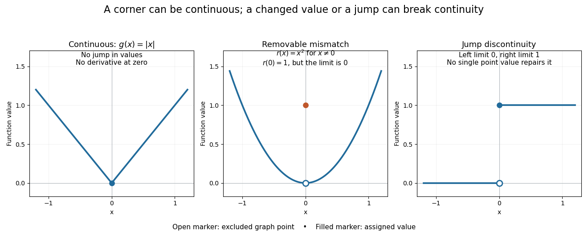

# Discontinuity of a function

↑ **Parent:** [Continuous function](continuous-function.md)

A [function](function-split.md) is [discontinuous](discontinuity-of-a-function.md) at a point in its [domain of a function](domain-of-a-function.md) when it fails the [epsilon-delta definition of continuity](epsilon-delta-definition-of-continuity.md) there. Two basic failures are an incorrect assigned value and unequal [one-sided limits](one-sided-limit.md). They demand different repairs.

For a [removable discontinuity](removable-discontinuity.md), consider

$$
r(x)=\begin{cases}x^2,&x\neq0,\\1,&x=0.\end{cases}
$$

The [limit](limit-of-a-function.md) at zero is $0$, but $r(0)=1$. Replacing that one value by $0$ gives the [continuous](continuous-function.md) square [function](function-split.md). The [sequence](sequence.md) $x_n=1/n$ makes the mismatch visible: $r(x_n)=1/n^2\to0\neq r(0)$. A [removable discontinuity](removable-discontinuity.md) can also describe an expression with a missing value, in which case the question is whether a [continuous](continuous-function.md) extension to the missing input exists.

For a [jump discontinuity](jump-discontinuity.md), take $j(x)=0$ for $x<0$ and $j(x)=1$ for $x\geq0$. The left and right [one-sided limits](one-sided-limit.md) at zero are $0$ and $1$. No assignment to $j(0)$ can equal both, so changing only the point value cannot make the [function](function-split.md) [continuous](continuous-function.md) there. Contrast both examples with the corner of $|x|$: that [function](function-split.md) is [continuous](continuous-function.md) at zero even though its [derivative](derivative.md) is absent.

**[Figure 18](#image-a-continuous-corner-a-removable-point-value-mismatch-and-a-jump-discontinuity). A continuous corner, a removable point-value mismatch, and a jump discontinuity**. The three original [function graphs](graph-of-a-function.md) separate [continuity](continuous-function.md) from [differentiability](differentiability.md). Open markers show excluded graph points; filled markers show assigned values. The jump has no vertical connector, because intermediate heights are not values of that [function](function-split.md).

**Table of contents**

- [Removable discontinuity](removable-discontinuity.md)
- [Jump discontinuity](jump-discontinuity.md)

## ↑ Ancestors (8)

1. [Continuous function](continuous-function.md)
2. [Limit of a function](limit-of-a-function.md)
3. [Calculus](calculus-split.md)
4. [Real analysis](real-analysis-split.md)
5. [Analysis](analysis-split.md)
6. [Area of mathematics](area-of-mathematics.md)
7. [Mathematics](mathematics-split.md)
8. [Codex Wiki](split.md)

## ← Incoming links (4)

- [Ceiling function](ceiling-function.md)
- [Floor function](floor-function.md)
- [Richardson extrapolation](richardson-extrapolation.md)
- [Truncation toward zero](truncation-toward-zero.md)
