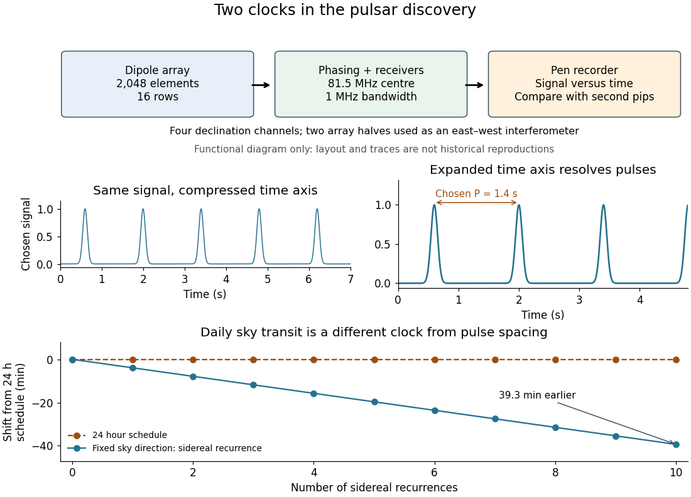

# Discovery of the first pulsar

↑ **Parent:** [Pulsar](pulsar.md)

[Jocelyn Bell Burnell](jocelyn-bell-burnell.md) helped build [Antony Hewish](antony-hewish.md)'s [radio telescope](radio-telescope.md) for finding compact sources through [interplanetary scintillation](interplanetary-scintillation.md) in the [solar wind](solar-wind.md). Operating it and inspecting its [chart recorder](chart-recorder.md) output in 1967, she recognized an unusual recurring trace, checked earlier charts, and obtained fast recordings resolving pulses in late November. Her observation, recognition and persistent analysis were indispensable.[Little Green Men, White Dwarfs or Pulsars?, construction through November recordings](little-green-men-white-dwarfs-or-pulsars-by-jocelyn-bell-burnell.md)

The 1968 paper by [Antony Hewish](antony-hewish.md), [Jocelyn Bell Burnell](jocelyn-bell-burnell.md) (bylined S. J. Bell), [J. D. H. Pilkington](j-d-h-pilkington.md), [P. F. Scott](p-f-scott.md) and [R. A. Collins](r-a-collins.md) reported $1.337\,\mathrm{s}$ spacing and proposed compact-star oscillations. Its [radio telescope](radio-telescope.md) had 2,048 full-wave [dipole antennas](dipole-antenna.md) in sixteen rows. Four receivers selected declinations; two array halves formed an east-west [interferometer](interferometer.md). The $81.5\,\mathrm{MHz}$ receivers passed $1\,\mathrm{MHz}$. Observations used $0.05\,\mathrm{s}$ receiver time constant and Rapidigraph [chart recorder](chart-recorder.md) with $0.03\,\mathrm{s}$ time constant; radio second pips calibrated timing.[Observation of a Rapidly Pulsating Radio Source, Nature 217, p. 709, opening and Position and Flux Density](observation-of-a-rapidly-pulsating-radio-source-by-antony-hewish-and-others.md)

[Antony Hewish](antony-hewish.md) checked [sidereal time](sidereal-time.md) recurrence. [Jocelyn Bell Burnell](jocelyn-bell-burnell.md) recalls that [P. F. Scott](p-f-scott.md) and [R. A. Collins](r-a-collins.md) reproduced the pulses with another telescope and receivers, while [J. D. H. Pilkington](j-d-h-pilkington.md) measured [pulsar dispersion delay](pulsar-dispersion-delay.md): independent checks of instrument independence and intervening [plasma](plasma-physics.md).[Little Green Men, White Dwarfs or Pulsars?, follow-up controls](little-green-men-white-dwarfs-or-pulsars-by-jocelyn-bell-burnell.md)

A useful numerical comparison uses the approximate [sidereal time](sidereal-time.md) day of $1436.07\,\mathrm{min}$. Relative to a $1440\,\mathrm{min}$ schedule, the same sky direction transits about $3.93\,\mathrm{min}$ earlier each day, or $39.3\,\mathrm{min}$ after ten days. This compares successive passages through the receiving beam; it is a different clock from the roughly $1.3\,\mathrm{s}$ pulse spacing within one passage. Sky recurrence alone cannot rule out every transmitter or reflection, and [pulsar dispersion delay](pulsar-dispersion-delay.md) alone does not uniquely establish an emission mechanism. Their strength lies in independent constraints agreeing.

**[Figure 8](#pulsar-discovery-array-timing). From a scintillation survey to two distinct timing tests**. Original functional schematic, not an engineering drawing or a reconstruction of a discovery chart. The illustrative fast signal has a chosen 1.4 second period. The lower panel compares sidereal recurrence with a 24 hour schedule using an approximate sidereal day.

The discovery lesson is that an unexpected signal must survive changes of readout, instrument and observing date. Increasing [chart recorder](chart-recorder.md) speed exposed structure hidden in a compressed trace; it did not make the source begin pulsing. The [pulsar](pulsar.md) interpretation now separates the rotating clock, beam geometry, [pulsar magnetosphere](pulsar-magnetosphere.md) emission and [pulsar dispersion delay](pulsar-dispersion-delay.md). The initial observation established periodic arrival, not a direct measurement of the [neutron star](neutron-star.md)'s surface motion or radius.

## ↑ Ancestors (8)

1. [Pulsar](pulsar.md)
2. [Neutron star](neutron-star.md)
3. [Stellar evolution](stellar-evolution.md)
4. [Stellar astrophysics](stellar-astrophysics-split.md)
5. [Astrophysics](astrophysics-split.md)
6. [Branches of physics](branches-of-physics.md)
7. [Physics](physics-split.md)
8. [Codex Wiki](split.md)

## ← Incoming links (1)

- [Pulsar](pulsar.md)
