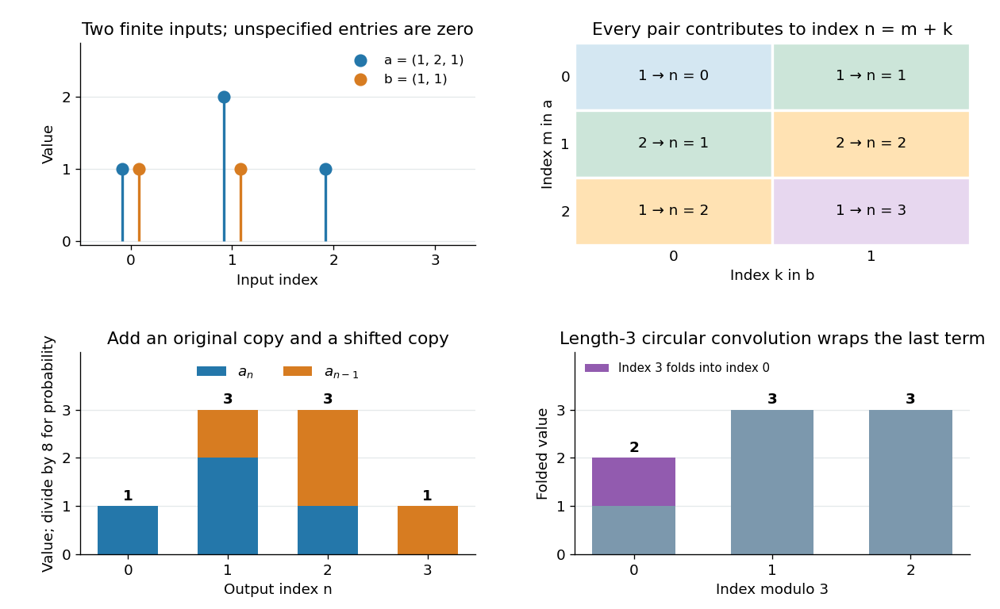

# Discrete convolution

↑ **Parent:** [Convolution](convolution.md)

For [sequences](sequence.md) $a,b$ indexed by the [integers](integer-split.md), discrete convolution adds products whose indices sum to the output index:

$$
(a*b)_n=\sum_{m\in\mathbb Z}a_m b_{n-m}.
$$

For finite sequences, treat every unspecified entry as zero; the sum then has finitely many nonzero terms. For infinite sequences, a convergence hypothesis is needed, for example [absolute summability](absolute-convergence.md) of both sequences.

Take $a=(1,2,1)$ at indices $0,1,2$ and $b=(1,1)$ at indices $0,1$. Their [convolution](convolution.md) is **$(1,3,3,1)$** at indices $0,1,2,3$:

$$
c_0=1\cdot1=1,\quad c_1=1\cdot1+2\cdot1=3,\quad c_2=2\cdot1+1\cdot1=3,\quad c_3=1\cdot1=1.
$$

Equivalently, $c_n=a_n+a_{n-1}$: add an unshifted and a one-step shifted copy of $a$. This explains the output by superposition, with every index included.

**[Figure 10](#image-discrete-convolution-combines-index-pairs-shifted-copies-polynomial-coefficients-and-outcome-counts). Discrete convolution combines index pairs, shifted copies, polynomial coefficients and outcome counts**.

The same products appear in [polynomial](polynomial-split.md) multiplication and [generating functions](generating-function.md):

$$
(1+2z+z^2)(1+z)=1+3z+3z^2+z^3.
$$

A term $a_mz^m$ times $b_kz^k$ contributes to coefficient $m+k$, precisely the index condition in [discrete convolution](discrete-convolution.md). In probability, $a$ counts the outcomes of two independent fair coin tosses by their number of heads, while $b$ counts the outcomes of one more toss. Dividing the output by eight gives the [probability mass function](probability-mass-function.md) $(1,3,3,1)/8$ of the [binomial distribution](binomial-distribution.md) with $n=3$ and $p=1/2$. No new arithmetic is needed to pass from coefficient multiplication to counting independent sums.

The full finite [convolution](convolution.md) is different from [circular convolution](circular-convolution.md), where indices wrap modulo a chosen length. Wrapping this four-term output to length three adds its last entry to its first and gives $(2,3,3)$. When using a [discrete Fourier transform](discrete-fourier-transform-split.md) to compute the full [convolution](convolution.md), [zero padding](zero-padding.md) to length at least the sum of the input lengths minus one prevents this wraparound. [Oppenheim, MIT Digital Signal Processing, Lecture 10, circular convolution and zero padding](https://ocw.mit.edu/courses/res-6-008-digital-signal-processing-spring-2011/610905d8154ec2bfc090cf78022249a5_MITRES_6_008S11_lec10.pdf)

**Table of contents**

- [XOR convolution](xor-convolution.md)
- [Cyclic convolution](cyclic-convolution.md)
- [Circular convolution](circular-convolution.md)
- [Zero padding](zero-padding.md)

## ↑ Ancestors (6)

1. [Convolution](convolution.md)
2. [Fourier analysis](fourier-analysis-split.md)
3. [Analysis](analysis-split.md)
4. [Area of mathematics](area-of-mathematics.md)
5. [Mathematics](mathematics-split.md)
6. [Codex Wiki](split.md)

## ← Incoming links (13)

- [Analytic Wiener algebra](analytic-wiener-algebra.md)
- [Circular convolution](circular-convolution.md)
- [Convolution](convolution.md)
- [Convolution theorem](convolution-theorem.md)
- [Discrete convolution](discrete-convolution.md)
- [Finite impulse response](finite-impulse-response.md)
- [Frequency response](frequency-response.md)
- [Linear time-invariant system](linear-time-invariant-system.md)
- [Solution](past-exam-of-the-mathematics-course-of-the-university-of-cambridge/2002/iii/paper-6/4/i/solution.md)
- [Solution](past-exam-of-the-mathematics-course-of-the-university-of-cambridge/2020/ii/paper-4/40e/a/solution.md)
- [Solution](past-exam-of-the-mathematics-course-of-the-university-of-cambridge/2023/ii/paper-2/41c/b/solution.md)
- [Wiener algebra](wiener-algebra.md)
- [Zero padding](zero-padding.md)
