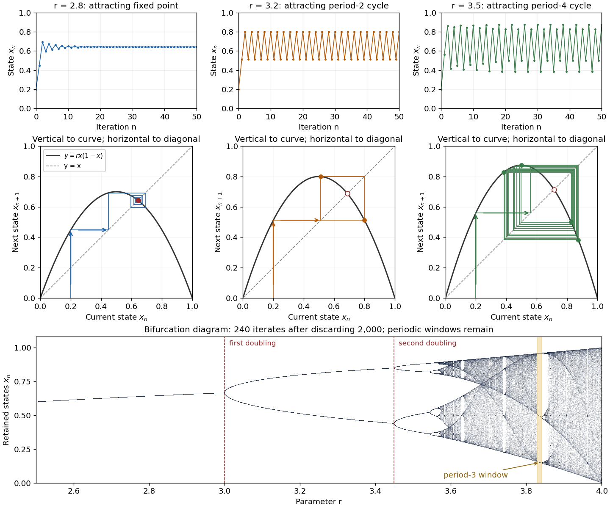

# Discrete dynamical system

↑ **Parent:** [Dynamical systems](dynamical-systems.md)  
ⓦ [Wiki](https://en.wikipedia.org/wiki/Discrete_dynamical_system)

A one-dimensional discrete dynamical system iterates a map $x_{n+1}=F(x_n)$. A fixed point satisfies $F(x^*)=x^*$, while a point of least period $k$ satisfies $F^k(x)=x$ but no corresponding equation for a smaller positive period.

**Table of contents**

- [Area-preserving map](#area-preserving-map)
  - [Nonlinear shear map](#nonlinear-shear-map)
- [Orbit equations for a triangular cubic map](#orbit-equations-for-a-triangular-cubic-map)
- [Hénon map](#henon-map)
  - [Conservative Hénon stability boundary](#conservative-henon-stability-boundary)
  - [Fixed-point and two-cycle thresholds of the Hénon map](#fixed-point-and-two-cycle-thresholds-of-the-henon-map)
- [Sign lift of an even map](#sign-lift-of-an-even-map)
  - [Period transfer from a quadratic map to its Lorenz sign lift](#period-transfer-from-a-quadratic-map-to-its-lorenz-sign-lift)
- [Odd quadratic Lorenz map](#odd-quadratic-lorenz-map)
  - [Gluing of cycles in an iterated Lorenz map](#gluing-of-cycles-in-an-iterated-lorenz-map)
- [Cubic map period-two branches](#cubic-map-period-two-branches)
- [Second-order difference equation](#second-order-difference-equation)
- [Iterated function](#iterated-function)
  - [Discontinuous trapping of decreasing iterates](#discontinuous-trapping-of-decreasing-iterates)
- [Topological entropy](#topological-entropy)
  - [Entropy of a hyperbolic toral automorphism](#entropy-of-a-hyperbolic-toral-automorphism)
  - [Bowen metric](#bowen-metric)
    - [Bowen ball](#bowen-ball)
  - [Positive topological entropy](#positive-topological-entropy)
  - [Interval-map positive-entropy horseshoe theorem](#interval-map-positive-entropy-horseshoe-theorem)
- [Interval map](#interval-map)
  - [Unimodal interval map](#unimodal-interval-map)
    - [Period-doubling renormalization operator](#period-doubling-renormalization-operator)
      - [Coefficient Banach space for normalized even maps](#coefficient-banach-space-for-normalized-even-maps)
      - [Feigenbaum renormalization fixed point](#feigenbaum-renormalization-fixed-point)
        - [Lanford contraction proof of the Feigenbaum fixed point](#lanford-contraction-proof-of-the-feigenbaum-fixed-point)
        - [Leading polynomial approximation to a renormalization fixed point](#leading-polynomial-approximation-to-a-renormalization-fixed-point)
        - [Hyperbolicity mechanism for period-doubling universality](#hyperbolicity-mechanism-for-period-doubling-universality)
  - [Beta transformation](#beta-transformation)
  - [Tent map](#tent-map)
    - [Core interval of an expanding tent map](#core-interval-of-an-expanding-tent-map)
      - [Interval exactness of a tent-map core](#interval-exactness-of-a-tent-map-core)
    - [Renormalization of the tent map near its fixed point](#renormalization-of-the-tent-map-near-its-fixed-point)
      - [Centered tent-map period-doubling renormalization](#centered-tent-map-period-doubling-renormalization)
    - [Itinerary of an interval map](#itinerary-of-an-interval-map)
      - [Itinerary cylinder](#itinerary-cylinder)
  - [Logistic map](#logistic-map)
    - [Logistic map two-cycle](#logistic-map-two-cycle)
  - [Periodic point of an interval map](#periodic-point-of-an-interval-map)
  - [Interval covering relation](#interval-covering-relation)
    - [Period three implies all periods](#period-three-implies-all-periods)
      - [Two five-cycles forced by a three-cycle](#two-five-cycles-forced-by-a-three-cycle)
    - [Directed covering graph of an interval map](#directed-covering-graph-of-an-interval-map)
      - [Periodic orbit from a closed interval-covering walk](#periodic-orbit-from-a-closed-interval-covering-walk)
        - [Counting cycles in an interval covering graph](#counting-cycles-in-an-interval-covering-graph)
          - [Period-three-free five-cycle interval covering pattern](#period-three-free-five-cycle-interval-covering-pattern)
          - [Monotone five-cycle interval covering pattern](#monotone-five-cycle-interval-covering-pattern)
  - [Connect-the-dots interval map](#connect-the-dots-interval-map)
- [Jury stability criterion](#jury-stability-criterion)
- [Multiplier of a periodic orbit of an iteration](#multiplier-of-a-periodic-orbit-of-an-iteration)
- [Period-doubling bifurcation](#period-doubling-bifurcation)
  - [Period-doubling cascade](#period-doubling-cascade)
    - [Feigenbaum constants](#feigenbaum-constants)
  - [Generalized flip bifurcation](#generalized-flip-bifurcation)
  - [Quadratic-cubic flip criticality](#quadratic-cubic-flip-criticality)
  - [Stability at a nondegenerate flip bifurcation](#stability-at-a-nondegenerate-flip-bifurcation)

## Area-preserving map

↑ **Parent:** [Discrete dynamical system](discrete-dynamical-system.md)

A planar diffeomorphism is area-preserving if the [phase-space area](hamiltonian-mechanics.md#phase-space-area) of every measurable set is unchanged. The change-of-variables formula proves this property when $|\det DF|=1$ everywhere, and conversely gives that [determinant](multilinear-algebra.md#determinant) condition for a smooth map preserving all sufficiently small areas. Such a map cannot have an asymptotically attracting [fixed point](function.md#fixed-point) with a positive-area local basin: iterates of a small invariant neighborhood would have to enter arbitrarily small disks while retaining its [phase-space area](hamiltonian-mechanics.md#phase-space-area). For a map with constant positive [determinant](multilinear-algebra.md#determinant) $b$, invariance of a bounded region of positive [phase-space area](hamiltonian-mechanics.md#phase-space-area) instead forces $b=1$.

### Nonlinear shear map

↑ **Parent:** [Area-preserving map](#area-preserving-map)

This triangular planar map has diagonal [Jacobian matrix](multivariable-calculus.md#jacobian-matrix) entries one and [determinant](multilinear-algebra.md#determinant) one, for [differentiable](analysis.md#differentiable-function) $f$. Its inverse subtracts $f(v)$, so it is an [area-preserving map](#area-preserving-map). The analogous vertical map $(u,v)\mapsto(u,v+g(u))$ has the same property. Their composition preserves area even when the shifts are nonlinear, as in the logarithmic [area-preserving seasonal predator-prey map](mathematical-biology.md#area-preserving-seasonal-predator-prey-map).

## Orbit equations for a triangular cubic map

↑ **Parent:** [Discrete dynamical system](discrete-dynamical-system.md)

For $F(x,y)=((a+1)x-x^3+y,(b-1)y-(b-1)x^3+y^3)$, the origin multipliers are $a+1$, $b-1$. A nonzero fixed point has $S=x^2>0$, $y=x(S-a)$, and $S[1-(S-a)^3]=a(2-b)$. Since the map is odd, a symmetric two-cycle has $F(x,y)=-(x,y)$; it satisfies $y=x(S-a-2)$ and $S[1+(S-a-2)^3]=b(a+2)$. Eliminating $y$ from the two map equations gives these identities directly. They locate the side of each pitchfork or flip without relying on a potentially misleading cubic sign in the original coordinates. At $(a,b)=(-1,0)$ the second identity becomes $3S^2-3S^3+S^4=b$, giving the quartic amplitude scaling of a [generalized flip bifurcation](#generalized-flip-bifurcation).

<h2 id="henon-map">Hénon map</h2>

↑ **Parent:** [Discrete dynamical system](discrete-dynamical-system.md)  
ⓦ [Wiki](https://en.wikipedia.org/wiki/Hénon_map)

The Hénon map is a two-parameter quadratic planar map, conventionally $(X,Y)\mapsto(1-aX^2+Y,b_HX)$. The alternative family $(x,y)\mapsto(y,\mu-bx-y^2)$ has constant Jacobian determinant $b$. When $\mu\ne0$, the change $X=y/\mu$, $Y=-bx/\mu$ gives the conventional parameters $a=\mu$, $b_H=-b$. Fixed points in the alternative normalization satisfy $x=y$ and $y^2+(1+b)y-\mu=0$. Its invertibility requires $b\ne0$; at $b=1$ it preserves area.

<h3 id="conservative-henon-stability-boundary">Conservative Hénon stability boundary</h3>

↑ **Parent:** [Hénon map](#henon-map)

At $b=1$ the [Hénon map](#henon-map) has unit Jacobian determinant. The upper fixed point is linearly elliptic for $-1<\mu<3$, and its newborn two-cycle is elliptic for $3<\mu<4$. These are neutral multiplier statements, not attraction. The endpoints have double multipliers $+1$ and $-1$. Constant-area scaling also excludes a simple invariant closed curve enclosing positive area when $b>0$ and $b\ne1$: invariance of its interior would require both $\operatorname{area}(F(D))=b\operatorname{area}(D)$ and $F(D)=D$. Thus the $b=1$ elliptic stability boundary is a conservative degeneracy, not a generic dissipative Neimark-Sacker bifurcation. Arbitrary non-area-preserving perturbations can change this behavior even though generic fold and flip curves persist.

<h3 id="fixed-point-and-two-cycle-thresholds-of-the-henon-map">Fixed-point and two-cycle thresholds of the Hénon map</h3>

↑ **Parent:** [Hénon map](#henon-map)

For the [Hénon map](#henon-map) $(x,y)\mapsto(y,\mu-bx-y^2)$ with $b>-1$, fixed points exist at $y_\pm=-(1+b)/2\pm\sqrt{\mu+(1+b)^2/4}$. Their multipliers satisfy $\lambda^2+2y\lambda+b=0$. The [Jury stability criterion](#jury-stability-criterion) gives asymptotic stability only for the upper branch, with $-1<b<1$ and $-(1+b)^2/4<\mu<3(1+b)^2/4$. The two-cycle has alternating values $y,z$ satisfying $y+z=1+b$ and $(y-z)^2/4=\mu-3(1+b)^2/4$. Its second-iterate trace is $4[(1+b)^2-\mu]-2b$ and determinant $b^2$, so it is attracting for $-1<b<1$ until $\mu=(5b^2+6b+5)/4$. The fixed-point fold and first flip are nondegenerate away from endpoints and persist under small smooth perturbations.

## Sign lift of an even map

↑ **Parent:** [Discrete dynamical system](discrete-dynamical-system.md)

If $g$ is even and an orbit does not hit zero before its final iterate, induction gives $f^n(x)=(-1)^n g^n(x)\prod_{k=0}^{n-1}\operatorname{sgn}(g^k(x))$. The step uses oddness of $f$ on nonzero arguments. A one-sided assigned value of $f(0)$ can invalidate that step after a critical hit; for $g(x)=\mu-x^2$, $\mu>0$, $x=\sqrt\mu$, the claimed second-iterate formula would give $+\mu$ while the actual value is $-\mu$.

// Target: dynamical-systems.bigb

### Period transfer from a quadratic map to its Lorenz sign lift

↑ **Parent:** [Sign lift of an even map](#sign-lift-of-an-even-map)

For a noncritical least-period-$n$ cycle of $g(x)=\mu-x^2$, the multiplier sign is $(-1)^n\prod_k\operatorname{sgn}(x_k)$. A positive multiplier gives two symmetry-related period-$n$ cycles of the [odd quadratic Lorenz map](#odd-quadratic-lorenz-map); a negative multiplier gives one period-$2n$ cycle. Their multipliers are respectively $|(g^n)'|$ and $|(g^n)'|^2$. Distinct points of a quadratic-map cycle cannot have the same absolute value, since the map is even and acts bijectively on its cycle; this proves the asserted least periods.

// Target: dynamical-systems.bigb

## Odd quadratic Lorenz map

↑ **Parent:** [Discrete dynamical system](discrete-dynamical-system.md)

Away from zero this discontinuous map is odd, and its branch derivatives are $2|x|$. With the convention $\operatorname{sgn}(0)=1$, its value at zero is $-\mu$, so it is not odd at zero unless $\mu=0$. A global transition at $\mu=0$ turns two small stable fixed points into one stable symmetric two-cycle. Its unsigned dynamics can be related to the even quadratic map $g_\mu(x)=\mu-x^2$, provided critical hits are treated separately.

// Target: dynamical-systems.bigb

### Gluing of cycles in an iterated Lorenz map

↑ **Parent:** [Odd quadratic Lorenz map](#odd-quadratic-lorenz-map)

The two-cycle of $g(x)=\mu-x^2$ has points $(1\pm\sqrt{4\mu-3})/2$ and multiplier $4(1-\mu)$. Crossing $\mu=1$ changes its sign and passes through the critical cycle $\{0,1\}$. The sign lift therefore changes from two stable two-cycles to one stable four-cycle. The second iterate is continuous at zero at the transition, but retains jumps at the nonzero preimages of zero. Thus the return-map interpretation concerns a neighborhood of zero, not continuity of the whole second iterate on the real line.

// Target: dynamical-systems.bigb

## Cubic map period-two branches

↑ **Parent:** [Discrete dynamical system](discrete-dynamical-system.md)

The displayed map has a symmetric [periodic orbit](dynamical-systems.md#periodic-orbit) $\{\pm\sqrt{\mu+1}\}$ for $\mu>-1$, with multiplier $(-2\mu-3)^2>1$. For $\mu>2$, put $s_\pm=(\mu\pm\sqrt{\mu^2-4})/2$. The two additional period-two orbits are $\{\sqrt{s_+},\sqrt{s_-}\}$ and their negatives. Their multiplier is $9-2\mu^2$, so they are stable for $2<\mu<\sqrt5$ and undergo a [period-doubling bifurcation](#period-doubling-bifurcation) at $\sqrt5$. At $\mu=2$ these points coincide with fixed points, not genuine two-cycles.

## Second-order difference equation

↑ **Parent:** [Discrete dynamical system](discrete-dynamical-system.md)

## Iterated function

↑ **Parent:** [Discrete dynamical system](discrete-dynamical-system.md)  
ⓦ [Wiki](https://en.wikipedia.org/wiki/Iterated_function)

For a [map](function.md#function-class) $F:X\to X$, its iterates are defined by $F^0$ equal to the [identity map](function.md#identity-function) and $F^{n+1}=F\circ F^n$.

### Discontinuous trapping of decreasing iterates

↑ **Parent:** [Iterated function](#iterated-function)

A [map](function.md#function-class) on $(0,1)$ can satisfy $0<f(x)<x$ and still have no orbit tending to zero. Partition the domain into $I_j=(1/(j+1),1/j]\cap(0,1)$ and define $f(x)=(x+1/(j+1))/2$ on $I_j$. Every interval is invariant under the [iteration of a map](#iterated-function), and $f^n(x)=1/(j+1)+2^{-n}(x-1/(j+1))$ has a positive limit. The discontinuities at interval boundaries prevent that limit from being a [fixed point](function.md#fixed-point). In contrast, continuity of a self-map satisfying $f(x)<x$ permits passage to a positive orbit limit and would force an impossible [fixed point](function.md#fixed-point).

## Topological entropy

↑ **Parent:** [Discrete dynamical system](discrete-dynamical-system.md)  
ⓦ [Wiki](https://en.wikipedia.org/wiki/Topological_entropy)

Topological entropy measures the exponential growth rate of distinguishable orbit segments of a [dynamical system](dynamical-systems.md#dynamical-system).

### Entropy of a hyperbolic toral automorphism

↑ **Parent:** [Topological entropy](#topological-entropy)

For a two-dimensional [hyperbolic toral automorphism](dynamical-systems.md#hyperbolic-toral-automorphism), the stable and unstable [eigenvalues](linear-operator-theory.md#eigenvalue) obey $|\lambda_s|<1<|\lambda_u|$. In a sufficiently small [Bowen ball](#bowen-ball), lifting to the stable and unstable coordinates gives widths proportional to $\epsilon$ and $\epsilon|\lambda_u|^{-(n-1)}$. Its normalized [Haar measure](measure.md#haar-measure) is therefore proportional to $\epsilon^2|\lambda_u|^{-(n-1)}$, uniformly in the centre. Maximal [separated sets](topological-analysis.md#separated-subset-of-a-metric-space) cover by radius-$\epsilon$ [Bowen balls](#bowen-ball) and pack disjoint radius-$\epsilon/2$ [Bowen balls](#bowen-ball), so their exponential growth rate is $\log|\lambda_u|$. Smallness of $\epsilon$ must exclude nonzero lattice jumps between successive lifted iterates; this is essential to the ball-volume argument.

### Bowen metric

↑ **Parent:** [Topological entropy](#topological-entropy)

For a [continuous map](topology.md#continuous-map) on a [compact metric space](topological-analysis.md#compact-metric-space), the Bowen metric compares the first $n$ points of two forward [orbits](dynamical-systems.md#orbit-dynamical-system). Its radius-$\epsilon$ ball is $B_n(x,\epsilon)=\{y:d_n(x,y)<\epsilon\}$. If $s_n(\epsilon)$ is the largest cardinality of an $\epsilon$-[separated set](topological-analysis.md#separated-subset-of-a-metric-space) in this [metric](topological-analysis.md#metric), then [topological entropy](#topological-entropy) is $\lim_{\epsilon\downarrow0}\limsup_{n\to\infty}n^{-1}\log s_n(\epsilon)$. The [uniform continuity](topological-analysis.md#uniform-continuity) of the identity between two [compatible metrics](topological-analysis.md#compatible-metric) gives the comparison of separated-set counts needed for independence of the original [metric](topological-analysis.md#metric).

#### Bowen ball

↑ **Parent:** [Bowen metric](#bowen-metric)

A radius-$\epsilon$ ball for a [Bowen metric](#bowen-metric) consists of the points whose first $n$ iterates stay within $\epsilon$ of the corresponding iterates of the centre. Balls at a fixed small radius distinguish forward [orbit](dynamical-systems.md#orbit-dynamical-system) segments at that observational resolution.

### Positive topological entropy

↑ **Parent:** [Topological entropy](#topological-entropy)

A dynamical system has positive topological entropy when $h_{\mathrm{top}}>0$; this expresses exponential orbit complexity.

### Interval-map positive-entropy horseshoe theorem

↑ **Parent:** [Topological entropy](#topological-entropy)

A continuous [interval map](#interval-map) has [positive topological entropy](#positive-topological-entropy) if and only if some positive [iterate](#iterated-function) has a [horseshoe for an interval map](dynamical-systems.md#horseshoe-for-an-interval-map).

## Interval map

↑ **Parent:** [Discrete dynamical system](discrete-dynamical-system.md)

An interval map is a [continuous function](calculus.md#continuous-function) $F:I\to I$ from a [real interval](real-analysis.md#interval-mathematics) to itself. Its [iterates](#iterated-function) form a one-dimensional [discrete dynamical system](discrete-dynamical-system.md).

### Unimodal interval map

↑ **Parent:** [Interval map](#interval-map)

A unimodal interval map is a [interval map](#interval-map) that is increasing to one turning point and decreasing afterwards. For a differentiable map with a maximum at zero, a [critical point](analysis.md#critical-point) of even order $d$ means $f(x)=f(0)+c x^d+o(x^d)$ with $c<0$. The critical order distinguishes universality classes of [period-doubling cascades](#period-doubling-cascade).

// Target: dynamical-systems.bigb

#### Period-doubling renormalization operator

↑ **Parent:** [Unimodal interval map](#unimodal-interval-map)

For a normalized even [unimodal interval map](#unimodal-interval-map) with $f(0)=1$ and $a=f(1)\in(-1,0)$, define

$$
\mathcal T(f)(x)=a^{-1}f(f(ax)).
$$

This returns the second iterate near the [critical point](analysis.md#critical-point) to the original spatial and height normalization. Then $\mathcal T(f)(0)=f(1)/a=1$. A restrictive-interval condition is also needed for the composition to remain unimodal and map $[-1,1]$ into itself; normalization alone is not sufficient.

// Target: dynamical-systems.bigb

##### Coefficient Banach space for normalized even maps

↑ **Parent:** [Period-doubling renormalization operator](#period-doubling-renormalization-operator)

Fix $R>1$ and write $h(z)=\sum_{n\geq0}h_n((z-1)/R)^n$ with absolutely summable real coefficients. The coefficient space is a [Banach space](banach-space.md) under $\|h\|=\sum_n|h_n|$. The normalized even maps $p(x)=1-x^2h(x^2)$ form an affine copy of that space and are analytic where $|x^2-1|<R$. On any smaller coefficient disk, the tail beyond degree $N$ is bounded by $q^{N+1}\sum_{n>N}|h_n|$ for a radius ratio $q<1$. Analytic composition and [Cauchy estimates](analysis.md#cauchy-estimate) on smaller domains permit certified derivative and truncation bounds. A small ball about an admissible map must additionally preserve the quadratic critical maximum and restrictive-interval conditions; the coefficient norm alone does not impose them.

// Target: banach-space.bigb

##### Feigenbaum renormalization fixed point

↑ **Parent:** [Period-doubling renormalization operator](#period-doubling-renormalization-operator)

A Feigenbaum [fixed point](function.md#fixed-point) is an even analytic [unimodal interval map](#unimodal-interval-map) $g$ with $g(0)=1$, a critical maximum of even order $d$, $a=g(1)\in(-1,0)$ and

$$
g(x)=a^{-1}g(g(ax)).
$$

In the quadratic class $g''(0)<0$. Its spatial scaling uses the [Feigenbaum constants](#feigenbaum-constants) convention $\alpha=-1/a$; the values depend on the critical order. The central restrictive intervals are successively reduced by $|a|$ under renormalization. This [fixed point](function.md#fixed-point) describes the limiting shape of repeatedly renormalized maps at a period-doubling accumulation.

// Target: dynamical-systems.bigb

###### Lanford contraction proof of the Feigenbaum fixed point

↑ **Parent:** [Feigenbaum renormalization fixed point](#feigenbaum-renormalization-fixed-point)

An approximate analytic [fixed point](function.md#fixed-point) of the [period-doubling renormalization operator](#period-doubling-renormalization-operator) can be certified by a [frozen Newton correction for a fixed-point equation](numerical-analysis.md#frozen-newton-correction-for-a-fixed-point-equation). A coefficient [Banach space](banach-space.md), rigorous residual and [derivative](calculus.md#derivative) bounds, and an [a posteriori contraction ball](analysis.md#a-posteriori-contraction-ball) give existence and local uniqueness in the full function space. [Interval arithmetic](numerical-analysis.md#interval-arithmetic) controls finite computations; analytic estimates control the infinite coefficient tail.

// Target: dynamical-systems.bigb

###### Leading polynomial approximation to a renormalization fixed point

↑ **Parent:** [Feigenbaum renormalization fixed point](#feigenbaum-renormalization-fixed-point)

Suppose $g(x)=1+c x^d+O(x^{d+2})$, with even $d$ and $c<0$. Expanding the [period-doubling renormalization operator](#period-doubling-renormalization-operator) exactly at zero gives $a^{d-1}g'(1)=1$. Approximating globally by $1+c x^d$ gives $c\approx a-1$ and $g'(1)\approx dc$, hence $d(a-1)a^{d-1}\approx1$. For $d=2$, $a\approx(1-\sqrt3)/2$, $g(x)\approx1-(1+\sqrt3)x^2/2$ and $\alpha\approx1+\sqrt3$. The coefficient relation is a polynomial-truncation approximation, not an exact identity for the full analytic [fixed point](function.md#fixed-point).

// Target: numerical-analysis.bigb

###### Hyperbolicity mechanism for period-doubling universality

↑ **Parent:** [Feigenbaum renormalization fixed point](#feigenbaum-renormalization-fixed-point)

At the normalized quadratic [fixed point](function.md#fixed-point) $g$, one expanding [eigenvalue](linear-operator-theory.md#eigenvalue) $\delta>1$ of $D\mathcal T(g)$ and a contracting complement give a [stable manifold](dynamical-systems.md#stable-manifold) of [finite codimension](banach-space.md#finite-codimension-in-a-banach-space) one. A generic one-parameter family crosses that manifold transversely at its cascade accumulation. Its unstable coordinate is initially proportional to parameter distance and multiplies by $\delta$ per renormalization, yielding $s_\infty-s_n\sim C\delta^{-n}$. Stable components disappear, while the [fixed point](function.md#fixed-point)'s orientation-reversing scale $a$ yields signed spatial ratios $a^{-1}=-\alpha$.

// Target: dynamical-systems.bigb

### Beta transformation

↑ **Parent:** [Interval map](#interval-map)  
ⓦ [Wiki](https://en.wikipedia.org/wiki/Beta_transformation)

For a real number $\beta>1$, the beta transformation is the [interval map](#interval-map)

$$
T_\beta(x)=\beta x\pmod 1
$$

on $[0,1)$. Each interval of continuity is expanding with slope $\beta$.

### Tent map

↑ **Parent:** [Interval map](#interval-map)  
ⓦ [Wiki](https://en.wikipedia.org/wiki/Tent_map)

The full tent map on the unit interval is

$$
T(x)=
\begin{cases}
2x,&0\leq x\leq1/2,\\
2-2x,&1/2\leq x\leq1.
\end{cases}
$$

Its two affine branches expand lengths by two, and it preserves [Lebesgue measure](measure-theory.md#lebesgue-measure).

#### Core interval of an expanding tent map

↑ **Parent:** [Tent map](#tent-map)

For $T_s(x)=1-s|x|$ with $1<s\leq2$, the largest [closed interval](real-analysis.md#closed-real-interval) mapped onto itself is $A=[1-s,1]=[T_s^2(0),T_s(0)]$. It equals the image of $[-1,1]$. Every point outside $A$ enters $A$ after one iterate, because $T_s([-1,1])=A$. It subsequently remains in $A$.

// Target: dynamical-systems.bigb

##### Interval exactness of a tent-map core

↑ **Parent:** [Core interval of an expanding tent map](#core-interval-of-an-expanding-tent-map)

If $\sqrt2<s\leq2$, every nondegenerate subinterval of $A=[1-s,1]$ eventually maps onto $A$. Away from the [critical point](analysis.md#critical-point), lengths multiply by $s$; one fold loses at most a factor of two. If an interval and its image both contain zero, its second image is $A$. Otherwise every two steps increase length by at least $s^2/2>1$, which cannot continue inside bounded $A$. Applying the [intermediate value theorem](calculus.md#intermediate-value-theorem) to an interval that covers itself then gives a [periodic point](complex-dynamics.md#periodic-point) in every subinterval.

// Target: dynamical-systems.bigb

#### Renormalization of the tent map near its fixed point

↑ **Parent:** [Tent map](#tent-map)

For $1<\mu\le\sqrt2$, the interval $J=[1/(\mu+1),\mu/(\mu+1)]$ is invariant under the second iterate of the [tent map](#tent-map). The affine coordinate $h(x)=(\mu/(\mu+1)-x)/((\mu-1)/(\mu+1))$ conjugates that restriction to the tent map with parameter $\mu^2$. Its two linear pieces give the identity directly. This turns the two-iterate horseshoe threshold into a four-iterate threshold and explains why chaotic invariant sets need not have periodic points near the original nonzero fixed point.

##### Centered tent-map period-doubling renormalization

↑ **Parent:** [Renormalization of the tent map near its fixed point](#renormalization-of-the-tent-map-near-its-fixed-point)

For $1<s\leq\sqrt2$, set $h_s(x)=-(s-1)x$ and $J_s=[-(s-1),s-1]$. The [tent map](#tent-map) sends $J_s$ to $[1+s-s^2,1]$, with disjoint interiors, and $T_s^2(J_s)\subseteq J_s$. Directly,

$$
h_s^{-1}\circ T_s^2\circ h_s=T_{s^2}.
$$

Successive squaring eventually brings every $s>1$ into $(\sqrt2,2]$. A [horseshoe for an interval map](dynamical-systems.md#horseshoe-for-an-interval-map) of an iterate in the renormalized coordinate lifts to a horseshoe of an iterate of the original map.

// Target: dynamical-systems.bigb

#### Itinerary of an interval map

↑ **Parent:** [Tent map](#tent-map)

Given a finite measurable partition of an interval, the itinerary of $x$ records which partition element contains each iterate $T^n(x)$. Prescribing a finite initial word defines an itinerary cylinder. For the full [tent map](#tent-map), every length-$N$ binary cylinder has Lebesgue measure $2^{-N}$ up to endpoint conventions, so its itinerary process is a fair i.i.d. [Bernoulli process](discrete-probability-distribution.md#bernoulli-distribution).

##### Itinerary cylinder

↑ **Parent:** [Itinerary of an interval map](#itinerary-of-an-interval-map)

An itinerary cylinder is the set of points whose first finitely many itinerary symbols equal a prescribed finite word. Such cylinders generate the symbolic σ-algebra and pull back to finite intersections of inverse images of partition elements.

### Logistic map

↑ **Parent:** [Interval map](#interval-map)  
ⓦ [Wiki](https://en.wikipedia.org/wiki/Logistic_map)

The logistic map repeatedly applies a [quadratic function](polynomial.md#quadratic-function):

$$
x_{n+1}=F_r(x_n)=rx_n(1-x_n),\qquad x_0\in[0,1],\qquad0\leq r\leq4.
$$

The [closed interval](real-analysis.md#closed-real-interval) $[0,1]$ is a [positively invariant set](dynamical-systems.md#positively-invariant-set): $0\leq F_r(x)\leq r/4\leq1$. An [orbit](dynamical-systems.md#orbit-dynamical-system) is the entire resulting [sequence](sequence-and-series.md#sequence) $x_0,x_1,x_2,\ldots$, not just one application of the formula. For example, with $r=2$ and $x_0=0.2$, the first states are $0.2,0.32,0.4352,0.49160192,\ldots$, approaching the [fixed point](function.md#fixed-point) $1/2$.

As a simple model of [population dynamics](mathematical-biology.md#population-dynamics), $x_n$ is a scaled abundance in generation $n$. When abundance is small, $x_{n+1}/x_n=r(1-x_n)$ is close to $r$; increasing abundance reduces this per-capita multiplier. The falling side of the [quadratic function](polynomial.md#quadratic-function) represents sufficiently severe crowding reducing the next generation. The scale $x=1$ is not generally the [carrying capacity](mathematical-biology.md#carrying-capacity): the positive [fixed point](function.md#fixed-point) is $1-1/r$. The [logistic map](#logistic-map) is a discrete-generation model; the continuous-time [logistic growth equation](mathematical-biology.md#logistic-growth-equation) has a different evolution rule and does not produce its [period-doubling cascade](#period-doubling-cascade).

The practical question is how abundance behaves after the initial adjustment: does it settle, alternate, or continue varying? The same formula permits all these possibilities. The following figure shows three [orbits](dynamical-systems.md#orbit-dynamical-system), their [cobweb plots](dynamical-systems.md#cobweb-plot), and a [bifurcation diagram](bifurcation-theory.md#bifurcation-diagram). In a [cobweb plot](dynamical-systems.md#cobweb-plot), moving vertically to $y=F_r(x)$ calculates the next state, and moving horizontally to $y=x$ makes that value the input for the next step.

**[Figure 1](#image-logistic-map-orbits-cobweb-plots-and-bifurcation-diagram). Logistic-map orbits, cobweb plots, and bifurcation diagram**. All three upper examples start at $x_0=0.2$. At $r=2.8$, the [orbit](dynamical-systems.md#orbit-dynamical-system) approaches a [fixed point](function.md#fixed-point); at $r=3.2$ and $r=3.5$, it approaches [periodic orbits](dynamical-systems.md#periodic-orbit) of periods two and four. Filled red marks in the [cobweb plots](dynamical-systems.md#cobweb-plot) indicate an attracting [fixed point](function.md#fixed-point), while hollow red marks indicate a repelling one. The lower [bifurcation diagram](bifurcation-theory.md#bifurcation-diagram) retains 240 [orbit](dynamical-systems.md#orbit-dynamical-system) states per parameter after discarding 2000 initial steps. Each column samples one [orbit](dynamical-systems.md#orbit-dynamical-system), rather than all possible [orbits](dynamical-systems.md#orbit-dynamical-system); the highlighted period-three window shows why larger parameters need not mean sensitive attracting motion.

The [fixed points](function.md#fixed-point) solve $F_r(x)=x$:

$$
x=0,\qquad x_*=1-\frac1r\quad(r>0).
$$

The second [fixed point](function.md#fixed-point) is in $[0,1]$ for $r\geq1$ and coincides with zero at $r=1$. The [derivative](calculus.md#derivative) is $F_r'(x)=r(1-2x)$, so the [fixed-point multipliers](#multiplier-of-a-periodic-orbit-of-an-iteration) are $r$ at zero and $2-r$ at $x_*$. The [fixed point stability for an iteration](dynamical-systems.md#fixed-point-stability-for-an-iteration) test gives an attracting zero for $0\leq r<1$, and a [locally asymptotically stable](dynamical-systems.md#asymptotic-stability) positive [fixed point](function.md#fixed-point) for $1<r<3$. A multiplier of modulus one needs a nonlinear argument; the strict [derivative](calculus.md#derivative) test alone settles neither $r=1$ nor $r=3$.

This [derivative](calculus.md#derivative) test has a direct interpretation. A small error $e_n=x_n-x_*$ obeys

$$
e_{n+1}=(2-r)e_n-re_n^2.
$$

At $r=2.8$, the leading multiplier is $-0.8$: the error changes sign, explaining the alternating approach, while its magnitude eventually shrinks by approximately a factor $0.8$ per step. At $r=3.2$, the multiplier is $-1.2$, and the positive [fixed point](function.md#fixed-point) repels nearby states. However, a different outcome has [asymptotic stability](dynamical-systems.md#asymptotic-stability): the [logistic map two-cycle](#logistic-map-two-cycle) attracts nearby [orbits](dynamical-systems.md#orbit-dynamical-system).

For $3<r<1+\sqrt6$, the attracting [period-two orbit](dynamical-systems.md#period-two-orbit) has the two values

$$
x_\pm=\frac{r+1\pm\sqrt{(r-3)(r+1)}}{2r}.
$$

At $r=3.2$ they are approximately $0.513045$ and $0.799455$, with $F_r(x_-)=x_+$ and $F_r(x_+)=x_-$. Their [periodic-orbit multiplier](#multiplier-of-a-periodic-orbit-of-an-iteration) is $4+2r-r^2=0.16$, so a small displacement shrinks over two steps even though the [fixed point](function.md#fixed-point) is unstable. The brief algebraic justification is to factor $F_r^2(x)-x$, remove the [fixed point](function.md#fixed-point) factors, and multiply the two [derivatives](calculus.md#derivative) using the [chain rule](calculus.md#chain-rule).

At $r=3$, the positive [fixed-point multiplier](#multiplier-of-a-periodic-orbit-of-an-iteration) passes through $-1$ and a [period-doubling bifurcation](#period-doubling-bifurcation) creates the [period-two orbit](dynamical-systems.md#period-two-orbit). At $r=1+\sqrt6\approx3.44949$, its [periodic-orbit multiplier](#multiplier-of-a-periodic-orbit-of-an-iteration) passes through $-1$ and an attracting period-four [periodic orbit](dynamical-systems.md#periodic-orbit) emerges. At $r=3.5$, the period-four values are approximately $0.382820,0.826941,0.500884,0.874997$ in that order. Further [period-doubling bifurcations](#period-doubling-bifurcation) accumulate near $r\approx3.56995$. Beyond that value there are also parameter windows with attracting [periodic orbits](dynamical-systems.md#periodic-orbit), including a period-three window near $r=3.83$. Neither a crowded numerical plot nor a parameter beyond the accumulation value proves [sensitive dependence on initial conditions](dynamical-systems.md#butterfly-effect) on the attracting set.

The endpoint $r=4$ supplies an analytically transparent example. The [homeomorphism](topology.md#homeomorphism) $h(u)=\sin^2(\pi u/2)$ satisfies

$$
F_4\circ h=h\circ T,
$$

where $T$ is the full [tent map](#tent-map). Thus these maps have [topological conjugacy](dynamical-systems.md#topological-conjugacy); stretching and folding in the [tent map](#tent-map) explain [sensitive dependence on initial conditions](dynamical-systems.md#butterfly-effect) and [Devaney chaos](dynamical-systems.md#devaney-chaos) for $F_4$ on $[0,1]$. This does not make every individual [orbit](dynamical-systems.md#orbit-dynamical-system) nonperiodic: $x_0=3/4$ stays fixed, and $x_0=1/2$ follows $1/2,1,0,0,\ldots$. Sensitivity means that these exceptional [orbits](dynamical-systems.md#orbit-dynamical-system) also have arbitrarily close initial states that eventually depart substantially.

Robert M. May's "Simple mathematical models with very complicated dynamics" (1976), Nature 261, pp. 459–467, reviewed how simple deterministic [recurrence relations](sequence-and-series.md#recurrence-relation) can pass from stable abundances through [period-doubling cascades](#period-doubling-cascade) to irregular behaviour. May presented the [logistic map](#logistic-map) as an especially accessible example and discussed the relevance of such models to [population dynamics](mathematical-biology.md#population-dynamics). The paper explicitly describes itself as a review of results found by several researchers, bringing their findings together for a broad scientific audience.[May's 1976 Nature review](https://doi.org/10.1038/261459a0)

#### Logistic map two-cycle

↑ **Parent:** [Logistic map](#logistic-map)

For the [logistic map](#logistic-map) $F(u)=\lambda u(1-u)$, factor $F(F(u))-u$ and remove its two [fixed points](function.md#fixed-point). The remaining [quadratic equation](polynomial.md#quadratic-equation) is $\lambda^2u^2-\lambda(\lambda+1)u+\lambda+1=0$. Its distinct roots form a [periodic orbit](dynamical-systems.md#periodic-orbit) of period two when $\lambda>3$. The [periodic-orbit multiplier](#multiplier-of-a-periodic-orbit-of-an-iteration) is $F'(u_-)F'(u_+)=4+2\lambda-\lambda^2$, so this orbit is [asymptotically stable](dynamical-systems.md#asymptotic-stability) for $3<\lambda<1+\sqrt6$. It is born at a [period-doubling bifurcation](#period-doubling-bifurcation) at $\lambda=3$.

### Periodic point of an interval map

↑ **Parent:** [Interval map](#interval-map)

A point $x$ is periodic for an [interval map](#interval-map) $F$ when $F^n(x)=x$ for some [positive integer](integer.md#positive-integer) $n$. Its least such $n$ is its period, and the finite set

$$
\{x,F(x),\ldots,F^{n-1}(x)\}
$$

is its periodic orbit.

For an [interval map](#interval-map), this is the usual [periodic point](complex-dynamics.md#periodic-point) condition. Its least positive return time is the period.

### Interval covering relation

↑ **Parent:** [Interval map](#interval-map)

For [closed intervals](real-analysis.md#closed-real-interval) $J$ and $K$, write $J\longrightarrow K$ under $F$ when $F(J)\supseteq K$. The [intermediate value theorem](calculus.md#intermediate-value-theorem) implies that there is a closed subinterval $L\subseteq J$ with $F(L)=K$.

#### Period three implies all periods

↑ **Parent:** [Interval covering relation](#interval-covering-relation)

For a [continuous function](calculus.md#continuous-function) from an interval to itself with a three-cycle $a<b<c$, reflection if needed gives $F(a)=b,F(b)=c,F(c)=a$. Set $I=[a,b],J=[b,c]$. The [intermediate value theorem](calculus.md#intermediate-value-theorem) gives $F(I)\supseteq J$ and $F(J)\supseteq I\cup J$. Successive closed-interval pullbacks realize every cyclic covering word by a point fixed under the corresponding iterate. The word $I J^{n-1}$ has a unique visit to the interior of $I$ per cycle, forcing least period $n$; the only boundary ambiguity is the original three-cycle, which realizes $n=3$ and cannot realize any other such word. A covering of $J$ by itself also gives a fixed point. Thus every positive least period occurs.

##### Two five-cycles forced by a three-cycle

↑ **Parent:** [Period three implies all periods](#period-three-implies-all-periods)

The covering words $I J J J J$ and $I J I J J$ both occur under the interval coverings in [period three implies all periods](#period-three-implies-all-periods). Their points cannot be the boundary three-cycle. Each has least period five, because five is prime and each itinerary visits both intervals. Their respective one and two visits to the interior of $I$ distinguish the orbits even after cyclic changes of starting point.

#### Directed covering graph of an interval map

↑ **Parent:** [Interval covering relation](#interval-covering-relation)

Given finitely many intervals $J_1,\ldots,J_r$, their directed covering graph has an [directed edge](graph-theory.md#directed-edge) $J_i\to J_j$ whenever $F(J_i)\supseteq J_j$.

##### Periodic orbit from a closed interval-covering walk

↑ **Parent:** [Directed covering graph of an interval map](#directed-covering-graph-of-an-interval-map)

Every closed walk

$$
J_0\longrightarrow J_1\longrightarrow\cdots\longrightarrow J_{n-1}\longrightarrow J_0
$$

in a [directed covering graph of an interval map](#directed-covering-graph-of-an-interval-map) has a point $x\in J_0$ with $F^j(x)\in J_j$ and $F^n(x)=x$. This follows by successively pulling $J_0$ back through the covering relations and applying the [fixed-point property of a closed interval](analysis.md#fixed-point-property-of-a-closed-interval). If the itinerary has least period $n$ and avoids shared endpoints, $x$ lies on an $n$-cycle.

###### Counting cycles in an interval covering graph

↑ **Parent:** [Periodic orbit from a closed interval-covering walk](#periodic-orbit-from-a-closed-interval-covering-walk)

If $A$ is the [adjacency matrix](graph-theory.md#adjacency-matrix-of-a-directed-graph) of a directed covering graph, then $\operatorname{tr}(A^n)$ counts its pointed closed walks of length $n$. For a [prime number](prime-number.md) $p$, subtracting the $\operatorname{tr}(A)$ constant walks and identifying the $p$ cyclic choices of starting point gives

$$
\frac{\operatorname{tr}(A^p)-\operatorname{tr}(A)}p
$$

primitive closed itineraries of length $p$.

###### Period-three-free five-cycle interval covering pattern

↑ **Parent:** [Counting cycles in an interval covering graph](#counting-cycles-in-an-interval-covering-graph)

For cycle points ordered $x_3<x_1<x_0<x_2<x_4$, successive gap vertices have arrows $0\to3$, $1\to1,2$, $2\to0$, $3\to0,1$. Their transition-matrix traces through length four are $1,3,1,7$, forcing periods one, two and four but not three. The affine interpolation through ordered values $(4,3,1,0,2)$ has no three-cycle: its only length-three closed interval itinerary is $111$, on which the map is $5-2x$ and its third iterate has only its fixed point. Two distinct length-four return words at vertex one give a horseshoe for the fourth iterate.

###### Monotone five-cycle interval covering pattern

↑ **Parent:** [Counting cycles in an interval covering graph](#counting-cycles-in-an-interval-covering-graph)

A five-cycle whose points are in orbit order along the real line gives four interval vertices with arrows $0\to1\to2\to3$ and $3\to0,1,2,3$. The transition-matrix traces for lengths one through four are $1,3,7,15$. Primitive closed words force at least one fixed point, one two-cycle, two three-cycles and three four-cycles. The second iterate has a two-branch [horseshoe for an interval map](dynamical-systems.md#horseshoe-for-an-interval-map) on vertices two and three. The map itself need not have a one-step horseshoe: the unimodal affine example $F(x)=x+1$ for $x\le3$, $F(x)=16-4x$ for $x\ge3$ has precisely this five-cycle and has no two disjoint self-covering branches.

### Connect-the-dots interval map

↑ **Parent:** [Interval map](#interval-map)

For prescribed values $F(x_i)$ at ordered points $x_0<\cdots<x_n$, the connect-the-dots interval map is the unique [piecewise linear function](function.md#piecewise-linear-function) obtained by linear interpolation between consecutive data points.

## Jury stability criterion

↑ **Parent:** [Discrete dynamical system](discrete-dynamical-system.md)  
ⓦ [Wiki](https://en.wikipedia.org/wiki/Jury_stability_criterion)

The Jury criterion tests whether every root of a real discrete-time characteristic polynomial lies strictly inside the unit circle. For $z^2+az+b$, this is equivalent to $|b|<1$, $1+a+b>0$, and $1-a+b>0$.

## Multiplier of a periodic orbit of an iteration

↑ **Parent:** [Discrete dynamical system](discrete-dynamical-system.md)

For a period-$k$ orbit $x_0,\ldots,x_{k-1}$ of a differentiable map, the multiplier is

$$
(F^k)'(x_0)=\prod_{j=0}^{k-1}F'(x_j).
$$

The orbit is locally asymptotically stable when the modulus of this product is less than one.

## Period-doubling bifurcation

↑ **Parent:** [Discrete dynamical system](discrete-dynamical-system.md)  
ⓦ [Wiki](https://en.wikipedia.org/wiki/Period-doubling_bifurcation)

A period-doubling bifurcation occurs when a fixed-point multiplier crosses $-1$ and a nearby period-two orbit is created. Under the generic nondegeneracy conditions, the orbit amplitude is proportional to the square root of the parameter displacement.

### Period-doubling cascade

↑ **Parent:** [Period-doubling bifurcation](#period-doubling-bifurcation)

A [period-doubling cascade](#period-doubling-cascade) is a succession of [period-doubling bifurcations](#period-doubling-bifurcation) creating attracting periods $1,2,4,8,\ldots$, with bifurcation parameters tending to an accumulation value. [Superstable periodic orbits](dynamical-systems.md#superstable-periodic-orbit) inside successive stability intervals give a second parameter sequence with the same limiting parameter-scaling ratio in a quadratic universality class.

// Target: dynamical-systems.bigb

#### Feigenbaum constants

↑ **Parent:** [Period-doubling cascade](#period-doubling-cascade)  
ⓦ [Wiki](https://en.wikipedia.org/wiki/Feigenbaum_constants)

For a generic quadratic [period-doubling cascade](#period-doubling-cascade), the Feigenbaum constants are the limiting parameter ratio $\delta$ and spatial ratio $\alpha$. With $s_n$ the successive superstable period-$2^n$ parameters and $d_n=f_{s_n}^{2^{n-1}}(0)$ the signed central-orbit spacing,

$$
\delta=\lim_{n\to\infty}\frac{s_n-s_{n-1}}{s_{n+1}-s_n},\qquad
\alpha=-\lim_{n\to\infty}\frac{d_n}{d_{n+1}}.
$$

The positive convention gives $\delta\simeq4.669201609$ and $\alpha\simeq2.502907875$. The orientation-reversing spatial scale at the [Feigenbaum renormalization fixed point](#feigenbaum-renormalization-fixed-point) is $a=-1/\alpha$.

// Target: dynamical-systems.bigb

### Generalized flip bifurcation

↑ **Parent:** [Period-doubling bifurcation](#period-doubling-bifurcation)

A generalized flip is a codimension-two period-doubling point with a simple multiplier $-1$, a vanishing cubic coefficient in its scalar centre-manifold map, and a nonzero quintic coefficient. In the odd normal form $z'=(-1+\beta)z+c\alpha z^3+d z^5+\cdots$, symmetric two-cycles solve $\beta+c\alpha z^2+d z^4=0$. The discriminant of this quadratic in $z^2$ produces a fold of two-cycles where its positive roots collide. For $c=3$, $d=-3$, this fold is $\beta=-3\alpha^2/4$, $z^2=\alpha/2$, $\alpha>0$. At $\alpha=0$ the amplitude is proportional to $|\beta|^{1/4}$.

### Quadratic-cubic flip criticality

↑ **Parent:** [Period-doubling bifurcation](#period-doubling-bifurcation)

For $F_\mu(x)=\mu x+bx^2+ax^3$ near $\mu=-1$, write $\mu=-1+\epsilon$. Then $F_\mu^2(x)-x=-2\epsilon x-2(a+b^2)x^3+O(\epsilon^2x,\epsilon x^2,x^4)$. The small two-cycle is attracting on $\mu<-1$ if $a+b^2>0$ and repelling on $\mu>-1$ if $a+b^2<0$. Vanishing of $a+b^2$ gives a degenerate flip requiring higher terms.

### Stability at a nondegenerate flip bifurcation

↑ **Parent:** [Period-doubling bifurcation](#period-doubling-bifurcation)

For a $C^4$ real map $f(u)=-u+c_2u^2+c_3u^3+O(u^4)$, the second iterate is

$$
f^2(u)=u-2(c_3+c_2^2)u^3+O(u^4).
$$

If $c_3+c_2^2>0$, sufficiently small nonzero $u$ retains its sign under $f^2$ and strictly decreases in absolute value. Its iterates therefore converge to zero, proving local asymptotic stability even though $f'(0)=-1$. If $c_3+c_2^2<0$, the second iterate moves small positive points away from zero, proving instability. The zero-coefficient case requires higher-order terms. With strictly stable transverse directions, the [centre manifold theorem for a discrete dynamical system](dynamical-systems.md#centre-manifold-theorem-for-a-discrete-dynamical-system) applies this scalar test to a higher-dimensional [discrete dynamical system](discrete-dynamical-system.md).

## ↑ Ancestors (4)

1. [Dynamical systems](dynamical-systems.md)
2. [Branches of physics](physics.md#branches-of-physics)
3. [Physics](physics.md)
4. [Codex Wiki](README.md)

## ← Incoming links (10)

- [Deterministic evolution](dynamical-systems.md#deterministic-evolution)
- [Dynamical systems](dynamical-systems.md)
- [Forecast horizon](dynamical-systems.md#forecast-horizon)
- [Interval map](#interval-map)
- [Solution](past-exam-of-the-mathematical-and-computational-biology-course-of-the-university-of-cambridge/2024/paper-1.md#b2/f/solution)
- [Solution](past-exam-of-the-mathematical-and-computational-biology-course-of-the-university-of-cambridge/2025/paper-1.md#5/f/solution)
- [Solution](past-exam-of-the-mathematics-course-of-the-university-of-cambridge/2007/ia/paper-2.md#2b/ii/solution)
- [Solution](past-exam-of-the-mathematics-course-of-the-university-of-cambridge/2007/iii/paper-85.md#2/a/solution)
- [Stability at a nondegenerate flip bifurcation](#stability-at-a-nondegenerate-flip-bifurcation)
- [Stage-structured population model](mathematical-biology.md#stage-structured-population-model)
