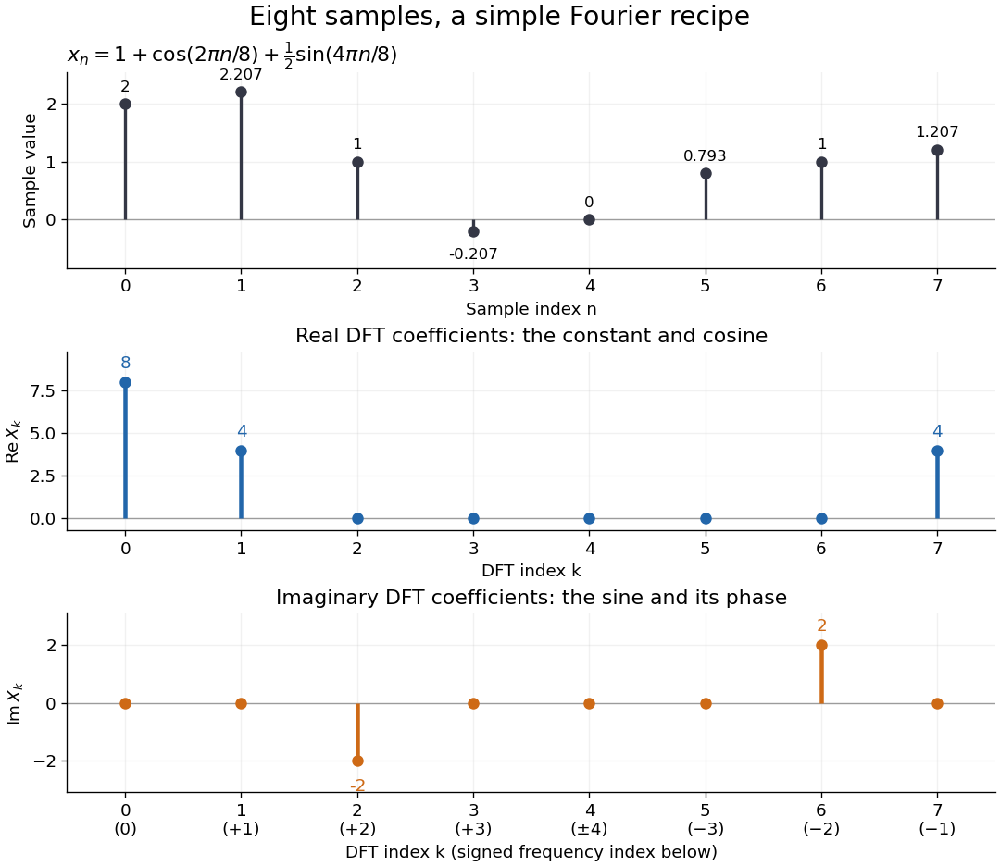

# Discrete Fourier transform

↑ **Parent:** [Numerical analysis](numerical-analysis-split.md)  
ⓦ [Wiki](https://en.wikipedia.org/wiki/Discrete_Fourier_transform)

The [discrete Fourier transform](discrete-fourier-transform.md) turns a finite list of samples into the weights of its [discrete Fourier modes](discrete-fourier-mode.md). The goal is to reveal a simple oscillatory recipe hidden in complicated-looking data, while retaining enough information to reconstruct every sample exactly. In [signal processing](signal-processing.md), those weights identify sampled [frequencies](frequency.md) and [wave phases](phase-waves.md); in [numerical analysis](numerical-analysis-split.md), they simplify [circular convolution](circular-convolution.md) and the [discrete sine transform Poisson solver](discrete-sine-transform-poisson-solver.md).

Start with eight real samples, indexed by $n=0,\ldots,7$:

$$
x_n=1+\cos\left(\frac{2\pi n}{8}\right)+\frac12\sin\left(\frac{4\pi n}{8}\right).
$$

Writing $a=\sqrt2/2$, the actual list is

$$
x=\left(2,\frac32+a,1,\frac12-a,0,\frac32-a,1,\frac12+a\right).
$$

The [discrete Fourier transform](discrete-fourier-transform.md) recovers the recipe as

$$
X=(8,4,-2i,0,0,0,2i,4).
$$

The constant contributes $X_0=8$; the [cosine](cosine.md) contributes $X_1=X_7=4$; the half-sized [sine](sine.md) contributes $X_2=-2i$ and $X_6=2i$. All other [coefficients](coefficient.md) vanish exactly. The imaginary [coefficients](coefficient.md) carry the [sine](sine.md)'s [wave phase](phase-waves.md), which a plot of [absolute values](absolute-value.md) alone would hide.

**[Figure 29](#image-eight-samples-become-a-constant-a-cosine-pair-and-a-sine-pair-in-the-discrete-fourier-transform). Eight samples become a constant, a cosine pair, and a sine pair in the discrete Fourier transform**.

Precisely, for a positive [integer](integer.md) $N$ and a [vector](vector.md) $x\in\mathbb C^N$, the forward [discrete Fourier transform](discrete-fourier-transform.md) and [inverse discrete Fourier transform](inverse-discrete-fourier-transform.md) used here are

$$
X_k=\sum_{n=0}^{N-1}x_n\exp\left(-\frac{2\pi ink}{N}\right),\qquad k=0,\ldots,N-1,
$$

$$
x_n=\frac1N\sum_{k=0}^{N-1}X_k\exp\left(\frac{2\pi ink}{N}\right),\qquad n=0,\ldots,N-1.
$$

Thus the forward exponent has a minus sign and no scale factor; the inverse exponent has a plus sign and the factor $1/N$. The [coefficients](coefficient.md) in the reconstruction are $X_k/N$, rather than $X_k$. In the example, $X_0/8=1$, the pair $4/8$ reconstructs the [cosine](cosine.md), and the pair $-2i/8,2i/8$ reconstructs the half-sized [sine](sine.md). These conventions agree with the scaled [Fourier coefficients](fourier-coefficient.md) in MIT's authored notes.[Hari Balakrishnan, Christopher Terman, and George Verghese, MIT 6.02 notes, Chapter 13, equations (13.15)–(13.16), 2012](https://ocw.mit.edu/courses/6-02-introduction-to-eecs-ii-digital-communication-systems-fall-2012/06d7972059805d20e6a7db3a52ec23f2_MIT6_02F12_chap13.pdf)

The proof idea is [orthogonality of roots of unity](orthogonality-of-roots-of-unity.md): for [integers](integer.md) $k,\ell\in\{0,\ldots,N-1\}$,

$$
\sum_{n=0}^{N-1}e^{2\pi in(k-\ell)/N}=\begin{cases}N,&k=\ell,\\0,&k\ne\ell.\end{cases}
$$

Distinct [discrete Fourier modes](discrete-fourier-mode.md) cancel in this finite [geometric series](geometric-series.md). Substituting the forward formula into the [inverse discrete Fourier transform](inverse-discrete-fourier-transform.md) leaves only the desired sample. The same [orthogonality](orthogonal-vectors.md) makes the normalized [discrete Fourier modes](discrete-fourier-mode.md) an [orthonormal basis](orthonormal-basis.md) and gives the [discrete Parseval identity](discrete-parseval-identity.md), in the present convention,

$$
\sum_{n=0}^{N-1}|x_n|^2=\frac1N\sum_{k=0}^{N-1}|X_k|^2.
$$

For the eight-sample example, direct squaring gives $\sum_nx_n^2=13$, while $\sum_k|X_k|^2=64+16+4+4+16=104$, so $104/8=13$. This identity preserves the squared [L2 norm](l2-norm.md) after accounting for normalization. The existing [discrete Parseval identity](discrete-parseval-identity.md) instead scales the forward [discrete Fourier transform](discrete-fourier-transform.md) by $N^{-1/2}$, producing a [unitary matrix](unitary-matrix.md) and equal squared [L2 norms](l2-norm.md) without the factor $1/N$.

For real input, [discrete Fourier conjugate symmetry](discrete-fourier-conjugate-symmetry.md) pairs positive and negative [frequencies](frequency.md). The label $k$ is a residue modulo $N$: $k=7$ when $N=8$ represents the same [discrete Fourier mode](discrete-fourier-mode.md) as $k=-1$, since $e^{2\pi i7n/8}=e^{-2\pi in/8}$. It therefore represents negative [frequency](frequency.md) $-1/8$ cycles per sample. If samples are $\Delta t$ seconds apart, the corresponding signed [frequency](frequency.md) is $-1/(8\Delta t)$ cycles per second. Similarly, index $6$ represents $-2$, while index $4$ is its own negative modulo $8$.

The [discrete Fourier transform](discrete-fourier-transform.md) is an invertible map between two finite [vectors](vector.md). The continuous [Fourier transform](fourier-transform.md) instead describes a [function](function-split.md) on the real line by an [integral](integral.md) over a continuous [frequency](frequency.md) variable. A finite list of samples does not determine the full continuous [frequency spectrum](frequency-spectrum.md): [aliasing of discrete Fourier modes](aliasing-of-discrete-fourier-modes.md) already supplies distinct waveforms with identical observations. Applying the inverse formula at arbitrary [integer](integer.md) indices gives the [periodic extension of a finite sequence](periodic-extension-of-a-finite-sequence.md), repeating the recorded block every $N$ samples. This is a property of that representation, rather than evidence that the physical [signal](signal.md) repeats beyond the recording. Laurent Demanet's MIT notes place the [discrete Fourier transform](discrete-fourier-transform.md) alongside the continuous [Fourier transform](fourier-transform.md) and [Fourier series](fourier-series-split.md) to explain the role of sampling and repetition.[Laurent Demanet, Introduction to Numerical Analysis, MIT 18.330, §§6.2–6.3, pp. 57–60, March 22, 2012](https://math.mit.edu/icg/resources/teaching/18.330/18.330-Mar21.pdf)

The beauty is that a change of [basis](basis.md) exposes cancellation and structure without losing data. Direct evaluation needs $N$ sums of $N$ terms; a [Fast Fourier transform](fast-fourier-transform.md) computes the same [discrete Fourier transform](discrete-fourier-transform.md) with far less work. Computational speed and the mathematical meaning of the [coefficients](coefficient.md) are separate questions.

**Table of contents**

- [Discrete Fourier conjugate symmetry](discrete-fourier-conjugate-symmetry.md)
- [Periodic extension of a finite sequence](periodic-extension-of-a-finite-sequence.md)
- [Aliasing of discrete Fourier modes](aliasing-of-discrete-fourier-modes.md)
- [Prime Fourier matrix minor theorem](prime-fourier-matrix-minor-theorem.md)
- [Finite-field discrete Fourier transform](finite-field-discrete-fourier-transform.md)
- [Discrete Parseval identity](discrete-parseval-identity.md)
- [Fourier representation of a Kronecker delta](fourier-representation-of-a-kronecker-delta.md)
- [Fourier frequency](fourier-frequency.md)
- [Inverse discrete Fourier transform](inverse-discrete-fourier-transform.md)
- [Discrete Fourier mode](discrete-fourier-mode.md)
- [Fast Fourier transform](fast-fourier-transform.md)
  - [Cooley-Tukey FFT algorithm](cooley-tukey-fft-algorithm.md)
    - [FFT butterfly](fft-butterfly.md)
    - [Even--odd fast Fourier transform recursion](even-odd-fast-fourier-transform-recursion.md)
- [Discrete cosine transform](discrete-cosine-transform.md)
  - [Discrete cosine transform from an even-reflected discrete Fourier transform](discrete-cosine-transform-from-an-even-reflected-discrete-fourier-transform.md)
- [Discrete sine transform](discrete-sine-transform.md)
  - [Discrete sine transform Poisson solver](discrete-sine-transform-poisson-solver.md)
  - [Discrete sine transform from a sign-modulated discrete cosine transform](discrete-sine-transform-from-a-sign-modulated-discrete-cosine-transform.md)

## ↑ Ancestors (5)

1. [Numerical analysis](numerical-analysis-split.md)
2. [Analysis](analysis-split.md)
3. [Area of mathematics](area-of-mathematics.md)
4. [Mathematics](mathematics-split.md)
5. [Codex Wiki](split.md)

## ← Incoming links (47)

- [Aliasing of discrete Fourier modes](aliasing-of-discrete-fourier-modes.md)
- [Circulant matrix](circulant-matrix.md)
- [Circular convolution](circular-convolution.md)
- [Cooley-Tukey FFT algorithm](cooley-tukey-fft-algorithm.md)
- [Discrete convolution](discrete-convolution.md)
- [Discrete Fourier conjugate symmetry](discrete-fourier-conjugate-symmetry.md)
- [Discrete Fourier transform](discrete-fourier-transform.md)
- [Discrete Parseval identity](discrete-parseval-identity.md)
- [Dissipative second-order forward advection semidiscretization](dissipative-second-order-forward-advection-semidiscretization.md)
- [Fast Fourier transform](fast-fourier-transform.md)
- [FFT butterfly](fft-butterfly.md)
- [Fourier diagonalization of a circulant matrix](fourier-diagonalization-of-a-circulant-matrix.md)
- [Fourier frequency](fourier-frequency.md)
- [Fourier model of a Lyot coronagraph](fourier-model-of-a-lyot-coronagraph.md)
- [Inverse discrete Fourier transform](inverse-discrete-fourier-transform.md)
- [Laurent operator](laurent-operator.md)
- [Orthogonality of roots of unity](orthogonality-of-roots-of-unity.md)
- [Solution](past-exam-of-the-mathematics-course-of-the-university-of-cambridge/2001/iii/paper-25/4/solution.md)
- [Solution](past-exam-of-the-mathematics-course-of-the-university-of-cambridge/2001/iii/paper-57/5/solution.md)
- [Solution](past-exam-of-the-mathematics-course-of-the-university-of-cambridge/2001/iii/paper-57/8/solution.md)
- [Solution](past-exam-of-the-mathematics-course-of-the-university-of-cambridge/2003/iii/paper-43/5/solution.md)
- [Solution](past-exam-of-the-mathematics-course-of-the-university-of-cambridge/2003/iii/paper-67/4/a/solution.md)
- [Solution](past-exam-of-the-mathematics-course-of-the-university-of-cambridge/2005/iii/paper-69/6/solution.md)
- [Solution](past-exam-of-the-mathematics-course-of-the-university-of-cambridge/2007/iii/paper-71/7/solution.md)
- [Solution](past-exam-of-the-mathematics-course-of-the-university-of-cambridge/2008/iii/paper-88/5/c/solution.md)
- [Solution](past-exam-of-the-mathematics-course-of-the-university-of-cambridge/2009/iii/paper-72/3/b/solution.md)
- [Solution](past-exam-of-the-mathematics-course-of-the-university-of-cambridge/2009/iii/paper-72/6/solution.md)
- [Solution](past-exam-of-the-mathematics-course-of-the-university-of-cambridge/2010/ii/paper-2/39a/4/solution.md)
- [Solution](past-exam-of-the-mathematics-course-of-the-university-of-cambridge/2010/ii/paper-2/39a/solution.md)
- [Solution](past-exam-of-the-mathematics-course-of-the-university-of-cambridge/2010/iii/paper-63/3/2/solution.md)
- [Solution](past-exam-of-the-mathematics-course-of-the-university-of-cambridge/2010/iii/paper-63/7/solution.md)
- [Solution](past-exam-of-the-mathematics-course-of-the-university-of-cambridge/2011/ii/paper-4/39a/i/solution.md)
- [Solution](past-exam-of-the-mathematics-course-of-the-university-of-cambridge/2012/iii/paper-69/3/2/solution.md)
- [Solution](past-exam-of-the-mathematics-course-of-the-university-of-cambridge/2013/iii/paper-23/1/b/solution.md)
- [Solution](past-exam-of-the-mathematics-course-of-the-university-of-cambridge/2013/iii/paper-75/1/b/solution.md)
- [Solution](past-exam-of-the-mathematics-course-of-the-university-of-cambridge/2015/iii/paper-68/6/solution.md)
- [Solution](past-exam-of-the-mathematics-course-of-the-university-of-cambridge/2015/iii/paper-81/1/e/solution.md)
- [Solution](past-exam-of-the-mathematics-course-of-the-university-of-cambridge/2016/iii/paper-208/2/2/solution.md)
- [Solution](past-exam-of-the-mathematics-course-of-the-university-of-cambridge/2017/iii/paper-341/7/solution.md)
- [Solution](past-exam-of-the-mathematics-course-of-the-university-of-cambridge/2019/ib/paper-3/7d/solution.md)
- [Solution](past-exam-of-the-mathematics-course-of-the-university-of-cambridge/2019/ii/paper-1/19i/c/i/solution.md)
- [Solution](past-exam-of-the-mathematics-course-of-the-university-of-cambridge/2021/iii/paper-341/3/c/solution.md)
- [Solution](past-exam-of-the-mathematics-course-of-the-university-of-cambridge/2022/iii/paper-341/section-b/7/solution.md)
- [Solution](past-exam-of-the-mathematics-course-of-the-university-of-cambridge/2024/iii/paper-341/6/solution.md)
- [Periodic Poisson equation on a four-point cycle](periodic-poisson-equation-on-a-four-point-cycle.md)
- [Periodogram](periodogram.md)
- [Prime Fourier matrix minor theorem](prime-fourier-matrix-minor-theorem.md)
