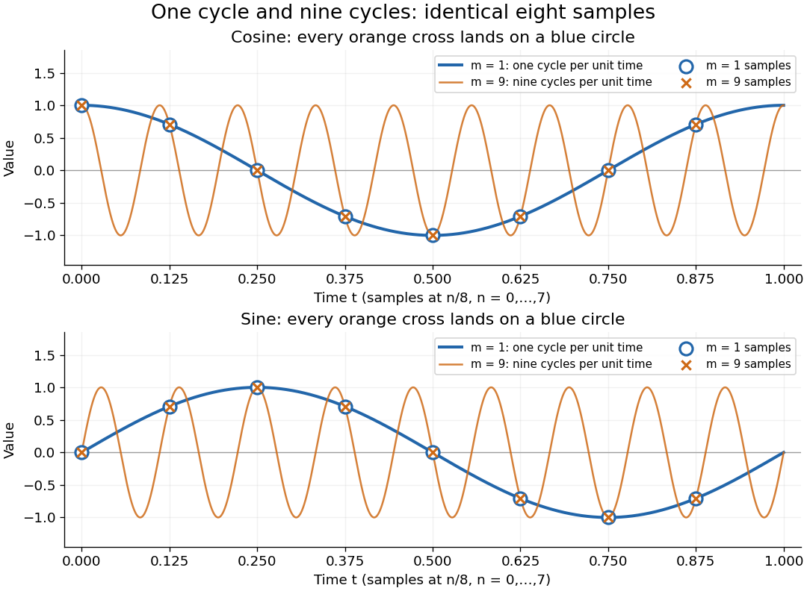

# Discrete Fourier transform

↑ **Parent:** [Numerical analysis](numerical-analysis.md)  
ⓦ [Wiki](https://en.wikipedia.org/wiki/Discrete_Fourier_transform)

The [discrete Fourier transform](discrete-fourier-transform.md) turns a finite list of samples into the weights of its [discrete Fourier modes](#discrete-fourier-mode). The goal is to reveal a simple oscillatory recipe hidden in complicated-looking data, while retaining enough information to reconstruct every sample exactly. In [signal processing](electrical-engineering.md#signal-processing), those weights identify sampled [frequencies](wave.md#frequency) and [wave phases](wave.md#phase-waves); in [numerical analysis](numerical-analysis.md), they simplify [circular convolution](fourier-analysis.md#circular-convolution) and the [discrete sine transform Poisson solver](#discrete-sine-transform-poisson-solver).

Start with eight real samples, indexed by $n=0,\ldots,7$:

$$
x_n=1+\cos\left(\frac{2\pi n}{8}\right)+\frac12\sin\left(\frac{4\pi n}{8}\right).
$$

Writing $a=\sqrt2/2$, the actual list is

$$
x=\left(2,\frac32+a,1,\frac12-a,0,\frac32-a,1,\frac12+a\right).
$$

The [discrete Fourier transform](discrete-fourier-transform.md) recovers the recipe as

$$
X=(8,4,-2i,0,0,0,2i,4).
$$

The constant contributes $X_0=8$; the [cosine](geometry-and-topology.md#cosine) contributes $X_1=X_7=4$; the half-sized [sine](geometry-and-topology.md#sine) contributes $X_2=-2i$ and $X_6=2i$. All other [coefficients](vector-space.md#coefficient) vanish exactly. The imaginary [coefficients](vector-space.md#coefficient) carry the [sine](geometry-and-topology.md#sine)'s [wave phase](wave.md#phase-waves), which a plot of [absolute values](real-analysis.md#absolute-value) alone would hide.

**[Figure 1](#image-eight-samples-become-a-constant-a-cosine-pair-and-a-sine-pair-in-the-discrete-fourier-transform). Eight samples become a constant, a cosine pair, and a sine pair in the discrete Fourier transform**.

Precisely, for a positive [integer](integer.md) $N$ and a [vector](vector-space.md#vector) $x\in\mathbb C^N$, the forward [discrete Fourier transform](discrete-fourier-transform.md) and [inverse discrete Fourier transform](#inverse-discrete-fourier-transform) used here are

$$
X_k=\sum_{n=0}^{N-1}x_n\exp\left(-\frac{2\pi ink}{N}\right),\qquad k=0,\ldots,N-1,
$$

$$
x_n=\frac1N\sum_{k=0}^{N-1}X_k\exp\left(\frac{2\pi ink}{N}\right),\qquad n=0,\ldots,N-1.
$$

Thus the forward exponent has a minus sign and no scale factor; the inverse exponent has a plus sign and the factor $1/N$. The [coefficients](vector-space.md#coefficient) in the reconstruction are $X_k/N$, rather than $X_k$. In the example, $X_0/8=1$, the pair $4/8$ reconstructs the [cosine](geometry-and-topology.md#cosine), and the pair $-2i/8,2i/8$ reconstructs the half-sized [sine](geometry-and-topology.md#sine). These conventions agree with the scaled [Fourier coefficients](fourier-series.md#fourier-coefficient) in MIT's authored notes.[Hari Balakrishnan, Christopher Terman, and George Verghese, MIT 6.02 notes, Chapter 13, equations (13.15)–(13.16), 2012](https://ocw.mit.edu/courses/6-02-introduction-to-eecs-ii-digital-communication-systems-fall-2012/06d7972059805d20e6a7db3a52ec23f2_MIT6_02F12_chap13.pdf)

The proof idea is [orthogonality of roots of unity](algebra.md#orthogonality-of-roots-of-unity): for [integers](integer.md) $k,\ell\in\{0,\ldots,N-1\}$,

$$
\sum_{n=0}^{N-1}e^{2\pi in(k-\ell)/N}=\begin{cases}N,&k=\ell,\\0,&k\ne\ell.\end{cases}
$$

Distinct [discrete Fourier modes](#discrete-fourier-mode) cancel in this finite [geometric series](sequence-and-series.md#geometric-series). Substituting the forward formula into the [inverse discrete Fourier transform](#inverse-discrete-fourier-transform) leaves only the desired sample. The same [orthogonality](inner-product.md#orthogonal-vectors) makes the normalized [discrete Fourier modes](#discrete-fourier-mode) an [orthonormal basis](inner-product.md#orthonormal-basis) and gives the [discrete Parseval identity](#discrete-parseval-identity), in the present convention,

$$
\sum_{n=0}^{N-1}|x_n|^2=\frac1N\sum_{k=0}^{N-1}|X_k|^2.
$$

For the eight-sample example, direct squaring gives $\sum_nx_n^2=13$, while $\sum_k|X_k|^2=64+16+4+4+16=104$, so $104/8=13$. This identity preserves the squared [L2 norm](real-analysis.md#l2-norm) after accounting for normalization. The existing [discrete Parseval identity](#discrete-parseval-identity) instead scales the forward [discrete Fourier transform](discrete-fourier-transform.md) by $N^{-1/2}$, producing a [unitary matrix](linear-operator-theory.md#unitary-matrix) and equal squared [L2 norms](real-analysis.md#l2-norm) without the factor $1/N$.

For real input, [discrete Fourier conjugate symmetry](#discrete-fourier-conjugate-symmetry) pairs positive and negative [frequencies](wave.md#frequency). The label $k$ is a residue modulo $N$: $k=7$ when $N=8$ represents the same [discrete Fourier mode](#discrete-fourier-mode) as $k=-1$, since $e^{2\pi i7n/8}=e^{-2\pi in/8}$. It therefore represents negative [frequency](wave.md#frequency) $-1/8$ cycles per sample. If samples are $\Delta t$ seconds apart, the corresponding signed [frequency](wave.md#frequency) is $-1/(8\Delta t)$ cycles per second. Similarly, index $6$ represents $-2$, while index $4$ is its own negative modulo $8$.

The [discrete Fourier transform](discrete-fourier-transform.md) is an invertible map between two finite [vectors](vector-space.md#vector). The continuous [Fourier transform](fourier-transform.md) instead describes a [function](function.md) on the real line by an [integral](integral.md) over a continuous [frequency](wave.md#frequency) variable. A finite list of samples does not determine the full continuous [frequency spectrum](fourier-analysis.md#frequency-spectrum): [aliasing of discrete Fourier modes](#aliasing-of-discrete-fourier-modes) already supplies distinct waveforms with identical observations. Applying the inverse formula at arbitrary [integer](integer.md) indices gives the [periodic extension of a finite sequence](#periodic-extension-of-a-finite-sequence), repeating the recorded block every $N$ samples. This is a property of that representation, rather than evidence that the physical [signal](electrical-engineering.md#signal) repeats beyond the recording. Laurent Demanet's MIT notes place the [discrete Fourier transform](discrete-fourier-transform.md) alongside the continuous [Fourier transform](fourier-transform.md) and [Fourier series](fourier-series.md) to explain the role of sampling and repetition.[Laurent Demanet, Introduction to Numerical Analysis, MIT 18.330, §§6.2–6.3, pp. 57–60, March 22, 2012](https://math.mit.edu/icg/resources/teaching/18.330/18.330-Mar21.pdf)

The beauty is that a change of [basis](vector-space.md#basis) exposes cancellation and structure without losing data. Direct evaluation needs $N$ sums of $N$ terms; a [Fast Fourier transform](#fast-fourier-transform) computes the same [discrete Fourier transform](discrete-fourier-transform.md) with far less work. Computational speed and the mathematical meaning of the [coefficients](vector-space.md#coefficient) are separate questions.

**Table of contents**

- [Number-theoretic transform](#number-theoretic-transform)
- [Fourier frequency resolution](#fourier-frequency-resolution)
- [Discrete Fourier conjugate symmetry](#discrete-fourier-conjugate-symmetry)
- [Periodic extension of a finite sequence](#periodic-extension-of-a-finite-sequence)
- [Aliasing of discrete Fourier modes](#aliasing-of-discrete-fourier-modes)
- [Prime Fourier matrix minor theorem](#prime-fourier-matrix-minor-theorem)
- [Finite-field discrete Fourier transform](#finite-field-discrete-fourier-transform)
- [Discrete Parseval identity](#discrete-parseval-identity)
- [Fourier representation of a Kronecker delta](#fourier-representation-of-a-kronecker-delta)
- [Fourier frequency](#fourier-frequency)
- [Inverse discrete Fourier transform](#inverse-discrete-fourier-transform)
- [Discrete Fourier mode](#discrete-fourier-mode)
- [Fast Fourier transform](#fast-fourier-transform)
  - [Good-Thomas algorithm](#good-thomas-algorithm)
  - [Cooley-Tukey FFT algorithm](#cooley-tukey-fft-algorithm)
    - [FFT butterfly](#fft-butterfly)
    - [Even--odd fast Fourier transform recursion](#even-odd-fast-fourier-transform-recursion)
- [Discrete cosine transform](#discrete-cosine-transform)
  - [Discrete cosine transform from an even-reflected discrete Fourier transform](#discrete-cosine-transform-from-an-even-reflected-discrete-fourier-transform)
- [Discrete sine transform](#discrete-sine-transform)
  - [Discrete sine transform Poisson solver](#discrete-sine-transform-poisson-solver)
  - [Discrete sine transform from a sign-modulated discrete cosine transform](#discrete-sine-transform-from-a-sign-modulated-discrete-cosine-transform)

## Number-theoretic transform

↑ **Parent:** [Discrete Fourier transform](discrete-fourier-transform.md)

A number-theoretic transform is a [discrete Fourier transform](discrete-fourier-transform.md) computed in [modular arithmetic](modular-arithmetic.md). In a [finite field](algebra.md#finite-field) with $p$ elements, choose a [primitive root of unity](algebra.md#primitive-root-of-unity) $\omega$ of order $L$ dividing $p-1$. The transform above is inverted using $\omega^{-1}$ and $L^{-1}$. With sufficient zero padding, it computes [polynomial](polynomial.md) products exactly modulo $p$, avoiding [floating-point arithmetic](floating-point-arithmetic.md) rounding.

## Fourier frequency resolution

↑ **Parent:** [Discrete Fourier transform](discrete-fourier-transform.md)

For $N$ equally spaced samples at [sampling rate](wave-equation.md#sampling-rate) $f_s$, the [discrete Fourier transform](discrete-fourier-transform.md) has [frequency](wave.md#frequency) bins spaced by $f_s/N=1/T_{\mathrm{obs}}$. A rectangular observation window broadens a sinusoid into a [sinc function](fourier-transform.md#sinc-function) profile whose nearest zeros are $1/T_{\mathrm{obs}}$ from its central [frequency](wave.md#frequency). This sets a conventional scale for distinguishing nearby spectral components. It is not a universal lower bound on the uncertainty of [frequency estimation](statistical-inference.md#frequency-estimation) for an isolated tone: a specified signal model and noise level can allow precision finer than the bin spacing. Padding with zeros interpolates the spectral display without increasing the observation duration.

## Discrete Fourier conjugate symmetry

↑ **Parent:** [Discrete Fourier transform](discrete-fourier-transform.md)

For real samples, taking the [complex conjugate](complex-analysis.md#complex-conjugate) of the forward [discrete Fourier transform](discrete-fourier-transform.md) changes the exponent's sign and proves the displayed symmetry. Hence $X_0$ is real; for even $N$, $X_{N/2}$ is also real. In the eight-sample example, $X_7=\overline{X_1}=4$ and $X_6=\overline{X_2}=2i$. This is the finite counterpart of [conjugate symmetry of trigonometric polynomial coefficients](fourier-series.md#conjugate-symmetry-of-trigonometric-polynomial-coefficients). It reduces storage for real [signals](electrical-engineering.md#signal) and provides a quick consistency check on a computed [discrete Fourier transform](discrete-fourier-transform.md).

## Periodic extension of a finite sequence

↑ **Parent:** [Discrete Fourier transform](discrete-fourier-transform.md)

A block $x_0,\ldots,x_{N-1}$ determines a repeating [sequence](sequence-and-series.md#sequence) by setting $x_n=x_{n\bmod N}$ for every [integer](integer.md) $n$. The [inverse discrete Fourier transform](#inverse-discrete-fourier-transform) gives this extension because each [discrete Fourier mode](#discrete-fourier-mode) satisfies $e^{2\pi ik(n+N)/N}=e^{2\pi ikn/N}$. The extension explains why [circular convolution](fourier-analysis.md#circular-convolution) wraps indices around the block. It specifies values at discrete indices; a continuous curve between samples requires an additional choice of [interpolation](interpolation.md).

## Aliasing of discrete Fourier modes

↑ **Parent:** [Discrete Fourier transform](discrete-fourier-transform.md)

For [integers](integer.md) $m,q,n$, adding $qN$ to a [frequency](wave.md#frequency) index changes the [complex exponential](calculus.md#complex-exponential-function) by $e^{2\pi iqn}=1$. Thus different continuous [Fourier modes](fourier-analysis.md#fourier-mode) become identical [discrete Fourier modes](#discrete-fourier-mode) on the sampling grid. This is [aliasing](fourier-analysis.md#aliasing), caused by sampling before any [discrete Fourier transform](discrete-fourier-transform.md) is computed.

For $N=8$, compare the continuous [functions](function.md) $\cos(2\pi mt)$ and $\sin(2\pi mt)$ with $m=1$ and $m=9$, sampled at $t=n/8$, $n=0,\ldots,7$. With $a=\sqrt2/2$, both [cosines](geometry-and-topology.md#cosine) give exactly the first row and both [sines](geometry-and-topology.md#sine) give exactly the second:

$$
\begin{array}{c|rrrrrrrr}
n&0&1&2&3&4&5&6&7\\\hline
\cos(2\pi n/8)=\cos(18\pi n/8)&1&a&0&-a&-1&-a&0&a\\
\sin(2\pi n/8)=\sin(18\pi n/8)&0&a&1&a&0&-a&-1&-a
\end{array}
$$

The nine-cycle [sine](geometry-and-topology.md#sine) agrees in sign as well as magnitude with the one-cycle [sine](geometry-and-topology.md#sine): the [frequency](wave.md#frequency) indices differ by $8$, rather than by a sign reversal. Consequently, either [cosine](geometry-and-topology.md#cosine) produces the same [discrete Fourier transform](discrete-fourier-transform.md), $X_1=X_7=4$ with all other [coefficients](vector-space.md#coefficient) zero; either [sine](geometry-and-topology.md#sine) produces $X_1=-4i$, $X_7=4i$, with all other [coefficients](vector-space.md#coefficient) zero.

**[Figure 2](#image-one-cycle-and-nine-cycle-cosine-and-sine-waves-have-exactly-the-same-eight-samples). One-cycle and nine-cycle cosine and sine waves have exactly the same eight samples**.

An observed low [frequency](wave.md#frequency) therefore does not establish that physical high [frequencies](wave.md#frequency) are absent. To exclude such alternatives, the [Nyquist–Shannon sampling theorem](fourier-analysis.md#nyquist-shannon-sampling-theorem) requires a specified class of [bandlimited functions](fourier-transform.md#bandlimited-function). For arbitrary pure [sinusoids](geometry-and-topology.md#sinusoid) with [frequencies](wave.md#frequency) at most $B$, choose sampling rate $f_s>2B$; equality needs care because $\sin(2\pi(f_s/2)t)$ vanishes at every $t=n/f_s$. The finite-energy [L2 space](measure-theory.md#l2-space-is-a-hilbert-space) version of the [Nyquist–Shannon sampling theorem](fourier-analysis.md#nyquist-shannon-sampling-theorem) permits equality under its own hypotheses. In either case, exact continuous reconstruction generally requires the entire infinite sample [sequence](sequence-and-series.md#sequence); eight observed samples alone do not supply it. Demanet derives the grid [aliasing](fourier-analysis.md#aliasing) condition as a difference by an [integer](integer.md) multiple of the sampling [angular frequency](lagrangian-mechanics.md#angular-frequency).[Laurent Demanet, MIT 18.330 notes, §6.2, Definition 11, p. 57: aliases on a grid, 2012](https://math.mit.edu/icg/resources/teaching/18.330/18.330-Mar21.pdf)

## Prime Fourier matrix minor theorem

↑ **Parent:** [Discrete Fourier transform](discrete-fourier-transform.md)

For a prime $p$, distinct row and column residues and $\zeta=e^{2\pi i/p}$, every square [discrete Fourier transform](discrete-fourier-transform.md) submatrix is nonsingular. Sort the selected column exponents decreasingly as $b_i$ and write $b_i=\lambda_i+N-i$. Its [determinant](multilinear-algebra.md#determinant) factors by the [bialternant formula](combinatorics.md#bialternant-formula) into a nonzero [Vandermonde determinant](galois-theory.md#vandermonde-determinant) and $s_\lambda(\zeta^{r_1},\ldots,\zeta^{r_N})$. Modulo $1-\zeta$, this Schur factor is $s_\lambda(1^N)$ in $\mathbb F_p$. The [Schur evaluation at all ones](combinatorics.md#schur-evaluation-at-all-ones) product has numerator and denominator differences strictly between zero and $p$, so its residue is nonzero. The Schur factor, and hence the minor, cannot vanish.

## Finite-field discrete Fourier transform

↑ **Parent:** [Discrete Fourier transform](discrete-fourier-transform.md)

If $\omega$ is a primitive $n$th root in a [finite field](algebra.md#finite-field) and the field [characteristic](algebra.md#characteristic-of-a-field) does not divide $n$, the inverse transform is $c_j=n^{-1}\sum_{\ell=0}^{n-1}\widehat c_\ell\omega^{-j\ell}$. The identity $\sum_{j=0}^{n-1}\omega^{jm}=0$ unless $n\mid m$, when the sum is $n$, proves inversion. For a [primitive cyclic Reed-Solomon code](coding-theory.md#primitive-cyclic-reed-solomon-code), encoding assigns the $k$ unconstrained transform values and makes the remaining values zero; received transform values at those zeros are [syndromes](coding-theory.md#syndrome).

## Discrete Parseval identity

↑ **Parent:** [Discrete Fourier transform](discrete-fourier-transform.md)

With normalization $\widehat U_k=N^{-1/2}\sum_mU_me^{-2\pi imk/N}$, the [discrete Fourier transform](discrete-fourier-transform.md) is a [unitary matrix](linear-operator-theory.md#unitary-matrix). Orthogonality of the roots-of-unity vectors gives the displayed identity. Multiplying both sides by the grid spacing gives the corresponding discrete [L2 norm](real-analysis.md#l2-norm). Modal contraction therefore proves grid-norm contraction without a mesh-dependent change-of-basis constant.

## Fourier representation of a Kronecker delta

↑ **Parent:** [Discrete Fourier transform](discrete-fourier-transform.md)

Orthogonality of integer-frequency [Fourier modes](fourier-analysis.md#fourier-mode) gives this identity: the integral is one for $n=m$ and zero otherwise. It converts integer step-count constraints into products of generating functions, as in the [dilute-hopping lattice propagator](bloch-s-theorem.md#dilute-hopping-lattice-propagator).

## Fourier frequency

↑ **Parent:** [Discrete Fourier transform](discrete-fourier-transform.md)

$\lambda_j=2\pi j/T$ is a frequency of the length-$T$ [discrete Fourier transform](discrete-fourier-transform.md). Distinct interior frequencies give orthogonal sine and cosine vectors; for a Gaussian [white noise](time-series.md#white-noise) record this makes the corresponding Fourier components independent.

## Inverse discrete Fourier transform

↑ **Parent:** [Discrete Fourier transform](discrete-fourier-transform.md)  
ⓦ [Wiki](https://en.wikipedia.org/wiki/Inverse_discrete_Fourier_transform)

The inverse discrete Fourier transform reconstructs samples from their [discrete Fourier transform](discrete-fourier-transform.md). Under one common normalization,

$$
x_\ell=\frac1n\sum_{j=0}^{n-1}Y_je^{2\pi i j\ell/n};
$$

moving the factor $1/n$ between the forward and inverse transforms gives other standard conventions.

## Discrete Fourier mode

↑ **Parent:** [Discrete Fourier transform](discrete-fourier-transform.md)

On a cyclic index set of length $n$, the $k$th discrete Fourier mode is the vector with $j$th coordinate $e^{2\pi ikj/n}$. Its real and imaginary parts are the corresponding cosine and sine modes.

## Fast Fourier transform

↑ **Parent:** [Discrete Fourier transform](discrete-fourier-transform.md)  
ⓦ [Wiki](https://en.wikipedia.org/wiki/Fast_Fourier_transform)

A [Fast Fourier transform](#fast-fourier-transform) is an efficient [algorithm](algorithm.md) for computing the [discrete Fourier transform](discrete-fourier-transform.md) or [inverse discrete Fourier transform](#inverse-discrete-fourier-transform). The [discrete Fourier transform](discrete-fourier-transform.md) specifies the mathematical result; a [Fast Fourier transform](#fast-fourier-transform) specifies how to compute it. Different [Fast Fourier transform](#fast-fourier-transform) [algorithms](algorithm.md) reorganize the same finite sums, with the selected sign and normalization. The [Cooley-Tukey FFT algorithm](#cooley-tukey-fft-algorithm) is one important family of [Fast Fourier transforms](#fast-fourier-transform), using factorization of the record length.[Balakrishnan, Terman, and Verghese, MIT 6.02 notes, §13.2.6, p. 194: the FFT computes the existing transform, 2012](https://ocw.mit.edu/courses/6-02-introduction-to-eecs-ii-digital-communication-systems-fall-2012/06d7972059805d20e6a7db3a52ec23f2_MIT6_02F12_chap13.pdf)

For a power-of-two length, the radix-two [Cooley-Tukey FFT algorithm](#cooley-tukey-fft-algorithm) has [time complexity](theoretical-computer-science.md#time-complexity) $O(N\log N)$ in arithmetic operations, compared with $O(N^2)$ for evaluating every sum independently; these are [Big O notation](real-analysis.md#big-o-notation) growth rates rather than machine timings. It returns the same eight [coefficients](vector-space.md#coefficient) $(8,4,-2i,0,0,0,2i,4)$ in the example. In exact arithmetic this reorganization introduces no approximation; actual implementations still incur [roundoff error](numerical-analysis.md#round-off-error).

### Good-Thomas algorithm

↑ **Parent:** [Fast Fourier transform](#fast-fourier-transform)

### Cooley-Tukey FFT algorithm

↑ **Parent:** [Fast Fourier transform](#fast-fourier-transform)  
ⓦ [Wiki](https://en.wikipedia.org/wiki/Cooley–Tukey_FFT_algorithm)

The radix-two Cooley--Tukey algorithm recursively splits a discrete Fourier transform into transforms of the even-indexed and odd-indexed samples. For a power-of-two length this evaluates the transform in $O(m\log m)$ arithmetic operations.

The saving comes from reusing the two shorter [discrete Fourier transforms](discrete-fourier-transform.md) for both halves of the output, through an [FFT butterfly](#fft-butterfly). For $N=2^p$, each level of the [even--odd fast Fourier transform recursion](#even-odd-fast-fourier-transform-recursion) needs work proportional to $N$, and there are $p=\log_2N$ levels. This gives the $O(N\log N)$ [time complexity](theoretical-computer-science.md#time-complexity) without changing the [discrete Fourier transform](discrete-fourier-transform.md) being computed.

James W. Cooley and John W. Tukey published _An Algorithm for the Machine Calculation of Complex Fourier Series_ in _Mathematics of Computation_ 19 (1965), pp. 297–301. Their original paper factors a composite length as $N=r_1\cdots r_p$, derives an operation count $N(r_1+\cdots+r_p)$, and discusses powers of two and in-place storage. Its opening explicitly builds on earlier [algorithms](algorithm.md) by I. J. Good; the 1965 paper is a landmark computational formulation, rather than the invention of the underlying [Fourier analysis](fourier-analysis.md). Its positive-exponent convention also illustrates why a [Fast Fourier transform](#fast-fourier-transform)'s exponent sign must be specified.[Cooley and Tukey 1965, original paper, pp. 297–300, equations (1)–(12); scan of the published article](https://janmr.com/files/papers/cooley-tukey.pdf)

#### FFT butterfly

↑ **Parent:** [Cooley-Tukey FFT algorithm](#cooley-tukey-fft-algorithm)

An [FFT butterfly](#fft-butterfly) combines corresponding outputs of two half-sized transforms using a twiddle factor $w$. Sharing the product $wb$ costs one complex multiplication and two additions. For the unnormalized positive-exponent inverse [discrete Fourier transform](discrete-fourier-transform.md) of length $2m$, use $w=e^{2\pi i\ell/(2m)}$ at index $\ell$.

<h4 id="even-odd-fast-fourier-transform-recursion">Even--odd fast Fourier transform recursion</h4>

↑ **Parent:** [Cooley-Tukey FFT algorithm](#cooley-tukey-fft-algorithm)

For $\omega_m=e^{-2\pi i/m}$ and length-$m/2$ transforms $E_k,O_k$ of the even and odd samples,

$$
Y_k=E_k+\omega_m^kO_k,
\qquad Y_{k+m/2}=E_k-\omega_m^kO_k.
$$

## Discrete cosine transform

↑ **Parent:** [Discrete Fourier transform](discrete-fourier-transform.md)  
ⓦ [Wiki](https://en.wikipedia.org/wiki/Discrete_cosine_transform)

The type-II discrete cosine transform of $x_0,\ldots,x_{N-1}$ is

$$
Z_k=\sum_{n=0}^{N-1}x_n\cos\left(\frac{\pi}{N}\left(n+\frac12\right)k\right).
$$

### Discrete cosine transform from an even-reflected discrete Fourier transform

↑ **Parent:** [Discrete cosine transform](#discrete-cosine-transform)

Reflect $x$ evenly to length $2N$ by $y_n=x_n$ and $y_{2N-1-n}=x_n$. If $Y$ is the discrete Fourier transform of $y$, then

$$
Z_k=\frac12e^{-\pi ik/(2N)}Y_k.
$$

This reduction computes the cosine transform with one fast Fourier transform and $O(N)$ additional work.

## Discrete sine transform

↑ **Parent:** [Discrete Fourier transform](discrete-fourier-transform.md)  
ⓦ [Wiki](https://en.wikipedia.org/wiki/Discrete_sine_transform)

One half-grid sine-transform convention is

$$
\widetilde Z_k=\sum_{n=0}^{N-1}x_n
\sin\left(\frac{\pi}{N}\left(n+\frac12\right)(k+1)\right).
$$

### Discrete sine transform Poisson solver

↑ **Parent:** [Discrete sine transform](#discrete-sine-transform)

For $-\Delta u=f$ on a square with homogeneous [Dirichlet boundary conditions](differential-equation.md#dirichlet-boundary-condition), the five-point [finite difference](finite-difference.md) operator on a mesh $h=1/N$ is diagonalized by $\sin(\pi ki/N)\sin(\pi\ell j/N)$. Its eigenvalues are $\lambda_{k\ell}=4h^{-2}[\sin^2(\pi k/(2N))+\sin^2(\pi\ell/(2N))]$. A two-dimensional [discrete sine transform](#discrete-sine-transform), division by these nonzero eigenvalues and the inverse transform give the solution. Odd extension realizes each one-dimensional transform by a [Fast Fourier transform](#fast-fourier-transform) of length $2N$, making the total cost $O(N^2\log N)$ and storage $O(N^2)$. These finite-difference eigenvalues should not be confused with the continuous spectral eigenvalues $\pi^2(k^2+\ell^2)$.

### Discrete sine transform from a sign-modulated discrete cosine transform

↑ **Parent:** [Discrete sine transform](#discrete-sine-transform)

If $\xi_n=(-1)^nx_n$ and $C_j(\xi)$ is its type-II cosine transform, then

$$
\widetilde Z_k=C_{N-1-k}(\xi).
$$

Thus a sign modulation, one fast cosine transform, and output reversal give an $O(N\log N)$ sine-transform algorithm.

## ↑ Ancestors (5)

1. [Numerical analysis](numerical-analysis.md)
2. [Analysis](analysis.md)
3. [Area of mathematics](mathematics.md#area-of-mathematics)
4. [Mathematics](mathematics.md)
5. [Codex Wiki](README.md)

## ← Incoming links (57)

- [Aliasing of discrete Fourier modes](#aliasing-of-discrete-fourier-modes)
- [Circulant matrix](linear-algebra.md#circulant-matrix)
- [Circular convolution](fourier-analysis.md#circular-convolution)
- [Cooley-Tukey FFT algorithm](#cooley-tukey-fft-algorithm)
- [Cyclic convolution](fourier-analysis.md#cyclic-convolution)
- [Discrete convolution](fourier-analysis.md#discrete-convolution)
- [Discrete Fourier conjugate symmetry](#discrete-fourier-conjugate-symmetry)
- [Discrete Fourier transform](discrete-fourier-transform.md)
- [Discrete Parseval identity](#discrete-parseval-identity)
- [Dissipative second-order forward advection semidiscretization](finite-difference.md#dissipative-second-order-forward-advection-semidiscretization)
- [Fast Fourier transform](#fast-fourier-transform)
- [FFT butterfly](#fft-butterfly)
- [Fourier diagonalization of a circulant matrix](linear-algebra.md#fourier-diagonalization-of-a-circulant-matrix)
- [Fourier frequency](#fourier-frequency)
- [Fourier frequency resolution](#fourier-frequency-resolution)
- [Fourier model of a Lyot coronagraph](optics.md#fourier-model-of-a-lyot-coronagraph)
- [Frequency estimation](statistical-inference.md#frequency-estimation)
- [Harmonic-chain normal-mode reality condition](classical-mechanics.md#harmonic-chain-normal-mode-reality-condition)
- [Inverse discrete Fourier transform](#inverse-discrete-fourier-transform)
- [Laurent operator](finite-difference.md#laurent-operator)
- [Number-theoretic transform](#number-theoretic-transform)
- [Off-axis holography](physical-optics.md#off-axis-holography)
- [Optical trap Langevin calibration](optics.md#optical-trap-langevin-calibration)
- [Orthogonality of roots of unity](algebra.md#orthogonality-of-roots-of-unity)
- [Solution](past-exam-of-the-mathematics-course-of-the-university-of-cambridge/2001/iii/paper-25.md#4/solution)
- [Solution](past-exam-of-the-mathematics-course-of-the-university-of-cambridge/2001/iii/paper-57.md#5/solution)
- [Solution](past-exam-of-the-mathematics-course-of-the-university-of-cambridge/2001/iii/paper-57.md#8/solution)
- [Solution](past-exam-of-the-mathematics-course-of-the-university-of-cambridge/2003/iii/paper-43.md#5/solution)
- [Solution](past-exam-of-the-mathematics-course-of-the-university-of-cambridge/2003/iii/paper-67.md#4/a/solution)
- [Solution](past-exam-of-the-mathematics-course-of-the-university-of-cambridge/2005/iii/paper-69.md#6/solution)
- [Solution](past-exam-of-the-mathematics-course-of-the-university-of-cambridge/2007/iii/paper-71.md#7/solution)
- [Solution](past-exam-of-the-mathematics-course-of-the-university-of-cambridge/2008/iii/paper-88.md#5/c/solution)
- [Solution](past-exam-of-the-mathematics-course-of-the-university-of-cambridge/2009/iii/paper-72.md#3/b/solution)
- [Solution](past-exam-of-the-mathematics-course-of-the-university-of-cambridge/2009/iii/paper-72.md#6/solution)
- [Solution](past-exam-of-the-mathematics-course-of-the-university-of-cambridge/2010/ii/paper-2.md#39a/4/solution)
- [Solution](past-exam-of-the-mathematics-course-of-the-university-of-cambridge/2010/ii/paper-2.md#39a/solution)
- [Solution](past-exam-of-the-mathematics-course-of-the-university-of-cambridge/2010/iii/paper-63.md#3/2/solution)
- [Solution](past-exam-of-the-mathematics-course-of-the-university-of-cambridge/2010/iii/paper-63.md#7/solution)
- [Solution](past-exam-of-the-mathematics-course-of-the-university-of-cambridge/2011/ii/paper-4.md#39a/i/solution)
- [Solution](past-exam-of-the-mathematics-course-of-the-university-of-cambridge/2012/iii/paper-69.md#3/2/solution)
- [Solution](past-exam-of-the-mathematics-course-of-the-university-of-cambridge/2013/iii/paper-23.md#1/b/solution)
- [Solution](past-exam-of-the-mathematics-course-of-the-university-of-cambridge/2013/iii/paper-75.md#1/b/solution)
- [Solution](past-exam-of-the-mathematics-course-of-the-university-of-cambridge/2015/iii/paper-68.md#6/solution)
- [Solution](past-exam-of-the-mathematics-course-of-the-university-of-cambridge/2015/iii/paper-81.md#1/e/solution)
- [Solution](past-exam-of-the-mathematics-course-of-the-university-of-cambridge/2016/iii/paper-208.md#2/2/solution)
- [Solution](past-exam-of-the-mathematics-course-of-the-university-of-cambridge/2017/iii/paper-341.md#7/solution)
- [Solution](past-exam-of-the-mathematics-course-of-the-university-of-cambridge/2019/ib/paper-3.md#7d/solution)
- [Solution](past-exam-of-the-mathematics-course-of-the-university-of-cambridge/2019/ii/paper-1.md#19i/c/i/solution)
- [Solution](past-exam-of-the-mathematics-course-of-the-university-of-cambridge/2021/iii/paper-341.md#3/c/solution)
- [Solution](past-exam-of-the-mathematics-course-of-the-university-of-cambridge/2022/iii/paper-341.md#section-b/7/solution)
- [Solution](past-exam-of-the-mathematics-course-of-the-university-of-cambridge/2024/iii/paper-341.md#6/solution)
- [Solution](past-exam-of-the-physics-a-course-of-the-university-of-cambridge/2022/paper-1.md#section-a/5/solution)
- [Solution](past-exam-of-the-quantum-condensed-matter-field-theory-course-of-the-university-of-cambridge/2013/paper-1.md#2/a/solution)
- [Solution](past-exam-of-the-quantum-condensed-matter-field-theory-course-of-the-university-of-cambridge/2015/paper-1.md#1/e/solution)
- [Periodic Poisson equation on a four-point cycle](linear-algebra.md#periodic-poisson-equation-on-a-four-point-cycle)
- [Periodogram](time-series.md#periodogram)
- [Prime Fourier matrix minor theorem](#prime-fourier-matrix-minor-theorem)
