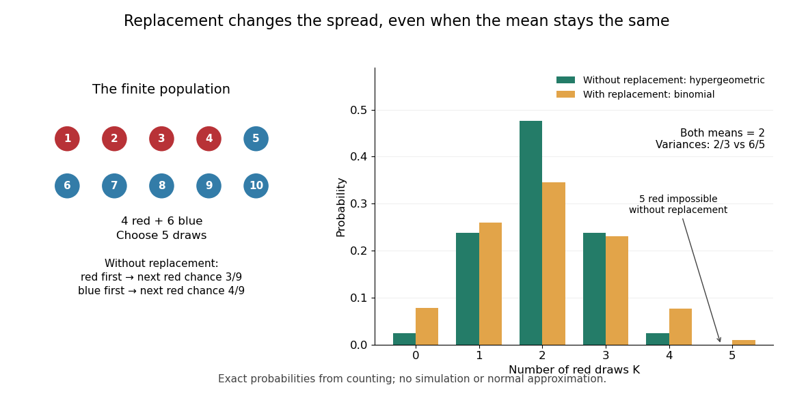

# Discrete probability distribution

↑ **Parent:** [Probability distribution](probability-theory.md#probability-distribution)  
ⓦ [Wiki](https://en.wikipedia.org/wiki/Discrete_probability_distribution)

A [discrete probability distribution](discrete-probability-distribution.md) is a [probability distribution](probability-theory.md#probability-distribution) concentrated on a finite or [countable set](set-theory.md#countable-set) of possible values $S$: a [random variable](random-variable.md) $X$ with this law satisfies $\mathbb P(X\in S)=1$. Its [probability mass function](probability-theory.md#probability-mass-function) assigns a [probability](probability-theory.md#probability) to each value:

$$
p_X(x)=\mathbb P(X=x),\qquad p_X(x)\geq0,\qquad \sum_{x\in S}p_X(x)=1.
$$

Thus the [probability](probability-theory.md#probability) of an event is obtained by adding masses, rather than integrating a [probability density function](continuous-probability-distribution.md#probability-density-function). The possible values need not be equally spaced, or even integers. When the relevant moments are finite, its [expected value](probability-theory.md#expected-value) and [variance](variance.md) are

$$
\mu=\mathbb E X=\sum_{x\in S}xp_X(x),\qquad
\operatorname{Var}(X)=\sum_{x\in S}(x-\mu)^2p_X(x)=\mathbb E[X^2]-\mu^2.
$$

For a constructed example, assign values $0,2,5$ masses $0.5,0.3,0.2$. They sum to one; $\mathbb P(X\geq2)=0.3+0.2=0.5$, $\mathbb E X=0(0.5)+2(0.3)+5(0.2)=1.6$, and $\mathbb E[X^2]=4(0.3)+25(0.2)=6.2$. Hence the [variance](variance.md) is $6.2-1.6^2=3.64$. A [mean](probability-theory.md#expected-value) can lie between possible values: no outcome here equals $1.6$.

The useful organizing question is what an experiment records. One yes/no [indicator random variable](probability-theory.md#indicator-random-variable) gives a [Bernoulli distribution](#bernoulli-distribution); a success count in a fixed number of [independent](random-variable.md#independent-random-variables) attempts gives a [binomial distribution](#binomial-distribution); the attempt number of the first success gives a [geometric distribution](#geometric-distribution). A [Poisson distribution](#poisson-distribution) describes an event count under different assumptions. Naming the quantity first helps prevent selecting a familiar formula for the wrong experiment.

**Table of contents**

- [Benford law](#benford-law)
  - [Scale invariance of decimal significands](#scale-invariance-of-decimal-significands)
    - [Decimal significand](#decimal-significand)
  - [Benford law from logarithmic uniformity](#benford-law-from-logarithmic-uniformity)
  - [Benford frequencies for powers of an integer](#benford-frequencies-for-powers-of-an-integer)
- [Discrete uniform distribution](#discrete-uniform-distribution)
  - [Nondecreasing uniform samples](#nondecreasing-uniform-samples)
- [Bernoulli distribution](#bernoulli-distribution)
  - [Estimating Bernoulli variance](#estimating-bernoulli-variance)
  - [Bernoulli trial](#bernoulli-trial)
  - [Bernoulli thinning](#bernoulli-thinning)
- [Geometric distribution](#geometric-distribution)
  - [Memorylessness of the geometric distribution](#memorylessness-of-the-geometric-distribution)
  - [Geometric return count before absorption](#geometric-return-count-before-absorption)
  - [Geometric count under Bernoulli thinning](#geometric-count-under-bernoulli-thinning)
  - [Capped geometric waiting time](#capped-geometric-waiting-time)
  - [Coupon collector problem](#coupon-collector-problem)
    - [Poissonized coupon completion time and count](#poissonized-coupon-completion-time-and-count)
    - [Waiting time to observe both Bernoulli outcomes](#waiting-time-to-observe-both-bernoulli-outcomes)
    - [Coupon collector waiting-time variance](#coupon-collector-waiting-time-variance)
- [Negative binomial distribution](#negative-binomial-distribution)
  - [Negative binomial stopping argument](#negative-binomial-stopping-argument)
  - [Poisson-gamma mixture](#poisson-gamma-mixture)
- [Binomial distribution](#binomial-distribution)
  - [Binomial proportion](#binomial-proportion)
    - [Grouped Bernoulli failure counts](#grouped-bernoulli-failure-counts)
  - [Zero-event binomial upper confidence bound](#zero-event-binomial-upper-confidence-bound)
  - [Zero-truncated binomial distribution](#zero-truncated-binomial-distribution)
  - [Fourth centered moment of a binomial distribution](#fourth-centered-moment-of-a-binomial-distribution)
  - [Sample proportion](#sample-proportion)
  - [Binomial likelihood](#binomial-likelihood)
- [Hypergeometric distribution](#hypergeometric-distribution)
  - [Finite population correction](#finite-population-correction)
  - [Multivariate hypergeometric distribution](#multivariate-hypergeometric-distribution)
- [Multinomial distribution](#multinomial-distribution)
  - [Multinomial aggregation](#multinomial-aggregation)
  - [Constrained Poisson and multinomial likelihood equivalence](#constrained-poisson-and-multinomial-likelihood-equivalence)
  - [Negative multinomial distribution](#negative-multinomial-distribution)
    - [Finite-sample bias in a negative multinomial probability estimator](#finite-sample-bias-in-a-negative-multinomial-probability-estimator)
  - [Multinomial central limit theorem](#multinomial-central-limit-theorem)
  - [Uniform balls-in-bins allocation](#uniform-balls-in-bins-allocation)
    - [Poisson limit for occupancy fractions](#poisson-limit-for-occupancy-fractions)
  - [Multinomial likelihood](#multinomial-likelihood)
    - [Multinomial deviance](#multinomial-deviance)
  - [Categorical distribution](#categorical-distribution)
- [Poisson binomial distribution](#poisson-binomial-distribution)
- [Poisson distribution](#poisson-distribution)
  - [Skellam distribution](#skellam-distribution)
  - [Mixed Poisson distribution](#mixed-poisson-distribution)
    - [Overdispersion of nondegenerate mixed Poisson counts](#overdispersion-of-nondegenerate-mixed-poisson-counts)
    - [Posterior mean from adjacent mixed Poisson probabilities](#posterior-mean-from-adjacent-mixed-poisson-probabilities)
  - [Poisson entropy monotonicity](#poisson-entropy-monotonicity)
  - [Stein-Chen method](#stein-chen-method)
    - [Stein-Chen bound with the Poisson Stein factor](#stein-chen-bound-with-the-poisson-stein-factor)
    - [Poisson approximation with dependency neighborhoods](#poisson-approximation-with-dependency-neighborhoods)
    - [Poisson Stein equation](#poisson-stein-equation)
  - [Poisson size-bias identity](#poisson-size-bias-identity)
  - [Upper-truncated Poisson distribution](#upper-truncated-poisson-distribution)
  - [Poisson mixture](#poisson-mixture)
    - [Poisson-uniform posterior mean](#poisson-uniform-posterior-mean)
    - [Shifted-exponential Poisson mixture](#shifted-exponential-poisson-mixture)
      - [Shifted-exponential Poisson count recursion](#shifted-exponential-poisson-count-recursion)
  - [Zero-truncated Poisson distribution](#zero-truncated-poisson-distribution)
    - [Parity estimator for a zero-truncated Poisson count](#parity-estimator-for-a-zero-truncated-poisson-count)
  - [Addition of independent Poisson random variables](#addition-of-independent-poisson-random-variables)
  - [Poisson approximation bound for dependent Bernoulli variables](#poisson-approximation-bound-for-dependent-bernoulli-variables)
  - [Poisson observation model](#poisson-observation-model)
    - [Poisson observation](#poisson-observation)
  - [Zero-inflated Poisson distribution](#zero-inflated-poisson-distribution)
    - [Zero-inflated Poisson regression](#zero-inflated-poisson-regression)
      - [Posterior structural-zero probability](#posterior-structural-zero-probability)
      - [Component and marginal effects in zero-inflated regression](#component-and-marginal-effects-in-zero-inflated-regression)
      - [EM algorithm for zero-inflated Poisson regression](#em-algorithm-for-zero-inflated-poisson-regression)
  - [Poisson central limit theorem](#poisson-central-limit-theorem)
    - [Poisson cumulative probability at its growing mean](#poisson-cumulative-probability-at-its-growing-mean)
  - [Poisson-multinomial conditioning](#poisson-multinomial-conditioning)
    - [Poisson trick](#poisson-trick)
      - [Flat log-rate marginalization gives the multinomial likelihood](#flat-log-rate-marginalization-gives-the-multinomial-likelihood)
        - [Gaussian log-rate correction to the Poisson trick](#gaussian-log-rate-correction-to-the-poisson-trick)
  - [Normal approximation to the Poisson distribution](#normal-approximation-to-the-poisson-distribution)

## Benford law

↑ **Parent:** [Discrete probability distribution](discrete-probability-distribution.md)

For a positive [random variable](random-variable.md) $X$, let $D\in\{1,\ldots,9\}$ be its first nonzero base-ten digit. The [Benford law](#benford-law) is the [discrete probability distribution](discrete-probability-distribution.md) with [probability mass function](probability-theory.md#probability-mass-function)

$$
\mathbb P(D=d)=\log_{10}\!\left(\frac{d+1}{d}\right)=\log_{10}(1+1/d),\qquad d=1,\ldots,9.
$$

Here $X$ need not be an [integer](number-theory.md#integer): $0.0042$, $4.2$ and $4200$ all have $D=4$. Multiplication by an [integer](number-theory.md#integer) power of ten changes the decimal point's position and leaves the first nonzero digit unchanged. Zero has no first nonzero digit, so exclude it. For negative inputs one may explicitly use their [absolute values](real-analysis.md#absolute-value), still excluding zero; that convention must be stated rather than applying a [logarithm](calculus.md#logarithm) to a negative number.

The [Benford law](#benford-law) favors small digits: $\mathbb P(D=1)=\log_{10}2\approx0.301029996$, whereas $\mathbb P(D=9)=\log_{10}(10/9)\approx0.04575749$. Thus the model assigns about $30.10\%$ to digit one and $4.58\%$ to digit nine. The masses are positive and their normalization is a finite [telescoping series](real-analysis.md#telescoping-series):

$$
\sum_{d=1}^9\mathbb P(D=d)=\sum_{d=1}^9\bigl(\log_{10}(d+1)-\log_{10}d\bigr)=\log_{10}10-\log_{10}1=1.
$$

**[Figure 1](#image-benford-probabilities-compared-with-equal-leading-digit-probabilities-in-two-constructed-laws). Benford probabilities compared with equal leading-digit probabilities in two constructed laws**.

Why can digit one be so common? In a [decimal significand](#decimal-significand) interval $[1,10)$, the digit-one region $[1,2)$ occupies a larger fraction of the [logarithmic scale](calculus.md#logarithmic-scale) than the digit-nine region $[9,10)$. The precise assumption is that the [fractional part](calculus.md#fractional-part) of the base-ten [logarithm](calculus.md#logarithm) is distributed uniformly on $[0,1)$; [Benford law from logarithmic uniformity](#benford-law-from-logarithmic-uniformity) turns those unequal interval lengths into [probabilities](probability-theory.md#probability). This makes a surprising digit pattern into a simple geometry of multiplicative size. The logarithmic explanation is also presented in [Peter Sheridan Dodds, Benford's Law, essential story](https://pdodds.w3.uvm.edu/pocs/docs/2025-2026pocsverse-benfordslaw-freeze-dried.pdf).

The [Benford law](#benford-law) is useful as a proposed model for leading digits when the mechanism supports logarithmic uniformity or an appropriate limiting argument, such as [Benford frequencies for powers of an integer](#benford-frequencies-for-powers-of-an-integer). Merely spanning many powers of ten does not establish that assumption. A discrepancy from the [Benford law](#benford-law) can prompt investigation of the model and data collection; by itself it does not establish fraud, and agreement does not establish authenticity.

Simon Newcomb's 1881 paper, _Note on the Frequency of Use of the Different Digits in Natural Numbers_, appeared in the _American Journal of Mathematics_ 4, pp. 39–40. Its opening connects unequal leading-digit frequencies with the faster wear of early pages in [logarithm](calculus.md#logarithm) tables. The publication metadata and original opening excerpt are available in [Newcomb (1881), original publication record](https://www.jstor.org/stable/2369148) and [Newcomb (1881), reproduced opening excerpt](https://www.benfordonline.net/fullreference/414). Frank Benford's _The Law of Anomalous Numbers_, _Proceedings of the American Philosophical Society_ 78 (1938), pp. 551–572, likewise discusses worn [logarithm](calculus.md#logarithm) tables on p. 551 and tabulates observations on p. 553. See [Benford (1938), transcription of the original paper with page numbers and publication metadata](https://pdfcoffee.com/the-law-of-anomalous-numbers-pdf-free.html). These observations motivated study of the digit pattern; they do not make the [Benford law](#benford-law) universal.

### Scale invariance of decimal significands

↑ **Parent:** [Benford law](#benford-law)

A decimal significand lies in $[1,10)$, obtained by removing the integer power of ten from a positive number. Multiplication by a constant rotates the fractional logarithm modulo one. Invariance under every such rotation makes the fractional logarithm uniform and hence implies [Benford law](#benford-law). This is an invariant significand distribution, not a proper scale-invariant distribution for the entire positive number.

#### Decimal significand

↑ **Parent:** [Scale invariance of decimal significands](#scale-invariance-of-decimal-significands)

For $x>0$, the [decimal significand](#decimal-significand) is the unique $S_{10}(x)\in[1,10)$ such that $x=10^kS_{10}(x)$ for an [integer](number-theory.md#integer) $k$. Explicitly, $k=\lfloor\log_{10}x\rfloor$ and $S_{10}(x)=10^{\{\log_{10}x\}}$, using the [floor function](calculus.md#floor-function) and the [fractional part](calculus.md#fractional-part). For $0.0042$, $4.2$ and $4200$, the [decimal significand](#decimal-significand) is $4.2$ and the first nonzero digit is $\lfloor S_{10}(x)\rfloor=4$. In the classical terminology of [logarithm](calculus.md#logarithm) tables, the logarithmic mantissa is $\{\log_{10}x\}$, which differs from the [decimal significand](#decimal-significand) $10^{\{\log_{10}x\}}$.

### Benford law from logarithmic uniformity

↑ **Parent:** [Benford law](#benford-law)

For a positive [random variable](random-variable.md) $X$, write its base-ten [logarithm](calculus.md#logarithm) as an [integer](number-theory.md#integer) part plus a [fractional part](calculus.md#fractional-part):

$$
K=\lfloor\log_{10}X\rfloor,\qquad Z=\{\log_{10}X\}=\log_{10}X-K\in[0,1),\qquad X=10^K10^Z.
$$

The [floor function](calculus.md#floor-function) handles values below one as well: for $X=0.0042$, $K=-3$ and the [decimal significand](#decimal-significand) is $10^Z=4.2$. Since $10^Z\in[1,10)$, the first nonzero decimal digit is $D=\lfloor10^Z\rfloor$. The monotonicity of the [logarithm](calculus.md#logarithm) gives the exact event equivalence

$$
D=d\quad\Longleftrightarrow\quad d\leq10^Z<d+1\quad\Longleftrightarrow\quad\log_{10}d\leq Z<\log_{10}(d+1).
$$

If $Z$ has the [uniform distribution](continuous-probability-distribution.md#continuous-uniform-distribution) on $[0,1)$, the [probability](probability-theory.md#probability) of this interval is its length. Consequently $\mathbb P(D=d)=\log_{10}(d+1)-\log_{10}d$, proving the [Benford law](#benford-law). This argument assumes uniformity of the [fractional part](calculus.md#fractional-part) of the [logarithm](calculus.md#logarithm), rather than uniformity of $X$ itself. See the logarithmic-coordinate explanation in [Peter Sheridan Dodds, Benford's Law, essential story](https://pdodds.w3.uvm.edu/pocs/docs/2025-2026pocsverse-benfordslaw-freeze-dried.pdf).

**[Figure 2](#image-leading-digit-intervals-have-unequal-lengths-in-the-fractional-logarithm-and-equal-lengths-in-the-original-number). Leading-digit intervals have unequal lengths in the fractional logarithm and equal lengths in the original number**.

An exact constructed example is the [log-uniform distribution](continuous-probability-distribution.md#log-uniform-distribution) on $[1,10)$, with [probability density function](continuous-probability-distribution.md#probability-density-function) $f_X(x)=1/(x\ln10)$ there and zero elsewhere. Its total mass is $\int_1^{10}dx/(x\ln10)=1$. The [change of variables formula](calculus.md#change-of-variables-formula) with $x=10^z$ gives $f_Z(z)=f_X(10^z)(\ln10)10^z=1$ for $0\leq z<1$. Equivalently, integrating directly gives

$$
\mathbb P(D=d)=\int_d^{d+1}\frac{dx}{x\ln10}=\frac{\ln(d+1)-\ln d}{\ln10}=\log_{10}\!\left(\frac{d+1}{d}\right).
$$

For example, the [probability](probability-theory.md#probability) of first digit four is $\log_{10}(5/4)\approx0.096910013$. By contrast, an ordinary [uniform distribution](continuous-probability-distribution.md#continuous-uniform-distribution) for $X$ on $[1,10)$ has [probability density function](continuous-probability-distribution.md#probability-density-function) $1/9$ there, so $\mathbb P(D=d)=\int_d^{d+1}dx/9=1/9$ for every digit. This is a concrete counterexample to any claim that the [Benford law](#benford-law) holds for every positive [random variable](random-variable.md).

More generally, a [log-uniform distribution](continuous-probability-distribution.md#log-uniform-distribution) on $[A,B)$ with $0<A<B$ has uniform $Y=\log_{10}X$ on $[\log_{10}A,\log_{10}B)$. If its logarithmic span $\log_{10}(B/A)=m$ is a positive [integer](number-theory.md#integer), reduction to the [fractional part](calculus.md#fractional-part) wraps an interval of length $m$ around the unit interval exactly $m$ times, making $Z$ uniform even when $A$ is not a power of ten. Arbitrary partial-decade truncations generally do not have this property: for a [log-uniform distribution](continuous-probability-distribution.md#log-uniform-distribution) on $[1,2)$, the first digit is always one.

Under the uniform fractional-logarithm assumption, multiplication by any constant $c>0$ replaces $Z$ by $Z'=\{Z+\log_{10}c\}$. This is a rotation modulo one, which preserves the [uniform distribution](continuous-probability-distribution.md#continuous-uniform-distribution) and therefore preserves the [Benford law](#benford-law); see [scale invariance of decimal significands](#scale-invariance-of-decimal-significands). For the constructed $[1,10)$ example, multiplying by $0.001$ gives a [log-uniform distribution](continuous-probability-distribution.md#log-uniform-distribution) on $[0.001,0.01)$ with the same digit [probabilities](probability-theory.md#probability). The claim concerns the [decimal significand](#decimal-significand) law: there is no proper [probability density function](continuous-probability-distribution.md#probability-density-function) proportional to $1/x$ over all of $(0,\infty)$, since its integral diverges. The existing [scale-invariant prior](statistical-inference.md#scale-invariant-prior) describes that unnormalizable measure, while a finite [log-uniform distribution](continuous-probability-distribution.md#log-uniform-distribution) is normalizable.

### Benford frequencies for powers of an integer

↑ **Parent:** [Benford law](#benford-law)

If $a\ge2$ is an integer with irrational $\log_{10}a$, then the leading digit $d$ of $a^n$ has limiting frequency $\log_{10}(1+1/d)$. Indeed the logarithmic fractional parts are the orbit of zero under an [irrational rotation of the circle](measure-theory.md#irrational-rotation), so [everywhere interval frequency under an irrational rotation](measure-theory.md#everywhere-interval-frequency-under-an-irrational-rotation) applies. Thus for $a=2$, digit seven has frequency $(\log8-\log7)/\log10$.

## Discrete uniform distribution

↑ **Parent:** [Discrete probability distribution](discrete-probability-distribution.md)  
ⓦ [Wiki](https://en.wikipedia.org/wiki/Discrete_uniform_distribution)

The discrete uniform distribution on a finite set $S$ assigns probability $1/|S|$ to every element of $S$.

### Nondecreasing uniform samples

↑ **Parent:** [Discrete uniform distribution](#discrete-uniform-distribution)

An ordered sample from $n$ equally likely values is nondecreasing exactly when it is the unique sorted representative of its multiplicities. [Stars and bars](combinatorics.md#stars-and-bars-combinatorics) counts the nonnegative multiplicities summing to $r$; repeated values are included automatically.

## Bernoulli distribution

↑ **Parent:** [Discrete probability distribution](discrete-probability-distribution.md)  
ⓦ [Wiki](https://en.wikipedia.org/wiki/Bernoulli_distribution)

A [Bernoulli random variable](#bernoulli-distribution) records one success as $1$ and one failure as $0$. For $0\leq p\leq1$, its [probability mass function](probability-theory.md#probability-mass-function) is

$$
\mathbb P(B=1)=p,\qquad \mathbb P(B=0)=1-p,
$$

with zero mass elsewhere. The terms success and failure merely name outcomes; success need not be desirable. Any event $A$ produces such a variable through its [indicator random variable](probability-theory.md#indicator-random-variable) $B=\mathbf1_A$, with $p=\mathbb P(A)$. A single [Bernoulli distribution](#bernoulli-distribution) requires no [independence](random-variable.md#independent-random-variables) assumption; [independence](random-variable.md#independent-random-variables) becomes relevant when several trials are combined.

Because $B^2=B$, the [expected value](probability-theory.md#expected-value) and [variance](variance.md) follow immediately:

$$
\mathbb E B=0(1-p)+1p=p,\qquad
\operatorname{Var}(B)=\mathbb E[B^2]-(\mathbb E B)^2=p-p^2=p(1-p).
$$

For a constructed trial with $p=0.3$, these are $0.3$ and $0.21$. The [variance](variance.md) is greatest at $p=1/2$, where it equals $1/4$, since $p(1-p)=1/4-(p-1/2)^2$. At $p=0$ or $p=1$, the outcome is certain and the [variance](variance.md) vanishes.

The beauty of an [indicator random variable](probability-theory.md#indicator-random-variable) is that counting becomes addition: summing such indicators counts successes, and the [linearity of expectation](probability-theory.md#linearity-of-expectation) gives the expected count even when the indicators are dependent. With [independence](random-variable.md#independent-random-variables) and a shared $p$, the full count law is the [binomial distribution](#binomial-distribution). These models are summarized in [Penn State STAT 504, discrete distributions](https://online.stat.psu.edu/stat504/Lesson01).

A historical anchor is Bernoulli's posthumous _Ars conjectandi_: its original title page identifies the author and records publication at Basel in 1713. This documents the book's publication, rather than establishing priority for the modern name [Bernoulli distribution](#bernoulli-distribution). See [Ars conjectandi, original title page, ETH Library](https://www.e-rara.ch/download/pdf/2645768.pdf).

### Estimating Bernoulli variance

↑ **Parent:** [Bernoulli distribution](#bernoulli-distribution)

For $n\geq2$ independent Bernoulli observations with sum $K$, the extended maximum-likelihood estimator is $\widehat\phi=(K/n)(1-K/n)$. Its unbiased improvement is $K(n-K)/[n(n-1)]=n\widehat\phi/(n-1)$, obtained by conditioning $X_1(1-X_2)$ on $K$. The [Rao-Blackwell theorem](probability-and-statistics.md#rao-blackwell-theorem) gives strict variance reduction for $0<\theta<1$. With a uniform prior on $\theta$ and squared-error loss for $\phi$, the Bayes estimator is $(K+1)(n-K+1)/[(n+2)(n+3)]$. For parameter space strictly $(0,1)$, samples with $K=0$ or $n$ have only a boundary likelihood supremum, not an attained maximum.

### Bernoulli trial

↑ **Parent:** [Bernoulli distribution](#bernoulli-distribution)  
ⓦ [Wiki](https://en.wikipedia.org/wiki/Bernoulli_trial)

A random experiment with two outcomes, success and failure, whose success indicator has a [Bernoulli distribution](#bernoulli-distribution). Repeated trials sharing success probability $\theta$ give a [binomial distribution](#binomial-distribution) for their success count if they are independent conditional on $\theta$; integrating over an uncertain common $\theta$ generally makes the trials dependent marginally.

### Bernoulli thinning

↑ **Parent:** [Bernoulli distribution](#bernoulli-distribution)

If an event occurs with probability $p$ and is independently retained with conditional probability $q$, its retained indicator is Bernoulli with probability $pq$. Applying this independently to a binomial count turns $\operatorname{Binomial}(n,p)$ into $\operatorname{Binomial}(n,pq)$.

## Geometric distribution

↑ **Parent:** [Discrete probability distribution](discrete-probability-distribution.md)  
ⓦ [Wiki](https://en.wikipedia.org/wiki/Geometric_distribution)

Consider successive [independent](random-variable.md#independent-random-variables) [Bernoulli trials](#bernoulli-trial) with the same success [probability](probability-theory.md#probability) $0<p\leq1$. A [geometric distribution](#geometric-distribution) models waiting for their first success. Two conventions coexist, so always say what is counted. Let $T$ count all trials up to and including the successful trial, and let $F=T-1$ count preceding failures. Their [probability mass functions](probability-theory.md#probability-mass-function) are

$$
\mathbb P(T=k)=(1-p)^{k-1}p,\quad k=1,2,\ldots,
\qquad
\mathbb P(F=j)=(1-p)^jp,\quad j=0,1,\ldots.
$$

The factors describe failures followed by one success; [independence](random-variable.md#independent-random-variables) permits multiplication. Summing the [geometric series](real-analysis.md#geometric-series) verifies that each law has total mass one. Their [expected values](probability-theory.md#expected-value) differ by one, while shifting by a constant leaves the [variance](variance.md) unchanged:

$$
\mathbb E T=\frac1p,\qquad \mathbb E F=\frac{1-p}{p},\qquad
\operatorname{Var}(T)=\operatorname{Var}(F)=\frac{1-p}{p^2}.
$$

The positive convention and these moments are also given in [Penn State STAT 414, geometric distributions](https://online.stat.psu.edu/stat414/Lesson11).

For a constructed retry mechanism with [independent](random-variable.md#independent-random-variables) attempts and $p=0.3$, success on attempt four has [probability](probability-theory.md#probability) $\mathbb P(T=4)=0.7^3(0.3)=0.1029$. More than four attempts are needed precisely when the first four fail: $\mathbb P(T>4)=0.7^4=0.2401$. The [expected values](probability-theory.md#expected-value) are $\mathbb E T=10/3$ and $\mathbb E F=7/3$, and the common [variance](variance.md) is $70/9\approx7.7778$. The large spread explains why the average waiting count is not a deadline.

The striking [memorylessness of the geometric distribution](#memorylessness-of-the-geometric-distribution) says that, for nonnegative integers $m,r$ with $\mathbb P(T>m)>0$,

$$
\mathbb P(T>m+r\mid T>m)=\frac{(1-p)^{m+r}}{(1-p)^m}
=(1-p)^r=\mathbb P(T>r).
$$

After five failures, the [conditional probability](probability-theory.md#conditional-probability) of requiring more than two additional attempts is still $0.7^2=0.49$. The analogous zero-based identity uses $\mathbb P(F\geq m+r\mid F\geq m)=\mathbb P(F\geq r)$; keeping the inequalities straight avoids an off-by-one error. This property follows from fresh [independent](random-variable.md#independent-random-variables) trials with unchanged $p$; learning or changing conditions can destroy it. At $p=0$, success never occurs, so there is no proper finite waiting-count law.

### Memorylessness of the geometric distribution

↑ **Parent:** [Geometric distribution](#geometric-distribution)

For the positive-integer [geometric distribution](#geometric-distribution) with success [probability](probability-theory.md#probability) $0<p\leq1$, the displayed identity holds for nonnegative [integers](number-theory.md#integer) $m,r$ whenever the conditioning [event](probability-theory.md#event) has positive [probability](probability-theory.md#probability). The first $m$ attempts have failed; future [independent](random-variable.md#independent-random-variables) attempts use the same success [probability](probability-theory.md#probability). Equivalently, divide the tail $(1-p)^{m+r}$ by $(1-p)^m$. For a zero-based failures count $F=T-1$, use $\mathbb P(F\geq m+r\mid F\geq m)=\mathbb P(F\geq r)$. Constant success [probability](probability-theory.md#probability) and [independence](random-variable.md#independent-random-variables) are essential: accumulated wear or learning would require a different model.

### Geometric return count before absorption

↑ **Parent:** [Geometric distribution](#geometric-distribution)

Start a [Markov chain](markov-process.md#markov-chain) at a nonabsorbing state $i$. If each departure from $i$ has probability $p>0$ of absorption before the next return, the [Strong Markov property](markov-process.md#strong-markov-property) makes the number of visits to $i$, including the initial one, a positive-integer [geometric random variable](#geometric-distribution) of parameter $p$. For a [continuous-time Markov chain](markov-process.md#continuous-time-markov-chain) whose [holding times](markov-process.md#holding-time) at $i$ are independent rate-$\lambda_i$ exponentials, independently of the embedded jump chain, the total [occupation time](markov-process.md#occupation-time-of-a-continuous-time-markov-chain) at $i$ is a sum of $K$ such holding times and has [expected value](probability-theory.md#expected-value) $1/(p\lambda_i)$.

### Geometric count under Bernoulli thinning

↑ **Parent:** [Geometric distribution](#geometric-distribution)

Independently retain each event of a zero-based [geometric distribution](#geometric-distribution) count with probability $\alpha$. Conditional on the original count, the retained count is binomial, so its [probability generating function](probability-theory.md#probability-generating-function) is $p/[1-(1-p)(1-\alpha+\alpha z)]$. This is again a zero-based [geometric distribution](#geometric-distribution), with success parameter $p_\alpha$ and mean $\alpha(1-p)/p$. In [excess of loss reinsurance](actuarial-statistics.md#excess-of-loss-reinsurance), $\alpha$ is the probability that a claim exceeds the retention.

### Capped geometric waiting time

↑ **Parent:** [Geometric distribution](#geometric-distribution)

For a positive-integer [geometric distribution](#geometric-distribution) $P(N=j)=pq^{j-1}$ with $q=1-p$, the capped time has masses $pq^{j-1}$ for $1\leq j<k$ and $q^{k-1}$ at $k$. The last mass includes all later arrivals, not only $N=k$. Its [probability generating function](probability-theory.md#probability-generating-function) and [expected value](probability-theory.md#expected-value) are

$$
G_X(s)=p\sum_{j=1}^{k-1}q^{j-1}s^j+q^{k-1}s^k,\qquad \mathbb E X=\frac{1-q^k}{p}.
$$

The expectation follows either by differentiating the [PGF](probability-theory.md#probability-generating-function) or summing the tail [probabilities](probability-theory.md#probability) up to $k$.

### Coupon collector problem

↑ **Parent:** [Geometric distribution](#geometric-distribution)  
ⓦ [Wiki](https://en.wikipedia.org/wiki/Coupon_collector_problem)

When independent uniform draws are made from $n$ types, the time $T_n$ until every type has appeared decomposes as a sum of independent geometric waiting times with parameters

$$
1,\frac{n-1}{n},\ldots,\frac1n.
$$

Consequently

$$
\mathbb ET_n=nH_n,
\qquad
\operatorname{var}(T_n)\leq n^2\sum_{j=1}^{\infty}\frac1{j^2},
$$

and Chebyshev's inequality gives $T_n/(n\log n)\to1$ in probability.

#### Poissonized coupon completion time and count

↑ **Parent:** [Coupon collector problem](#coupon-collector-problem)

For independent coupon labels arriving at rate $\lambda$, [Poisson thinning](probability-theory.md#poisson-thinning) makes the type-specific first arrival times independent exponentials of rates $\lambda p_j$. Completion time is their maximum. Its distribution is $\mathbb P(T<t)=\prod_j(1-e^{-\lambda p_jt})$. The completion count $L$ depends only on the labels and is independent of the exponential interarrival sequence. Therefore $T=\sum_{k\ge1}E_k\mathbf1_{\{L\ge k\}}$ and nonnegative integration gives the displayed identity. Completion count and its expectation do not depend on arrival rate.

#### Waiting time to observe both Bernoulli outcomes

↑ **Parent:** [Coupon collector problem](#coupon-collector-problem)

In independent trials with two outcomes of [probabilities](probability-theory.md#probability) $p$ and $q=1-p$, let $N$ include the first trial and the trial that first completes the pair. Conditional on the first outcome, $N-1$ has a [geometric distribution](#geometric-distribution) of parameter $q$ or $p$, with mixture weights $p,q$. The [law of total expectation](measure-theory.md#law-of-total-expectation) and [law of total variance](probability-theory.md#law-of-total-variance) give

$$
EN=1+\frac pq+\frac qp=\frac1{pq}-1,\qquad
\operatorname{Var}N=\frac{p^2}{q^2}+\frac{q^2}{p^2}+\frac{(p-q)^2}{pq}
=\frac1{p^2q^2}-\frac3{pq}-2.
$$

The final term in the unsimplified variance is the [variance](variance.md) of the two conditional means; omitting it is incorrect unless $p=q$. Both outcomes must have positive [probability](probability-theory.md#probability) for these finite formulas.

#### Coupon collector waiting-time variance

↑ **Parent:** [Coupon collector problem](#coupon-collector-problem)

For uniform independent draws of $n$ coupon types, the waiting times with $r$ unseen types remaining are independent positive-support [geometric distributions](#geometric-distribution) of parameter $r/n$. Summing their means gives $n\sum_{r=1}^n1/r$, and summing their variances gives the displayed formula. [Independence](random-variable.md#independent-random-variables) follows from fresh draws after each discovery and the fact that the next stage's conditional distribution depends only on the count of remaining types.

## Negative binomial distribution

↑ **Parent:** [Discrete probability distribution](discrete-probability-distribution.md)  
ⓦ [Wiki](https://en.wikipedia.org/wiki/Negative_binomial_distribution)

The [negative binomial distribution](#negative-binomial-distribution) counts failures before a target number of successes in successive [independent](random-variable.md#independent-random-variables) [Bernoulli trials](#bernoulli-trial) with constant success [probability](probability-theory.md#probability) $p$. In this stopping model, $r$ is a positive [integer](number-theory.md#integer) and $0<p\leq1$. On the failures-before-the-$r$th-success convention, the [random variable](random-variable.md) $X$ takes values $0,1,\ldots$; for $0<p<1$, its [probability mass function](probability-theory.md#probability-mass-function) is

$$
\mathbb P(X=x)=\binom{x+r-1}{x}(1-p)^x p^r,
\qquad x=0,1,\ldots.
$$

The [binomial coefficient](combinatorics.md#binomial-coefficient) counts possible arrangements before the final success, as explained by the [negative binomial stopping argument](#negative-binomial-stopping-argument). At $p=1$, every trial succeeds: $X=0$ with [probability](probability-theory.md#probability) one, so its [expected value](probability-theory.md#expected-value) and [variance](variance.md) are both zero. This handles the endpoint without needing to interpret $0^0$. At $p=0$, the target is never reached and there is no proper finite waiting-count law.

For a worked example, toss a fair coin until the second head, calling heads $S$ and tails $F$. Thus $r=2$ and $p=1/2$. Exactly two failures means that the second success is on trial four. The complete stopped sequences are $SFFS$, $FSFS$ and $FFSS$; each has [probability](probability-theory.md#probability) $(1/2)^4=1/16$, giving $\mathbb P(X=2)=3/16$. The first three masses are

$$
\mathbb P(X=0)=\frac14,\qquad \mathbb P(X=1)=\frac14,\qquad \mathbb P(X=2)=\frac3{16}.
$$

Both $0$ and $1$ are [modes](probability-and-statistics.md#mode-statistics), each with mass $1/4$: there is no unique [mode](probability-and-statistics.md#mode-statistics) here. Later masses decrease, since $\mathbb P(X=x+1)/\mathbb P(X=x)=(x+2)/(2x+2)<1$ for $x\geq1$.

**[Figure 3](#image-exactly-two-failures-before-the-second-success-three-stopped-sequences-each-of-probability-1-16). Exactly two failures before the second success: three stopped sequences, each of probability 1/16**.

The [expected value](probability-theory.md#expected-value) and [variance](variance.md) of the failures count are

$$
\mathbb E X=\frac{r(1-p)}p,\qquad \operatorname{Var}(X)=\frac{r(1-p)}{p^2}.
$$

If instead $N=X+r$ counts all trials, including the $r$ successes, then $N\geq r$ and

$$
\mathbb E N=\frac rp,\qquad \operatorname{Var}(N)=\frac{r(1-p)}{p^2}.
$$

For the fair-coin example, $\mathbb E X=2$, $\operatorname{Var}(X)=4$, and $\mathbb E N=4$. Shifting the count changes its [expected value](probability-theory.md#expected-value) but preserves its [variance](variance.md). When $r=1$, $X$ has the failures-count [geometric distribution](#geometric-distribution), while $N=X+1$ has the all-trials [geometric distribution](#geometric-distribution). The two conventions and the moments are treated in [Kyle Siegrist, The Negative Binomial Distribution, Random Services](https://www.randomservices.org/random/bernoulli/NegativeBinomial.html).

**[Figure 4](#image-negative-binomial-failure-counts-for-success-probability-1-2-and-targets-of-one-two-and-five-successes). Negative binomial failure counts for success probability 1/2 and targets of one, two and five successes**.

The [negative binomial distribution](#negative-binomial-distribution) is useful when a procedure runs until it collects a target number of successes: for example, obtaining $r$ usable samples from [independent](random-variable.md#independent-random-variables) attempts with a stable acceptance [probability](probability-theory.md#probability). A [binomial distribution](#binomial-distribution) instead counts successes in a fixed number of trials. The attractive connection is that these two experimental questions can be answered from the same trial sequence, using the [negative binomial stopping argument](#negative-binomial-stopping-argument). For the failures count and $0<p<1$, the positive [mean](probability-theory.md#expected-value) $\mu=r(1-p)/p$ satisfies $\operatorname{Var}(X)=\mu/p>\mu$, so the law allows [overdispersion](exponential-family.md#overdispersion) relative to a [Poisson distribution](#poisson-distribution). At $p=1$, both quantities vanish and the inequality is not strict. The separate [Poisson-gamma mixture](#poisson-gamma-mixture) explains another way this count law arises; its noninteger shape parameters do not represent a literal target number of successes.

### Negative binomial stopping argument

↑ **Parent:** [Negative binomial distribution](#negative-binomial-distribution)

For the [negative binomial distribution](#negative-binomial-distribution) with positive [integer](number-theory.md#integer) target $r$ and success [probability](probability-theory.md#probability) $0<p<1$, the $r$th success occurs after exactly $x$ failures only if the final trial is a success, while the preceding $x+r-1$ trials contain $x$ failures and $r-1$ successes. Choosing the failure locations gives the [binomial coefficient](combinatorics.md#binomial-coefficient) $\binom{x+r-1}{x}$. Each such stopped sequence has [probability](probability-theory.md#probability) $(1-p)^xp^r$ by [independence](random-variable.md#independent-random-variables), and the sequences describe mutually exclusive [events](probability-theory.md#event), so their [probabilities](probability-theory.md#probability) add. This proves the [probability mass function](probability-theory.md#probability-mass-function). Counting arrangements among all $x+r$ positions would wrongly include sequences that already reached the target earlier. The same argument is used for three heads in [MIT 18.05, spring 2022, problem set 9 solutions, problem 2(b)](https://ocw.mit.edu/courses/18-05-introduction-to-probability-and-statistics-spring-2022/mit18_05_s22_pset09_sol.pdf).

A short route to normalization and moments is to split the failures count into successive waiting blocks:

$$
X=F_1+\cdots+F_r,
$$

where $F_i$ counts failures after success $i-1$ and before success $i$, with $F_1$ starting at the first trial. Fresh [independent](random-variable.md#independent-random-variables) [Bernoulli trials](#bernoulli-trial) make the blocks [independent](random-variable.md#independent-random-variables), each with the failures-count [geometric distribution](#geometric-distribution). Each block has total mass $p\sum_{j=0}^{\infty}(1-p)^j=1$ by the [geometric series](real-analysis.md#geometric-series), so their sum also defines a normalized [probability distribution](probability-theory.md#probability-distribution). The [linearity of expectation](probability-theory.md#linearity-of-expectation) and [variance additivity for independent random variables](variance.md#variance-additivity-for-independent-random-variables) give $\mathbb E X=r(1-p)/p$ and $\operatorname{Var}(X)=r(1-p)/p^2$. This makes the moments transparent without a long calculation of sums. For $p=1$, every block is zero.

The same stopping rule connects a waiting count to a fixed-length count. Let $N=X+r$ be the trial number of the $r$th success, and let $B_n$ count successes in the first $n$ trials, so $B_n$ has a [binomial distribution](#binomial-distribution). For any nonnegative [integer](number-theory.md#integer) $n$,

$$
\{N>n\}=\{B_n<r\},\qquad
\mathbb P(N>n)=\sum_{k=0}^{\min(r-1,n)}\binom nk p^k(1-p)^{n-k}.
$$

The target is still unmet after $n$ trials exactly when fewer than $r$ successes have occurred. With $r=2$, $p=1/2$ and $n=4$, this gives $\mathbb P(N>4)=(1+4)/16=5/16$; equivalently, $\mathbb P(X\leq2)=1-5/16=11/16$, matching $1/4+1/4+3/16$. At $p=1$, the [event](probability-theory.md#event) identity still holds, with $N=r$ and $B_n=n$ deterministically.

### Poisson-gamma mixture

↑ **Parent:** [Negative binomial distribution](#negative-binomial-distribution)

If $Y\mid\Lambda\sim\operatorname{Poisson}(\Lambda)$ and $\Lambda$ has a [gamma distribution](continuous-probability-distribution.md#gamma-distribution), then $Y$ has a [negative binomial distribution](#negative-binomial-distribution). For gamma shape $\nu$ and scale $\alpha$,

$$
\mathbb EY=\alpha\nu,
\qquad
\operatorname{Var}(Y)=\alpha\nu+\alpha^2\nu.
$$

## Binomial distribution

↑ **Parent:** [Discrete probability distribution](discrete-probability-distribution.md)  
ⓦ [Wiki](https://en.wikipedia.org/wiki/Binomial_distribution)

The [binomial distribution](#binomial-distribution) counts successes in a fixed number $n$ of [independent](random-variable.md#independent-random-variables) [Bernoulli trials](#bernoulli-trial) with common success [probability](probability-theory.md#probability) $p$. Equivalently,

$$
K=B_1+\cdots+B_n,\qquad B_i\sim\operatorname{Bernoulli}(p),\qquad
\mathbb P(K=k)=\binom nk p^k(1-p)^{n-k},\quad k=0,\ldots,n.
$$

Here $n$ is a nonnegative integer and $0\leq p\leq1$. The [binomial coefficient](combinatorics.md#binomial-coefficient) $\binom nk=n!/[k!(n-k)!]$ counts placements of the $k$ successes; each particular arrangement has [probability](probability-theory.md#probability) $p^k(1-p)^{n-k}$. The [binomial theorem](combinatorics.md#binomial-theorem) makes the masses sum to $[p+(1-p)]^n=1$. At $p=0$ all mass is at zero, and at $p=1$ all mass is at $n$; these endpoint laws can be read directly without interpreting $0^0$.

The [linearity of expectation](probability-theory.md#linearity-of-expectation) and addition of [variances](variance.md) for [independent random variables](random-variable.md#independent-random-variables) give

$$
\mathbb E K=np,\qquad \operatorname{Var}(K)=np(1-p).
$$

The fixed trial count, common success [probability](probability-theory.md#probability), and joint [independence](random-variable.md#independent-random-variables) are substantive model assumptions. Sampling uniformly without replacement from a finite population instead leads to a [hypergeometric distribution](#hypergeometric-distribution). [Independent](random-variable.md#independent-random-variables) trials with different success [probabilities](probability-theory.md#probability) generally give a [Poisson binomial distribution](#poisson-binomial-distribution). Common marginal success [probabilities](probability-theory.md#probability) alone are insufficient: if all ten indicators equal the same [Bernoulli random variable](#bernoulli-distribution) with $p=0.3$, their sum is zero with [probability](probability-theory.md#probability) $0.7$ or ten with [probability](probability-theory.md#probability) $0.3$. Its [mean](probability-theory.md#expected-value) is still three, but its [variance](variance.md) is $100(0.21)=21$. The standard construction is given in [Penn State STAT 504, binomial distribution](https://online.stat.psu.edu/stat504/Lesson01).

For an exact constructed example, let each of ten [independent](random-variable.md#independent-random-variables) trials choose uniformly from ten labelled tokens, with replacement, and mark three tokens as successes. Then $p=3/10$ and $K\sim\operatorname{Bin}(10,0.3)$. Exactly three successes have [probability](probability-theory.md#probability)

$$
\mathbb P(K=3)=\binom{10}{3}(0.3)^3(0.7)^7
=120(0.027)(0.0823543)=0.266827932.
$$

The [mean](probability-theory.md#expected-value) is $10(0.3)=3$, the [variance](variance.md) is $10(0.3)(0.7)=2.1$, and the [standard deviation](variance.md#standard-deviation) is $\sqrt{2.1}\approx1.4491$. Zero successes have [probability](probability-theory.md#probability) $0.7^{10}=0.0282475249$, so at least one success has [probability](probability-theory.md#probability) $1-0.7^{10}=0.9717524751$. A single count calculation replaces enumeration of all $10^{10}$ equally likely token sequences.

**[Figure 5](#image-exact-binomial-count-probabilities-for-ten-independent-trials-with-success-probability-0-3). Exact binomial count probabilities for ten independent trials with success probability 0.3**.

Each bar's height is one [probability](probability-theory.md#probability) mass. Three is the most likely count, but its mass is only about $26.7\%$: a most likely outcome need not occur most of the time.

### Binomial proportion

↑ **Parent:** [Binomial distribution](#binomial-distribution)

For $D\sim\operatorname{Bin}(n,p)$ with $n>0$, the sample binomial proportion is $D/n$. Its [expectation](probability-theory.md#expected-value) is p and its [variance](variance.md) is $p(1-p)/n$. The [central limit theorem](convergence-of-random-variables.md#central-limit-theorem) gives a [normal approximation](convergence-of-random-variables.md#normal-approximation) when both expected outcome counts are sufficiently large. These moments determine a [standard error](statistical-inference.md#standard-error) and model-based [control limits](statistical-inference.md#control-limits).

#### Grouped Bernoulli failure counts

↑ **Parent:** [Binomial proportion](#binomial-proportion)

With $m$ groups of $q$ trials and common marginal failure [probability](probability-theory.md#probability) $p$, each count $X_j$ has [expectation](probability-theory.md#expected-value) $qp$, so the displayed estimate is unbiased without assuming independence within groups. Independent individual trials give [variance](variance.md) $p(1-p)/(mq)$. If only groups are independent, estimate the [variance](variance.md) instead by $s_X^2/(mq^2)$, retaining within-group dependence. Equal marginal probabilities alone do not justify a binomial [confidence interval](statistical-inference.md#confidence-interval).

### Zero-event binomial upper confidence bound

↑ **Parent:** [Binomial distribution](#binomial-distribution)

If $X\sim\operatorname{Bin}(n,p)$ and $X=0$ is observed, the [maximum-likelihood estimate](statistical-modelling.md#maximum-likelihood-estimator) of $p$ is zero. A one-sided $1-\alpha$ upper [confidence bound](statistical-inference.md#confidence-bound) solves $P_{p_U}(X=0)=(1-p_U)^n=\alpha$, so $p_U=1-\alpha^{1/n}$. For large $n$, $p_U\simeq-\log(\alpha)/n$, giving approximately $3/n$ at 95% confidence. This describes uncertainty after no observed events, rather than proving that the underlying [probability](probability-theory.md#probability) is zero. It assumes independent observations with a common event probability; [clustered data](statistical-modelling.md#clustered-data) require a different uncertainty calculation.

### Zero-truncated binomial distribution

↑ **Parent:** [Binomial distribution](#binomial-distribution)

The [zero-truncated binomial distribution](#zero-truncated-binomial-distribution) has probabilities $\binom nx p^x(1-p)^{n-x}/[1-(1-p)^n]$ for $1\leq x\leq n$. Its natural parameter is $\phi=\log[p/(1-p)]$ and its cumulant is $\log[(1+e^\phi)^n-1]$. Mean and variance are $np/s$ and $np(1-p)/s-n^2p^2(1-p)^n/s^2$, where $s=1-(1-p)^n$. The conditional normalizer depends on $p$, so its likelihood is not proportional to the untruncated likelihood even after a positive observation. At $X=1$ and $n>1$, its likelihood supremum is at $p\downarrow0$ rather than at $1/n$.

### Fourth centered moment of a binomial distribution

↑ **Parent:** [Binomial distribution](#binomial-distribution)

For $W\sim\operatorname{Bin}(n,p)$, expand the fourth power of the sum of centered independent Bernoulli variables. Terms with an index occurring once vanish; single-index fourth moments contribute $nq(1-3q)$ and paired second moments contribute $3n(n-1)q^2$. Their sum is the displayed formula. Scaling by $n^4$ yields a uniform $O(n^{-2})$ fourth moment for $W/n-p$.

### Sample proportion

↑ **Parent:** [Binomial distribution](#binomial-distribution)

For independent Bernoulli observations with success probability $p$, the sample proportion is the success count divided by the sample size. It is an unbiased [estimator](statistical-modelling.md#estimator) with variance $p(1-p)/n$. It supplies the arm-specific risks in a [risk ratio](statistical-modelling.md#risk-ratio) and the mean difference in a two-proportion comparison.

### Binomial likelihood

↑ **Parent:** [Binomial distribution](#binomial-distribution)

If $x$ successes occur in $n$ independent Bernoulli trials, the binomial likelihood for the success probability $p$ is proportional to $p^x(1-p)^{n-x}$.

## Hypergeometric distribution

↑ **Parent:** [Discrete probability distribution](discrete-probability-distribution.md)  
ⓦ [Wiki](https://en.wikipedia.org/wiki/Hypergeometric_distribution)

The [hypergeometric distribution](#hypergeometric-distribution) counts marked objects in a uniformly chosen sample of fixed size from a finite population, using [sampling without replacement](statistical-inference.md#sampling-without-replacement). Let $n\geq1$ be the population size, let $0\leq c\leq n$ objects be marked, and sample $0\leq r\leq n$ distinct objects. If $K$ counts the marked objects selected, its [probability mass function](probability-theory.md#probability-mass-function) is

$$
\mathbb P(K=k)=\frac{\binom ck\binom{n-c}{r-k}}{\binom nr},
\qquad \max(0,r-(n-c))\leq k\leq\min(c,r).
$$

The bounds describe the [support of a probability distribution](probability-theory.md#support-of-a-probability-distribution) and $k$ must be an [integer](number-theory.md#integer); the mass is zero elsewhere. The denominator counts all size-$r$ [subsets](set.md#subset), while the numerator counts choices of $k$ marked and $r-k$ unmarked objects using [binomial coefficients](combinatorics.md#binomial-coefficient). This counting argument requires every size-$r$ sample to have the same [probability](probability-theory.md#probability).[MIT 14.30, hypergeometric distribution handout, §§1–4](https://web.mit.edu/14.380/www/handouts/hypergeometric.pdf)

For a constructed example, a box contains ten labelled objects, four red and six blue. Select five without replacement. There are $\binom{10}{5}=252$ possible samples. The [probabilities](probability-theory.md#probability) for $K=0,1,2,3,4$ are

$$
\frac1{42},\quad\frac5{21},\quad\frac{10}{21},\quad\frac5{21},\quad\frac1{42}.
$$

In particular, $\mathbb P(K=2)=\binom42\binom63/252=120/252=10/21$. Five red objects are impossible because the box only contains four. The [expected value](probability-theory.md#expected-value) is $r(c/n)=2$, and the [variance](variance.md) is $2/3$.

**[Figure 6](#image-five-draws-from-four-red-and-six-blue-objects-replacement-preserves-the-mean-but-changes-the-spread). Five draws from four red and six blue objects: replacement preserves the mean but changes the spread**.

The count law also answers a detection question: what is the chance that five draws find at least one red object? By the [complement rule of probability](probability-theory.md#complement-rule-of-probability), it is $1-\mathbb P(K=0)=41/42$, approximately $0.9762$. This can model inspecting five distinct objects from a known finite collection, with a mark indicating the property we want to detect. If repeated inspections can select the same object again, the replacement model instead gives $1-0.6^5=0.92224$. Equal [expected values](probability-theory.md#expected-value) therefore do not imply equal chances of detecting a marked object.

The corresponding [binomial distribution](#binomial-distribution) counts red draws when each selected object is put back before the next independent draw: $K_{\mathrm{rep}}\sim\operatorname{Bin}(5,0.4)$. It has the same [expected value](probability-theory.md#expected-value) $2$, but [variance](variance.md) $5(0.4)(0.6)=6/5$, and it permits five red draws. Without replacement, a red first draw leaves red [probability](probability-theory.md#probability) $3/9$ for the next draw; a blue first draw leaves $4/9$. This [statistical dependence](random-variable.md#statistical-dependence) pulls the total toward the fixed composition of the population, producing the [finite population correction](#finite-population-correction).

The useful modelling question is whether previously selected objects remain available. A fixed-size sample of distinct items calls for a [hypergeometric distribution](#hypergeometric-distribution); fresh independent trials with constant success [probability](probability-theory.md#probability) call for a [binomial distribution](#binomial-distribution). When the population grows with $c/n\to p$ while $r$ stays fixed, the hypergeometric masses tend to the corresponding [binomial distribution](#binomial-distribution) masses: removing finitely many objects has an increasingly small effect on the next draw's [probability](probability-theory.md#probability).

### Finite population correction

↑ **Parent:** [Hypergeometric distribution](#hypergeometric-distribution)

For uniform [sampling without replacement](statistical-inference.md#sampling-without-replacement) from a population of $n>1$ objects, the [finite population correction](#finite-population-correction) accounts for the reduced spread caused by drawing distinct objects. For the marked-object count $K$ in a [hypergeometric distribution](#hypergeometric-distribution), put $p=c/n$. Then

$$
\mathbb E K=rp,\qquad
\operatorname{Var}(K)=rp(1-p)\frac{n-r}{n-1}.
$$

Relative to the corresponding [binomial distribution](#binomial-distribution), the [variance](variance.md) is multiplied by $f^2=(n-r)/(n-1)$ and the [standard deviation](variance.md#standard-deviation) by $f$. The square-root convention for the correction is used in Philip Stark's discussion of sample sums.[Stark, SticiGui, Standard Error: sample sums without replacement](https://www.stat.berkeley.edu/~stark/SticiGui/Text/standardError.htm)

The factor has a direct interpretation. For $r=1$, replacement makes no difference and $f=1$. For $r=n$, the entire population is observed and the marked count is exactly $c$, so $f=0$. In the ten-object, five-draw example, $f^2=5/9$ and $(6/5)(5/9)=2/3$. The exceptional population size $n=1$ is deterministic and should be handled directly rather than inserting it into a zero denominator.

A short explanation uses an [indicator random variable](probability-theory.md#indicator-random-variable) $I_j$ for a marked object at draw $j$. Each has [expected value](probability-theory.md#expected-value) $p$ and [variance](variance.md) $p(1-p)$. For distinct draw positions $i,j$,

$$
\mathbb E[I_iI_j]=\frac{c(c-1)}{n(n-1)},\qquad
\operatorname{Cov}(I_i,I_j)=-\frac{p(1-p)}{n-1}.
$$

Since $K=\sum_{j=1}^r I_j$, the [variance of a sum](variance.md#variance-of-a-sum) includes $r$ individual terms and $r(r-1)$ ordered [covariance](variance.md#covariance) terms, giving the displayed correction. [Linearity of expectation](probability-theory.md#linearity-of-expectation) still gives $rp$ despite this dependence.

### Multivariate hypergeometric distribution

↑ **Parent:** [Hypergeometric distribution](#hypergeometric-distribution)

Suppose a finite population is split into $m$ categories with fixed sizes $c_1,\ldots,c_m$ summing to $n$. A uniform size-$r$ sample drawn by [sampling without replacement](statistical-inference.md#sampling-without-replacement) has category counts $K_1,\ldots,K_m$ with the displayed [joint probability mass function](random-variable.md#joint-probability-mass-function), for [integers](number-theory.md#integer) $0\leq k_i\leq c_i$ summing to $r$. It extends the two-category [hypergeometric distribution](#hypergeometric-distribution); replacing the sampled objects instead gives a [multinomial distribution](#multinomial-distribution).

For a box with category sizes $(5,3,2)$ and a sample of four distinct objects, the count pattern $(2,1,1)$ has [probability](probability-theory.md#probability)

$$
\frac{\binom52\binom31\binom21}{\binom{10}4}
=\frac{60}{210}=\frac27.
$$

Put $p_i=c_i/n$. When $n>1$, its [covariance matrix](variance.md#covariance-matrix) is the corresponding [multinomial distribution](#multinomial-distribution) [covariance matrix](variance.md#covariance-matrix) multiplied by the squared [finite population correction](#finite-population-correction):

$$
\operatorname{Var}(K_i)=rp_i(1-p_i)\frac{n-r}{n-1},
\qquad
\operatorname{Cov}(K_i,K_j)=-rp_ip_j\frac{n-r}{n-1}\quad(i\ne j).
$$

This connects the fixed-total dependence between categories with the further reduction from [sampling without replacement](statistical-inference.md#sampling-without-replacement). X. G. Duan gives a symmetry-based explanation of this shared [covariance](variance.md#covariance) structure.[Duan, Better understanding of the multivariate hypergeometric distribution, 2021 preprint](https://arxiv.org/abs/2101.00548)

## Multinomial distribution

↑ **Parent:** [Discrete probability distribution](discrete-probability-distribution.md)  
ⓦ [Wiki](https://en.wikipedia.org/wiki/Multinomial_distribution)

A [multinomial distribution](#multinomial-distribution) describes category counts from $n$ [independent](random-variable.md#independent-random-variables) trials, each choosing exactly one of $k$ categories with the same [probabilities](probability-theory.md#probability) $p_1,\ldots,p_k$. Require $n\geq0$ to be an [integer](number-theory.md#integer), $p_i\geq0$, and $\sum_i p_i=1$. If $N_i$ counts the trials in category $i$, then $\sum_iN_i=n$ and

$$
\mathbb P(N_1=n_1,\ldots,N_k=n_k)
=\frac{n!}{n_1!\cdots n_k!}\prod_{i=1}^k p_i^{n_i},
\qquad n_i\geq0,\quad\sum_i n_i=n.
$$

The $n_i$ are [integers](number-theory.md#integer), and the mass is zero for other count patterns. A category with $p_i=0$ has count zero [almost surely](convergence-of-random-variables.md#almost-sure-convergence), with $0^0=1$ in this formula. For a specified ordered trial [sequence](real-analysis.md#sequence), [independence](random-variable.md#independent-random-variables) gives the [product of numbers](arithmetic.md#product-of-numbers) $\prod_i p_i^{n_i}$; the [multinomial coefficient](combinatorics.md#multinomial-coefficient) counts the different [sequences](real-analysis.md#sequence) with that same count pattern.

For four trials with category [probabilities](probability-theory.md#probability) $(1/2,3/10,1/5)$, the count pattern $(2,1,1)$ can occur in $4!/(2!1!1!)=12$ orders, each of [probability](probability-theory.md#probability) $(1/2)^2(3/10)(1/5)=0.015$. Thus its total [probability](probability-theory.md#probability) is $12(0.015)=0.18$. This is a constructed independent-trial example, distinct from drawing four objects without replacement from a ten-object population of composition $(5,3,2)$, where the [multivariate hypergeometric distribution](#multivariate-hypergeometric-distribution) gives $2/7$.

**[Figure 7](#image-three-category-counts-from-four-independent-trials-every-point-fixes-the-third-count-through-the-total). Three category counts from four independent trials: every point fixes the third count through the total**.

The diagram shows all fifteen possible count patterns. [Coordinates](vector-space.md#coordinate-linear-algebra) $(N_1,N_2)$ determine $N_3=4-N_1-N_2$; the triangle is a constraint on [integer](number-theory.md#integer) counts, not a continuous [probability density](quantum-mechanics.md#probability-density). The [mode](probability-and-statistics.md#mode-statistics) is $(N_1,N_2,N_3)=(2,1,1)$, where the [probability mass function](probability-theory.md#probability-mass-function) is largest, but the [expected values](probability-theory.md#expected-value) $(2,1.2,0.8)$ are not a possible count pattern.

Each single count has a [binomial distribution](#binomial-distribution), because recording category $i$ versus all other categories reduces every trial to a [Bernoulli trial](#bernoulli-trial). Consequently,

$$
\mathbb E N_i=np_i,\qquad
\operatorname{Var}(N_i)=np_i(1-p_i),\qquad
\operatorname{Cov}(N_i,N_j)=-np_ip_j\quad(i\ne j).
$$

These statements about the joint count model are summarized in Aditya Guntuboyina's lecture notes.[Guntuboyina, Berkeley STAT 238, lecture 12: multinomial distribution](https://stat238.berkeley.edu/spring-2026/lecturetwelve238spring2026/)

Independent trials do not make the resulting counts [independent random variables](random-variable.md#independent-random-variables). Within one trial the [indicator random variables](probability-theory.md#indicator-random-variable) for two distinct categories cannot both equal one, so their product is zero and their [covariance](variance.md#covariance) is $-p_ip_j$. Summing over independent trials gives $-np_ip_j$. In the four-trial example, the [variances](variance.md) are $(1,0.84,0.64)$ and the pairwise [covariances](variance.md#covariance) are $-0.6,-0.4,-0.24$. Knowing that all four trials were in the first category fixes the other two counts at zero.

The attraction is that one formula describes any fixed-total list of category counts while preserving the constraint that they add up to $n$. It underlies [multinomial likelihood](#multinomial-likelihood) calculations and [uniform balls-in-bins allocation](#uniform-balls-in-bins-allocation). The [multinomial aggregation](#multinomial-aggregation) rule lets us merge categories without leaving this family of [probability distributions](probability-theory.md#probability-distribution). Allowing independent category counts with an unfixed total instead leads to a different model, related through [Poisson-multinomial conditioning](#poisson-multinomial-conditioning).

### Multinomial aggregation

↑ **Parent:** [Multinomial distribution](#multinomial-distribution)

If $(N_1,\ldots,N_k)$ has a [multinomial distribution](#multinomial-distribution) with $n$ trials, group its categories into disjoint nonempty [sets](set.md) $G_1,\ldots,G_m$ covering all categories. The grouped counts in the displayed equation have the [multinomial distribution](#multinomial-distribution)

$$
(M_1,\ldots,M_m)\sim\operatorname{Mult}(n;q_1,\ldots,q_m).
$$

Each original trial belongs to exactly one group, its group [probability](probability-theory.md#probability) is the sum of its category [probabilities](probability-theory.md#probability), and grouping preserves [independence](random-variable.md#independent-random-variables) between trials. This gives the rule without summing the original [probability mass function](probability-theory.md#probability-mass-function) over every possible internal count pattern.

For the four-trial example with [probabilities](probability-theory.md#probability) $(1/2,3/10,1/5)$, merge the last two categories. Their total $M=N_2+N_3$ has the [binomial distribution](#binomial-distribution) $\operatorname{Bin}(4,1/2)$, so $\mathbb E M=2$ and $\operatorname{Var}(M)=1$. The same [variance](variance.md) follows from the [variance of a sum](variance.md#variance-of-a-sum):

$$
\operatorname{Var}(N_2+N_3)=0.84+0.64+2(-0.24)=1.
$$

Ignoring the negative [covariance](variance.md#covariance) would give $1.48$, although the two counts share a fixed total. [Multinomial aggregation](#multinomial-aggregation) lets the resolution of category labels change while retaining a consistent model for the counts.

### Constrained Poisson and multinomial likelihood equivalence

↑ **Parent:** [Multinomial distribution](#multinomial-distribution)

For cell means $\mu_j$ with $\sum_j\mu_j=n$, the independent [Poisson distribution](#poisson-distribution) likelihood and the [multinomial distribution](#multinomial-distribution) likelihood with probabilities $\mu_j/n$ differ by a parameter-independent factor. Thus a [maximum-likelihood estimator](statistical-modelling.md#maximum-likelihood-estimator) for the unrestricted Poisson model whose fitted total is $n$ is also an estimator for the constrained multinomial model. Equality of named parameter estimates presumes identifiability and uniqueness; without these, the conclusion concerns the sets of maximizers. A free intercept in a log-linear Poisson model enforces the fitted-total equation.

### Negative multinomial distribution

↑ **Parent:** [Multinomial distribution](#multinomial-distribution)  
ⓦ [Wiki](https://en.wikipedia.org/wiki/Negative_multinomial_distribution)

Counts of several categories before a fixed number of stopping-category outcomes have a negative multinomial distribution. For one stopping outcome of probability $r=1-\alpha-\beta$, the two-count mass function is $r\binom{x+y}{x}\alpha^x\beta^y$. Its [probability generating function](probability-theory.md#probability-generating-function) is $r/(1-\alpha s-\beta t)$ and its means are $\alpha/r$ and $\beta/r$.

#### Finite-sample bias in a negative multinomial probability estimator

↑ **Parent:** [Negative multinomial distribution](#negative-multinomial-distribution)

For $n$ independent one-stop [negative multinomial distribution](#negative-multinomial-distribution) observations, the natural estimates are $\widehat\alpha=S_X/(n+S_X+S_Y)$ and $\widehat\beta=S_Y/(n+S_X+S_Y)$. Their sum is $g((S_X+S_Y)/n)$ with strictly concave $g(z)=z/(1+z)$, so [Jensen's inequality](real-analysis.md#jensen-s-inequality) makes its expectation strictly below $\alpha+\beta$. Conditional category proportions split this bias between both estimates. With zero observed counts of a category, that estimate lies at zero; in a parameter space requiring strict positivity the likelihood supremum is not attained.

### Multinomial central limit theorem

↑ **Parent:** [Multinomial distribution](#multinomial-distribution)

The vector of category counts is the sum of independent categorical indicator vectors. Their means are $p$ and covariance is $\operatorname{diag}p-pp^T$, so the [multivariate central limit theorem](convergence-of-random-variables.md#multivariate-central-limit-theorem) gives the displayed limit. At uniform probabilities on $k$ categories, Pearson-standardized deviations have covariance equal to the orthogonal projection onto the $(k-1)$-dimensional subspace of zero-sum vectors. Their squared norm has an asymptotic [chi-squared distribution](probability-theory.md#chi-squared-distribution) with $k-1$ degrees of freedom.

### Uniform balls-in-bins allocation

↑ **Parent:** [Multinomial distribution](#multinomial-distribution)

Place $n$ labelled balls independently into $m$ labelled bins, each with probability $1/m$. The vector of bin counts has a [multinomial distribution](#multinomial-distribution), and each count separately has the [binomial distribution](#binomial-distribution) $\operatorname{Bin}(n,1/m)$. Distinct bin counts have [covariance](variance.md#covariance) $-n/m^2$, so they are dependent for $n>0$ and $m>1$. Counts of bins of a specified size are sums of [indicator variables](statistical-modelling.md#indicator-variable); their [expectations](probability-theory.md#expected-value) follow from the [linearity of expectation](probability-theory.md#linearity-of-expectation), without any independence between bins.

#### Poisson limit for occupancy fractions

↑ **Parent:** [Uniform balls-in-bins allocation](#uniform-balls-in-bins-allocation)

In a [uniform balls-in-bins allocation](#uniform-balls-in-bins-allocation) with $m\to\infty$ and $n/m\to\lambda\in(0,\infty)$, a fixed bin count has [convergence in distribution](convergence-of-random-variables.md#convergence-in-distribution) to a [Poisson distribution](#poisson-distribution) variable of mean $\lambda$ by the [Poisson limit theorem](convergence-of-random-variables.md#poisson-limit-theorem). If $N_j$ counts bins containing exactly $j$ balls, symmetry and the [linearity of expectation](probability-theory.md#linearity-of-expectation) give $\mathbb E[N_j]/m=\mathbb P(B_1=j)\to e^{-\lambda}\lambda^j/j!$ for each fixed $j$. In particular the expected empty fraction tends to $e^{-\lambda}$, and the expected fraction with at least two balls tends to $1-(1+\lambda)e^{-\lambda}$. These are statements about expectations; convergence of the random fractions requires an additional argument.

### Multinomial likelihood

↑ **Parent:** [Multinomial distribution](#multinomial-distribution)

For category counts $y_1,\ldots,y_k$ with fixed total $n$ and probabilities $p_1,\ldots,p_k$, the multinomial likelihood is

$$
L(p_1,\ldots,p_k)
=\frac{n!}{\prod_jy_j!}\prod_jp_j^{y_j},
\qquad \sum_jp_j=1.
$$

Its [maximum-likelihood fitted probabilities](statistical-modelling.md#maximum-likelihood-fitted-probability) are $\widehat p_j=y_j/n$.

#### Multinomial deviance

↑ **Parent:** [Multinomial likelihood](#multinomial-likelihood)

For counts with a [multinomial distribution](#multinomial-distribution), this is twice the log likelihood ratio of the saturated cell-probability estimate to fixed probabilities $p_i$. Zero-count terms have limiting value zero. Simulation under the specified probabilities gives a direct reference distribution when asymptotic approximations are unsuitable.

### Categorical distribution

↑ **Parent:** [Multinomial distribution](#multinomial-distribution)  
ⓦ [Wiki](https://en.wikipedia.org/wiki/Categorical_distribution)

A [categorical distribution](#categorical-distribution) describes one trial with one of $k$ labelled outcomes and [probabilities](probability-theory.md#probability) $p_1,\ldots,p_k$ summing to one. The labels need not be numbers or have an order. It is the single-trial building block of the [multinomial distribution](#multinomial-distribution): $n$ [independent](random-variable.md#independent-random-variables) draws with the same [categorical distribution](#categorical-distribution) produce multinomial category counts.

For a trial choosing labels $A,B,C$ with [probabilities](probability-theory.md#probability) $1/2,3/10,1/5$, the category-indicator [random vector](random-variable.md#random-vector) is $(1,0,0)$, $(0,1,0)$, or $(0,0,1)$. Its [expected value](probability-theory.md#expected-value) is $(1/2,3/10,1/5)$; its components are dependent because exactly one is one. A numerical encoding of $A,B,C$ is a separate modelling choice: the category labels themselves do not define an [arithmetic mean](arithmetic.md#arithmetic-mean).

## Poisson binomial distribution

↑ **Parent:** [Discrete probability distribution](discrete-probability-distribution.md)  
ⓦ [Wiki](https://en.wikipedia.org/wiki/Poisson_binomial_distribution)

The sum of [independent](random-variable.md#independent-random-variables) [Bernoulli random variables](#bernoulli-distribution) with possibly unequal success [probabilities](probability-theory.md#probability) $p_i$ has a Poisson binomial distribution. Its [probability generating function](probability-theory.md#probability-generating-function) is $G_K(z)=\prod_i(1-p_i+p_i z)$: expand the product to read off the [probability mass function](probability-theory.md#probability-mass-function). [Linearity of expectation](probability-theory.md#linearity-of-expectation) and additivity of [variance](variance.md) for [independent random variables](random-variable.md#independent-random-variables) give $\mathbb EK=\sum_i p_i$ and $\operatorname{Var}(K)=\sum_i p_i(1-p_i)$. Equal $p_i=p$ recover the [binomial distribution](#binomial-distribution).

For three trials with success [probabilities](probability-theory.md#probability) $1/10,3/10,4/5$, expanding $(9/10+z/10)(7/10+3z/10)(1/5+4z/5)$ gives masses $0.126,0.572,0.278,0.024$ at $0,1,2,3$. Their [expected value](probability-theory.md#expected-value) is $1.2$ and [variance](variance.md) is $0.46$. Replacing all three success [probabilities](probability-theory.md#probability) by their average $0.4$ preserves the [expected value](probability-theory.md#expected-value) but gives [binomial distribution](#binomial-distribution) [variance](variance.md) $0.72$, so it does not preserve the law.

## Poisson distribution

↑ **Parent:** [Discrete probability distribution](discrete-probability-distribution.md)  
ⓦ [Wiki](https://en.wikipedia.org/wiki/Poisson_distribution)

For $\lambda>0$, a [Poisson random variable](#poisson-distribution) $N$ has [probability mass function](probability-theory.md#probability-mass-function)

$$
\mathbb P(N=k)=e^{-\lambda}\frac{\lambda^k}{k!},\quad k=0,1,2,\ldots,
\qquad \mathbb E N=\operatorname{Var}(N)=\lambda.
$$

The [exponential function](calculus.md#exponential-function) series verifies normalization. At $\lambda=0$, define $N=0$ with certainty. The equality of [mean](probability-theory.md#expected-value) and [variance](variance.md) is a distinguishing model property, though it does not by itself characterize the law.

When counting events in a homogeneous [Poisson process](probability-theory.md#poisson-process), distinguish its rate $r$ from the distribution parameter: an interval of duration $t$ has $\lambda=rt$. A rate measured per minute times a duration measured in minutes gives a dimensionless expected count. This process assumes [independent increments](stochastic-process.md#independent-increments), a constant rate, and a negligible chance of multiple events relative to interval length in a sufficiently short interval. A rate alone does not establish a [Poisson distribution](#poisson-distribution). See [Bertsekas and Tsitsiklis, chapter 6 summary, pages 46-47](https://ocw.mit.edu/courses/res-6-012-introduction-to-probability-spring-2018/d973b10c2587781f86ca4f2aff49098f_MITRES_6_012S18_Textbook.pdf).

For a constructed arrival model with $r=2$ events per minute over $t=1.5$ minutes, $\lambda=3$. The [mean](probability-theory.md#expected-value) and [variance](variance.md) are both three, and

$$
\mathbb P(N=0)=e^{-3}\approx0.0497871,\qquad
\mathbb P(N=3)=e^{-3}\frac{3^3}{3!}=4.5e^{-3}\approx0.2240418.
$$

The [probability](probability-theory.md#probability) of at least one event is $1-e^{-3}\approx0.9502129$. These results describe the specified process, not every arrival mechanism with the same average rate.

The [Poisson limit theorem](convergence-of-random-variables.md#poisson-limit-theorem), often called the law of rare events, connects this law to the [binomial distribution](#binomial-distribution). Keep $\lambda>0$ fixed and let $K_n\sim\operatorname{Bin}(n,\lambda/n)$ for integers $n\geq\lambda$. For each fixed nonnegative integer $k$ and sufficiently large $n\geq k$,

$$
\mathbb P(K_n=k)=\frac{\lambda^k}{k!}
\left(\prod_{j=0}^{k-1}\left(1-\frac jn\right)\right)
\left(1-\frac\lambda n\right)^{n-k}
\longrightarrow e^{-\lambda}\frac{\lambda^k}{k!}.
$$

There are more opportunities, each less likely to succeed, while the [mean](probability-theory.md#expected-value) stays $\lambda$ and the [variance](variance.md) $\lambda(1-\lambda/n)$ approaches $\lambda$. For $\lambda=3$, the [probability](probability-theory.md#probability) of three successes is $0.2668279$ at $n=10$, $0.2310569$ at $n=50$, and $0.2257398$ at $n=200$, approaching the [Poisson distribution](#poisson-distribution) value $0.2240418$.

**[Figure 8](#image-binomial-counts-approach-poisson-counts-while-their-mean-stays-fixed-at-three). Binomial counts approach Poisson counts while their mean stays fixed at three**.

The panels show the same count scale and the same [Poisson distribution](#poisson-distribution) reference. At $n=10$, $p=0.3$ is not especially small and the difference is visible. No universal trial-count cutoff guarantees an adequate approximation for every event.

The [independence](random-variable.md#independent-random-variables) assumption matters even when every success is rare. For $n\geq3$, if all $n$ [indicator random variables](probability-theory.md#indicator-random-variable) equal one shared [Bernoulli random variable](#bernoulli-distribution) of parameter $3/n$, their sum is zero with [probability](probability-theory.md#probability) $1-3/n$ and $n$ with [probability](probability-theory.md#probability) $3/n$. Its [mean](probability-theory.md#expected-value) is three, yet its zero-count [probability](probability-theory.md#probability) tends to one, not $e^{-3}$. Some dependent counts still admit approximation through the [Stein-Chen method](#stein-chen-method), but this requires additional control of dependence.

For historical orientation, the BnF records Poisson's original probability treatise, _Recherches sur la probabilité des jugements_, as published in Paris in 1837. This bibliographic fact alone does not establish when the modern distribution terminology arose. See [BnF record of Poisson's 1837 treatise](https://catalogue.bnf.fr/ark:/12148/cb31129269s).

### Skellam distribution

↑ **Parent:** [Poisson distribution](#poisson-distribution)

The distribution of $N_+-N_-$ for independent [Poisson random variables](#poisson-distribution) with means $\lambda_+,\lambda_-$ is the Skellam distribution. Its [characteristic function](probability-theory.md#characteristic-function) is $\exp(\lambda_+(e^{iu}-1)+\lambda_-(e^{-iu}-1))$, its mean is $\lambda_+-\lambda_-$ and its variance is $\lambda_++\lambda_-$. For equal means $\lambda>0$,

$$
\mathbb P(N_+-N_-=k)=e^{-2\lambda}\sum_{j=0}^\infty\frac{\lambda^{2j+|k|}}{j!(j+|k|)!},\qquad k\in\mathbb Z.
$$

This is the fixed-time law of a [symmetric Poisson difference process](probability-theory.md#symmetric-poisson-difference-process).

// Target: markov-process.bigb

### Mixed Poisson distribution

↑ **Parent:** [Poisson distribution](#poisson-distribution)  
ⓦ [Wiki](https://en.wikipedia.org/wiki/Mixed_Poisson_distribution)

A mixture of [Poisson distributions](#poisson-distribution) over a nonnegative random intensity. With exposure $n>0$ and [prior density](statistical-inference.md#prior-density) $\pi(\theta)$, its [probability mass function](probability-theory.md#probability-mass-function) is $p_n(s)=\int_0^\infty e^{-n\theta}(n\theta)^s\pi(\theta)\,d\theta/s!$. A gamma mixing distribution gives a [negative binomial distribution](#negative-binomial-distribution). Counts sharing the same latent intensity are [conditionally independent](random-variable.md#conditional-independence), but generally dependent after mixing.

#### Overdispersion of nondegenerate mixed Poisson counts

↑ **Parent:** [Mixed Poisson distribution](#mixed-poisson-distribution)

If $N\mid L$ has Poisson mean $L$, [conditional expectation](measure-theory.md#conditional-expectation) and the [law of total variance](probability-theory.md#law-of-total-variance) give the display. A positive [variance](variance.md) of the random mean prevents the unconditional count from being Poisson. For Poisson parents of density $\lambda$ and offspring mean $\mu$, the count in $A$ has excess [variance](variance.md) $\lambda\mu^2\int\kappa(A-z)^2dz$, which is positive for a bounded positive-area set and a nontrivial model.

#### Posterior mean from adjacent mixed Poisson probabilities

↑ **Parent:** [Mixed Poisson distribution](#mixed-poisson-distribution)

For a [mixed Poisson distribution](#mixed-poisson-distribution) with known exposure $n>0$, multiply the unnormalized [posterior density](statistical-inference.md#posterior-density) $\theta^s e^{-n\theta}\pi(\theta)$ by $\theta$ and compare its integral with the next [probability](probability-theory.md#probability) mass. The factors $n^s/s!$ give the displayed identity whenever $p_n(s)>0$. Both mass [probabilities](probability-theory.md#probability) have the same exposure $n$. For a future [conditionally independent](random-variable.md#conditional-independence) unit-exposure [Poisson distribution](#poisson-distribution) count, this is also its [posterior predictive](statistical-inference.md#posterior-predictive-distribution) [expected value](probability-theory.md#expected-value). It holds for arbitrary proper mixing distributions, with integrals taken against the [prior](statistical-inference.md#prior-probability) measure when there is no density.

### Poisson entropy monotonicity

↑ **Parent:** [Poisson distribution](#poisson-distribution)

The [information entropy](information-theory.md#information-entropy) $F(\lambda)$ of a [Poisson distribution](#poisson-distribution) is strictly increasing for $\lambda>0$. Given $\lambda_2>\lambda_1$, take independent $U\sim\operatorname{Pois}(\lambda_1)$ and $V\sim\operatorname{Pois}(\lambda_2-\lambda_1)$. Their sum has [Poisson distribution](#poisson-distribution) with mean $\lambda_2$, so [entropy monotonicity under independent addition](information-theory.md#entropy-monotonicity-under-independent-addition) gives $F(\lambda_2)\geq F(\lambda_1)$. All these [information entropies](information-theory.md#information-entropy) are finite, and $\operatorname{Cov}(U+V,V)=\operatorname{Var}(V)>0$ excludes equality.

// Target: probability-and-statistics.bigb

### Stein-Chen method

↑ **Parent:** [Poisson distribution](#poisson-distribution)

The Stein-Chen method compares an integer-valued count with a [Poisson distribution](#poisson-distribution) by solving the [Poisson Stein equation](#poisson-stein-equation) and estimating its [expectation](probability-theory.md#expected-value) at the count. For sums of [indicator random variables](probability-theory.md#indicator-random-variable), dependency neighborhoods expose local overlap errors. This gives [total variation distance](probability-and-statistics.md#total-variation-distance) bounds without having to compute the entire count distribution.

#### Stein-Chen bound with the Poisson Stein factor

↑ **Parent:** [Stein-Chen method](#stein-chen-method)

Let $W=\sum_i I_i$ and $\lambda=\sum_i p_i>0$, where each [indicator random variable](probability-theory.md#indicator-random-variable) $I_i$ is independent of all indicators outside $\{i\}\cup J_i$ jointly. Write $V_i=\sum_{j\in J_i}I_j$ and $W_i=W-I_i-V_i$. For a test-event solution of the [Poisson Stein equation](#poisson-stein-equation), independence gives

$$
\lambda\mathbb Eg(W+1)-\mathbb EWg(W)
=\sum_i p_i\mathbb E[g(W+1)-g(W_i+1)]
+\sum_i\mathbb EI_i[g(W_i+1)-g(W)].
$$

Telescoping each difference and using $\|\Delta g\|_\infty\leq\min(1,\lambda^{-1})$ bounds the [total variation distance](probability-and-statistics.md#total-variation-distance) by that factor times $\sum_i p_i^2+\sum_i\sum_{j\in J_i}(p_ip_j+\mathbb EI_iI_j)$. Directed dependence neighborhoods are allowed. If $\lambda=0$, the count is identically zero.

#### Poisson approximation with dependency neighborhoods

↑ **Parent:** [Stein-Chen method](#stein-chen-method)

For indicators $I_a$ with means $p_a$, let $B_a$ contain $a$ and suppose $I_a$ is independent of the entire family outside $B_a$. Put $\mu=\sum_ap_a$, $b_1=\sum_a\sum_{b\in B_a}p_ap_b$ and $b_2=\sum_a\sum_{b\in B_a\setminus\{a\}}\mathbb E(I_aI_b)$. The [Poisson Stein equation](#poisson-stein-equation) and its bound $\|\Delta f\|_\infty\le1$ give the displayed [total variation distance](probability-and-statistics.md#total-variation-distance) estimate. Stronger Stein factors can improve the bound when $\mu$ is large.

#### Poisson Stein equation

↑ **Parent:** [Stein-Chen method](#stein-chen-method)

For indicator test functions $g$, the equation has a solution with $\|\Delta f\|_\infty\le1$. One proof uses an [immigration--death process](mathematical-biology.md#immigration-death-process) with immigration rate $\mu$ and per-particle death rate one. Its potential $u(k)=-\int_0^\infty(\mathbb Eg(Z_t^k)-\mathbb Eg(Z))\,dt$ satisfies its generator equation, and $f(k)=u(k)-u(k-1)$. Coupling two additional initial particles bounds the second difference of $u$ by $\int_0^\infty2e^{-2t}dt=1$.

### Poisson size-bias identity

↑ **Parent:** [Poisson distribution](#poisson-distribution)

For $N$ with [Poisson distribution](#poisson-distribution) of mean $\lambda$, the equality $n\mathbb P(N=n)=\lambda\mathbb P(N=n-1)$ proves the identity by summation. For an independent [random sum of independent claims](actuarial-statistics.md#random-sum-of-independent-claims) $S$ with this count, exchangeability of the summands gives $\mathbb E[S h(S)]=\lambda\mathbb E[X h(S+X)]$, where $X$ on the right is independent of $S$ and has the severity law. These identities hold for nonnegative measurable functions, and for integrable signed functions. They obtain [moments](probability-theory.md#moment) without assuming that a positive [exponential moment](probability-theory.md#exponential-moment) exists.

### Upper-truncated Poisson distribution

↑ **Parent:** [Poisson distribution](#poisson-distribution)

A [Poisson distribution](#poisson-distribution) of parameter $a$ conditioned to lie in $\{0,\ldots,C\}$. It is the occupancy law of a unit-resource [loss network](queueing-theory.md#loss-network). Its mean is the [carried load of an Erlang loss resource](queueing-theory.md#carried-load-of-an-erlang-loss-resource), $a[1-E(C,a)]$. Differentiating the mean with respect to $\log a$ gives its [variance](variance.md), which is positive for $a>0$ and $C\geq1$; this proves strict monotonicity of the carried load.

### Poisson mixture

↑ **Parent:** [Poisson distribution](#poisson-distribution)

A model with $Y\mid\Lambda\sim\operatorname{Poisson}(\Lambda)$ for a nonnegative random intensity. [Conditional expectation](measure-theory.md#conditional-expectation) and total [variance](variance.md) give $\mathbb E Y=\mathbb E\Lambda$ and $\operatorname{Var}Y=\mathbb E\Lambda+\operatorname{Var}\Lambda$, explaining [overdispersion](exponential-family.md#overdispersion). A [Poisson-gamma mixture](#poisson-gamma-mixture) gives the [negative binomial distribution](#negative-binomial-distribution).

#### Poisson-uniform posterior mean

↑ **Parent:** [Poisson mixture](#poisson-mixture)

For a uniform [prior distribution](statistical-inference.md#prior-probability) on $(l,u)$ with $0<l<u$, conditionally independent [Poisson distribution](#poisson-distribution) observations have sufficient count $s=\sum_i x_i$. Their [Bayesian posterior](statistical-inference.md#bayesian-posterior) density is proportional to $t^s e^{-nt}$ on that bounded interval. The displayed [posterior mean](statistical-inference.md#posterior-mean) is the [Bayes estimator under squared error loss](statistical-inference.md#bayes-estimator-under-squared-error-loss), and is generally not the affine [Bühlmann credibility estimate](actuarial-statistics.md#buhlmann-credibility-premium).

#### Shifted-exponential Poisson mixture

↑ **Parent:** [Poisson mixture](#poisson-mixture)

When the random intensity is $\alpha+Y$ with $Y$ having an [exponential distribution](continuous-probability-distribution.md#exponential-distribution) of rate $\beta$, the mixed count is the sum of independent [Poisson distribution](#poisson-distribution) and support-zero [geometric distribution](#geometric-distribution) counts. The Poisson parameter is $\alpha$ and the geometric success probability is $\beta/(\beta+1)$. At $\alpha=0$ the law is geometric.

##### Shifted-exponential Poisson count recursion

↑ **Parent:** [Shifted-exponential Poisson mixture](#shifted-exponential-poisson-mixture)

For the [shifted-exponential Poisson mixture](#shifted-exponential-poisson-mixture), the displayed relation holds for $n\ge2$, initialized by $p_0=e^{-\alpha}\beta/(\beta+1)$ and $p_1=(\alpha+1/(\beta+1))p_0$. It follows by differentiating the [probability generating function](probability-theory.md#probability-generating-function) and comparing coefficients. Nonnegativity follows from the independent Poisson-geometric [convolution of independent random variables](probability-theory.md#convolution-of-independent-random-variables) representation.

### Zero-truncated Poisson distribution

↑ **Parent:** [Poisson distribution](#poisson-distribution)

A [Poisson distribution](#poisson-distribution) conditioned on a positive count has [probability mass function](probability-theory.md#probability-mass-function) $\mathbb P(Y=y)=\theta^y/[y!(e^\theta-1)]$ for $y\ge1$ and $\theta>0$.

#### Parity estimator for a zero-truncated Poisson count

↑ **Parent:** [Zero-truncated Poisson distribution](#zero-truncated-poisson-distribution)

For the [zero-truncated Poisson distribution](#zero-truncated-poisson-distribution), $2\mathbf1_{\{Y\text{ even}\}}$ is the unique integrable nonrandomized [unbiased estimator](statistical-modelling.md#unbiased-estimator) of $p=1-e^{-\theta}$. Indeed unbiasedness gives $\sum_{y\ge1}t(y)\theta^y/y!=e^\theta+e^{-\theta}-2$, and [power series](real-analysis.md#power-series) coefficients force the parity values. Its [variance](variance.md) is $2p-p^2$; clipping it to $\mathbf1_{\{Y\text{ even}\}}$ gives [mean squared error](statistical-modelling.md#mean-squared-error) $p/2$, strictly smaller for $0<p<1$.

### Addition of independent Poisson random variables

↑ **Parent:** [Poisson distribution](#poisson-distribution)

The sum of independent Poisson random variables is Poisson, with parameter equal to the sum of their parameters. This follows by multiplying their probability generating functions $\exp(\lambda_i(z-1))$.

### Poisson approximation bound for dependent Bernoulli variables

↑ **Parent:** [Poisson distribution](#poisson-distribution)

For Bernoulli random variables $X_1,\ldots,X_n$, which need not be independent, put $p_i=\mathbb P(X_i=1)$, $S=\sum_iX_i$, and $\lambda=\sum_ip_i$. Then

$$
D_e\bigl(\mathcal L(S)\Vert\operatorname{Poisson}(\lambda)\bigr)
\leq\sum_ip_i^2+\sum_iH_e(X_i)-H_e(X_1,\ldots,X_n).
$$

The dependence penalty is the [total correlation](information-theory.md#total-correlation). The proof compares the joint Bernoulli law with the product of Poisson laws of means $p_i$, then applies the [data processing inequality for relative entropy](probability-and-statistics.md#data-processing-inequality-for-relative-entropy) to addition.

### Poisson observation model

↑ **Parent:** [Poisson distribution](#poisson-distribution)

A Poisson observation model represents a nonnegative count as conditionally Poisson with a mean supplied by an underlying process or regression model.

#### Poisson observation

↑ **Parent:** [Poisson observation model](#poisson-observation-model)

A Poisson observation is an integer-valued count modeled by a [Poisson distribution](#poisson-distribution) of specified intensity, possibly conditionally on a latent field. Independent [Poisson observations](#poisson-observation) motivate [Poisson data fidelity](inverse-problem.md#poisson-data-fidelity) through their [log-likelihood](statistical-modelling.md#log-likelihood).

### Zero-inflated Poisson distribution

↑ **Parent:** [Poisson distribution](#poisson-distribution)

A zero-inflated Poisson distribution is a mixture of a point mass at zero and a [Poisson distribution](#poisson-distribution). If the Poisson component has weight $\pi$ and mean $\lambda$, then its mean is $\pi\lambda$ and its variance is $\pi\lambda+\pi(1-\pi)\lambda^2$.

#### Zero-inflated Poisson regression

↑ **Parent:** [Zero-inflated Poisson distribution](#zero-inflated-poisson-distribution)

A zero-inflated Poisson regression specifies a structural-zero probability $\pi$ and a susceptible-component [Poisson distribution](#poisson-distribution) mean $\mu$. In this parametrization,

$$
P(Y=0)=\pi+(1-\pi)e^{-\mu},\qquad P(Y=y)=(1-\pi)e^{-\mu}\mu^y/y!\quad(y>0).
$$

The mean is $(1-\pi)\mu$. Logistic predictors for $\pi$ and logarithmic predictors for $\mu$ allow covariates to affect component membership and count intensity differently. A susceptible individual can still generate a zero count; susceptibility is not equivalent to an observed positive response.

##### Posterior structural-zero probability

↑ **Parent:** [Zero-inflated Poisson regression](#zero-inflated-poisson-regression)

In a [zero-inflated Poisson regression](#zero-inflated-poisson-regression), [Bayes' theorem](probability-theory.md#bayes-theorem) separates structural zeros from susceptible zero counts. A positive count rules out the structural-zero class; a zero raises its posterior probability according to the displayed formula, but usually does not determine class membership with certainty. This same probability supplies the E-step of the [EM algorithm for zero-inflated Poisson regression](#em-algorithm-for-zero-inflated-poisson-regression).

##### Component and marginal effects in zero-inflated regression

↑ **Parent:** [Zero-inflated Poisson regression](#zero-inflated-poisson-regression)

A logarithmic count-component contrast $b$ multiplies the susceptible mean by $e^b$, while a zero-logit contrast $g$ multiplies the structural-zero odds by $e^g$. If the baseline zero predictor is $\eta$, the marginal mean ratio is

$$
e^b\frac{1+e^{\eta}}{1+e^{\eta+g}}.
$$

Thus the count ratio alone is not a population-average effect when a covariate changes both components. With [interaction terms](statistical-model.md#interaction-term), the relevant count contrast must first include the interactions for the stated reference group.

##### EM algorithm for zero-inflated Poisson regression

↑ **Parent:** [Zero-inflated Poisson regression](#zero-inflated-poisson-regression)

The [expectation-maximization algorithm](statistical-modelling.md#expectation-maximization-algorithm) introduces $Z_i=1$ for a structural zero. Its E-step gives $\tau_i=0$ at positive counts and $\tau_i=\pi_i/[\pi_i+(1-\pi_i)e^{-\mu_i}]$ at zero. The M-step maximizes a logistic [log-likelihood](statistical-modelling.md#log-likelihood) with fractional responses $\tau_i$ and a Poisson [log-likelihood](statistical-modelling.md#log-likelihood) with weights $1-\tau_i$. With only a binary predictor, write $n_j$ for group size, $S_j=\sum_{x_i=j}\tau_i$ and $C_j=\sum_{x_i=j}Y_i$; the explicit updates are $\pi_j=S_j/n_j$ and $\mu_j=C_j/(n_j-S_j)$. Log and logit group contrasts recover the regression coefficients, with boundary values interpreted through limits.

### Poisson central limit theorem

↑ **Parent:** [Poisson distribution](#poisson-distribution)

If $N_\lambda\sim\operatorname{Pois}(\lambda)$ and $\lambda\to\infty$, then

$$
\frac{N_\lambda-\lambda}{\sqrt\lambda}
\ \xrightarrow{\mathrm d}\ N(0,1).
$$

Indeed, its [characteristic function](probability-theory.md#characteristic-function) is

$$
\exp\!\left(\lambda\left(e^{it/\sqrt\lambda}-1-\frac{it}{\sqrt\lambda}\right)\right)
\longrightarrow e^{-t^2/2}.
$$

#### Poisson cumulative probability at its growing mean

↑ **Parent:** [Poisson central limit theorem](#poisson-central-limit-theorem)

If $X_\lambda$ has a [Poisson distribution](#poisson-distribution), then $\mathbb P(X_\lambda\leq\lfloor\lambda\rfloor)\to1/2$ as $\lambda\to\infty$. The [Poisson central limit theorem](#poisson-central-limit-theorem) standardizes by mean $\lambda$ and [variance](variance.md) $\lambda$; the cutoff $(\lfloor\lambda\rfloor-\lambda)/\sqrt\lambda$ tends to zero. Squeezing between fixed nearby cutoffs and using continuity of the standard [normal distribution](probability-theory.md#normal-distribution) function gives the limit.

### Poisson-multinomial conditioning

↑ **Parent:** [Poisson distribution](#poisson-distribution)  
ⓦ [Wiki](https://en.wikipedia.org/wiki/Poisson-multinomial_conditioning)

Independent Poisson counts conditioned on their sum have a multinomial distribution.

#### Poisson trick

↑ **Parent:** [Poisson-multinomial conditioning](#poisson-multinomial-conditioning)

For each group $g$, let independent cell counts have Poisson means $\mu_{gj}$. Conditional on their total $n_g$, the cells have a [multinomial distribution](#multinomial-distribution) with probabilities

$$
\pi_{gj}=\frac{\mu_{gj}}{\sum_k\mu_{gk}}.
$$

Including a free group main effect in the Poisson log-linear model makes its profiled likelihood for the remaining parameters proportional to the corresponding multinomial likelihood. The two fits therefore give the same fitted proportions and likelihood-ratio comparisons.

##### Flat log-rate marginalization gives the multinomial likelihood

↑ **Parent:** [Poisson trick](#poisson-trick)

For positive group totals, the [improper prior](statistical-inference.md#improper-prior) $du/u$ on an independent Poisson baseline yields the [multinomial likelihood](#multinomial-likelihood) kernel after integration. This prior is flat in $\log u$. A proper finite-variance log-rate prior generally introduces an additional coefficient-dependent factor.

###### Gaussian log-rate correction to the Poisson trick

↑ **Parent:** [Flat log-rate marginalization gives the multinomial likelihood](#flat-log-rate-marginalization-gives-the-multinomial-likelihood)

A mean-zero [normal distribution](probability-theory.md#normal-distribution) prior of variance $s^2$ on the log baseline multiplies the multinomial kernel by the displayed correction, up to a constant independent of coefficients. The factor is not constant in $S$, so the posterior equivalence is approximate. [Dominated convergence](measure-theory.md#dominated-convergence-theorem) makes it tend to one as $s^2$ tends to infinity.

### Normal approximation to the Poisson distribution

↑ **Parent:** [Poisson distribution](#poisson-distribution)

For large $\lambda$, a Poisson random variable of mean $\lambda$ is approximately normal with mean and variance $\lambda$.

## ↑ Ancestors (6)

1. [Probability distribution](probability-theory.md#probability-distribution)
2. [Probability theory](probability-theory.md)
3. [Probability and statistics](probability-and-statistics.md)
4. [Area of mathematics](mathematics.md#area-of-mathematics)
5. [Mathematics](mathematics.md)
6. [Codex Wiki](README.md)

## ← Incoming links (8)

- [Benford law](#benford-law)
- [Discrete probability distribution](discrete-probability-distribution.md)
- [Kolmogorov-Smirnov test](statistical-inference.md#kolmogorov-smirnov-test)
- [Mixed probability distribution](probability-theory.md#mixed-probability-distribution)
- [Solution](past-exam-of-the-mathematics-course-of-the-university-of-cambridge/2005/iii/paper-33.md#1/solution)
- [Probability mass](probability-theory.md#probability-mass)
- [Probability mass function](probability-theory.md#probability-mass-function)
- [Return level](probability-theory.md#return-level)
