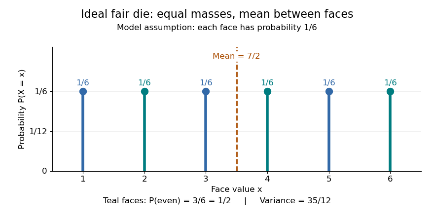
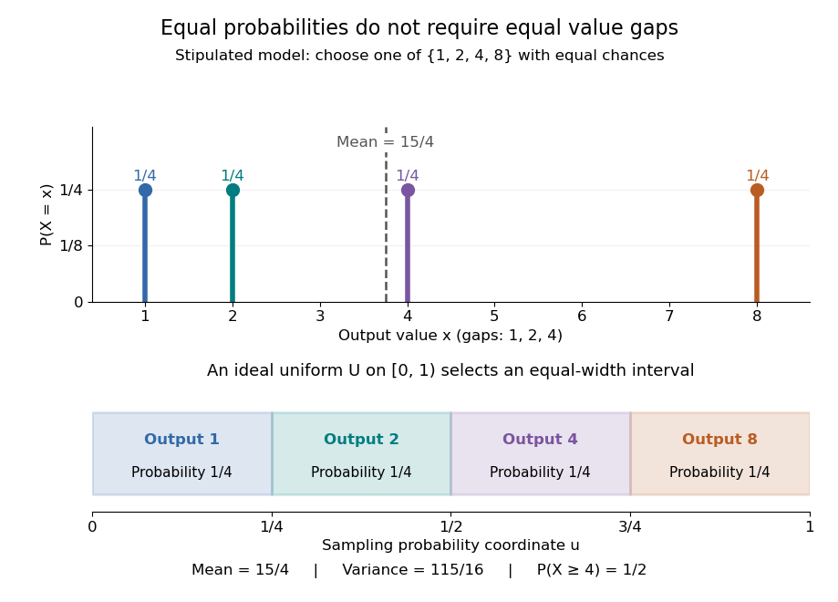

# Discrete uniform distribution

↑ **Parent:** [Discrete probability distribution](discrete-probability-distribution-split.md)  
ⓦ [Wiki](https://en.wikipedia.org/wiki/Discrete_uniform_distribution)

A [discrete uniform distribution](discrete-uniform-distribution.md) gives every element of a nonempty [finite set](finite-set.md) $S$ the same [probability](probability.md). Write $n=|S|$ for its [cardinality](cardinality.md). A [random variable](random-variable-split.md) $X$ with this law has [support of a probability distribution](support-of-a-probability-distribution.md) $S$ and [probability mass function](probability-mass-function.md)

$$
p_X(x)=\mathbb P(X=x)=\begin{cases}1/n,&x\in S,\\0,&x\notin S.\end{cases}
$$

The masses sum to $n(1/n)=1$. Conversely, if all $n$ masses equal $p$, their sum is $np=1$, so necessarily $p=1/n$. Thus equal chances determine the whole law.[Uniform Distributions on a Finite Set: definition and mass formula](random-probability-mathematical-statistics-stochastic-processes-by-kyle-siegrist/discrete-uniform-distributions.md)

Counting now computes an [event](event.md)'s [probability](probability.md): for any [set](set-split.md) $A$ of possible values,

$$
\mathbb P(X\in A)=\sum_{x\in A\cap S}\frac1n=\frac{|A\cap S|}{n}.
$$

In particular, when $A\subseteq S$, the answer is $|A|/|S|$. The [intersection](set-intersection.md) matters: values outside the [support of a probability distribution](support-of-a-probability-distribution.md) contribute zero. This turns a [probability](probability.md) question into a [combinatorics](combinatorics-split.md) question, provided that equal chances are justified by the model.

For an ideal fair six-sided die, $S=\{1,2,3,4,5,6\}$ and each face has [probability](probability.md) $1/6$. The [event](event.md) of an [even integer](even-number.md) is $\{2,4,6\}$, so its [probability](probability.md) is $3/6=1/2$; the [event](event.md) $X\geq5$ has [probability](probability.md) $2/6=1/3$. Direct [summation](summation.md) gives the [expected value](expected-value-split.md) $\mathbb E X=21/6=7/2$ and the [variance](variance-split.md) $\operatorname{Var}(X)=91/6-(7/2)^2=35/12$. The [mean](expected-value-split.md) $7/2$ is a balance point between possible outcomes. These are exact consequences of stipulated fairness, rather than measured frequencies from physical dice.

**[Figure 3](#image-an-ideal-fair-die-six-equal-probability-masses-and-a-mean-between-the-faces). An ideal fair die: six equal probability masses and a mean between the faces**.

Uniformity describes [probabilities](probability.md), not distances between values. For a second constructed model, stipulate equal-chance selection from $S=\{1,2,4,8\}$. Every value has [probability](probability.md) $1/4$, despite the unequal gaps $1,2,4$. Here $\mathbb P(X\geq4)=2/4=1/2$, while the [expected value](expected-value-split.md) and [variance](variance-split.md) are

$$
\mathbb E X=\frac{1+2+4+8}{4}=\frac{15}{4},\qquad
\mathbb E[X^2]=\frac{1+4+16+64}{4}=\frac{85}{4},\qquad
\operatorname{Var}(X)=\frac{85}{4}-\left(\frac{15}{4}\right)^2=\frac{115}{16}.
$$

Neither the midpoint of the extreme values, $9/2$, nor a formula using only the [cardinality](cardinality.md) gives these moments. For a general numerical [support of a probability distribution](support-of-a-probability-distribution.md), use its actual values:

$$
\mu=\frac1n\sum_{x\in S}x,\qquad
\operatorname{Var}(X)=\frac1n\sum_{x\in S}(x-\mu)^2.
$$

**[Figure 4](#image-equal-chances-for-unequal-gaps-four-masses-and-four-equal-width-sampling-intervals). Equal chances for unequal gaps: four masses and four equal-width sampling intervals**.

Choosing an item from a finite list with equal chances is a basic building block of [simple random sampling](simple-random-sampling.md). A [bijection](bijection.md) that relabels the items preserves equal [probabilities](probability.md), although changing numerical labels can change the [expected value](expected-value-split.md) and [variance](variance-split.md). A [function](function-split.md) that merges labels can destroy uniformity: for the fair-die model, $Y=\min(X,3)$ has masses $1/6,1/6,4/6$ at $1,2,3$, since four faces map to three. Always count the original equally likely outcomes.

An [indicator random variable](indicator-random-variable.md) for membership in a [set](set-split.md) $A\subseteq S$ has a [Bernoulli distribution](bernoulli-distribution.md) with parameter $|A|/n$; counting that [event](event.md) over $r$ [independent](independent-random-variables.md) repetitions gives a [binomial distribution](binomial-distribution.md) with parameters $r$ and $|A|/n$. Equal chances among individual values need not produce equal chances among aggregated counts.[§3.1.5, indicator random variables and binomial variables as sums of independent Bernoulli variables](introduction-to-probability-statistics-and-random-processes-by-hossein-pishro-nik.md)

**Table of contents**

- [Discrete uniform moments on an integer interval](discrete-uniform-moments-on-an-integer-interval.md)
- [Sampling a discrete uniform distribution](sampling-a-discrete-uniform-distribution.md)
- [Nondecreasing uniform samples](nondecreasing-uniform-samples.md)

## ↑ Ancestors (7)

1. [Discrete probability distribution](discrete-probability-distribution-split.md)
2. [Probability distribution](probability-distribution-split.md)
3. [Probability theory](probability-theory-split.md)
4. [Probability and statistics](probability-and-statistics-split.md)
5. [Area of mathematics](area-of-mathematics.md)
6. [Mathematics](mathematics-split.md)
7. [Codex Wiki](split.md)

## ← Incoming links (22)

- [Boole's inequality](boole-s-inequality.md)
- [Coordinate revealment](coordinate-revealment.md)
- [Discrete uniform distribution](discrete-uniform-distribution.md)
- [Discrete uniform moments on an integer interval](discrete-uniform-moments-on-an-integer-interval.md)
- [Expected query cost](expected-query-cost.md)
- [Fano's inequality](fano-s-inequality.md)
- [Independent random variables](independent-random-variables.md)
- [Information entropy dominates min-entropy](information-entropy-dominates-min-entropy.md)
- [Memorylessness of the geometric distribution](memorylessness-of-the-geometric-distribution.md)
- [Min-entropy](min-entropy.md)
- [Overlap in the union bound](overlap-in-the-union-bound.md)
- [Solution](past-exam-of-the-mathematics-course-of-the-university-of-cambridge/2008/ia/paper-2/4f/solution.md)
- [Solution](past-exam-of-the-mathematics-course-of-the-university-of-cambridge/2009/iii/paper-36/2/a/solution.md)
- [Solution](past-exam-of-the-mathematics-course-of-the-university-of-cambridge/2015/ia/paper-2/12f/solution.md)
- [Solution](past-exam-of-the-mathematics-course-of-the-university-of-cambridge/2016/iii/paper-124/1/a/solution.md)
- [Solution](past-exam-of-the-mathematics-course-of-the-university-of-cambridge/2016/iii/paper-124/3/c/solution.md)
- [Solution](past-exam-of-the-mathematics-course-of-the-university-of-cambridge/2016/iii/paper-124/5/a/solution.md)
- [Solution](past-exam-of-the-mathematics-course-of-the-year-1-of-the-natural-sciences-course-of-the-university-of-cambridge/2021/paper-1/16/a/solution.md)
- [Probability theory](probability-theory-split.md)
- [Random variable](random-variable-split.md)
- [Sampling a discrete uniform distribution](sampling-a-discrete-uniform-distribution.md)
- [Tail probability](tail-probability.md)
