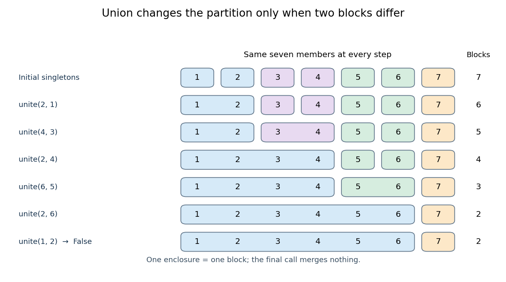

# Disjoint-set union operation

↑ **Parent:** [Disjoint-set data structure](disjoint-set-data-structure.md)

The [disjoint-set union operation](disjoint-set-union-operation.md) first uses the [disjoint-set find operation](disjoint-set-find-operation.md) to locate the [blocks of a set partition](block-of-a-set-partition.md) containing $x,y$. If they are different [blocks of a set partition](block-of-a-set-partition.md) $A,B$, replace them by their [union](set-union.md) $A\cup B$; every other [block of a set partition](block-of-a-set-partition.md) stays as it was. If the two [disjoint-set representatives](disjoint-set-representative.md) agree, no merge is needed. Here `unite` returns `True` exactly when it merges two different [blocks of a set partition](block-of-a-set-partition.md). A successful call decreases their count by one; a redundant call preserves it. The name `union` is also customary. Some interfaces instead accept already found [disjoint-set representatives](disjoint-set-representative.md), making that linking step a separate operation.

For an original example, initialize $X=\{1,2,3,4,5,6,7\}$ as seven [singleton sets](singleton-mathematics.md). Apply the calls in this order:

$$
\operatorname{unite}(2,1),\ \operatorname{unite}(4,3),\ \operatorname{unite}(2,4),\ \operatorname{unite}(6,5),\ \operatorname{unite}(2,6),\ \operatorname{unite}(1,2).
$$

The first five calls succeed. After the third, the [partition of a set](partition-of-a-set.md) is $\{\{1,2,3,4\},\{5\},\{6\},\{7\}\}$; after the fifth it is $\{\{1,2,3,4,5,6\},\{7\}\}$. The sixth returns `False`: $1,2$ are already together. The [blocks of a set partition](block-of-a-set-partition.md) number $7,6,5,4,3,2,2$, counting the initial state. A [disjoint-set find operation](disjoint-set-find-operation.md) on $7$ cannot merge it with any other member.

**[Figure 19](#image-five-successful-disjoint-set-union-operations-and-one-redundant-call-on-seven-elements). Five successful disjoint-set union operations and one redundant call on seven elements**. Each coloured enclosure is one [block of a set partition](block-of-a-set-partition.md). Columns identify the same seven members in every row; enclosures show membership rather than parent pointers.

This is exactly the kind of changing membership needed by [Kruskal component merging](kruskal-component-merging.md): an accepted [edge](edge-of-a-graph.md) joins two current [connected components of a graph](component-graph-theory.md), while an [edge](edge-of-a-graph.md) whose endpoints already have equal [disjoint-set representatives](disjoint-set-representative.md) is rejected. The existing [Kruskal's algorithm worked example](kruskal-s-algorithm-worked-example.md) follows that application. A [disjoint-set forest](disjoint-set-forest.md) stores membership efficiently without repeatedly enumerating every [block of a set partition](block-of-a-set-partition.md).

## ↑ Ancestors (4)

1. [Disjoint-set data structure](disjoint-set-data-structure.md)
2. [Data structure](data-structure-split.md)
3. [Computer science](computer-science-split.md)
4. [Codex Wiki](split.md)

## ← Incoming links (5)

- [Disjoint-set data structure](disjoint-set-data-structure.md)
- [Disjoint-set forest](disjoint-set-forest.md)
- [Disjoint-set union operation](disjoint-set-union-operation.md)
- [Union by rank](union-by-rank.md)
- [Union-find operation bounds](union-find-operation-bounds.md)
