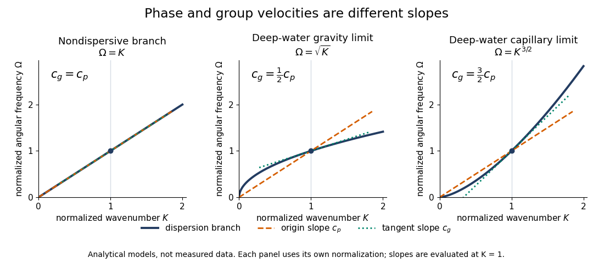
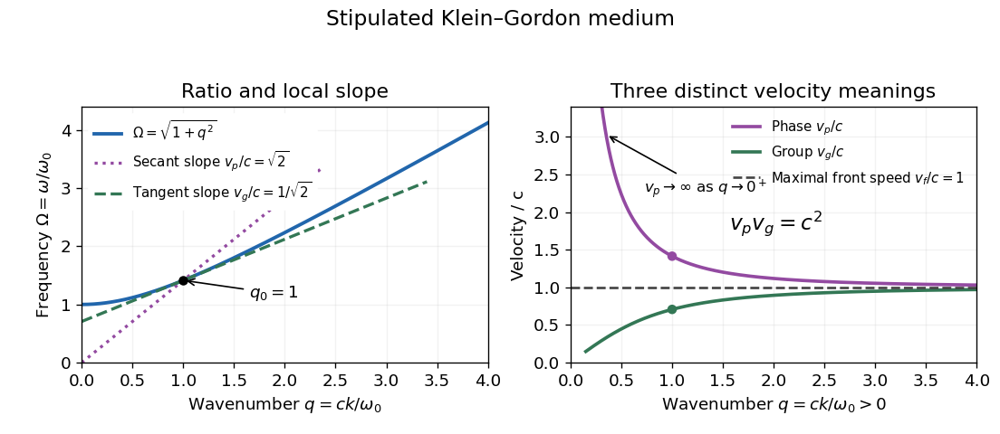
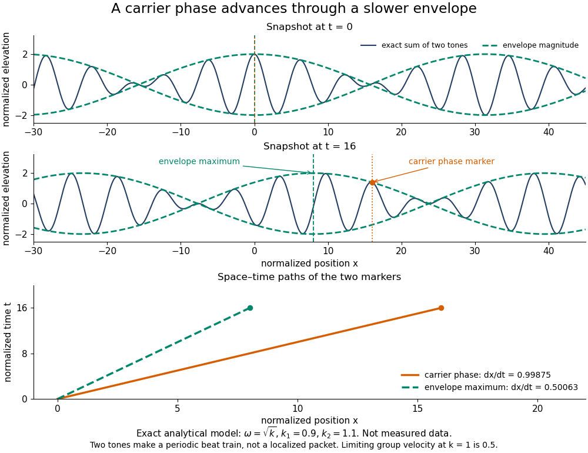
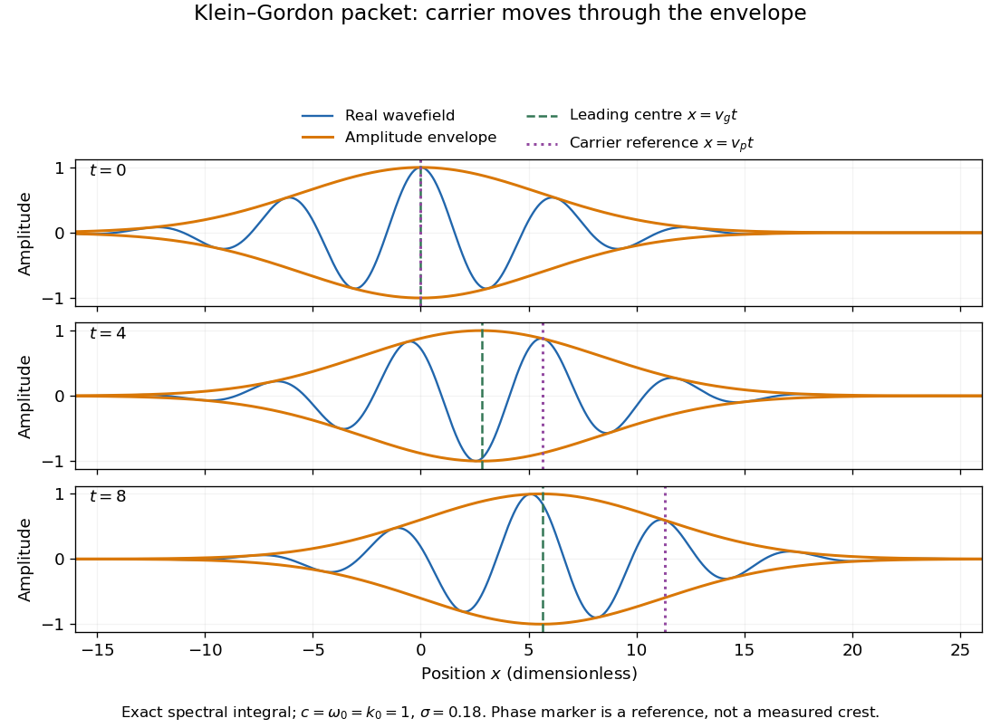

# Dispersion relation

↑ **Parent:** [Wave equation](wave-equation.md)  
ⓦ [Wiki](https://en.wikipedia.org/wiki/Dispersion_relation)

A [dispersion relation](dispersion-relation.md) specifies which [angular frequencies](lagrangian-mechanics.md#angular-frequency) and [wavevectors](elasticity-physics.md#wavevector) a linear wave model admits. Fix the [plane wave](wave-function.md#plane-wave) convention

$$
u(\mathbf x,t)=\operatorname{Re}\!\left\{a e^{i(\mathbf k\cdot\mathbf x-\omega t)}\right\},\qquad D(\omega,\mathbf k)=0.
$$

Here $a$ is a constant [complex amplitude](wave.md#complex-amplitude), $\mathbf k$ is the [wavevector](elasticity-physics.md#wavevector), and $\omega$ is the [angular frequency](lagrangian-mechanics.md#angular-frequency). Substitution into a constant-coefficient [linear partial differential equation](partial-differential-equation.md#linear-partial-differential-equation) replaces $\partial_t$ by $-i\omega$ and $\nabla$ by $i\mathbf k$, turning the wave problem into an algebraic condition. A system can have several roots; $\omega=\omega(\mathbf k)$ means one chosen branch, rather than a promise that the full [dispersion relation](dispersion-relation.md) is single-valued. For real $\mathbf k$, $\operatorname{Im}\omega>0$ means temporal growth in this convention, while $\operatorname{Im}\omega<0$ means [damping](wave-equation.md#damping). The real-branch discussion of [phase velocity](#phase-velocity) and [group velocity](#group-velocity) below assumes negligible loss.

For the one-dimensional [wave equation](wave-equation.md) $u_{tt}=c^2u_{xx}$, the [dispersion relation](dispersion-relation.md) is $\omega^2=c^2k^2$. The branch $\omega=ck$ carries right-moving [travelling waves](analysis.md#travelling-wave) for $c>0$; both its [phase velocity](#phase-velocity) and [group velocity](#group-velocity) are $c$. One may instead use the positive-[angular frequency](lagrangian-mechanics.md#angular-frequency) branch $\omega=c|k|$, with right-moving components at $k>0$ and left-moving components at $k<0$. A real wave pairs each $(k,\omega)$ with $(-k,-\omega)$; that conjugate pair represents the same travelling pattern. Branch and sign choices therefore matter when interpreting a [dispersion diagram](#dispersion-diagram).

A particularly tangible [dispersive](#wave-dispersion) example is a small-amplitude [surface gravity wave](fluid-mechanics.md#surface-gravity-wave) on still water of uniform depth $h$. Neglect [surface tension](surface-tension.md) and [viscosity](dynamic-viscosity.md), assume [incompressible flow](fluid-mechanics.md#incompressible-flow) and [irrotational flow](vorticity.md#irrotational-flow), and impose a flat impermeable bottom. With $k>0$ and positive [angular frequency](lagrangian-mechanics.md#angular-frequency),

$$
\omega^2=gk\tanh(kh),\qquad g>0.
$$

Here $g$ is [gravitational acceleration](newton-s-law-of-universal-gravitation.md#gravitational-acceleration) and $\tanh$ is the [hyperbolic tangent](calculus.md#hyperbolic-tangent). Deep water means $kh\gg1$: $\omega\simeq\sqrt{gk}$ and longer [wavelengths](wave-equation.md#wavelength) have larger [phase speed](#phase-speed). Shallow water means $kh\ll1$: $\omega\simeq\sqrt{gh}\,k$, an approximately [nondispersive wave](#nondispersive-wave). Thus depth relative to [wavelength](wave-equation.md#wavelength), rather than depth alone, determines whether crests and [wave packets](#wave-packet) travel together.[equation 3.2](physics-bibliography.md#free-surface-water-waves-13-012-hydrodynamics-for-ocean-engineers-reading-5-by-a-h-techet)

The [dispersion diagram](#dispersion-diagram) below also includes the ideal deep-water [capillary wave](surface-tension.md#capillary-wave) limit $\omega=\sqrt{\gamma/\rho}\,k^{3/2}$, where $\gamma$ is [surface tension](surface-tension.md) and $\rho$ is [mass density](fluid-mechanics.md#density). This limit requires the [surface tension](surface-tension.md) restoring term to dominate [gravity](physics.md#gravity); it reverses the trend of the [surface gravity wave](fluid-mechanics.md#surface-gravity-wave), giving larger [phase speed](#phase-speed) at shorter [wavelength](wave-equation.md#wavelength). The combined [gravity-capillary wave](surface-tension.md#gravity-capillary-wave) has $\omega^2=gk+(\gamma/\rho)k^3$.[equation 9.7](physics-bibliography.md#pulse-propagation-by-richard-fitzpatrick)

**[Figure 1](#image-analytical-dispersion-diagrams-origin-to-point-slope-gives-phase-velocity-tangent-slope-gives-group-velocity). Analytical dispersion diagrams: origin-to-point slope gives phase velocity, tangent slope gives group velocity**.

The curves use dimensionless normalizations chosen separately for each model; they are analytical diagrams, not experimental data. Their beauty is that a single [dispersion relation](dispersion-relation.md) encodes several observable behaviours: its value gives the [angular frequency](lagrangian-mechanics.md#angular-frequency), its origin-to-point slope gives the one-dimensional [phase velocity](#phase-velocity), its tangent slope gives the [group velocity](#group-velocity), and variation of that tangent slope predicts distortion of a [wave packet](#wave-packet). A straight line through the origin describes a [nondispersive wave](#nondispersive-wave); an affine branch $\omega=ck+b$ with $b\ne0$ has constant [group velocity](#group-velocity) but [phase velocity](#phase-velocity) $c+b/k$, so those properties must be distinguished.

**Table of contents**

- [Dispersive wave](#dispersive-wave)
- [Weak-stiffness string frequency shift](#weak-stiffness-string-frequency-shift)
- [Spatial root of a dispersion relation](#spatial-root-of-a-dispersion-relation)
- [Spatiotemporal wave-packet stability](#spatiotemporal-wave-packet-stability)
  - [Modulational instability](#modulational-instability)
    - [Fibre modulational instability](#fibre-modulational-instability)
      - [Sideband coupling](#sideband-coupling)
    - [Benjamin-Feir instability](#benjamin-feir-instability)
    - [Focusing nonlinear Schrodinger modulation dispersion](#focusing-nonlinear-schrodinger-modulation-dispersion)
  - [Briggs-Bers criterion](#briggs-bers-criterion)
    - [Bounded temporal growth condition for cubic dispersion](#bounded-temporal-growth-condition-for-cubic-dispersion)
    - [Quartic impulse-response Laplace resolvent](#quartic-impulse-response-laplace-resolvent)
      - [Physical-sheet growth rate of a quartic impulse response](#physical-sheet-growth-rate-of-a-quartic-impulse-response)
    - [Spatial pinch point](#spatial-pinch-point)
      - [False complex saddle in dissipative cubic dispersion](#false-complex-saddle-in-dissipative-cubic-dispersion)
      - [False spatial saddle in quartic dispersion](#false-spatial-saddle-in-quartic-dispersion)
  - [Convective wave-packet instability](#convective-wave-packet-instability)
  - [Absolute wave-packet instability](#absolute-wave-packet-instability)
  - [Finite maximum temporal growth rate](#finite-maximum-temporal-growth-rate)
- [Wave dispersion](#wave-dispersion)
  - [Intermodal dispersion](#intermodal-dispersion)
  - [Nondispersive wave](#nondispersive-wave)
- [Dispersion diagram](#dispersion-diagram)
- [Ray tracing](#ray-tracing)
  - [Travel time](#travel-time)
  - [Elastic ray](#elastic-ray)
    - [Spherical elastic ray invariant](#spherical-elastic-ray-invariant)
      - [Herglotz–Wiechert inversion](#herglotz-wiechert-inversion)
        - [Hidden turning-ray zone from nonmonotone spherical slowness](#hidden-turning-ray-zone-from-nonmonotone-spherical-slowness)
      - [Core-reflected travel time](#core-reflected-travel-time)
    - [Hyperbolic interface collimation of P-waves](#hyperbolic-interface-collimation-of-p-waves)
  - [Hamiltonian ray equations for a local dispersion relation](#hamiltonian-ray-equations-for-a-local-dispersion-relation)
    - [Simple turning point of a variable-speed wave](#simple-turning-point-of-a-variable-speed-wave)
      - [Airy scaling at a variable-speed wave turning point](#airy-scaling-at-a-variable-speed-wave-turning-point)
        - [Decaying Airy continuation and ray reflection](#decaying-airy-continuation-and-ray-reflection)
        - [Turning-point enhancement of wave amplitude](#turning-point-enhancement-of-wave-amplitude)
  - [Stationary square-root-dispersion wake](#stationary-square-root-dispersion-wake)
- [Growth rate](#growth-rate)
- [Phase velocity and group velocity](#phase-velocity-and-group-velocity)
  - [Klein-Gordon packet velocities](#klein-gordon-packet-velocities)
  - [Phase-group orthogonality for degree-zero dispersion](#phase-group-orthogonality-for-degree-zero-dispersion)
  - [Phase velocity](#phase-velocity)
    - [Horizontal phase velocity](#horizontal-phase-velocity)
    - [Phase speed](#phase-speed)
  - [Group velocity](#group-velocity)
    - [Group velocity from a period-dependent phase velocity](#group-velocity-from-a-period-dependent-phase-velocity)
    - [Group-velocity mismatch](#group-velocity-mismatch)
    - [Group velocity in material and vacuum wavelength coordinates](#group-velocity-in-material-and-vacuum-wavelength-coordinates)
    - [Group velocity dispersion](#group-velocity-dispersion)
      - [Dispersion-limited digital-fibre link length](#dispersion-limited-digital-fibre-link-length)
        - [Digital optical pulse regeneration](#digital-optical-pulse-regeneration)
      - [Dispersion length](#dispersion-length)
  - [Front velocity](#front-velocity)
  - [Information velocity](#information-velocity)
  - [Crest and trough](#crest-and-trough)
    - [Wave crest](#wave-crest)
    - [Wave trough](#wave-trough)
  - [Wave packet](#wave-packet)
    - [Crest crossings through a dispersive wave packet](#crest-crossings-through-a-dispersive-wave-packet)
    - [Envelope (waves)](#envelope-waves)
    - [Carrier wave](#carrier-wave)
    - [Gaussian envelope in a Klein-Gordon medium](#gaussian-envelope-in-a-klein-gordon-medium)
  - [Ninth-order dispersive advection equation](#ninth-order-dispersive-advection-equation)

## Dispersive wave

↑ **Parent:** [Dispersion relation](dispersion-relation.md)

A wave whose phase speed depends on frequency. In a one-dimensional branch, phase velocity is $\omega/k$ and the narrow-packet [group velocity](#group-velocity) is $d\omega/dk$. Loss, mode conversion and broad spectral bandwidth require care before identifying group speed with energy or signal transport. Confinement can create dispersion even when the underlying unbounded material has a constant wave speed.

## Weak-stiffness string frequency shift

↑ **Parent:** [Dispersion relation](dispersion-relation.md)

For the prescribed sine-mode model $\omega=k\sqrt{c_s^2+\alpha k^2}$, positive small stiffness shifts higher harmonics more strongly. Writing $\eta=\alpha k_1^2/c_s^2$ and $k_2=2k_1$ gives $\omega_2/\omega_1=2+3\eta+O(\eta^2)$. At the original fundamental quarter-period, the fundamental displacement changes to first order, but the second-mode [cosine](geometry-and-topology.md#cosine) is at an extremum and changes only to second order. If the quarter-period is redefined with the shifted fundamental [frequency](wave.md#frequency), that fundamental displacement is exactly zero. Comparing profiles requires specifying which clock convention is held fixed.

## Spatial root of a dispersion relation

↑ **Parent:** [Dispersion relation](dispersion-relation.md)

For fixed complex frequency $\omega$, a spatial root is a complex [wavenumber](wave-equation.md#wavenumber) $k$ satisfying the [dispersion relation](dispersion-relation.md). Analytic continuation of these branches from a causal temporal contour is essential in the [Briggs-Bers criterion](#briggs-bers-criterion); their collision alone does not decide whether a [spatial pinch point](#spatial-pinch-point) occurs.

## Spatiotemporal wave-packet stability

↑ **Parent:** [Dispersion relation](dispersion-relation.md)

The response to a localized perturbation must be followed in space as well as time. Growth at a fixed position is [absolute wave-packet instability](#absolute-wave-packet-instability); growth transported away while the original position decays is [convective wave-packet instability](#convective-wave-packet-instability). The [Briggs-Bers criterion](#briggs-bers-criterion) evaluates the relevant complex spatial branches of a [dispersion relation](dispersion-relation.md), while a real-wavenumber temporal mode test alone does not generally distinguish those behaviors.

### Modulational instability

↑ **Parent:** [Spatiotemporal wave-packet stability](#spatiotemporal-wave-packet-stability)  
ⓦ [Wiki](https://en.wikipedia.org/wiki/Modulational_instability)

Modulational instability is growth of long-wavelength [perturbations](asymptotic-expansion.md#perturbation) of a uniform or periodic wave due to coupling between its modulation and nonlinear dynamics. In the [focusing nonlinear Schrodinger equation](integrable-systems.md#focusing-nonlinear-schrodinger-equation), the amplitude and phase perturbations can have imaginary modulation frequencies even though the unperturbed wave is an exact solution.

#### Fibre modulational instability

↑ **Parent:** [Modulational instability](#modulational-instability)

Linearizing a uniform Kerr-fibre background couples opposite [frequency](wave.md#frequency) sidebands. With $iA_z-\beta_2A_{TT}/2+\gamma|A|^2A=0$, the displayed [dispersion relation](dispersion-relation.md) permits exponential growth precisely when $\beta_2\gamma<0$ and $0<\Omega^2<-4\gamma P/\beta_2$. For positive $\gamma$, this is anomalous [group velocity dispersion](#group-velocity-dispersion). [complex conjugation](complex-analysis.md#complex-conjugation) requires the paired complex-mode ansatz on the unstable branch. [amplitude](wave.md#wave-amplitude) and [power](energy.md#power) growth exponents differ by a factor of two.

##### Sideband coupling

↑ **Parent:** [Fibre modulational instability](#fibre-modulational-instability)

Linearization around a pumped background couples the [perturbation](asymptotic-expansion.md#perturbation) at positive [frequency](wave.md#frequency) offset to the conjugate of the negative-offset [perturbation](asymptotic-expansion.md#perturbation). Their matrix [eigenvalues](linear-operator-theory.md#eigenvalue) determine amplification; assuming two unrelated scalar phase shifts misses the instability.

#### Benjamin-Feir instability

↑ **Parent:** [Modulational instability](#modulational-instability)

For the [complex Ginzburg–Landau equation](partial-differential-equation.md#complex-ginzburg-landau-equation) $A_t=A+(1+ic_1)A_{xx}-(1+ic_3)|A|^2A$, the uniform oscillation has a neutral [phase](wave.md#phase-waves) mode whose [growth rate](#growth-rate) is $\lambda=-(1+c_1c_3)k^2+O(k^4)$. Negative [phase](wave.md#phase-waves) diffusion therefore causes a long-wavelength [modulational instability](#modulational-instability). The [Benjamin-Feir stability condition](partial-differential-equation.md#benjamin-feir-stability-condition) is the complementary positive-diffusion condition. On a finite domain an unstable wavenumber must actually be allowed by the boundary conditions.

#### Focusing nonlinear Schrodinger modulation dispersion

↑ **Parent:** [Modulational instability](#modulational-instability)

For $-iA_t+\chi A_{xx}-\mu A+\delta A|A|^2=0$ with positive coefficients, linearize around $A=\sqrt{\mu/\delta}$ using real amplitude and phase perturbations. Their two-by-two [dispersion relation](dispersion-relation.md) gives the displayed equation. The [modulational instability](#modulational-instability) band is $0<K^2<2\mu/\chi$, with maximum [growth rate](#growth-rate) $\mu$ at $K^2=\mu/\chi$.

### Briggs-Bers criterion

↑ **Parent:** [Spatiotemporal wave-packet stability](#spatiotemporal-wave-packet-stability)  
ⓦ [Wiki](https://en.wikipedia.org/wiki/Briggs–Bers_criterion)

A criterion for [absolute wave-packet instability](#absolute-wave-packet-instability) based on analytic continuation of the spatial roots of a [dispersion relation](dispersion-relation.md). Start the temporal inversion contour above the spectrum, then lower it while deforming the spatial contour. A [spatial pinch point](#spatial-pinch-point) occurs when branches originating in opposite spatial half-planes obstruct that deformation. A double root $D=D_k=0$ is only an algebraic candidate. The opposite-half-plane condition is stated in the primary study [https://doi.org/10.1017/jfm.2016.195,](https://doi.org/10.1017/jfm.2016.195,) section 4.2.

#### Bounded temporal growth condition for cubic dispersion

↑ **Parent:** [Briggs-Bers criterion](#briggs-bers-criterion)

For $\omega(k)=i\alpha k^2-\beta k^3-i\gamma$, real-wavenumber growth is $\operatorname{Re}\alpha\,k^2-\operatorname{Im}\beta\,k^3-\operatorname{Re}\gamma$. A nonzero cubic coefficient is unbounded above on one side; after it vanishes, a positive quadratic coefficient is unbounded above on both sides. The displayed conditions are therefore necessary and sufficient for a finite temporal upper bound, which is then $-\operatorname{Re}\gamma$. The bound permits the initial causal temporal contour required by the [Briggs-Bers criterion](#briggs-bers-criterion).

#### Quartic impulse-response Laplace resolvent

↑ **Parent:** [Briggs-Bers criterion](#briggs-bers-criterion)

For the whole-line equation $A_t+a_1A_{xx}+a_2A_{xxxx}+a_3A=0$ with $\operatorname{Re}a_2>0$, the [dispersion relation](dispersion-relation.md) is $s=a_1k^2-a_2k^4-a_3$. The temporal [Laplace transform](integral-transform.md#laplace-transform) of the impulse response at zero is the real-k integral of $[s+a_3-a_1k^2+a_2k^4]^{-1}/(2\pi)$. Factor the denominator as $a_2(k^2+\kappa_1^2)(k^2+\kappa_2^2)$ with $\operatorname{Re}\kappa_j>0$ for large $\operatorname{Re}s$. Partial fractions give the displayed resolvent. Square-root sheets are chosen by continuation from this causal large-s region; choosing roots independently can introduce false [spatial pinch points](#spatial-pinch-point).

##### Physical-sheet growth rate of a quartic impulse response

↑ **Parent:** [Quartic impulse-response Laplace resolvent](#quartic-impulse-response-laplace-resolvent)

Put $z=a_1/\sqrt{a_2}$ using the root with positive real part. The additional resolvent singularity at $s+a_3=z^2/4$ lies on the physical square-root sheet only when $\operatorname{Re}z>0$; otherwise the apparent saddle is on the other sheet. The singularity at $s=-a_3$ remains, including a quartic degeneracy when $a_1=0$. The rightmost physical singularity determines the exponential fixed-position growth rate. Compare it with the temporal maximum $-\operatorname{Re}a_3+\max(\operatorname{Re}a_1,0)^2/(4\operatorname{Re}a_2)$ to distinguish [absolute wave-packet instability](#absolute-wave-packet-instability) from [convective wave-packet instability](#convective-wave-packet-instability). Equality cases require their algebraic prefactors.

#### Spatial pinch point

↑ **Parent:** [Briggs-Bers criterion](#briggs-bers-criterion)

A collision of spatial branches which pinches the spatial inversion contour as the temporal contour is lowered from above all singularities. The branches must originate on opposite sides of the spatial contour. A collision of two upper-half-plane branches or two lower-half-plane branches can solve the double-root equations without causing [absolute wave-packet instability](#absolute-wave-packet-instability).

##### False complex saddle in dissipative cubic dispersion

↑ **Parent:** [Spatial pinch point](#spatial-pinch-point)

For these constants, every real-wavenumber [growth rate](#growth-rate) is $-k^2-1/10<0$. The real-contour impulse integral decays with envelope $e^{-t/10}t^{-1/2}$ at fixed position. Yet the stationary candidate $k=-2i/3$ has $\operatorname{Im}\omega=4/27-1/10>0$. It cannot be a contributing [spatial pinch point](#spatial-pinch-point); otherwise it would contradict the real-contour growth bound. This explicit example shows why solving the algebraic saddle equations is insufficient for [absolute wave-packet instability](#absolute-wave-packet-instability).

##### False spatial saddle in quartic dispersion

↑ **Parent:** [Spatial pinch point](#spatial-pinch-point)

The real dispersion above is temporally stable for every real $k$, but its analytic continuation has stationary points at $k=\pm i$ with $\omega=i/2$. Writing $\omega=i\Omega$ gives $k^2=-1\pm\sqrt{1/2-\Omega}$; as $\Omega$ decreases to $1/2$, both branches at $+i$ approach from the upper half-plane and both at $-i$ from the lower. These are not [spatial pinch points](#spatial-pinch-point). This provides a concrete counterexample to treating growing algebraic double roots as sufficient for [absolute wave-packet instability](#absolute-wave-packet-instability).

### Convective wave-packet instability

↑ **Parent:** [Spatiotemporal wave-packet stability](#spatiotemporal-wave-packet-stability)

A localized disturbance grows along some moving rays but decays at its original fixed location. This wave-packet meaning differs from buoyancy-driven stellar convection and is therefore given a distinct canonical title. Changing the observation frame can change the absolute/convective classification. The [Briggs-Bers criterion](#briggs-bers-criterion) uses the laboratory-frame impulse response to distinguish this case from [absolute wave-packet instability](#absolute-wave-packet-instability).

### Absolute wave-packet instability

↑ **Parent:** [Spatiotemporal wave-packet stability](#spatiotemporal-wave-packet-stability)

A localized perturbation has positive asymptotic exponential growth at a fixed observation point in the chosen reference frame. The relevant [spatial pinch point](#spatial-pinch-point) of the [Briggs-Bers criterion](#briggs-bers-criterion) has positive imaginary [frequency](wave.md#frequency). Merely finding a growing temporal mode or a formal complex saddle is not sufficient; the saddle must contribute to the localized impulse response.

### Finite maximum temporal growth rate

↑ **Parent:** [Spatiotemporal wave-packet stability](#spatiotemporal-wave-packet-stability)

With normal modes $e^{ikx-i\omega t}$, a finite upper bound on $\operatorname{Im}\omega$ allows the inverse temporal [Laplace transform](integral-transform.md#laplace-transform) contour to start above all temporal singularities. An unbounded growth rate at high real [wavenumber](wave-equation.md#wavenumber) prevents the standard causal [Green function](green-s-function.md) construction used in the [Briggs-Bers criterion](#briggs-bers-criterion). For $\operatorname{Im}\omega=\alpha k^2-\beta k^4-\gamma$ with nonzero real $\beta$, the bound holds exactly when $\beta>0$.

## Wave dispersion

↑ **Parent:** [Dispersion relation](dispersion-relation.md)

Wave dispersion means that [phase velocity](#phase-velocity) depends on [wavenumber](wave-equation.md#wavenumber) or, equivalently, [wavelength](wave-equation.md#wavelength). [Wave packets](#wave-packet) generally travel with [group velocity](#group-velocity), which need not equal [phase velocity](#phase-velocity). The [linear rotating shallow-water dispersion relation](geophysical-fluid-dynamics.md#linear-rotating-shallow-water-dispersion-relation) $\omega^2=f^2+c^2k^2$ has faster long-wave phase motion but slower long-[wave packet](#wave-packet) motion when $f\ne0$.

### Intermodal dispersion

↑ **Parent:** [Wave dispersion](#wave-dispersion)

[Intermodal dispersion](#intermodal-dispersion) is the temporal separation of components in different propagating [normal modes](wave-equation.md#normal-mode) because their [group velocities](#group-velocity) differ. A pulse exciting several modes can therefore broaden even when its individual modal components have negligible bandwidth. It is distinct from [group velocity dispersion](#group-velocity-dispersion) within a single mode.

### Nondispersive wave

↑ **Parent:** [Wave dispersion](#wave-dispersion)

A nondispersive wave has constant [phase velocity](#phase-velocity) on a propagation branch. For $\omega=ck$, its [group velocity](#group-velocity) is also $c$. A [frequency](wave.md#frequency) relation with a nonzero offset, such as $\omega=ck+b$, has constant [group velocity](#group-velocity) but a [phase velocity](#phase-velocity) $c+b/k$ depending on [wavenumber](wave-equation.md#wavenumber); constant [group velocity](#group-velocity) alone is therefore not sufficient for nondispersion.

## Dispersion diagram

↑ **Parent:** [Dispersion relation](dispersion-relation.md)

A dispersion diagram plots the branches of a [dispersion relation](dispersion-relation.md), usually with [wavenumber](wave-equation.md#wavenumber) on the horizontal axis and [angular frequency](lagrangian-mechanics.md#angular-frequency) on the vertical axis. Its slopes, intersections, and gaps display [group velocities](#group-velocity), mode conversion, and forbidden frequency ranges.

## Ray tracing

↑ **Parent:** [Dispersion relation](dispersion-relation.md)

Ray tracing follows the paths along which a slowly modulated wave packet propagates. For a local dispersion relation $\omega=\Omega(\mathbf k;\mathbf x,t)$, the ray velocity is the [group velocity](#group-velocity) $\nabla_{\mathbf k}\Omega$.

### Travel time

↑ **Parent:** [Ray tracing](#ray-tracing)

A wave's travel time along a [elastic ray](#elastic-ray) is the integral of local [slowness](wave-equation.md#slowness) against [arc length](riemannian-geometry.md#arc-length). Its variation with source and receiver position describes the arrival branches, including transmitted and reflected paths. Different paths can have different travel times between the same endpoints.

### Elastic ray

↑ **Parent:** [Ray tracing](#ray-tracing)

In a smooth isotropic medium, an [elastic ray](#elastic-ray) is the path followed by a local [wavefront](physical-optics.md#wavefront) normal, with the appropriate P or S [wave speed](wave-equation.md#wave-speed) $c$. Arclength $s$ gives the displayed trajectory and travel-time equations. Its neighboring ray paths determine geometrical spreading, while the [eikonal equation](elasticity-physics.md#eikonal-equation) determines the normals. A [caustic](geometrical-optics.md#wave-caustic) occurs where the neighboring paths focus and the elementary ray [wave amplitude](wave.md#wave-amplitude) description ceases to be uniform.

#### Spherical elastic ray invariant

↑ **Parent:** [Elastic ray](#elastic-ray)

For an [isotropic](continuum-mechanics.md#isotropy) radial [wave speed](wave-equation.md#wave-speed) $\alpha(r)$, the [elastic ray](#elastic-ray) equations imply conservation of $\mathbf x\times\mathbf y$, where $\mathbf y$ is the [slowness](wave-equation.md#slowness) vector. Indeed, its derivative is $\alpha\mathbf y\times\mathbf y+\mathbf x\times\nabla(1/\alpha)=0$. Thus each nonradial [elastic ray](#elastic-ray) lies in a fixed plane through the centre and $p=|\mathbf x\times\mathbf y|$ is constant. The angle $i$ is measured from the radial direction; tangential [slowness](wave-equation.md#slowness) continuity preserves $p$ across spherical interfaces.

<h5 id="herglotz-wiechert-inversion">Herglotz–Wiechert inversion</h5>

↑ **Parent:** [Spherical elastic ray invariant](#spherical-elastic-ray-invariant)

For a spherically symmetric speed with strictly increasing $\eta(r)=r/v(r)$, a turning ray of parameter $p$ has $\Delta(p)=2p\int_p^{\eta_a}(d\log r/d\eta)(\eta^2-p^2)^{-1/2}\,d\eta$. Integrate this against $(p^2-\mu^2)^{-1/2}$ and interchange the triangular integration region. The inner kernel integral is $\pi/2$, giving the displayed radius and then $v(r(\mu))=r(\mu)/\mu$. Complete turning-ray branch data are required.

###### Hidden turning-ray zone from nonmonotone spherical slowness

↑ **Parent:** [Herglotz–Wiechert inversion](#herglotz-wiechert-inversion)

Where $\eta=r/v$ decreases outwards, it increases as a surface ray travels inward, so no surface ray turns inside that interval. Penetrating rays may traverse it and turn deeper. The radius is then not a single-valued function of $\eta$, and angular ray data constrain combined branch contributions rather than the single function inverted by [Herglotz–Wiechert inversion](#herglotz-wiechert-inversion). Additional structural or observational information is needed to locate the hidden profile.

##### Core-reflected travel time

↑ **Parent:** [Spherical elastic ray invariant](#spherical-elastic-ray-invariant)

In a constant-speed spherical shell with outer radius $R$ and inner radius $a$, a symmetric single reflection from the inner boundary has the displayed [travel time](#travel-time). The boundary lies on the angular bisector of source and receiver. The branch exists only for $0\leq\Delta\leq2\arccos(a/R)$, since the incident line must remain in the shell. At the endpoint it joins the mantle-only chord branch with the same slope $a/c$. Continuing the formula beyond that endpoint would make the line intersect the inner boundary before its supposed reflection point.

#### Hyperbolic interface collimation of P-waves

↑ **Parent:** [Elastic ray](#elastic-ray)

A solid-to-fluid interface can turn spherical source [P waves](wave-equation.md#p-wave) into parallel vertical rays if its height $Z(R)$ satisfies the displayed travel-time identity, with $r=\sqrt{R^2+Z^2}$. The positive branch through $Z(0)=z_0$ is a hyperboloid when $\alpha>\alpha_f$. Differentiating the travel-time identity enforces [Snell law for elastic and acoustic waves](elasticity-physics.md#snell-law-for-elastic-and-acoustic-waves). Travel time above the interface is then $z_0/\alpha+(z-z_0)/\alpha_f$, independent of cylindrical radius. The leading [wavefront](physical-optics.md#wavefront) is planar although its [wave amplitude](wave.md#wave-amplitude) need not be uniform across that plane.

### Hamiltonian ray equations for a local dispersion relation

↑ **Parent:** [Ray tracing](#ray-tracing)

A local [dispersion relation](dispersion-relation.md) $\omega=\Omega(\mathbf k;\mathbf X,T)$ yields

$$
\frac{d\mathbf X}{dT}=\nabla_{\mathbf k}\Omega,\quad\frac{d\mathbf k}{dT}=-\nabla_{\mathbf X}\Omega\big|_{\mathbf k},\quad\frac{d\omega}{dT}=\Omega_T\big|_{\mathbf k}.
$$

The spatial and temporal derivatives on the right hold the [wavevector](elasticity-physics.md#wavevector) fixed. Translation symmetries conserve the corresponding wavevector components, while time independence conserves frequency.

#### Simple turning point of a variable-speed wave

↑ **Parent:** [Hamiltonian ray equations for a local dispersion relation](#hamiltonian-ray-equations-for-a-local-dispersion-relation)

A simple turning point for a stratified [wavespeed](wave-equation.md#wave-speed) occurs at $c(Y_s)=\omega/k$, where $Q=\omega^2/c^2-k^2$ has a nonzero derivative. If $c_Y(Y_s)>0$, write $q=-Q'(Y_s)>0$; then $\ell\sim[q(Y_s-Y)]^{1/2}$ below it. The vertical [group velocity](#group-velocity) vanishes and the [stationary wave amplitude in a stratified wavespeed](geometrical-optics.md#stationary-wave-amplitude-in-a-stratified-wavespeed) diverges as $(Y_s-Y)^{-1/4}$.

##### Airy scaling at a variable-speed wave turning point

↑ **Parent:** [Simple turning point of a variable-speed wave](#simple-turning-point-of-a-variable-speed-wave)

In $\varepsilon^2\Psi''+2\varepsilon^2(c'/c)\Psi'+Q(Y)\Psi=0$, with $Q\sim-q(Y-Y_s)$ and $q>0$, set $Y-Y_s=(\varepsilon^2/q)^{1/3}\eta$. The leading equation is $\Psi_{\eta\eta}-\eta\Psi=0$, the [Airy ordinary differential equation](linear-ordinary-differential-equation.md#airy-ordinary-differential-equation). The first derivative and nonlinear coefficient corrections are smaller by $O(\varepsilon^{2/3})$.

###### Decaying Airy continuation and ray reflection

↑ **Parent:** [Airy scaling at a variable-speed wave turning point](#airy-scaling-at-a-variable-speed-wave-turning-point)

The local inner solution is a combination of [Airy functions](linear-ordinary-differential-equation.md#airy-function) $\operatorname{Ai},\operatorname{Bi}$. Decay in the forbidden region removes $\operatorname{Bi}$. The remaining [Airy turning-point connection formula](analysis.md#airy-turning-point-connection-formula) is oscillatory on the allowed side and represents an incident/reflected pair, not a single upward branch. Without the forbidden-side condition the local differential equation alone leaves both coefficients free.

###### Turning-point enhancement of wave amplitude

↑ **Parent:** [Airy scaling at a variable-speed wave turning point](#airy-scaling-at-a-variable-speed-wave-turning-point)

A simple ray turning point has outer [amplitude](wave.md#wave-amplitude) proportional to $|Y-Y_s|^{-1/4}$. At the [Airy scaling at a variable-speed wave turning point](#airy-scaling-at-a-variable-speed-wave-turning-point), $|Y-Y_s|=O(\varepsilon^{2/3})$, this gives an inner wavefield of size $O(\varepsilon^{-1/6})$ when the incident action normalization is order one. The enhancement is finite for nonzero $\varepsilon$ and is resolved by the [Airy function](linear-ordinary-differential-equation.md#airy-function).

### Stationary square-root-dispersion wake

↑ **Parent:** [Ray tracing](#ray-tracing)

For the zero-frequency dispersion relation

$$
\Omega=\alpha|\mathbf k|^{1/2}-Vk_1,
$$

write $\mathbf k=\kappa(\cos\phi,\sin\phi)$. Then

$$
\kappa=\frac{\alpha^2}{V^2\cos^2\phi},
\qquad
\tan\psi=-\frac{\tan\phi}{1+2\tan^2\phi},
$$

where $\psi$ is the direction of the [group velocity](#group-velocity). Maximizing the angular slope gives a downstream wake wedge of semi-angle

$$
\tan^{-1}(2^{-3/2}).
$$

## Growth rate

↑ **Parent:** [Dispersion relation](dispersion-relation.md)

For a normal mode proportional to $e^{\sigma t}$, the real part $\operatorname{Re}\sigma$ is its exponential growth rate. A positive growth rate signals linear instability.

## Phase velocity and group velocity

↑ **Parent:** [Dispersion relation](dispersion-relation.md)

For a dispersion relation $\omega(k)$, the phase velocity is $c_p=\omega/k$ and the group velocity is $c_g=d\omega/dk$. For the Klein-Gordon relation at $k>0$,

$$
c_p=c\frac{\sqrt{k^2+A^2}}{k}>c,
\qquad
c_g=c\frac{k}{\sqrt{k^2+A^2}}<c,
\qquad
c_pc_g=c^2.
$$

### Klein-Gordon packet velocities

↑ **Parent:** [Phase velocity and group velocity](#phase-velocity-and-group-velocity)

A useful stipulated dispersive medium obeys the [Klein-Gordon equation](wave-equation.md#klein-gordon-equation) $u_{tt}-c^2u_{xx}+\omega_0^2u=0$, with $c>0$ and $\omega_0>0$. Its positive-[angular frequency](lagrangian-mechanics.md#angular-frequency) [dispersion relation](dispersion-relation.md) is

$$
\omega(k)=\sqrt{\omega_0^2+c^2k^2},\qquad
v_p=\frac{\omega(k)}{k},\qquad
v_g=\omega'(k)=\frac{c^2k}{\omega(k)}.
$$

Here $\omega_0$ is the gap at zero [wavenumber](wave-equation.md#wavenumber), not the central [angular frequency](lagrangian-mechanics.md#angular-frequency) $\omega_c=\omega(k_0)$ of a [wave packet](#wave-packet); the parameter in the preceding formula is $A=\omega_0/c$. For $k>0$, the [phase velocity](#phase-velocity) satisfies $v_p>c$, the [group velocity](#group-velocity) satisfies $0<v_g<c$, and $v_pv_g=c^2$. In this stipulated medium $c$ is the limiting propagation speed of the model; it need not mean the vacuum [speed of light](special-relativity.md#speed-of-light). The same square-root [dispersion relation](dispersion-relation.md) appears in [waveguide phase and group velocities](electromagnetic-wave.md#waveguide-phase-and-group-velocities), with a [waveguide cutoff frequency](electromagnetic-wave.md#waveguide-cutoff-frequency) playing the role of $\omega_0$.[equation 9.6 and equations 9.10–9.12: square-root dispersion and local group velocity](physics-bibliography.md#pulse-propagation-by-richard-fitzpatrick)

For the original dimensionless choice $c=\omega_0=k_0=1$, a [carrier wave](#carrier-wave) has [phase velocity](#phase-velocity) $v_p=\sqrt2$, while a narrow [wave packet](#wave-packet) has leading [group velocity](#group-velocity) $v_g=1/\sqrt2$. After time $t=8$, the carrier's zero-[wave phase](wave.md#phase-waves) reference has moved to $x=8\sqrt2\simeq11.31$, whereas the leading [wave envelope](#envelope-waves) centre is at $x=8/\sqrt2\simeq5.66$. A carrier [wave crest](#wave-crest) therefore moves through the [wave envelope](#envelope-waves); it does not carry an identifiable piece of the envelope with it.

**[Figure 2](#image-stipulated-klein-gordon-medium-secant-phase-velocity-tangent-group-velocity-and-front-speed). Stipulated Klein-Gordon medium: secant phase velocity, tangent group velocity and front speed**.

The origin-to-curve secant on the [dispersion diagram](#dispersion-diagram) gives [phase velocity](#phase-velocity), while its local tangent gives [group velocity](#group-velocity). As $k\to0^+$, $v_p\to\infty$ and $v_g\to0$; at $k=0$ the [phase velocity](#phase-velocity) itself is undefined. As $k\to\infty$, both approach $c$, from opposite sides. On the same positive-[angular frequency](lagrangian-mechanics.md#angular-frequency) branch with $k<0$, both signed velocities are negative and their product remains $c^2$. These conventions distinguish direction from [phase speed](#phase-speed). Reversing both $k$ and $\omega$ represents the same real [plane wave](wave-function.md#plane-wave); changing just one sign changes its direction.

For an original finite-bandwidth check, take equal-amplitude [plane waves](wave-function.md#plane-wave) at $k_1=0.8$ and $k_2=1.2$, still with $c=\omega_0=1$. The exact two-tone [wave envelope](#envelope-waves) speed is

$$
v_{\rm beat}=\frac{\sqrt{1+1.2^2}-\sqrt{1+0.8^2}}{1.2-0.8}\simeq0.703563,
$$

while its [carrier wave](#carrier-wave) has [phase velocity](#phase-velocity) $(\sqrt{1+0.8^2}+\sqrt{1+1.2^2})/2\simeq1.421337$. Their product is exactly $1$: rationalizing the difference gives $v_{\rm beat}=2/(\omega_1+\omega_2)$. Nevertheless $v_{\rm beat}\ne\omega'(1)$; the derivative describes the limit of vanishing separation, not an arbitrary pair of tones. The two-tone [wave envelope](#envelope-waves) repeats indefinitely, so it has no isolated first arrival and cannot measure [front velocity](#front-velocity).

### Phase-group orthogonality for degree-zero dispersion

↑ **Parent:** [Phase velocity and group velocity](#phase-velocity-and-group-velocity)

If a differentiable [dispersion relation](dispersion-relation.md) $\omega(\mathbf k)$ is homogeneous of degree zero at nonzero $\mathbf k$, the [Euler homogeneous function theorem](real-analysis.md#euler-theorem-for-homogeneous-functions) gives $\mathbf k\cdot\nabla_{\mathbf k}\omega=0$. Therefore [phase velocity](#phase-velocity) $\omega\mathbf k/k^2$ is orthogonal to [group velocity](#group-velocity) $\nabla_{\mathbf k}\omega$. The result applies exactly to limiting [inertial waves](geophysical-fluid-dynamics.md#inertial-wave); finite compressibility can alter the dispersion.

### Phase velocity

↑ **Parent:** [Phase velocity and group velocity](#phase-velocity-and-group-velocity)  
ⓦ [Wiki](https://en.wikipedia.org/wiki/Phase_velocity)

The [phase velocity](#phase-velocity) is the motion of a constant-[wave phase](wave.md#phase-waves) surface. For a one-dimensional [plane wave](wave-function.md#plane-wave) $u=a\cos(kx-\omega t+\phi_0)$ with real $k\ne0$ and real $\omega$, fixing $kx-\omega t+\phi_0$ gives

$$
k\frac{dx}{dt}-\omega=0,\qquad c_p=\frac{\omega}{k}.
$$

Each [wave crest](#wave-crest) of this monochromatic [travelling wave](analysis.md#travelling-wave) advances at that signed [phase velocity](#phase-velocity). Its magnitude is the [phase speed](#phase-speed) $|c_p|=\lambda/T$, where $\lambda=2\pi/|k|$ is the [wavelength](wave-equation.md#wavelength) and $T=2\pi/|\omega|$ is the temporal [period](mathematics.md#period-of-a-function) when $\omega\ne0$. Choosing $\omega>0$ makes positive $k$ mean rightward [phase velocity](#phase-velocity) and negative $k$ mean leftward [phase velocity](#phase-velocity). Reversing both signs leaves the real [plane wave](wave-function.md#plane-wave) and its [phase velocity](#phase-velocity) unchanged. At $k=0$ there are no spatial crests to track, so $\omega/k$ is undefined; a finite limit as $k\to0$ is a limiting [phase speed](#phase-speed), not the speed of a spatially uniform oscillation.

In several dimensions, a [plane wave](wave-function.md#plane-wave) has [wave phase](wave.md#phase-waves) $\mathbf k\cdot\mathbf x-\omega t+\phi_0$. Constant-[wave phase](wave.md#phase-waves) planes obey $\mathbf k\cdot\mathbf v=\omega$. Their normal [phase velocity](#phase-velocity) is

$$
\mathbf c_p=\frac{\omega\mathbf k}{|\mathbf k|^2}\qquad(\mathbf k\ne0).
$$

Tangential motion within a plane does not move that [wavefront](physical-optics.md#wavefront), which is why the normal direction fixes the vector convention. In an [anisotropic](continuum-mechanics.md#anisotropy) medium the [group velocity](#group-velocity) need not point along this [wavevector](elasticity-physics.md#wavevector). Likewise the [horizontal phase velocity](#horizontal-phase-velocity) of a tilted [wavefront](physical-optics.md#wavefront) is its crossing speed along a horizontal line, rather than a component of the normal [phase velocity](#phase-velocity).

For the [nondispersive wave](#nondispersive-wave) branch $\omega=ck$, a [wave crest](#wave-crest) and a [wave envelope](#envelope-waves) both move at $c$. For deep-water [surface gravity waves](fluid-mechanics.md#surface-gravity-wave), $\omega=\sqrt{gk}$ gives $c_p=\sqrt{g/k}$ and [group velocity](#group-velocity) $c_g=c_p/2$. With the illustrative choices $g=9.81\,\mathrm{m\,s^{-2}}$ and $\lambda=1\,\mathrm m$, the model predicts $c_p\simeq1.25\,\mathrm{m\,s^{-1}}$ and $c_g\simeq0.625\,\mathrm{m\,s^{-1}}$. These are calculated values for negligible [surface tension](surface-tension.md) and sufficiently large $kh$, not measurements. A [wave crest](#wave-crest) moves forward through the [wave packet](#wave-packet), so timing a crest does not time the packet's journey.

There is a direct laboratory meaning to this distinction. MIT's 2005 surface-wave lab uses a long water tank, a controllable hydraulic paddle, and an absorbing beach. Resistance probes convert submerged length into voltage; calibration converts their readouts into [free surface](fluid-mechanics.md#free-surface) elevation versus time. Two probes a known distance apart, backed by a ruler and stopwatch, let students time a [wave crest](#wave-crest) and separately time a feature of the [wave packet](#wave-packet). The lab records depth and varies [frequency](wave.md#frequency) and [wave amplitude](wave.md#wave-amplitude).[Surface Waves Kinematics (MIT 2.016 Hydrodynamics) by Massachusetts Institute of Technology, 2.016 course staff](physics-bibliography.md#surface-waves-kinematics-mit-2-016-hydrodynamics-by-massachusetts-institute-of-technology-2-016-course-staff)

For a clean measurement of [phase velocity](#phase-velocity), fit the periodic portion of both records or follow one identifiable [wave crest](#wave-crest). A phase difference is only known modulo $2\pi$: probe spacing below half the shortest relevant [wavelength](wave-equation.md#wavelength), or continuity while sweeping [frequency](wave.md#frequency), avoids assigning the wrong whole-cycle delay. Then compare the timed [phase velocity](#phase-velocity) with $\lambda/T$. Tracking pepper grains instead measures fluid-particle motion, which has a different meaning from either [phase velocity](#phase-velocity) or [group velocity](#group-velocity).

The [Klein-Gordon packet velocities](#klein-gordon-packet-velocities) example makes the distinction especially sharp: its [phase velocity](#phase-velocity) exceeds $c$, yet its narrow [wave envelope](#envelope-waves) moves below $c$. A [carrier wave](#carrier-wave) labels successive oscillations; its speed alone does not establish [information velocity](#information-velocity). The [front velocity](#front-velocity) depends on the full causal model, including [angular frequencies](lagrangian-mechanics.md#angular-frequency) far outside the carrier's narrow range.

#### Horizontal phase velocity

↑ **Parent:** [Phase velocity](#phase-velocity)

For phase $kx+mz-\omega t$ with $k\ne0$, hold $z$ fixed: a contour of constant [wave phase](wave.md#phase-waves) advances in $x$ at $\omega/k$. This is the speed at which a tilted [wavefront](physical-optics.md#wavefront) crosses a horizontal line. It differs from the horizontal component of the vector [phase velocity](#phase-velocity), $\omega k/(k^2+m^2)$, which is defined along the [wavevector](elasticity-physics.md#wavevector).

#### Phase speed

↑ **Parent:** [Phase velocity](#phase-velocity)

The magnitude of the [phase velocity](#phase-velocity) of a real-frequency plane [Fourier mode](fourier-analysis.md#fourier-mode) is $|\omega|/|\mathbf k|$. In an anisotropic medium it depends on the direction of the [wave vector](elasticity-physics.md#wavevector) and need not equal the [group velocity](#group-velocity) magnitude.

### Group velocity

↑ **Parent:** [Phase velocity and group velocity](#phase-velocity-and-group-velocity)  
ⓦ [Wiki](https://en.wikipedia.org/wiki/Group_velocity)

The [group velocity](#group-velocity) of a differentiable, real [dispersion relation](dispersion-relation.md) branch is

$$
\mathbf c_g=\nabla_{\mathbf k}\omega(\mathbf k_0),\qquad c_g=\frac{d\omega}{dk}(k_0)\ \text{in one dimension}.
$$

It describes the leading translation of a narrow-band [wave packet](#wave-packet) centred on [wavevector](elasticity-physics.md#wavevector) $\mathbf k_0$, assuming a linear model, a locally uniform medium and negligible loss. Narrow-band means that the appreciably excited [wavevectors](elasticity-physics.md#wavevector) occupy a small neighbourhood on which one smooth branch can be linearized. Write its complex wavefield as

$$
\psi(\mathbf x,t)=\int a(\mathbf q)e^{i[(\mathbf k_0+\mathbf q)\cdot\mathbf x-\omega(\mathbf k_0+\mathbf q)t]}\,d\mathbf q.
$$

The [Taylor expansion](calculus.md#taylor-expansion) $\omega(\mathbf k_0+\mathbf q)\simeq\omega_0+\mathbf c_g\cdot\mathbf q$ gives

$$
\psi(\mathbf x,t)\simeq e^{i(\mathbf k_0\cdot\mathbf x-\omega_0t)}A(\mathbf x-\mathbf c_gt),\qquad A(\mathbf y)=\int a(\mathbf q)e^{i\mathbf q\cdot\mathbf y}\,d\mathbf q.
$$

Thus the rapid [wave phase](wave.md#phase-waves) follows the [phase velocity](#phase-velocity), while the slowly varying [wave envelope](#envelope-waves) follows the [group velocity](#group-velocity). This [Fourier analysis](fourier-analysis.md) argument is an outline of the approximation, rather than a statement that every [wave packet](#wave-packet) translates rigidly forever. In one dimension a useful short-time condition is $|\omega''(k_0)|t(\Delta k)^2\ll1$, where $\Delta k$ is the characteristic spectral width; neglected higher derivatives must also remain small. Curvature of the [dispersion relation](dispersion-relation.md) eventually changes the [wave envelope](#envelope-waves).[equations 9.9–9.16](physics-bibliography.md#pulse-propagation-by-richard-fitzpatrick)

Two nearby [plane waves](wave-function.md#plane-wave) make the derivative visible without an integral. For equal [wave amplitudes](wave.md#wave-amplitude) $a$, define $\bar k=(k_1+k_2)/2$, $\bar\omega=(\omega_1+\omega_2)/2$, $\Delta k=k_2-k_1$ and $\Delta\omega=\omega_2-\omega_1$. The [superposition principle](vector-space.md#superposition-principle) gives the exact identity

$$
a\cos(k_1x-\omega_1t)+a\cos(k_2x-\omega_2t)=2a\cos\!\left(\frac{\Delta k\,x-\Delta\omega\,t}{2}\right)\cos(\bar kx-\bar\omega t).
$$

The periodic [wave envelope](#envelope-waves) has speed $\Delta\omega/\Delta k$, approaching [group velocity](#group-velocity) as the two [wavenumbers](wave-equation.md#wavenumber) coalesce, while the carrier [wave phase](wave.md#phase-waves) has speed $\bar\omega/\bar k$. Two tones alone form an infinite beat train, not a localized [wave packet](#wave-packet). The figure shows an exact two-tone [surface gravity wave](fluid-mechanics.md#surface-gravity-wave) model with dimensionless $\omega=\sqrt{k}$: $k_1=0.9$, $k_2=1.1$. Its carrier [phase velocity](#phase-velocity) is approximately $0.99875$, its finite-difference envelope velocity approximately $0.50063$, and $\omega'(1)=0.5$ is the limiting [group velocity](#group-velocity). The marked carrier phase line need not coincide exactly with a maximum of the full modulated wave.

**[Figure 3](#image-exact-analytical-two-tone-gravity-wave-model-carrier-phase-advances-through-a-slower-periodic-envelope). Exact analytical two-tone gravity-wave model: carrier phase advances through a slower periodic envelope**.

The deep-water [surface gravity wave](fluid-mechanics.md#surface-gravity-wave) therefore has $c_g=c_p/2$, whereas the deep-water [capillary wave](surface-tension.md#capillary-wave) limit has $c_g=3c_p/2$: crests can drift either forward or backward relative to a [wave envelope](#envelope-waves). For finite-depth [surface gravity waves](fluid-mechanics.md#surface-gravity-wave), differentiating the [dispersion relation](dispersion-relation.md) gives

$$
c_g=\frac{c_p}{2}\left(1+\frac{2kh}{\sinh(2kh)}\right),\qquad k>0.
$$

Here $\sinh$ is the [hyperbolic sine](calculus.md#hyperbolic-sine). The shallow-water limit has $c_g\simeq c_p\simeq\sqrt{gh}$; the deep-water limit has $c_g\simeq c_p/2$.[equations 6.8–6.11](physics-bibliography.md#free-surface-water-waves-13-012-hydrodynamics-for-ocean-engineers-reading-5-by-a-h-techet)

In the wave tank, produce a finite train with a smooth turn-on and turn-off and time the same [wave envelope](#envelope-waves) feature at two probes separated by distance $L$; its transit estimate is $L/\Delta t$. Independently follow [wave crests](#wave-crest) through that train. Techet's 2003 lab asks students to observe a deep-water train's foremost crest disappearing as the group moves forward, and to compare deep- and shallow-water cases. The interpretation is that a [wave crest](#wave-crest) overtakes the slower [wave envelope](#envelope-waves), dwindling at its front while other crests become visible at its rear. This is a qualitative expected observation in the teaching protocol, not a published set of measured curves.[Waves, phase speed, and group speed (13.012 Hydrodynamics for Ocean Engineers, Laboratory 1) by A. H. Techet](physics-bibliography.md#waves-phase-speed-and-group-speed-13-012-hydrodynamics-for-ocean-engineers-laboratory-1-by-a-h-techet)

A useful controlled version keeps the paddle [wave amplitude](wave.md#wave-amplitude) small, records $h$ and $\lambda$, and checks both $ka\ll1$ and $a/h\ll1$. Compare runs with $kh\gg1$ and $kh\ll1$, rather than assuming every ripple tank is shallow relative to every [wavelength](wave-equation.md#wavelength). Increase train duration at fixed central [frequency](wave.md#frequency) to narrow its spectrum, and check that the envelope transit estimate stabilizes. Calibrate both probes, sample fast enough to resolve the carrier, and compare records before reflected waves return; an absorbing beach reduces this contamination. A current changes laboratory velocities, large [wave amplitudes](wave.md#wave-amplitude) introduce nonlinear effects, and very short [wavelengths](wave-equation.md#wavelength) require [surface tension](surface-tension.md). Strong [damping](wave-equation.md#damping) or noticeable reshaping makes the chosen threshold or peak an unreliable marker of simple [group velocity](#group-velocity). These are proposed controls and model limits, not claims that the cited lab measured every correction.

Three velocities should consequently be kept separate. The [group velocity](#group-velocity) predicts narrow-band [wave envelope](#envelope-waves) motion. An energy-transport velocity is [energy flux](mathematical-physics.md#energy-flux) divided by [energy density](statistical-physics.md#energy-density), using the appropriate time average; it agrees with [group velocity](#group-velocity) in standard lossless linear wave models when all stored [energy](energy.md) is included.[Mathematical Methods in Nanophotonics, MIT 18.369, Spring 2016 — lectures 18–19 by Steven G. Johnson](physics-bibliography.md#mathematical-methods-in-nanophotonics-mit-18-369-spring-2016-lectures-18-19-by-steven-g-johnson) A signal-front velocity concerns the earliest response to a new disturbance and requires a causal model over its full spectrum. A strictly band-limited [wave packet](#wave-packet) has no sharply bounded onset, and a mathematical two-tone envelope cannot test front arrival. In strongly absorbing or broadband propagation, a single [group velocity](#group-velocity) need not describe the observed peak, energy transport, or first detectable response. A complex $\omega$ or $k$ also prevents interpreting its derivative as an ordinary real transport velocity without further analysis.

In particular, an unusually large or negative [group velocity](#group-velocity) from pulse reshaping does not establish superluminal information transmission. For the causal dielectric model analysed by Fitzpatrick, the field ahead of the front vanishes for $t<x/c$, even when its [phase velocity](#phase-velocity) exceeds the vacuum [speed of light](special-relativity.md#speed-of-light) $c$. That result concerns the electromagnetic model's [causality](special-relativity.md#causality); the ideal water-wave diagrams above contain no relativistic signal-front claim.[equations 871–873](physics-bibliography.md#wave-front-propagation-by-richard-fitzpatrick)

Finally, zero [wavenumber](wave-equation.md#wavenumber) requires care: the positive-frequency [wave equation](wave-equation.md) branch $c|k|$ is not differentiable at $k=0$, so it has no unique [group velocity](#group-velocity) there, although its one-sided values are $\pm c$. A smooth gapped branch such as the [Klein-Gordon equation](wave-equation.md#klein-gordon-equation) instead has $\omega'(0)=0$ despite undefined [phase velocity](#phase-velocity) at $k=0$. The same signed branch must be used in both derivatives and ratios; a negative [group velocity](#group-velocity) means an envelope moving in the negative coordinate direction, not a negative elapsed time. The practical value of [group velocity](#group-velocity) is precisely this translation between a local slope on a [dispersion diagram](#dispersion-diagram) and a measurable packet transit, with its assumptions made explicit.

The [Gaussian envelope in a Klein-Gordon medium](#gaussian-envelope-in-a-klein-gordon-medium) supplies a quantitative next step: the first [derivative](calculus.md#derivative) translates the [wave envelope](#envelope-waves), the second [derivative](calculus.md#derivative) spreads it, and higher [derivatives](calculus.md#derivative) limit that approximation. At finite spectral width, a peak's measured speed need not equal the [group velocity](#group-velocity) at the central [wavenumber](wave-equation.md#wavenumber). Neither a peak nor a fixed fraction of its height generally identifies [front velocity](#front-velocity).

#### Group velocity from a period-dependent phase velocity

↑ **Parent:** [Group velocity](#group-velocity)

Since $k=\omega/c(\omega)$, [differentiation](calculus.md#differentiation) gives $u=(dk/d\omega)^{-1}=c/[1-(\omega/c)\,dc/d\omega]$. Using the [period](mathematics.md#period-of-a-function) $P=2\pi/\omega$ gives the displayed formula. A positive [period](mathematics.md#period-of-a-function) slope makes the [group velocity](#group-velocity) smaller than the [phase velocity](#phase-velocity) on this branch. A slope read from a graph produces an approximate local result, not a globally fitted [dispersion](#wave-dispersion) law.

#### Group-velocity mismatch

↑ **Parent:** [Group velocity](#group-velocity)

The relative envelope delay accumulated by waves with different group velocities over length $L$. In nonlinear pulse gating this can blur the temporal overlap and limits the useful crystal thickness.

#### Group velocity in material and vacuum wavelength coordinates

↑ **Parent:** [Group velocity](#group-velocity)

Writing the material [wavelength](wave-equation.md#wavelength) as $\lambda_m=2\pi/k$ and its [phase velocity](#phase-velocity) as $v_p(\lambda_m)$ gives $v_g=v_p-\lambda_m\,dv_p/d\lambda_m$. This follows by differentiating $\omega=kv_p$ and using $k\,d\lambda_m/dk=-\lambda_m$. If instead the independent variable is vacuum wavelength $\lambda_0=2\pi c/\omega$, then $k=\omega/v_p(\lambda_0)$ gives

$$
\boxed{v_g=\frac{v_p}{1+(\lambda_0/v_p)\,dv_p/d\lambda_0}
=\frac{c}{n-\lambda_0\,dn/d\lambda_0}}.
$$

Substituting vacuum wavelengths into the material-wavelength derivative formula gives an erroneous result beyond first order in dispersion. The two coordinates describe the same [dispersion relation](dispersion-relation.md), but their derivatives differ by the chain rule.

#### Group velocity dispersion

↑ **Parent:** [Group velocity](#group-velocity)

Variation of inverse [group velocity](#group-velocity) with [angular frequency](lagrangian-mechanics.md#angular-frequency); for a uniform medium of length $L$, the accumulated [group delay dispersion](physical-optics.md#group-delay-dispersion) is $L\,d^2k/d\omega^2$.

##### Dispersion-limited digital-fibre link length

↑ **Parent:** [Group velocity dispersion](#group-velocity-dispersion)

A pulse's [frequency](wave.md#frequency) components accumulate a differential [group delay](physical-optics.md#group-delay) $\Delta t=L|\partial_f(1/v_g)|\Delta f$. If that spread approaches the pulse repetition period $T_r$, neighbouring symbols overlap. The resulting length estimate depends on [bandwidth](electrical-engineering.md#bandwidth-signal-processing), initial pulse width, chirp and the receiver's allowable intersymbol interference. For $n(f)=n_0+\tau(f-f_0)$, the group index is $n_0+\tau(2f-f_0)$ and $\partial_f(1/v_g)=2\tau/c$: differentiating the phase index alone loses a factor of two.

###### Digital optical pulse regeneration

↑ **Parent:** [Dispersion-limited digital-fibre link length](#dispersion-limited-digital-fibre-link-length)

A digital repeater can recover the symbol sequence and generate new pulses with restored amplitude, shape and timing. This resets waveform degradation between spans, provided decisions remain reliable. An amplifier alone increases the broadened pulse amplitude and also adds noise; it does not undo [group velocity dispersion](#group-velocity-dispersion). [optical dispersion](geometrical-optics.md#dispersion-optics) compensation can instead reverse an accumulated frequency-dependent delay within its design [bandwidth](electrical-engineering.md#bandwidth-signal-processing).

##### Dispersion length

↑ **Parent:** [Group velocity dispersion](#group-velocity-dispersion)

The distance over which second-order [group velocity dispersion](#group-velocity-dispersion) substantially changes a pulse of characteristic duration $T_0$. Width conventions and initial [chirp](wave.md#chirp) affect numerical broadening factors; the displayed definition is the standard envelope-equation scale.

### Front velocity

↑ **Parent:** [Phase velocity and group velocity](#phase-velocity-and-group-velocity)

The [front velocity](#front-velocity) is the propagation speed of the earliest boundary of a newly introduced disturbance's [support](function.md#support). It asks when an initially unaffected observer can first respond, whereas [group velocity](#group-velocity) asks how a narrow [wave envelope](#envelope-waves) translates. A detector threshold defines a practical arrival time, but can miss arbitrarily small earlier responses; a packet peak is another distinct timing convention. In a causal dielectric model, a high-[angular frequency](lagrangian-mechanics.md#angular-frequency) contour argument gives exactly zero field for $t<x/c$, even when [phase velocity](#phase-velocity) exceeds $c$. This is a statement about that model's [relativistic causality](special-relativity.md#relativistic-causality), not a universal identification of [group velocity](#group-velocity) with [front velocity](#front-velocity).[equations 871–873 and the paragraph following equation 887: zero field ahead of the causal front](physics-bibliography.md#wave-front-propagation-by-richard-fitzpatrick)

For the stipulated [Klein-Gordon equation](wave-equation.md#klein-gordon-equation) with compactly supported real [Cauchy data](partial-differential-equation.md#cauchy-data), [front velocity](#front-velocity) is bounded by $c$, and $c$ is the model's maximal speed of influence. A short [energy method](numerical-analysis.md#energy-method) outline uses

$$
e=\frac12\left(u_t^2+c^2u_x^2+\omega_0^2u^2\right),\qquad
J=-c^2u_tu_x,\qquad
\partial_te+\partial_xJ=0,\qquad |J|\le ce.
$$

Integration outside an expanding interval shows that zero initial [energy](energy.md) there remains zero. Thus initial [support](function.md#support) in $[-a,a]$ cannot influence $x>a$ before $t=(x-a)/c$. The positive [energy density](statistical-physics.md#energy-density) includes the restoring term $\omega_0^2u^2/2$: this adds oscillation behind the front without extending its [domain of dependence](partial-differential-equation.md#domain-of-dependence). A particular disturbance may fail to excite the leading boundary, so the maximal speed is not a promise of a detectable response for every source.

A [Gaussian function](calculus.md#gaussian-function) is nonzero arbitrarily far away, so the [Gaussian envelope in a Klein-Gordon medium](#gaussian-envelope-in-a-klein-gordon-medium) has no sharp initial [support](function.md#support) boundary. Its small distant tails are already in the initial data. Likewise, keeping only a narrow interval of the [frequency spectrum](fourier-analysis.md#frequency-spectrum) cannot reproduce an exact abrupt onset. Cutting off a Gaussian tail changes its [Fourier transform](fourier-transform.md) and the accompanying initial [velocity](classical-mechanics.md#velocity); it is a different initial-value problem. The [exponential initial-velocity tail for the Klein-Gordon equation](wave-equation.md#exponential-initial-velocity-tail-for-the-klein-gordon-equation) is another concrete example of a pre-existing tail outside the main disturbance.

The water-tank measurement in [phase velocity](#phase-velocity) records [free surface](fluid-mechanics.md#free-surface) elevation with calibrated resistance probes and uses a ruler and stopwatch for an independent check. The inspected protocol calls the front or back of a group a timing feature. That visible edge establishes an envelope transit estimate, not the first nonzero disturbance in the sense of [front velocity](#front-velocity).[p. 1, Equipment; p. 2, task 2; p. 3, tasks 5–6: apparatus, calibration and group-feature timing](physics-bibliography.md#surface-waves-kinematics-mit-2-016-hydrodynamics-by-massachusetts-institute-of-technology-2-016-course-staff) A proposed additional control would repeat the transit fit at several detection thresholds and train durations, using matched probe calibration and the same [sampling rate](wave-equation.md#sampling-rate). Dependence on the threshold diagnoses [wave envelope](#envelope-waves) reshaping or limited sensitivity; records should be compared before reflections return. Such a test could expose limitations of a [group velocity](#group-velocity) estimate, but would not establish an exact causal front or validate the stipulated [Klein-Gordon equation](wave-equation.md#klein-gordon-equation) for water waves.

### Information velocity

↑ **Parent:** [Phase velocity and group velocity](#phase-velocity-and-group-velocity)

An [information velocity](#information-velocity) must specify what counts as a newly distinguishable message and how it is detected. In a causal model, receivers cannot distinguish two otherwise identical preparations before their difference can arrive. [Front velocity](#front-velocity) therefore bounds the arrival of genuinely new changes when the model has a finite [domain of dependence](partial-differential-equation.md#domain-of-dependence). [Group velocity](#group-velocity) can estimate the delay of a weakly distorted narrow [wave packet](#wave-packet), but it is not a universal speed of information: [damping](wave-equation.md#damping), amplification and reshaping can move the peak without advancing the first possible response. A Gaussian peak shift alone does not test [relativistic causality](special-relativity.md#relativistic-causality).[equations 871–873 and discussion after equation 887: earliest response versus phase propagation](physics-bibliography.md#wave-front-propagation-by-richard-fitzpatrick)

### Crest and trough

↑ **Parent:** [Phase velocity and group velocity](#phase-velocity-and-group-velocity)  
ⓦ [Wiki](https://en.wikipedia.org/wiki/Crest_and_trough)

The [wave crest](#wave-crest) and [wave trough](#wave-trough) are respectively the highest and lowest displacements in a [wave](wave.md).

#### Wave crest

↑ **Parent:** [Crest and trough](#crest-and-trough)

A wave crest is a [local maximum](analysis.md#local-maximum) of the wave's displacement. In a monochromatic travelling [wave](wave.md) it lies at a fixed phase and propagates at the [phase velocity](#phase-velocity).

#### Wave trough

↑ **Parent:** [Crest and trough](#crest-and-trough)

A wave trough is a [local minimum](analysis.md#local-minimum) of the wave's displacement.

### Wave packet

↑ **Parent:** [Phase velocity and group velocity](#phase-velocity-and-group-velocity)  
ⓦ [Wiki](https://en.wikipedia.org/wiki/Wave_packet)

A [wave packet](#wave-packet) is a localized [superposition](vector-space.md#superposition-principle) of [Fourier modes](fourier-analysis.md#fourier-mode). In a narrow packet, nearby [wavenumbers](wave-equation.md#wavenumber) interfere to produce a slowly varying [wave envelope](#envelope-waves) around a rapid [carrier wave](#carrier-wave). Its leading translation is governed by [group velocity](#group-velocity); the carrier's [wave phase](wave.md#phase-waves) follows [phase velocity](#phase-velocity). Localized does not necessarily mean [compact support](function.md#compact-support): a [Gaussian function](calculus.md#gaussian-function) decays rapidly but extends over the whole line. The [Gaussian envelope in a Klein-Gordon medium](#gaussian-envelope-in-a-klein-gordon-medium) gives an original example with both translation and spreading.

#### Crest crossings through a dispersive wave packet

↑ **Parent:** [Wave packet](#wave-packet)

For a nearly monochromatic packet of length $L$ travelling past a stationary observer, the snapshot count is $L/\lambda$ but the crossing count is $fL/v_g=(L/\lambda)(v_p/v_g)$. In the envelope frame the observer moves at $-v_g$ and the crests at $v_p-v_g$. For [deep-water gravity waves](fluid-mechanics.md#deep-water-gravity-wave), $v_p=2v_g$, so the observer counts twice as many crests as appear in an instantaneous snapshot. A sharply bounded monochromatic packet is an idealization; the count describes the approximately uniform central train.

#### Envelope (waves)

↑ **Parent:** [Wave packet](#wave-packet)  
ⓦ [Wiki](https://en.wikipedia.org/wiki/Envelope_(waves))

A [wave envelope](#envelope-waves) is a slowly varying [wave amplitude](wave.md#wave-amplitude) multiplying a rapidly oscillating [carrier wave](#carrier-wave). For a complex wavefield $\psi=A(x,t)e^{i(k_0x-\omega_ct)}$, its nonnegative amplitude envelope is $|A|=|\psi|$; the complex $A$ can also encode a slowly varying [wave phase](wave.md#phase-waves). This choice distinguishes the amplitude envelope from a signed modulation factor, such as the cosine factor in a two-tone [superposition](vector-space.md#superposition-principle). A slowly varying [wave envelope](#envelope-waves) is useful when the carrier's [wavelength](wave-equation.md#wavelength) and [period](mathematics.md#period-of-a-function) are short compared with its variation scales. Strong overlap between distinct packets or a broad [frequency spectrum](fourier-analysis.md#frequency-spectrum) can spoil a unique carrier-envelope interpretation.

#### Carrier wave

↑ **Parent:** [Wave packet](#wave-packet)

A [carrier wave](#carrier-wave) is the rapid reference oscillation in a modulated [wave](wave.md). In the narrow-packet representation $\psi=A(x,t)e^{i(k_0x-\omega_ct)}$, choose $k_0$ near the centre of the [frequency spectrum](fourier-analysis.md#frequency-spectrum) and $\omega_c=\omega(k_0)$ on its [dispersion relation](dispersion-relation.md). Its constant-[wave phase](wave.md#phase-waves) reference moves at [phase velocity](#phase-velocity) $\omega_c/k_0$. This reference need not coincide with a [local maximum](analysis.md#local-maximum) of the complete real wavefield when the [wave envelope](#envelope-waves) varies. Moving the reference $k_0$ shifts some slow [wave phase](wave.md#phase-waves) into $A$ without changing $\psi$.

#### Gaussian envelope in a Klein-Gordon medium

↑ **Parent:** [Wave packet](#wave-packet)

For the stipulated [Klein-Gordon packet velocities](#klein-gordon-packet-velocities), take the original normalized spectral amplitude

$$
a(k)=\frac{1}{\sqrt{2\pi}\sigma}\exp\!\left[-\frac{(k-k_0)^2}{2\sigma^2}\right],\qquad
\psi(x,t)=\int_{\mathbb R}a(k)e^{i[kx-\omega(k)t]}\,dk,
$$

with $k_0>0$ and $0<\sigma\ll k_0$. Here $\sigma$ is the width of the spectral amplitude, not the [standard deviation](variance.md#standard-deviation) of its squared magnitude. Initially $\psi(x,0)=e^{-\sigma^2x^2/2}e^{ik_0x}$, a [Gaussian function](calculus.md#gaussian-function) multiplying a [carrier wave](#carrier-wave). Taking $u=\operatorname{Re}\psi$ gives a real solution of the [Klein-Gordon equation](wave-equation.md#klein-gordon-equation) with the corresponding initial [velocity](classical-mechanics.md#velocity). The tiny negative-$k$ tail is retained in this exact integral; the statement that it is mainly right-going is a narrow-spectrum approximation, not a claim of strictly positive [wavenumbers](wave-equation.md#wavenumber).

**[Figure 4](#image-original-klein-gordon-packet-evolution-exact-spectral-integral-slower-envelope-and-carrier-phase-reference). Original Klein-Gordon packet evolution: exact spectral integral, slower envelope and carrier phase reference**.

The dimensionless figure uses $c=\omega_0=k_0=1$ and $\sigma=0.18$ at $t=0,4,8$. Blue curves are $\operatorname{Re}\psi$, orange bounds are $\pm|\psi|$, and the marked [carrier wave](#carrier-wave) reference is $x=v_pt$; it need not be a crest of the full wavefield. The dashed envelope-centre reference $x=v_gt$ is a leading approximation. These are calculated curves, not experimental records. The exact [dispersion relation](dispersion-relation.md) makes the packet slightly asymmetric; a quadratic approximation predicts symmetric broadening about $v_gt$.

The first-order [Taylor expansion](calculus.md#taylor-expansion) translates the initial [wave envelope](#envelope-waves) without changing its shape. Retaining curvature instead gives

$$
\omega(k)\simeq\omega_c+v_gq+\frac12\beta q^2,\qquad q=k-k_0,\qquad
\beta=\omega''(k_0)=\frac{c^2\omega_0^2}{\omega_c^3}>0.
$$

The distinction between translation and curvature-driven spreading is the same one exposed by the Gaussian pulse calculation in [Pulse Propagation by Richard Fitzpatrick](physics-bibliography.md#pulse-propagation-by-richard-fitzpatrick) (equations 9.8–9.18). Its first-order approximation is not an assertion that a dispersive packet keeps its shape indefinitely.

Evaluating the quadratic [Gaussian integral](integral.md#gaussian-integral) gives the original approximation

$$
\psi_2(x,t)=\frac{e^{i(k_0x-\omega_ct)}}{\sqrt{1+i\beta t\sigma^2}}
\exp\!\left[-\frac{\sigma^2(x-v_gt)^2}{2(1+i\beta t\sigma^2)}\right],
$$

and hence

$$
|\psi_2(x,t)|=(1+\beta^2t^2\sigma^4)^{-1/4}
\exp\!\left[-\frac{(x-v_gt)^2}{2L(t)^2}\right],\qquad
L(t)=\frac{\sqrt{1+\beta^2t^2\sigma^4}}{\sigma}.
$$

Here $L$ is the amplitude width: the [standard deviation](variance.md#standard-deviation) of the normalized intensity $|\psi_2|^2$ is $L/\sqrt2$. The peak falls as the packet widens, while $\int|\psi_2|^2dx$ stays constant. This conserved integral is not the complete physical [wave energy](wave-equation.md#wave-energy) of the [Klein-Gordon equation](wave-equation.md#klein-gordon-equation).

Rigid translation requires $|\beta|t\sigma^2\ll1$. The quadratic approximation can allow that quantity to be order one, but still requires the accumulated neglected cubic [wave phase](wave.md#phase-waves) to be small over the appreciable spectrum, for example $(t/6)\sup_{|q|\le3\sigma}|\omega'''(k_0+q)|(3\sigma)^3\ll1$. This sufficient check controls only the stated three-width spectral window; the Gaussian tails must also be negligible at the required accuracy. Higher [derivatives](calculus.md#derivative) or very long times require returning to the exact spectral integral. The width $L(t)$ is therefore a controlled local approximation; it neither predicts [front velocity](#front-velocity) nor establishes a universal identity between [group velocity](#group-velocity) and [information velocity](#information-velocity).

### Ninth-order dispersive advection equation

↑ **Parent:** [Phase velocity and group velocity](#phase-velocity-and-group-velocity)

For

$$
\phi_t+U\phi_x+\frac19\phi_{xxxxxxxxx}=0,
$$

the dispersion relation is $\omega=Uk+k^9/9$, so $c_p=U+k^8/9$ and $c_g=U+k^8$.

## ↑ Ancestors (6)

1. [Wave equation](wave-equation.md)
2. [Partial differential equation](partial-differential-equation.md)
3. [Analysis](analysis.md)
4. [Area of mathematics](mathematics.md#area-of-mathematics)
5. [Mathematics](mathematics.md)
6. [Codex Wiki](README.md)

## ← Incoming links (311)

- [Absolute hydrodynamic instability](hydrodynamic-stability.md#absolute-hydrodynamic-instability)
- [Absolute wavenumber](hydrodynamic-stability.md#absolute-wavenumber)
- [Acoustic eikonal equation in a shear flow](physics.md#acoustic-eikonal-equation-in-a-shear-flow)
- [Airy wall-layer matching determinant](hydrodynamic-stability.md#airy-wall-layer-matching-determinant)
- [Alfvén wave](ideal-magnetohydrodynamics.md#alfven-wave)
- [Anisotropic absolute-instability threshold for positive diffusion](hydrodynamic-stability.md#anisotropic-absolute-instability-threshold-for-positive-diffusion)
- [Anisotropic Love-wave dispersion](wave-equation.md#anisotropic-love-wave-dispersion)
- [Atmospheric acoustic cutoff transformation](fluid-mechanics.md#atmospheric-acoustic-cutoff-transformation)
- [Axisymmetric gravitational instability of an incompressible cylinder](astrophysical-fluid-dynamics.md#axisymmetric-gravitational-instability-of-an-incompressible-cylinder)
- [Bending stiffness in a membrane waveguide](wave-equation.md#bending-stiffness-in-a-membrane-waveguide)
- [Benjamin-Feir stability condition](partial-differential-equation.md#benjamin-feir-stability-condition)
- [Briggs-Bers criterion](#briggs-bers-criterion)
- [Capillary length](surface-tension.md#capillary-length)
- [Capillary wave](surface-tension.md#capillary-wave)
- [Carrier wave](#carrier-wave)
- [Cold-plasma radio dispersion](geophysics.md#cold-plasma-radio-dispersion)
- [Critical angle for total internal reflection](electromagnetic-wave.md#critical-angle-for-total-internal-reflection)
- [Debye T-cubed test](heat.md#debye-t-cubed-test)
- [Dirac cone](bloch-s-theorem.md#dirac-cone)
- [Dirac valleys in graphene](chemical-substance.md#dirac-valleys-in-graphene)
- [Dispersion diagram](#dispersion-diagram)
- [Dispersion relation](dispersion-relation.md)
- [Dispersion relation for interfacial gravity waves between rigid boundaries](gravity-wave.md#dispersion-relation-for-interfacial-gravity-waves-between-rigid-boundaries)
- [Dispersion relation of a floating elastic plate](elasticity-physics.md#dispersion-relation-of-a-floating-elastic-plate)
- [Dispersion relation of an equal-diffusivity interface dynamo](stellar-astrophysics.md#dispersion-relation-of-an-equal-diffusivity-interface-dynamo)
- [Dispersion symmetry elimination of a boundary trace](boundary-value-problem.md#dispersion-symmetry-elimination-of-a-boundary-trace)
- [Drift-diffusion half-line global relation](boundary-value-problem.md#drift-diffusion-half-line-global-relation)
- [Dust gravitational dispersion relation with gas drag](gravitational-instability-of-an-astrophysical-disk.md#dust-gravitational-dispersion-relation-with-gas-drag)
- [Eady model with parallel sloping boundaries](hydrodynamic-stability.md#eady-model-with-parallel-sloping-boundaries)
- [Eikonal equation for a variable-speed wave](geometrical-optics.md#eikonal-equation-for-a-variable-speed-wave)
- [Elastic wave surface](wave-equation.md#elastic-wave-surface)
- [Electron hole](quantum-mechanics.md#electron-hole)
- [Energy band](bloch-s-theorem.md#energy-band)
- [Equality of top-hat jet parity growth rates](fluid-mechanics.md#equality-of-top-hat-jet-parity-growth-rates)
- [Exponential-decay contour for half-line drift diffusion](boundary-value-problem.md#exponential-decay-contour-for-half-line-drift-diffusion)
- [Extended-zone representation of a phonon dispersion](quantum-ideal-gas-statistics.md#extended-zone-representation-of-a-phonon-dispersion)
- [Fermi velocity](quantum-ideal-gas-statistics.md#fermi-velocity)
- [Fibre modulational instability](#fibre-modulational-instability)
- [Filling fraction of an independent cosine band](bloch-s-theorem.md#filling-fraction-of-an-independent-cosine-band)
- [Finite-aperture stabilization of an inverted liquid surface](continuum-mechanics.md#finite-aperture-stabilization-of-an-inverted-liquid-surface)
- [Finite-depth Rayleigh-Taylor dispersion relation](continuum-mechanics.md#finite-depth-rayleigh-taylor-dispersion-relation)
- [Finite-interval Airy global relation](boundary-value-problem.md#finite-interval-airy-global-relation)
- [Finite-time spectral boundary transform](boundary-value-problem.md#finite-time-spectral-boundary-transform)
- [Flexural-gravity wave](elasticity-physics.md#flexural-gravity-wave)
- [Focusing nonlinear Schrodinger modulation dispersion](#focusing-nonlinear-schrodinger-modulation-dispersion)
- [Free electron model](physics.md#free-electron-model)
- [Friction-induced instability of a collapsible-tube flow](physiological-fluid-dynamics.md#friction-induced-instability-of-a-collapsible-tube-flow)
- [Full thermal stability of a travelling solidification front](geophysics.md#full-thermal-stability-of-a-travelling-solidification-front)
- [Gaussian envelope in a Klein-Gordon medium](#gaussian-envelope-in-a-klein-gordon-medium)
- [Global hydrodynamic mode](hydrodynamic-stability.md#global-hydrodynamic-mode)
- [Graphene exfoliation and field-effect experiments](chemical-substance.md#graphene-exfoliation-and-field-effect-experiments)
- [Gravity-capillary wave](surface-tension.md#gravity-capillary-wave)
- [Gravity-vorticity interface wave](gravity-wave.md#gravity-vorticity-interface-wave)
- [Group velocity](#group-velocity)
- [Group velocity in material and vacuum wavelength coordinates](#group-velocity-in-material-and-vacuum-wavelength-coordinates)
- [Hamiltonian ray equations for a local dispersion relation](#hamiltonian-ray-equations-for-a-local-dispersion-relation)
- [Horizontal-field magnetoconvection dispersion relation](magnetohydrodynamics.md#horizontal-field-magnetoconvection-dispersion-relation)
- [Incompressible Hall-MHD wave dispersion](magnetohydrodynamics.md#incompressible-hall-mhd-wave-dispersion)
- [Inelastic neutron scattering](neutron.md#inelastic-neutron-scattering)
- [Inertial-wave dispersion relation](geophysical-fluid-dynamics.md#inertial-wave-dispersion-relation)
- [Inviscid instability of a piecewise-linear mixing layer](hydrodynamic-stability.md#inviscid-instability-of-a-piecewise-linear-mixing-layer)
- [Kelvin-Helmholtz dispersion relation with gravity](fluid-mechanics.md#kelvin-helmholtz-dispersion-relation-with-gravity)
- [Kinetic Alfvén wave](ideal-magnetohydrodynamics.md#kinetic-alfven-wave)
- [Klein-Gordon packet velocities](#klein-gordon-packet-velocities)
- [Landau criterion](statistical-physics.md#landau-criterion)
- [Laser-diffraction measurement of capillary waves](surface-tension.md#laser-diffraction-measurement-of-capillary-waves)
- [Linear Alfvén wave equations](ideal-magnetohydrodynamics.md#linear-alfven-wave-equations)
- [Linear complex Ginzburg-Landau equation](partial-differential-equation.md#linear-complex-ginzburg-landau-equation)
- [Linear stability of a meridional two-layer current](geophysical-fluid-dynamics.md#linear-stability-of-a-meridional-two-layer-current)
- [Local alpha-Omega dynamo wave dispersion](resistive-magnetohydrodynamics.md#local-alpha-omega-dynamo-wave-dispersion)
- [Local Rossby-wave dispersion relation in a zonal jet](geophysical-fluid-dynamics.md#local-rossby-wave-dispersion-relation-in-a-zonal-jet)
- [Localization condition for the fastest orthogonal-field interface mode](continuum-mechanics.md#localization-condition-for-the-fastest-orthogonal-field-interface-mode)
- [Long-wave and short-wave branches at marginal Toomre stability](gravitational-instability-of-an-astrophysical-disk.md#long-wave-and-short-wave-branches-at-marginal-toomre-stability)
- [Long-wave convection equation with broken Boussinesq symmetry](convection.md#long-wave-convection-equation-with-broken-boussinesq-symmetry)
- [Magnetic stabilization of an equal-density vortex sheet](ideal-magnetohydrodynamics.md#magnetic-stabilization-of-an-equal-density-vortex-sheet)
- [Membrane waveguide](wave-equation.md#membrane-waveguide)
- [On the Gravitational Stability of a Disk of Stars by Alar Toomre](physics-bibliography.md#on-the-gravitational-stability-of-a-disk-of-stars-by-alar-toomre)
- [One-dimensional free-electron density of states](quantum-ideal-gas-statistics.md#one-dimensional-free-electron-density-of-states)
- [One-sided kinetic solidification dispersion](geophysics.md#one-sided-kinetic-solidification-dispersion)
- [Opposite propagation directions in the annular displacement equation](physiological-fluid-dynamics.md#opposite-propagation-directions-in-the-annular-displacement-equation)
- [Orthogonal-field magnetic Rayleigh-Taylor dispersion relation](continuum-mechanics.md#orthogonal-field-magnetic-rayleigh-taylor-dispersion-relation)
- [Solution](past-exam-of-the-advanced-quantum-physics-course-of-the-university-of-cambridge/2018.md#section-b/b3/solution)
- [Solution](past-exam-of-the-astrophysical-fluid-dynamics-course-of-the-university-of-cambridge/2015/paper-1.md#2/a/solution)
- [Solution](past-exam-of-the-astrophysical-fluid-dynamics-course-of-the-university-of-cambridge/2019.md#section-a/2/solution)
- [Solution](past-exam-of-the-astrophysical-fluid-dynamics-course-of-the-university-of-cambridge/2019.md#section-a/3/solution)
- [Solution](past-exam-of-the-astrophysical-fluid-dynamics-course-of-the-university-of-cambridge/2022.md#section-b/4/d/solution)
- [Solution](past-exam-of-the-astrophysical-fluid-dynamics-course-of-the-university-of-cambridge/2022.md#section-b/6/d/solution)
- [Solution](past-exam-of-the-astrophysical-fluid-dynamics-course-of-the-university-of-cambridge/2022.md#section-b/6/e/solution)
- [Solution](past-exam-of-the-chemistry-a-course-of-the-university-of-cambridge/2021/paper-2.md#a10/b/i/solution)
- [Solution](past-exam-of-the-chemistry-a-course-of-the-university-of-cambridge/2022/paper-2.md#a9/a/ii/solution)
- [Solution](past-exam-of-the-formation-of-structure-in-the-universe-course-of-the-university-of-cambridge/2014/paper-1.md#2/solution)
- [Solution](past-exam-of-the-mathematics-course-of-the-university-of-cambridge/2001/iii/paper-35.md#3/solution)
- [Solution](past-exam-of-the-mathematics-course-of-the-university-of-cambridge/2001/iii/paper-42.md#3/solution)
- [Solution](past-exam-of-the-mathematics-course-of-the-university-of-cambridge/2001/iii/paper-43.md#2/c/solution)
- [Solution](past-exam-of-the-mathematics-course-of-the-university-of-cambridge/2001/iii/paper-44.md#3/solution)
- [Solution](past-exam-of-the-mathematics-course-of-the-university-of-cambridge/2001/iii/paper-50.md#2/solution)
- [Solution](past-exam-of-the-mathematics-course-of-the-university-of-cambridge/2002/iii/paper-43.md#2/solution)
- [Solution](past-exam-of-the-mathematics-course-of-the-university-of-cambridge/2002/iii/paper-49.md#1/solution)
- [Solution](past-exam-of-the-mathematics-course-of-the-university-of-cambridge/2002/iii/paper-54.md#3/solution)
- [Solution](past-exam-of-the-mathematics-course-of-the-university-of-cambridge/2002/iii/paper-58.md#4/solution)
- [Solution](past-exam-of-the-mathematics-course-of-the-university-of-cambridge/2003/iii/paper-60.md#4/solution)
- [Solution](past-exam-of-the-mathematics-course-of-the-university-of-cambridge/2003/iii/paper-61.md#1/a/solution)
- [Solution](past-exam-of-the-mathematics-course-of-the-university-of-cambridge/2003/iii/paper-64.md#3/solution)
- [Solution](past-exam-of-the-mathematics-course-of-the-university-of-cambridge/2003/iii/paper-72.md#1/solution)
- [Solution](past-exam-of-the-mathematics-course-of-the-university-of-cambridge/2003/iii/paper-74.md#3/a/solution)
- [Solution](past-exam-of-the-mathematics-course-of-the-university-of-cambridge/2003/iii/paper-74.md#3/b/solution)
- [Solution](past-exam-of-the-mathematics-course-of-the-university-of-cambridge/2003/iii/paper-78.md#3/ii/solution)
- [Solution](past-exam-of-the-mathematics-course-of-the-university-of-cambridge/2004/ib/paper-1.md#20c/solution)
- [Solution](past-exam-of-the-mathematics-course-of-the-university-of-cambridge/2004/iii/paper-61.md#1/b/solution)
- [Solution](past-exam-of-the-mathematics-course-of-the-university-of-cambridge/2004/iii/paper-64.md#3/solution)
- [Solution](past-exam-of-the-mathematics-course-of-the-university-of-cambridge/2004/iii/paper-65.md#2/ii/solution)
- [Solution](past-exam-of-the-mathematics-course-of-the-university-of-cambridge/2004/iii/paper-75.md#1/a/solution)
- [Solution](past-exam-of-the-mathematics-course-of-the-university-of-cambridge/2004/iii/paper-75.md#5/a/solution)
- [Solution](past-exam-of-the-mathematics-course-of-the-university-of-cambridge/2004/iii/paper-76.md#5/a/iii/solution)
- [Solution](past-exam-of-the-mathematics-course-of-the-university-of-cambridge/2005/ii/paper-3.md#37e/solution)
- [Solution](past-exam-of-the-mathematics-course-of-the-university-of-cambridge/2005/iii/paper-67.md#1/a/solution)
- [Solution](past-exam-of-the-mathematics-course-of-the-university-of-cambridge/2005/iii/paper-67.md#1/b/solution)
- [Solution](past-exam-of-the-mathematics-course-of-the-university-of-cambridge/2005/iii/paper-81.md#2/iv/solution)
- [Solution](past-exam-of-the-mathematics-course-of-the-university-of-cambridge/2005/iii/paper-81.md#4/ii/solution)
- [Solution](past-exam-of-the-mathematics-course-of-the-university-of-cambridge/2006/ii/paper-3.md#37c/solution)
- [Solution](past-exam-of-the-mathematics-course-of-the-university-of-cambridge/2006/iii/paper-69.md#2/a/solution)
- [Solution](past-exam-of-the-mathematics-course-of-the-university-of-cambridge/2006/iii/paper-77.md#1/solution)
- [Solution](past-exam-of-the-mathematics-course-of-the-university-of-cambridge/2006/iii/paper-82.md#4/a/solution)
- [Solution](past-exam-of-the-mathematics-course-of-the-university-of-cambridge/2007/ii/paper-1.md#37c/solution)
- [Solution](past-exam-of-the-mathematics-course-of-the-university-of-cambridge/2007/ii/paper-3.md#37c/solution)
- [Solution](past-exam-of-the-mathematics-course-of-the-university-of-cambridge/2007/iii/paper-68.md#1/solution)
- [Solution](past-exam-of-the-mathematics-course-of-the-university-of-cambridge/2007/iii/paper-68.md#2/i/solution)
- [Solution](past-exam-of-the-mathematics-course-of-the-university-of-cambridge/2007/iii/paper-68.md#2/ii/solution)
- [Solution](past-exam-of-the-mathematics-course-of-the-university-of-cambridge/2007/iii/paper-75.md#2/d/solution)
- [Solution](past-exam-of-the-mathematics-course-of-the-university-of-cambridge/2007/iii/paper-77.md#1/i/solution)
- [Solution](past-exam-of-the-mathematics-course-of-the-university-of-cambridge/2007/iii/paper-77.md#1/ii/solution)
- [Solution](past-exam-of-the-mathematics-course-of-the-university-of-cambridge/2007/iii/paper-77.md#1/solution)
- [Solution](past-exam-of-the-mathematics-course-of-the-university-of-cambridge/2007/iii/paper-84.md#2/i/solution)
- [Solution](past-exam-of-the-mathematics-course-of-the-university-of-cambridge/2008/ib/paper-3.md#17b/ii/solution)
- [Solution](past-exam-of-the-mathematics-course-of-the-university-of-cambridge/2008/iii/paper-74.md#1/solution)
- [Solution](past-exam-of-the-mathematics-course-of-the-university-of-cambridge/2008/iii/paper-81.md#1/solution)
- [Solution](past-exam-of-the-mathematics-course-of-the-university-of-cambridge/2008/iii/paper-81.md#2/solution)
- [Solution](past-exam-of-the-mathematics-course-of-the-university-of-cambridge/2008/iii/paper-82.md#4/b/solution)
- [Solution](past-exam-of-the-mathematics-course-of-the-university-of-cambridge/2009/iii/paper-68.md#3/solution)
- [Solution](past-exam-of-the-mathematics-course-of-the-university-of-cambridge/2009/iii/paper-71.md#1/c/solution)
- [Solution](past-exam-of-the-mathematics-course-of-the-university-of-cambridge/2010/ii/paper-3.md#38a/solution)
- [Solution](past-exam-of-the-mathematics-course-of-the-university-of-cambridge/2010/iii/paper-68.md#3/a/solution)
- [Solution](past-exam-of-the-mathematics-course-of-the-university-of-cambridge/2010/iii/paper-71.md#2/a/solution)
- [Solution](past-exam-of-the-mathematics-course-of-the-university-of-cambridge/2010/iii/paper-71.md#4/b/solution)
- [Solution](past-exam-of-the-mathematics-course-of-the-university-of-cambridge/2010/iii/paper-72.md#2/solution)
- [Solution](past-exam-of-the-mathematics-course-of-the-university-of-cambridge/2011/ii/paper-1.md#39b/solution)
- [Solution](past-exam-of-the-mathematics-course-of-the-university-of-cambridge/2012/iii/paper-62.md#1/solution)
- [Solution](past-exam-of-the-mathematics-course-of-the-university-of-cambridge/2012/iii/paper-78.md#2/solution)
- [Solution](past-exam-of-the-mathematics-course-of-the-university-of-cambridge/2012/iii/paper-79.md#1/solution)
- [Solution](past-exam-of-the-mathematics-course-of-the-university-of-cambridge/2013/ib/paper-2.md#7a/solution)
- [Solution](past-exam-of-the-mathematics-course-of-the-university-of-cambridge/2013/iii/paper-65.md#1/b/i/solution)
- [Solution](past-exam-of-the-mathematics-course-of-the-university-of-cambridge/2013/iii/paper-65.md#2/b/i/solution)
- [Solution](past-exam-of-the-mathematics-course-of-the-university-of-cambridge/2013/iii/paper-67.md#4/a/solution)
- [Solution](past-exam-of-the-mathematics-course-of-the-university-of-cambridge/2013/iii/paper-68.md#3/solution)
- [Solution](past-exam-of-the-mathematics-course-of-the-university-of-cambridge/2013/iii/paper-70.md#2/c/solution)
- [Solution](past-exam-of-the-mathematics-course-of-the-university-of-cambridge/2013/iii/paper-70.md#2/d/solution)
- [Solution](past-exam-of-the-mathematics-course-of-the-university-of-cambridge/2013/iii/paper-71.md#2/solution)
- [Solution](past-exam-of-the-mathematics-course-of-the-university-of-cambridge/2013/iii/paper-72.md#1/a/solution)
- [Solution](past-exam-of-the-mathematics-course-of-the-university-of-cambridge/2013/iii/paper-72.md#1/b/i/solution)
- [Solution](past-exam-of-the-mathematics-course-of-the-university-of-cambridge/2013/iii/paper-73.md#1/iii/solution)
- [Solution](past-exam-of-the-mathematics-course-of-the-university-of-cambridge/2014/ib/paper-4.md#18b/solution)
- [Solution](past-exam-of-the-mathematics-course-of-the-university-of-cambridge/2014/iii/paper-54.md#1/d/solution)
- [Solution](past-exam-of-the-mathematics-course-of-the-university-of-cambridge/2014/iii/paper-57.md#2/b/solution)
- [Solution](past-exam-of-the-mathematics-course-of-the-university-of-cambridge/2014/iii/paper-57.md#2/c/solution)
- [Solution](past-exam-of-the-mathematics-course-of-the-university-of-cambridge/2014/iii/paper-57.md#2/d/solution)
- [Solution](past-exam-of-the-mathematics-course-of-the-university-of-cambridge/2014/iii/paper-69.md#1/i/solution)
- [Solution](past-exam-of-the-mathematics-course-of-the-university-of-cambridge/2014/iii/paper-69.md#1/ii/solution)
- [Solution](past-exam-of-the-mathematics-course-of-the-university-of-cambridge/2014/iii/paper-69.md#1/iii/solution)
- [Solution](past-exam-of-the-mathematics-course-of-the-university-of-cambridge/2014/iii/paper-70.md#1/solution)
- [Solution](past-exam-of-the-mathematics-course-of-the-university-of-cambridge/2014/iii/paper-76.md#1/ii/solution)
- [Solution](past-exam-of-the-mathematics-course-of-the-university-of-cambridge/2015/ii/paper-2.md#36b/solution)
- [Solution](past-exam-of-the-mathematics-course-of-the-university-of-cambridge/2015/ii/paper-3.md#37b/solution)
- [Solution](past-exam-of-the-mathematics-course-of-the-university-of-cambridge/2015/iii/paper-64.md#3/b/solution)
- [Solution](past-exam-of-the-mathematics-course-of-the-university-of-cambridge/2015/iii/paper-64.md#3/c/solution)
- [Solution](past-exam-of-the-mathematics-course-of-the-university-of-cambridge/2015/iii/paper-72.md#4/solution)
- [Solution](past-exam-of-the-mathematics-course-of-the-university-of-cambridge/2015/iii/paper-74.md#1/a/solution)
- [Solution](past-exam-of-the-mathematics-course-of-the-university-of-cambridge/2015/iii/paper-74.md#1/b/solution)
- [Solution](past-exam-of-the-mathematics-course-of-the-university-of-cambridge/2015/iii/paper-77.md#2/a/solution)
- [Solution](past-exam-of-the-mathematics-course-of-the-university-of-cambridge/2015/iii/paper-77.md#2/b/solution)
- [Solution](past-exam-of-the-mathematics-course-of-the-university-of-cambridge/2015/iii/paper-81.md#1/e/solution)
- [Solution](past-exam-of-the-mathematics-course-of-the-university-of-cambridge/2016/iii/paper-314.md#4/solution)
- [Solution](past-exam-of-the-mathematics-course-of-the-university-of-cambridge/2016/iii/paper-321.md#2/b/solution)
- [Solution](past-exam-of-the-mathematics-course-of-the-university-of-cambridge/2016/iii/paper-321.md#2/c/solution)
- [Solution](past-exam-of-the-mathematics-course-of-the-university-of-cambridge/2016/iii/paper-321.md#3/d/solution)
- [Solution](past-exam-of-the-mathematics-course-of-the-university-of-cambridge/2016/iii/paper-330.md#1/c/solution)
- [Solution](past-exam-of-the-mathematics-course-of-the-university-of-cambridge/2016/iii/paper-331.md#3/b/iii/solution)
- [Solution](past-exam-of-the-mathematics-course-of-the-university-of-cambridge/2016/iii/paper-333.md#3/iii/solution)
- [Solution](past-exam-of-the-mathematics-course-of-the-university-of-cambridge/2016/iii/paper-333.md#3/iv/solution)
- [Solution](past-exam-of-the-mathematics-course-of-the-university-of-cambridge/2016/iii/paper-336.md#3/solution)
- [Solution](past-exam-of-the-mathematics-course-of-the-university-of-cambridge/2017/ib/paper-1.md#16c/solution)
- [Solution](past-exam-of-the-mathematics-course-of-the-university-of-cambridge/2017/ib/paper-4.md#18d/solution)
- [Solution](past-exam-of-the-mathematics-course-of-the-university-of-cambridge/2017/ii/paper-1.md#38b/i/solution)
- [Solution](past-exam-of-the-mathematics-course-of-the-university-of-cambridge/2017/ii/paper-3.md#38b/solution)
- [Solution](past-exam-of-the-mathematics-course-of-the-university-of-cambridge/2017/ii/paper-4.md#38b/solution)
- [Solution](past-exam-of-the-mathematics-course-of-the-university-of-cambridge/2017/iii/paper-331.md#3/a/ii/solution)
- [Solution](past-exam-of-the-mathematics-course-of-the-university-of-cambridge/2017/iii/paper-332.md#1/solution)
- [Solution](past-exam-of-the-mathematics-course-of-the-university-of-cambridge/2018/ii/paper-3.md#40c/solution)
- [Solution](past-exam-of-the-mathematics-course-of-the-university-of-cambridge/2018/iii/paper-321.md#3/c/solution)
- [Solution](past-exam-of-the-mathematics-course-of-the-university-of-cambridge/2018/iii/paper-321.md#3/d/solution)
- [Solution](past-exam-of-the-mathematics-course-of-the-university-of-cambridge/2018/iii/paper-331.md#2/b/iii/solution)
- [Solution](past-exam-of-the-mathematics-course-of-the-university-of-cambridge/2018/iii/paper-331.md#2/c/solution)
- [Solution](past-exam-of-the-mathematics-course-of-the-university-of-cambridge/2018/iii/paper-332.md#1/solution)
- [Solution](past-exam-of-the-mathematics-course-of-the-university-of-cambridge/2018/iii/paper-333.md#1/solution)
- [Solution](past-exam-of-the-mathematics-course-of-the-university-of-cambridge/2018/iii/paper-345.md#1/a/solution)
- [Solution](past-exam-of-the-mathematics-course-of-the-university-of-cambridge/2018/iii/paper-345.md#4/d/solution)
- [Solution](past-exam-of-the-mathematics-course-of-the-university-of-cambridge/2019/ii/paper-3.md#39a/b/solution)
- [Solution](past-exam-of-the-mathematics-course-of-the-university-of-cambridge/2019/ii/paper-4.md#38a/a/solution)
- [Solution](past-exam-of-the-mathematics-course-of-the-university-of-cambridge/2019/iii/paper-332.md#3/c/solution)
- [Solution](past-exam-of-the-mathematics-course-of-the-university-of-cambridge/2019/iii/paper-336.md#3/a/solution)
- [Solution](past-exam-of-the-mathematics-course-of-the-university-of-cambridge/2019/iii/paper-345.md#1/b/solution)
- [Solution](past-exam-of-the-mathematics-course-of-the-university-of-cambridge/2020/ib/paper-2.md#16c/c/solution)
- [Solution](past-exam-of-the-mathematics-course-of-the-university-of-cambridge/2020/ii/paper-2.md#39b/c/solution)
- [Solution](past-exam-of-the-mathematics-course-of-the-university-of-cambridge/2020/ii/paper-4.md#36d/b/iii/solution)
- [Solution](past-exam-of-the-mathematics-course-of-the-university-of-cambridge/2021/ib/paper-4.md#5d/solution)
- [Solution](past-exam-of-the-mathematics-course-of-the-university-of-cambridge/2021/iii/paper-332.md#1/solution)
- [Solution](past-exam-of-the-mathematics-course-of-the-university-of-cambridge/2021/iii/paper-333.md#1/i/solution)
- [Solution](past-exam-of-the-mathematics-course-of-the-university-of-cambridge/2022/ii/paper-2.md#36d/solution)
- [Solution](past-exam-of-the-mathematics-course-of-the-university-of-cambridge/2022/ii/paper-3.md#39c/a/solution)
- [Solution](past-exam-of-the-mathematics-course-of-the-university-of-cambridge/2022/iii/paper-329.md#2/solution)
- [Solution](past-exam-of-the-mathematics-course-of-the-university-of-cambridge/2022/iii/paper-332.md#2/solution)
- [Solution](past-exam-of-the-mathematics-course-of-the-university-of-cambridge/2022/iii/paper-345.md#1/b/solution)
- [Solution](past-exam-of-the-mathematics-course-of-the-university-of-cambridge/2022/iii/paper-345.md#1/c/solution)
- [Solution](past-exam-of-the-mathematics-course-of-the-university-of-cambridge/2023/ii/paper-3.md#39c/a/i/solution)
- [Solution](past-exam-of-the-mathematics-course-of-the-university-of-cambridge/2023/ii/paper-4.md#38c/e/solution)
- [Solution](past-exam-of-the-mathematics-course-of-the-university-of-cambridge/2023/iii/paper-321.md#1/c/solution)
- [Solution](past-exam-of-the-mathematics-course-of-the-university-of-cambridge/2023/iii/paper-321.md#1/d/solution)
- [Solution](past-exam-of-the-mathematics-course-of-the-university-of-cambridge/2023/iii/paper-321.md#1/e/solution)
- [Solution](past-exam-of-the-mathematics-course-of-the-university-of-cambridge/2023/iii/paper-336.md#1/b/i/solution)
- [Solution](past-exam-of-the-mathematics-course-of-the-university-of-cambridge/2023/iii/paper-336.md#1/b/ii/solution)
- [Solution](past-exam-of-the-mathematics-course-of-the-university-of-cambridge/2024/iii/paper-321.md#3/c/iv/solution)
- [Solution](past-exam-of-the-mathematics-course-of-the-university-of-cambridge/2024/iii/paper-331.md#1/iii/c/solution)
- [Solution](past-exam-of-the-mathematics-course-of-the-university-of-cambridge/2024/iii/paper-332.md#3/iii/solution)
- [Solution](past-exam-of-the-mathematics-course-of-the-university-of-cambridge/2024/iii/paper-337.md#2/d/solution)
- [Solution](past-exam-of-the-mathematics-course-of-the-university-of-cambridge/2024/iii/paper-345.md#2/a/solution)
- [Solution](past-exam-of-the-mathematics-course-of-the-university-of-cambridge/2024/iii/paper-347.md#1/c/solution)
- [Solution](past-exam-of-the-mathematics-course-of-the-university-of-cambridge/2025/iii/paper-321.md#3/c/solution)
- [Solution](past-exam-of-the-mphil-in-micro-and-nanotechnology-enterprise-course-of-the-university-of-cambridge/2023/paper-2.md#section-a-i/14/i/solution)
- [Solution](past-exam-of-the-physics-a-course-of-the-university-of-cambridge/2011/paper-1.md#section-d/d12/c/solution)
- [Solution](past-exam-of-the-physics-a-course-of-the-university-of-cambridge/2013/paper-1.md#section-a/2/solution)
- [Solution](past-exam-of-the-physics-a-course-of-the-university-of-cambridge/2015/paper-1.md#section-c/c11/c/solution)
- [Solution](past-exam-of-the-physics-a-course-of-the-university-of-cambridge/2015/paper-2.md#section-c/c11/solution)
- [Solution](past-exam-of-the-physics-a-course-of-the-university-of-cambridge/2016/paper-2.md#section-a/4/solution)
- [Solution](past-exam-of-the-physics-a-course-of-the-university-of-cambridge/2016/paper-2.md#section-b/b7/solution)
- [Transit and pulse evolution](past-exam-of-the-physics-a-course-of-the-university-of-cambridge/2017/paper-2.md#section-b/b7/transit-and-pulse-evolution)
- [Wavepacket derivation of group velocity](past-exam-of-the-physics-a-course-of-the-university-of-cambridge/2017/paper-2.md#section-b/b7/wavepacket-derivation-of-group-velocity)
- [Solution](past-exam-of-the-physics-a-course-of-the-university-of-cambridge/2017/paper-2.md#section-d/d13/a/solution)
- [Solution](past-exam-of-the-physics-a-course-of-the-university-of-cambridge/2018/paper-2.md#section-c/c10/a/solution)
- [Solution](past-exam-of-the-physics-a-course-of-the-university-of-cambridge/2018/paper-2.md#section-c/c11/a/solution)
- [Solution](past-exam-of-the-physics-a-course-of-the-university-of-cambridge/2018/paper-2.md#section-d/d13/c/solution)
- [Solution](past-exam-of-the-physics-a-course-of-the-university-of-cambridge/2019/paper-2.md#section-a/1/solution)
- [Solution](past-exam-of-the-physics-a-course-of-the-university-of-cambridge/2019/paper-2.md#section-b/b9/d/solution)
- [Solution](past-exam-of-the-physics-a-course-of-the-university-of-cambridge/2019/paper-2.md#section-c/c11/a/solution)
- [Solution](past-exam-of-the-physics-a-course-of-the-university-of-cambridge/2019/paper-2.md#section-d/d12/solution)
- [Solution](past-exam-of-the-physics-a-course-of-the-university-of-cambridge/2021/paper-2.md#section-a/1/solution)
- [Solution](past-exam-of-the-physics-a-course-of-the-university-of-cambridge/2021/paper-2.md#section-d/d9/b/solution)
- [Solution](past-exam-of-the-physics-a-course-of-the-university-of-cambridge/2022/paper-2.md#section-b/b6/a/solution)
- [Solution](past-exam-of-the-physics-a-course-of-the-university-of-cambridge/2022/paper-2.md#section-c/c8/c/solution)
- [Solution](past-exam-of-the-physics-a-course-of-the-university-of-cambridge/2022/paper-2.md#section-c/c8/f/solution)
- [Solution](past-exam-of-the-physics-b-course-of-the-university-of-cambridge/2010/paper-1.md#section-b/b7/solution)
- [Solution](past-exam-of-the-physics-b-course-of-the-university-of-cambridge/2015/paper-2.md#section-b/b7/solution)
- [Solution](past-exam-of-the-physics-b-course-of-the-university-of-cambridge/2018/paper-2.md#section-c/c11/solution)
- [Solution](past-exam-of-the-physics-b-course-of-the-university-of-cambridge/2019/paper-2.md#section-a/a3/solution)
- [Solution](past-exam-of-the-physics-b-course-of-the-university-of-cambridge/2022/paper-1.md#section-a/a5/solution)
- [Solution](past-exam-of-the-physics-course-of-the-year-1-of-the-natural-sciences-course-of-the-university-of-cambridge/2012/paper-1.md#section-d/d12/solution)
- [Solution](past-exam-of-the-physics-course-of-the-year-1-of-the-natural-sciences-course-of-the-university-of-cambridge/2013/paper-1.md#section-d/d13/solution)
- [Solution](past-exam-of-the-physics-course-of-the-year-1-of-the-natural-sciences-course-of-the-university-of-cambridge/2019.md#section-a/4/solution)
- [Solution](past-exam-of-the-quantum-condensed-matter-course-of-the-university-of-cambridge/2012.md#1/c/solution)
- [Solution](past-exam-of-the-quantum-condensed-matter-course-of-the-university-of-cambridge/2012.md#2/b/solution)
- [Solution](past-exam-of-the-quantum-condensed-matter-course-of-the-university-of-cambridge/2022.md#section-a/1/solution)
- [Solution](past-exam-of-the-quantum-condensed-matter-field-theory-course-of-the-university-of-cambridge/2013/paper-1.md#2/a/solution)
- [Solution](past-exam-of-the-theoretical-physics-i-course-of-the-university-of-cambridge/2019.md#3/e/solution)
- [Solution](past-exam-of-the-theoretical-physics-i-course-of-the-university-of-cambridge/2022.md#2/e/solution)
- [Solution](past-exam-of-the-theoretical-physics-i-course-of-the-university-of-cambridge/2022.md#4/d/solution)
- [Phase compatibility in geometrical optics](geometrical-optics.md#phase-compatibility-in-geometrical-optics)
- [Phase-group orthogonality for degree-zero dispersion](#phase-group-orthogonality-for-degree-zero-dispersion)
- [Phase matching for a quadratic wave interaction](singular-perturbation.md#phase-matching-for-a-quadratic-wave-interaction)
- [Plane internal gravity wave](gravity-wave.md#plane-internal-gravity-wave)
- [Plane-wave string mode frequency](bosonic-string-theory.md#plane-wave-string-mode-frequency)
- [Point-force radiation from a fluid-loaded sheet](linear-acoustics.md#point-force-radiation-from-a-fluid-loaded-sheet)
- [Potential-vorticity step edge wave](geophysical-fluid-dynamics.md#potential-vorticity-step-edge-wave)
- [Pseudo-Alfvén wave](ideal-magnetohydrodynamics.md#pseudo-alfven-wave)
- [Pulsar dispersion delay](stellar-astrophysics.md#pulsar-dispersion-delay)
- [Quadratic wave interaction](singular-perturbation.md#quadratic-wave-interaction)
- [Quartic impulse-response Laplace resolvent](#quartic-impulse-response-laplace-resolvent)
- [Radial and angular modes of an orthogonally invariant scalar potential](quantum-field-theory.md#radial-and-angular-modes-of-an-orthogonally-invariant-scalar-potential)
- [Razor-thin fluid disk dispersion relation](galaxy.md#razor-thin-fluid-disk-dispersion-relation)
- [Reflection pole of a fluid-loaded membrane](linear-acoustics.md#reflection-pole-of-a-fluid-loaded-membrane)
- [Relativistic matter-wave velocities](wave-function.md#relativistic-matter-wave-velocities)
- [Roton](statistical-physics.md#roton)
- [Saddle growth rate along a ray](hydrodynamic-stability.md#saddle-growth-rate-along-a-ray)
- [Schrödinger equation](mathematical-physics.md#schrodinger-equation)
- [Single-phonon neutron scattering model](neutron.md#single-phonon-neutron-scattering-model)
- [Single-polarization two-dimensional photon density of states](quantum-ideal-gas-statistics.md#single-polarization-two-dimensional-photon-density-of-states)
- [Small-wavelength thermal approximation for a solidification front](geophysics.md#small-wavelength-thermal-approximation-for-a-solidification-front)
- [Spatial root of a dispersion relation](#spatial-root-of-a-dispersion-relation)
- [Spatiotemporal wave-packet stability](#spatiotemporal-wave-packet-stability)
- [Stratified magneto-Coriolis wave](magnetohydrodynamics.md#stratified-magneto-coriolis-wave)
- [Thermocapillary thin-film equation](viscous-fluid-flow.md#thermocapillary-thin-film-equation)
- [Thin-film icicle-ripple instability](geophysics.md#thin-film-icicle-ripple-instability)
- [Torsional Alfvén wave](ideal-magnetohydrodynamics.md#torsional-alfven-wave)
- [Transverse magnetic mode of a rectangular waveguide](electromagnetic-wave.md#transverse-magnetic-mode-of-a-rectangular-waveguide)
- [Unbounded piecewise-linear shear layer](hydrodynamic-stability.md#unbounded-piecewise-linear-shear-layer)
- [Uniform-current rotating magnetohydrodynamic wave dispersion](ideal-magnetohydrodynamics.md#uniform-current-rotating-magnetohydrodynamic-wave-dispersion)
- [Unstable band of a three-layer stratified shear flow](hydrodynamic-stability.md#unstable-band-of-a-three-layer-stratified-shear-flow)
- [Van Hove singularity](quantum-ideal-gas-statistics.md#van-hove-singularity)
- [Wave-action criterion for critical-level overturning](gravity-wave.md#wave-action-criterion-for-critical-level-overturning)
- [Wave equation](wave-equation.md)
- [Waveguide](wave.md#waveguide)
- [Waveguide cutoff frequency](electromagnetic-wave.md#waveguide-cutoff-frequency)
- [Waveguide phase and group velocities](electromagnetic-wave.md#waveguide-phase-and-group-velocities)
- [Wavelength](wave-equation.md#wavelength)
