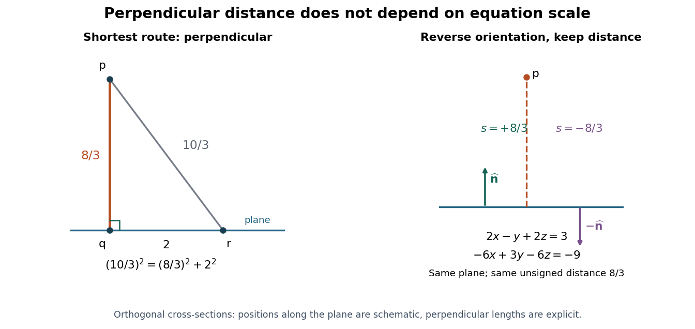

# Distance from a point to a plane

↑ **Parent:** [Geometry and topology](geometry-and-topology-split.md)  
ⓦ [Wiki](https://en.wikipedia.org/wiki/Distance_from_a_point_to_a_plane)

The [distance from a point to a plane](distance-from-a-point-to-a-plane.md) is the shortest [Euclidean distance](euclidean-distance.md) from the given [point](point-geometry.md) to any point on the [plane](plane.md). For $P=\{\mathbf x:\mathbf n\cdot\mathbf x=d\}$ with nonzero [normal vector](normal-vector.md) $\mathbf n$, a point $\mathbf p$ has

$$
\boxed{D=\frac{|\mathbf n\cdot\mathbf p-d|}{\|\mathbf n\|}.}
$$

The numerator is the residual of the [plane equation](cartesian-equation-of-a-plane.md), not yet a [length](length.md): its size depends on the chosen [normal vector](normal-vector.md). Dividing by that vector's [Euclidean norm](euclidean-norm.md) removes this arbitrary scale.

For the original example $P:2x-y+2z=3$ and $\mathbf p=(4,1,2)$, the [normal vector](normal-vector.md) is $\mathbf n=(2,-1,2)$ and $\|\mathbf n\|=3$. The residual is $8-1+4-3=8$, so **the distance is $8/3$**. Using the equivalent [plane equation](cartesian-equation-of-a-plane.md) $-6x+3y-6z=-9$ instead gives numerator $24$ and [Euclidean norm](euclidean-norm.md) $9$, hence the same $8/3$. A point already on the [plane](plane.md) has zero residual and zero distance.

Why is the perpendicular route shortest? Let $\mathbf q$ be the [closest point on a plane](closest-point-on-a-plane.md) and $\mathbf r$ any other point on it. The displacement $\mathbf p-\mathbf q$ is [orthogonal](orthogonal-vectors.md) to $\mathbf q-\mathbf r$, so the [Pythagorean theorem](pythagorean-theorem.md) gives

$$
\|\mathbf p-\mathbf r\|^2=\|\mathbf p-\mathbf q\|^2+\|\mathbf q-\mathbf r\|^2\geq\|\mathbf p-\mathbf q\|^2.
$$

Equality holds only for $\mathbf r=\mathbf q$. This is the closest-point principle of [orthogonal decomposition](orthogonal-decomposition-by-a-closed-subspace.md), applied after a [translation](translation-geometry.md) of an affine [plane](plane.md) to its direction [linear subspace](vector-subspace.md).[Interactive Linear Algebra, §6.3.1: Orthogonal decomposition theorem, Closest vector and distance](interactive-linear-algebra-by-dan-margalit-and-others/orthogonal-projection.md)

**[Figure 12](#image-the-perpendicular-route-to-a-plane-is-shortest-and-rescaling-its-plane-equation-preserves-the-distance). The perpendicular route to a plane is shortest, and rescaling its plane equation preserves the distance**. Original cross-section using the worked distance $8/3$. The comparison point lies two length units along the [plane](plane.md) from the [closest point on a plane](closest-point-on-a-plane.md), giving a longer route of $10/3$. The second panel reverses the [unit normal](unit-normal.md) without moving the [plane](plane.md).

The formula is useful whenever the deviation from a flat reference should be measured geometrically. A raw [linear equation](linear-equation.md) residual cannot be compared across arbitrary equation scalings; a perpendicular distance can. The same reasoning works for a [hyperplane](hyperplane.md) in any finite-dimensional [Euclidean space](euclidean-norm.md), with the appropriate number of coordinates.

**Table of contents**

- [Closest point on a plane](closest-point-on-a-plane.md)
  - [Orthogonal projection onto an intercept plane](orthogonal-projection-onto-an-intercept-plane.md)
- [Signed distance from a point to a plane](signed-distance-from-a-point-to-a-plane.md)

## ↑ Ancestors (4)

1. [Geometry and topology](geometry-and-topology-split.md)
2. [Area of mathematics](area-of-mathematics.md)
3. [Mathematics](mathematics-split.md)
4. [Codex Wiki](split.md)

## ← Incoming links (14)

- [Cartesian equation of a plane](cartesian-equation-of-a-plane.md)
- [Distance from a point to a plane](distance-from-a-point-to-a-plane.md)
- [Interplanar spacing](interplanar-spacing.md)
- [Solution](past-exam-of-the-mathematics-course-of-the-university-of-cambridge/2016/ia/paper-1/5a/c/solution.md)
- [Solution](past-exam-of-the-mathematics-course-of-the-year-1-of-the-natural-sciences-course-of-the-university-of-cambridge/2003/paper-2/1/a/solution.md)
- [Solution](past-exam-of-the-mathematics-course-of-the-year-1-of-the-natural-sciences-course-of-the-university-of-cambridge/2005/paper-1/5/d/solution.md)
- [Solution](past-exam-of-the-mathematics-course-of-the-year-1-of-the-natural-sciences-course-of-the-university-of-cambridge/2005/paper-2/6/c/solution.md)
- [Solution](past-exam-of-the-mathematics-course-of-the-year-1-of-the-natural-sciences-course-of-the-university-of-cambridge/2006/paper-1/5/c/solution.md)
- [Solution](past-exam-of-the-mathematics-course-of-the-year-1-of-the-natural-sciences-course-of-the-university-of-cambridge/2012/paper-2/14/a/iii/solution.md)
- [Solution](past-exam-of-the-mathematics-course-of-the-year-1-of-the-natural-sciences-course-of-the-university-of-cambridge/2015/paper-2/1/solution.md)
- [Solution](past-exam-of-the-mathematics-course-of-the-year-1-of-the-natural-sciences-course-of-the-university-of-cambridge/2016/paper-2/11/d/solution.md)
- [Solution](past-exam-of-the-mathematics-course-of-the-year-1-of-the-natural-sciences-course-of-the-university-of-cambridge/2019/paper-2/11/b/solution.md)
- [Solution](past-exam-of-the-mathematics-course-of-the-year-1-of-the-natural-sciences-course-of-the-university-of-cambridge/2025/paper-1/11/b/iv/solution.md)
- [Signed distance from a point to a plane](signed-distance-from-a-point-to-a-plane.md)
