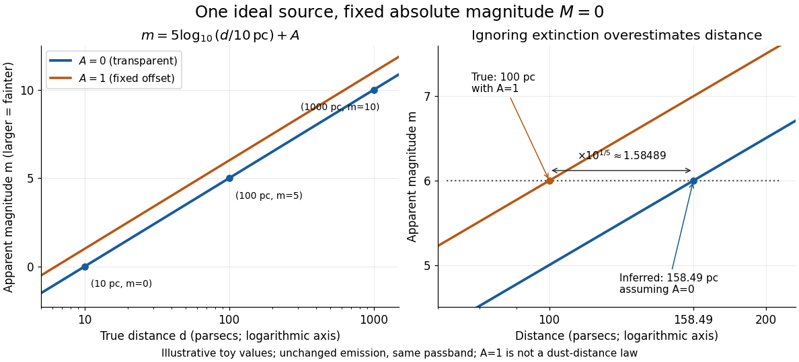

# Distance modulus

↑ **Parent:** [Astronomical magnitude](astronomical-magnitude.md)  
ⓦ [Wiki](https://en.wikipedia.org/wiki/Distance_modulus)

The distance modulus compares received brightness with intrinsic brightness through $\mu=m-M$, the difference between [apparent magnitude](apparent-magnitude.md) and [absolute magnitude](absolute-magnitude.md) in the same [photometric passband](photometric-passband.md) and [magnitude zero point](magnitude-zero-point.md). With no [interstellar extinction](interstellar-extinction.md), fixed emitted spectrum and [luminosity](luminosity.md), [isotropy](isotropy.md) of emission, and the local [inverse-square law](inverse-square-law.md), it determines [Euclidean distance](euclidean-distance.md):

$$
\mu=m-M=5\log_{10}\left(\frac{d}{10\,\mathrm{pc}}\right),\qquad d=10\,\mathrm{pc}\;10^{\mu/5}.
$$

The ratio inside the [logarithm](logarithm.md) is dimensionless. To see the factor $5$, use the [inverse-square law](inverse-square-law.md) in the [magnitude difference](magnitude-difference.md) formula:

$$
\frac{F(d)}{F_{10}}=\left(\frac{10\,\mathrm{pc}}{d}\right)^2,\qquad m-M=-2.5\log_{10}\left[\left(\frac{10\,\mathrm{pc}}{d}\right)^2\right].
$$

For example, $m=5$ and $M=0$ give $\mu=5$, hence $d=10\,\mathrm{pc}\times10=100\,\mathrm{pc}$. A tenfold increase in distance adds five magnitudes; an increase of one magnitude multiplies distance by $10^{1/5}\simeq1.584893$. The [distance modulus](distance-modulus.md) is a [logarithmic scale](logarithmic-scale.md) for distance, not a distance in length units. [Las Cumbres Observatory: What is distance modulus?](https://lco.global/spacebook/distance/what-is-distance-modulus/).

At $10$ [parsecs](parsec.md), $\mu=0$ and $m=M$. Within $10$ [parsecs](parsec.md), the [distance modulus](distance-modulus.md) is negative; for example, $\mu=-5$ gives the positive distance $d=1\,\mathrm{pc}$. A negative [distance modulus](distance-modulus.md) does not imply negative distance. At cosmological distances, the inference needs [luminosity distance](luminosity-distance.md) and a [K correction](k-correction.md); the simple local formula must not silently absorb these effects.

**[Figure 11](#image-toy-source-with-absolute-magnitude-zero-inverse-square-distance-steps-and-the-distance-overestimate-from-ignoring-one-magnitude-of-extinction). Toy source with absolute magnitude zero: inverse-square distance steps and the distance overestimate from ignoring one magnitude of extinction**.

[Interstellar extinction](interstellar-extinction.md) increases [apparent magnitude](apparent-magnitude.md). The observed [distance modulus](distance-modulus.md) then includes both geometric dimming and attenuation; [extinction bias in photometric distance](extinction-bias-in-photometric-distance.md) explains how to separate them.

**Table of contents**

- [Extinction bias in photometric distance](extinction-bias-in-photometric-distance.md)

## ↑ Ancestors (5)

1. [Astronomical magnitude](astronomical-magnitude.md)
2. [Astrophysics](astrophysics-split.md)
3. [Branches of physics](branches-of-physics.md)
4. [Physics](physics-split.md)
5. [Codex Wiki](split.md)

## ← Incoming links (11)

- [Absolute magnitude](absolute-magnitude.md)
- [Distance modulus](distance-modulus.md)
- [Extinction bias in photometric distance](extinction-bias-in-photometric-distance.md)
- [Hubble diagram](hubble-diagram.md)
- [Solution](past-exam-of-the-mathematics-course-of-the-university-of-cambridge/2001/iii/paper-41/1/iii/solution.md)
- [Solution](past-exam-of-the-mathematics-course-of-the-university-of-cambridge/2002/iii/paper-45/1/d/solution.md)
- [Solution](past-exam-of-the-mathematics-course-of-the-university-of-cambridge/2009/iii/paper-66/4/iii/solution.md)
- [Solution](past-exam-of-the-mathematics-course-of-the-university-of-cambridge/2018/iii/paper-219/1/i/solution.md)
- [Solution](past-exam-of-the-mathematics-course-of-the-university-of-cambridge/2019/iii/paper-219/1/a/solution.md)
- [Solution](past-exam-of-the-mathematics-course-of-the-university-of-cambridge/2022/iii/paper-219/1/b/solution.md)
- [Solution](past-exam-of-the-mathematics-course-of-the-university-of-cambridge/2025/iii/paper-219/1/a/solution.md)
