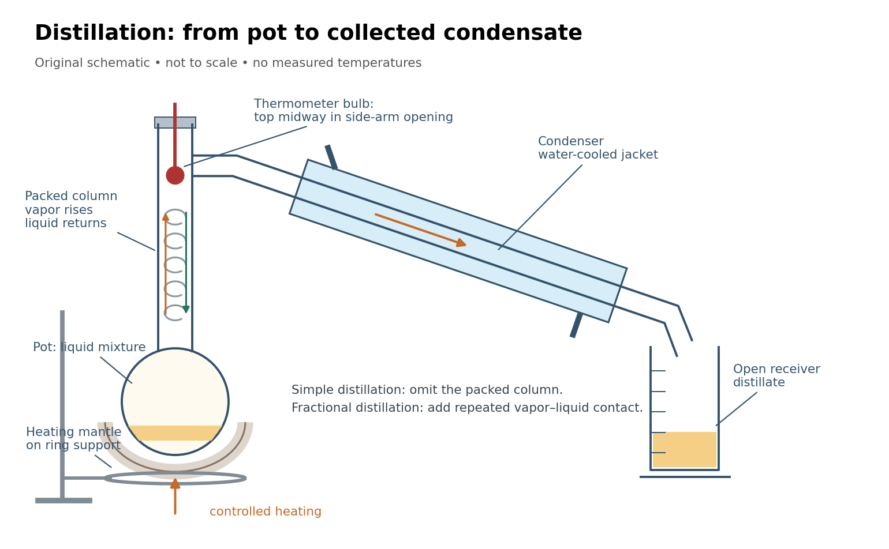

# Distillation

↑ **Parent:** [Chemistry](chemistry-split.md)  
ⓦ [Wiki](https://en.wikipedia.org/wiki/Distillation)

Distillation separates a [mixture](mixture-split.md) by producing [vapor](vapor.md) from a [liquid](liquid.md) and collecting the condensed [liquid](liquid.md), called the distillate. The more volatile component can have a higher [mole fraction](mole-fraction.md) in the [vapor](vapor.md). [Simple distillation](simple-distillation.md) collects this condensate directly; [fractional distillation](fractional-distillation.md) adds repeated contact in a [fractionating column](fractionating-column.md).[Chem2O06 Laboratory Manual by McMaster University; General Principles; A Mixture of Ideal Liquids; Fractional Distillation](chem2o06-laboratory-manual-by-mcmaster-university/distillation-introduction.md)

Two questions must be kept separate. [Vapor-liquid equilibrium](vapor-liquid-equilibrium.md) describes which compositions can coexist. A [distillation material balance](distillation-material-balance.md) accounts for how much of each component leaves in each product. A product can be enriched without containing all the original component, and even a feasible [distillation material balance](distillation-material-balance.md) does not establish that an apparatus can make those products.

**[Figure 27](#image-distillation-pot-column-and-condenser). Distillation connects a heated pot, a fractionating column, a thermometer, a laboratory condenser, and a receiver**. Original schematic, not a scale drawing. Bulb position and mantle support follow the [paired simple and fractional distillation experiment](paired-simple-and-fractional-distillation-experiment.md); blue marks the cooling jacket.

**Table of contents**

- [Vacuum distillation](vacuum-distillation.md)
- [Laboratory condenser](laboratory-condenser.md)
- [Simple distillation](simple-distillation.md)
- [Fractional distillation](fractional-distillation.md)
  - [Fractionating column](fractionating-column.md)
  - [Equilibrium stage](equilibrium-stage.md)
  - [Reflux](reflux.md)
- [Relative volatility](relative-volatility.md)
  - [Repeated ideal-stage enrichment](repeated-ideal-stage-enrichment.md)
- [Distillation material balance](distillation-material-balance.md)
- [Paired simple and fractional distillation experiment](paired-simple-and-fractional-distillation-experiment.md)
- [Azeotrope](azeotrope.md)

## ↑ Ancestors (2)

1. [Chemistry](chemistry-split.md)
2. [Codex Wiki](split.md)

## ← Incoming links (7)

- [Argon](argon.md)
- [Distillation](distillation.md)
- [Ideal solution](ideal-solution.md)
- [Laboratory condenser](laboratory-condenser.md)
- [Mixture measurements and the Gibbs-Duhem constraint](mixture-measurements-and-the-gibbs-duhem-constraint.md)
- [Reflux](reflux.md)
- [Vacuum distillation](vacuum-distillation.md)
