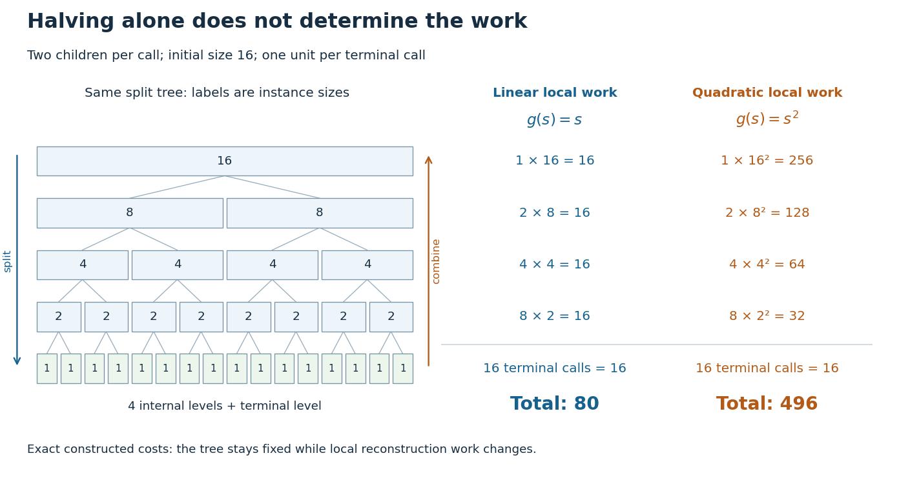

# Divide-and-conquer combination cost

↑ **Parent:** [Divide-and-conquer algorithm](divide-and-conquer-algorithm.md)

The combination cost is the work needed to reconstruct an answer from the returned smaller answers. In a [time complexity](time-complexity.md) calculation, also count partitioning the [input](input-computer-science.md), preparing arguments, and other work outside [recursive calls](recursive-call.md). Write their total as $g(n)$ for a size-$n$ call. For an ideal balanced [divide-and-conquer algorithm](divide-and-conquer-algorithm.md) making $a$ calls of size $n/2$, the [recurrence relation](recurrence-relation.md) is

$$
T(1)=c_0,\qquad T(n)=aT(n/2)+g(n)\quad(n>1),
$$

where $a$ is a fixed positive [integer](integer-split.md) and $c_0>0$ is the [base case](base-case.md) cost. Take $n=2^k$, a [power of two](power-of-two.md), so the size becomes one after exactly $k$ divisions. This is a model of total sequential work: all $a$ smaller calls contribute, even if a machine could run some simultaneously.

At level $j$, there are $a^j$ calls, each of size $n/2^j$. Expanding the [recurrence relation](recurrence-relation.md) gives the exact identity

$$
T(n)=a^k c_0+\sum_{j=0}^{k-1}a^j g(n/2^j).
$$

The first term counts the [base cases](base-case.md); the [sum](sum.md) stops before their level because $g$ describes work in nonterminal calls. This separates depth, number of calls, and local work. [Merge sort](merge-sort.md) has two smaller calls and a linear [merge algorithm](merge-algorithm.md), giving $T(n)=2T(n/2)+O(n)=O(n\log n)$ in [Big O notation](big-o-notation.md). The MIT notes derive this by summing equal work across levels, and contrast it with the same two-way split followed by quadratic local work.[6.006 Introduction to Algorithms, Fall 2011, Lecture 3: slides 32–44, recurrence and equal work per level; slide 46, quadratic local work](6-006-introduction-to-algorithms-fall-2011-by-massachusetts-institute-of-technology-6-006-course-staff/lecture-3-insertion-sort-merge-sort.md)

**[Figure 16](#image-the-same-halving-tree-can-have-linear-or-quadratic-work-at-each-call). The same halving tree can have linear or quadratic work at each call**. Original exact cost models with $n=16$, two children per nonterminal call, and one unit per [base case](base-case.md). For local work $g(s)=s$, every internal level costs 16 and the total is 80. For $g(s)=s^2$, internal levels cost 256, 128, 64, 32 and the total is 496. The tree shows instance sizes; the ledger counts work rather than execution order.

For the first constructed model, set $a=2$, $c_0=1$ and $g(s)=s$. Every internal level costs $2^j(n/2^j)=n$, while the leaves cost $n$. Thus $T(n)=n\log_2 n+n$, giving $T(16)=80$. If the same split instead has $g(s)=s^2$, then the [finite geometric series](finite-geometric-series.md) gives

$$
T(n)=n+n^2\sum_{j=0}^{k-1}2^{-j}=2n^2-n,
$$

so $T(16)=496$. The root alone already costs $n^2$ in this second model. Smaller arguments do not eliminate expensive reconstruction. These are stipulated operation counts, rather than measured running times or exact [merge sort](merge-sort.md) instruction counts.

[Binary search](binary-search.md) has a different saving: after its comparison, only one half remains a candidate. With constant-cost indexed [array](array-data-structure.md) access and comparisons, its worst-case [time complexity](time-complexity.md) satisfies an upper [recurrence relation](recurrence-relation.md) $T(n)\leq T(\lfloor n/2\rfloor)+C$ for $n\geq1$, with $T(0)=c_0$. There is one continuing branch, rather than two. At most $\lfloor\log_2 n\rfloor+1$ nonempty candidate ranges are inspected for $n\geq1$. Copying the retained half into a fresh [array](array-data-structure.md) on every step would add linear work at that step and lose this logarithmic bound. The shrinking range and its representation both matter.

## ↑ Ancestors (4)

1. [Divide-and-conquer algorithm](divide-and-conquer-algorithm.md)
2. [Algorithm](algorithm-split.md)
3. [Computer science](computer-science-split.md)
4. [Codex Wiki](split.md)

## ← Incoming links (1)

- [Divide-and-conquer algorithm](divide-and-conquer-algorithm.md)
