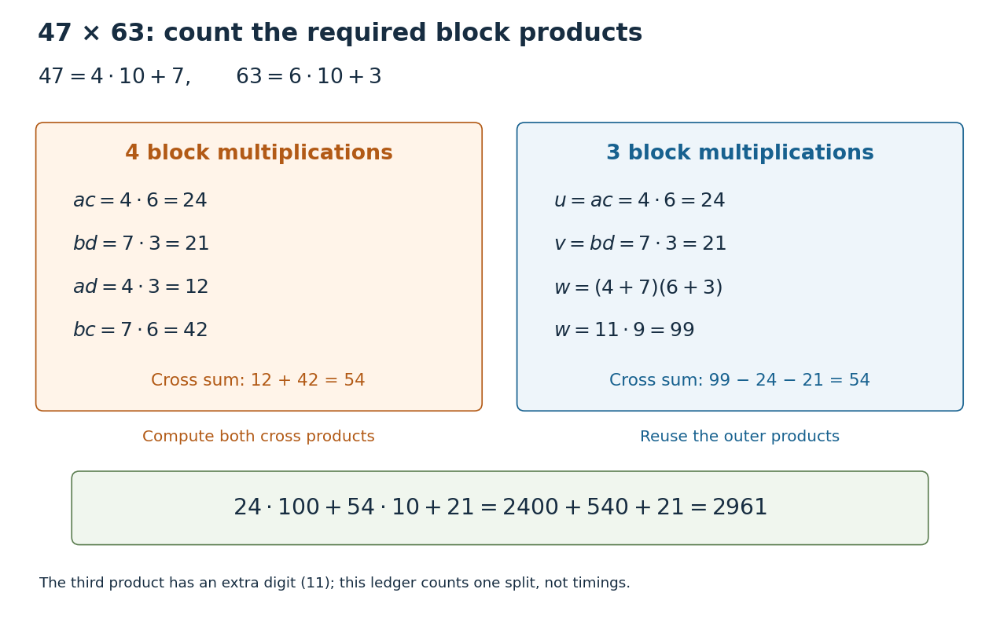

# Divide-and-conquer product ledger

↑ **Parent:** [Divide-and-conquer algorithm](divide-and-conquer-algorithm.md)

Splitting two [integers](integer-split.md) in [positional notation](positional-notation.md) gives $x=aq+b$ and $y=cq+d$, where $q=B^m$ shifts a block by $m$ [numeral digits](numerical-digit.md) in fixed [radix](radix.md) $B\geq2$. The [distributive property](distributive-property.md) gives

$$
xy=acq^2+(ad+bc)q+bd.
$$

Computing $ac,ad,bc,bd$ separately needs four block [multiplications](multiplication.md). Merely halving the operands therefore gives an ideal [recurrence relation](recurrence-relation.md) $F(n)=4F(n/2)+O(n)$, still with quadratic [time complexity](time-complexity.md). The [Karatsuba three-product identity](karatsuba-three-product-identity.md) instead computes $ac$, $bd$ and $(a+b)(c+d)$, recovering the middle [coefficient](coefficient.md) by two [subtractions](subtraction.md). The MIT notes present precisely this four-product versus three-product distinction.[6.006 Introduction to Algorithms, Fall 2011, Lecture 11: Numerics I, printed pp. 4–5, High Precision Multiplication and Karatsuba's Method](6-006-introduction-to-algorithms-fall-2011-by-massachusetts-institute-of-technology-6-006-course-staff/lecture-11-numerics-i.md)

For an original small example, multiply $47$ by $63$. Set $B=q=10$, $a=4$, $b=7$, $c=6$, $d=3$. Four separate block products would give $ac=24$, $ad=12$, $bc=42$, $bd=21$. The three-product calculation is

$$
\begin{aligned}
u&=ac=24,&v&=bd=21,&w&=(a+b)(c+d)=11\cdot9=99,\\
h&=w-u-v=99-24-21=54,\\
47\cdot63&=100u+10h+v=2400+540+21=2961.
\end{aligned}
$$

The crucial reuse is that $u$ and $v$ supply the outer [coefficients](coefficient.md) and also remove the unwanted terms from $w$. There is no need to compute $ad$ and $bc$ separately. Expanding $w=ac+ad+bc+bd$ proves the identity. [Induction](mathematical-induction.md) extends it to [Karatsuba multiplication](karatsuba-multiplication.md) once each smaller block product is correct and [Karatsuba recursion termination](karatsuba-recursion-termination.md) supplies decreasing sizes and complete [base cases](base-case.md).

**[Figure 17](#image-four-block-products-or-three-the-exact-ledger-for-47-cdot63). Four block products or three: the exact ledger for $47\cdot63$**. The left ledger computes both cross products separately. The right ledger reuses $ac=24$ and $bd=21$ to recover their sum as $99-24-21=54$. Both reconstructions yield $2961$. Counts refer to block [multiplication](multiplication.md) calls at this split; the extra [numeral digit](numerical-digit.md) in $4+7=11$ prevents interpreting all three as single-digit products.

The operation model matters. Let $n$ count [numeral digits](numerical-digit.md) in fixed [radix](radix.md) $B$, and count single-digit [multiplication](multiplication.md), [addition](addition.md), [subtraction](subtraction.md) and copying as constant-cost operations. The nonrecursive work on size-$n$ operands is $O(n)$: it includes forming sums, positional shifts and [Karatsuba carry handling](karatsuba-carry-handling.md). Treating an arbitrarily large [integer](integer-split.md) [multiplication](multiplication.md) as one operation would hide the very saving being studied. The coefficients $24,54,21$ above must be shifted and added; concatenating them does not give $2961$.

In the ideal equal-half model, [Karatsuba multiplication](karatsuba-multiplication.md) has $K(n)=3K(n/2)+O(n)$. At depth $j$ its additional work is at most a constant times $n(3/2)^j$, and its leaf count is $3^k=n^{\log_2 3}$ for $n=2^k$. A [geometric series](geometric-series.md) gives $K(n)=O(n^{\log_2 3})$, where $\log_2 3\approx1.585$. Four recursive products would instead give $4^k=n^2$ leaves. Saving one block product repeatedly changes the exponent, even though the combination requires extra [addition](addition.md) and [subtraction](subtraction.md).

For the literal sum-based version, each operand sum can occupy one extra [numeral digit](numerical-digit.md). Its worst-case upper [recurrence relation](recurrence-relation.md) is $K(n)\leq3K(\lceil n/2\rceil+1)+Cn$ for a nondecreasing cost envelope, above a fixed [base case](base-case.md) threshold of at least three digits. [Karatsuba digit-operation cost](karatsuba-digit-operation-cost.md) proves that this extra digit preserves the exponent; [Karatsuba operand splitting](karatsuba-operand-splitting.md) handles odd lengths and leading zero padding. For signed [integers](integer-split.md), apply the nonnegative procedure to their [absolute values](absolute-value.md) and restore the sign. The small ledger establishes an exact identity, while [Karatsuba practical crossover](karatsuba-practical-crossover.md) explains why it alone cannot predict a speedup for two-digit operands.

## ↑ Ancestors (4)

1. [Divide-and-conquer algorithm](divide-and-conquer-algorithm.md)
2. [Algorithm](algorithm-split.md)
3. [Computer science](computer-science-split.md)
4. [Codex Wiki](split.md)

## ← Incoming links (1)

- [Divide-and-conquer algorithm](divide-and-conquer-algorithm.md)
