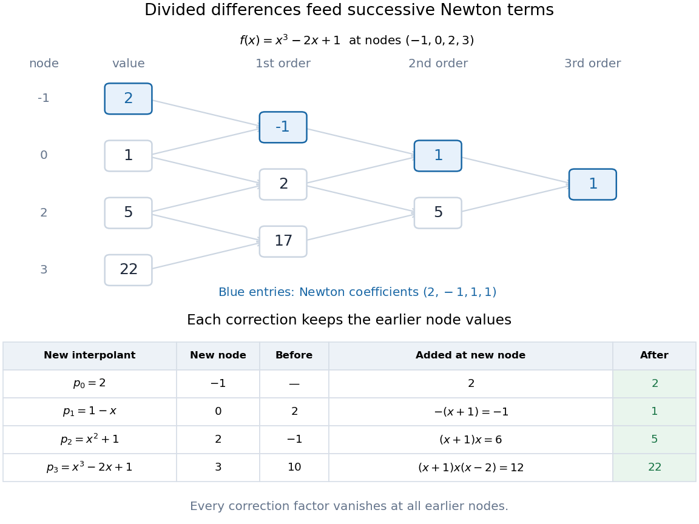

# Divided difference table

↑ **Parent:** [Divided difference](divided-difference.md)

A [divided difference table](divided-difference-table.md) arranges [divided differences](divided-difference.md) by starting [interpolation node](interpolation-node.md) $i$ and order $k$. Its base column is $D_{i,0}=f(x_i)$; every later entry uses two neighboring entries from the previous column:

$$
D_{i,k}=\frac{D_{i+1,k-1}-D_{i,k-1}}{x_{i+k}-x_i},\qquad
1\leq k\leq n,\quad 0\leq i\leq n-k.
$$

The denominator spans all $k+1$ [interpolation nodes](interpolation-node.md) of that entry, even though the numerator uses adjacent table entries. The [interpolation nodes](interpolation-node.md) must be distinct; they need not be equally spaced or sorted.[NIST Digital Library of Mathematical Functions; §3.3(iii), equation 3.3.34: initial values and divided-difference recurrence for distinct nodes](nist-digital-library-of-mathematical-functions/3-3-interpolation.md)

Take the [polynomial](polynomial-split.md) $f(x)=x^3-2x+1$ at the [interpolation nodes](interpolation-node.md) $(-1,0,2,3)$, giving values $(2,1,5,22)$. Its [divided difference table](divided-difference-table.md) is

$$
\begin{array}{c|r|r|r|r}
x_i&D_{i,0}&D_{i,1}&D_{i,2}&D_{i,3}\\\hline
-1&2&-1&1&1\\
0&1&2&5&\\
2&5&17&&\\
3&22&&&
\end{array}
$$

The first [divided differences](divided-difference.md) are $(1-2)/(0+1)=-1$, $(5-1)/(2-0)=2$, and $(22-5)/(3-2)=17$. The second [divided differences](divided-difference.md) use the wider spans: $(2+1)/(2+1)=1$ and $(17-2)/(3-0)=5$. The third [divided difference](divided-difference.md) is $(5-1)/(3+1)=1$. Reading the top row gives the [Newton polynomial](newton-polynomial.md) coefficients $(2,-1,1,1)$, rather than all the entries in any one column.

The resulting [Newton polynomial](newton-polynomial.md) grows through four partial [interpolants](interpolant.md):

$$
\begin{aligned}
p_0(x)&=2,\\
p_1(x)&=2-(x+1)=1-x,\\
p_2(x)&=2-(x+1)+(x+1)x=x^2+1,\\
p_3(x)&=2-(x+1)+(x+1)x+(x+1)x(x-2)=x^3-2x+1.
\end{aligned}
$$

At $x=2$, $p_1(2)=-1$ misses $f(2)=5$ by $6$; the correction $(x+1)x$ supplies exactly $6$ there and vanishes at the earlier [interpolation nodes](interpolation-node.md) $-1,0$. At $x=3$, $p_2(3)=10$ misses $f(3)=22$ by $12$; the correction $(x+1)x(x-2)$ supplies exactly $12$ there and vanishes at all three earlier [interpolation nodes](interpolation-node.md). Each added term therefore preserves the previous agreements while satisfying the next one.

**[Figure 3](#image-divided-difference-triangle-and-successive-newton-interpolants-for-the-constructed-polynomial-x-cubed-minus-2x-plus-1). Divided-difference triangle and successive Newton interpolants for the constructed polynomial x cubed minus 2x plus 1**.

For $n+1$ [interpolation nodes](interpolation-node.md), the triangle contains $n+(n-1)+\cdots+1=n(n+1)/2$ recurrence steps. Once the top row is known, nested evaluation of the [Newton polynomial](newton-polynomial.md) uses only $n$ multiplications and $n$ additions per argument. The triangle organizes the work; the factors explain why the construction works.

## ↑ Ancestors (8)

1. [Divided difference](divided-difference.md)
2. [Polynomial interpolation](polynomial-interpolation.md)
3. [Interpolation](interpolation-split.md)
4. [Numerical analysis](numerical-analysis-split.md)
5. [Analysis](analysis-split.md)
6. [Area of mathematics](area-of-mathematics.md)
7. [Mathematics](mathematics-split.md)
8. [Codex Wiki](split.md)

## ← Incoming links (4)

- [Divided difference table](divided-difference-table.md)
- [Newton polynomial](newton-polynomial.md)
- [Node order in Newton interpolation](node-order-in-newton-interpolation.md)
- [Symmetry of divided differences](symmetry-of-divided-differences.md)
