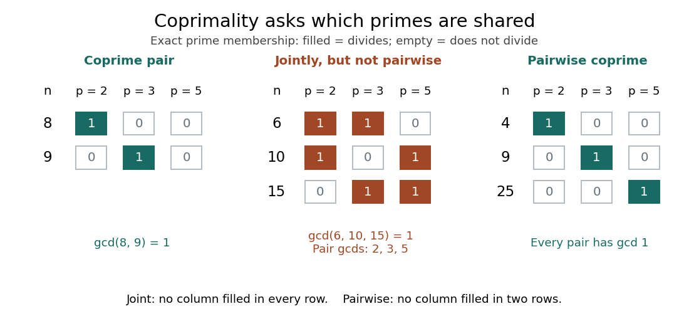
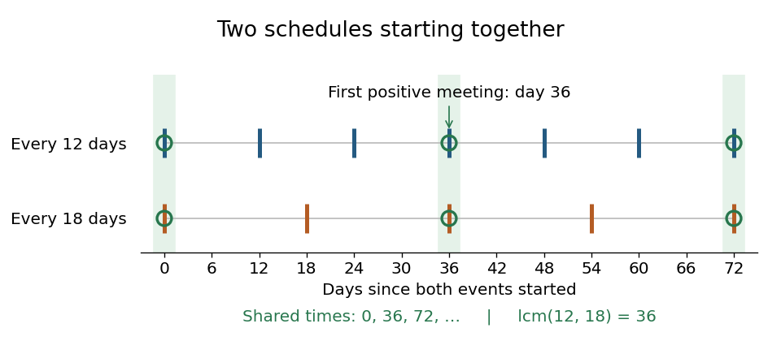
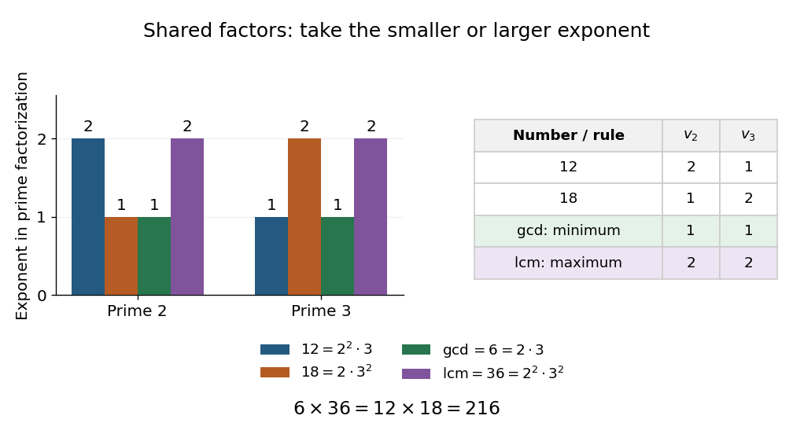

# Divisibility

↑ **Parent:** [Number theory](number-theory.md)  
ⓦ [Wiki](https://en.wikipedia.org/wiki/Divisibility)

For [integers](integer.md) $d,n$, **$d$ divides $n$** when [multiplication](arithmetic.md#multiplication) by some [integer](integer.md) $k$ takes $d$ to $n$:

$$
d\mid n\quad\Longleftrightarrow\quad \text{there exists }k\in\mathbb Z\text{ such that }n=dk.
$$

Then $d$ is a [divisor](#divisor) of $n$, and $n$ is an [integer multiple](#integer-multiple) of $d$. The notation $d\nmid n$ means that no such [integer](integer.md) $k$ exists. For $d\ne0$, this is equivalent to saying that the [quotient](arithmetic.md#quotient) $n/d$ is an [integer](integer.md), or that [Euclidean division](integer.md#euclidean-division) by $|d|$ leaves [remainder](integer.md#remainder) zero.

For example, $3\mid12$ because $12=3\cdot4$, whereas $5\nmid12$ because $12=5\cdot2+2$. Signs do not change [divisibility](divisibility.md): $-3\mid12$ because $12=(-3)(-4)$, and $3\mid-12$ because $-12=3(-4)$. In general, changing the sign of either input preserves the relation.

The definition here permits zero as either input. Every [integer](integer.md) divides zero, since $0=d\cdot0$. In particular, **$0\mid0$**; however, $0\nmid n$ whenever $n\ne0$, since $0k$ is always zero. This is a statement about [multiplication](arithmetic.md#multiplication), and assigns no meaning to [division](arithmetic.md#division-mathematics) by zero: $0/0$ remains undefined.

Two useful properties come directly from the defining [multiplication](arithmetic.md#multiplication). [Divisibility](divisibility.md) is a [reflexive relation](set-theory.md#reflexive-relation), since $n=n\cdot1$, and a [transitive relation](set-theory.md#transitive-relation): if $b=ar$ and $c=bs$, then $c=a(rs)$. Moreover, a shared [divisor](#divisor) divides every [integer](integer.md) [linear combination](vector-space.md#linear-combination):

$$
d\mid a,\quad d\mid b\quad\Longrightarrow\quad d\mid(ax+by)\qquad(x,y\in\mathbb Z).
$$

Indeed, writing $a=du$ and $b=dv$ gives $ax+by=d(ux+vy)$. For example, $6\mid12$ and $6\mid18$ imply $6\mid(18-12)$. This small observation explains why the [Euclidean algorithm](number-theory.md#euclidean-algorithm) preserves common [divisors](#divisor), and why [Bézout's identity](algebra.md#bezout-s-identity) can certify a [greatest common divisor](#greatest-common-divisor).

On the [positive integers](integer.md#positive-integer), [divisibility](divisibility.md) is a [partial order](set.md#partially-ordered-set): if $a\mid b$ and $b\mid a$, then $a=b$. The restriction matters, since $3\mid-3$ and $-3\mid3$ although $3\ne-3$. The [prime factorization](prime-number.md#fundamental-theorem-of-arithmetic) viewpoint makes this order concrete: $d\mid n$ exactly when every [prime valuation](number-theory.md#prime-valuation) of $d$ is at most the corresponding [prime valuation](number-theory.md#prime-valuation) of $n$. Thus one relation connects equal grouping, [prime factorization](prime-number.md#fundamental-theorem-of-arithmetic), and [modular arithmetic](modular-arithmetic.md).

Book VII, definitions 3 and 5 of [Euclid's Elements](euclidean-geometry.md#euclid-s-elements) describe the corresponding positive-number relation through one number measuring another and through [integer multiples](#integer-multiple). The sign and zero conventions above belong to the present [integer](integer.md) formulation, rather than to those ancient definitions. [Euclid, Elements VII, definitions 3 and 5, T. L. Heath translation](https://geometor.github.io/euclid/heath/VII/index.html)

**Table of contents**

- [Divisibility rule](#divisibility-rule)
- [Semidivisible number](#semidivisible-number)
- [Integer multiple](#integer-multiple)
- [Divisor](#divisor)
  - [Divisor lattice](#divisor-lattice)
  - [Bi-unitary divisor](#bi-unitary-divisor)
  - [Unitary divisor](#unitary-divisor)
    - [Greatest common unitary divisor](#greatest-common-unitary-divisor)
  - [Factor pair](#factor-pair)
  - [Proper divisor](#proper-divisor)
  - [Squarefree divisor](#squarefree-divisor)
- [Greatest common divisor](#greatest-common-divisor)
  - [Scaling identity for greatest common divisors](#scaling-identity-for-greatest-common-divisors)
  - [Coprime integers](#coprime-integers)
    - [Pairwise coprimality](#pairwise-coprimality)
    - [Joint coprimality](#joint-coprimality)
- [Least common multiple](#least-common-multiple)

## Divisibility rule

↑ **Parent:** [Divisibility](divisibility.md)

## Semidivisible number

↑ **Parent:** [Divisibility](divisibility.md)

A [positive integer](integer.md#positive-integer) $n$ lying strictly between consecutive [prime](prime-number.md) squares $p^2<n<q^2$ that is divisible by exactly one of $p,q$. Within a fixed band, the sum is the sum of multiples of $p$ plus the sum of multiples of $q$ minus twice the sum of multiples of $pq$, an [inclusion-exclusion](combinatorics.md#inclusion-exclusion-principle) calculation using [arithmetic progressions](arithmetic.md#arithmetic-progression).

## Integer multiple

↑ **Parent:** [Divisibility](divisibility.md)

An integer multiple of an [integer](integer.md) $d$ is a [product](arithmetic.md#product-of-numbers) $dk$ with $k$ an [integer](integer.md); equivalently, $d$ is a [divisor](#divisor) of that [product](arithmetic.md#product-of-numbers). The [integer multiples](#integer-multiple) of $12$ are $\ldots,-24,-12,0,12,24,\ldots$. Zero is an [integer multiple](#integer-multiple) of every [integer](integer.md), and the only [integer multiple](#integer-multiple) of zero is zero. Shared positive [integer multiples](#integer-multiple) lead to the [least common multiple](#least-common-multiple).

## Divisor

↑ **Parent:** [Divisibility](divisibility.md)  
ⓦ [Wiki](https://en.wikipedia.org/wiki/Divisor)

A divisor of an [integer](integer.md) $n$ is an [integer](integer.md) $d$ satisfying the [divisibility](divisibility.md) relation $d\mid n$. Equivalently, $n=dk$ for some [integer](integer.md) $k$. The word **positive** matters when listing or counting [divisors](#divisor): unless signs are restricted, both $d$ and $-d$ qualify.

The positive [divisors](#divisor) of $12$ are

$$
1,2,3,4,6,12.
$$

Their negatives are also [divisors](#divisor) of $12$, giving twelve [integer divisors](#divisor) altogether. The same list of positive [divisors](#divisor) works for $-12$. One has only the positive [divisor](#divisor) $1$, while zero has every [integer](integer.md) as a [divisor](#divisor), including zero under our [divisibility](divisibility.md) convention. A nonzero [integer](integer.md) never has zero as a [divisor](#divisor).

For a [positive integer](integer.md#positive-integer) $n$, the positive [divisors](#divisor) come in pairs $(d,n/d)$ whose [product](arithmetic.md#product-of-numbers) is $n$. For $12$, the pairs are $(1,12)$, $(2,6)$ and $(3,4)$. Each pair contains a [divisor](#divisor) at most $\sqrt n$, so searching through candidate [divisors](#divisor) up to the [square root](algebra.md#square-root) suffices to find all pairs. A pair repeats its own member only when $n$ is a [perfect square](integer.md#square-number); for $36$, the middle pair is $(6,6)$. Consequently a [positive integer](integer.md#positive-integer) has an odd number of positive [divisors](#divisor) exactly when it is a [perfect square](integer.md#square-number).

The [prime factorization](prime-number.md#fundamental-theorem-of-arithmetic) gives another complete description. Since $12=2^2\cdot3$, its positive [divisors](#divisor) are precisely $2^i3^j$ with $0\leq i\leq2$ and $0\leq j\leq1$. These independent choices give $(2+1)(1+1)=6$ positive [divisors](#divisor), the value of the [divisor function](arithmetic-function.md#divisor-function) $\tau(12)$. A [prime factor](prime-number.md#prime-factor) is one particular kind of [divisor](#divisor); $4$, $6$ and $12$ show that [divisors](#divisor) need not be [prime numbers](prime-number.md).

Thinking in pairs connects exact grouping with [integer factorization](number-theory.md#integer-factorization): twelve objects can form three groups of four or four groups of three. Thinking in shared [divisors](#divisor) gives the [greatest common divisor](#greatest-common-divisor); for $12$ and $18$, the positive common [divisors](#divisor) are $1,2,3,6$, and the largest is $6$.

### Divisor lattice

↑ **Parent:** [Divisor](#divisor)

The positive divisors of an integer ordered by divisibility form a [lattice](mathematical-logic.md#lattice). The meet is the [greatest common divisor](#greatest-common-divisor), and the join is the [least common multiple](#least-common-multiple).

### Bi-unitary divisor

↑ **Parent:** [Divisor](#divisor)

A divisor $d$ of $n$ is bi-unitary when the greatest common unitary divisor of $d$ and $n/d$ equals $1$. For $n=p^e$, all divisors are allowed except $p^{e/2}$ when $e$ is even.

### Unitary divisor

↑ **Parent:** [Divisor](#divisor)

A [divisor](#divisor) $d$ of a [positive integer](integer.md#positive-integer) $n$ is unitary when $\gcd(d,n/d)=1$. Each [prime power](prime-number.md#prime-power) in the [prime factorization](prime-number.md#fundamental-theorem-of-arithmetic) of $n$ must therefore be included in $d$ completely or omitted completely. Consequently, the sum of the $k$-th powers of unitary divisors is $\prod_{p^e\parallel n}(1+p^{ek})$.

#### Greatest common unitary divisor

↑ **Parent:** [Unitary divisor](#unitary-divisor)

### Factor pair

↑ **Parent:** [Divisor](#divisor)

A pair of [positive integers](integer.md#positive-integer) $(a,b)$ with $ab=n$ for a specified [positive integer](integer.md#positive-integer) $n$. Pairing each [divisor](#divisor) $a$ with $n/a$ gives $\tau(n)/2$ unordered [factor pairs](#factor-pair) for nonsquare $n$, and $(\tau(n)+1)/2$ for a [perfect square](integer.md#square-number), where $\tau(n)$ is the [divisor function](arithmetic-function.md#divisor-function).

### Proper divisor

↑ **Parent:** [Divisor](#divisor)

Here a [proper divisor](#proper-divisor) of a [positive integer](integer.md#positive-integer) $n$ means a positive [integer divisor](#divisor) other than $n$ itself. Thus $1$ has no [proper divisors](#proper-divisor), and the [proper divisors](#proper-divisor) of $12$ are $1,2,3,4,6$.

### Squarefree divisor

↑ **Parent:** [Divisor](#divisor)

A squarefree divisor of an [integer](integer.md) $n$ is a [divisor](#divisor) $d\mid n$ that is a [squarefree integer](integer.md#square-free-integer). It is specified by choosing a subset of the distinct [prime factors](prime-number.md#prime-factor) of $n$.

## Greatest common divisor

↑ **Parent:** [Divisibility](divisibility.md)  
ⓦ [Wiki](https://en.wikipedia.org/wiki/Greatest_common_divisor)

For [integers](integer.md) $a,b$ not both zero, their greatest common divisor is the largest positive [integer](integer.md) dividing both. It is unchanged by replacing either input by its negative. The convention $\gcd(0,0)=0$ is useful, but this exceptional value is not a largest positive common [divisor](#divisor). For positive inputs, the [Euclidean algorithm](number-theory.md#euclidean-algorithm) computes the answer, and [Bézout's identity](algebra.md#bezout-s-identity) expresses it as an integer [linear combination](vector-space.md#linear-combination) of the inputs.

For $12=2^2\cdot3$ and $18=2\cdot3^2$, a common [divisor](#divisor) can contain at most one copy of the [prime number](prime-number.md) two and one of the [prime number](prime-number.md) three. Taking the smaller [prime valuation](number-theory.md#prime-valuation) at each [prime number](prime-number.md) therefore gives

$$
\gcd(12,18)=2^{\min(2,1)}3^{\min(1,2)}=2\cdot3=6.
$$

The check $6=18-12$ is also a [Bézout's identity](algebra.md#bezout-s-identity): every common [divisor](#divisor) divides this difference, and six itself divides both inputs. More generally, every common [divisor](#divisor) divides the [greatest common divisor](#greatest-common-divisor), a stronger statement than merely being no larger than it. The companion [least common multiple](#least-common-multiple) takes the larger [prime valuations](number-theory.md#prime-valuation), as the diagram there illustrates. For an application, divide the [numerator](number-theory.md#numerator) and [denominator](number-theory.md#denominator) of the [fraction](number-theory.md#fraction) $12/18$ by six to obtain $2/3$; these remaining [integers](integer.md) are [coprime](#coprime-integers).

### Scaling identity for greatest common divisors

↑ **Parent:** [Greatest common divisor](#greatest-common-divisor)

For positive integers $m,n,k$, the [greatest common divisor](#greatest-common-divisor) scales by the common multiplier $k$. If $d=\gcd(m,n)$, then $kd$ is a common divisor of $km,kn$. Meanwhile [Bézout's identity](algebra.md#bezout-s-identity) expresses $kd$ as an integer linear combination of $km,kn$, so their [greatest common divisor](#greatest-common-divisor) divides $kd$. These two comparisons prove the identity without prime factorization.

### Coprime integers

↑ **Parent:** [Greatest common divisor](#greatest-common-divisor)  
ⓦ [Wiki](https://en.wikipedia.org/wiki/Coprime_integers)

Two [integers](integer.md) $a,b$ are **coprime** when their [greatest common divisor](#greatest-common-divisor) is one:

$$
a,b\text{ are coprime}\quad\Longleftrightarrow\quad\gcd(a,b)=1.
$$

For [positive integers](integer.md#positive-integer), this says that the only positive common [divisor](#divisor) is one. For signed [integers](integer.md), use $\gcd(a,b)=\gcd(|a|,|b|)$, with [absolute values](real-analysis.md#absolute-value); changing either sign leaves [coprimality](#coprime-integers) unchanged. With the convention $\gcd(0,0)=0$, zero is [coprime](#coprime-integers) precisely to $1,-1$, because $\gcd(a,0)=|a|$. Both $1,-1$ are [coprime](#coprime-integers) to every [integer](integer.md). [Darij Grinberg, MIT 18.781, Section 1.2: greatest common divisors and coprimality](https://darijgrinberg.gitlab.io/floor.pdf)

The word concerns shared [prime factors](prime-number.md#prime-factor), not whether either input is a [prime number](prime-number.md). For instance $8=2^3$ and $9=3^2$ are [coprime](#coprime-integers) [composite numbers](number-theory.md#composite-number), even though neither is a [square-free integer](integer.md#square-free-integer). Conversely, $6=2\cdot3$ and $10=2\cdot5$ are [square-free integers](integer.md#square-free-integer) but are not [coprime](#coprime-integers). Consecutive [integers](integer.md) are always [coprime](#coprime-integers): any common [divisor](#divisor) of $n,n+1$ divides their difference one. Thus $14,15$ provide another pair of [coprime](#coprime-integers) [composite numbers](number-theory.md#composite-number).

For [positive integers](integer.md#positive-integer), let $P(n)$ be the [prime support of an integer](arithmetic-function.md#prime-support-of-an-integer). The equivalent test is

$$
\gcd(a,b)=1\quad\Longleftrightarrow\quad P(a)\cap P(b)=\varnothing.
$$

The [set intersection](set.md#set-intersection) of the two [prime supports of an integer](arithmetic-function.md#prime-support-of-an-integer) must be the [empty set](set.md#empty-set). Indeed, any positive common [divisor](#divisor) greater than one has a [prime factor](prime-number.md#prime-factor), and any shared [prime factor](prime-number.md#prime-factor) is a common [divisor](#divisor) greater than one. Hence [coprimality](#coprime-integers) depends on which [prime factors](prime-number.md#prime-factor) occur, rather than on their [prime valuations](number-theory.md#prime-valuation); replacing either input by its [radical of an integer](arithmetic-function.md#radical-of-an-integer) preserves [coprimality](#coprime-integers).

For a list of at least two [integers](integer.md), distinguish [pairwise coprimality](#pairwise-coprimality), requiring every pair to be [coprime](#coprime-integers), from [joint coprimality](#joint-coprimality), requiring only the [greatest common divisor](#greatest-common-divisor) of the entire list to be one. For example,

$$
\gcd(6,10,15)=1,\qquad
\gcd(6,10)=2,\quad\gcd(6,15)=3,\quad\gcd(10,15)=5.
$$

No [prime factor](prime-number.md#prime-factor) belongs to all three [prime supports of an integer](arithmetic-function.md#prime-support-of-an-integer), yet each pair shares one. By contrast, $4,9,25$ have [pairwise coprimality](#pairwise-coprimality). The distinction is presented by Poritz under the names pairwise and mutually relatively prime. [Jonathan A. Poritz, Yet Another Introductory Number Theory Textbook, Section 1.5](https://math.libretexts.org/Bookshelves/Combinatorics_and_Discrete_Mathematics/Yet_Another_Introductory_Number_Theory_Textbook_-_Cryptology_Emphasis_(Poritz)/01:_Well-Ordering_and_Division/1.05:_The_Greatest_Common_Divisor)

**[Figure 1](#image-prime-support-of-an-integer-distinguishes-coprime-pairs-joint-coprimality-and-pairwise-coprimality). Prime support of an integer distinguishes coprime pairs, joint coprimality and pairwise coprimality**. Filled cells mark membership in the [prime support of an integer](arithmetic-function.md#prime-support-of-an-integer); empty cells mean the [prime number](prime-number.md) does not divide the row label. The first panel has two [coprime integers](#coprime-integers); the middle has [joint coprimality](#joint-coprimality) but fails [pairwise coprimality](#pairwise-coprimality); the last has [pairwise coprimality](#pairwise-coprimality). The columns exhaust all [prime factors](prime-number.md#prime-factor) of these eight row entries. This original finite arithmetic diagram shows exact [divisibility](divisibility.md), not sampled probabilities.

One use is simplifying [fractions](number-theory.md#fraction). For a [fraction](number-theory.md#fraction) $a/b$ with [integer](integer.md) entries and $b>0$, divide its [numerator](number-theory.md#numerator) and [denominator](number-theory.md#denominator) by $d=\gcd(a,b)$ to obtain a [reduced fraction](number-theory.md#reduced-fraction) with [coprime](#coprime-integers) entries. For example, $42/30=7/5$ since $d=6$, and $-42/30=-7/5$ uses the same $d$. A further common [divisor](#divisor) would make $d$ too small, so the reduction is complete. In particular, the [reduced fraction](number-theory.md#reduced-fraction) for zero is $0/1$.

Another use is reversible [modular arithmetic](modular-arithmetic.md): for an [integer modulus](modular-arithmetic.md#modulus-in-modular-arithmetic) $m>1$, an [integer](integer.md) $a$ has a [modular inverse](number-theory.md#modular-multiplicative-inverse) precisely when $a,m$ are [coprime](#coprime-integers). The proof outline uses [Bézout's identity](algebra.md#bezout-s-identity): $ua+vm=1$ makes $u$ a [modular inverse](number-theory.md#modular-multiplicative-inverse), and any inverse relation $ua-km=1$ forces every common [divisor](#divisor) to divide one. For example, $3\cdot5-2\cdot7=1$ gives $5^{-1}\equiv3\pmod7$, whereas $6$ has no [modular inverse](number-theory.md#modular-multiplicative-inverse) modulo $10$. Thus [coprimality](#coprime-integers) is the exact condition allowing division by a residue in [modular arithmetic](modular-arithmetic.md). [Ankur Moitra, MIT 18.200, Lecture 15, Lemmas 1–2 and modular inverses](https://ocw.mit.edu/courses/18-200-principles-of-discrete-applied-mathematics-spring-2024/mit18_200_s24_lec15.pdf)

#### Pairwise coprimality

↑ **Parent:** [Coprime integers](#coprime-integers)

A list of [integers](integer.md) $a_1,\ldots,a_r$, with $r\ge2$, has [pairwise coprimality](#pairwise-coprimality) when every two entries in distinct positions are [coprime](#coprime-integers). This implies [joint coprimality](#joint-coprimality). For [positive integers](integer.md#positive-integer), it means no [prime factor](prime-number.md#prime-factor) occurs in two different entries. For example, $4,9,25$ satisfy this condition.

#### Joint coprimality

↑ **Parent:** [Coprime integers](#coprime-integers)

A list of [integers](integer.md) $a_1,\ldots,a_r$, with $r\ge2$, has [joint coprimality](#joint-coprimality) when its [greatest common divisor](#greatest-common-divisor) is one; define that [greatest common divisor](#greatest-common-divisor) by repeated application of the two-input operation. For [positive integers](integer.md#positive-integer), no [prime factor](prime-number.md#prime-factor) may divide every entry. Thus $6,10,15$ have [joint coprimality](#joint-coprimality) but fail [pairwise coprimality](#pairwise-coprimality). For two entries, the conditions coincide.

## Least common multiple

↑ **Parent:** [Divisibility](divisibility.md)  
ⓦ [Wiki](https://en.wikipedia.org/wiki/Least_common_multiple)

For [positive integers](integer.md#positive-integer) $a,b$, their least common multiple is the **smallest positive [integer](integer.md) that is an [integer multiple](#integer-multiple) of both**. Write it as $\operatorname{lcm}(a,b)$. A positive common [integer multiple](#integer-multiple) always exists, since $ab$ is one, but it can be larger than necessary.

For example, the positive [integer multiples](#integer-multiple) of $12$ begin $12,24,36,48,60,72$, while those of $18$ begin $18,36,54,72$. Their first positive coincidence is $36$, so $\operatorname{lcm}(12,18)=36$. Both also divide zero, but the word positive excludes zero from this minimum.

Suppose two events happen every twelve and eighteen days, and both happen at day $t=0$. Their next meeting is at day $36$, after three twelve-day intervals and two eighteen-day intervals. Through day $72$, their common event times are $0,36,72$.

**[Figure 2](#image-events-every-12-and-18-days-starting-together-meet-again-every-36-days). Events every 12 and 18 days, starting together, meet again every 36 days**. Each row marks the nonnegative [integer multiples](#integer-multiple) of its interval from zero through 72. The highlighted columns $0,36,72$ are shared; 36 is the first positive one and hence the [least common multiple](#least-common-multiple).

The [prime factorization](prime-number.md#fundamental-theorem-of-arithmetic) explains why this coincidence occurs. For the [integers](integer.md) $12$ and $18$,

$$
12=2^2\cdot3,\qquad18=2\cdot3^2,\qquad
\operatorname{lcm}(12,18)=2^{\max(2,1)}3^{\max(1,2)}=36.
$$

A common [integer multiple](#integer-multiple) must contain at least the [prime valuations](number-theory.md#prime-valuation) required by each input. Taking the larger [prime valuation](number-theory.md#prime-valuation) at each [prime number](prime-number.md) meets both requirements with no extra factors. The [greatest common divisor](#greatest-common-divisor) uses the smaller [prime valuations](number-theory.md#prime-valuation) instead. This is the same coordinate comparison developed under [prime factorization](prime-number.md#fundamental-theorem-of-arithmetic), applied in opposite directions.

**[Figure 3](#image-for-12-and-18-smaller-prime-valuations-give-greatest-common-divisor-6-and-larger-ones-give-least-common-multiple-36). For 12 and 18, smaller prime valuations give greatest common divisor 6 and larger ones give least common multiple 36**. Bars show the exponents of the [prime numbers](prime-number.md) two and three in $12$, $18$, $6$ and $36$. The table makes the minimum and maximum in each column explicit.

For any [positive integers](integer.md#positive-integer) $a,b$, the [prime valuations](number-theory.md#prime-valuation) give

$$
\gcd(a,b)\operatorname{lcm}(a,b)=ab,\qquad
\operatorname{lcm}(a,b)=\frac{ab}{\gcd(a,b)}.
$$

The proof outline is one observation at each [prime number](prime-number.md): $\min(r,s)+\max(r,s)=r+s$. Hence the two sides have identical [prime factorizations](prime-number.md#fundamental-theorem-of-arithmetic). Numerically, $6\cdot36=12\cdot18=216$. This also gives a calculation using the [Euclidean algorithm](number-theory.md#euclidean-algorithm) for the [greatest common divisor](#greatest-common-divisor), without first finding the [prime factors](prime-number.md#prime-factor) of both inputs.

Every positive common [integer multiple](#integer-multiple) is an [integer multiple](#integer-multiple) of the [least common multiple](#least-common-multiple), because its [prime valuations](number-theory.md#prime-valuation) must be at least the larger input [prime valuations](number-theory.md#prime-valuation). Including negatives and zero, the common [integer multiples](#integer-multiple) of $12$ and $18$ are exactly $36k$ for [integers](integer.md) $k$. For more than two [positive integers](integer.md#positive-integer), the same definition and rule of taking the largest [prime valuations](number-theory.md#prime-valuation) apply; one may also combine inputs successively. For example, $\operatorname{lcm}(12,18,20)=\operatorname{lcm}(36,20)=180$.

For nonzero signed [integers](integer.md), take [absolute values](real-analysis.md#absolute-value): $\operatorname{lcm}(-12,18)=36$. We extend the definition to zero by the convention $\operatorname{lcm}(a,0)=0$, since zero is then the only common [integer multiple](#integer-multiple); this is an extension, not a positive minimum. In particular $\operatorname{lcm}(0,0)=0$ must be handled separately from the displayed [quotient](arithmetic.md#quotient), which would involve [division](arithmetic.md#division-mathematics) by zero.

The [least common multiple](#least-common-multiple) is useful for combining [fractions](number-theory.md#fraction) with the smallest positive shared [denominator](number-theory.md#denominator). For example,

$$
\frac1{12}+\frac1{18}=\frac3{36}+\frac2{36}=\frac5{36}.
$$

Its scheduling interpretation requires care about starting times. If the events start at [integer](integer.md) days $r$ and $s$, a common time must satisfy the [integer congruences](modular-arithmetic.md#integer-congruence) $t\equiv r\pmod{12}$ and $t\equiv s\pmod{18}$. The [Chinese remainder theorem for noncoprime moduli](mathematics.md#chinese-remainder-theorem-for-noncoprime-moduli) says a solution exists exactly when $6\mid(r-s)$. If it exists, solutions form one [congruence class](modular-arithmetic.md#congruence-class) modulo $36$, but the first meeting need not be day $36$. With starts $r=0,s=6$, the first meeting is day $24$ and subsequent meetings are $60,96,\ldots$; with $r=0,s=1$, they never meet. The beauty of the [least common multiple](#least-common-multiple) is the exact shared spacing, while the [integer congruences](modular-arithmetic.md#integer-congruence) determine whether and where the spacing begins.

Book VII, Proposition 34 of [Euclid's Elements](euclidean-geometry.md#euclid-s-elements) constructs the [least common multiple](#least-common-multiple) of two numbers, and Proposition 36 extends the construction to three by first combining two of them. In modern notation this is $\operatorname{lcm}(a,b,c)=\operatorname{lcm}(\operatorname{lcm}(a,b),c)$. These are specific ancient treatments of the construction, rather than a claim about its first discovery. [Euclid, Elements VII.34, T. L. Heath translation: two numbers](https://geometor.github.io/euclid/heath/VII/34/index.html) [Euclid, Elements VII.36, T. L. Heath translation: three numbers](https://geometor.github.io/euclid/heath/VII/36/index.html)

## ↑ Ancestors (4)

1. [Number theory](number-theory.md)
2. [Area of mathematics](mathematics.md#area-of-mathematics)
3. [Mathematics](mathematics.md)
4. [Codex Wiki](README.md)

## ← Incoming links (38)

- [Algebraic number theory](algebraic-number-theory.md)
- [Carmichael function](number-theory.md#carmichael-function)
- [Circular prime](prime-number.md#circular-prime)
- [Contrapositive](mathematical-logic.md#contrapositive)
- [Converse implication](mathematical-logic.md#converse-implication)
- [Coprime integers](#coprime-integers)
- [Coresilience](number-theory.md#coresilience)
- [Divisibility](divisibility.md)
- [Divisor](#divisor)
- [Divisor function](arithmetic-function.md#divisor-function)
- [Equivalence relation](set-theory.md#equivalence-relation)
- [Euclid's lemma](number-theory.md#euclid-s-lemma)
- [Extended Euclidean algorithm](number-theory.md#extended-euclidean-algorithm)
- [Fermat little theorem](number-theory.md#fermat-little-theorem)
- [Fermat number](number-theory.md#fermat-number)
- [Field norm](algebraic-number-theory.md#field-norm)
- [Finite-state machine](foundations-of-mathematics.md#finite-state-machine)
- [Fundamental theorem of arithmetic](prime-number.md#fundamental-theorem-of-arithmetic)
- [Inclusion-exclusion principle](combinatorics.md#inclusion-exclusion-principle)
- [Integer congruence](modular-arithmetic.md#integer-congruence)
- [Legendre's formula](number-theory.md#legendre-s-formula)
- [Linear congruence](modular-arithmetic.md#linear-congruence)
- [Logical implication](mathematical-logic.md#logical-implication)
- [Modular arithmetic](modular-arithmetic.md)
- [Modular congruence](modular-arithmetic.md#modular-congruence)
- [Nonzero residue permutation](number-theory.md#nonzero-residue-permutation)
- [Number theory](number-theory.md)
- [p-adic absolute value](non-archimedean-analysis.md#p-adic-absolute-value)
- [Solution](past-exam-of-the-mathematics-course-of-the-university-of-cambridge/2004/ia/paper-4.md#2e/solution)
- [Solution](past-exam-of-the-mathematics-course-of-the-university-of-cambridge/2022/ii/paper-2.md#18h/a/solution)
- [Solution](past-exam-of-the-mathematics-course-of-the-university-of-cambridge/2022/ii/paper-2.md#20h/b/solution)
- [Prime divisor of a Fermat number](number-theory.md#prime-divisor-of-a-fermat-number)
- [Prime number](prime-number.md)
- [Prime valuation](number-theory.md#prime-valuation)
- [Radical of an integer](arithmetic-function.md#radical-of-an-integer)
- [Ring of integers](algebraic-number-theory.md#ring-of-integers)
- [Totient divisibility along divisors](number-theory.md#totient-divisibility-along-divisors)
- [Tribonacci number](sequence-and-series.md#tribonacci-number)
