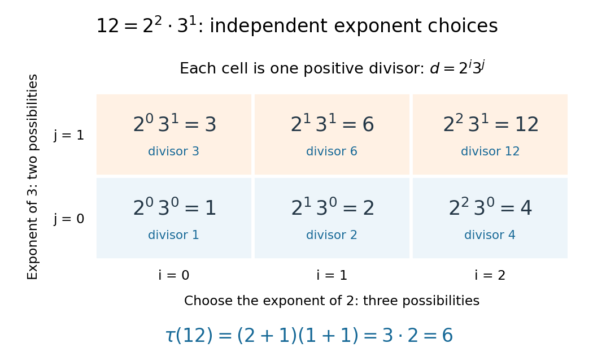

# Divisor function

↑ **Parent:** [Arithmetic function](arithmetic-function-split.md)  
ⓦ [Wiki](https://en.wikipedia.org/wiki/Divisor_function)

The [divisor function](divisor-function.md) $\tau(n)=\sum_{d\mid n}1$ counts the positive [integer divisors](divisor.md) of a [positive integer](positive-integer.md) $n$. In particular $\tau(1)=1$, because $1$ has just one positive [integer divisor](divisor.md). More generally the notation $\sigma_k(n)=\sum_{d\mid n}d^k$ gives $\tau=\sigma_0$ and the [sum-of-divisors function](sum-of-divisors-function.md) $\sigma_1$. Thus the [divisor function](divisor-function.md) counts the positive [integer divisors](divisor.md), while $\sigma_1$ adds their sizes. [Darij Grinberg, MIT 18.781 lecture notes, Definition 2.1.2 and Theorem 2.1.6](https://darijgrinberg.gitlab.io/floor.pdf)

If the [prime factorization](fundamental-theorem-of-arithmetic.md) is $n=\prod_{k=1}^r p_k^{a_k}$ with distinct [prime numbers](prime-number-split.md) $p_k$ and positive exponents $a_k$, then

$$
\tau(n)=\prod_{k=1}^r(a_k+1).
$$

The short proof is a count: each positive [integer divisor](divisor.md) has a unique form $\prod_{k=1}^r p_k^{b_k}$, where $0\le b_k\le a_k$. There are $a_k+1$ choices at each [prime number](prime-number-split.md), and choosing them gives every positive [integer divisor](divisor.md) exactly once. For $n=1$ there are no [prime factors](prime-factor.md) and the product is $1$.

For $12=2^2\cdot3$, choose $i\in\{0,1,2\}$ and $j\in\{0,1\}$ to obtain $2^i3^j$. The six values are $1,2,4,3,6,12$; sorted, the positive [integer divisors](divisor.md) are $1,2,3,4,6,12$. Therefore $\tau(12)=(2+1)(1+1)=6$. The diagram makes the independent exponent choices visible.

**[Figure 8](#image-the-prime-factorization-12-2-2-cdot3-gives-a-three-by-two-array-of-positive-integer-divisors-2-i3-j-so-the-divisor-function-has-tau-12-6). The prime factorization $12=2^2\cdot3$ gives a three-by-two array of positive integer divisors $2^i3^j$, so the divisor function has $\tau(12)=6$**.

This count is useful because a known [prime factorization](fundamental-theorem-of-arithmetic.md) gives $\tau(n)$ without testing every smaller [positive integer](positive-integer.md) for [divisibility](divisibility-split.md). It also proves the [divisor function](divisor-function.md) is a [multiplicative function](multiplicative-function.md): [coprime integers](coprime-integers.md) have disjoint [prime factors](prime-factor.md), so their exponent choices combine. For example $\tau(6)=4=\tau(2)\tau(3)$, but $\tau(4)=3\ne4=\tau(2)^2$, so it is not a [completely multiplicative function](completely-multiplicative-function.md). Equivalently, $\tau=\mathbf1*\mathbf1$ under [Dirichlet convolution](dirichlet-convolution.md), counting [ordered pairs](ordered-pair.md) of [positive integers](positive-integer.md) whose product is $n$.

**Table of contents**

- [Perfection quotient](perfection-quotient.md)
- [Amicable number](amicable-number.md)
  - [Amicable pair](amicable-pair.md)
- [Subpower bound for the divisor function](subpower-bound-for-the-divisor-function.md)
- [Divisor-square summatory bound](divisor-square-summatory-bound.md)

## ↑ Ancestors (5)

1. [Arithmetic function](arithmetic-function-split.md)
2. [Number theory](number-theory-split.md)
3. [Area of mathematics](area-of-mathematics.md)
4. [Mathematics](mathematics-split.md)
5. [Codex Wiki](split.md)

## ← Incoming links (27)

- [Arithmetic function](arithmetic-function-split.md)
- [Completely multiplicative function](completely-multiplicative-function.md)
- [Constant-one arithmetic function](constant-one-arithmetic-function.md)
- [Dirichlet convolution](dirichlet-convolution.md)
- [Dirichlet hyperbola method](dirichlet-hyperbola-method.md)
- [Divisor](divisor.md)
- [Divisor function](divisor-function.md)
- [Divisor-square summatory bound](divisor-square-summatory-bound.md)
- [Divisor sum](divisor-sum.md)
- [Divisor summatory function](divisor-summatory-function.md)
- [Factor pair](factor-pair.md)
- [Fourth moment of the Riemann zeta function](fourth-moment-of-the-riemann-zeta-function.md)
- [Fundamental theorem of arithmetic](fundamental-theorem-of-arithmetic.md)
- [Multiplicative function](multiplicative-function.md)
- [Multiplicativity of Dirichlet convolution](multiplicativity-of-dirichlet-convolution.md)
- [Solution](past-exam-of-the-mathematics-course-of-the-university-of-cambridge/2008/iii/paper-33/2/solution.md)
- [Solution](past-exam-of-the-mathematics-course-of-the-university-of-cambridge/2012/iii/paper-29/4/solution.md)
- [Solution](past-exam-of-the-mathematics-course-of-the-university-of-cambridge/2016/iii/paper-124/4/c/solution.md)
- [Solution](past-exam-of-the-mathematics-course-of-the-university-of-cambridge/2020/ii/paper-4/11h/b/solution.md)
- [Solution](past-exam-of-the-mathematics-course-of-the-university-of-cambridge/2020/ii/paper-4/11h/d/solution.md)
- [Perfection quotient](perfection-quotient.md)
- [Prime number](prime-number-split.md)
- [Prime signature](prime-signature.md)
- [Subpower bound for the divisor function](subpower-bound-for-the-divisor-function.md)
- [Sum-of-divisors function](sum-of-divisors-function.md)
- [Summatory function](summatory-function.md)
- [Type I–type II inverse principle for Möbius correlation](type-i-type-ii-inverse-principle-for-mobius-correlation.md)
