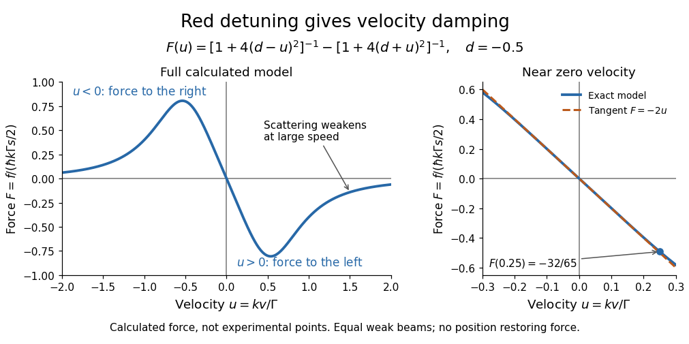

# Doppler cooling force

↑ **Parent:** [Doppler cooling](doppler-cooling.md)

Use a closed [two-level system](two-level-system.md) with [spontaneous emission](spontaneous-emission.md) population decay $P_e(t)=P_e(0)e^{-\Gamma t}$. Here $\Gamma$ is a decay rate in inverse seconds and also the full width at half maximum of the [natural linewidth](natural-linewidth.md) expressed in [angular frequency](angular-frequency.md). The corresponding full width in [hertz](hertz.md) is $\Gamma/(2\pi)$; the angular half width is $\Gamma/2$. These conventions determine every factor of two and $2\pi$ below.

Let $s$ be the on-resonance [saturation parameter](saturation-parameter.md) of each beam, with total excitation weak enough that saturation and coherent coupling between beams can be neglected. The independent-beam scattering rates and net [force](force-split.md) are

$$
R_\pm(v)=\frac{\Gamma s}{2}\frac{1}{1+4(\delta\mp kv)^2/\Gamma^2},\qquad
f(v)=\hbar k\bigl(R_+(v)-R_-(v)\bigr).
$$

The [force](force-split.md) is the [photon](photon.md) [momentum](momentum-split.md) per absorption multiplied by the difference in absorption rates. With dimensionless [laser detuning](laser-detuning.md) $d=\delta/\Gamma$ and dimensionless [velocity](velocity.md) $u=kv/\Gamma$, write

$$
f(v)=\frac{\hbar k\Gamma s}{2}F(u),\qquad
F(u)=\frac{1}{1+4(d-u)^2}-\frac{1}{1+4(d+u)^2}.
$$

For the example $d=-0.5$ and $u=0.25$, the positive and negative beam factors are respectively $4/13$ and $4/5$. Thus $F(0.25)=-32/65\simeq-0.4923$: the atom is moving right and the net [force](force-split.md) points left. All values in this example are dimensionless.

Subtracting the two fractions gives an especially useful sign check:

$$
F(u)=\frac{16du}{\bigl(1+4(d-u)^2\bigr)\bigl(1+4(d+u)^2\bigr)},\qquad
F'(0)=\frac{16d}{(1+4d^2)^2}.
$$

For red detuning, the [force](force-split.md) opposes nonzero $v$ throughout this ideal model; its useful magnitude eventually falls at large $|u|$. Near zero, a [Taylor series](taylor-series.md) gives [damping](damping.md)

$$
f(v)=-\alpha v+O(v^3),\qquad
\alpha=-\frac{8\hbar k^2 s d}{(1+4d^2)^2}>0.
$$

At $d=-0.5$, $F'(0)=-2$ and $\alpha=\hbar k^2s$. For blue detuning the sign reverses and the small-[velocity](velocity.md) motion is amplified; at exact resonance the opposing mean [forces](force-split.md) cancel in this symmetric model. Its derivation assumes weak excitation, a closed [two-level system](two-level-system.md), equal beam intensities and nonrelativistic [velocities](velocity.md); real multilevel atoms need additional physics.

**[Figure 14](#image-calculated-doppler-cooling-force-versus-velocity). Calculated Doppler cooling force versus velocity**. The equal-beam weak-field model at $d=-0.5$. The right panel compares the exact calculated force with its tangent $F=-2u$ near zero velocity. Neither panel depicts measured data, and the horizontal axis is velocity rather than displacement.

## ↑ Ancestors (6)

1. [Doppler cooling](doppler-cooling.md)
2. [Laser cooling](laser-cooling.md)
3. [Atomic measurement methods](atomic-measurement-methods.md)
4. [Atomic physics](atomic-physics-split.md)
5. [Physics](physics-split.md)
6. [Codex Wiki](split.md)

## ← Incoming links (2)

- [Doppler cooling limit](doppler-cooling-limit.md)
- [Saturation parameter](saturation-parameter.md)
