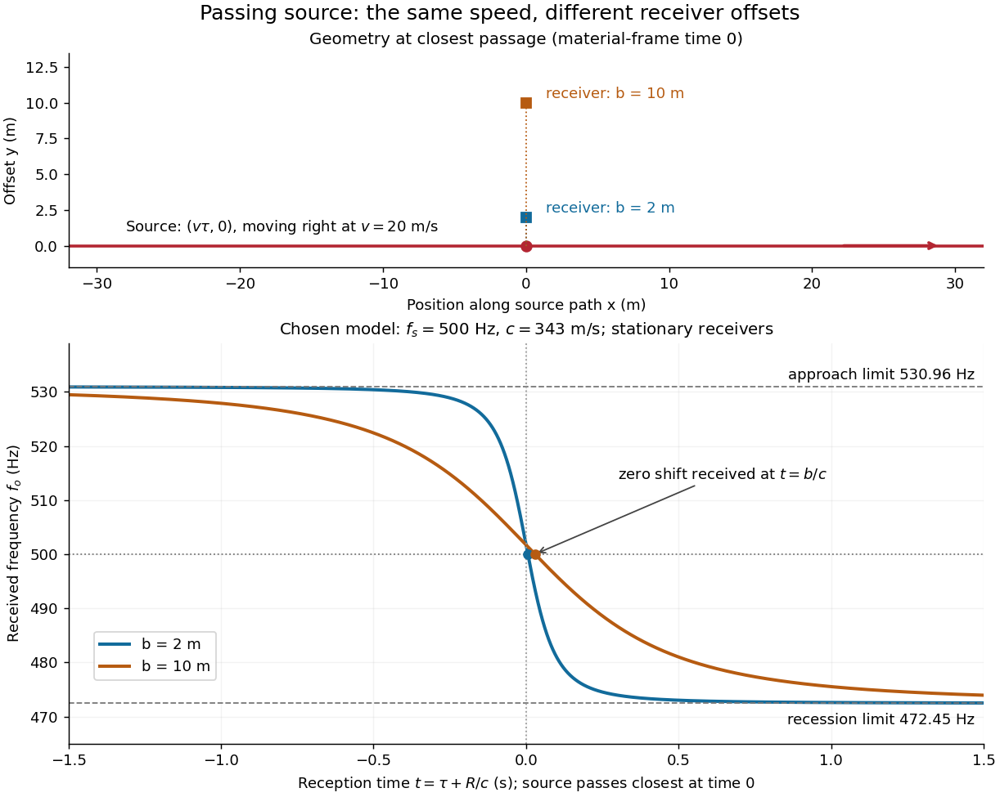

# Doppler frequency along a trajectory

↑ **Parent:** [Doppler effect](doppler-effect.md)

In the same uniform stationary sound model, let $\tau$ be emission [time](time-in-physics.md), $t$ reception [time](time-in-physics.md), and $\mathbf x_s(\tau)$ and $\mathbf x_o(t)$ source and receiver positions. The direct-path propagation condition and its direction are

$$
c(t-\tau)=R,\qquad R=|\mathbf x_o(t)-\mathbf x_s(\tau)|>0,\qquad \mathbf n=\frac{\mathbf x_o(t)-\mathbf x_s(\tau)}{R}.
$$

The [unit vector](unit-vector.md) $\mathbf n$ points from the source's old emission position to the receiver's reception position. With [velocities](velocity.md) $\mathbf v_s=d\mathbf x_s/d\tau$ and $\mathbf v_o=d\mathbf x_o/dt$, taking a [derivative](derivative.md) of the propagation condition gives

$$
c\left(1-\frac{d\tau}{dt}\right)=\mathbf n\cdot\mathbf v_o-\mathbf n\cdot\mathbf v_s\frac{d\tau}{dt},\qquad f_o(t)=f_s\frac{d\tau}{dt}=f_s\frac{c-\mathbf n\cdot\mathbf v_o(t)}{c-\mathbf n\cdot\mathbf v_s(\tau)}.
$$

Here the [dot products](dot-product.md) project onto the actual propagation direction. The last equality counts source [wave phase](phase-waves.md) cycles at reception for constant emitted [frequency](frequency.md) $f_s$. It assumes both speeds are below $c$, a unique direct arrival and smooth motion; interpreting a measured short-window [frequency spectrum](frequency-spectrum.md) additionally requires little [frequency](frequency.md) change within that window. The source [velocity](velocity.md) must be evaluated at emission, not at reception. This delayed geometry matters when the direction changes.

For an original pass-by model, a source follows $\mathbf x_s(\tau)=(v\tau,0)$ and a stationary receiver is at $(0,b)$ with $b>0$. The source passes its closest position at emission [time](time-in-physics.md) $\tau=0$. Then

$$
R=\sqrt{v^2\tau^2+b^2},\qquad t=\tau+R/c,\qquad f_o(t)=f_s\frac{c}{c+v^2\tau/R}.
$$

These parametric equations give received [frequency](frequency.md) against reception [time](time-in-physics.md). For $\tau<0$ the shift is positive, for $\tau>0$ negative, and the unshifted emission at $\tau=0$ reaches the receiver at $t=b/c$. Thus zero shift occurs after the source's geometric closest passage in the material's [reference frame](reference-frame.md). Increasing $b$ spreads the transition over a longer interval even though $v$ is unchanged. Far before and after passage, the [frequency](frequency.md) approaches $f_sc/(c-v)$ and $f_sc/(c+v)$ respectively.

**[Figure 6](#doppler-receiver-frequency-trajectories). Receiver offset changes the shape of a passing source's Doppler shift**. Original model predictions for $c=343\,\mathrm{m\,s^{-1}}$, $v=20\,\mathrm{m\,s^{-1}}$, $f_s=500\,\mathrm{Hz}$ and receiver offsets $b=2\,\mathrm m$ and $10\,\mathrm m$. The upper panel shows the shared straight source [trajectory](trajectory.md) and the two receiver positions; the lower panel uses reception [time](time-in-physics.md) $t=\tau+R/c$. Dots at $t=b/c$ mark zero shift. Dashed horizontal limits are the one-dimensional approach and recession values. No curve is measured data.

## ↑ Ancestors (4)

1. [Doppler effect](doppler-effect.md)
2. [Wave](wave-split.md)
3. [Physics](physics-split.md)
4. [Codex Wiki](split.md)

## ← Incoming links (2)

- [Acoustic Doppler measurement](acoustic-doppler-measurement.md)
- [Doppler effect](doppler-effect.md)
