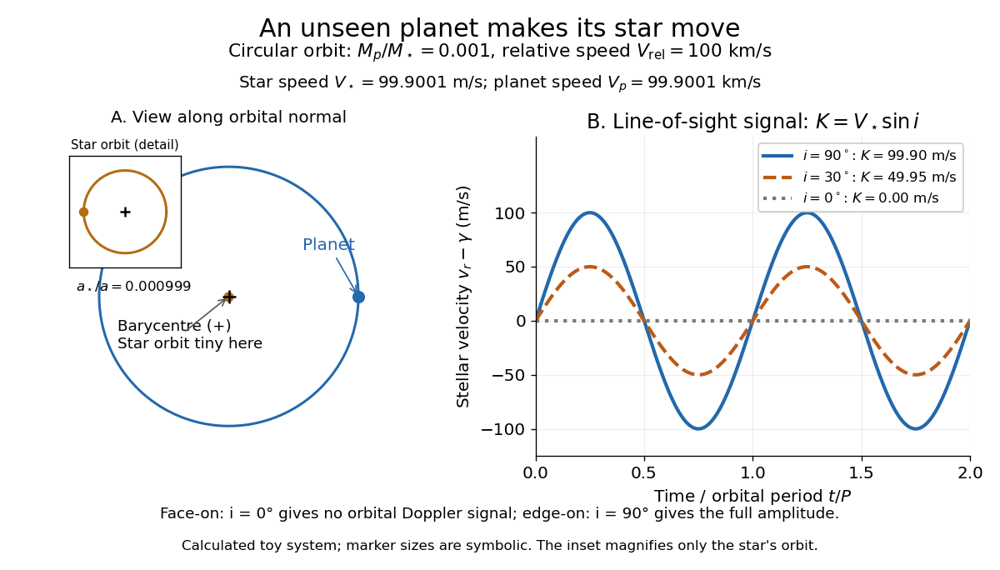

# Doppler spectroscopy

↑ **Parent:** [Exoplanet atmospheric observatory](exoplanet-atmospheric-observatory.md)  
ⓦ [Wiki](https://en.wikipedia.org/wiki/Doppler_spectroscopy)

[Doppler spectroscopy](doppler-spectroscopy.md) detects an [exoplanet](exoplanet-split.md) through the host [star](star.md)'s changing [Doppler shift](doppler-effect.md). Both bodies orbit their shared [astronomical barycenter](barycenter-astronomy.md): the [star](star.md) undergoes [stellar reflex motion](stellar-reflex-motion.md) even when the [exoplanet](exoplanet-split.md) itself is unseen. Its [velocity](velocity.md) along the line of sight shifts its [spectral lines](spectral-line.md); at speeds small compared with the [speed of light](speed-of-light.md), $\Delta\lambda/\lambda\simeq v_r/c$, with positive $v_r$ for recession. Repeated measurements can fit a [Kepler orbit](kepler-orbit.md), rather than merely detect one shifted spectrum. [Starspots](starspot.md) and other changes in stellar [spectral lines](spectral-line.md) must be distinguished from actual orbital motion.

For one companion in an isolated [two-body problem](two-body-problem.md), the [stellar radial-velocity semi-amplitude](stellar-radial-velocity-semi-amplitude.md) is

$$
K=\left(\frac{2\pi G}{P}\right)^{1/3}\frac{M_p\sin i}{(M_\star+M_p)^{2/3}}\frac{1}{\sqrt{1-e^2}}.
$$

Here $G$ is the [gravitational constant](gravitational-constant.md), $P$ the [orbital period](orbital-period.md), $e$ the [orbital eccentricity](orbital-eccentricity.md), and $M_\star,M_p$ the [star](star.md) and [exoplanet](exoplanet-split.md) [masses](mass.md). The [orbital inclination](orbital-inclination.md) $i$ is measured relative to the sky plane: $i=0$ is face-on and $i=90^\circ$ is an [edge-on orbit](edge-on-orbit.md). The exact [binary mass function](binary-mass-function.md) measured from the fitted [orbit](orbit-dynamical-system.md) is

$$
f=\frac{PK^3(1-e^2)^{3/2}}{2\pi G}=\frac{M_p^3\sin^3i}{(M_\star+M_p)^2}.
$$

With known $M_\star$ and $M_p\ll M_\star$, this is usually reported as $M_p\sin i$. Taking $\sin i=1$ gives the minimum companion [mass](mass.md); a smaller [orbital inclination](orbital-inclination.md) allows a larger [mass](mass.md). A detected [exoplanet transit](exoplanet-transit.md) constrains $i$ close to $90^\circ$ for a compact [planet](planet.md) orbiting well outside the [star](star.md)'s surface, substantially resolving this ambiguity. Combining [Doppler spectroscopy](doppler-spectroscopy.md) and [exoplanet transit photometry](exoplanet-transit-photometry.md) then supplies a [mass](mass.md) and [radius](radius.md) for [exoplanet interior](exoplanet-interior.md) studies.

For a computed circular example, let $q=M_p/M_\star=0.001$ and choose a relative orbital [speed](speed.md) $V_{\rm rel}=100\,\mathrm{km\,s^{-1}}$: this is the speed of the [planet](planet.md) relative to the [star](star.md), not its speed about the [astronomical barycenter](barycenter-astronomy.md). [Conservation of momentum](momentum-conservation.md) gives

$$
V_\star=\frac{q}{1+q}V_{\rm rel}=99.9001\,\mathrm{m\,s^{-1}},\qquad V_p=\frac{1}{1+q}V_{\rm rel}=99.9001\,\mathrm{km\,s^{-1}}.
$$

The barycentric [velocities](velocity.md) point in opposite directions, so their [speeds](speed.md) add to $V_{\rm rel}$. Here $e=0$ and $K=V_\star\sin i$: $K=99.9001\,\mathrm{m\,s^{-1}}$ at $i=90^\circ$, $49.9500\,\mathrm{m\,s^{-1}}$ at $i=30^\circ$, and zero at $i=0$. The [star](star.md) still orbits in the face-on case, but its orbital [velocity](velocity.md) has no line-of-sight component. The plotted circular signal is $v_r(t)-\gamma=K\sin(2\pi t/P)$ for a chosen phase origin and constant system [velocity](velocity.md) $\gamma$.

**[Figure 2](#image-a-planet-makes-its-star-orbit-too-inclination-changes-the-measured-velocity-amplitude). A planet makes its star orbit too: inclination changes the measured velocity amplitude**.

**Table of contents**

- [Stellar reflex motion](stellar-reflex-motion.md)
  - [Stellar radial-velocity semi-amplitude](stellar-radial-velocity-semi-amplitude.md)

## ↑ Ancestors (7)

1. [Exoplanet atmospheric observatory](exoplanet-atmospheric-observatory.md)
2. [Exoplanet atmosphere](exoplanet-atmosphere.md)
3. [Exoplanet](exoplanet-split.md)
4. [Astrophysics](astrophysics-split.md)
5. [Branches of physics](branches-of-physics.md)
6. [Physics](physics-split.md)
7. [Codex Wiki](split.md)

## ← Incoming links (10)

- [Doppler effect](doppler-effect.md)
- [Doppler spectroscopy](doppler-spectroscopy.md)
- [Exoplanet](exoplanet-split.md)
- [Light curve](light-curve.md)
- [Methods of detecting exoplanets](methods-of-detecting-exoplanets.md)
- [Solution](past-exam-of-the-mathematics-course-of-the-university-of-cambridge/2016/iii/paper-315/4/e/solution.md)
- [Solution](past-exam-of-the-mathematics-course-of-the-university-of-cambridge/2018/iii/paper-315/4/e/solution.md)
- [Starspot](starspot.md)
- [Stellar radial-velocity semi-amplitude](stellar-radial-velocity-semi-amplitude.md)
- [Stellar reflex motion](stellar-reflex-motion.md)
