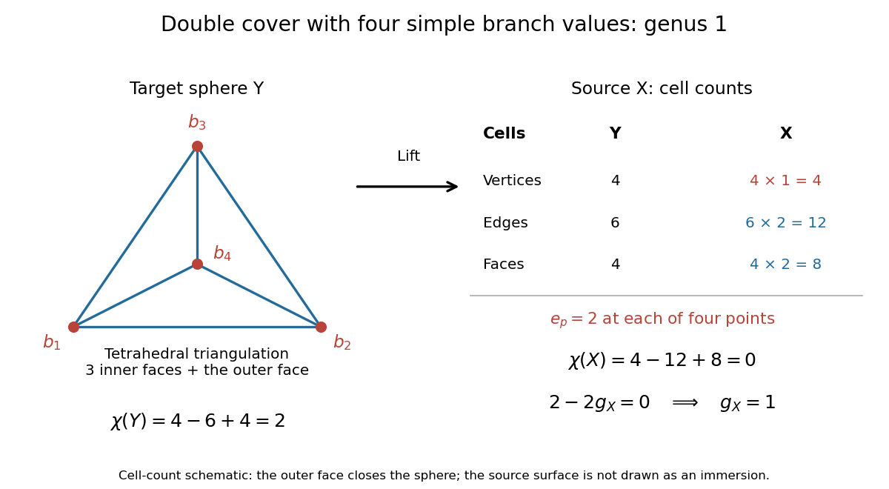

# Double cover of the sphere with four branch values

↑ **Parent:** [Riemann-Hurwitz formula](riemann-hurwitz-formula.md)

Suppose a nonconstant [holomorphic map](holomorphic-map.md) $f:X\to\mathbb P^1$ from a [connected](connected-space.md) [compact Riemann surface](compact-riemann-surface.md) has [degree of a holomorphic map](degree-of-a-holomorphic-map.md) two and exactly four distinct [branch values of a holomorphic map](branch-value-of-a-holomorphic-map.md). The [valency theorem](valency-theorem.md) forces each of their [fibres](fiber-of-a-function.md) to contain one [ramification point](ramification-point-of-a-holomorphic-map.md) with $e_p=2$, a [simple ramification point of a holomorphic map](simple-ramification-point-of-a-holomorphic-map.md). Hence

$$
2g_X-2=2(-2)+4(2-1)=0,\qquad g_X=1.
$$

This determines the [genus](genus-of-a-surface.md) without recognizing a [torus](torus.md) in a drawing.

A concrete realization is the [compact Riemann surface](compact-riemann-surface.md) obtained by adding the two points at infinity to the [even-degree hyperelliptic model](even-degree-hyperelliptic-model.md) given by the [algebraic curve](algebraic-curve.md)

$$
w^2=P(z)=(z+2)(z+1)(z-1)(z-2).
$$

Projection to $z$ has [degree of a holomorphic map](degree-of-a-holomorphic-map.md) two. At a [simple zero](simple-zero.md) $a$ of $P$, $w$ is a [local coordinate](local-coordinate.md) and $z-a=w^2/P'(a)+O(w^4)$, so $e_p=2$. At infinity set $u=1/z$ and $s=w/z^2$: then $s^2=(1-4u^2)(1-u^2)$. There are two points with $u=0$, $s=\pm1$, each unramified since $u$ is a [local coordinate](local-coordinate.md). The four finite roots are therefore all the [branch values of a holomorphic map](branch-value-of-a-holomorphic-map.md).[Section 3.3, printed pp. 41-43: local coordinates at simple roots, two points at infinity for even polynomial degree, and ramification count](geometry-of-surfaces-by-nigel-hitchin-b3a-course-2013.md)

**[Figure 2](#image-cell-count-schematic-for-a-double-cover-of-the-sphere-with-four-simple-branch-values-four-vertices-twelve-edges-and-eight-faces-upstairs). Cell-count schematic for a double cover of the sphere with four simple branch values: four vertices, twelve edges and eight faces upstairs**.

Choose a [triangulation of a surface](triangulation-of-a-surface.md) on the [Riemann sphere](riemann-sphere.md) with these four [branch values of a holomorphic map](branch-value-of-a-holomorphic-map.md) as vertices, combinatorially the boundary of a [tetrahedron](tetrahedron.md). Its counts are $V=4,E=6,F=4$. Upstairs, each vertex has one preimage and each open edge and face has two lifts: $V_X=4,E_X=12,F_X=8$, giving [Euler characteristic](euler-characteristic.md) $4-12+8=0$. This is a cell schematic, not a geometric immersion of $X$. The [Triangulation proof of the Riemann-Hurwitz formula](triangulation-proof-of-the-riemann-hurwitz-formula.md) applies the same counting idea after refining a general [triangulation of a surface](triangulation-of-a-surface.md) around the [branch values of a holomorphic map](branch-value-of-a-holomorphic-map.md).[Section 3.2, Theorem 3.2 and its triangulation proof, printed pp. 38-39](geometry-of-surfaces-by-nigel-hitchin-b3a-course-2013.md)

## ↑ Ancestors (7)

1. [Riemann-Hurwitz formula](riemann-hurwitz-formula.md)
2. [Riemann surfaces](riemann-surfaces-split.md)
3. [Complex analysis](complex-analysis-split.md)
4. [Analysis](analysis-split.md)
5. [Area of mathematics](area-of-mathematics.md)
6. [Mathematics](mathematics-split.md)
7. [Codex Wiki](split.md)

## ← Incoming links (1)

- [Riemann-Hurwitz formula](riemann-hurwitz-formula.md)
