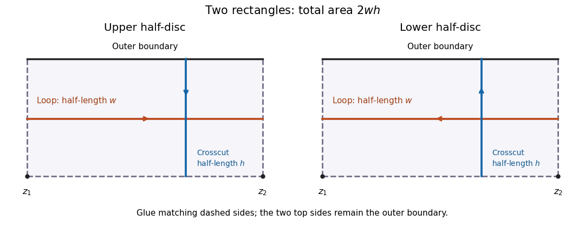

# Doubled rectangle extremal-length duality

↑ **Parent:** [Conformal modulus of a quadrilateral](conformal-modulus-of-a-quadrilateral.md)

Glue two copies of $[0,w]\times[0,h]$ along their left, bottom and right sides. Their unglued top sides form the outer boundary of a disk; the two bottom corners are marked interior points. Let $\Gamma$ be the loops surrounding both points, and $\Gamma^*$ the boundary-to-boundary crosscuts separating them. Then $\lambda(\Gamma)\lambda(\Gamma^*)=4$.

Each vertical seam joins a marked point to the outer boundary, so the [Jordan curve theorem](jordan-curve-theorem.md) forces a loop surrounding both points to meet both seams. In the flat [conformal metric](conformal-metric.md), its total horizontal travel is therefore at least $2w$. Doubled horizontal segments attain this length. Each separating crosscut meets the bottom seam and starts and ends at height $h$, so its total vertical travel is at least $2h$; doubled vertical segments attain it. The total [area](surface-area.md) is $2wh$.

For an arbitrary density, integrate the lengths of the doubled horizontal segments over their height. The [Cauchy-Schwarz inequality](cauchy-schwarz-inequality.md) yields $L_\rho(\Gamma)^2h\leq2wA_\rho$. Doubled vertical segments similarly give $L_\rho(\Gamma^*)^2w\leq2hA_\rho$. These upper bounds equal the flat-metric ratios, proving both displayed formulas. Mapping the upper and lower halves of a disc to these rectangles gives the corresponding duality for a [simply connected domain](simply-connected-domain.md) with two marked interior points.

**[Figure 1](#image-two-rectangles-glued-along-three-sides-give-loop-length-2w-crosscut-length-2h-and-total-area-2wh). Two rectangles glued along three sides give loop length 2w, crosscut length 2h and total area 2wh**.

## ↑ Ancestors (8)

1. [Conformal modulus of a quadrilateral](conformal-modulus-of-a-quadrilateral.md)
2. [Conformal quadrilateral](conformal-quadrilateral.md)
3. [Riemann surfaces](riemann-surfaces-split.md)
4. [Complex analysis](complex-analysis-split.md)
5. [Analysis](analysis-split.md)
6. [Area of mathematics](area-of-mathematics.md)
7. [Mathematics](mathematics-split.md)
8. [Codex Wiki](split.md)

## ← Incoming links (1)

- [Solution](past-exam-of-the-complex-analysis-conformal-maps-and-geometry-course-of-the-university-of-oxford/2023/2/d/solution.md)
