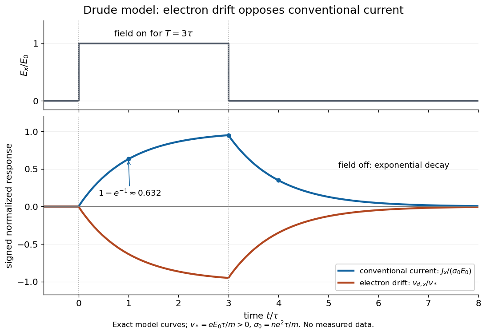

# Drude current relaxation

↑ **Parent:** [Drude model](drude-model.md)

Switch on a constant [electric field](electric-field-split.md) $\mathbf E_0$ at $t=0$. For prescribed initial [current density](current-density.md) $\mathbf J(0)$, the exact [Drude model](drude-model.md) solution is the displayed formula. For [electrons](electron.md), the corresponding [drift velocity](drift-velocity.md) is

$$
\mathbf v_d(t)=-\frac{e\tau}{m}\mathbf E_0+
\left[\mathbf v_d(0)+\frac{e\tau}{m}\mathbf E_0\right]e^{-t/\tau}.
$$

Starting from zero [drift velocity](drift-velocity.md), the [current density](current-density.md) reaches $1-e^{-1}\approx0.632$ of its limiting value after one [momentum relaxation time](momentum-relaxation-time.md). Switching the [electric field](electric-field-split.md) off at $T$ instead gives $\mathbf J(t)=\mathbf J(T)e^{-(t-T)/\tau}$ for $t\geq T$. A finite step of [electric field](electric-field-split.md) changes the acceleration immediately but leaves [drift velocity](drift-velocity.md) and [current density](current-density.md) continuous.

**[Figure 14](#image-exact-drude-current-relaxation-during-and-after-an-electric-field-pulse). Exact Drude current relaxation during and after an electric field pulse**. [Source](drude-electron-drift-current-transient.py). The applied [electric field](electric-field-split.md) is $E_0\widehat{\mathbf x}$ for $0<t<3\tau$ and zero otherwise, with initially zero [current density](current-density.md). The blue curve is $J_x/(\sigma_0E_0)$; the orange curve is $v_{d,x}/v_*$ for [electrons](electron.md), where $v_*=eE_0\tau/m>0$. The opposite signs implement [conventional current](conventional-current.md). These are calculated model curves.

More generally, multiplying the [current density](current-density.md) equation by an [integrating factor](integrating-factor.md) gives

$$
\mathbf J(t)=e^{-(t-t_0)/\tau}\mathbf J(t_0)+\frac{nq^2}{m}\int_{t_0}^{t}e^{-(t-s)/\tau}\mathbf E(s)\,ds.
$$

This is the [causal response of a first-order relaxation equation](causal-response-of-a-first-order-relaxation-equation.md): only earlier [electric fields](electric-field-split.md) enter the [integral](integral-split.md). It also shows why instantaneous [Ohm's law](ohm-s-law.md) is an approximation when the [electric field](electric-field-split.md) changes appreciably during a [momentum relaxation time](momentum-relaxation-time.md).

## ↑ Ancestors (11)

1. [Drude model](drude-model.md)
2. [Electrical conductivity](electrical-conductivity.md)
3. [Ohm's law](ohm-s-law.md)
4. [Electrical resistance](electrical-resistance.md)
5. [Electrical resistance and conductance](electrical-resistance-and-conductance.md)
6. [Electric current](electric-current.md)
7. [Electric charge](electric-charge-split.md)
8. [Electromagnetism](electromagnetism-split.md)
9. [Branches of physics](branches-of-physics.md)
10. [Physics](physics-split.md)
11. [Codex Wiki](split.md)

## ← Incoming links (2)

- [Drude current relaxation](drude-current-relaxation.md)
- [Drude model](drude-model.md)
