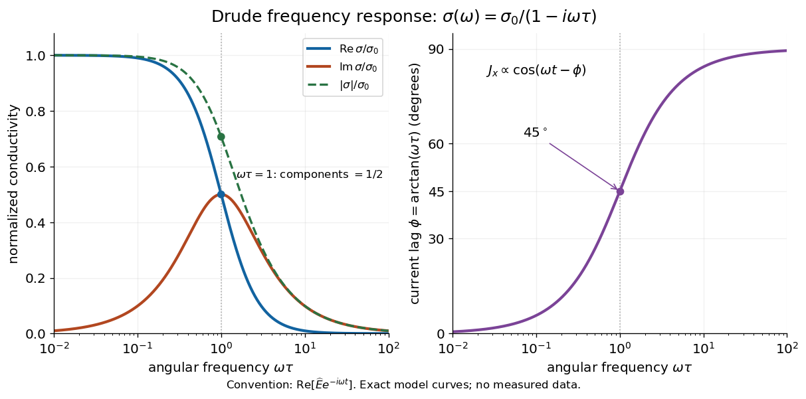

# Drude frequency response

↑ **Parent:** [Drude model](drude-model.md)

Use physical [electric fields](electric-field.md) $\mathbf E(t)=\operatorname{Re}[\widehat{\mathbf E}e^{-i\omega t}]$ and [current densities](current-density.md) $\mathbf J(t)=\operatorname{Re}[\widehat{\mathbf J}e^{-i\omega t}]$, with peak [complex amplitudes](complex-amplitude.md). After the initial transient has decayed, substitution into the [Drude model](drude-model.md) equation gives the [complex conductivity](complex-conductivity.md)

$$
\sigma(\omega)=\frac{ne^2\tau/m}{1-i\omega\tau},\qquad
\operatorname{Re}\sigma=\frac{\sigma_0}{1+\omega^2\tau^2},\qquad
\operatorname{Im}\sigma=\frac{\sigma_0\omega\tau}{1+\omega^2\tau^2}.
$$

Here the mobile species is [Electrons](electron.md). With the alternative $e^{+i\omega t}$ convention, the denominator is $1+i\omega\tau$ and the [imaginary part](imaginary-part.md) changes sign; the physical response is identical.[p. 2, Eqs. (1)–(11), and pp. 5–6, Eqs. (23)–(27)](lecture-notes-on-the-electrodynamics-of-metals-and-superconductors.md)

For $E_x(t)=E_0\cos\omega t$ with $\omega>0$, the real-time [current density](current-density.md) is

$$
J_x(t)=\frac{\sigma_0E_0}{\sqrt{1+\omega^2\tau^2}}\cos(\omega t-\phi),\qquad
\phi=\arctan(\omega\tau).
$$

Thus a positive [argument](argument-complex-analysis.md) of [complex conductivity](complex-conductivity.md) in the $e^{-i\omega t}$ convention means that [current density](current-density.md) lags the [electric field](electric-field.md). At $\omega\tau=1$, its [real part](real-part.md) and [imaginary part](imaginary-part.md) are both $\sigma_0/2$, its [modulus](modulus.md) is $\sigma_0/\sqrt2$, and the lag is $\pi/4$.

**[Figure 24](#image-drude-frequency-response-dissipative-component-amplitude-and-phase-lag). Drude frequency response: dissipative component, amplitude, and phase lag**. [Source](drude-complex-conductivity-frequency-response.py). Exact dimensionless [Drude model](drude-model.md) curves with $e^{-i\omega t}$ time dependence. The [real part](real-part.md) controls average electrical [power](power.md) absorption; the positive [imaginary part](imaginary-part.md) describes delayed [current density](current-density.md). The dotted line marks $\omega\tau=1$.

For $\omega\tau\ll1$, [complex conductivity](complex-conductivity.md) tends to the positive constant $\sigma_0$: [current density](current-density.md) nearly follows the [electric field](electric-field.md). For $\omega\tau\gg1$ within this model,

$$
\sigma(\omega)\sim\frac{i ne^2}{m\omega},\qquad
\operatorname{Re}\sigma\sim\frac{ne^2}{m\omega^2\tau},\qquad
\phi\longrightarrow\frac{\pi}{2}.
$$

The [current density](current-density.md) amplitude decreases and its response becomes predominantly inertial. Average [power](power.md) absorbed per volume is $\overline p=\tfrac12\operatorname{Re}\sigma\,|\widehat{\mathbf E}|^2\geq0$. These limits describe the material response to a specified local [electric field](electric-field.md), not the complete electromagnetic response of a finite specimen with contacts. The [Drude response](drude-response.md) has its pole at $\omega=-i/\tau$, consistent with the decaying [causal response of a first-order relaxation equation](causal-response-of-a-first-order-relaxation-equation.md).

The simple [Drude model](drude-model.md) does not predict the microscopic [momentum relaxation time](momentum-relaxation-time.md). It neglects [electronic band structure](electronic-band-structure.md) and [Fermi-Dirac statistics](fermi-dirac-statistics.md); a useful semiclassical extension replaces $m$ by an appropriate [band effective mass](band-effective-mass.md), but neither a single scalar [mass](mass.md) nor one constant [momentum relaxation time](momentum-relaxation-time.md) describes every material. Several [charge carriers](charge-carrier.md), energy-dependent scattering, and transitions between electronic bands can spoil the simple [Drude frequency response](drude-frequency-response.md). A successful low-[angular frequency](angular-frequency.md) fit does not justify extrapolation to arbitrarily large [angular frequencies](angular-frequency.md).

## ↑ Ancestors (11)

1. [Drude model](drude-model.md)
2. [Electrical conductivity](electrical-conductivity.md)
3. [Ohm's law](ohm-s-law.md)
4. [Electrical resistance](electrical-resistance.md)
5. [Electrical resistance and conductance](electrical-resistance-and-conductance.md)
6. [Electric current](electric-current.md)
7. [Electric charge](electric-charge.md)
8. [Electromagnetism](electromagnetism-split.md)
9. [Branches of physics](branches-of-physics.md)
10. [Physics](physics-split.md)
11. [Codex Wiki](split.md)

## ← Incoming links (2)

- [Drude frequency response](drude-frequency-response.md)
- [Drude model](drude-model.md)
