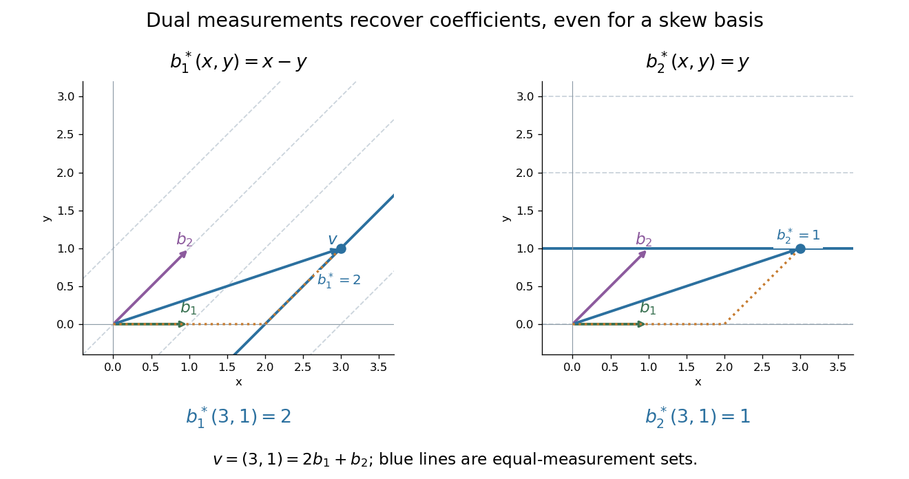

# Dual basis

↑ **Parent:** [Dual space](dual-space-split.md)  
ⓦ [Wiki](https://en.wikipedia.org/wiki/Dual_basis)

For a [basis](basis.md) $e_1,\ldots,e_n$ of a finite-dimensional [vector space](vector-space-split.md) $V$, its [dual basis](dual-basis.md) consists of [linear functionals](linear-functional.md) $e_1^*,\ldots,e_n^*$ satisfying

$$
e_i^*(e_j)=\delta_{ij}.
$$

The [Kronecker delta](kronecker-delta.md) means that each rule gives one on its own [basis vector](basis-vector.md) and zero on the others. These rules extract coordinates:

$$
v=\sum_{i=1}^n e_i^*(v)e_i.
$$

Applying $e_i^*$ to a [linear combination](linear-combination.md) removes every term except the $i$th. Consequently the [dual basis](dual-basis.md) is a [basis](basis.md) of the [dual space](dual-space-split.md), and every [linear functional](linear-functional.md) has expansion $\varphi=\sum_i\varphi(e_i)e_i^*$. [Axler, Linear Algebra Done Right, fourth edition, §3F, definitions and results 3.112–3.116](linear-algebra-done-right-by-sheldon-axler-4th-edition.md).

Coordinate extraction works for a nonorthogonal [basis](basis.md) too. With $b_1=(1,0)$ and $b_2=(1,1)$, the [dual basis](dual-basis.md) is

$$
b_1^*(x,y)=x-y,\qquad b_2^*(x,y)=y.
$$

The checks $b_1^*(b_1)=1$, $b_1^*(b_2)=0$, $b_2^*(b_1)=0$, and $b_2^*(b_2)=1$ fix the two rules. For $v=(3,1)$ they give **coordinates $(2,1)$**, so $v=2b_1+b_2$. The usual [dot products](dot-product.md) with $b_1,b_2$ instead give $3,4$ and do not extract these coordinates: simple projection formulas depend on an [orthonormal basis](orthonormal-basis.md).

**[Figure 2](#image-the-dual-basis-extracts-coefficients-in-a-skew-basis-by-two-scalar-valued-measurements). The dual basis extracts coefficients in a skew basis by two scalar-valued measurements**.

The same idea explains [polynomial interpolation](polynomial-interpolation.md). On [polynomials](polynomial-split.md) of [polynomial degree](degree-of-a-polynomial.md) at most $n$, evaluation at distinct [interpolation nodes](interpolation-node.md) $x_0,\ldots,x_n$ gives the [dual basis](dual-basis.md) to the [Lagrange cardinal polynomials](lagrange-cardinal-polynomial.md), because $\ell_i(x_j)=\delta_{ij}$. Samples are coordinates in this [basis](basis.md), so the reconstruction $p=\sum_i p(x_i)\ell_i$ is a dual-basis expansion. [Differentiation weights from nodal evaluations](differentiation-weights-from-nodal-evaluations.md) and [factorial monomial basis for polynomial differentiation](factorial-monomial-basis-for-polynomial-differentiation.md) apply the same principle to different measurements.

**Table of contents**

- [Coordinate functional](coordinate-functional.md)
- [Factorial monomial basis for polynomial differentiation](factorial-monomial-basis-for-polynomial-differentiation.md)

## ↑ Ancestors (6)

1. [Dual space](dual-space-split.md)
2. [Linear algebra](linear-algebra-split.md)
3. [Algebra](algebra-split.md)
4. [Area of mathematics](area-of-mathematics.md)
5. [Mathematics](mathematics-split.md)
6. [Codex Wiki](split.md)

## ← Incoming links (33)

- [Bidual evaluation map](bidual-evaluation-map.md)
- [Cartesian and oblique coordinate reconstruction](cartesian-and-oblique-coordinate-reconstruction.md)
- [Cartesian basis](cartesian-basis.md)
- [Chebyshev spline coefficient and dual norm equality](chebyshev-spline-coefficient-and-dual-norm-equality.md)
- [Coordinate functional](coordinate-functional.md)
- [Coordinate (linear algebra)](coordinate-linear-algebra.md)
- [Coordinate vector](coordinate-vector.md)
- [Dual basis](dual-basis.md)
- [Dual space](dual-space-split.md)
- [Lagrange cardinal polynomial](lagrange-cardinal-polynomial.md)
- [Linear functional](linear-functional.md)
- [Nondegenerate bilinear form](nondegenerate-bilinear-form.md)
- [Solution](past-exam-of-the-mathematics-course-of-the-university-of-cambridge/2001/ib/paper-2/15c/solution.md)
- [Solution](past-exam-of-the-mathematics-course-of-the-university-of-cambridge/2002/ib/paper-4/15f/solution.md)
- [Solution](past-exam-of-the-mathematics-course-of-the-university-of-cambridge/2004/ib/paper-3/1e/solution.md)
- [Solution](past-exam-of-the-mathematics-course-of-the-university-of-cambridge/2005/ib/paper-1/9c/solution.md)
- [Solution](past-exam-of-the-mathematics-course-of-the-university-of-cambridge/2005/iii/paper-68/5/a/solution.md)
- [Solution](past-exam-of-the-mathematics-course-of-the-university-of-cambridge/2006/ib/paper-2/10e/solution.md)
- [Solution](past-exam-of-the-mathematics-course-of-the-university-of-cambridge/2006/iii/paper-1/1/b/solution.md)
- [Solution](past-exam-of-the-mathematics-course-of-the-university-of-cambridge/2009/ib/paper-1/9g/solution.md)
- [Solution](past-exam-of-the-mathematics-course-of-the-university-of-cambridge/2012/iii/paper-1/6/solution.md)
- [Solution](past-exam-of-the-mathematics-course-of-the-university-of-cambridge/2014/ib/paper-4/10g/solution.md)
- [Solution](past-exam-of-the-mathematics-course-of-the-university-of-cambridge/2017/ib/paper-4/10f/solution.md)
- [Solution](past-exam-of-the-mathematics-course-of-the-university-of-cambridge/2017/iii/paper-115/2/a/solution.md)
- [Solution](past-exam-of-the-mathematics-course-of-the-university-of-cambridge/2017/iii/paper-115/2/b/ii/solution.md)
- [Solution](past-exam-of-the-mathematics-course-of-the-university-of-cambridge/2018/ib/paper-2/1e/solution.md)
- [Solution](past-exam-of-the-mathematics-course-of-the-university-of-cambridge/2018/ii/paper-4/20g/b/solution.md)
- [Solution](past-exam-of-the-mathematics-course-of-the-university-of-cambridge/2018/iii/paper-140/2/b/solution.md)
- [Solution](past-exam-of-the-mathematics-course-of-the-university-of-cambridge/2022/iii/paper-115/2/b/solution.md)
- [Solution](past-exam-of-the-mathematics-course-of-the-university-of-cambridge/2024/ib/paper-1/8g/a/solution.md)
- [Solution](past-exam-of-the-mathematics-course-of-the-university-of-cambridge/2024/iii/paper-318/4/b/solution.md)
- [Riesz dual basis in an inner product space](riesz-dual-basis-in-an-inner-product-space.md)
- [Transpose of a linear map](transpose-of-a-linear-map.md)
