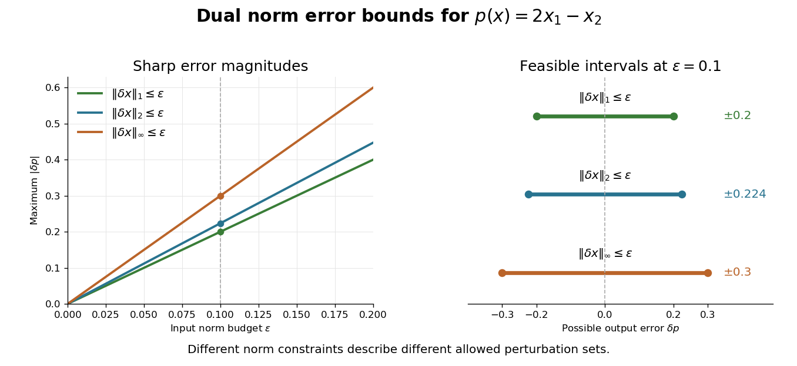

# Dual norm as a worst-case linear error bound

↑ **Parent:** [Dual norm](dual-norm.md)

Suppose a perturbation $\delta x$ satisfies $\|\delta x\|\le\varepsilon$, with $\varepsilon\ge0$. [Absolute homogeneity of a norm](absolute-homogeneity-of-a-norm.md) and the [dual norm](dual-norm.md) definition give

$$
|p(x+\delta x)-p(x)|=|p(\delta x)|
\le\|p\|_*\|\delta x\|\le\varepsilon\|p\|_*.
$$

For nonzero $\delta x$, divide it by its [norm](norm.md) to obtain an input in the [unit ball](unit-ball.md); for zero perturbation the inequality is immediate. This is an exact [error bound](error-bound.md) for a [linear functional](linear-functional.md), for every perturbation in the stated input set.

For $p(x)=2x_1-x_2$ and a budget $\varepsilon=0.1$, the sharp output-error bounds are **$0.2$** for $\|\delta x\|_1\le0.1$, **$\sqrt5/10\simeq0.224$** for $\|\delta x\|_2\le0.1$, and **$0.3$** for $\|\delta x\|_\infty\le0.1$. Scale the maximizing [vectors](vector.md) from the preceding example by $0.1$ to attain the positive endpoints; their negatives attain the negative endpoints. The [L1 norm](l1-norm.md) budget constrains a total absolute error; the [maximum norm](supremum-norm.md) budget permits each coordinate to have that error separately. These budgets define nested sets and carry different information.

**[Figure 3](#image-dual-norms-give-exact-worst-case-errors-for-the-same-linear-functional). Dual norms give exact worst-case errors for the same linear functional**. Original bounds for $p(x)=2x_1-x_2$. Lines show the sharp error magnitude as the stated input [norm](norm.md) budget increases. The right panel gives the full possible error intervals at $\varepsilon=0.1$; these are the full feasible intervals for the stated deterministic bounds.

The coordinates must use the stated scale and units. Rescaling one coordinate changes both its coefficient in $a$ and the meaning of its input budget. For a nonlinear [differentiable function](differentiable-function.md) with scalar values, its [Fréchet derivative](frechet-derivative.md) at the base point is a [linear functional](linear-functional.md) governing the first-order response. An exact finite-perturbation [error bound](error-bound.md) additionally needs control of the [Taylor remainder](taylor-remainder.md) or of the [Fréchet derivative](frechet-derivative.md) along the path.

## ↑ Ancestors (8)

1. [Dual norm](dual-norm.md)
2. [Norm](norm.md)
3. [Normed vector space](normed-vector-space-split.md)
4. [Functional analysis](functional-analysis-split.md)
5. [Analysis](analysis-split.md)
6. [Area of mathematics](area-of-mathematics.md)
7. [Mathematics](mathematics-split.md)
8. [Codex Wiki](split.md)
