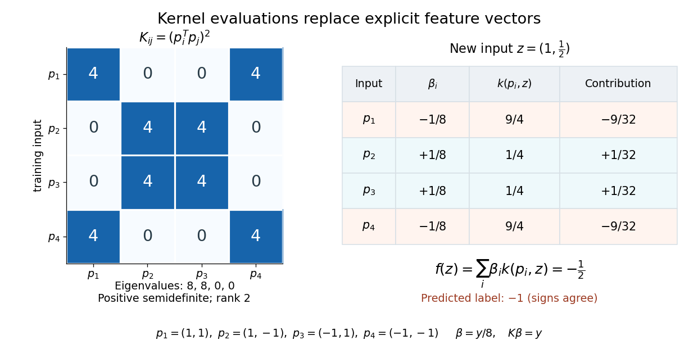

# Dual prediction with a kernel

↑ **Parent:** [Kernel trick](kernel-trick.md)

If the weight [vector](vector.md) lies in the [linear span](linear-span.md) of the training [feature map](feature-map.md) outputs, write $w=\sum_i\beta_i\phi(p_i)$. Then

$$
f(z)=w^T\phi(z)+b=\sum_i\beta_i k(p_i,z)+b.
$$

This is a dual representation: coefficients weight training examples rather than feature coordinates. They need not be positive, and need not be unique when the [kernel matrix](kernel-matrix.md) is singular. Some [kernel methods](kernel-method.md) instead write $\beta_i=\alpha_i y_i$ with $\alpha_i\geq0$ under their own optimization constraints.[Kernelizing classification with support vector machines: displayed prediction as a sum of label-weighted kernel evaluations](the-kernel-trick-by-ryan-giordano.md) The formula is an algebraic conversion for a weight [vector](vector.md) in this [linear span](linear-span.md), not a claim about every possible weight [vector](vector.md). The [representer theorem](representer-theorem.md) gives a broader reason this form appears in regularized [kernel methods](kernel-method.md).

For the [XOR separation by a product feature](xor-separation-by-a-product-feature.md), let $\Phi$ have rows $\phi(p_i)^T$. The [Gram matrix](gram-matrix.md) of those rows, equivalently the [kernel matrix](kernel-matrix.md), is

$$
\Phi=\begin{pmatrix}1&\sqrt2&1\\1&-\sqrt2&1\\1&-\sqrt2&1\\1&\sqrt2&1\end{pmatrix},\qquad
K=\Phi\Phi^T=\bigl((p_i^Tp_j)^2\bigr)_{ij}=\begin{pmatrix}4&0&0&4\\0&4&4&0\\0&4&4&0\\4&0&0&4\end{pmatrix}.
$$

Its [eigenvalues](eigenvalue.md) are $8,8,0,0$, so it is a [positive semidefinite matrix](positive-semidefinite-matrix.md) of [rank](rank-one-quadratic-form.md) two, not an invertible [matrix](matrix.md). More generally, for any real coefficient [vector](vector.md) $a$ and any finite set of inputs,

$$
a^TKa=\left\|\sum_i a_i\phi(p_i)\right\|_2^2\geq0.
$$

This proves the [positive-semidefinite kernel](positive-semidefinite-kernel.md) condition for the displayed [polynomial kernel](polynomial-kernel.md) on all of $\mathbb R^2$, rather than checking only this square.

Here $Ky=8y$, so the explicit choice $\beta=y/8$ gives $K\beta=y$ and $\Phi^T\beta=w$. Consequently

$$
f(z)=\frac{-k(p_1,z)+k(p_2,z)+k(p_3,z)-k(p_4,z)}8=-z_1z_2.
$$

For the new input $z=(1,1/2)$, the four [polynomial kernel](polynomial-kernel.md) evaluations are $(9/4,1/4,1/4,9/4)^T$. Their weighted sum is $-1/2$, and the [sign function](sign-function.md) predicts $-1$. No explicit [feature map](feature-map.md) is needed for this calculation. These coefficients were constructed to reproduce the chosen separator; no fitting algorithm or [generalization](generalization-in-statistical-learning.md) guarantee is being asserted.

**[Figure 6](#image-quadratic-kernel-gram-matrix-and-a-dual-prediction-for-a-new-input). Quadratic kernel Gram matrix and a dual prediction for a new input**. Both panels use the same ordered four square corners. The Gram matrix has eigenvalues eight, eight, zero, zero. The new-input column contains four kernel evaluations, whose signed weighted contributions sum to minus one half.

## ↑ Ancestors (7)

1. [Kernel trick](kernel-trick.md)
2. [Reproducing kernel Hilbert space](reproducing-kernel-hilbert-space.md)
3. [Positive-semidefinite kernel](positive-semidefinite-kernel.md)
4. [Probability and statistics](probability-and-statistics-split.md)
5. [Area of mathematics](area-of-mathematics.md)
6. [Mathematics](mathematics-split.md)
7. [Codex Wiki](split.md)

## ← Incoming links (1)

- [Kernel trick](kernel-trick.md)
