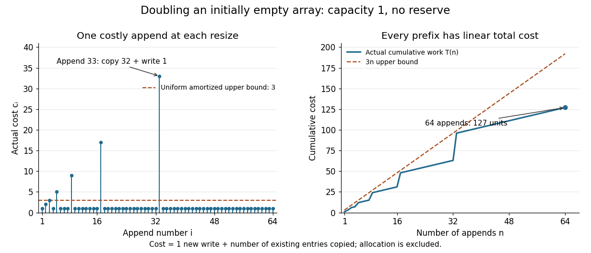

# Dynamic array doubling

↑ **Parent:** [Amortized analysis](amortized-analysis.md)

Consider a [dynamic array](dynamic-array.md) holding fixed-size entries. Its size $n$ is the number of occupied slots and its capacity $C$ is the number of allocated slots. Start with $n=0$, $C=1$. The only operation is append: if $n=C$, allocate a new [array](array-data-structure.md) of capacity $2C$, copy the $C$ existing entries, and release the old [array](array-data-structure.md); then write the new entry and increase $n$ by one. There is no reserve operation, deletion or shrinking in this model.

Count one unit for writing the new entry and one unit per existing entry copied during resizing. Thus the $i$th append has actual cost $c_i=1$ without resizing and $c_i=C+1$ when the old capacity $C$ is full. Copying an entry, including its read and write, is one counted action. Allocation, deallocation, index [arithmetic operations](arithmetic-operation.md) and the initial one-slot allocation are outside this exact count. If these add only a constant per ordinary append and a linear cost per resize, the [Big O notation](big-o-notation.md) conclusions still hold, with different constants; costly entry copies require their own cost model.

The first ten costs are $1,2,3,1,5,1,1,1,9,1$. For example, append $9$ copies eight entries and writes one, so $c_9=9$. At that point the capacity becomes $16$, but the total cost of all nine appends is only $24$.

For $n\geq1$, the final capacity is $C_n=2^{\lceil\log_2 n\rceil}$. Every earlier capacity $1,2,4,\ldots,C_n/2$ was copied once. This [geometric series](geometric-series.md) sums to $C_n-1$, including the empty sum when $n=1$. Therefore [aggregate analysis](aggregate-analysis.md) gives the exact total

$$
T(0)=0,\qquad T(n)=\sum_{i=1}^n c_i=n+C_n-1,\qquad n\leq C_n<2n\quad(n\geq1).
$$

Consequently $T(n)<3n$, so append has amortized $O(1)$ cost in [Big O notation](big-o-notation.md) for every prefix from this empty initial state. The values being appended do not affect the count. In contrast, an append to a full [dynamic array](dynamic-array.md) with $n$ entries costs $n+1$: its worst-case cost is $O(n)$, and actually grows linearly along full-capacity states. A bound on total work does not promise a constant response time for each call.

**[Figure 5](#image-individual-append-costs-and-cumulative-work-under-dynamic-array-doubling). Individual append costs and cumulative work under dynamic array doubling**. The spikes include every copied entry and the new write. At append 33 the actual cost is 33; at append 64 the total cost is 127. Every prefix lies below the line $3n$.

The same policy controls [computer memory](computer-memory.md): after each completed append, $n\leq C_n<2n$ for $n\geq1$, so fewer than $n$ slots are unused. This is a bound on the retained backing [array](array-data-structure.md), with fixed-size slots. During a resize from full capacity $k$ to $2k$, a copying implementation can temporarily hold both [arrays](array-data-structure.md), totalling $3k$ allocated slots before releasing the old one. Thus the retained-capacity bound does not bound this temporary peak by twice the live size. Allocator metadata and separately allocated objects are additional [computer memory](computer-memory.md) costs.

The [geometric series](geometric-series.md) is the source of the efficiency. If capacity instead increases by one each time, the same count becomes $n+1+2+\cdots+(n-1)=n(n+1)/2$, a quadratic total. [Dynamic array doubling](dynamic-array-doubling.md) buys a linear total with bounded spare capacity, even when the final length is unknown.

## ↑ Ancestors (7)

1. [Amortized analysis](amortized-analysis.md)
2. [Time complexity](time-complexity.md)
3. [Complexity class](complexity-class.md)
4. [Computational complexity theory](computational-complexity-theory.md)
5. [Theoretical computer science](theoretical-computer-science-split.md)
6. [Computer science](computer-science-split.md)
7. [Codex Wiki](split.md)

## ← Incoming links (6)

- [Accounting method](accounting-method.md)
- [Aggregate analysis](aggregate-analysis.md)
- [Amortized analysis](amortized-analysis.md)
- [Dynamic array](dynamic-array.md)
- [Dynamic array doubling](dynamic-array-doubling.md)
- [Potential method](potential-method.md)
