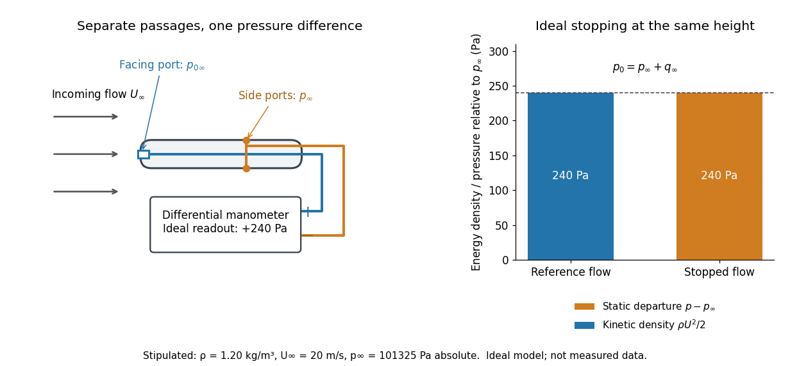

# Dynamic pressure

↑ **Parent:** [Lift coefficient](lift-coefficient.md)

[Dynamic pressure](dynamic-pressure.md) is the bulk [kinetic energy](kinetic-energy.md) per unit [volume](volume.md) associated with [fluid](fluid.md) motion at [speed](speed.md) $U$ in a specified [reference frame](reference-frame.md):

$$
q=\frac12\rho U^2,\qquad
\frac{\tfrac12mU^2}{V}=\frac12\rho U^2,\qquad
\mathrm{J\,m^{-3}}=\mathrm{Pa}.
$$

Here $\rho=m/V$ is [mass density](density.md). The word "pressure" identifies its units and its use as a [pressure](pressure-split.md) scale; $q$ is not an extra isotropic [stress](stress.md) to add to the local [static pressure](static-pressure.md) in every surface [traction](traction.md). A stationary [fluid](fluid.md) can have large [static pressure](static-pressure.md) with $q=0$. Conversely, knowing $U$ and $\rho$ fixes $q$ without fixing [static pressure](static-pressure.md). The definition remains useful in [viscous fluid flow](viscous-fluid-flow-split.md) and [compressible flow](compressible-flow-split.md), even when the simplest [Bernoulli equation](bernoulli-equation.md) is inapplicable. [Dynamic Pressure by NASA Glenn Research Center](dynamic-pressure-by-nasa-glenn-research-center.md)

For stipulated [mass density](density.md) $\rho_\infty=1.20\,\mathrm{kg\,m^{-3}}$ and reference [speed](speed.md) $U_\infty=20\,\mathrm{m\,s^{-1}}$, $q_\infty=240\,\mathrm{Pa}$. At $40\,\mathrm{m\,s^{-1}}$ with the same [mass density](density.md), $q_\infty=960\,\mathrm{Pa}$. This quadratic scaling makes [dynamic pressure](dynamic-pressure.md) a useful normalization for the [lift coefficient](lift-coefficient.md), [drag coefficient](drag-coefficient.md) and [pressure coefficient](pressure-coefficient.md); it predicts four times a particular [force](force-split.md) only if its corresponding coefficient remains unchanged.

**[Figure 3](#image-a-pitot-static-tube-compares-stagnation-pressure-with-static-pressure). A Pitot-static tube compares stagnation pressure with static pressure**. Original schematic with separate [pressure](pressure-split.md) passages and a differential readout. The right panel uses stipulated values, not measurements: ideal stopping in [incompressible flow](incompressible-flow.md) at unchanged height raises [static pressure](static-pressure.md) by 240 Pa as the [kinetic energy](kinetic-energy.md) per unit [volume](volume.md) falls by 240 Pa. The diagram is not a probe design or a claim that real [static pressure](static-pressure.md) ports are error free.

The connection with [stagnation pressure](stagnation-pressure.md) requires hypotheses. For [steady flow](steady-flow.md), constant [mass density](density.md), [inviscid flow](inviscid-flow.md), and [gravity](gravity.md) as the only [body force](body-force.md), the [Bernoulli equation](bernoulli-equation.md) gives, along one [streamline](streamline.md),

$$
p+\frac12\rho U^2+\rho gz=B.
$$

Here $p$ is [static pressure](static-pressure.md), $g$ is [gravitational acceleration](gravitational-acceleration.md), and $z$ is height. Bring that flow to rest without losses at the same height and the limiting [static pressure](static-pressure.md) is the [stagnation pressure](stagnation-pressure.md) $p_0$:

$$
p_0=p+q,\qquad p_0-p=\frac12\rho U^2.
$$

There must be no intervening pump supplying [work](work.md) or other energy input. Constancy along one [streamline](streamline.md) does not assert equal $B$ on all [streamlines](streamline.md); [irrotational flow](irrotational-flow.md) in a connected region supplies that additional conclusion. Changing height requires retaining $\rho gz$. In [compressible flow](compressible-flow-split.md) the stopping [pressure](pressure-split.md) difference generally differs from $\rho U^2/2$, and [viscous dissipation](viscous-dissipation.md) can reduce recovered [stagnation pressure](stagnation-pressure.md). [Bernoulli’s Equation by NASA Glenn Research Center](bernoulli%E2%80%99s-equation-by-nasa-glenn-research-center.md)

A [Pitot-static tube](pitot-static-tube.md) turns this relation into a measurement: its upstream-facing opening senses [stagnation pressure](stagnation-pressure.md), while separate side openings sample [static pressure](static-pressure.md). Connect these to the positive and negative ports of a differential [pressure transducer](pressure-transducer.md) or [manometer](manometer.md). Under the hypotheses above, the measured difference $\Delta p$ gives

$$
U=\sqrt{\frac{2\Delta p}{\rho}}.
$$

Thus the stipulated $240\,\mathrm{Pa}$ and $1.20\,\mathrm{kg\,m^{-3}}$ imply $20\,\mathrm{m\,s^{-1}}$, not an independently measured [speed](speed.md). Align the probe with the incoming flow and keep its passages clear: blockage and pinched tubing invalidate the comparison. At very low [speed](speed.md), the difference can be smaller than instrument error; at high [Mach number](mach-number.md), [compressibility](compressibility.md) and possibly a [shock wave](shock-wave.md) require a different reduction. [Pitot – Static Tube – Speedometer by NASA Glenn Research Center](pitot-static-tube-speedometer-by-nasa-glenn-research-center.md)

A useful control is [differential-pressure calibration](differential-pressure-calibration.md). For a digital [manometer](manometer.md), zeroing establishes the reading at equal port [pressures](pressure-split.md); it does not establish the gain away from zero. The manufacturer's [Series 475 Handheld Digital Manometer: Specifications - Installation and Operating Instructions by Dwyer Instruments, Inc.](series-475-handheld-digital-manometer-specifications-installation-and-operating-instructions-by-dwyer-instruments-inc.md) directs the user to vent both ports to the atmosphere before zeroing. Its stated accuracy is a fraction of full scale, not of the reading, and depends on instrument [temperature](temperature-split.md). Select a suitable range and record the instrument variant and units; the manual covers several ranges.[p. 1: Specifications, Model Chart and ZERO instructions](series-475-handheld-digital-manometer-specifications-installation-and-operating-instructions-by-dwyer-instruments-inc.md)

An independent physical check can use a liquid-column [manometer](manometer.md): apply a stable [pressure](pressure-split.md) difference to both instruments and compare the digital reading with the [hydrostatic pressure](hydrostatic-pressure.md) inferred from the vertical level difference. For equal-height connections carrying a gas of [mass density](density.md) $\rho_g$ above a manometric liquid of [mass density](density.md) $\rho_m$,

$$
|\Delta p|=(\rho_m-\rho_g)g|h|.
$$

This follows by balancing [hydrostatic pressure](hydrostatic-pressure.md) down and up the two connected columns. Use vertical height, even if a tube is inclined. Known [mass densities](density.md), measured height and [gravitational acceleration](gravitational-acceleration.md) set the comparison scale. Check several differences across the working range and reverse the port connections to check the sign. This is a proposed independent check, not a claim that the cited teaching experiment performed a full instrument calibration. Recheck zero after reconnecting the sealed tubing; a zero adjustment alone cannot detect a blocked passage or an incorrect scale.

## ↑ Ancestors (6)

1. [Lift coefficient](lift-coefficient.md)
2. [Lift (force)](lift-force-split.md)
3. [Fluid mechanics](fluid-mechanics-split.md)
4. [Branches of physics](branches-of-physics.md)
5. [Physics](physics-split.md)
6. [Codex Wiki](split.md)

## ← Incoming links (10)

- [Differential-pressure calibration](differential-pressure-calibration.md)
- [Dynamic pressure](dynamic-pressure.md)
- [Flat-plate boundary-layer traverse experiment](flat-plate-boundary-layer-traverse-experiment.md)
- [Lift coefficient](lift-coefficient.md)
- [Lift (force)](lift-force-split.md)
- [Pressure coefficient](pressure-coefficient.md)
- [Skin friction coefficient](skin-friction-coefficient.md)
- [Stagnation pressure](stagnation-pressure.md)
- [Static pressure](static-pressure.md)
- [Water-column wind-tunnel pressure measurement](water-column-wind-tunnel-pressure-measurement.md)
