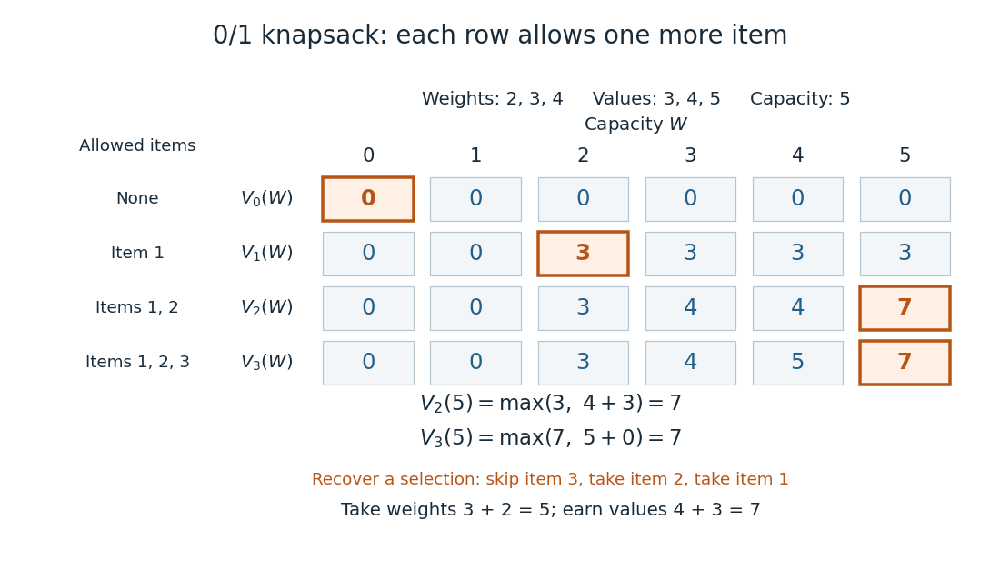
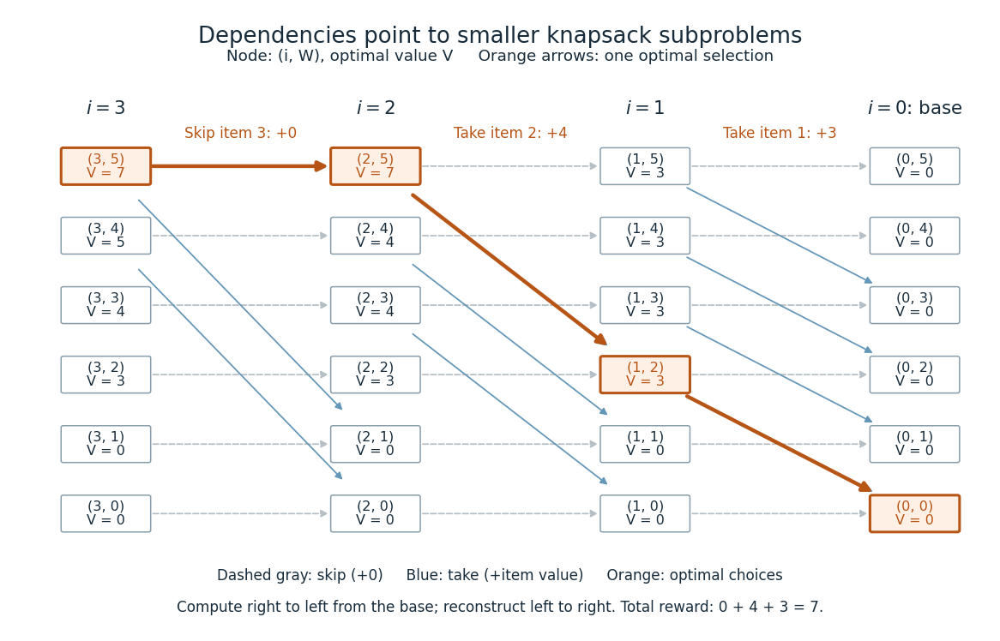

# Dynamic programming

↑ **Parent:** [Mathematical optimization](mathematical-optimization-split.md)  
ⓦ [Wiki](https://en.wikipedia.org/wiki/Dynamic_programming)

[Dynamic programming](dynamic-programming.md) solves a [mathematical optimization](mathematical-optimization-split.md) problem by choosing reusable subproblems, recording their [value functions](value-function.md), and combining already solved cases through a [recurrence relation](recurrence-relation.md). Its attraction is that many possible decision histories can share one continuation calculation. A [dynamic programming state](dynamic-programming-state.md) must retain everything needed to determine the allowed future choices and their rewards. The [0-1 knapsack problem](0-1-knapsack-problem.md), for example, needs both the available capacity and which items remain available; capacity alone would lose the restriction that each item can be used at most once.

Two ideas explain when this works. [Optimal substructure](optimal-substructure.md) makes an optimal continuation valid inside a larger optimal solution. When subproblems overlap, storing each answer avoids repeated work: [memoization](memoization.md) computes entries as needed, while a table fills them in dependency order. Start from known base cases. For a problem indexed by increasing size, compute smaller cases first; for a finite sequence of future decisions, work backwards from the terminal reward, as in the [Bellman equation](bellman-equation.md). See [Bertsekas, MIT lecture 2: optimality and state augmentation](https://ocw.mit.edu/courses/6-231-dynamic-programming-and-stochastic-control-fall-2015/2beec55b0de261096962e514febe3b5c_MIT6_231F15_Lec2.pdf).

Consider a [0-1 knapsack problem](0-1-knapsack-problem.md) with item weights $(w_1,w_2,w_3)=(2,3,4)$, item values $(v_1,v_2,v_3)=(3,4,5)$, and capacity $5$. Define the [value function](value-function.md) $V_i(W)$ to be the largest total item value obtainable from the first $i$ items with total weight at most $W$. Here $i\in\{0,1,2,3\}$ and $W\in\{0,1,2,3,4,5\}$ specify the [dynamic programming state](dynamic-programming-state.md). All weights and capacities are nonnegative [integers](integer.md). The empty selection supplies the base case $V_0(W)=0$. The [recurrence relation](recurrence-relation.md) is

$$
V_i(W)=\begin{cases}
V_{i-1}(W),&W<w_i,\\
\max\{V_{i-1}(W),\ v_i+V_{i-1}(W-w_i)\},&W\geq w_i.
\end{cases}
$$

The two candidates skip or take item $i$. Both use the previous row, so taking item $i$ cannot take that same item again. The condition $W\geq w_i$ prevents a negative remaining capacity; no entry with $W<0$ is needed. The [optimal substructure](optimal-substructure.md) is concrete: after taking item $i$, its companions must solve the smaller [0-1 knapsack problem](0-1-knapsack-problem.md) on the first $i-1$ items with capacity $W-w_i$. Otherwise replacing them by a better feasible selection would improve the whole selection. Compare [MIT 6.006 knapsack notes, pages 1-3](https://ocw.mit.edu/courses/6-006-introduction-to-algorithms-fall-2011/95e744ee64464cb6bc8f8264faeea080_MIT6_006F11_rec21.pdf); those notes index the remaining items in the opposite direction.

The full computation is small enough to see at once:

$$
\begin{array}{c|rrrrrr}
i\backslash W&0&1&2&3&4&5\\\hline
0&0&0&0&0&0&0\\
1&0&0&3&3&3&3\\
2&0&0&3&4&4&7\\
3&0&0&3&4&5&7
\end{array}
$$

For example, $V_2(5)=\max\{3,4+3\}=7$ and $V_3(5)=\max\{7,5+0\}=7$. Choosing the feasible item with largest individual value takes weight $4$, earns $5$, and leaves capacity $1$, which cannot fit another item. This [greedy algorithm](greedy-algorithm.md) misses the two-item selection of weights $2$ and $3$, whose value is $7$. This example tests the largest-individual-value rule; choosing by value divided by weight happens to find the optimum here.

**[Figure 4](#image-a-knapsack-table-builds-the-optimal-value-from-smaller-subproblems). A knapsack table builds the optimal value from smaller subproblems**. The [value function](value-function.md) of this [0-1 knapsack problem](0-1-knapsack-problem.md) is computed row by row. Outlined entries show the reconstruction of an optimal selection: skip weight 4, take weight 3, then take weight 2. The total weight is 5 and total value is 7.

The number $V_3(5)=7$ is the optimal value, while the choices attaining it form a [control policy](control-policy.md). To reconstruct one optimal selection, start at $(3,5)$. Equality with $V_2(5)$ allows skipping item $3$. At $(2,5)$, taking item $2$ gives $4+V_1(2)=7$, so continue to $(1,2)$. Take item $1$ and finish at $(0,0)$. In a tie, either maximizing choice suffices to recover one optimum. Recording choices during the calculation or comparing stored entries afterwards recovers the [control policy](control-policy.md); a final optimal value alone does not describe the selection.

**[Figure 5](#image-knapsack-dependencies-and-one-optimal-reconstruction). Knapsack dependencies and one optimal reconstruction**. Each node is a [dynamic programming state](dynamic-programming-state.md) $(i,W)$ labeled by its [value function](value-function.md). Arrows point to the earlier-row entries used in the [recurrence relation](recurrence-relation.md), forming a [Directed acyclic graph](directed-acyclic-graph.md). Dashed arrows skip an item; blue arrows take it. The orange [graph path](path-in-a-graph.md) reconstructs the optimal selection with value 7. Compute in the opposite direction to the arrows, beginning at the zero base row.

For $n$ items and integer capacity $W\geq1$, the table uses [time complexity](time-complexity.md) $O(nW)$ and [space complexity](space-complexity.md) $O(nW)$, counting arithmetic operations and stored numbers using [Big O notation](big-o-notation.md). This is [pseudo-polynomial time](pseudo-polynomial-time.md): when weights and capacity use the [binary numeral system](binary-numeral-system.md), the capacity needs only $O(\log(W+1))$ digits. A capacity near $2^b$ creates about $2^b$ columns despite needing only about $b$ digits. Thus this [algorithm](algorithm.md) is practical for moderate capacities but does not establish [polynomial time](polynomial-time.md) in the encoded input length. See [MIT 6.006 recitation 19: knapsack and input size](https://ocw.mit.edu/courses/6-006-introduction-to-algorithms-spring-2020/7232b0ff982f501556118a8552654762_MIT6_006S20_r19.pdf). For the optimal value alone, one array reduces [space complexity](space-complexity.md) to $O(W)$: for each item, update capacities in descending order, from $W$ down to $w_i$. Ascending order would read entries already updated for that item and could reuse it. Reconstruction then requires extra information or recomputation.

The link between the [knapsack problem](knapsack-problem.md) and [dynamic programming](dynamic-programming.md) is already explicit in a 1957 paper by [Richard Bellman](richard-bellman.md) at RAND: its abstract discusses an exact [knapsack problem](knapsack-problem.md) solution using [functional equations](functional-equation.md) and cites his 1957 book. See [Bellman, Comment on Dantzig's Paper on Discrete Variable Extremum Problems (1957)](https://pubsonline.informs.org/doi/10.1287/opre.5.5.723).

**Table of contents**

- [Dynamic programming state](dynamic-programming-state.md)
- [Optimal substructure](optimal-substructure.md)
- [Dynamic programming principle](dynamic-programming-principle.md)
- [Average-reward optimal policy](average-reward-optimal-policy.md)
  - [Average-reward Bellman equation](average-reward-bellman-equation.md)
- [Control policy](control-policy.md)
  - [Markov policy](markov-policy.md)
- [Retirement threshold with multiplicative capture risk](retirement-threshold-with-multiplicative-capture-risk.md)
- [Bellman equation](bellman-equation.md)
  - [Dynamic programming operator](dynamic-programming-operator.md)
  - [Bellman comparison with nonnegative rewards and superunit discount](bellman-comparison-with-nonnegative-rewards-and-superunit-discount.md)
  - [Hamilton-Jacobi-Bellman equation](hamilton-jacobi-bellman-equation.md)
    - [Verification by a nonnegative control supermartingale](verification-by-a-nonnegative-control-supermartingale.md)
    - [Linear-quadratic optimal control](linear-quadratic-optimal-control.md)
      - [Discrete Riccati recurrence](discrete-riccati-recurrence.md)
- [Value function](value-function.md)
  - [Non-vertical supporting hyperplane of a value function](non-vertical-supporting-hyperplane-of-a-value-function.md)
- [Bayesian box search problem](bayesian-box-search-problem.md)
  - [Optimal index for Bayesian box search](optimal-index-for-bayesian-box-search.md)
  - [Rewarded Bayesian box search Bellman equation](rewarded-bayesian-box-search-bellman-equation.md)

## ↑ Ancestors (4)

1. [Mathematical optimization](mathematical-optimization-split.md)
2. [Area of mathematics](area-of-mathematics.md)
3. [Mathematics](mathematics-split.md)
4. [Codex Wiki](split.md)

## ← Incoming links (23)

- [Critical path method](critical-path-method.md)
- [Dynamic programming](dynamic-programming.md)
- [Linear-time multiplication in an automatic structure](linear-time-multiplication-in-an-automatic-structure.md)
- [Longest increasing subsequence](longest-increasing-subsequence.md)
- [Memoization arithmetic and stack costs](memoization-arithmetic-and-stack-costs.md)
- [Memoized Fibonacci evaluation](memoized-fibonacci-evaluation.md)
- [Overlapping subproblems](overlapping-subproblems.md)
- [Solution](past-exam-of-the-mathematics-course-of-the-university-of-cambridge/2007/iii/paper-40/6/c/solution.md)
- [Solution](past-exam-of-the-mathematics-course-of-the-university-of-cambridge/2009/iii/paper-39/2/ii/solution.md)
- [Solution](past-exam-of-the-mathematics-course-of-the-university-of-cambridge/2013/iii/paper-40/1/solution.md)
- [Solution](past-exam-of-the-mathematics-course-of-the-university-of-cambridge/2013/iii/paper-40/2/solution.md)
- [Solution](past-exam-of-the-mathematics-course-of-the-university-of-cambridge/2013/iii/paper-40/3/solution.md)
- [Solution](past-exam-of-the-mathematics-course-of-the-university-of-cambridge/2015/ii/paper-3/25k/solution.md)
- [Solution](past-exam-of-the-mathematics-course-of-the-university-of-cambridge/2015/ii/paper-4/25k/solution.md)
- [Solution](past-exam-of-the-mathematics-course-of-the-university-of-cambridge/2016/iii/paper-120/1/b/solution.md)
- [Solution](past-exam-of-the-mathematics-course-of-the-university-of-cambridge/2016/iii/paper-120/1/c/solution.md)
- [Solution](past-exam-of-the-mathematics-course-of-the-university-of-cambridge/2016/iii/paper-211/5/b/solution.md)
- [Solution](past-exam-of-the-mathematics-course-of-the-university-of-cambridge/2018/ii/paper-4/30k/a/solution.md)
- [Solution](past-exam-of-the-mathematics-course-of-the-university-of-cambridge/2018/iii/paper-207/2/c/solution.md)
- [Pseudo-polynomial time](pseudo-polynomial-time.md)
- [Rounded dynamic programming for two-bin load balancing](rounded-dynamic-programming-for-two-bin-load-balancing.md)
- [Stochastic control](stochastic-control.md)
- [Strictly increasing subsequence](strictly-increasing-subsequence.md)
