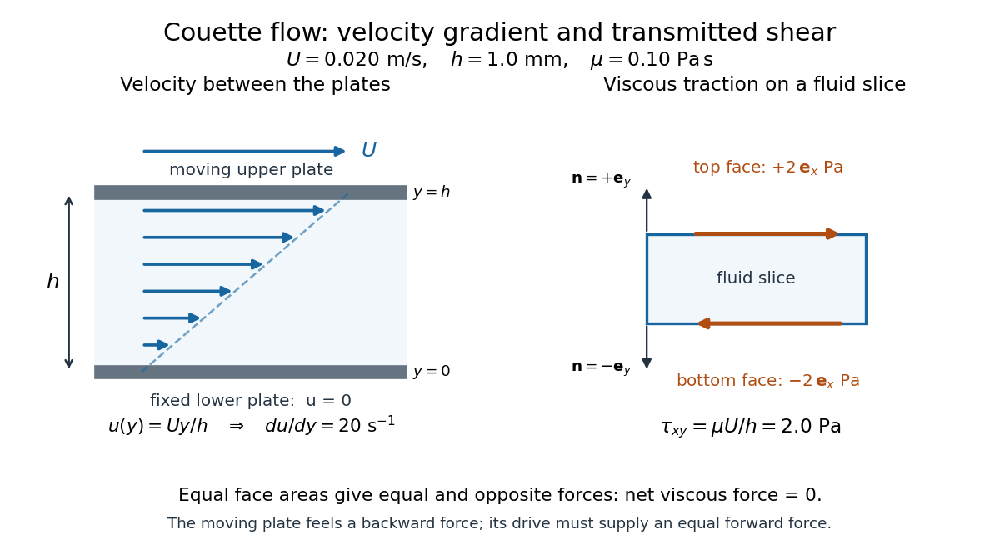

# Dynamic viscosity

↑ **Parent:** [Fluid mechanics](fluid-mechanics-split.md)

The [dynamic viscosity](dynamic-viscosity.md) $\mu$ is the coefficient relating [shear stress](shear-stress.md) to [shear rate](shear-rate.md) in a [Newtonian fluid](newtonian-fluid.md). For a [simple shear flow](simple-shear-flow.md) $\mathbf u=(u(y),0,0)$,

$$
\tau_{xy}=\mu\frac{du}{dy}=\mu\dot\gamma,\qquad
[\mu]=\mathrm{Pa\,s}=\mathrm{kg\,m^{-1}\,s^{-1}}.
$$

Here $\tau_{xy}$ is the $x$ component of viscous [traction](traction.md) on a plane with [normal vector](normal-vector.md) $+\mathbf e_y$. The [shear rate](shear-rate.md) $\dot\gamma=du/dy$ has units $\mathrm{s^{-1}}$. Thus [dynamic viscosity](dynamic-viscosity.md) measures the [stress](stress.md) required to sustain a given rate of deformation. It is the shear coefficient; the separate coefficient for [volume](volume.md) change is [volume viscosity](volume-viscosity.md). [UCL, Fluid Mechanics II, Forces in Fluids, slides 4–5](https://www.homepages.ucl.ac.uk/~uceseug/Fluids2/Slides_1.pdf)

For a worked [Couette flow](couette-flow.md) example, place a [Newtonian fluid](newtonian-fluid.md) of constant [dynamic viscosity](dynamic-viscosity.md) $\mu=0.10\,\mathrm{Pa\,s}$ between parallel plates separated by $h=0.0010\,\mathrm m$. Hold the lower plate fixed and move the upper plate at $U=0.020\,\mathrm{m\,s^{-1}}$. Assume [steady flow](steady-flow.md), no streamwise [pressure gradient](pressure-gradient.md), and the [no-slip boundary condition](no-slip-boundary-condition.md). Then

$$
u(y)=\frac{Uy}{h},\qquad
\dot\gamma=\frac Uh=20\,\mathrm{s^{-1}},\qquad
\tau_{xy}=\frac{\mu U}{h}=2.0\,\mathrm{Pa}.
$$

The fluid pulls backward on the moving plate with [force](force.md) magnitude $F=\tau_{xy}A$, where $A$ is its wetted [area](surface-area.md). For $A=0.010\,\mathrm{m^2}$ this is $0.020\,\mathrm N$. Measuring that [force](force.md), the gap and the plate [velocity](velocity.md) determines $\mu=Fh/(AU)$: a direct way to measure [dynamic viscosity](dynamic-viscosity.md). The linear profile and opposing wall [tractions](traction.md) are the standard plane [Couette flow](couette-flow.md) solution. [MIT, Couette and Poiseuille Flows, p. 1](https://ocw.mit.edu/courses/2-25-advanced-fluid-mechanics-fall-2013/1a114d602956fa0dd328155f9b45f93d_MIT2_25F13_Couet_and_Pois.pdf)

**[Figure 14](#image-couette-flow-a-constant-velocity-gradient-produces-a-constant-shear-stress). Couette flow: a constant velocity gradient produces a constant shear stress**. Blue arrows show the linear velocity profile between the plates. Orange arrows show viscous traction on the upper and lower faces of a fluid slice; reversing the surface normal reverses the traction. The slice has zero net viscous force although each face carries stress.

The [velocity gradient](velocity-gradient.md) matters, rather than the [velocity](velocity.md) itself. Adding the same constant [velocity](velocity.md) to both plates and the fluid leaves $du/dy$, and hence [shear stress](shear-stress.md), unchanged. In [uniform flow](uniform-flow.md), every layer translates together and $du/dy=0$. More generally, even a nonzero [velocity gradient](velocity-gradient.md) need not generate [viscous stress](viscous-stress-tensor.md): [solid-body rotation](solid-body-rotation.md) has zero [strain-rate tensor](strain-rate-tensor.md), as the [viscous stress tensor](viscous-stress-tensor.md) example shows. Thin gaps amplify [shear stress](shear-stress.md) for a fixed plate-speed difference, making [dynamic viscosity](dynamic-viscosity.md) useful for predicting the [force](force.md) needed to move lubricated surfaces.

**Table of contents**

- [Zero-shear viscosity](zero-shear-viscosity.md)
- [Kinematic viscosity](kinematic-viscosity.md)
  - [Density-weighted mean kinematic viscosity](density-weighted-mean-kinematic-viscosity.md)
  - [Density-weighted viscosity of a disk](density-weighted-viscosity-of-a-disk.md)
- [Viscous stress tensor](viscous-stress-tensor.md)
- [Reynolds number](reynolds-number.md)

## ↑ Ancestors (4)

1. [Fluid mechanics](fluid-mechanics-split.md)
2. [Branches of physics](branches-of-physics.md)
3. [Physics](physics-split.md)
4. [Codex Wiki](split.md)

## ← Incoming links (99)

- [Blasius boundary layer](blasius-boundary-layer.md)
- [Boundary layer](boundary-layer.md)
- [Buoyancy-modified Darcy fingering dispersion relation](buoyancy-modified-darcy-fingering-dispersion-relation.md)
- [Clean-bubble Stokes drag](clean-bubble-stokes-drag.md)
- [Constant gas-radiation ratio vertical disc structure](constant-gas-radiation-ratio-vertical-disc-structure.md)
- [Constant-pressure-ratio vertical disk model](constant-pressure-ratio-vertical-disk-model.md)
- [Constant viscosity in radiation-supported vertical balance](constant-viscosity-in-radiation-supported-vertical-balance.md)
- [Couette flow with a slipping lower wall](couette-flow-with-a-slipping-lower-wall.md)
- [Darcy flow through a homogeneous slab](darcy-flow-through-a-homogeneous-slab.md)
- [Darcy law](darcy-law.md)
- [Delayed polymer diversion in parallel porous layers](delayed-polymer-diversion-in-parallel-porous-layers.md)
- [Drag coefficient](drag-coefficient.md)
- [Dynamic viscosity](dynamic-viscosity.md)
- [Effective permeability](effective-permeability.md)
- [Einstein viscosity formula for a dilute suspension](einstein-viscosity-formula-for-a-dilute-suspension.md)
- [Elementary charge](elementary-charge.md)
- [Energy dissipation identity for Model H](energy-dissipation-identity-for-model-h.md)
- [Equipartition theorem](equipartition-theorem.md)
- [Fluid](fluid.md)
- [Friction-dominated grounding-line evolution law](friction-dominated-grounding-line-evolution-law.md)
- [Gas-pressure viscosity closure with mixed pressure support](gas-pressure-viscosity-closure-with-mixed-pressure-support.md)
- [Hydraulic conductivity](hydraulic-conductivity.md)
- [Hydrodynamic coarsening crossover scales](hydrodynamic-coarsening-crossover-scales.md)
- [Kinematic viscosity](kinematic-viscosity.md)
- [Laminar flow](laminar-flow.md)
- [Laminar skin-friction scaling along a slender swimmer](laminar-skin-friction-scaling-along-a-slender-swimmer.md)
- [Layered porous permeability](layered-porous-permeability.md)
- [Magma](magma.md)
- [Newtonian fluid stress tensor](newtonian-fluid-stress-tensor.md)
- [Newtonian till lubrication](newtonian-till-lubrication.md)
- [Optical trap relaxation time](optical-trap-relaxation-time.md)
- [Solution](past-exam-of-the-mathematics-course-of-the-university-of-cambridge/2001/iii/paper-45/3/solution.md)
- [Solution](past-exam-of-the-mathematics-course-of-the-university-of-cambridge/2002/iii/paper-46/2/i/solution.md)
- [Solution](past-exam-of-the-mathematics-course-of-the-university-of-cambridge/2002/iii/paper-46/2/ii/solution.md)
- [Solution](past-exam-of-the-mathematics-course-of-the-university-of-cambridge/2002/iii/paper-46/2/iii/solution.md)
- [Solution](past-exam-of-the-mathematics-course-of-the-university-of-cambridge/2003/iii/paper-71/2/b/solution.md)
- [Solution](past-exam-of-the-mathematics-course-of-the-university-of-cambridge/2003/iii/paper-73/2/solution.md)
- [Solution](past-exam-of-the-mathematics-course-of-the-university-of-cambridge/2004/iii/paper-74/3/solution.md)
- [Solution](past-exam-of-the-mathematics-course-of-the-university-of-cambridge/2004/iii/paper-77/3/ii/solution.md)
- [Solution](past-exam-of-the-mathematics-course-of-the-university-of-cambridge/2005/iii/paper-77/2/b/solution.md)
- [Solution](past-exam-of-the-mathematics-course-of-the-university-of-cambridge/2005/iii/paper-77/2/c/solution.md)
- [Solution](past-exam-of-the-mathematics-course-of-the-university-of-cambridge/2005/iii/paper-84/3/solution.md)
- [Solution](past-exam-of-the-mathematics-course-of-the-university-of-cambridge/2006/iii/paper-75/3/solution.md)
- [Solution](past-exam-of-the-mathematics-course-of-the-university-of-cambridge/2006/iii/paper-83/1/solution.md)
- [Solution](past-exam-of-the-mathematics-course-of-the-university-of-cambridge/2006/iii/paper-83/2/solution.md)
- [Solution](past-exam-of-the-mathematics-course-of-the-university-of-cambridge/2006/iii/paper-83/4/solution.md)
- [Solution](past-exam-of-the-mathematics-course-of-the-university-of-cambridge/2007/iii/paper-78/1/solution.md)
- [Solution](past-exam-of-the-mathematics-course-of-the-university-of-cambridge/2007/iii/paper-81/3/solution.md)
- [Solution](past-exam-of-the-mathematics-course-of-the-university-of-cambridge/2008/iii/paper-84/2/a/solution.md)
- [Solution](past-exam-of-the-mathematics-course-of-the-university-of-cambridge/2008/iii/paper-84/2/b/solution.md)
- [Solution](past-exam-of-the-mathematics-course-of-the-university-of-cambridge/2008/iii/paper-86/4/solution.md)
- [Solution](past-exam-of-the-mathematics-course-of-the-university-of-cambridge/2009/iii/paper-73/2/i/solution.md)
- [Solution](past-exam-of-the-mathematics-course-of-the-university-of-cambridge/2009/iii/paper-73/2/ii/solution.md)
- [Solution](past-exam-of-the-mathematics-course-of-the-university-of-cambridge/2009/iii/paper-73/2/iii/solution.md)
- [Solution](past-exam-of-the-mathematics-course-of-the-university-of-cambridge/2009/iii/paper-73/2/iv/solution.md)
- [Solution](past-exam-of-the-mathematics-course-of-the-university-of-cambridge/2009/iii/paper-73/3/i/solution.md)
- [Solution](past-exam-of-the-mathematics-course-of-the-university-of-cambridge/2012/iii/paper-61/1/i/solution.md)
- [Solution](past-exam-of-the-mathematics-course-of-the-university-of-cambridge/2012/iii/paper-61/1/iii/solution.md)
- [Solution](past-exam-of-the-mathematics-course-of-the-university-of-cambridge/2012/iii/paper-61/1/iv/solution.md)
- [Solution](past-exam-of-the-mathematics-course-of-the-university-of-cambridge/2013/iii/paper-68/2/solution.md)
- [Solution](past-exam-of-the-mathematics-course-of-the-university-of-cambridge/2013/iii/paper-69/1/solution.md)
- [Solution](past-exam-of-the-mathematics-course-of-the-university-of-cambridge/2013/iii/paper-69/2/solution.md)
- [Solution](past-exam-of-the-mathematics-course-of-the-university-of-cambridge/2013/iii/paper-71/3/solution.md)
- [Solution](past-exam-of-the-mathematics-course-of-the-university-of-cambridge/2014/iii/paper-78/5/solution.md)
- [Solution](past-exam-of-the-mathematics-course-of-the-university-of-cambridge/2014/iii/paper-78/6/solution.md)
- [Solution](past-exam-of-the-mathematics-course-of-the-university-of-cambridge/2015/ii/paper-1/36e/i/solution.md)
- [Solution](past-exam-of-the-mathematics-course-of-the-university-of-cambridge/2015/iii/paper-80/2/solution.md)
- [Solution](past-exam-of-the-mathematics-course-of-the-university-of-cambridge/2016/iii/paper-321/1/b/i/solution.md)
- [Solution](past-exam-of-the-mathematics-course-of-the-university-of-cambridge/2016/iii/paper-332/2/solution.md)
- [Solution](past-exam-of-the-mathematics-course-of-the-university-of-cambridge/2016/iii/paper-334/1/solution.md)
- [Solution](past-exam-of-the-mathematics-course-of-the-university-of-cambridge/2017/iii/paper-321/1/b/i/solution.md)
- [Solution](past-exam-of-the-mathematics-course-of-the-university-of-cambridge/2017/iii/paper-332/3/solution.md)
- [Solution](past-exam-of-the-mathematics-course-of-the-university-of-cambridge/2017/iii/paper-344/2/a/solution.md)
- [Solution](past-exam-of-the-mathematics-course-of-the-university-of-cambridge/2017/iii/paper-344/2/c/ii/solution.md)
- [Solution](past-exam-of-the-mathematics-course-of-the-university-of-cambridge/2018/ii/paper-4/38c/solution.md)
- [Solution](past-exam-of-the-mathematics-course-of-the-university-of-cambridge/2019/iii/paper-321/1/c/solution.md)
- [Solution](past-exam-of-the-mathematics-course-of-the-university-of-cambridge/2019/iii/paper-334/2/a/solution.md)
- [Solution](past-exam-of-the-mathematics-course-of-the-university-of-cambridge/2021/iii/paper-352/2/a/solution.md)
- [Solution](past-exam-of-the-mathematics-course-of-the-university-of-cambridge/2023/ii/paper-2/39c/a/solution.md)
- [Permeability of a porous medium](permeability-of-a-porous-medium.md)
- [Phase mobility](phase-mobility.md)
- [Planar Poiseuille flow with equal wall slip](planar-poiseuille-flow-with-equal-wall-slip.md)
- [Planar viscous-fingering dispersion relation](planar-viscous-fingering-dispersion-relation.md)
- [Pointwise alpha-prescription obstruction in a radiation-supported layer](pointwise-alpha-prescription-obstruction-in-a-radiation-supported-layer.md)
- [Porous gravity current with background flow](porous-gravity-current-with-background-flow.md)
- [Premelted-film lifting of a disk](premelted-film-lifting-of-a-disk.md)
- [Relaxation of a symmetric viscous layer](relaxation-of-a-symmetric-viscous-layer.md)
- [Reynolds number](reynolds-number.md)
- [Stokes equation](stokes-equation.md)
- [Stokes flow](stokes-flow-split.md)
- [Stokes's law](stokes-s-law.md)
- [Stokes settling velocity](stokes-settling-velocity.md)
- [Strong Boussinesq approximation](strong-boussinesq-approximation.md)
- [Thermocapillary migration of an insulating bubble](thermocapillary-migration-of-an-insulating-bubble.md)
- [Two-layer Couette flow](two-layer-couette-flow.md)
- [Vertically averaged alpha closure for a mixed-pressure layer](vertically-averaged-alpha-closure-for-a-mixed-pressure-layer.md)
- [Viscous mountain spreading over an underthrust plate](viscous-mountain-spreading-over-an-underthrust-plate.md)
- [Viscous stress tensor](viscous-stress-tensor.md)
- [Wall friction in the Navier slip boundary condition](wall-friction-in-the-navier-slip-boundary-condition.md)
