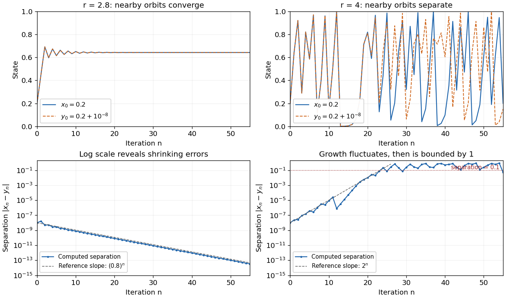

# Dynamical systems

↑ **Parent:** [Branches of physics](physics.md#branches-of-physics)

The study of dynamical systems asks how a state changes in [time](classical-mechanics.md#time-in-physics): which states persist, which [orbits](#orbit-dynamical-system) repeat, and how a small [perturbation](asymptotic-expansion.md#perturbation) changes the future. A [dynamical system](#dynamical-system) combines a [state space](#state-space) with an evolution rule. For a seasonal population, the state might be its abundance and one step one generation; for a [harmonic oscillator](classical-mechanics.md#simple-harmonic-motion), a [state vector](#state-vector) includes both position and velocity. Choosing a sufficient state is essential: position alone does not determine where an oscillator moves next.

The two basic descriptions are a [discrete dynamical system](discrete-dynamical-system.md), $x_{n+1}=F(x_n)$, and an [ordinary differential equation](differential-equation.md#ordinary-differential-equation), $\dot x=f(x)$. Repeated [iteration of a map](discrete-dynamical-system.md#iterated-function) gives $x_n=F^n(x_0)$; an [autonomous differential equation](#autonomous-system-mathematics) with unique solutions gives a [flow map](#flow-map) $x(t)=\Phi_t(x_0)$. In either case, evolving for two successive durations agrees with evolving for their sum. The [logistic map](discrete-dynamical-system.md#logistic-map) provides a particularly simple [discrete dynamical system](discrete-dynamical-system.md); the [Lorenz system](#lorenz-system) supplies a continuous-time example with a very different geometry.

[Deterministic evolution](#deterministic-evolution) says that the exact rule and exact [initial condition](differential-equation.md#initial-condition) specify one future. Predicting that future from measurements is a separate question. An instrument supplies a range of possible [initial conditions](differential-equation.md#initial-condition), and a computation adds small errors. Near an [asymptotically stable](#asymptotic-stability) [fixed point](function.md#fixed-point), nearby [orbits](#orbit-dynamical-system) converge and the long-term state can become easier to predict. With [sensitive dependence on initial conditions](#butterfly-effect), arbitrarily close starting states can eventually lead to a visible disagreement, even though each follows the same rule.

Much of the usefulness of [dynamical systems](dynamical-systems.md) comes from describing outcomes without writing every solution explicitly. [Fixed points](function.md#fixed-point) identify possible resting states; [periodic orbits](#periodic-orbit) identify repeating behaviour; [stability theory](#stability-theory) asks whether those behaviours survive small disturbances. A [bifurcation diagram](bifurcation-theory.md#bifurcation-diagram) shows how changing a [bifurcation parameter](bifurcation-theory.md#bifurcation-parameter) changes the possible outcomes. This is useful in [population dynamics](mathematical-biology.md#population-dynamics), where a stable abundance and an alternating abundance have different consequences, and in [thermal convection](convection.md#thermal-convection), where a steady flow and a changing flow transport heat differently.

The beauty of the subject is that a small formula can organize a large variety of behaviour. The [logistic map](discrete-dynamical-system.md#logistic-map) moves from an attracting [fixed point](function.md#fixed-point) to attracting [periodic orbits](#periodic-orbit) and then to parameter values supporting sensitive motion. Its [period-doubling cascade](discrete-dynamical-system.md#period-doubling-cascade) has a recognizable structure across many [unimodal maps](discrete-dynamical-system.md#unimodal-interval-map). Nevertheless, [Devaney chaos](#devaney-chaos), [Glendinning chaos](#glendinning-chaos), and a positive [Lyapunov exponent](#lyapunov-exponent) express different properties; a claim of chaos should specify its definition, its [state space](#state-space), and the parameter values under consideration.

**Table of contents**

- [Hyperbolic invariant set](#hyperbolic-invariant-set)
- [Smale horseshoe](#smale-horseshoe)
- [Equivariant dynamical system](#equivariant-dynamical-system)
  - [Translation invariants of Fourier-mode phases](#translation-invariants-of-fourier-mode-phases)
    - [Wavevector selection rule for equivariant monomials](#wavevector-selection-rule-for-equivariant-monomials)
  - [Cubic equivariants of the full cube symmetry group](#cubic-equivariants-of-the-full-cube-symmetry-group)
  - [Equivariant Hopf theorem](#equivariant-hopf-theorem)
    - [Rotating-wave branch of an equivariant Hopf bifurcation](#rotating-wave-branch-of-an-equivariant-hopf-bifurcation)
    - [Standing-wave branch of an equivariant Hopf bifurcation](#standing-wave-branch-of-an-equivariant-hopf-bifurcation)
    - [Dihedral fourfold Hopf normal form](#dihedral-fourfold-hopf-normal-form)
    - [Hopf coordinates for two real representation copies](#hopf-coordinates-for-two-real-representation-copies)
    - [Spatiotemporal symmetry of a periodic orbit](#spatiotemporal-symmetry-of-a-periodic-orbit)
    - [Dihedral threefold Hopf normal form](#dihedral-threefold-hopf-normal-form)
      - [Reflection-preserving splitting of a dihedral Hopf bifurcation](#reflection-preserving-splitting-of-a-dihedral-hopf-bifurcation)
  - [Equivariant branching lemma](#equivariant-branching-lemma)
    - [Normalizer action determines axial branch parity](#normalizer-action-determines-axial-branch-parity)
    - [Dihedral steady-state normal form](#dihedral-steady-state-normal-form)
      - [Square-symmetric cubic steady-state normal form](#square-symmetric-cubic-steady-state-normal-form)
        - [Equal-amplitude states of an eight-mode square pattern](#equal-amplitude-states-of-an-eight-mode-square-pattern)
        - [Square-pattern interaction with a sign-changing scalar mode](#square-pattern-interaction-with-a-sign-changing-scalar-mode)
- [Relative equilibrium](#relative-equilibrium)
  - [Rotating point-vortex relative equilibrium](#rotating-point-vortex-relative-equilibrium)
- [Unstable manifold](#unstable-manifold)
- [Poincaré map](#poincare-map)
  - [Local passage map near a dissipative saddle-node](#local-passage-map-near-a-dissipative-saddle-node)
  - [Cubic return-map stability of a weak focus](#cubic-return-map-stability-of-a-weak-focus)
- [Routh-Hurwitz stability criterion](#routh-hurwitz-stability-criterion)
  - [Drag-polynomial stability for all positive stopping rates](#drag-polynomial-stability-for-all-positive-stopping-rates)
  - [Two-dimensional Routh-Hurwitz stability criterion](#two-dimensional-routh-hurwitz-stability-criterion)
- [Heteroclinic orbit](#heteroclinic-orbit)
  - [Heteroclinic cycle](#heteroclinic-cycle)
- [Phase locking](#phase-locking)
- [Topological dynamics](#topological-dynamics)
  - [Topological conjugacy](#topological-conjugacy)
  - [Point transitivity](#point-transitivity)
  - [Syndetic set](#syndetic-set)
  - [Recurrent point](#recurrent-point)
    - [Birkhoff recurrence theorem](#birkhoff-recurrence-theorem)
  - [Proximality](#proximality)
    - [Asymptotic-pair obstruction to an invariant metric](#asymptotic-pair-obstruction-to-an-invariant-metric)
    - [Joint return lemma for a proximal minimal pair](#joint-return-lemma-for-a-proximal-minimal-pair)
  - [Minimal dynamical system](#minimal-dynamical-system)
    - [Minimal point](#minimal-point)
    - [Minimal subsystem](#minimal-subsystem)
  - [Orbit closure](#orbit-closure)
  - [Symbolic dynamics](#symbolic-dynamics)
    - [Subshift of finite type](#subshift-of-finite-type)
      - [Trace formula for periodic points of a subshift](#trace-formula-for-periodic-points-of-a-subshift)
      - [Transition matrix for a subshift](#transition-matrix-for-a-subshift)
        - [Locally admissible word for a transition matrix](#locally-admissible-word-for-a-transition-matrix)
    - [Uniform recurrence](#uniform-recurrence)
    - [Full shift](#full-shift)
      - [Left shift](#left-shift)
- [Dynamical system](#dynamical-system)
  - [Semiconjugacy of dynamical systems](#semiconjugacy-of-dynamical-systems)
  - [Forward orbit](#forward-orbit)
  - [Box-ball system](#box-ball-system)
  - [Deterministic evolution](#deterministic-evolution)
  - [Lorenz system](#lorenz-system)
  - [Feigenbaum period-doubling map](#feigenbaum-period-doubling-map)
    - [Feigenbaum geometric potential](#feigenbaum-geometric-potential)
      - [Odd-even comparison for Feigenbaum partition lengths](#odd-even-comparison-for-feigenbaum-partition-lengths)
    - [Feigenbaum attractor](#feigenbaum-attractor)
  - [Expanding interval map](#expanding-interval-map)
    - [Geometric potential of an expanding map](#geometric-potential-of-an-expanding-map)
      - [Cylinder averages of an invariant density](#cylinder-averages-of-an-invariant-density)
  - [Thermodynamic formalism](#thermodynamic-formalism)
    - [Gibbs measure](#gibbs-measure)
      - [An arbitrary Gibbs measure need not be absolutely continuous](#an-arbitrary-gibbs-measure-need-not-be-absolutely-continuous)
    - [Topological pressure](#topological-pressure)
    - [Almost-additive partition-function limit](#almost-additive-partition-function-limit)
    - [Symbolic potential](#symbolic-potential)
  - [Toral automorphism](#toral-automorphism)
  - [Imperfect soft Duffing-van der Pol oscillator](#imperfect-soft-duffing-van-der-pol-oscillator)
  - [Pattern formation](#pattern-formation)
    - [Planform](#planform)
    - [Phase modulation](#phase-modulation)
      - [Translation-covariant phase expansion](#translation-covariant-phase-expansion)
      - [Zigzag instability](#zigzag-instability)
        - [Quartic-time transverse phase scaling](#quartic-time-transverse-phase-scaling)
    - [Swift–Hohenberg equation](#swift-hohenberg-equation)
      - [Cubic-quintic Swift–Hohenberg amplitude reduction](#cubic-quintic-swift-hohenberg-amplitude-reduction)
  - [Polar form of the cubic confinement model](#polar-form-of-the-cubic-confinement-model)
  - [Lyapunov exponent](#lyapunov-exponent)
  - [Multistability](#multistability)
  - [Bistability](#bistability)
    - [Bistable biochemical switch](#bistable-biochemical-switch)
  - [Homoclinic orbit](#homoclinic-orbit)
    - [Saddle index](#saddle-index)
      - [Positive saddle quantity makes a nearby saddle loop repelling](#positive-saddle-quantity-makes-a-nearby-saddle-loop-repelling)
    - [Asymmetric planar gluing return map](#asymmetric-planar-gluing-return-map)
    - [Symmetric homoclinic gluing bifurcation](#symmetric-homoclinic-gluing-bifurcation)
      - [Lorenz power return map](#lorenz-power-return-map)
      - [Signed gluing-map reduction](#signed-gluing-map-reduction)
        - [Saddle-node curves of a signed power gluing map](#saddle-node-curves-of-a-signed-power-gluing-map)
          - [Exponentially narrow gluing-map cusp](#exponentially-narrow-gluing-map-cusp)
    - [Shilnikov bifurcation](#shilnikov-bifurcation)
      - [Shilnikov return map](#shilnikov-return-map)
        - [Log-periodic accumulation of Shilnikov cycles](#log-periodic-accumulation-of-shilnikov-cycles)
    - [Homoclinic basin boundary in a sinusoidal radial flow](#homoclinic-basin-boundary-in-a-sinusoidal-radial-flow)
  - [Anosov diffeomorphism](#anosov-diffeomorphism)
  - [Hyperbolic toral automorphism](#hyperbolic-toral-automorphism)
  - [Smooth flow](#smooth-flow)
    - [Flow coboundary](#flow-coboundary)
      - [Invariant volume criterion for a smooth flow](#invariant-volume-criterion-for-a-smooth-flow)
    - [Suspension flow](#suspension-flow)
    - [Positive time change of a smooth flow](#positive-time-change-of-a-smooth-flow)
    - [Anosov flow](#anosov-flow)
      - [Quadratic-form criterion for an Anosov flow](#quadratic-form-criterion-for-an-anosov-flow)
      - [Smooth invariant function of an Anosov flow](#smooth-invariant-function-of-an-anosov-flow)
      - [Livsic theorem](#livsic-theorem)
      - [Unstable bundle of an Anosov flow](#unstable-bundle-of-an-anosov-flow)
      - [Stable bundle of an Anosov flow](#stable-bundle-of-an-anosov-flow)
        - [Weak stable bundle](#weak-stable-bundle)
  - [Nearly Hamiltonian system](#nearly-hamiltonian-system)
    - [Melnikov energy-balance method](#melnikov-energy-balance-method)
      - [Heteroclinic Melnikov function for a periodic planar flow](#heteroclinic-melnikov-function-for-a-periodic-planar-flow)
      - [Heteroclinic splitting of a fold-Hopf amplitude cycle](#heteroclinic-splitting-of-a-fold-hopf-amplitude-cycle)
      - [Weak-damping heteroclinic splitting of a tilted quartic oscillator](#weak-damping-heteroclinic-splitting-of-a-tilted-quartic-oscillator)
      - [Heteroclinic Melnikov integral for a quartic Hamiltonian](#heteroclinic-melnikov-integral-for-a-quartic-hamiltonian)
      - [Homoclinic balance for a quadratic-force oscillator](#homoclinic-balance-for-a-quadratic-force-oscillator)
        - [Homoclinic integrals for a quadratic-force oscillator](#homoclinic-integrals-for-a-quadratic-force-oscillator)
  - [Stability theory](#stability-theory)
  - [Phase oscillator](#phase-oscillator)
    - [Phase slip](#phase-slip)
      - [Thermally activated phase slip](#thermally-activated-phase-slip)
        - [Forward-backward bias of phase slips](#forward-backward-bias-of-phase-slips)
    - [Adler phase equation](#adler-phase-equation)
      - [Activation barriers of the Adler phase equation](#activation-barriers-of-the-adler-phase-equation)
      - [Running phase dynamics](#running-phase-dynamics)
  - [Skew product](#skew-product)
    - [Circle skew-product minimality criterion](#circle-skew-product-minimality-criterion)
    - [Irrational skew shift](#irrational-skew-shift)
      - [Uniform equidistribution of an irrational skew shift](#uniform-equidistribution-of-an-irrational-skew-shift)
  - [State space](#state-space)
  - [Orbit (dynamical system)](#orbit-dynamical-system)
    - [Closed orbit](#closed-orbit)
    - [Bound orbit](#bound-orbit)
- [Autonomous system (mathematics)](#autonomous-system-mathematics)
  - [Phase line](#phase-line)
- [Nonautonomous differential equation](#nonautonomous-differential-equation)
- [Transient response](#transient-response)
- [State vector](#state-vector)
- [Instability](#instability)
- [Flow map](#flow-map)
  - [Linear flow](#linear-flow)
  - [Jacobian evolution of a smooth flow](#jacobian-evolution-of-a-smooth-flow)
- [Phase portrait](#phase-portrait)
  - [Quartic double-well phase portrait with linear damping](#quartic-double-well-phase-portrait-with-linear-damping)
  - [Cubic potential barrier phase portrait](#cubic-potential-barrier-phase-portrait)
  - [Nullcline](#nullcline)
  - [Phase portrait of x dot equals two x times y minus a](#phase-portrait-of-x-dot-equals-two-x-times-y-minus-a)
- [Conservative planar phase portrait](#conservative-planar-phase-portrait)
- [Energy balance method](#energy-balance-method)
  - [Averaged amplitude equation](#averaged-amplitude-equation)
  - [Averaged first-integral obstruction to persistence of a periodic orbit](#averaged-first-integral-obstruction-to-persistence-of-a-periodic-orbit)
    - [Averaged area criterion for perturbed Hamiltonian cycles](#averaged-area-criterion-for-perturbed-hamiltonian-cycles)
  - [Energy balance for the weakly perturbed double-well oscillator](#energy-balance-for-the-weakly-perturbed-double-well-oscillator)
    - [Outer-cycle fold in a weakly perturbed double-well oscillator](#outer-cycle-fold-in-a-weakly-perturbed-double-well-oscillator)
    - [Homoclinic balance for the weakly perturbed double-well oscillator](#homoclinic-balance-for-the-weakly-perturbed-double-well-oscillator)
    - [Single-well periodic orbit range for the weakly perturbed double-well oscillator](#single-well-periodic-orbit-range-for-the-weakly-perturbed-double-well-oscillator)
- [Lotka-Volterra equations](#lotka-volterra-equations)
  - [Logarithmic first integral of the Lotka-Volterra equations](#logarithmic-first-integral-of-the-lotka-volterra-equations)
- [Poincaré index](#poincare-index)
  - [Energy obstruction for a cubic planar oscillator](#energy-obstruction-for-a-cubic-planar-oscillator)
  - [Index of a planar periodic orbit](#index-of-a-planar-periodic-orbit)
    - [Poincare-index obstruction to a periodic orbit](#poincare-index-obstruction-to-a-periodic-orbit)
- [Relaxation oscillation](#relaxation-oscillation)
- [Discrete dynamical system](discrete-dynamical-system.md)
  - [Area-preserving map](discrete-dynamical-system.md#area-preserving-map)
    - [Nonlinear shear map](discrete-dynamical-system.md#nonlinear-shear-map)
  - [Orbit equations for a triangular cubic map](discrete-dynamical-system.md#orbit-equations-for-a-triangular-cubic-map)
  - [Hénon map](discrete-dynamical-system.md#henon-map)
    - [Conservative Hénon stability boundary](discrete-dynamical-system.md#conservative-henon-stability-boundary)
    - [Fixed-point and two-cycle thresholds of the Hénon map](discrete-dynamical-system.md#fixed-point-and-two-cycle-thresholds-of-the-henon-map)
  - [Sign lift of an even map](discrete-dynamical-system.md#sign-lift-of-an-even-map)
    - [Period transfer from a quadratic map to its Lorenz sign lift](discrete-dynamical-system.md#period-transfer-from-a-quadratic-map-to-its-lorenz-sign-lift)
  - [Odd quadratic Lorenz map](discrete-dynamical-system.md#odd-quadratic-lorenz-map)
    - [Gluing of cycles in an iterated Lorenz map](discrete-dynamical-system.md#gluing-of-cycles-in-an-iterated-lorenz-map)
  - [Cubic map period-two branches](discrete-dynamical-system.md#cubic-map-period-two-branches)
  - [Second-order difference equation](discrete-dynamical-system.md#second-order-difference-equation)
  - [Iterated function](discrete-dynamical-system.md#iterated-function)
    - [Discontinuous trapping of decreasing iterates](discrete-dynamical-system.md#discontinuous-trapping-of-decreasing-iterates)
  - [Topological entropy](discrete-dynamical-system.md#topological-entropy)
    - [Entropy of a hyperbolic toral automorphism](discrete-dynamical-system.md#entropy-of-a-hyperbolic-toral-automorphism)
    - [Bowen metric](discrete-dynamical-system.md#bowen-metric)
      - [Bowen ball](discrete-dynamical-system.md#bowen-ball)
    - [Positive topological entropy](discrete-dynamical-system.md#positive-topological-entropy)
    - [Interval-map positive-entropy horseshoe theorem](discrete-dynamical-system.md#interval-map-positive-entropy-horseshoe-theorem)
  - [Interval map](discrete-dynamical-system.md#interval-map)
    - [Unimodal interval map](discrete-dynamical-system.md#unimodal-interval-map)
      - [Period-doubling renormalization operator](discrete-dynamical-system.md#period-doubling-renormalization-operator)
        - [Coefficient Banach space for normalized even maps](discrete-dynamical-system.md#coefficient-banach-space-for-normalized-even-maps)
        - [Feigenbaum renormalization fixed point](discrete-dynamical-system.md#feigenbaum-renormalization-fixed-point)
          - [Lanford contraction proof of the Feigenbaum fixed point](discrete-dynamical-system.md#lanford-contraction-proof-of-the-feigenbaum-fixed-point)
          - [Leading polynomial approximation to a renormalization fixed point](discrete-dynamical-system.md#leading-polynomial-approximation-to-a-renormalization-fixed-point)
          - [Hyperbolicity mechanism for period-doubling universality](discrete-dynamical-system.md#hyperbolicity-mechanism-for-period-doubling-universality)
    - [Beta transformation](discrete-dynamical-system.md#beta-transformation)
    - [Tent map](discrete-dynamical-system.md#tent-map)
      - [Core interval of an expanding tent map](discrete-dynamical-system.md#core-interval-of-an-expanding-tent-map)
        - [Interval exactness of a tent-map core](discrete-dynamical-system.md#interval-exactness-of-a-tent-map-core)
      - [Renormalization of the tent map near its fixed point](discrete-dynamical-system.md#renormalization-of-the-tent-map-near-its-fixed-point)
        - [Centered tent-map period-doubling renormalization](discrete-dynamical-system.md#centered-tent-map-period-doubling-renormalization)
      - [Itinerary of an interval map](discrete-dynamical-system.md#itinerary-of-an-interval-map)
        - [Itinerary cylinder](discrete-dynamical-system.md#itinerary-cylinder)
    - [Logistic map](discrete-dynamical-system.md#logistic-map)
      - [Logistic map two-cycle](discrete-dynamical-system.md#logistic-map-two-cycle)
    - [Periodic point of an interval map](discrete-dynamical-system.md#periodic-point-of-an-interval-map)
    - [Interval covering relation](discrete-dynamical-system.md#interval-covering-relation)
      - [Period three implies all periods](discrete-dynamical-system.md#period-three-implies-all-periods)
        - [Two five-cycles forced by a three-cycle](discrete-dynamical-system.md#two-five-cycles-forced-by-a-three-cycle)
      - [Directed covering graph of an interval map](discrete-dynamical-system.md#directed-covering-graph-of-an-interval-map)
        - [Periodic orbit from a closed interval-covering walk](discrete-dynamical-system.md#periodic-orbit-from-a-closed-interval-covering-walk)
          - [Counting cycles in an interval covering graph](discrete-dynamical-system.md#counting-cycles-in-an-interval-covering-graph)
            - [Period-three-free five-cycle interval covering pattern](discrete-dynamical-system.md#period-three-free-five-cycle-interval-covering-pattern)
            - [Monotone five-cycle interval covering pattern](discrete-dynamical-system.md#monotone-five-cycle-interval-covering-pattern)
    - [Connect-the-dots interval map](discrete-dynamical-system.md#connect-the-dots-interval-map)
  - [Jury stability criterion](discrete-dynamical-system.md#jury-stability-criterion)
  - [Multiplier of a periodic orbit of an iteration](discrete-dynamical-system.md#multiplier-of-a-periodic-orbit-of-an-iteration)
  - [Period-doubling bifurcation](discrete-dynamical-system.md#period-doubling-bifurcation)
    - [Period-doubling cascade](discrete-dynamical-system.md#period-doubling-cascade)
      - [Feigenbaum constants](discrete-dynamical-system.md#feigenbaum-constants)
    - [Generalized flip bifurcation](discrete-dynamical-system.md#generalized-flip-bifurcation)
    - [Quadratic-cubic flip criticality](discrete-dynamical-system.md#quadratic-cubic-flip-criticality)
    - [Stability at a nondegenerate flip bifurcation](discrete-dynamical-system.md#stability-at-a-nondegenerate-flip-bifurcation)
- [Transcritical bifurcation](#transcritical-bifurcation)
  - [Parameter-dependent coordinate shift in a transcritical bifurcation](#parameter-dependent-coordinate-shift-in-a-transcritical-bifurcation)
- [Center manifold](#center-manifold)
  - [Stable-variable lag in nilpotent center-manifold reduction](#stable-variable-lag-in-nilpotent-center-manifold-reduction)
  - [Odd symmetry removes even center-manifold jets](#odd-symmetry-removes-even-center-manifold-jets)
  - [Connecting pitchfork and transcritical branches in a quadratic-product flow](#connecting-pitchfork-and-transcritical-branches-in-a-quadratic-product-flow)
  - [Center manifold of the 2024 Cambridge cubic system](#center-manifold-of-the-2024-cambridge-cubic-system)
  - [Extended centre manifold of the 2023 Cambridge quadratic-product system](#extended-centre-manifold-of-the-2023-cambridge-quadratic-product-system)
  - [Bifurcations of the 2022 Cambridge quadratic-cubic system](#bifurcations-of-the-2022-cambridge-quadratic-cubic-system)
  - [Extended centre-manifold reductions of the 2019 Cambridge reflection-symmetric system](#extended-centre-manifold-reductions-of-the-2019-cambridge-reflection-symmetric-system)
- [Glendinning chaos](#glendinning-chaos)
  - [Horseshoe for an interval map](#horseshoe-for-an-interval-map)
    - [Interval exactness produces a horseshoe](#interval-exactness-produces-a-horseshoe)
    - [Three-cycle forces a two-iterate interval horseshoe](#three-cycle-forces-a-two-iterate-interval-horseshoe)
    - [Horseshoe from two closed covering walks](#horseshoe-from-two-closed-covering-walks)
  - [Sharkovskii's theorem](#sharkovskii-s-theorem)
    - [Fibonacci transition-graph cycle count](#fibonacci-transition-graph-cycle-count)
- [Radially symmetric planar dynamical system](#radially-symmetric-planar-dynamical-system)
- [Devaney chaos](#devaney-chaos)
  - [Topological transitivity](#topological-transitivity)
  - [Dense periodic points](#dense-periodic-points)
  - [Butterfly effect](#butterfly-effect)
    - [Forecast horizon](#forecast-horizon)
  - [Dyadic transformation](#dyadic-transformation)
    - [Lebesgue invariance of the doubling map](#lebesgue-invariance-of-the-doubling-map)
    - [Binary shift representation of the doubling map](#binary-shift-representation-of-the-doubling-map)
    - [Periodic points of the doubling map](#periodic-points-of-the-doubling-map)
      - [Exact power-of-two periods of the doubling map](#exact-power-of-two-periods-of-the-doubling-map)
- [Centre manifold theorem](#centre-manifold-theorem)
  - [Centre manifold theorem for a discrete dynamical system](#centre-manifold-theorem-for-a-discrete-dynamical-system)
  - [Extended centre manifold for a parameter](#extended-centre-manifold-for-a-parameter)
    - [Quadratic centre manifold for a pair of linear filters](#quadratic-centre-manifold-for-a-pair-of-linear-filters)
  - [Centre-manifold invariance equation](#centre-manifold-invariance-equation)
- [Bifurcation theory](bifurcation-theory.md)
  - [Bifurcation parameter](bifurcation-theory.md#bifurcation-parameter)
  - [Global bifurcation](bifurcation-theory.md#global-bifurcation)
  - [Neimark–Sacker bifurcation](bifurcation-theory.md#neimark-sacker-bifurcation)
    - [Cubic radial coefficient of a quadratic planar map](bifurcation-theory.md#cubic-radial-coefficient-of-a-quadratic-planar-map)
    - [Strong resonance of a planar map](bifurcation-theory.md#strong-resonance-of-a-planar-map)
  - [Bifurcation](bifurcation-theory.md#bifurcation)
  - [Normal form (dynamical systems)](bifurcation-theory.md#normal-form-dynamical-systems)
    - [Quadratic even-odd mode interaction](bifurcation-theory.md#quadratic-even-odd-mode-interaction)
    - [Near-identity transformation](bifurcation-theory.md#near-identity-transformation)
  - [Steady-state bifurcation](bifurcation-theory.md#steady-state-bifurcation)
  - [Subcritical bifurcation](bifurcation-theory.md#subcritical-bifurcation)
  - [Supercritical bifurcation](bifurcation-theory.md#supercritical-bifurcation)
  - [Codimension-two bifurcation](bifurcation-theory.md#codimension-two-bifurcation)
    - [Cusp bifurcation](bifurcation-theory.md#cusp-bifurcation)
    - [Fold-Hopf bifurcation](bifurcation-theory.md#fold-hopf-bifurcation)
      - [First integral of the quadratic fold-Hopf amplitude flow](bifurcation-theory.md#first-integral-of-the-quadratic-fold-hopf-amplitude-flow)
    - [Saddle-node separatrix-loop bifurcation](bifurcation-theory.md#saddle-node-separatrix-loop-bifurcation)
    - [Bogdanov–Takens bifurcation](bifurcation-theory.md#bogdanov-takens-bifurcation)
      - [Quadratic-product flow with a double-zero bifurcation](bifurcation-theory.md#quadratic-product-flow-with-a-double-zero-bifurcation)
        - [Quadratic escape desingularization](bifurcation-theory.md#quadratic-escape-desingularization)
      - [Quadratic Bogdanov–Takens unfolding](bifurcation-theory.md#quadratic-bogdanov-takens-unfolding)
      - [Reflection-symmetric cubic double-zero normal form](bifurcation-theory.md#reflection-symmetric-cubic-double-zero-normal-form)
        - [Nilpotent cubic damping invariant](bifurcation-theory.md#nilpotent-cubic-damping-invariant)
          - [Cubic elimination at a nilpotent double-zero point](bifurcation-theory.md#cubic-elimination-at-a-nilpotent-double-zero-point)
        - [Hamiltonian blow-up of a reflection-symmetric double-zero point](bifurcation-theory.md#hamiltonian-blow-up-of-a-reflection-symmetric-double-zero-point)
    - [Steady–Hopf mode interaction](bifurcation-theory.md#steady-hopf-mode-interaction)
  - [Stationary bifurcation](bifurcation-theory.md#stationary-bifurcation)
  - [Amplitude equation](bifurcation-theory.md#amplitude-equation)
    - [Conserved-mean convection amplitude equations](bifurcation-theory.md#conserved-mean-convection-amplitude-equations)
    - [Conserved-field real amplitude equation](bifurcation-theory.md#conserved-field-real-amplitude-equation)
      - [Coexistence fraction of a conserved-field amplitude mesa](bifurcation-theory.md#coexistence-fraction-of-a-conserved-field-amplitude-mesa)
      - [Periodic stability criterion for a conserved-field uniform amplitude](bifurcation-theory.md#periodic-stability-criterion-for-a-conserved-field-uniform-amplitude)
    - [Directly forced cubic amplitude equation](bifurcation-theory.md#directly-forced-cubic-amplitude-equation)
      - [Fold and Hopf thresholds of a directly forced cubic amplitude](bifurcation-theory.md#fold-and-hopf-thresholds-of-a-directly-forced-cubic-amplitude)
    - [Parametrically forced counterpropagating waves](bifurcation-theory.md#parametrically-forced-counterpropagating-waves)
      - [Positivity condition for a phase-locked standing wave](bifurcation-theory.md#positivity-condition-for-a-phase-locked-standing-wave)
    - [Newell–Whitehead–Segel equation](bifurcation-theory.md#newell-whitehead-segel-equation)
      - [Anisotropic transverse scaling of an isotropic roll envelope](bifurcation-theory.md#anisotropic-transverse-scaling-of-an-isotropic-roll-envelope)
    - [Signed cyclic three-mode amplitude equations](bifurcation-theory.md#signed-cyclic-three-mode-amplitude-equations)
      - [Conserved octant dynamics of a cyclic amplitude system](bifurcation-theory.md#conserved-octant-dynamics-of-a-cyclic-amplitude-system)
    - [Chiral hexagonal amplitude equations](bifurcation-theory.md#chiral-hexagonal-amplitude-equations)
      - [Chiral hexagon Hopf threshold](bifurcation-theory.md#chiral-hexagon-hopf-threshold)
      - [Uniqueness of positive hexagon equilibria with straddling cross-couplings](bifurcation-theory.md#uniqueness-of-positive-hexagon-equilibria-with-straddling-cross-couplings)
      - [Phase locking of a resonant hexagonal triad](bifurcation-theory.md#phase-locking-of-a-resonant-hexagonal-triad)
    - [Three-to-one spatially forced amplitude equation](bifurcation-theory.md#three-to-one-spatially-forced-amplitude-equation)
      - [Hamiltonian limit of three-to-one forcing](bifurcation-theory.md#hamiltonian-limit-of-three-to-one-forcing)
      - [Threefold phase-locked equilibria](bifurcation-theory.md#threefold-phase-locked-equilibria)
      - [Rotating-frame normalization of resonant amplitude forcing](bifurcation-theory.md#rotating-frame-normalization-of-resonant-amplitude-forcing)
    - [Real Ginzburg–Landau equation](bifurcation-theory.md#real-ginzburg-landau-equation)
      - [Quintic real Ginzburg-Landau equation](bifurcation-theory.md#quintic-real-ginzburg-landau-equation)
        - [Modulation cutoff of a cubic-quintic uniform pattern](bifurcation-theory.md#modulation-cutoff-of-a-cubic-quintic-uniform-pattern)
      - [Eckhaus instability](bifurcation-theory.md#eckhaus-instability)
        - [Sideband spectrum of a real Ginzburg-Landau plane wave](bifurcation-theory.md#sideband-spectrum-of-a-real-ginzburg-landau-plane-wave)
        - [Eckhaus boundary for a subcritical quintic amplitude equation](bifurcation-theory.md#eckhaus-boundary-for-a-subcritical-quintic-amplitude-equation)
    - [Landau amplitude equation](bifurcation-theory.md#landau-amplitude-equation)
      - [Spatially forced convection amplitude equation](bifurcation-theory.md#spatially-forced-convection-amplitude-equation)
        - [Stable equilibria of a conjugately forced Landau equation](bifurcation-theory.md#stable-equilibria-of-a-conjugately-forced-landau-equation)
        - [Vanishing two-to-one forcing coefficient for Stokes convection](bifurcation-theory.md#vanishing-two-to-one-forcing-coefficient-for-stokes-convection)
  - [Eigenvalue-crossing bifurcation test](bifurcation-theory.md#eigenvalue-crossing-bifurcation-test)
  - [Saddle-node bifurcation](bifurcation-theory.md#saddle-node-bifurcation)
    - [Saddle-node bifurcation on an invariant circle](bifurcation-theory.md#saddle-node-bifurcation-on-an-invariant-circle)
      - [Inverse-square-root period law near a saddle-node bottleneck](bifurcation-theory.md#inverse-square-root-period-law-near-a-saddle-node-bottleneck)
  - [Pitchfork bifurcation normal form](bifurcation-theory.md#pitchfork-bifurcation-normal-form)
    - [Rational equilibrium curve at a degenerate pitchfork](bifurcation-theory.md#rational-equilibrium-curve-at-a-degenerate-pitchfork)
    - [Degenerate pitchfork in the cubic confinement model](bifurcation-theory.md#degenerate-pitchfork-in-the-cubic-confinement-model)
    - [Supercritical pitchfork bifurcation](bifurcation-theory.md#supercritical-pitchfork-bifurcation)
    - [Subcritical pitchfork bifurcation](bifurcation-theory.md#subcritical-pitchfork-bifurcation)
    - [Symmetry-forced pitchfork bifurcation](bifurcation-theory.md#symmetry-forced-pitchfork-bifurcation)
      - [Imperfect pitchfork bifurcation](bifurcation-theory.md#imperfect-pitchfork-bifurcation)
        - [Quintic saturation of a symmetry-broken pitchfork](bifurcation-theory.md#quintic-saturation-of-a-symmetry-broken-pitchfork)
  - [Structural stability of a bifurcation](bifurcation-theory.md#structural-stability-of-a-bifurcation)
  - [Bifurcation diagram](bifurcation-theory.md#bifurcation-diagram)
    - [Bifurcation diagram of the 2023 Cambridge quadratic-product system](bifurcation-theory.md#bifurcation-diagram-of-the-2023-cambridge-quadratic-product-system)
    - [Bifurcations of the 2020 Cambridge quintic system](bifurcation-theory.md#bifurcations-of-the-2020-cambridge-quintic-system)
  - [Hopf bifurcation](bifurcation-theory.md#hopf-bifurcation)
    - [Reflection-symmetric one-to-one Hopf resonance](bifurcation-theory.md#reflection-symmetric-one-to-one-hopf-resonance)
      - [Secondary steady and Hopf thresholds of a resonant pure mode](bifurcation-theory.md#secondary-steady-and-hopf-thresholds-of-a-resonant-pure-mode)
    - [Generalized Hopf bifurcation](bifurcation-theory.md#generalized-hopf-bifurcation)
    - [Hopf criticality for an asymmetric Lienard center](bifurcation-theory.md#hopf-criticality-for-an-asymmetric-lienard-center)
    - [Supercritical Hopf bifurcation](bifurcation-theory.md#supercritical-hopf-bifurcation)
    - [Hopf normal form](bifurcation-theory.md#hopf-normal-form)
    - [Subcritical Hopf bifurcation](bifurcation-theory.md#subcritical-hopf-bifurcation)
  - [Saddle-node bifurcation of periodic orbits](bifurcation-theory.md#saddle-node-bifurcation-of-periodic-orbits)
  - [Quintic radial Hopf equation](bifurcation-theory.md#quintic-radial-hopf-equation)
  - [Interior equilibrium branch connecting two boundary bifurcations](bifurcation-theory.md#interior-equilibrium-branch-connecting-two-boundary-bifurcations)
    - [Two-stage stability exchange in a symmetric planar system](bifurcation-theory.md#two-stage-stability-exchange-in-a-symmetric-planar-system)
- [Strict Lyapunov function](#strict-lyapunov-function)
- [Stable manifold](#stable-manifold)
  - [Cubic graph expansion of a saddle invariant manifold](#cubic-graph-expansion-of-a-saddle-invariant-manifold)
  - [Stable manifold theorem](#stable-manifold-theorem)
- [Invariant manifold](#invariant-manifold)
  - [Invariance equation for a graph](#invariance-equation-for-a-graph)
- [Autonomous planar system](#autonomous-planar-system)
  - [Phase plane](#phase-plane)
  - [Equilibrium point of a dynamical system](#equilibrium-point-of-a-dynamical-system)
    - [Source equilibrium](#source-equilibrium)
    - [Sink equilibrium](#sink-equilibrium)
    - [Saddle-focus equilibrium](#saddle-focus-equilibrium)
    - [Linear stability of a planar equilibrium](#linear-stability-of-a-planar-equilibrium)
      - [Node (dynamical systems)](#node-dynamical-systems)
      - [Focus (dynamical systems)](#focus-dynamical-systems)
      - [Saddle equilibrium](#saddle-equilibrium)
      - [Center equilibrium](#center-equilibrium)
      - [Stable node](#stable-node)
      - [Unstable node](#unstable-node)
      - [Stable spiral](#stable-spiral)
- [Separatrix](#separatrix)
  - [Pendulum separatrix approach takes infinite time](#pendulum-separatrix-approach-takes-infinite-time)
- [Bendixson-Dulac theorem](#bendixson-dulac-theorem)
  - [Dulac function](#dulac-function)
- [Limit set](#limit-set)
  - [Alpha-limit set](#alpha-limit-set)
  - [Omega-limit set](#omega-limit-set)
- [Periodic orbit](#periodic-orbit)
  - [Superstable periodic orbit](#superstable-periodic-orbit)
  - [Period-two orbit](#period-two-orbit)
  - [Limit cycle](#limit-cycle)
    - [Unit-circle attracting limit cycle](#unit-circle-attracting-limit-cycle)
  - [Monotone coordinate excludes periodic orbits](#monotone-coordinate-excludes-periodic-orbits)
- [Finite-time blow-up of an ordinary differential equation](#finite-time-blow-up-of-an-ordinary-differential-equation)
- [Poincaré-Bendixson theorem](#poincare-bendixson-theorem)
- [Floquet multiplier](#floquet-multiplier)
  - [Divergence test for a planar periodic orbit](#divergence-test-for-a-planar-periodic-orbit)
- [Fixed point stability for an autonomous differential equation](#fixed-point-stability-for-an-autonomous-differential-equation)
- [Fixed point stability for an iteration](#fixed-point-stability-for-an-iteration)
  - [Global convergence of a square-root iteration](#global-convergence-of-a-square-root-iteration)
  - [Saddle fixed point of a map](#saddle-fixed-point-of-a-map)
  - [Cubic population iteration](#cubic-population-iteration)
  - [Cobweb plot](#cobweb-plot)
- [Resonance](#resonance)
  - [Resonator](#resonator)
  - [Resonant frequency](#resonant-frequency)
  - [Q factor](#q-factor)
    - [Quality factor and viscous damping regimes](#quality-factor-and-viscous-damping-regimes)
      - [Displacement-resonance threshold of a viscous oscillator](#displacement-resonance-threshold-of-a-viscous-oscillator)
    - [Absorbed-power bandwidth of a viscously damped oscillator](#absorbed-power-bandwidth-of-a-viscously-damped-oscillator)
      - [Wavelength linewidth of a damped-oscillator power resonance](#wavelength-linewidth-of-a-damped-oscillator-power-resonance)
    - [Quality factor from ringdown](#quality-factor-from-ringdown)
      - [Ringdown comparison bound for two resonator modes](#ringdown-comparison-bound-for-two-resonator-modes)
- [Unstable equilibrium](#unstable-equilibrium)
- [Stable equilibrium](#stable-equilibrium)
- [Equilibrium of an autonomous differential equation](#equilibrium-of-an-autonomous-differential-equation)
  - [Linear stability](#linear-stability)
    - [Stability threshold of a discrete exponential predator-prey model](#stability-threshold-of-a-discrete-exponential-predator-prey-model)
    - [Stability matrix](#stability-matrix)
    - [Saddle-centre equilibrium](#saddle-centre-equilibrium)
    - [Sideband instability](#sideband-instability)
      - [Bloch stability operator](#bloch-stability-operator)
        - [Phase-diffusion coefficient from a Bloch cell problem](#phase-diffusion-coefficient-from-a-bloch-cell-problem)
      - [Spatial sideband](#spatial-sideband)
    - [Overstability](#overstability)
    - [Trace-determinant stability criterion](#trace-determinant-stability-criterion)
- [Basin of attraction](#basin-of-attraction)
- [Lyapunov function](#lyapunov-function)
  - [Lyapunov functional](#lyapunov-functional)
    - [Increasing-gradient functional for poorly conducting convection](#increasing-gradient-functional-for-poorly-conducting-convection)
      - [Transverse energy instability of nonconstant temperature rolls](#transverse-energy-instability-of-nonconstant-temperature-rolls)
  - [Quadratic-logarithmic Lyapunov function for a feedback system](#quadratic-logarithmic-lyapunov-function-for-a-feedback-system)
  - [Orbital derivative](#orbital-derivative)
  - [Positive definiteness of a Lyapunov function](#positive-definiteness-of-a-lyapunov-function)
  - [Lyapunov stability](#lyapunov-stability)
    - [Orbital stability](#orbital-stability)
  - [First Lyapunov theorem](#first-lyapunov-theorem)
  - [Second Lyapunov theorem](#second-lyapunov-theorem)
  - [Asymptotic stability](#asymptotic-stability)
    - [Quasi-asymptotic stability](#quasi-asymptotic-stability)
    - [Symmetric-part contraction criterion](#symmetric-part-contraction-criterion)
    - [Hurwitz stable matrix](#hurwitz-stable-matrix)
  - [Ellipsoidal Lyapunov function](#ellipsoidal-lyapunov-function)
  - [Invariant sublevel set](#invariant-sublevel-set)
    - [Compact gradient-flow trapping criterion](#compact-gradient-flow-trapping-criterion)
    - [Basin estimate from a Lyapunov sublevel set](#basin-estimate-from-a-lyapunov-sublevel-set)
      - [Exact quadratic basin boundary](#exact-quadratic-basin-boundary)
    - [Tangency at a Lyapunov boundary](#tangency-at-a-lyapunov-boundary)
  - [LaSalle's invariance principle](#lasalle-s-invariance-principle)
    - [Damped mechanical energy as a Lyapunov function](#damped-mechanical-energy-as-a-lyapunov-function)
      - [Damped rational double-barrier phase portrait](#damped-rational-double-barrier-phase-portrait)
        - [Outward escape from the rational potential barrier](#outward-escape-from-the-rational-potential-barrier)
- [Hyperbolic equilibrium point](#hyperbolic-equilibrium-point)
  - [Hartman-Grobman theorem](#hartman-grobman-theorem)
  - [Linearization stability theorem](#linearization-stability-theorem)
- [Nonhyperbolic equilibrium](#nonhyperbolic-equilibrium)
- [Positively invariant set](#positively-invariant-set)
  - [Trapping region](#trapping-region)
- [Steady state](#steady-state)

## Hyperbolic invariant set

↑ **Parent:** [Dynamical systems](dynamical-systems.md)

A compact [invariant set](ergodic-theory.md#invariant-set-of-a-measure-preserving-transformation) $K$ of a smooth invertible map $f$ is uniformly hyperbolic when its tangent spaces split continuously as $E^s\oplus E^u$, the [derivative](calculus.md#derivative) preserves this splitting, and constants $C>0$, $0<\rho<1$ satisfy $\|Df^n v_s\|\le C\rho^n\|v_s\|$ and $\|Df^{-n}v_u\|\le C\rho^n\|v_u\|$ for every $n\ge0$. Thus the stable direction contracts forward and the unstable direction contracts backward. A [Smale horseshoe](#smale-horseshoe) is an example with nontrivial symbolic dynamics; such a set can contain infinitely many saddle [periodic orbits](#periodic-orbit) without attracting an open neighborhood.

## Smale horseshoe

↑ **Parent:** [Dynamical systems](dynamical-systems.md)

A Smale horseshoe is a compact [hyperbolic invariant set](#hyperbolic-invariant-set) of a smooth map with expanding and contracting directions and at least two strips that stretch across a common rectangle. Iterating the strips and their inverse images produces a Cantor-set product on which the dynamics are conjugate to a [full shift](#full-shift). It supplies infinitely many saddle [periodic orbits](#periodic-orbit) and chaotic itineraries; hyperbolicity alone does not make it an attracting invariant set. The geometric construction explains why phase-dependent reinjection near a [Shilnikov bifurcation](#shilnikov-bifurcation) can create chaos even when the associated symmetric amplitude equations have no such mechanism.

## Equivariant dynamical system

↑ **Parent:** [Dynamical systems](dynamical-systems.md)

An equivariant dynamical system has a [vector field](multivariable-calculus.md#vector-field) commuting with the action of a symmetry group. Its [flow map](#flow-map) preserves every subgroup's fixed-point subspace, because equivariance and uniqueness keep initial states fixed by that subgroup. Polynomial [normal forms](bifurcation-theory.md#normal-form-dynamical-systems) are constrained by the weights and parity of the [group representation](representation-theory.md#group-representation).

### Translation invariants of Fourier-mode phases

↑ **Parent:** [Equivariant dynamical system](#equivariant-dynamical-system)

If a [translation symmetry](physics.md#translational-symmetry) acts on complex [Fourier modes](fourier-analysis.md#fourier-mode) by $A_j\mapsto e^{iq_j\cdot s}A_j$, a linear combination of their [phases](wave.md#phase-waves) is invariant precisely when its [coefficient](vector-space.md#coefficient) vector lies in the [kernel](kernel-of-a-linear-map.md) of the matrix of [wavevectors](elasticity-physics.md#wavevector). For four [amplitudes](wave.md#wave-amplitude) whose [wavevectors](elasticity-physics.md#wavevector) span a plane, this leaves two independent [phase](wave.md#phase-waves) variables after quotienting translations. At zero [amplitude](wave.md#wave-amplitude), polar [phases](wave.md#phase-waves) are undefined, so smooth [centre manifold](#center-manifold) equations should first be written in Cartesian [amplitudes](wave.md#wave-amplitude).

#### Wavevector selection rule for equivariant monomials

↑ **Parent:** [Translation invariants of Fourier-mode phases](#translation-invariants-of-fourier-mode-phases)

An [equivariant dynamical system](#equivariant-dynamical-system) can contain the [monomial](polynomial.md#monomial) $\prod_jA_j^{p_j}\overline A_j^{q_j}$ in its $\ell$th [amplitude](wave.md#wave-amplitude) equation only if its total [wavevector](elasticity-physics.md#wavevector) equals the output [wavevector](elasticity-physics.md#wavevector). Its degree is $\sum_j(p_j+q_j)$. Thus an integer vector $d=p-q$ contributes at degree $N$ exactly when the [wavevector](elasticity-physics.md#wavevector) equation holds, $\|d\|_1\leq N$, and $N-\|d\|_1$ is even. The extra even degree is supplied by factors $|A_j|^2$. This finite integer test distinguishes regular saturation terms from phase-sensitive [resonance](#resonance) terms.

### Cubic equivariants of the full cube symmetry group

↑ **Parent:** [Equivariant dynamical system](#equivariant-dynamical-system)

Independent coordinate [reflections](linear-algebra.md#reflection-mathematics) require the $i$th component to be odd in $x_i$ and even in every other coordinate. Permutations force the same two cubic coefficients in all components. [Absolute irreducibility](representation-theory.md#absolute-irreducibility-of-a-group-representation) forces a scalar linear coefficient, which can be normalized to the transverse bifurcation parameter. No quadratic terms occur. The axial branches with one, two or three equal nonzero absolute coordinates have leading squared amplitude $-\mu/[a+(m-1)b]$, provided that denominator is nonzero.

### Equivariant Hopf theorem

↑ **Parent:** [Equivariant dynamical system](#equivariant-dynamical-system)

At a nondegenerate equivariant [Hopf bifurcation](bifurcation-theory.md#hopf-bifurcation), each complex axial isotropy subgroup of the spatial group combined with temporal phase gives a branch of periodic solutions with that spatiotemporal symmetry. Assumptions include an isolated semisimple imaginary critical pair of the required representation type, transverse parameter crossing, and a nonzero cubic coefficient on the fixed-point plane. The statement guarantees existence and symmetry type, not stability or which parameter side contains every branch.

#### Rotating-wave branch of an equivariant Hopf bifurcation

↑ **Parent:** [Equivariant Hopf theorem](#equivariant-hopf-theorem)

A primary periodic branch whose phase advance is compensated by a spatial rotation. For the natural plane representation, the spatial pattern rotates rather than remaining on a fixed reflection axis. Opposite chiralities are exchanged by reflection.

// Target: dynamical-systems.bigb

#### Standing-wave branch of an equivariant Hopf bifurcation

↑ **Parent:** [Equivariant Hopf theorem](#equivariant-hopf-theorem)

A primary periodic branch retaining a spatial reflection at every time. In the natural plane representation, each real-copy component oscillates along a fixed reflection axis. The fourfold dihedral case has distinct axial and diagonal standing-wave types.

// Target: dynamical-systems.bigb

#### Dihedral fourfold Hopf normal form

↑ **Parent:** [Equivariant Hopf theorem](#equivariant-hopf-theorem)

In Hopf coordinates where the rotation acts as $(iq_1,-iq_2)$, reflection swaps components, and temporal phase multiplies both equally, cubic equivariance permits precisely the three displayed monomials in the first component. Swapping indices gives the second equation, with the same complex coefficients. The rotating, axial standing, and diagonal standing branches are $q_2=0$, $q_2=q_1$, and $q_2=iq_1$. Their squared component amplitudes are $\mu/\operatorname{Re}a$, $\mu/\operatorname{Re}(a+b+c)$, and $\mu/\operatorname{Re}(a+b-c)$, respectively, when positive.

// Target: dynamical-systems.bigb

#### Hopf coordinates for two real representation copies

↑ **Parent:** [Equivariant Hopf theorem](#equivariant-hopf-theorem)

Spatially complex coordinates on two real copies need not both have the same temporal phase weight. If their time-circle action is $(z_1,z_2)\mapsto(e^{-i\phi}z_1,e^{i\phi}z_2)$, conjugating the second coordinate gives a common Hopf phase. The linear terms then have the same imaginary frequency in $q$ coordinates but opposite imaginary frequencies in the original $z$ coordinates. Failing to make this conjugation produces amplitude equations inconsistent with the specified symmetries.

// Target: dynamical-systems.bigb

#### Spatiotemporal symmetry of a periodic orbit

↑ **Parent:** [Equivariant Hopf theorem](#equivariant-hopf-theorem)

A spatial group element combined with a time shift may preserve a periodic orbit even if the spatial element alone does not fix it at each instant. The temporal circle acts complex linearly on Hopf amplitudes. Complex axial isotropy subgroups identify the primary branches guaranteed by the [equivariant Hopf theorem](#equivariant-hopf-theorem).

// Target: dynamical-systems.bigb

#### Dihedral threefold Hopf normal form

↑ **Parent:** [Equivariant Hopf theorem](#equivariant-hopf-theorem)

For the $D_3$ action $\rho(z_1,z_2)=(\zeta^{-1}z_1,\zeta z_2)$, $m(z_1,z_2)=(z_2,z_1)$ and common phase multiplication, the fifth-order normal form has first component $z_1[\alpha+a|z_1|^2+b|z_2|^2+c|z_1|^4+d|z_1|^2|z_2|^2+e|z_2|^4]+f\bar z_1^2z_2^3$ and second component obtained by swapping indices. Here all coefficients may be complex. Its three primary symmetry types are a one-component rotating wave and the two standing-wave lines $z_1=z_2$ and $z_1=-z_2$, together with their group conjugates. The two standing amplitudes split at fifth order through $\operatorname{Re}f$.

##### Reflection-preserving splitting of a dihedral Hopf bifurcation

↑ **Parent:** [Dihedral threefold Hopf normal form](#dihedral-threefold-hopf-normal-form)

If only reflection and common temporal phase remain, the linear complex matrix is $\begin{pmatrix}\alpha&\eta\\\eta&\alpha\end{pmatrix}$. The symmetric and antisymmetric modes have eigenvalues $\alpha+\eta$ and $\alpha-\eta$, generically separating their Hopf thresholds. One-component rotating-wave axes are no longer invariant. Their hyperbolic finite-amplitude periodic solutions can persist as mixed-mode solutions, often through secondary symmetry-breaking bifurcations, while the double primary onset splits into two simple Hopf onsets. Coefficients determine the detailed secondary diagram and stability.

### Equivariant branching lemma

↑ **Parent:** [Equivariant dynamical system](#equivariant-dynamical-system)

For an absolutely irreducible real symmetry representation, an equivariant steady-state bifurcation with a simple transverse crossing of the scalar linear eigenvalue generically has an equilibrium branch for each axial isotropy type. Restricting the [vector field](multivariable-calculus.md#vector-field) to its one-dimensional fixed-point subspace reduces the existence problem to a scalar bifurcation equation. The lemma guarantees these branches; it does not exclude branches with smaller isotropy or higher-dimensional fixed-point subspaces.

#### Normalizer action determines axial branch parity

↑ **Parent:** [Equivariant branching lemma](#equivariant-branching-lemma)

The [normalizer](group-action.md#normalizer) of an axial isotropy subgroup preserves its one-dimensional [fixed-point subspace of a group action](representation-theory.md#fixed-point-subspace-of-a-group-action). If its quotient by the isotropy contains an element acting as minus one, the reduced scalar vector field is odd, forcing a [pitchfork bifurcation](bifurcation-theory.md#pitchfork-bifurcation-normal-form) rather than a generic quadratic branch. For odd dihedral groups the reflection normalizer has no such quotient; an even-degree anisotropic term can distinguish the two half-axes at higher order.

// Target: algebra.bigb

#### Dihedral steady-state normal form

↑ **Parent:** [Equivariant branching lemma](#equivariant-branching-lemma)

For the natural plane action of the [dihedral group](finite-group-theory.md#dihedral-group), rotations constrain monomial weights and reflection makes coefficients real. The reflection axes support the bifurcating equilibria. For $n=3$, the quadratic anisotropic term gives three transcritical-like branches that are saddles in the full plane. For $n=4$, cubic isotropic and anisotropic terms determine two reflection-isotropy classes. For $n=5$, the cubic isotropic term sets the leading radial amplitude while quartic anisotropy separates stable and saddle angular classes.

// Target: dynamical-systems.bigb

##### Square-symmetric cubic steady-state normal form

↑ **Parent:** [Dihedral steady-state normal form](#dihedral-steady-state-normal-form)

Independent sign changes and interchange of two coordinates in the natural [dihedral group](finite-group-theory.md#dihedral-group) action force the displayed cubic [normal form](bifurcation-theory.md#normal-form-dynamical-systems). Apart from the origin, its nondegenerate small [equilibria](#equilibrium-point-of-a-dynamical-system) lie on coordinate axes or on the diagonals. An axial branch has squared amplitude $\mu/a$ and [eigenvalues](linear-operator-theory.md#eigenvalue) $-2\mu,\mu(1-b/a)$. A diagonal branch has component squared amplitude $\mu/(a+b)$ and [eigenvalues](linear-operator-theory.md#eigenvalue) $-2\mu,2\mu(b-a)/(a+b)$. Subtracting the two nonzero equilibrium equations gives $(a-b)(A^2-B^2)=0$, excluding other cubic branches when $a\ne b$.

###### Equal-amplitude states of an eight-mode square pattern

↑ **Parent:** [Square-symmetric cubic steady-state normal form](#square-symmetric-cubic-steady-state-normal-form)

For the four [wavevectors](elasticity-physics.md#wavevector) $(2,1),(2,-1),(1,2),(1,-2)$ and their negatives, use invariant [phases](wave.md#phase-waves) $\chi_1=2\theta_1-2\theta_2-\theta_3+\theta_4$, $\chi_2=\theta_1+\theta_2-2\theta_3-2\theta_4$. Add to the cubic [normal form of a dynamical system](bifurcation-theory.md#normal-form-dynamical-systems) the two quintic terms $e\overline A_2A_3^2A_4^2$ and $f\overline A_1A_2^2A_3\overline A_4$ in the first equation, together with their square-symmetry partners; $e,f$ are real. For equal positive magnitudes, steadiness forces $\sin\chi_1=\sin\chi_2=0$ unless $e=f=0$. Equality of radial equations further gives $(e-f)(\cos\chi_1-\cos\chi_2)=0$. Consequently the generic [phase](wave.md#phase-waves) types are $(0,0)$ and $(\pi,\pi)$. When $e=f\ne0$, the mixed type $(0,\pi)$, equivalent by square [symmetry](physics.md#symmetry-physics) to $(\pi,0)$, also exists. When both quintic [coefficients](vector-space.md#coefficient) vanish, every [phase](wave.md#phase-waves) pair is allowed. [Amplitude](wave.md#wave-amplitude) existence must still be checked from the remaining scalar equation.

###### Square-pattern interaction with a sign-changing scalar mode

↑ **Parent:** [Square-symmetric cubic steady-state normal form](#square-symmetric-cubic-steady-state-normal-form)

A scalar mode that changes sign under a quarter-turn and is fixed by diagonal reflections couples quadratically through $AC,BC,A^2-B^2$. In the saturated three-mode [equivariant dynamical system](#equivariant-dynamical-system), a diagonal state $A=B=s$, $C=0$ has $s^2=\mu_1/(1+\lambda)$ and $p=2(\lambda-1)s^2$. The symmetric perturbation decays at rate $2\mu_1$; the remaining [stability matrix](#stability-matrix) is the displayed block. With $K=2\alpha_1\gamma_1/(\lambda-1)>0$, its [linear stability](#linear-stability) interval is $-K<\mu_2<-p$, provided $p<K$. The endpoints are a symmetry-breaking [pitchfork bifurcation](bifurcation-theory.md#pitchfork-bifurcation-normal-form) and a [Hopf bifurcation](bifurcation-theory.md#hopf-bifurcation), respectively, away from degeneracies.

## Relative equilibrium

↑ **Parent:** [Dynamical systems](dynamical-systems.md)

A relative equilibrium is a solution that is stationary after undoing motion generated by a continuous symmetry. For complex amplitudes with a common rotation symmetry, constant moduli and constant relative phases can accompany a common phase evolving at constant frequency. Quotienting by the symmetry turns that solution into an ordinary equilibrium.

### Rotating point-vortex relative equilibrium

↑ **Parent:** [Relative equilibrium](#relative-equilibrium)

For identical [point vortices](vorticity.md#line-vortex) on the plane, use $\omega=\sum_a dx_a\wedge dy_a$, $\iota_{X_H}\omega=dH$, and $L=\tfrac12\sum_a(x_a^2+y_a^2)$. The generator $Y$ of simultaneous counterclockwise rotations is $-X_L$, and $L$ is its [moment map](symplectic-geometry.md#moment-map) with the convention $\iota_Y\omega=-dL$. In coordinates rotating with [angular velocity](rigid-body-dynamics.md#angular-velocity) $\Omega$, the [Hamiltonian vector field](symplectic-geometry.md#hamiltonian-vector-field) is $X_H-\Omega Y=X_{H+\Omega L}$. Hence a collision-free configuration rigidly rotating at that velocity is exactly a [critical point](analysis.md#critical-point) of the augmented [Hamiltonian function](symplectic-geometry.md#hamiltonian-function) $H+\Omega L$. For $H=-\sum_{a<b}\log|\mathbf r_a-\mathbf r_b|^2$, scaling all positions shows $\sum_a\mathbf r_a\cdot\nabla_aH=-N(N-1)$; a rotating relative equilibrium therefore obeys $2\Omega L=N(N-1)$. For $N\geq2$ this implies positive $\Omega$ in the stated circulation convention. Reversing the contraction convention requires consistent changes to the Hamiltonian and rotation signs.

## Unstable manifold

↑ **Parent:** [Dynamical systems](dynamical-systems.md)

At a hyperbolic equilibrium, the unstable manifold is formed by nearby trajectories approaching that equilibrium as time tends to minus infinity. It is tangent to the span of [eigenvectors](linear-operator-theory.md#eigenvector) whose [eigenvalues](linear-operator-theory.md#eigenvalue) have positive real part. Its dimension counts departing amplitudes; translation along an autonomous trajectory can remove one parameter when comparing orbit shapes. The [stable manifold](#stable-manifold) instead approaches the equilibrium forward in time.

<h2 id="poincare-map">Poincaré map</h2>

↑ **Parent:** [Dynamical systems](dynamical-systems.md)  
ⓦ [Wiki](https://en.wikipedia.org/wiki/Poincaré_map)

A local transverse section to a flow is mapped back to itself by the next intersection of an orbit. Fixed points represent [periodic orbits](#periodic-orbit), and the derivative of this return map determines their transverse stability.

### Local passage map near a dissipative saddle-node

↑ **Parent:** [Poincaré map](#poincare-map)

For $\dot x=x^2-\mu$, $\dot y=-\lambda y$, use entry $(x,h)$ and exit $(h,Y)$. If $\mu=k^2>0$, $x>k$, integration gives $Y=h[(h+k)(x-k)/((h-k)(x+k))]^{\lambda/(2k)}$. A smooth global return has $P(x)=\nu+cY+O(Y^2)$. If $\lambda>2k$, its derivative vanishes as $x\downarrow k$, and a small $\nu-k>0$ yields an attracting fixed point. If $\mu=-k^2<0$, the passage is $Y=h\exp[-(\lambda/k)(\arctan(h/k)-\arctan(x/k))]$. For small parameters the resulting global return is strongly contracting, with an attracting fixed point near $\nu$ on either side of zero.

### Cubic return-map stability of a weak focus

↑ **Parent:** [Poincaré map](#poincare-map)

If a planar equilibrium with purely imaginary linear [eigenvalues](linear-operator-theory.md#eigenvalue) has radial return map $r\mapsto r+\kappa r^3+O(r^4)$, then $\kappa<0$ gives nonlinear attraction and $\kappa>0$ gives repulsion. Vanishing linear decay therefore does not imply a centre.

## Routh-Hurwitz stability criterion

↑ **Parent:** [Dynamical systems](dynamical-systems.md)

The [Routh-Hurwitz criterion](#routh-hurwitz-stability-criterion) tests whether all roots of a real [polynomial](polynomial.md) have negative real part, by sign conditions on [determinants](multilinear-algebra.md#determinant) formed from its coefficients. Applied to a [characteristic polynomial](linear-operator-theory.md#characteristic-polynomial), it gives an algebraic test for strict linear asymptotic stability.

### Drag-polynomial stability for all positive stopping rates

↑ **Parent:** [Routh-Hurwitz stability criterion](#routh-hurwitz-stability-criterion)

Consider the real family $s^4+2\gamma s^3+(K+\gamma^2)s^2+2L\gamma s+P\gamma^2$ with fixed $K,L,P$. The [Routh-Hurwitz criterion](#routh-hurwitz-stability-criterion) reduces its nontrivial determinant to $4\gamma^2[L(K-L)+\gamma^2(L-P)]$. Strict decay for every finite $\gamma>0$ is equivalent to the displayed inequalities: the constant and slope must be nonnegative, with at least one positive, and coefficient positivity requires $P>0$. The stricter chain $K>L>P>0$ is sufficient but excludes valid equality cases. Neither equality case guarantees a uniform decay margin as $\gamma$ tends to zero or infinity. At $\gamma=0$ there is no asymptotic attraction.

### Two-dimensional Routh-Hurwitz stability criterion

↑ **Parent:** [Routh-Hurwitz stability criterion](#routh-hurwitz-stability-criterion)

A real $2\times2$ [Jacobian matrix](multivariable-calculus.md#jacobian-matrix) has both [eigenvalues](linear-operator-theory.md#eigenvalue) in the open left half-plane exactly when its trace is negative and its [determinant](multilinear-algebra.md#determinant) is positive. At zero trace the test no longer determines nonlinear stability.

## Heteroclinic orbit

↑ **Parent:** [Dynamical systems](dynamical-systems.md)

A heteroclinic orbit is a trajectory tending to one invariant equilibrium or orbit in backward time and a different one in forward time. Coupled convection amplitudes can have such trajectories describing replacement of one [convection roll](convection.md#convection-roll) orientation by another.

### Heteroclinic cycle

↑ **Parent:** [Heteroclinic orbit](#heteroclinic-orbit)

A heteroclinic cycle is a closed chain of invariant states connected by [heteroclinic orbits](#heteroclinic-orbit). In convection-amplitude models it can describe successive [convection roll](convection.md#convection-roll) switching. Existence and attraction require the global connections and their transverse stability; a single [convection roll](convection.md#convection-roll)'s positive invasion growth rate alone does not establish an attracting cycle.

## Phase locking

↑ **Parent:** [Dynamical systems](dynamical-systems.md)

Phase locking is the maintenance of a fixed phase relation (possibly an integer combination of phases) between coupled oscillations, or between a pattern and imposed forcing. The following spatial-forcing example occurs in an [amplitude equation](bifurcation-theory.md#amplitude-equation). For a real-coefficient conjugately forced [amplitude equation](bifurcation-theory.md#amplitude-equation), $A=\rho e^{i\phi}$ obeys $\rho_T=(\mu+\beta\cos2\phi-\lambda\rho^2)\rho$ and $\phi_T=-\beta\sin2\phi$. Thus forcing selects stable phases $0,\pi$ for $\beta>0$ and $\pi/2,3\pi/2$ for $\beta<0$, when a nonzero amplitude exists. At $\beta=0$ this pinning disappears and the phase is neutral.

## Topological dynamics

↑ **Parent:** [Dynamical systems](dynamical-systems.md)  
ⓦ [Wiki](https://en.wikipedia.org/wiki/Topological_dynamics)

Topological dynamics studies [continuous maps](topology.md#continuous-map) and their [orbits](#orbit-dynamical-system) on [topological spaces](topology.md#topological-space). For a compact [metric space](topological-analysis.md#metric-space) $X$ and a [continuous map](topology.md#continuous-map) $T:X\to X$, the pair $(X,T)$ is a compact Hausdorff topological [dynamical system](#dynamical-system).

### Topological conjugacy

↑ **Parent:** [Topological dynamics](#topological-dynamics)  
ⓦ [Wiki](https://en.wikipedia.org/wiki/Topological_conjugacy)

Two [continuous maps](topology.md#continuous-map) are topologically conjugate if a [homeomorphism](topology.md#homeomorphism) $H$ between their [state spaces](#state-space) satisfies the displayed intertwining identity. It is [conjugate maps](function.md#conjugate-functions) with a topology-preserving conjugating map. On compact [metric spaces](topological-analysis.md#metric-space), pulling back a [compatible metric](topological-analysis.md#compatible-metric) through $H$ preserves every [Bowen metric](discrete-dynamical-system.md#bowen-metric), and hence [topological entropy](discrete-dynamical-system.md#topological-entropy).

### Point transitivity

↑ **Parent:** [Topological dynamics](#topological-dynamics)

A [continuous map](topology.md#continuous-map) on a nonempty [topological space](topology.md#topological-space) is point-transitive if it has a [dense](topology.md#dense-set) forward [orbit](#orbit-dynamical-system). This is one convention for [topological transitivity](#topological-transitivity), but on spaces with isolated points it must be distinguished from the open-set intersection definition. On a nonempty [compact metric space](topological-analysis.md#compact-metric-space), the positive-time open-set intersection property implies point transitivity: for each member $U_j$ of a countable [basis of a topology](topology.md#basis-of-a-topology), $\bigcup_{n\geq1}f^{-n}(U_j)$ is open and dense, and the [Baire category theorem](topological-analysis.md#baire-category-theorem) supplies a point in their intersection. Conversely, a [surjective](algebra.md#surjective-function) point-transitive [continuous map](topology.md#continuous-map) has every tail of its dense orbit dense, since $f^k(X)=X$ and continuity sends its orbit closure into the closure of that tail. The map $f(1/j)=1/(j+1)$, $f(0)=0$ on $\{0\}\cup\{1/j:j\geq1\}$ is point-transitive but fails the open-set intersection property.

### Syndetic set

↑ **Parent:** [Topological dynamics](#topological-dynamics)  
ⓦ [Wiki](https://en.wikipedia.org/wiki/Syndetic_set)

A subset of the integers is syndetic if it has bounded gaps: some finite length meets the set in every integer interval of that length. On the positive integers, ignoring a finite initial interval gives the same asymptotic notion. Such a set has positive lower density.

### Recurrent point

↑ **Parent:** [Topological dynamics](#topological-dynamics)

A point of a [dynamical system](#dynamical-system) is recurrent if some sequence of positive times tending to infinity returns its [orbit](#orbit-dynamical-system) arbitrarily close to the point. In a compact [metric space](topological-analysis.md#metric-space), this is equivalent to the displayed condition. A periodic point is recurrent, but a recurrent point need not be periodic.

#### Birkhoff recurrence theorem

↑ **Parent:** [Recurrent point](#recurrent-point)

Every continuous self-map of a nonempty compact [metric space](topological-analysis.md#metric-space) has a [recurrent point](#recurrent-point). Choose a [minimal subsystem](#minimal-subsystem). The forward orbit of every point in it is dense, and the same is true of every tail of that orbit; consequently each neighborhood is revisited at arbitrarily large times. A nonempty subsystem is all that is guaranteed: the identity map on a singleton has no larger subsystem.

### Proximality

↑ **Parent:** [Topological dynamics](#topological-dynamics)

In a compact [metric space](topological-analysis.md#metric-space) with a [continuous map](topology.md#continuous-map) $T$, points $x,y$ are [proximal](#proximality) if

$$
\inf_{n\geq0}d(T^n x,T^n y)=0.
$$

This property is independent of the [compatible metric](topological-analysis.md#compatible-metric). If $T$ is injective and $x\ne y$, arbitrarily small [proximal](#proximality) distances must occur at arbitrarily large times, since each finite collection of distances is strictly positive. [Proximal](#proximality) points need not be equal or have dense [orbits](#orbit-dynamical-system).

#### Asymptotic-pair obstruction to an invariant metric

↑ **Parent:** [Proximality](#proximality)

If distinct points $x,y$ of a [dynamical system](#dynamical-system) on a compact [metric space](topological-analysis.md#metric-space) satisfy $d(T^nx,T^ny)\to0$ in one [compatible metric](topological-analysis.md#compatible-metric), no [compatible metric](topological-analysis.md#compatible-metric) can make $T$ an [isometry](riemannian-geometry.md#isometry). On a compact space, all [compatible metrics](topological-analysis.md#compatible-metric) give the same asymptotic-pair property by [uniform continuity](topological-analysis.md#uniform-continuity), whereas an [isometry](riemannian-geometry.md#isometry) preserves the strictly positive distance between distinct points. In a [full shift](#full-shift), a constant [sequence](sequence-and-series.md#sequence) and a [sequence](sequence-and-series.md#sequence) differing at just one coordinate converge to each other under forward shifts, proving this obstruction directly in the [product topology](geometry-and-topology.md#product-topology).

#### Joint return lemma for a proximal minimal pair

↑ **Parent:** [Proximality](#proximality)

For a compact [metric space](topological-analysis.md#metric-space) with a [continuous map](topology.md#continuous-map) $T$, suppose $y$ is a [minimal point](#minimal-point) and $x,y$ are [proximal](#proximality). Every [neighborhood](topology.md#neighbourhood-mathematics) $U$ of $y$ admits arbitrarily large $n$ with $T^nx,T^ny\in U$. First shrink $U$ to an open [neighborhood](topology.md#neighbourhood-mathematics), then choose an open $V$ with $y\in V$ and $\overline V\subseteq U$. Minimality and [compactness](topology.md#compact-space) give a finite cover of the [orbit closure](#orbit-closure) of $y$ by $T^{-j}V$, $0\leq j\leq J$. [Uniform continuity](topological-analysis.md#uniform-continuity) of these finitely many iterates turns a sufficiently close [proximal](#proximality) encounter into a common visit to $U$ after at most $J$ more steps. If the [proximal](#proximality) encounters occur only at bounded times, a zero distance at some time makes the two future [orbits](#orbit-dynamical-system) coincide, and minimality then gives arbitrarily late common visits. Thus injectivity is not needed for this general lemma.

### Minimal dynamical system

↑ **Parent:** [Topological dynamics](#topological-dynamics)

A nonempty topological [dynamical system](#dynamical-system) $(Y,T)$ on a [compact Hausdorff space](topology.md#compact-hausdorff-space) is minimal if it has no proper nonempty closed forward-invariant [subset](set.md#subset). Equivalently, every forward [orbit](#orbit-dynamical-system) is dense in $Y$, because an [orbit closure](#orbit-closure) is closed and forward invariant. Minimality implies $T(Y)=Y$.

#### Minimal point

↑ **Parent:** [Minimal dynamical system](#minimal-dynamical-system)

A point is minimal when its forward [orbit closure](#orbit-closure) is a [minimal dynamical system](#minimal-dynamical-system). This does not require the point to be a [fixed point](function.md#fixed-point). In a finite-alphabet [full shift](#full-shift), [minimal points](#minimal-point) are exactly the [uniformly recurrent](#uniform-recurrence) [sequences](sequence-and-series.md#sequence).

#### Minimal subsystem

↑ **Parent:** [Minimal dynamical system](#minimal-dynamical-system)

A [minimal subsystem](#minimal-subsystem) is a nonempty closed forward-invariant [subset](set.md#subset) on which the restricted [dynamical system](#dynamical-system) is a [minimal dynamical system](#minimal-dynamical-system). Every [continuous map](topology.md#continuous-map) on a nonempty [compact Hausdorff space](topology.md#compact-hausdorff-space) has one: intersections of chains of nonempty closed invariant sets remain nonempty by [compactness](topology.md#compact-space), so the [Zorn lemma](set-theory.md#zorn-s-lemma) gives a minimal member.

### Orbit closure

↑ **Parent:** [Topological dynamics](#topological-dynamics)

The forward [orbit closure](#orbit-closure) of $x$ under a [continuous map](topology.md#continuous-map) $T$ is the [closure](topology.md#closure-topology) of its forward [orbit](#orbit-dynamical-system). It is a closed forward-invariant set. If $T$ is invertible, one may instead consider the two-sided [orbit closure](#orbit-closure) using $n\in\mathbb Z$; the convention should be specified. For a [minimal point](#minimal-point) of an invertible compact system the two closures agree.

### Symbolic dynamics

↑ **Parent:** [Topological dynamics](#topological-dynamics)  
ⓦ [Wiki](https://en.wikipedia.org/wiki/Symbolic_dynamics)

Symbolic dynamics studies [dynamical systems](dynamical-systems.md) whose points are [sequences](sequence-and-series.md#sequence) of symbols from an [alphabet](information-theory.md#alphabet) and whose evolution is a shift. A finite [alphabet](information-theory.md#alphabet) with the [discrete topology](topology.md#discrete-space) gives its [sequence](sequence-and-series.md#sequence) space a [product topology](geometry-and-topology.md#product-topology).

#### Subshift of finite type

↑ **Parent:** [Symbolic dynamics](#symbolic-dynamics)  
ⓦ [Wiki](https://en.wikipedia.org/wiki/Subshift_of_finite_type)

A subshift of finite type is a [closed subset](topology.md#closed-set) of a finite-alphabet [full shift](#full-shift) defined by finitely many forbidden finite words, with the restricted [left shift](#left-shift). After replacing symbols by sufficiently long blocks, its constraints can be described by a zero-one [symbolic transition matrix](#transition-matrix-for-a-subshift). In this presentation, membership means that every consecutive pair follows an allowed transition. The resulting [sequence](sequence-and-series.md#sequence) space is a [compact metric space](topological-analysis.md#compact-metric-space) and the restricted [left shift](#left-shift) is a [homeomorphism](topology.md#homeomorphism).

##### Trace formula for periodic points of a subshift

↑ **Parent:** [Subshift of finite type](#subshift-of-finite-type)

A [fixed point](function.md#fixed-point) of the $n$th [iteration of a map](discrete-dynamical-system.md#iterated-function) of a [subshift of finite type](#subshift-of-finite-type) is determined uniquely by its length-$n$ block with a permitted closing transition. Summing the counts of length-$n$ closed walks over their starting symbols gives the displayed [trace](linear-algebra.md#matrix-trace). This counts points whose least period divides $n$. If $P_n$ counts points of least period exactly $n$, then $\operatorname{tr}(A^n)=\sum_{d\mid n}P_d$, and [Möbius inversion](arithmetic-function.md#mobius-inversion-formula) gives $P_n=\sum_{d\mid n}\mu_{\mathrm M}(n/d)\operatorname{tr}(A^d)$. The number of distinct least-period-$n$ [periodic orbits](#periodic-orbit) is $P_n/n$.

##### Transition matrix for a subshift

↑ **Parent:** [Subshift of finite type](#subshift-of-finite-type)

The [adjacency matrix of a directed graph](graph-theory.md#adjacency-matrix-of-a-directed-graph) whose vertices are symbols and whose directed edges are the permitted consecutive pairs. Its entries indicate permission. In comparison, the [transition matrix](markov-chain.md#stochastic-matrix) of a [Markov chain](markov-chain.md) records transition probabilities.

###### Locally admissible word for a transition matrix

↑ **Parent:** [Transition matrix for a subshift](#transition-matrix-for-a-subshift)

A finite [word over an alphabet](foundations-of-mathematics.md#string) is locally admissible for a zero-one [symbolic transition matrix](#transition-matrix-for-a-subshift) if every consecutive pair is permitted. Its length counts symbols, so length $n+1$ corresponds to $n$ transitions. The number with endpoints $i,j$ is $(A^n)_{ij}$ by [matrix multiplication](vector-space.md#matrix-multiplication). Local admissibility does not always imply occurrence in a two-sided [subshift of finite type](#subshift-of-finite-type): the [matrix](vector-space.md#matrix) $\begin{pmatrix}0&1\\0&0\end{pmatrix}$ permits the word $(1,2)$ but admits no two-sided [sequence](sequence-and-series.md#sequence). If every row and column has a nonzero entry, every locally admissible word extends in both directions.

#### Uniform recurrence

↑ **Parent:** [Symbolic dynamics](#symbolic-dynamics)

A two-sided [sequence](sequence-and-series.md#sequence) over a finite [alphabet](information-theory.md#alphabet) is [uniformly recurrent](#uniform-recurrence) if every finite [word over an alphabet](foundations-of-mathematics.md#string) occurring in it occurs with bounded gaps. More precisely, for each such word some $M$ ensures that every length-$M$ interval contains a complete occurrence. This is equivalent to being a [minimal point](#minimal-point) of the [full shift](#full-shift): a finite cover of the [orbit closure](#orbit-closure) by preimages of a word's [cylinder set](geometry-and-topology.md#cylinder-set) bounds its return gaps; conversely, bounded gaps pass to all points of the [orbit closure](#orbit-closure) and make every forward [orbit](#orbit-dynamical-system) dense there. The property concerns finite words, not infinite [integer intervals](integer.md#integer-interval).

#### Full shift

↑ **Parent:** [Symbolic dynamics](#symbolic-dynamics)

The two-sided [full shift](#full-shift) on a finite [alphabet](information-theory.md#alphabet) $[k]$ consists of all [functions](function.md) $z:\mathbb Z\to[k]$, with the [product topology](geometry-and-topology.md#product-topology) and the [left shift](#left-shift). It is a [compact metric space](topological-analysis.md#compact-metric-space). A [compatible metric](topological-analysis.md#compatible-metric) is

$$
d(z,w)=\sum_{j\in\mathbb Z}2^{-|j|-2}\mathbf1_{\{z(j)\ne w(j)\}}.
$$

Agreement on increasingly large finite coordinate sets is equivalent to convergence in this topology. The [metric](topological-analysis.md#metric) above is compatible but is not invariant under the [left shift](#left-shift).

##### Left shift

↑ **Parent:** [Full shift](#full-shift)

On a two-sided [full shift](#full-shift), the [left shift](#left-shift) is the [homeomorphism](topology.md#homeomorphism)

$$
(\mathcal Lz)(j)=z(j+1).
$$

Its inverse sends $z(j)$ to $z(j-1)$. On a one-sided [sequence](sequence-and-series.md#sequence) space, the same forward shift is generally not invertible.

## Dynamical system

↑ **Parent:** [Dynamical systems](dynamical-systems.md)  
ⓦ [Wiki](https://en.wikipedia.org/wiki/Dynamical_system)

A dynamical system consists of a [state space](#state-space) together with a rule that determines how its state evolves in [time](classical-mechanics.md#time-in-physics).

### Semiconjugacy of dynamical systems

↑ **Parent:** [Dynamical system](#dynamical-system)

A semiconjugacy from $f:X\to X$ to $g:Y\to Y$ is a map $h:X\to Y$ satisfying $h\circ f=g\circ h$. It transports forward orbits but need not be invertible, A [bijection](function.md#bijection) instead gives [conjugate functions](function.md#conjugate-functions).

### Forward orbit

↑ **Parent:** [Dynamical system](#dynamical-system)

### Box-ball system

↑ **Parent:** [Dynamical system](#dynamical-system)

### Deterministic evolution

↑ **Parent:** [Dynamical system](#dynamical-system)

Evolution is deterministic when a specified [initial condition](differential-equation.md#initial-condition) and evolution rule select a unique future [orbit](#orbit-dynamical-system). For a [discrete dynamical system](discrete-dynamical-system.md), applying the same [map](function.md#function-class) to the same state gives the same next state. For an [ordinary differential equation](differential-equation.md#ordinary-differential-equation), uniqueness of the [initial value problem](differential-equation.md#initial-value-problem) is required; merely writing a [differential equation](differential-equation.md) does not guarantee it.

Determinism permits both [asymptotic stability](#asymptotic-stability) and [sensitive dependence on initial conditions](#butterfly-effect). It does not by itself imply reliable prediction from approximate measurements, and sensitivity does not introduce a random choice into the evolution rule.

### Lorenz system

↑ **Parent:** [Dynamical system](#dynamical-system)

The Lorenz system is a three-variable [autonomous differential equation](#autonomous-system-mathematics) modeling an idealized [thermal convection](convection.md#thermal-convection) flow. In Edward N. Lorenz's "Deterministic Nonperiodic Flow" (1963), published in the Journal of the Atmospheric Sciences 20, pp. 130–141, numerical solutions of the model illustrated nonrepeating motion and instability to changes in the [initial condition](differential-equation.md#initial-condition). Lorenz used this example to examine obstacles to very-long-range [weather forecasting](geophysics.md#weather-forecasting).[Lorenz's original 1963 paper](https://samizdat.co/works/do-while/lorenz-1963.pdf)

### Feigenbaum period-doubling map

↑ **Parent:** [Dynamical system](#dynamical-system)

The smooth quadratic-critical fixed point of period-doubling renormalization is normalized by $g(0)=1$ and $\beta=g(1)<0$. It has $g'(0)=0$ and $g''(0)\ne0$. Differentiating its displayed functional equation twice at zero gives $g'(1)=1/\beta$. Its restrictive intervals generate a Cantor attractor described by [Feigenbaum geometric potential](#feigenbaum-geometric-potential) weights.

#### Feigenbaum geometric potential

↑ **Parent:** [Feigenbaum period-doubling map](#feigenbaum-period-doubling-map)

The geometric symbolic potential for the [Feigenbaum period-doubling map](#feigenbaum-period-doubling-map) has uniformly negative bounded values and exponentially decreasing variations. Potential sums describe logarithmic lengths of odd-address period-doubling intervals up to a uniform additive error. This is a geometric scaling potential, distinct from an unbounded derivative potential at a critical point. Its pressure is continuous, strictly decreasing and convex by the [almost-additive partition-function limit](#almost-additive-partition-function-limit) and finite-volume inequalities.

##### Odd-even comparison for Feigenbaum partition lengths

↑ **Parent:** [Feigenbaum geometric potential](#feigenbaum-geometric-potential)

Odd-address intervals lie in the first image of the central restrictive interval, away from the critical point. The derivative of the [Feigenbaum map](#feigenbaum-period-doubling-map) is bounded above and away from zero there, so the next even interval has comparable length by the [mean value theorem](calculus.md#mean-value-theorem). For the wraparound image, $g^{2^n}(\beta^n x)=\beta^ng(x)$ makes its length a fixed fraction $(1-\beta)/2$ of the central interval. Thus the odd and full partition length-power sums differ only by constant factors for each fixed real exponent, and have the same exponential growth rate.

#### Feigenbaum attractor

↑ **Parent:** [Feigenbaum period-doubling map](#feigenbaum-period-doubling-map)

The Feigenbaum attractor is the compact Cantor set obtained from the nested restrictive-interval partitions of the [Feigenbaum map](#feigenbaum-period-doubling-map). Every level interval has two descendant intervals. Their lengths vary with symbolic address, so a geometric [topological pressure](#topological-pressure) is useful for estimating its [Hausdorff dimension](measure-theory.md#hausdorff-dimension).

### Expanding interval map

↑ **Parent:** [Dynamical system](#dynamical-system)

A piecewise smooth interval map is uniformly expanding when every smooth branch has derivative magnitude at least $\lambda>1$. A finite branch partition gives a symbolic itinerary and cylinders with diameters at most a constant times $\lambda^{-n}$. Expansion alone does not make every symbolic [Gibbs measure](#gibbs-measure) absolutely continuous; the geometric potential and suitable branch regularity are essential.

#### Geometric potential of an expanding map

↑ **Parent:** [Expanding interval map](#expanding-interval-map)

For a sufficiently regular uniformly expanding full-branch interval map, the geometric potential assigns the inverse [Jacobian determinant](multivariable-calculus.md#jacobian-determinant) weight. Its transfer operator is $\mathcal Lh(x)=\sum_{Ty=x}h(y)/|T'(y)|$. Under the standard smooth full-branch hypotheses, a positive Lipschitz fixed density $h$ generates the corresponding invariant symbolic [Gibbs measure](#gibbs-measure). A different potential generally produces another measure, possibly singular with respect to [Lebesgue measure](measure-theory.md#lebesgue-measure).

##### Cylinder averages of an invariant density

↑ **Parent:** [Geometric potential of an expanding map](#geometric-potential-of-an-expanding-map)

If cylinder weights are $\nu(C_w)=\int_{\Delta_w}h\,dx$, $h\geq h_*>0$, and $h$ is Lipschitz with constant $L$, then $g_n$ is the logarithm of a cylinder average. For $x\in\Delta_w$, $|g_n-\log h(x)|\leq L\operatorname{diam}(\Delta_w)/h_*$. Thus uniformly shrinking expanding-map cylinders give the geometric convergence estimate. Conversely, if $g_n$ converge uniformly at that rate to $g$ and the symbolic law is shift invariant, $e^{g(E(x))}\,dx$ has exactly the same cylinder masses: subdivide a fixed cylinder into level-$n$ cylinders, compare integrals within factors $e^{\pm C\lambda^{-n}}$, and let $n$ increase. This proves absolute continuity and invariance.

### Thermodynamic formalism

↑ **Parent:** [Dynamical system](#dynamical-system)

Thermodynamic formalism studies weighted orbit sums, [invariant measures](ergodic-theory.md#invariant-measure) and geometric scaling through analogues of [partition functions](canonical-ensemble.md#canonical-partition-function). A symbolic potential assigns a weight to each orbit segment; its asymptotic logarithmic normalization is [topological pressure](#topological-pressure). The resulting [Gibbs measure](#gibbs-measure) depends on the potential, so choosing an arbitrary Gibbs law does not automatically select geometric volume.

#### Gibbs measure

↑ **Parent:** [Thermodynamic formalism](#thermodynamic-formalism)

A Gibbs measure is a [probability measure](probability-space.md#probability-measure) whose finite-block weights or conditional laws are determined by exponential potential sums and their normalization. One must specify whether the convention uses boundary-conditioned finite-volume laws, a normalized one-sided transition kernel, or symbolic Gibbs bounds. For the latter, cylinder probabilities are comparable to $\exp(S_n\phi-nP(\phi))$, where $P$ is [topological pressure](#topological-pressure). These conventions have compatibility requirements; an arbitrary unnormalized one-sided potential need not define consistent finite-horizon conditional probabilities.

##### An arbitrary Gibbs measure need not be absolutely continuous

↑ **Parent:** [Gibbs measure](#gibbs-measure)

For the doubling map, level-$n$ cylinders have [Lebesgue measure](measure-theory.md#lebesgue-measure) $2^{-n}$. A Bernoulli symbolic law with probabilities $p,1-p$ is a [Gibbs measure](#gibbs-measure) for a locally constant potential. On a cylinder with $n$ identical symbols, its density ratio is $(2p)^n$. If $p\ne1/2$, these ratios cannot converge uniformly to a finite positive density. For $p=2/3$, the nonboundary alternating sequence has even-level log ratio $(n/2)\log(8/9)$, which tends to $-\infty$. The geometric Gibbs law is the special case $p=1/2$.

#### Topological pressure

↑ **Parent:** [Thermodynamic formalism](#thermodynamic-formalism)

For a finite [full shift](#full-shift) and a potential with summable variations, the displayed symbolic pressure exists and does not depend on the reference tail $\eta$. The [almost-additive partition-function limit](#almost-additive-partition-function-limit) proves existence. The function $\gamma\mapsto P(\gamma U)$ is [convex](real-analysis.md#convex-function); finite-volume second derivatives are energy variances divided by block length. If $-B\leq U\leq-b<0$, its increments for $\delta>0$ lie between $-B\delta$ and $-b\delta$, so it is Lipschitz continuous, strictly decreasing, and has one positive zero.

#### Almost-additive partition-function limit

↑ **Parent:** [Thermodynamic formalism](#thermodynamic-formalism)

The sequences $a_n+D$ and $a_n-D$ are respectively subadditive and superadditive. Apply [Fekete's lemma](sequence-and-series.md#fekete-s-lemma) to the first and its negative to the second; their normalized difference is $2D/n$, so their limits coincide. For full-shift weighted orbit sums, summable variations of the potential bound the energy change at a concatenation boundary, giving this estimate for the logarithm of the [partition function](canonical-ensemble.md#canonical-partition-function). A fixed initial symbol or fixed remote tail changes only a bounded normalization and not the limit.

#### Symbolic potential

↑ **Parent:** [Thermodynamic formalism](#thermodynamic-formalism)

A symbolic potential assigns a real weight to an infinite symbolic sequence. Its orbit sum gives the energy in a weighted [partition function](canonical-ensemble.md#canonical-partition-function). Agreement on the first $r$ symbols defines the variation $\operatorname{var}_rU$; summable variations control sensitivity to a remote history. Geometric potentials encode interval contraction, while other potentials can assign different statistical weights to the same symbolic dynamics.

### Toral automorphism

↑ **Parent:** [Dynamical system](#dynamical-system)

An integer [matrix](vector-space.md#matrix) with determinant $\pm1$ induces an invertible transformation of the [real torus](lie-theory.md#real-torus), preserving normalized [Haar measure](measure.md#haar-measure). It is a [mixing measure-preserving transformation](ergodic-theory.md#strong-mixing) exactly when none of its [eigenvalues](linear-operator-theory.md#eigenvalue) is a [root of unity](algebra.md#root-of-unity). Indeed Fourier frequencies evolve by $A^T$: a nonzero integer frequency cannot revisit a fixed frequency unless some power has eigenvalue one. Conversely a root of unity gives a nonzero integer vector fixed by a power of $A^T$, and its nonconstant character obstructs mixing.

### Imperfect soft Duffing-van der Pol oscillator

↑ **Parent:** [Dynamical system](#dynamical-system)

The [equilibria](#equilibrium-point-of-a-dynamical-system) are $0$ and $-\varepsilon\pm\sqrt{\varepsilon^2+\lambda}$. Their linear [trace](linear-algebra.md#matrix-trace) is $\kappa-v_*^2$ and [determinant](multilinear-algebra.md#determinant) $\lambda-4\varepsilon v_*-3v_*^2$. For nonzero $\varepsilon$ the symmetry-protected [pitchfork bifurcation](bifurcation-theory.md#pitchfork-bifurcation-normal-form) splits into a [transcritical bifurcation](#transcritical-bifurcation) at $\lambda=0$ and a [saddle-node bifurcation](bifurcation-theory.md#saddle-node-bifurcation) at $\lambda=-\varepsilon^2$. The [energy](energy.md) $H=\dot v^2/2+\lambda v^2/2-2\varepsilon v^3/3-v^4/4$ obeys $\dot H=(\kappa-v^2)\dot v^2$. For positive $\lambda$, the two outer [saddle equilibria](#saddle-equilibrium) have unequal barrier heights, so the symmetric [heteroclinic cycle](#heteroclinic-cycle) unfolds into separated one-way connections and a [homoclinic orbit](#homoclinic-orbit) termination of the central stable [limit cycle](#limit-cycle).

### Pattern formation

↑ **Parent:** [Dynamical system](#dynamical-system)

Pattern formation is the development of spatial structure from an initially uniform state, often through loss of stability to perturbations with a preferred nonzero wavenumber. If a translation-invariant linearized equation has Fourier growth rate $\lambda(k)$, an unstable maximum near $k=k_c\ne0$ initially amplifies spatial modes near that scale. Nonlinear interactions then determine whether the pattern saturates, drifts, oscillates or changes scale. The [Swift–Hohenberg equation](#swift-hohenberg-equation) supplies a simple model with $\lambda(k)=r-(1-k^2)^2$, selecting $k\simeq1$ near onset.

#### Planform

↑ **Parent:** [Pattern formation](#pattern-formation)

A planform is the horizontal spatial structure of a pattern, often described by the [Fourier modes](fourier-analysis.md#fourier-mode) active at a [bifurcation](bifurcation-theory.md#bifurcation). For example, one pair of opposite [wavevectors](elasticity-physics.md#wavevector) gives parallel [convection rolls](convection.md#convection-roll), while two equal-amplitude perpendicular pairs give squares. A planform includes the relative [amplitudes](wave.md#wave-amplitude) and [phases](wave.md#phase-waves) needed to distinguish spatial [symmetry](physics.md#symmetry-physics) types.

#### Phase modulation

↑ **Parent:** [Pattern formation](#pattern-formation)

A phase modulation changes the local position of a periodic pattern. Its local [wavenumber](wave-equation.md#wavenumber) is shifted by derivatives of the phase. In a [method of multiple scales](singular-perturbation.md#method-of-multiple-scales), a correction profile depending on the translated coordinate $\xi=x+\phi(Y)$ must be differentiated with $\mathcal D_Y=\partial_Y+\phi_Y\partial_\xi$. Omitting this [chain rule](calculus.md#chain-rule) can change the nonlinear coefficient of a reduced [amplitude equation](bifurcation-theory.md#amplitude-equation) even when its linear coefficients are unchanged.

##### Translation-covariant phase expansion

↑ **Parent:** [Phase modulation](#phase-modulation)

Let $p=\phi_Y$, $r=\phi_{YY}$ and $w_2=C_1(\xi)r+C_2(\xi)p^2$. Two applications of the [chain rule](calculus.md#chain-rule) give $\mathcal D_Y^2w_2=C_1\phi_{YYYY}+2(C_1'+C_2)p\phi_{YYY}+(C_1'+2C_2)r^2+(C_1''+5C_2')p^2r+C_2''p^4$. In a [Fredholm solvability condition](sturm-liouville-theory.md#fredholm-solvability-condition), the fourth term generally contributes to the coefficient of $\phi_Y^2\phi_{YY}$. It cannot be omitted merely because the fast-coordinate correction functions have been denoted by $C_j(x)$.

##### Zigzag instability

↑ **Parent:** [Phase modulation](#phase-modulation)

A zigzag instability is a long-wave transverse [phase modulation](#phase-modulation) of parallel rolls. In $\phi_T=\lambda\phi_{YY}-\gamma\phi_{YYYY}-\alpha\phi_Y^2\phi_{YY}$, with $\gamma>0$, the straight roll loses transverse [linear stability analysis](#linear-stability) when $\lambda<0$. Differentiating gives the conserved slope equation $p_T=\partial_Y^2(\lambda p-\gamma p_{YY}-\alpha p^3/3)$. When $\lambda,\alpha<0$, the nonzero preferred slopes satisfy $p^2=3\lambda/\alpha$.

###### Quartic-time transverse phase scaling

↑ **Parent:** [Zigzag instability](#zigzag-instability)

At a transverse phase-diffusion threshold the coefficient of the second spatial derivative is of order $\varepsilon^2$. Its product with two long-wave derivatives therefore has order $\varepsilon^4$, the same order as the stabilizing fourth derivative. This balance determines the slow time $T=\varepsilon^4t$ and retains both terms in the leading [phase modulation](#phase-modulation) equation.

<h4 id="swift-hohenberg-equation">Swift–Hohenberg equation</h4>

↑ **Parent:** [Pattern formation](#pattern-formation)

The Swift–Hohenberg equation is a pattern-forming dissipative PDE with linear operator $r-(q_0^2+\partial_x^2)^2$. A spatial Fourier mode of wavenumber $k$ has growth rate $r-(q_0^2-k^2)^2$, selecting modes near $k=q_0$. A cubic-quintic version $w_t=[r-(1+\partial_x^2)^2]w+sw^3-w^5$ has destabilizing cubic feedback for $s>0$ and quintic saturation. Its weakly nonlinear envelope obeys a [quintic real Ginzburg-Landau equation](bifurcation-theory.md#quintic-real-ginzburg-landau-equation).

<h5 id="cubic-quintic-swift-hohenberg-amplitude-reduction">Cubic-quintic Swift–Hohenberg amplitude reduction</h5>

↑ **Parent:** [Swift–Hohenberg equation](#swift-hohenberg-equation)

In the mildly subcritical [Swift–Hohenberg equation](#swift-hohenberg-equation), set $r=\varepsilon^4\mu$, $s=\varepsilon^2\hat s$ and $w=\varepsilon[A(X,T)e^{ix}+\overline A e^{-ix}]+\cdots$. The nonlinear and growth terms first balance at order $\varepsilon^5$, so $T=\varepsilon^4t$. Quadratic detuning of the critical Fourier growth rate gives $X=\varepsilon^2x$. At order $\varepsilon^5$, projection onto the kernel of the self-adjoint fast operator $(1+\partial_x^2)^2$ requires the resonant $e^{\pm ix}$ forcing to vanish. The cubic and quintic resonances have coefficients $3A|A|^2$ and $10A|A|^4$, while the operator expansion gives $4A_{XX}$. Thus $A_T=\mu A+3\hat sA|A|^2-10A|A|^4+4A_{XX}$.

### Polar form of the cubic confinement model

↑ **Parent:** [Dynamical system](#dynamical-system)

A reflection-symmetric planar cubic model can be expressed in polar variables $S=u^2+v^2$, $u=\sqrt S\cos\theta$, $v=\sqrt S\sin\theta$ as $\dot S=2S(\mu+\sin2\theta-S/2)$ and $\dot\theta=\sigma+\cos2\theta-S/2$. A nonzero equilibrium therefore has $\sin2\theta=S/2-\mu$, $\cos2\theta=S/2-\sigma$. Adding their squares gives $S^2/2-(\mu+\sigma)S+\mu^2+\sigma^2-1=0$. Each positive root $S=\mu+\sigma\pm\sqrt{2-(\mu-\sigma)^2}$ determines an antipodal equilibrium pair. The determinant of the polar linearization there is $2S(S-\mu-\sigma)$ and its trace is $2(\mu-S)$. These formulas distinguish folds of nonzero equilibria from symmetry-forced bifurcations at $S=0$.

### Lyapunov exponent

↑ **Parent:** [Dynamical system](#dynamical-system)  
ⓦ [Wiki](https://en.wikipedia.org/wiki/Lyapunov_exponent)

A Lyapunov exponent measures the asymptotic exponential rate of an infinitesimal tangent displacement under a [dynamical system](#dynamical-system), when the displayed [limit](calculus.md#limit-of-a-function) exists for a nonzero tangent vector $v$. A positive exponent represents exponential separation along that direction. In a smooth [velocity field](fluid-mechanics.md#velocity-field), the tangent displacement obeys $\dot{\boldsymbol l}=(\nabla\mathbf u)\boldsymbol l$. Finite-separation growth eventually leaves this linear regime; moments of random separation need not grow at the same rate as typical separation.

### Multistability

↑ **Parent:** [Dynamical system](#dynamical-system)  
ⓦ [Wiki](https://en.wikipedia.org/wiki/Multistability)

Coexistence of multiple stable long-time states at the same parameter values. [Bistability](#bistability) is the case of two states; distinct [basins of attraction](#basin-of-attraction) allow a system to remember its initial state or a sufficiently large perturbation.

// Target: mathematical-biology.bigb

### Bistability

↑ **Parent:** [Dynamical system](#dynamical-system)  
ⓦ [Wiki](https://en.wikipedia.org/wiki/Bistability)

Coexistence of two stable long-time states at fixed parameters. Initial conditions and sufficiently strong perturbations can select different basins of attraction, allowing a dynamical system to retain a state-dependent memory.

#### Bistable biochemical switch

↑ **Parent:** [Bistability](#bistability)

A biochemical regulatory module with two stable states over a specified range of conditions. History-dependent thresholds distinguish [hysteresis](critical-phenomenon.md#hysteresis) from a single steep response.

### Homoclinic orbit

↑ **Parent:** [Dynamical system](#dynamical-system)

A homoclinic orbit is a nonconstant trajectory that approaches the same [equilibrium point](#equilibrium-point-of-a-dynamical-system) as time tends to both positive and negative infinity. Its closure includes that equilibrium. Such an orbit may form a basin boundary, although a homoclinic orbit alone does not imply a chaotic invariant set.

#### Saddle index

↑ **Parent:** [Homoclinic orbit](#homoclinic-orbit)

For a [hyperbolic equilibrium point](#hyperbolic-equilibrium-point) with one unstable [eigenvalue](linear-operator-theory.md#eigenvalue) $\lambda_+>0$ and weakest stable decay rate $\lambda_-<0$, the saddle index is $\delta=-\lambda_-/\lambda_+$. For a stable complex pair, use its real part. An incoming distance $x$ from the [stable manifold](#stable-manifold) takes time $T=\lambda_+^{-1}\log(h/|x|)$ to reach an outgoing section at unstable coordinate magnitude $h$. A stable coordinate is multiplied by $e^{\lambda_-T}=(|x|/h)^\delta$, giving a power-law local passage. A smooth nondegenerate reinjection consequently has derivative tending to zero when $\delta>1$ and an unbounded leading derivative when $\delta<1$. This determines local contraction or expansion near a [homoclinic orbit](#homoclinic-orbit); existence of a particular attractor also depends on the global return geometry.

##### Positive saddle quantity makes a nearby saddle loop repelling

↑ **Parent:** [Saddle index](#saddle-index)

At a planar [saddle equilibrium](#saddle-equilibrium) with $m_-<0<m_+$, positive saddle quantity $m_-+m_+>0$ is equivalent to [saddle index](#saddle-index) $\delta<1$. The local passage followed by the regular return has leading transverse map $s\mapsto C s^\delta$, $C>0$. Its derivative diverges as $s\downarrow0$, so a nearby periodic orbit created by the saddle-loop splitting is repelling. This local mechanism agrees with the growth of the unstable periodic orbit born at a [subcritical Hopf bifurcation](bifurcation-theory.md#subcritical-hopf-bifurcation) in the [quadratic Bogdanov–Takens unfolding](bifurcation-theory.md#quadratic-bogdanov-takens-unfolding).

#### Asymmetric planar gluing return map

↑ **Parent:** [Homoclinic orbit](#homoclinic-orbit)

Near two [homoclinic orbits](#homoclinic-orbit) of a planar [saddle equilibrium](#saddle-equilibrium) with contracting ratio $\delta>1$, the signed [Poincaré return map](#poincare-map) has separate offsets $\mu,\nu$. Two single-lobe [periodic orbits](#periodic-orbit) exist for $\mu<0$ and $\nu<0$, respectively. A two-lobe [periodic orbit](#periodic-orbit) is represented by positive $p,q$ solving the displayed equations. Its boundary consists of the compound [homoclinic orbit](#homoclinic-orbit) curves $\mu=-A\nu^\delta$ for $\nu>0$ and $\nu=-B\mu^\delta$ for $\mu>0$, with $A,B>0$. In a sufficiently small return domain the derivatives tend to zero, so each admissible symbolic branch has at most one attracting [periodic orbit](#periodic-orbit). Restricting to $\mu=\nu$, $A=B$ gives the usual [symmetric homoclinic gluing bifurcation](#symmetric-homoclinic-gluing-bifurcation).

#### Symmetric homoclinic gluing bifurcation

↑ **Parent:** [Homoclinic orbit](#homoclinic-orbit)

Two symmetry-related periodic orbits can meet the two loops of a symmetric saddle's figure-eight separatrix. On the other side a single periodic orbit can traverse both lobes. The saddle value and nonlinear return-map coefficients determine stability. In a damped double-well oscillator the symmetry-related stable cycles born at the two well Hopf bifurcations provide a natural setting for this merger.

##### Lorenz power return map

↑ **Parent:** [Symmetric homoclinic gluing bifurcation](#symmetric-homoclinic-gluing-bifurcation)

For a symmetric real saddle with one unstable direction and a strongly contracting transverse direction, composing the power-law local passage with a smooth global return gives this leading [Poincaré return map](#poincare-map), with $A>0$ and [saddle index](#saddle-index) $\delta$. It is undefined at the stable-manifold crossing $x=0$. For $\delta>1$, small fixed points on each branch are attracting for $\mu<0$; for $\mu>0$ an attracting alternating-sign period-two orbit satisfies $s=\mu-As^\delta$, giving gluing of two one-lobe flow cycles into one two-lobe cycle. For $\delta<1$ and small $\mu>0$, on $I=[-c\mu,c\mu]$, $0<c<1$, the inverse branches

$$
g_+(y)=((\mu+y)/A)^{1/\delta},\qquad g_-(y)=-((\mu-y)/A)^{1/\delta}
$$

map into $I$ and contract. Infinite branch choices define an invariant Cantor set with full two-symbol dynamics. In the two-dimensional return, transverse contraction turns this mechanism into a [Smale horseshoe](#smale-horseshoe). An attracting Lorenz set additionally requires appropriate trapping and global-return properties.

##### Signed gluing-map reduction

↑ **Parent:** [Symmetric homoclinic gluing bifurcation](#symmetric-homoclinic-gluing-bifurcation)

For $x'=-\mu\operatorname{sgn}(x)+A\operatorname{sgn}(y)|x|^\delta$, $y'=\operatorname{sgn}(x)$, the invariant sign sheet has $y=\pm1$ after one iterate. There $z=-xy$ obeys the displayed one-dimensional map. A negative fixed $z$ lifts to two symmetry-related [fixed points](function.md#fixed-point), while a positive fixed $z$ lifts to one [period-two orbit](#period-two-orbit). The origin of the [return map](#poincare-map) represents the [separatrix](#separatrix), where the flow return time diverges, and is not an ordinary finite-period [orbit of a group action](group-action.md#orbit-group-theory).

###### Saddle-node curves of a signed power gluing map

↑ **Parent:** [Signed gluing-map reduction](#signed-gluing-map-reduction)

The [fixed point](function.md#fixed-point) relation is $\mu=z-A\operatorname{sgn}(z)|z|^\delta$. Setting the [fixed-point multiplier](discrete-dynamical-system.md#multiplier-of-a-periodic-orbit-of-an-iteration) $A\delta|z|^{\delta-1}$ equal to one gives the two [saddle-node bifurcations](bifurcation-theory.md#saddle-node-bifurcation) at $z=\pm r$. For fixed $0<A<1$, as $\delta\uparrow1$ from below their parameter width tends to zero as $(1-\delta)A^{1/(1-\delta)}/e$, forming an exponentially narrow [gluing-map cusp](#exponentially-narrow-gluing-map-cusp). Three scalar [fixed points](function.md#fixed-point) coexist inside this region: two stable outer branches and one unstable inner branch. For $\delta>1$ near one the formal [saddle-node bifurcations](bifurcation-theory.md#saddle-node-bifurcation) recede to infinity, outside the local gluing-map domain.

###### Exponentially narrow gluing-map cusp

↑ **Parent:** [Saddle-node curves of a signed power gluing map](#saddle-node-curves-of-a-signed-power-gluing-map)

For fixed $0<A<1$ and $\delta<1$, the two folds of the [signed gluing-map reduction](#signed-gluing-map-reduction) enclose three scalar fixed-point branches. Writing $\delta=1-\eta$ gives width $C=\eta(1-\eta)^{-1}[A(1-\eta)]^{1/\eta}$. Since $(1-\eta)^{1/\eta}\to e^{-1}$, the displayed essential asymptotic follows. The fold curves meet with exponentially small width; this is not the ordinary algebraic cusp normal form of a smooth cubic vector field. A negative fixed point lifts to two symmetry-related flow cycles, so the cusp describes distinct return-map branches rather than counting every physical cycle separately.

#### Shilnikov bifurcation

↑ **Parent:** [Homoclinic orbit](#homoclinic-orbit)

A Shilnikov bifurcation is a homoclinic connection to a saddle-focus in three dimensions, with one real unstable eigenvalue $\lambda_+>0$ and a stable complex pair $\lambda_-\pm i\omega$. The eigenvalue ratio $\delta=-\lambda_-/\lambda_+$ distinguishes a contracting return for $\delta>1$ from the oscillatory expanding return associated with positive saddle value when $\delta<1$. Generic local and global maps yield infinitely many saddle periodic orbits at a connection in the latter case.

##### Shilnikov return map

↑ **Parent:** [Shilnikov bifurcation](#shilnikov-bifurcation)

A passage near a saddle-focus contracts a transverse radius by $z^\delta$ while rotating it by an angle proportional to $\log z$. A smooth global reinjection converts these transverse coordinates into a sinusoidal return in $z$. The map is defined only for positive passage coordinates that return on the chosen branch. The full two-dimensional map has determinant of order $z^{2\delta-1}$; for $\delta>1/2$ its thin transverse geometry supports a leading one-dimensional approximation. A one-passage orbit has period $T=T_g+\lambda_+^{-1}\log(z_0/z)$.

###### Log-periodic accumulation of Shilnikov cycles

↑ **Parent:** [Shilnikov return map](#shilnikov-return-map)

At a saddle-focus [homoclinic orbit](#homoclinic-orbit), the leading [Shilnikov return map](#shilnikov-return-map) is $f(x)=Ax^\delta\cos(q\log x+\Phi)$, $x>0$, with $q>0$. If $1/2<\delta<1$, its [fixed points](function.md#fixed-point) solve $\cos(q\log x+\Phi)=x^{1-\delta}/A$. Infinitely many solutions accumulate at zero near the zeros of the cosine, with successive size ratios tending to $e^{-\pi/q}$. The derivative is $Ax^{\delta-1}[\delta\cos(q\log x+\Phi)-q\sin(q\log x+\Phi)]$, so their expanding multiplier is unbounded. Narrow monotone strips near successive oscillations map across a common interval; inverse branches contract, supplying arbitrarily long symbolic itineraries and infinitely many saddle [periodic orbits](#periodic-orbit). Varying the splitting parameter shifts the graph vertically, producing accumulating fold and period-doubling thresholds and stable windows. The condition $\delta>1/2$ makes the local flow volume-contracting, whereas $\delta<1$ makes its saddle value positive.

#### Homoclinic basin boundary in a sinusoidal radial flow

↑ **Parent:** [Homoclinic orbit](#homoclinic-orbit)

For $\dot r=r(1-r)(r-2\sin\theta)$, $\dot\theta=r$, the circle $r=1$ has normal [Floquet multiplier](#floquet-multiplier) $e^{-2\pi}$ and is attracting. Inside it, $w=(1-r)^{-1}$ satisfies $dw/d\theta=(1-2\sin\theta)w-1$. The solution through $w(\pi)=1$ has $w>1$ on one interval $(\theta_b,\pi)$ with $-\pi<\theta_b<0$. The corresponding radius $r=1-1/w$ is a [homoclinic orbit](#homoclinic-orbit) to the origin. Near its returning endpoint $r\sim(\theta-\pi)^2$, so the approach takes infinite physical time. Comparison for the scalar angular equation shows that smaller radii inside this loop approach the origin, whereas all positive radii outside it approach the circle. The origin is therefore not Lyapunov stable despite attracting an open set.

### Anosov diffeomorphism

↑ **Parent:** [Dynamical system](#dynamical-system)  
ⓦ [Wiki](https://en.wikipedia.org/wiki/Anosov_diffeomorphism)

An Anosov diffeomorphism is a continuously differentiable [diffeomorphism](geometry-and-topology.md#diffeomorphism) of a compact [smooth manifold](smooth-manifold.md) with an invariant splitting of its [tangent bundle](vector-bundle.md#tangent-bundle) into stable and unstable [vector subbundles](vector-bundle.md#vector-subbundle) satisfying the displayed uniform exponential estimates for $n\ge0$, with $C,\lambda>0$. [Hyperbolic toral automorphisms](#hyperbolic-toral-automorphism) give examples. An [Anosov flow](#anosov-flow) has a further one-dimensional invariant bundle along the flow direction; its definition is a distinct continuous-time version of uniform hyperbolicity.

### Hyperbolic toral automorphism

↑ **Parent:** [Dynamical system](#dynamical-system)

An integer invertible matrix with no eigenvalue on the unit circle induces a hyperbolic toral automorphism. Its stable and unstable tangent subspaces are the corresponding generalized eigenspaces. The matrix $\begin{pmatrix}2&1\\1&1\end{pmatrix}$ has eigenvalues $(3\pm\sqrt5)/2$, yielding one contracting and one expanding direction.

### Smooth flow

↑ **Parent:** [Dynamical system](#dynamical-system)

A smooth flow is a smooth one-parameter family of diffeomorphisms satisfying $\phi_0=\mathrm{id}$ and $\phi_{t+s}=\phi_t\circ\phi_s$. Its generating vector field is $F(x)=\partial_t\phi_t(x)|_{t=0}$. On a [closed manifold](smooth-manifold.md#closed-manifold), every smooth vector field has a flow defined for all real times.

#### Flow coboundary

↑ **Parent:** [Smooth flow](#smooth-flow)

A smooth function $h$ is a flow coboundary if $h=Fu$ for some smooth function $u$, where $F$ is the flow generator. Equivalently $u(\phi_t x)-u(x)=\int_0^t h(\phi_sx)\,ds$. Thus its integral over every periodic orbit is zero. For a transitive [Anosov flow](#anosov-flow), the [Livsic theorem](#livsic-theorem) supplies the converse and smooth regularity.

##### Invariant volume criterion for a smooth flow

↑ **Parent:** [Flow coboundary](#flow-coboundary)

For a [volume form](differential-form.md#volume-form) $\Omega$, define divergence by $\mathcal L_F\Omega=(\operatorname{div}_{\Omega}F)\Omega$. The product rule for the [Lie derivative](differential-form.md#lie-derivative-of-a-differential-form) gives $\operatorname{div}_{e^h\Omega}F=\operatorname{div}_{\Omega}F+Fh$. Consequently the flow preserves a smooth positive volume precisely when its divergence in any reference volume is a smooth [flow coboundary](#flow-coboundary). The displayed density has the minus sign dictated by this product rule.

#### Suspension flow

↑ **Parent:** [Smooth flow](#smooth-flow)

A suspension flow moves vertically in the [mapping torus](algebraic-topology.md#mapping-torus) of a diffeomorphism, applying that diffeomorphism whenever an orbit crosses the identifying section. A [hyperbolic toral automorphism](#hyperbolic-toral-automorphism) with constant roof gives a three-dimensional [Anosov flow](#anosov-flow): after $k$ crossings its transverse derivative is $A^k$, while the remaining fractional time contributes a uniformly bounded factor.

#### Positive time change of a smooth flow

↑ **Parent:** [Smooth flow](#smooth-flow)

Write $\rho=1/f$ and $t=\int_0^s\rho(\phi_r x)\,dr$. For an [Anosov stable bundle](#stable-bundle-of-an-anosov-flow), the new stable directions are $v+\lambda_s(x,v)F(x)$, where $\lambda_s=\rho(x)^{-1}\int_0^\infty d\rho_{\phi_r x}(D\phi_rv)\,dr$. Exponential contraction makes this integral uniformly convergent. Differentiating the clock equation shows that its flow-direction coefficient after time $t$ is $\rho(\phi_sx)^{-1}\int_s^\infty d\rho(D\phi_rv)\,dr$, which decays exponentially and has the same graph form at the new point. Negative-time integrals give the unstable graph. Compactness and positivity of $f$ compare old and new times uniformly, preserving the [Anosov flow](#anosov-flow) property.

#### Anosov flow

↑ **Parent:** [Smooth flow](#smooth-flow)

A nonsingular [smooth flow](#smooth-flow) on a compact [smooth manifold](smooth-manifold.md) is Anosov if there is a continuous invariant splitting $TN=E^s\oplus\mathbb RF\oplus E^u$ and constants $C,\lambda>0$ with $\|D\phi_t v_s\|\le Ce^{-\lambda t}\|v_s\|$ and $\|D\phi_{-t}v_u\|\le Ce^{-\lambda t}\|v_u\|$ for $t\ge0$. Uniform contraction and expansion are transverse to the neutral flow direction, which distinguishes the splitting from that of an [Anosov diffeomorphism](#anosov-diffeomorphism).

##### Quadratic-form criterion for an Anosov flow

↑ **Parent:** [Anosov flow](#anosov-flow)

Let $F$ generate a nonsingular [smooth flow](#smooth-flow) on a [closed manifold](smooth-manifold.md#closed-manifold). Suppose a continuous nondegenerate indefinite [quadratic form](quadratic-form.md) on the transverse [vector bundle](vector-bundle.md) $TN/\mathbb RF$ has constant signature, is differentiable along the linearized flow, and has continuous positive-definite derivative along that flow. Then the flow is an [Anosov flow](#anosov-flow). Compactness makes the positivity uniform; the positive and negative cones give the unstable and stable transverse directions. The flow direction must be quotiented out: its derivative cannot satisfy strict positivity.

##### Smooth invariant function of an Anosov flow

↑ **Parent:** [Anosov flow](#anosov-flow)

Invariance gives $dh(v_s)=dh(D\phi_t v_s)$ for a stable direction. Boundedness of $dh$ and exponential contraction make this zero; negative time does the same for unstable directions. Also $dh(F)=0$. The Anosov splitting spans the tangent bundle, so $dh=0$ and the function is constant on each connected component. This proof does not need an ergodicity hypothesis.

##### Livsic theorem

↑ **Parent:** [Anosov flow](#anosov-flow)

For a topologically transitive [Anosov flow](#anosov-flow), a Hölder function has a Hölder flow coboundary precisely when its integral around every periodic orbit vanishes. The coboundary identity is $u(\phi_t x)-u(x)=\int_0^t h(\phi_sx)\,ds$. For smooth flow and smooth $h$, the smooth regularity theorem gives smooth $u$. Necessity follows by setting $t$ equal to a period. The solution is unique up to a constant by density of an orbit.

##### Unstable bundle of an Anosov flow

↑ **Parent:** [Anosov flow](#anosov-flow)

The unstable bundle consists of transverse directions exponentially contracted in negative time. Together with the stable bundle and the flow direction it gives the invariant splitting of an [Anosov flow](#anosov-flow). Under a positive time change its graph coefficient is obtained from the convergent past integral $-\rho(x)^{-1}\int_{-\infty}^0d\rho(D\phi_rv)\,dr$.

##### Stable bundle of an Anosov flow

↑ **Parent:** [Anosov flow](#anosov-flow)

The stable bundle consists of the transverse directions exponentially contracted in positive time. The unstable bundle has the corresponding negative-time property. A [positive time change of a smooth flow](#positive-time-change-of-a-smooth-flow) can tilt these bundles in the flow direction, even though it preserves the underlying orbits.

###### Weak stable bundle

↑ **Parent:** [Stable bundle of an Anosov flow](#stable-bundle-of-an-anosov-flow)

The weak stable bundle adjoins the flow direction to the strong stable bundle. It is tangent to the weak stable [foliation](geometry-and-topology.md#foliation). For a [geodesic flow](riemannian-geometry.md#geodesic-flow) on a [hyperbolic surface](hyperbolic-geometry.md#hyperbolic-surface), the canonical frame gives $E^{ws}=\operatorname{span}\{X,H-V\}$.

### Nearly Hamiltonian system

↑ **Parent:** [Dynamical system](#dynamical-system)

A [nearly Hamiltonian system](#nearly-hamiltonian-system) is a weak perturbation of a [Hamiltonian system](hamiltonian-mechanics.md#hamiltonian-system). Along its paths, $\dot H=\epsilon\nabla H\cdot R$. Averaging this drift over an unperturbed [periodic orbit](#periodic-orbit) is the [energy balance method](#energy-balance-method); a simple zero of the averaged drift selects a persistent nearby [periodic orbit](#periodic-orbit) for sufficiently small $\epsilon$. A multiple zero requires higher-order analysis.

#### Melnikov energy-balance method

↑ **Parent:** [Nearly Hamiltonian system](#nearly-hamiltonian-system)

For a weak perturbation of a planar [Hamiltonian system](hamiltonian-mechanics.md#hamiltonian-system), integrate the first-order [orbital derivative](#orbital-derivative) of the Hamiltonian along an unperturbed homoclinic orbit. This measures the first-order separation of stable and unstable manifolds on a transverse section. A simple zero as a parameter varies permits a nearby homoclinic connection by the implicit function theorem. The resulting leading balance is not a claim that the unperturbed separatrix remains an exact orbit after perturbation.

##### Heteroclinic Melnikov function for a periodic planar flow

↑ **Parent:** [Melnikov energy-balance method](#melnikov-energy-balance-method)

For $\dot q=u_0(q)+\epsilon u_1(q,t)$ with planar [Hamiltonian flow](hamiltonian-mechanics.md#hamiltonian-flow) $u_0=(-\partial_y\psi_0,\partial_x\psi_0)$, let $q_0$ be a [heteroclinic orbit](#heteroclinic-orbit) between two [hyperbolic fixed points](#hyperbolic-equilibrium-point). Its first-order displacement satisfies $\dot q_1=Du_0q_1+u_1$. The covector $w=\nabla\psi_0(q_0)$ satisfies $\dot w=-(Du_0)^Tw$, obtained by differentiating $\nabla\psi_0\cdot u_0=0$. Thus $(w\cdot q_1)'=w\cdot u_1$. Integrating the stable correction from the future and the unstable correction from the past gives the displayed function. At a regular section the first-order normal separation is $\epsilon M/|\nabla\psi_0|$. A simple zero yields a transverse intersection of the perturbed manifolds, by the [implicit function theorem](multivariable-calculus.md#implicit-function-theorem).

##### Heteroclinic splitting of a fold-Hopf amplitude cycle

↑ **Parent:** [Melnikov energy-balance method](#melnikov-energy-balance-method)

Perturb the [first integral of the quadratic fold-Hopf amplitude flow](bifurcation-theory.md#first-integral-of-the-quadratic-fold-hopf-amplitude-flow) by $u'=-2uv+\varepsilon u(\lambda_1+v^2)$, keeping $v'=\lambda_2+v^2+u^2$. Then $F'=-\varepsilon u(\lambda_1+v^2)(\lambda_2+u^2+v^2)$. On the interior [heteroclinic orbit](#heteroclinic-orbit) for $\lambda_2=-a^2$, $u=\sqrt{3(a^2-v^2)}$ and $v'=2(a^2-v^2)$, so the first-order change is $-\varepsilon\sqrt3\int_{-a}^a(\lambda_1+v^2)\sqrt{a^2-v^2}\,dv=-\varepsilon\pi\sqrt3\,a^2(\lambda_1+a^2/4)/2$. The boundary connection contributes zero. The simple zero gives the displayed leading persistence curve, rather than an exact all-orders parameter equality.

##### Weak-damping heteroclinic splitting of a tilted quartic oscillator

↑ **Parent:** [Melnikov energy-balance method](#melnikov-energy-balance-method)

For the [imperfect soft Duffing-van der Pol oscillator](#imperfect-soft-duffing-van-der-pol-oscillator) at positive small $\lambda$ and $|\varepsilon|\ll\sqrt\lambda$, the symmetric connection of the [Hamiltonian system](hamiltonian-mechanics.md#hamiltonian-system) is $v=\sqrt\lambda\tanh(\sqrt{\lambda/2}\,t)$. Its damping integral is $4\lambda^{3/2}(\kappa-\lambda/5)/(3\sqrt2)$. The two [saddle equilibrium](#saddle-equilibrium) barrier heights differ by $-4\varepsilon\lambda^{3/2}/3$ to first order. Equating the [energy](energy.md) change to this difference gives the two oppositely directed connection curves in the display. These are weak-damping asymptotic curves, not exact global formulas at order-one parameters.

// Destination: astrophysical-fluid-dynamics.bigb

##### Heteroclinic Melnikov integral for a quartic Hamiltonian

↑ **Parent:** [Melnikov energy-balance method](#melnikov-energy-balance-method)

Perturb the [Hamiltonian blow-up of a reflection-symmetric double-zero point](bifurcation-theory.md#hamiltonian-blow-up-of-a-reflection-symmetric-double-zero-point) by $u'= -sv+v^3/2+\varepsilon(\mu-v^2/2)u+O(\varepsilon^2)$ and $v'=2u+\varepsilon(\mu-v^2/2)v+O(\varepsilon^2)$. Then $H'=\varepsilon(\mu-v^2/2)(2u^2+sv^2-v^4/2)+O(\varepsilon^2)$. On the positive heteroclinic branch $dt=dv/[\sqrt2(s-v^2/2)]$, so its first energy change is $\varepsilon M/\sqrt2$, where $M=\int_{-\sqrt{2s}}^{\sqrt{2s}}(\mu-v^2/2)(s+v^2/2)dv$. A simple zero gives cancellation of the leading stable/unstable manifold splitting and continues to a nearby heteroclinic bifurcation. Since $\partial M/\partial\mu>0$, there is a unique first-order balance for fixed $s>0$.

##### Homoclinic balance for a quadratic-force oscillator

↑ **Parent:** [Melnikov energy-balance method](#melnikov-energy-balance-method)

For $u''=u^2-\kappa-\varepsilon(\lambda+u)u'$ with $\kappa>0$, the Hamiltonian homoclinic orbit has $H=2\kappa^{3/2}/3$. Its energy balance is $\lambda\int v^2dt+\int uv^2dt=0$. Along this orbit the ratio of the second integral to the first is $-5\sqrt\kappa/7$, giving the displayed simple zero and hence the leading homoclinic parameter curve.

###### Homoclinic integrals for a quadratic-force oscillator

↑ **Parent:** [Homoclinic balance for a quadratic-force oscillator](#homoclinic-balance-for-a-quadratic-force-oscillator)

The conservative equation $u''=u^2-a^2$ has a saddle loop with $v_+(u)=\sqrt{2/3}(a-u)\sqrt{u+2a}$ for $-2a\le u\le a$. Its [homoclinic orbit](#homoclinic-orbit) integrals are $I_0=2\int_{-2a}^av_+(u)du$ and $I_1=2\int_{-2a}^au v_+(u)du$. Substitution $s=u+2a$ evaluates them as displayed. For a weak perturbation $\varepsilon(\beta+u)u'$, integrating the energy derivative gives $\beta I_0+I_1=0$, hence $\beta=5a/7$. The nonzero derivative $I_0$ makes this a simple first-order splitting zero.

### Stability theory

↑ **Parent:** [Dynamical system](#dynamical-system)  
ⓦ [Wiki](https://en.wikipedia.org/wiki/Stability_theory)

[Stability theory](#stability-theory) studies the response of a [dynamical system](#dynamical-system) to small changes of its state. [Linear stability of a planar equilibrium](#linear-stability-of-a-planar-equilibrium) describes the response near equilibria using the linearized evolution.

### Phase oscillator

↑ **Parent:** [Dynamical system](#dynamical-system)

A model retaining an oscillation's phase while neglecting amplitude dynamics. Interactions can synchronize relative phases through [phase locking](#phase-locking); noise can cause [phase slips](#phase-slip). The [Adler phase equation](#adler-phase-equation) is a simple example for a coupled relative phase.

#### Phase slip

↑ **Parent:** [Phase oscillator](#phase-oscillator)

An event changing the unwrapped relative phase by one cycle, usually $2\pi$, compared with a phase-locked state. [Thermally activated phase slips](#thermally-activated-phase-slip) correspond to crossing neighboring barriers of a [tilted washboard potential](stochastic-calculus.md#tilted-washboard-potential). Successive slips can produce long-term drift even while small fluctuations appear confined on shorter times.

##### Thermally activated phase slip

↑ **Parent:** [Phase slip](#phase-slip)

A noise-driven barrier crossing between adjacent phase-locked wells. The [Kramers escape rate](stochastic-calculus.md#kramers-escape-rate) is proportional to $e^{-\Delta V/T_{\rm eff}}$ when a mobility-one [Langevin equation](stochastic-process.md#langevin-dynamics) has white-noise [covariance](variance.md#covariance) $2T_{\rm eff}\delta(t-t')$. Both the barrier and local relaxation time determine whether an [intrawell phase autocorrelation](stochastic-process.md#intrawell-phase-autocorrelation) approximation is appropriate.

###### Forward-backward bias of phase slips

↑ **Parent:** [Thermally activated phase slip](#thermally-activated-phase-slip)

In a mobility-one noisy [Adler phase equation](#adler-phase-equation), matching [Kramers escape rate](stochastic-calculus.md#kramers-escape-rate) prefactors and a barrier difference $2\pi\omega$ give $p_+/p_-=e^{2\pi\omega/T_{\rm eff}}$. Positive mismatch favors forward winding. The ratio is a low-noise barrier-crossing result, not a claim that the particle remains in one well at arbitrarily long times.

#### Adler phase equation

↑ **Parent:** [Phase oscillator](#phase-oscillator)

The relative-phase drift $\dot\theta=\omega-\epsilon\sin\theta$ describes competing frequency mismatch and phase coupling. For $0<\omega<\epsilon$, the [equilibrium points](#equilibrium-point-of-a-dynamical-system) are $\arcsin(\omega/\epsilon)$ and $\pi-\arcsin(\omega/\epsilon)$, stable and unstable respectively. They merge in a [saddle-node bifurcation](bifurcation-theory.md#saddle-node-bifurcation) at $\omega=\epsilon$; greater mismatch gives [running phase dynamics](#running-phase-dynamics). Adding [Gaussian white noise](gaussian-process.md#gaussian-white-noise) gives [overdamped Langevin dynamics](stochastic-calculus.md#overdamped-langevin-dynamics) in a [tilted washboard potential](stochastic-calculus.md#tilted-washboard-potential).

##### Activation barriers of the Adler phase equation

↑ **Parent:** [Adler phase equation](#adler-phase-equation)

For $0<\omega<\epsilon$, set $\alpha=\arcsin(\omega/\epsilon)$ and $\kappa=\sqrt{\epsilon^2-\omega^2}$. The neighboring saddles of the [tilted washboard potential](stochastic-calculus.md#tilted-washboard-potential) have barriers $\Delta V_+=2\kappa-\omega(\pi-2\alpha)$ and $\Delta V_-=2\kappa+\omega(\pi+2\alpha)$ above the minimum at $\alpha$. Their difference is $2\pi\omega$; both have curvature $-\kappa$, so forward and backward [Kramers escape rates](stochastic-calculus.md#kramers-escape-rate) have equal leading prefactors.

##### Running phase dynamics

↑ **Parent:** [Adler phase equation](#adler-phase-equation)

A phase that continues winding rather than tending to a locked value. In the noise-free [Adler phase equation](#adler-phase-equation), $\omega>\epsilon>0$ makes the drift positive at every phase, so there are no [equilibrium points](#equilibrium-point-of-a-dynamical-system). The associated [tilted washboard potential](stochastic-calculus.md#tilted-washboard-potential) decreases monotonically; wells vanish at the locking threshold.

### Skew product

↑ **Parent:** [Dynamical system](#dynamical-system)

A skew product evolves a base coordinate by a [dynamical system](#dynamical-system) $R$ and a fibre coordinate by a map $S_x$ depending on the current base coordinate: $F(x,y)=(R(x),S_x(y))$. The base evolution is independent of the fibre, while the fibre may depend on the base. Continuity or measurability is imposed according to the setting. An [irrational skew shift](#irrational-skew-shift) is a useful affine example on a [torus](topological-surface.md#torus).

#### Circle skew-product minimality criterion

↑ **Parent:** [Skew product](#skew-product)

For a [minimal dynamical system](#minimal-dynamical-system) on a compact [metric space](topological-analysis.md#metric-space), the continuous circle extension $(x,y)\mapsto(Tx,y+\rho(x))$ is minimal precisely when the displayed equation has no continuous circle-valued solution $f$ for any nonzero integer $m$. A [minimal subsystem](#minimal-subsystem) of the extension has fibers that are cosets of its closed vertical translation stabilizer. If that stabilizer is proper, a nontrivial circle character trivial on it gives the forbidden equation. Conversely a solution makes $e^{2\pi i m y}/f(x)$ a nonconstant continuous invariant function.

#### Irrational skew shift

↑ **Parent:** [Skew product](#skew-product)

For irrational $\alpha$, the irrational skew shift is the [skew product](#skew-product) $T_\alpha(x,y)=(x+\alpha,y+x)$ on the [torus](topological-surface.md#torus) $(\mathbb R/\mathbb Z)^2$. It preserves normalized [Lebesgue measure](measure-theory.md#lebesgue-measure) and has iterates $T_\alpha^n(x,y)=(x+n\alpha,y+nx+\alpha n(n-1)/2)$ modulo one. Its [Koopman operator](ergodic-theory.md#koopman-operator) sends the [Fourier basis](fourier-series.md#fourier-basis) character $e_{r,s}=e^{2\pi i(rx+sy)}$ to $e^{2\pi ir\alpha}e_{r+s,s}$. The resulting infinite chains of [Fourier coefficients](fourier-series.md#fourier-coefficient) show that it is an [ergodic transformation](ergodic-theory.md#ergodicity). Moreover, [uniform equidistribution of an irrational skew shift](#uniform-equidistribution-of-an-irrational-skew-shift) proves [unique ergodicity](ergodic-theory.md#unique-ergodicity).

##### Uniform equidistribution of an irrational skew shift

↑ **Parent:** [Irrational skew shift](#irrational-skew-shift)

For an [irrational skew shift](#irrational-skew-shift), the averages of every continuous function $g$ converge uniformly in the starting point to $\int g\,dm_2$, with $m_2$ normalized [Lebesgue measure](measure-theory.md#lebesgue-measure). Nonconstant [Fourier basis](fourier-series.md#fourier-basis) characters have either linear or quadratic phases. Linear phases are bounded [geometric series](sequence-and-series.md#geometric-series); for quadratic phases the [Van der Corput inequality for finite scalar sequences](ergodic-theory.md#van-der-corput-inequality-for-finite-scalar-sequences) reduces to linear correlations of irrational frequency, uniformly in the starting point. Approximation by [trigonometric polynomials](fourier-series.md#trigonometric-polynomial) proves the assertion and identifies every invariant [Borel probability measure](measure.md#borel-probability-measure) as $m_2$.

### State space

↑ **Parent:** [Dynamical system](#dynamical-system)

The state space of a [dynamical system](#dynamical-system) is the set of all states that the system may occupy. An evolution rule traces an [orbit](#orbit-dynamical-system) through this space from each admissible initial state.

### Orbit (dynamical system)

↑ **Parent:** [Dynamical system](#dynamical-system)  
ⓦ [Wiki](https://en.wikipedia.org/wiki/Orbit_(dynamics))

An orbit of a [dynamical system](#dynamical-system) is the set or time-ordered trajectory of states reached from one initial state under the evolution rule.

#### Closed orbit

↑ **Parent:** [Orbit (dynamical system)](#orbit-dynamical-system)

#### Bound orbit

↑ **Parent:** [Orbit (dynamical system)](#orbit-dynamical-system)

An [orbit](#orbit-dynamical-system) that remains within a bounded spatial region for all times for which the motion is defined. In an attractive inverse-distance [central potential](energy.md#central-potential) with zero [potential energy](energy.md#potential-energy) at infinity, a noncolliding [orbit](#orbit-dynamical-system) is bound when its total [mechanical energy](energy.md#mechanical-energy) is negative. That sign test depends on the potential and its energy origin; it is not a universal definition of bounded motion. A [closed orbit](#closed-orbit) repeats its position and velocity, whereas a general [bound orbit](#bound-orbit) can precess without closing.

## Autonomous system (mathematics)

↑ **Parent:** [Dynamical systems](dynamical-systems.md)  
ⓦ [Wiki](https://en.wikipedia.org/wiki/Autonomous_system_(mathematics))

An autonomous differential equation has the form $\dot x=f(x)$, with no explicit dependence of the vector field $f$ on time.

### Phase line

↑ **Parent:** [Autonomous system (mathematics)](#autonomous-system-mathematics)

The [phase line](#phase-line) of a scalar [autonomous differential equation](#autonomous-system-mathematics) $y'=f(y)$ marks the zeros of $f$ and the direction of motion between them. The sign of $f$ gives the arrows. Under local uniqueness, a nonconstant trajectory cannot cross an [equilibrium point](#equilibrium-point-of-a-dynamical-system); inward arrows indicate attraction and outward arrows repulsion.

## Nonautonomous differential equation

↑ **Parent:** [Dynamical systems](dynamical-systems.md)

A [differential equation](differential-equation.md) whose evolution rule depends explicitly on time. A time-varying coefficient or [forcing term](differential-equation.md#forcing-term) can make a system nonautonomous. Unlike an [autonomous differential equation](#autonomous-system-mathematics), the state alone need not determine its future without the current time.

## Transient response

↑ **Parent:** [Dynamical systems](dynamical-systems.md)

The part of a response that dies away after an [initial condition](differential-equation.md#initial-condition) or an input change. In a stable [linear ordinary differential equation](linear-ordinary-differential-equation.md), the decaying [homogeneous solution](linear-ordinary-differential-equation.md#homogeneous-solution) gives a transient response relative to a chosen [particular solution](linear-ordinary-differential-equation.md#particular-solution). A [homogeneous solution](linear-ordinary-differential-equation.md#homogeneous-solution) that grows or persists is not a decaying transient.

## State vector

↑ **Parent:** [Dynamical systems](dynamical-systems.md)

A state vector collects variables that determine a system's instantaneous state so that its evolution can be written as a first-order equation $\dot x=F(x,t)$.

## Instability

↑ **Parent:** [Dynamical systems](dynamical-systems.md)  
ⓦ [Wiki](https://en.wikipedia.org/wiki/Instability)

Instability means that arbitrarily small perturbations can produce departures that do not remain uniformly small. Linear instability is commonly detected by an eigenmode with positive growth rate.

## Flow map

↑ **Parent:** [Dynamical systems](dynamical-systems.md)

For an autonomous ordinary differential equation, the flow map $\varphi_t$ sends each initial state to its state after time $t$. Uniqueness gives $\varphi_{t+s}=\varphi_t\circ\varphi_s$ and $\varphi_{-t}=\varphi_t^{-1}$ whenever both sides exist.

### Linear flow

↑ **Parent:** [Flow map](#flow-map)

For a constant real square [matrix](vector-space.md#matrix) $A$, the [autonomous differential equation](#autonomous-system-mathematics) $\dot x=Ax$ has the [linear flow](#linear-flow) $\varphi_t(x)=e^{tA}x$, where $e^{tA}$ is the [matrix exponential](linear-operator-theory.md#matrix-exponential). The identity $e^{(t+s)A}=e^{tA}e^{sA}$ gives the [flow map](#flow-map) composition law, and $e^{-tA}$ reverses the evolution. Its [determinant](multilinear-algebra.md#determinant) is $e^{t\operatorname{tr}A}$, so the [matrix trace](linear-algebra.md#matrix-trace) gives the instantaneous fractional rate of [volume](geometry-and-topology.md#volume) change, as illustrated in [trace and local volume change](linear-algebra.md#trace-and-local-volume-change). A zero trace preserves volume even when the flow stretches one direction and contracts another.

### Jacobian evolution of a smooth flow

↑ **Parent:** [Flow map](#flow-map)

For a smooth [flow map](#flow-map) $\varphi_t$ generated by a [vector field](multivariable-calculus.md#vector-field) $F$, the [chain rule](calculus.md#chain-rule) and $\det(I+tDF)=1+t\operatorname{tr}(DF)+o(t)$ give $\partial_tJ[\varphi_t](x)=(\nabla\cdot F)(\varphi_t(x))J[\varphi_t](x)$. With initial value one, its solution is the exponential of the time integral of this [divergence](multivariable-calculus.md#divergence). Thus a divergence-free generator preserves Euclidean volume and orientation. This connects the [Jacobian determinant](multivariable-calculus.md#jacobian-determinant) with a [volume-preserving vector field](differential-form.md#volume-preserving-vector-field).

## Phase portrait

↑ **Parent:** [Dynamical systems](dynamical-systems.md)  
ⓦ [Wiki](https://en.wikipedia.org/wiki/Phase_portrait)

A phase portrait depicts representative [orbits](#orbit-dynamical-system) of an autonomous differential equation in its [state space](#state-space), together with equilibria, invariant curves, and the direction of the flow.

### Quartic double-well phase portrait with linear damping

↑ **Parent:** [Phase portrait](#phase-portrait)

For $\dot x=\alpha x-y+y^3$, $\dot y=-x$, the [energy](energy.md) $H=x^2-y^2+y^4/2$ satisfies $\dot H=2\alpha x^2$. At $\alpha=0$, its compact [level sets](topology.md#level-set) give two families of closed [periodic orbits](#periodic-orbit) around $(0,\pm1)$ and an outer family around both; $H=0$ is a figure-eight [homoclinic orbit](#homoclinic-orbit) pair through the [saddle point](analysis.md#saddle-point) at the origin. The two minima of $H$ are [center equilibria](#center-equilibrium) for zero damping, [stable foci](#stable-spiral) for small negative $\alpha$, and unstable [foci](#focus-dynamical-systems) for small positive $\alpha$. For $\alpha\ne0$, strict monotonicity along nonconstant solutions excludes [periodic orbits](#periodic-orbit) and [homoclinic orbits](#homoclinic-orbit).

### Cubic potential barrier phase portrait

↑ **Parent:** [Phase portrait](#phase-portrait)

For unit-mass motion in $V(x)=3x^2-2x^3$, the [mechanical energy](energy.md#mechanical-energy) is $E=v^2/2+V(x)$. The origin is a [center equilibrium](#center-equilibrium), and $(1,0)$ is a [saddle equilibrium](#saddle-equilibrium). Energies $0<E<1$ have trapped periodic orbits around the origin as well as a separate escaping component to the right. The barrier energy has a [homoclinic orbit](#homoclinic-orbit) returning to the saddle after a turn at $x=-1/2$, plus two saddle branches on $x>1$. Above the barrier, particles traverse the well and eventually escape to the right.

### Nullcline

↑ **Parent:** [Phase portrait](#phase-portrait)  
ⓦ [Wiki](https://en.wikipedia.org/wiki/Nullcline)

A nullcline of a planar [autonomous differential equation](#autonomous-system-mathematics) is a set where one component of its [vector field](multivariable-calculus.md#vector-field) vanishes, typically drawn as a curve. Intersections of the two component nullclines are [equilibrium points](#equilibrium-point-of-a-dynamical-system). The sign of each component on either side helps determine the directions in a [phase portrait](#phase-portrait).

### Phase portrait of x dot equals two x times y minus a

↑ **Parent:** [Phase portrait](#phase-portrait)

This reflection-symmetric planar system has equilibria $(0,\pm1)$ and, for $|a|\leq1$, $(\pm\sqrt{1-a^2},a)$. Its divergence is the constant $-2a$, excluding periodic orbits when $a\ne0$ by the [Bendixson-Dulac criterion](#bendixson-dulac-theorem). At $a=0$ it is Hamiltonian with

$$
H(x,y)=xy^2+\frac{x^3}{3}-x,
$$

and the nonzero equilibria are nonlinear centers. At $a=\pm1$ the symmetric equilibria undergo pitchfork bifurcations.

## Conservative planar phase portrait

↑ **Parent:** [Dynamical systems](dynamical-systems.md)

For $\dot q=p$, $\dot p=-V'(q)$, the energy

$$
E=\frac12p^2+V(q)
$$

is constant. Local minima of $V$ give center equilibria, local maxima give saddle equilibria, and separatrices are energy contours through saddles.

## Energy balance method

↑ **Parent:** [Dynamical systems](dynamical-systems.md)

For a weak perturbation of a planar [Hamiltonian](hamiltonian-mechanics.md#hamiltonian) system, integrate the first-order change of the unperturbed Hamiltonian around each unperturbed [periodic orbit](#periodic-orbit). Zeros of this averaged energy drift select candidate perturbed periodic orbits, and a change from positive to negative drift indicates stability.

### Averaged amplitude equation

↑ **Parent:** [Energy balance method](#energy-balance-method)

An [averaged amplitude equation](#averaged-amplitude-equation) describes the slow evolution of a [periodic orbit](#periodic-orbit)'s amplitude under a weak perturbation. If unperturbed energy is $H(r)$ with $H'(r)\ne0$, divide the mean energy drift over one fast period by $H'(r)$. Simple zeros identify attracting or repelling persistent [periodic orbits](#periodic-orbit) according to the derivative of this drift; this approximation is local to an appropriate perturbative amplitude range.

### Averaged first-integral obstruction to persistence of a periodic orbit

↑ **Parent:** [Energy balance method](#energy-balance-method)

Suppose $V$ is a [first integral](differential-equation.md#first-integral) of an unperturbed planar system and $\dot V=\varepsilon G+O(\varepsilon^2)$ after perturbation. A periodic orbit converging to an unperturbed orbit $\gamma$ can persist only if

$$
\int_\gamma G\,dt=0.
$$

Indeed, the net change of $V$ over every period is zero. A nonzero averaged drift therefore obstructs persistence.

#### Averaged area criterion for perturbed Hamiltonian cycles

↑ **Parent:** [Averaged first-integral obstruction to persistence of a periodic orbit](#averaged-first-integral-obstruction-to-persistence-of-a-periodic-orbit)

For a planar [Hamiltonian system](hamiltonian-mechanics.md#hamiltonian-system) with vector field $(H_y/2,-H_x/2)$ perturbed by $\varepsilon(\widehat\mu-r^2)(x,y)$, the [divergence theorem](multivariable-calculus.md#divergence-theorem) expresses the leading drift of the [first integral](differential-equation.md#first-integral) around a closed [periodic orbit](#periodic-orbit) as

$$
\oint H_t\,dt=4\varepsilon\left[\widehat\mu|\mathcal D_h|-2\int_{\mathcal D_h}r^2\,dA\right].
$$

A vanishing drift is a necessary first-order selection condition for a persisting [periodic orbit](#periodic-orbit). A simple zero with outward drift on its inner side and inward drift on its outer side yields an attracting [limit cycle](#limit-cycle). In the [Hamiltonian limit of three-to-one forcing](bifurcation-theory.md#hamiltonian-limit-of-three-to-one-forcing), the separatrix triangle has mean $r^2=1/4$, so the leading separatrix flux vanishes at $\widehat\mu=1/2$. A homoclinic or heteroclinic transition still requires the separatrix splitting and higher-order corrections to be controlled.

### Energy balance for the weakly perturbed double-well oscillator

↑ **Parent:** [Energy balance method](#energy-balance-method)

For

$$
H=\frac12y^2-\frac12x^2+\frac14x^4,
$$

the perturbation gives $\dot H=\varepsilon(1-\alpha x^2)y^2$. Along an unperturbed orbit $H=H_0$ with turning points $x_1,x_2$,

$$
\Delta H=2\varepsilon\int_{x_1}^{x_2}
(1-\alpha x^2)
\sqrt{2H_0+x^2-\frac12x^4}dx+O(\varepsilon^2).
$$

#### Outer-cycle fold in a weakly perturbed double-well oscillator

↑ **Parent:** [Energy balance for the weakly perturbed double-well oscillator](#energy-balance-for-the-weakly-perturbed-double-well-oscillator)

For $u'=v$, $v'=u-u^3+\varepsilon(\beta-u^2)v$, let $H=v^2/2-u^2/2+u^4/4$. On an outer [periodic orbit](#periodic-orbit) with $H>0$, leading [energy balance method](#energy-balance-method) requires $\beta=B(H)$, where

$$
B(H)=\frac{\int_0^{u_{\max}(H)}u^2\sqrt{2H+u^2-u^4/2}\,du}{\int_0^{u_{\max}(H)}\sqrt{2H+u^2-u^4/2}\,du}.
$$

Here $u_{\max}^2=1+\sqrt{1+4H}$. The [homoclinic orbit](#homoclinic-orbit) limit is $B(0)=4/5$. Differentiating the denominator gives a period integral diverging at $H=0$, whereas the derivative of the numerator stays finite; hence $B$ decreases immediately above zero. At large $H$, rescaling $u=H^{1/4}s$ gives $B(H)\propto\sqrt H$. Its first nondegenerate minimum selects a [saddle-node bifurcation of periodic orbits](bifurcation-theory.md#saddle-node-bifurcation-of-periodic-orbits); numerical quadrature gives $\beta_{\rm fold}\simeq0.75226$. The cycle on the decreasing portion is unstable and the one on the increasing portion is stable, since the net energy drift has sign $\beta-B(H)$. Restoring an unperturbed coefficient $a^2$ in the linear restoring term multiplies the threshold by $a^2$.

#### Homoclinic balance for the weakly perturbed double-well oscillator

↑ **Parent:** [Energy balance for the weakly perturbed double-well oscillator](#energy-balance-for-the-weakly-perturbed-double-well-oscillator)

On either unperturbed homoclinic loop, $H_0=0$ and the positive-side turning points are zero and $\sqrt2$. The first-order persistence condition is

$$
\int_0^{\sqrt2}(1-\alpha x^2)x\sqrt{1-x^2/2}dx=0,
$$

which gives $\alpha=5/4$.

#### Single-well periodic orbit range for the weakly perturbed double-well oscillator

↑ **Parent:** [Energy balance for the weakly perturbed double-well oscillator](#energy-balance-for-the-weakly-perturbed-double-well-oscillator)

For the periodic energy levels $-1/4<H_0<0$ enclosing one well, the energy-balance value of $\alpha$ ranges from one at the center to $5/4$ at the homoclinic loop. Thus for small positive $\varepsilon$, one expects one symmetric pair of single-well periodic orbits when $1<\alpha<5/4$.

## Lotka-Volterra equations

↑ **Parent:** [Dynamical systems](dynamical-systems.md)  
ⓦ [Wiki](https://en.wikipedia.org/wiki/Lotka–Volterra_equations)

The Lotka-Volterra predator-prey equations are

$$
\dot x=x(\alpha-\beta y),
\qquad
\dot y=y(-\gamma+\delta x),
$$

with positive parameters. Their positive equilibrium is surrounded by closed level curves of a logarithmic [first integral](differential-equation.md#first-integral).

### Logarithmic first integral of the Lotka-Volterra equations

↑ **Parent:** [Lotka-Volterra equations](#lotka-volterra-equations)

For the normalized equations $\dot x=x(1-y)$ and $\dot y=ry(x-1)$ on the [positive quadrant](linear-algebra.md#positive-quadrant),

$$
V(x,y)=r(x-\log x-1)+y-\log y-1
$$

is a [first integral](differential-equation.md#first-integral). It is nonnegative, [strictly convex](real-analysis.md#strictly-convex-function), and tends to infinity at the boundary and at infinity. Every positive regular level is therefore a compact simple closed curve traversed by one [periodic orbit](#periodic-orbit).

<h2 id="poincare-index">Poincaré index</h2>

↑ **Parent:** [Dynamical systems](dynamical-systems.md)

The Poincare index of a planar vector field around a simple closed curve containing no zero on the curve is the winding number of the vector-field direction along that curve.

The index is therefore a [winding number](complex-analysis.md#winding-number) for the normalized vector-field direction.

### Energy obstruction for a cubic planar oscillator

↑ **Parent:** [Poincaré index](#poincare-index)

For $\dot x=y+ax-bx^3$, $\dot y=x^3-x$, the function $H=y^2/2+x^2/2-x^4/4$ obeys $\dot H=(x-x^3)(ax-bx^3)$. Every nonconstant [periodic orbit](#periodic-orbit) lies in $|x|<1$: at a maximum above one or a minimum below minus one, $\ddot x=x^3-x$ has the wrong sign; equality would force the solution to be an [equilibrium](#equilibrium-point-of-a-dynamical-system) by uniqueness. If $a\ne0$ and $b/a<1$, then $\dot H=a x^2(1-x^2)(1-(b/a)x^2)$ has the strict sign of $a$ except at $x=0$, preventing a nonconstant [periodic orbit](#periodic-orbit).

### Index of a planar periodic orbit

↑ **Parent:** [Poincaré index](#poincare-index)

A planar [periodic orbit](#periodic-orbit), oriented by the flow, has [Poincaré index](#poincare-index) $+1$. The index theorem equates this with the sum of the indices of the isolated equilibria enclosed by the orbit. A hyperbolic equilibrium has index $+1$ when its [Jacobian matrix](multivariable-calculus.md#jacobian-matrix) has positive determinant and index $-1$ when it is a [saddle equilibrium](#saddle-equilibrium).

#### Poincare-index obstruction to a periodic orbit

↑ **Parent:** [Index of a planar periodic orbit](#index-of-a-planar-periodic-orbit)

A simply connected region containing no equilibrium, or containing equilibria whose total [Poincaré index](#poincare-index) is not $+1$, cannot contain a [periodic orbit](#periodic-orbit) that encloses exactly those equilibria.

## Relaxation oscillation

↑ **Parent:** [Dynamical systems](dynamical-systems.md)  
ⓦ [Wiki](https://en.wikipedia.org/wiki/Relaxation_oscillation)

A relaxation oscillation alternates slow motion along attracting branches of a critical manifold with fast jumps near its folds. It is characteristic of a fast-slow system with widely separated time scales.

## Discrete dynamical system

↑ **Parent:** [Dynamical systems](dynamical-systems.md)

[This section is present in another page, follow this link to view it.](discrete-dynamical-system.md)

## Transcritical bifurcation

↑ **Parent:** [Dynamical systems](dynamical-systems.md)  
ⓦ [Wiki](https://en.wikipedia.org/wiki/Transcritical_bifurcation)

The normal form $\dot x=\mu x-x^2$ has equilibria $x=0$ and $x=\mu$ that cross and exchange stability at $\mu=0$. A generic constant perturbation separates the branches or replaces the crossing by saddle-node bifurcations, so the transcritical bifurcation is not structurally stable without a constraint preserving both branches.

### Parameter-dependent coordinate shift in a transcritical bifurcation

↑ **Parent:** [Transcritical bifurcation](#transcritical-bifurcation)

A [transcritical bifurcation](#transcritical-bifurcation) need not already have its persistent branch at coordinate zero. The smooth parameter-dependent shift $u=y-\mu$ turns the displayed crossing of $y=\pm\mu$ into the standard form with parameter $-2\mu$. The crossing branches exchange [dynamical stability](#stability-theory). A mere nonsmooth relabeling of stable and unstable branches as $\pm|\mu|$ would conceal this smooth exchange.

## Center manifold

↑ **Parent:** [Dynamical systems](dynamical-systems.md)  
ⓦ [Wiki](https://en.wikipedia.org/wiki/Center_manifold)

A local center manifold is an invariant manifold tangent at a nonhyperbolic equilibrium to the generalized eigenspace whose eigenvalues have zero real part. Nearby stability reduces to the flow on this manifold when all transverse eigenvalues have negative real part.

### Stable-variable lag in nilpotent center-manifold reduction

↑ **Parent:** [Center manifold](#center-manifold)

For $\dot z=v/2$, $\dot v=-3v/2+3w$, $\dot w=-(z-v)^3/9$, the stable coordinate is $v-2w$ and the [center manifold](#center-manifold) begins with $v=2w$. A cubic correction $h_3$ satisfies $w\partial_z h_3-(2/9)(z-2w)^3=-3h_3/2$, giving $h_3=4z^3/27-32z^2w/27+272zw^2/81-832w^3/243$. The derivative of the graph contributes at the same order as the cubic forcing. Simply setting $\dot v=0$ omits this lag and incorrectly changes the cubic damping coefficient of the reduced [normal form](bifurcation-theory.md#normal-form-dynamical-systems).

### Odd symmetry removes even center-manifold jets

↑ **Parent:** [Center manifold](#center-manifold)

An odd smooth [vector field](multivariable-calculus.md#vector-field) with a nilpotent center block and an invertible stable block has zero even homogeneous jets in a symmetry-compatible [center manifold](#center-manifold). At degree two its invariance equation has the form $(N-S)h_2=0$, where $N$ is the nilpotent differentiation operator generated by the center block and $S$ the invertible stable linear operator. Since their spectra are disjoint, this operator is invertible, so $h_2=0$. The same argument applies inductively to even orders after lower even jets vanish. This is a statement about local Taylor jets; it does not assert uniqueness of a global center manifold.

### Connecting pitchfork and transcritical branches in a quadratic-product flow

↑ **Parent:** [Center manifold](#center-manifold)

At $(x,y)=(\mu,0)$ near $\mu=1$, use $X=x-\mu$, $Y=y$, $\nu=\mu-1$. The stable direction is the $X$ axis and the centre direction is the $Y$ axis. The extended centre manifold has $X=Y^2+O(\nu Y^2,Y^4)$ and reduced flow $\dot Y=-\nu Y-2Y^3+\cdots$, a [supercritical pitchfork bifurcation](bifurcation-theory.md#supercritical-pitchfork-bifurcation) in parameter $-\nu$. At $(0,1)$ near $\mu=-1$, use $X=x$, $Y=y-1$, $\nu=\mu+1$. The centre line is $Y=-X/2$, the stable line is $X=0$, and the reduced flow is $\dot X=\nu X-2X^2+\cdots$, a [transcritical bifurcation](#transcritical-bifurcation). The branch $x=(\mu+1)/2$, $y=\sqrt{(1-\mu)/2}$ joins the two bifurcations and is stable for $-1<\mu<1$.

### Center manifold of the 2024 Cambridge cubic system

↑ **Parent:** [Center manifold](#center-manifold)

For the system in the 2024 Part II Paper 2 question at $r=1$, with  
$v=(x+y)/2$ and $w=(x-y)/2$, the center manifold is

$$
w=\frac{a+1}{4}v^3+O(v^5),
\qquad
z=v^2+(1-a)v^4+O(v^6).
$$

Its reduced equation is

$$
\dot v=\frac{a-1}{2}v^3+
\frac{(3a-1)(a+3)}8v^5+O(v^7).
$$

### Extended centre manifold of the 2023 Cambridge quadratic-product system

↑ **Parent:** [Center manifold](#center-manifold)

For

$$
\dot x=(a^2-x)(a-y^2),
\qquad \dot y=x-y,
$$

set $X=x-a^2$ and $Y=y-a^2$, and append $\dot a=0$. Near $(X,Y,a)=(0,0,0)$, the extended centre manifold and its reduced dynamics are

$$
Y=X+aX+O(3),
\qquad
\dot X=-aX+X^3+O(4).
$$

The reduced equation is a subcritical pitchfork with reversed parameter $\mu=-a$.

### Bifurcations of the 2022 Cambridge quadratic-cubic system

↑ **Parent:** [Center manifold](#center-manifold)

For

$$
\dot x=x(y-k-3x+x^2),
\qquad
\dot y=y(y-1-x),
$$

the invariant center manifold near $(x,y,k)=(0,0,0)$ is $y=0$, with reduced equation $\dot x=x(-k-3x+x^2)$ and hence a [transcritical bifurcation](#transcritical-bifurcation). Near $(x,y,k)=(1,2,0)$, put $X=x-1$ and $v=y-2-X$. The extended center manifold begins

$$
v=-k+X^2-5Xk+9k^2+O(3),
$$

and its reduced equation is $\dot X=2(X^2-k)+O(3)$, a [saddle-node bifurcation](bifurcation-theory.md#saddle-node-bifurcation).

### Extended centre-manifold reductions of the 2019 Cambridge reflection-symmetric system

↑ **Parent:** [Center manifold](#center-manifold)

For

$$
\dot x=x+y^2-a,
\qquad
\dot y=y(4x-x^2-a),
$$

the [extended centre manifold for a parameter](#extended-centre-manifold-for-a-parameter) gives the local reduced equations

$$
\begin{array}{c|c|c}
(a,x,y)&\text{local parameter and centre coordinate}&\text{reduced equation}\\ \hline
(0,0,0)&\mu=a,\ y&\dot y=3\mu y-4y^3+O(4),\\
(3,3,0)&\mu=a-3,\ y&\dot y=-3\mu y+2y^3+O(4),\\
(4,2,y_0)&\mu=a-4,\ v=y-y_0&\dot v=-y_0(\mu+8v^2)+O(v^3,\mu v),
\end{array}
$$

where $y_0=\pm\sqrt2$. Thus the first two points undergo respectively supercritical and subcritical [symmetry-forced pitchfork bifurcations](bifurcation-theory.md#symmetry-forced-pitchfork-bifurcation), while each of the last two points undergoes a [saddle-node bifurcation](bifurcation-theory.md#saddle-node-bifurcation).

## Glendinning chaos

↑ **Parent:** [Dynamical systems](dynamical-systems.md)

A continuous [interval map](discrete-dynamical-system.md#interval-map) is chaotic in Glendinning's sense when some positive [iterate](discrete-dynamical-system.md#iterated-function) has a [horseshoe for an interval map](#horseshoe-for-an-interval-map).

### Horseshoe for an interval map

↑ **Parent:** [Glendinning chaos](#glendinning-chaos)

An [interval map](discrete-dynamical-system.md#interval-map) $F:I\to I$ has a horseshoe when there are an [open interval](topology.md#open-interval) $J\subseteq I$ and disjoint [open intervals](topology.md#open-interval) $K_0,K_1\subseteq J$ such that

$$
F(K_0)=F(K_1)=J.
$$

Iterating inverse branches produces full two-symbol itinerary dynamics.

#### Interval exactness produces a horseshoe

↑ **Parent:** [Horseshoe for an interval map](#horseshoe-for-an-interval-map)

Suppose a [interval map](discrete-dynamical-system.md#interval-map) $F:A\to A$ maps every nondegenerate subinterval onto $A$ after finitely many iterates. Choose two separated [closed intervals](real-analysis.md#closed-real-interval) inside the interior of $A$ and a common iterate mapping each onto $A$. Between first-passage endpoint levels in each interval, take an [open interval](topology.md#open-interval) that maps exactly onto the interior of $A$. These two disjoint intervals are the branches of a [horseshoe for an interval map](#horseshoe-for-an-interval-map) for that iterate.

// Target: dynamical-systems.bigb

#### Three-cycle forces a two-iterate interval horseshoe

↑ **Parent:** [Horseshoe for an interval map](#horseshoe-for-an-interval-map)

For a continuous [interval map](discrete-dynamical-system.md#interval-map) $F$ with a three-cycle $a<b<c$, after reflecting the coordinate if needed its ordering is $F(a)=b$, $F(b)=c$, $F(c)=a$. Then $F^2(a)=c$, $F^2(b)=a$. Also the [intermediate value theorem](calculus.md#intermediate-value-theorem) gives $d\in(b,c)$ with $F(d)=b$, hence $F^2(d)=c$. Each of $[a,b]$ and $[b,d]$ therefore maps across $[a,c]$ under $F^2$. Choose first-passage subintervals between endpoint levels to avoid overshoots; their interiors are disjoint and both map exactly onto $(a,c)$. This is a [horseshoe for an interval map](#horseshoe-for-an-interval-map), and establishes [Glendinning chaos](#glendinning-chaos).

#### Horseshoe from two closed covering walks

↑ **Parent:** [Horseshoe for an interval map](#horseshoe-for-an-interval-map)

If a [directed covering graph of an interval map](discrete-dynamical-system.md#directed-covering-graph-of-an-interval-map) has two distinct closed walks of the same length $n$, based at the same interval and with different first edges, successive use of the [interval covering relation](discrete-dynamical-system.md#interval-covering-relation) produces two subintervals with disjoint interiors that $F^n$ maps across the base interval. Hence $F^n$ has a [horseshoe for an interval map](#horseshoe-for-an-interval-map).

<h3 id="sharkovskii-s-theorem">Sharkovskii's theorem</h3>

↑ **Parent:** [Glendinning chaos](#glendinning-chaos)  
ⓦ [Wiki](https://en.wikipedia.org/wiki/Sharkovskii's_theorem)

Order the positive integers by odd numbers from $3$ upward, then twice the odds, then four times the odds, and so on, followed by descending powers of two and finally $1$. If a continuous interval map has a cycle of one period, it has cycles of every period later in this order. In particular, period three forces every positive period.

#### Fibonacci transition-graph cycle count

↑ **Parent:** [Sharkovskii's theorem](#sharkovskii-s-theorem)

A period-three orbit forces an interval-covering graph with adjacency matrix

$$
A=\begin{pmatrix}1&1\\1&0\end{pmatrix}.
$$

Its number of closed pointed length-$n$ itineraries is $\operatorname{tr}(A^n)=L_n$. Möbius removal of lower periods and division by $n$ give four primitive cyclic classes at $n=7$ and five at $n=8$.

## Radially symmetric planar dynamical system

↑ **Parent:** [Dynamical systems](dynamical-systems.md)

For

$$
\dot x=y+h(r^2)x,\qquad
\dot y=-x+h(r^2)y,
\qquad r^2=x^2+y^2,
$$

polar coordinates give

$$
\dot r=h(r^2)r,\qquad \dot\theta=-1.
$$

The trajectories rotate clockwise, while the sign of the radial equation determines stability.

## Devaney chaos

↑ **Parent:** [Dynamical systems](dynamical-systems.md)

A map on a metric space is chaotic in Devaney's sense when it is topologically transitive, its periodic points are dense, and it has sensitive dependence on initial conditions.

A continuous map is chaotic in Devaney's sense when it has [topological transitivity](#topological-transitivity), a dense set of [periodic points](complex-dynamics.md#periodic-point), and [sensitive dependence on initial conditions](#butterfly-effect).

### Topological transitivity

↑ **Parent:** [Devaney chaos](#devaney-chaos)  
ⓦ [Wiki](https://en.wikipedia.org/wiki/Topological_transitivity)

A map $F:X\to X$ is topologically transitive when, for every pair of nonempty open sets $U,V$, some iterate satisfies $F^n(U)\cap V\ne\varnothing$.

### Dense periodic points

↑ **Parent:** [Devaney chaos](#devaney-chaos)

Periodic points are dense when every nonempty open set contains a point fixed by some positive iterate.

### Butterfly effect

↑ **Parent:** [Devaney chaos](#devaney-chaos)  
ⓦ [Wiki](https://en.wikipedia.org/wiki/Butterfly_effect)

The butterfly effect is the intuitive idea that an arbitrarily small change in an [initial condition](differential-equation.md#initial-condition) can eventually change the observed future substantially. In [dynamical systems](dynamical-systems.md), sensitive dependence makes this precise for a [map](function.md#function-class) $F:X\to X$ on a [metric space](topological-analysis.md#metric-space) $(X,d)$: there is one separation scale $\delta>0$ such that

$$
\forall x\in X\ \forall\varepsilon>0\ \exists y\in X\ \exists n\geq0:
\qquad d(x,y)<\varepsilon,\qquad d(F^n(x),F^n(y))>\delta.
$$

The same $\delta$ works at every point, whereas $y$ and the separation time $n$ may depend on the point and the requested closeness. For a [flow map](#flow-map), replace the [iteration of a map](discrete-dynamical-system.md#iterated-function) $F^n$ by $\Phi_t$ with some $t\geq0$. The [state space](#state-space) matters: restricting to a single [fixed point](function.md#fixed-point) removes the alternative nearby states needed for sensitivity.

Sensitivity is compatible with [deterministic evolution](#deterministic-evolution). Given an exact [initial condition](differential-equation.md#initial-condition), there is still one [orbit](#orbit-dynamical-system); uncertainty concerns which exact state a measurement represents. It also allows accurate short-term prediction. For a [continuous function](calculus.md#continuous-function) $F$, each fixed finite [iterated function](discrete-dynamical-system.md#iterated-function) $F^n$ is continuous, so sufficiently close initial states remain close at any specified finite step. What fails is a single initial accuracy that controls every future step.

The [logistic map](discrete-dynamical-system.md#logistic-map) illustrates both sides. At $r=2.8$, nearby [orbits](#orbit-dynamical-system) in the [basin of attraction](#basin-of-attraction) of its attracting [fixed point](function.md#fixed-point) approach one another. At $r=4$, arbitrarily close states can eventually separate by a macroscopic fraction of $[0,1]$. The definition asserts the existence of separating neighbours, not that every nearby pair must separate: $x$ and $1-x$ have exactly the same next state under the [logistic map](discrete-dynamical-system.md#logistic-map) and hence the same subsequent [orbit](#orbit-dynamical-system). Nor must separation increase at every step.

**[Figure 1](#image-the-same-deterministic-logistic-rule-can-shrink-or-amplify-initial-uncertainty). The same deterministic logistic rule can shrink or amplify initial uncertainty**. Each pair starts at $0.2$ and $0.2+10^{-8}$ and uses the same [logistic map](discrete-dynamical-system.md#logistic-map) parameter. At $r=2.8$, the [orbits](#orbit-dynamical-system) approach the same attracting [fixed point](function.md#fixed-point). At $r=4$, this pair eventually gives visibly different states. The logarithmic panels expose changes hidden in the upper panels; dashed slopes illustrate the eventual contraction factor $0.8$ and a representative exponential growth factor $2$. They are reference slopes, not exact formulas for these finite separations. Distances fluctuate and remain bounded by one. These computations illustrate the phenomenon; two numerical [orbits](#orbit-dynamical-system) alone do not establish the quantified definition.

A positive [Lyapunov exponent](#lyapunov-exponent) describes average exponential growth of an infinitesimal displacement along an [orbit](#orbit-dynamical-system), when the relevant [limit](calculus.md#limit-of-a-function) exists. It is related to sensitivity but is not a substitute for its uniform definition. For a differentiable [interval map](discrete-dynamical-system.md#interval-map), the [chain rule](calculus.md#chain-rule) gives

$$
\lambda(x_0)=\lim_{N\to\infty}\frac1N\sum_{j=0}^{N-1}\log|F'(x_j)|.
$$

At $r=4$, the [logistic map](discrete-dynamical-system.md#logistic-map) has $\lambda=\log2$ for [Lebesgue measure](measure-theory.md#lebesgue-measure)-almost every [initial condition](differential-equation.md#initial-condition), while exceptional [orbits](#orbit-dynamical-system) can have different exponents. Finite-separation growth is only approximately exponential while the linear approximation remains useful. In a bounded [state space](#state-space), a separation cannot grow exponentially forever.

Sensitivity alone is also weaker than [Devaney chaos](#devaney-chaos), which additionally requires [topological transitivity](#topological-transitivity) and [dense periodic points](#dense-periodic-points). For example, $F(x)=2x$ on the real line has sensitive dependence and a positive [Lyapunov exponent](#lyapunov-exponent), but its only [periodic point](complex-dynamics.md#periodic-point) is zero, so it is not [Devaney-chaotic](#devaney-chaos). This distinguishes growth of uncertainty from the richer organization of recurrent [orbits](#orbit-dynamical-system).

Edward N. Lorenz's "Deterministic Nonperiodic Flow" (1963) studied a [thermal convection](convection.md#thermal-convection) model with three [ordinary differential equations](differential-equation.md#ordinary-differential-equation). Its numerical [orbits](#orbit-dynamical-system) exhibited persistent nonperiodic motion and instability to small changes of the [initial condition](differential-equation.md#initial-condition). Lorenz discussed the consequences for very-long-range [weather forecasting](geophysics.md#weather-forecasting): a deterministic law need not make a detailed distant future reliably recoverable from approximate observations. The historically relevant lesson of the [Lorenz system](#lorenz-system) is this growth of uncertainty under [deterministic evolution](#deterministic-evolution).[Lorenz's 1963 convection and predictability paper](https://samizdat.co/works/do-while/lorenz-1963.pdf)

#### Forecast horizon

↑ **Parent:** [Butterfly effect](#butterfly-effect)

A forecast horizon is the duration over which a prediction meets a specified error tolerance. If an initial uncertainty $\varepsilon_0$ grows approximately as $\varepsilon_0e^{\lambda n}$ with positive [Lyapunov exponent](#lyapunov-exponent) $\lambda$, then solving for when it reaches a tolerance $\Delta$ gives the displayed estimate. Here $\log$ is the [natural logarithm](calculus.md#natural-logarithm) and $\lambda$ is measured per step of the [discrete dynamical system](discrete-dynamical-system.md); for a [flow map](#flow-map), use the exponent per unit [time](classical-mechanics.md#time-in-physics) instead. The estimate assumes the growth approximation remains valid up to the chosen tolerance and excludes additional model errors.

Reducing $\varepsilon_0$ by a factor ten buys approximately $(\log10)/\lambda$ more steps, rather than multiplying the forecast duration by ten. For typical [logistic map](discrete-dynamical-system.md#logistic-map) [orbits](#orbit-dynamical-system) at $r=4$, $\lambda=\log2$, so one extra decimal digit buys roughly $3.32$ steps in this approximation. Better measurements help, but their benefit is logarithmic. A forecast of a [probability distribution](probability-distribution.md) or a stable long-term average asks a different question from predicting each individual state.

### Dyadic transformation

↑ **Parent:** [Devaney chaos](#devaney-chaos)  
ⓦ [Wiki](https://en.wikipedia.org/wiki/Dyadic_transformation)

The doubling map on the unit circle is

$$
F(x)=2x\pmod1.
$$

It is chaotic in Devaney's sense.

#### Lebesgue invariance of the doubling map

↑ **Parent:** [Dyadic transformation](#dyadic-transformation)

The [doubling map](#dyadic-transformation) preserves normalized [Lebesgue measure](measure-theory.md#lebesgue-measure) on the unit circle. Each point has exactly two preimages, $x/2$ and $(x+1)/2$ modulo one, and each inverse branch scales lengths by $1/2$.

#### Binary shift representation of the doubling map

↑ **Parent:** [Dyadic transformation](#dyadic-transformation)

If $x=0.b_1b_2b_3\ldots$ in base two, then

$$
F(x)=0.b_2b_3b_4\ldots.
$$

Binary cylinders make transitivity and density of periodic points transparent: concatenate prescribed finite blocks for transitivity and repeat a finite block for a periodic point.

#### Periodic points of the doubling map

↑ **Parent:** [Dyadic transformation](#dyadic-transformation)

The fixed points of $F^n$ are

$$
x=\frac{j}{2^n-1},
\qquad
j=0,\ldots,2^n-2.
$$

Thus $F^n$ has $2^n-1$ fixed points.

##### Exact power-of-two periods of the doubling map

↑ **Parent:** [Periodic points of the doubling map](#periodic-points-of-the-doubling-map)

For $n=2^k$, every proper period dividing $n$ divides $n/2$. Hence the number of points of exact period $2^k$ is

$$
(2^{2^k}-1)-(2^{2^{k-1}}-1)
=2^{2^k}-2^{2^{k-1}}.
$$

## Centre manifold theorem

↑ **Parent:** [Dynamical systems](dynamical-systems.md)

Near a nonhyperbolic equilibrium, a local invariant centre manifold is tangent to the generalized eigenspace with zero-real-part eigenvalues, and its reduced dynamics determine the local bifurcation behaviour.

### Centre manifold theorem for a discrete dynamical system

↑ **Parent:** [Centre manifold theorem](#centre-manifold-theorem)

For a sufficiently [smooth](analysis.md#smooth-function) local map fixing the origin, a local invariant [centre manifold](#center-manifold) is tangent to the [generalized eigenspaces](linear-operator-theory.md#generalized-eigenspace) with [eigenvalues](linear-operator-theory.md#eigenvalue) of [modulus](complex-analysis.md#modulus) one. Writing the map as $(u,v)\mapsto(F(u,v),G(u,v))$ and the manifold as $v=h(u)$ gives the invariance equation $h(F(u,h(u)))=G(u,h(u))$. Finite [Taylor series](calculus.md#taylor-series) coefficients can be found from this equation. If all transverse [eigenvalues](linear-operator-theory.md#eigenvalue) have [modulus](complex-analysis.md#modulus) less than one, local asymptotic stability reduces to that of the map on the [centre manifold](#center-manifold).

### Extended centre manifold for a parameter

↑ **Parent:** [Centre manifold theorem](#centre-manifold-theorem)

Appending $\dot\mu=0$ turns a system parameter into a centre variable, allowing one invariant graph to describe nearby parameter values.

#### Quadratic centre manifold for a pair of linear filters

↑ **Parent:** [Extended centre manifold for a parameter](#extended-centre-manifold-for-a-parameter)

At a double-zero [eigenvalue](linear-operator-theory.md#eigenvalue) with centre equations $\dot u=p$, $\dot p=0$ to linear order, stable filters $\dot v=-v+u^2$ and $\dot w=-\tau w+u^2/\tau$ have the displayed quadratic [centre manifold](#center-manifold) graphs. Solving $p\partial_u h=-\alpha h+u^2/\alpha$ gives $h=u^2/\alpha^2-2up/\alpha^3+2p^2/\alpha^4$. Under the weighted scaling $u=O(\varepsilon)$, $p=O(\varepsilon^2)$, the $p^2$ graph term affects an $uh$ coupling only at order $\varepsilon^5$.

// Target: dynamical-systems.bigb

### Centre-manifold invariance equation

↑ **Parent:** [Centre manifold theorem](#centre-manifold-theorem)

If a centre manifold is the graph $v=h(u)$ for $\dot u=f(u,v)$ and $\dot v=g(u,v)$, its coefficients satisfy $Dh(u)f(u,h(u))=g(u,h(u))$.

## Bifurcation theory

↑ **Parent:** [Dynamical systems](dynamical-systems.md)

[This section is present in another page, follow this link to view it.](bifurcation-theory.md)

## Strict Lyapunov function

↑ **Parent:** [Dynamical systems](dynamical-systems.md)

$V(x_0)=0$, $V>0$ elsewhere, and $\dot V<0$ prove asymptotic stability; suitable sublevel sets lie in the basin.

## Stable manifold

↑ **Parent:** [Dynamical systems](dynamical-systems.md)  
ⓦ [Wiki](https://en.wikipedia.org/wiki/Stable_manifold)

At a hyperbolic fixed point, stable and unstable manifolds are tangent to the corresponding eigenspaces. Power-series coefficients follow from graph invariance.

### Cubic graph expansion of a saddle invariant manifold

↑ **Parent:** [Stable manifold](#stable-manifold)

At a hyperbolic saddle, express a local [stable manifold](#stable-manifold) or [unstable manifold](#unstable-manifold) as a graph over its tangent eigenspace. Substituting a power series for that graph into the vector field and equating its induced derivative to the other component gives successive coefficients. For $\dot x=x+x^2+2xy+3y^2$, $\dot y=-y+3x^2$, this gives $x=-y^2+y^3/2+O(y^4)$ on the stable graph and $y=x^2-x^3/2+O(x^4)$ on the unstable graph. These are local expansions, not globally invariant polynomial curves.

### Stable manifold theorem

↑ **Parent:** [Stable manifold](#stable-manifold)

For a sufficiently smooth vector field at a hyperbolic equilibrium, the sums of generalized eigenspaces with negative and positive real parts are tangent to local invariant stable and unstable manifolds of the same dimensions. Their points converge to the equilibrium in forward and backward time respectively. Hyperbolicity excludes eigenvalues with zero real part; center manifolds require a separate theorem.

## Invariant manifold

↑ **Parent:** [Dynamical systems](dynamical-systems.md)  
ⓦ [Wiki](https://en.wikipedia.org/wiki/Invariant_manifold)

An invariant manifold is a [manifold](topological-manifold.md) preserved by a [dynamical system](#dynamical-system): a trajectory beginning on it stays on it for as long as that trajectory is defined. The [stable manifold](#stable-manifold) and [unstable manifold](#unstable-manifold) of a [hyperbolic equilibrium](#hyperbolic-equilibrium-point) are examples.

### Invariance equation for a graph

↑ **Parent:** [Invariant manifold](#invariant-manifold)

For $\dot x=F(x,y)$ and $\dot y=G(x,y)$, a [differentiable](analysis.md#differentiable-function) graph $y=h(x)$ is invariant precisely when $Dh(x)F(x,h(x))=G(x,h(x))$. This is the [chain rule](calculus.md#chain-rule) along a trajectory on the graph. The equation determines coefficients in a local power-series approximation of a [stable manifold](#stable-manifold) or [unstable manifold](#unstable-manifold); checking tangent directions alone does not ensure invariance.

## Autonomous planar system

↑ **Parent:** [Dynamical systems](dynamical-systems.md)

An autonomous planar system is an ordinary differential equation

$$
\dot x=f(x,y),\qquad \dot y=g(x,y)
$$

whose vector field does not depend explicitly on time.

### Phase plane

↑ **Parent:** [Autonomous planar system](#autonomous-planar-system)

The phase plane is the two-dimensional state space of an [autonomous planar system](#autonomous-planar-system). Its oriented trajectories, equilibria, nullclines, and invariant sets display the system's qualitative dynamics.

### Equilibrium point of a dynamical system

↑ **Parent:** [Autonomous planar system](#autonomous-planar-system)

An equilibrium point, or fixed point, of $\dot z=f(z)$ is a state $z_*$ with $f(z_*)=0$.

#### Source equilibrium

↑ **Parent:** [Equilibrium point of a dynamical system](#equilibrium-point-of-a-dynamical-system)

A hyperbolic [equilibrium point](#equilibrium-point-of-a-dynamical-system) is a source when all its [eigenvalues](linear-operator-theory.md#eigenvalue) have positive real parts. It is a [sink equilibrium](#sink-equilibrium) for the reversed flow. Every sufficiently close nonstationary trajectory leaves its neighborhood in forward time. This is distinct from an external forcing source.

#### Sink equilibrium

↑ **Parent:** [Equilibrium point of a dynamical system](#equilibrium-point-of-a-dynamical-system)

A hyperbolic [equilibrium point](#equilibrium-point-of-a-dynamical-system) is a sink when all its [eigenvalues](linear-operator-theory.md#eigenvalue) have negative real parts. Nearby trajectories converge exponentially to it. In a planar system this includes both [stable nodes](#stable-node) and [stable foci](#stable-spiral). The condition is stronger than neutral [stability](numerical-analysis.md#stability-of-a-numerical-method): a centre equilibrium is not a sink.

#### Saddle-focus equilibrium

↑ **Parent:** [Equilibrium point of a dynamical system](#equilibrium-point-of-a-dynamical-system)

A three-dimensional [hyperbolic equilibrium point](#hyperbolic-equilibrium-point) is a saddle-focus when its [eigenvalues](linear-operator-theory.md#eigenvalue) include a nonreal pair and a real eigenvalue with the opposite sign of real part. In the displayed orientation it has a one-dimensional [unstable manifold](#unstable-manifold) and a two-dimensional spiralling [stable manifold](#stable-manifold); reversing time interchanges the stable and unstable dimensions. The ratio $-\lambda_s/\lambda_u$ controls local transverse contraction in a [Shilnikov return map](#shilnikov-return-map).

#### Linear stability of a planar equilibrium

↑ **Parent:** [Equilibrium point of a dynamical system](#equilibrium-point-of-a-dynamical-system)

For a hyperbolic equilibrium of a smooth planar system, the eigenvalues of the [Jacobian matrix](multivariable-calculus.md#jacobian-matrix) determine local stability. If its determinant and trace are positive, both eigenvalues have positive real part and the equilibrium is a repeller.

##### Node (dynamical systems)

↑ **Parent:** [Linear stability of a planar equilibrium](#linear-stability-of-a-planar-equilibrium)

A planar equilibrium with real nonzero [eigenvalues](linear-operator-theory.md#eigenvalue) of the same sign. Negative eigenvalues give a [stable node](#stable-node); positive eigenvalues give an [unstable node](#unstable-node). Repeated real eigenvalues may give a degenerate or improper node, depending on the eigenspace.

##### Focus (dynamical systems)

↑ **Parent:** [Linear stability of a planar equilibrium](#linear-stability-of-a-planar-equilibrium)

A planar equilibrium whose linearization has a complex-conjugate pair of nonreal [eigenvalues](linear-operator-theory.md#eigenvalue) with nonzero real part. Negative real part gives a [stable focus](#stable-spiral); positive real part gives an unstable focus.

##### Saddle equilibrium

↑ **Parent:** [Linear stability of a planar equilibrium](#linear-stability-of-a-planar-equilibrium)

A planar hyperbolic equilibrium is a saddle when the Jacobian determinant is negative. It has one stable and one unstable eigendirection and corresponding one-dimensional invariant manifolds.

##### Center equilibrium

↑ **Parent:** [Linear stability of a planar equilibrium](#linear-stability-of-a-planar-equilibrium)

A center equilibrium of a planar [dynamical system](#dynamical-system) is surrounded by closed trajectories. It is stable but not asymptotically stable.

##### Stable node

↑ **Parent:** [Linear stability of a planar equilibrium](#linear-stability-of-a-planar-equilibrium)

A planar equilibrium is a stable node when its two Jacobian eigenvalues are real and negative. Every nearby trajectory approaches it, tangent asymptotically to an eigendirection.

##### Unstable node

↑ **Parent:** [Linear stability of a planar equilibrium](#linear-stability-of-a-planar-equilibrium)

A planar equilibrium is an unstable node when its two [Jacobian](multivariable-calculus.md#jacobian-matrix) eigenvalues are real and positive. Every nearby nonstationary trajectory moves away from it in forward time.

##### Stable spiral

↑ **Parent:** [Linear stability of a planar equilibrium](#linear-stability-of-a-planar-equilibrium)

A planar equilibrium is a stable spiral when its Jacobian has a complex-conjugate pair of eigenvalues with negative real part. Nearby nonstationary trajectories spiral toward it.

## Separatrix

↑ **Parent:** [Dynamical systems](dynamical-systems.md)  
ⓦ [Wiki](https://en.wikipedia.org/wiki/Separatrix)

A separatrix is an invariant trajectory or surface that separates regions with qualitatively different motion. In a one-degree-of-freedom conservative system, it commonly lies on the energy level through an unstable equilibrium and separates oscillation from escape or rotation.

### Pendulum separatrix approach takes infinite time

↑ **Parent:** [Separatrix](#separatrix)

For the nondimensional [simple pendulum](simple-pendulum.md) $\ddot x=-\sin x$, the [separatrix](#separatrix) has energy $\dot x^2/2+1-\cos x=2$. Starting at $x=0$ with velocity $2$, its time to angle $a<\pi$ is $\log(\sec(a/2)+\tan(a/2))$. The saddle at angle $\pi$ is approached only as time tends to infinity.

// Target: classical-mechanics.bigb

## Bendixson-Dulac theorem

↑ **Parent:** [Dynamical systems](dynamical-systems.md)  
ⓦ [Wiki](https://en.wikipedia.org/wiki/Bendixson–Dulac_theorem)

If $D$ is simply connected and a $C^1$ function $B$ makes $\nabla\mathbin{\cdot}(BF)$ have one sign and not vanish identically on any open subset of $D$, then the planar system $\dot x=F(x)$ has no periodic orbit lying in $D$.

### Dulac function

↑ **Parent:** [Bendixson-Dulac theorem](#bendixson-dulac-theorem)

A multiplier $B(x,y)$ whose rescaled planar vector field has divergence of one strict sign can exclude [periodic orbits](#periodic-orbit) in a simply connected region. For a system $\dot x=xF$, $\dot y=yG$ in the positive quadrant, $B=1/(xy)$ is often effective.

## Limit set

↑ **Parent:** [Dynamical systems](dynamical-systems.md)  
ⓦ [Wiki](https://en.wikipedia.org/wiki/Limit_set)

A trajectory's [limit set](#limit-set) consists of its accumulation points along sequences of times tending to positive or negative infinity. The forward-time set is its [omega-limit set](#omega-limit-set) and the backward-time set its [alpha-limit set](#alpha-limit-set).

### Alpha-limit set

↑ **Parent:** [Limit set](#limit-set)

The alpha-limit set of a trajectory consists of the points approached along sequences of times tending to negative infinity. It is the [omega-limit set](#omega-limit-set) for the time-reversed flow.

### Omega-limit set

↑ **Parent:** [Limit set](#limit-set)

The omega-limit set of a trajectory consists of the points approached along sequences of times tending to positive infinity. For a bounded continuous flow it is nonempty, compact, connected, and invariant.

## Periodic orbit

↑ **Parent:** [Dynamical systems](dynamical-systems.md)  
ⓦ [Wiki](https://en.wikipedia.org/wiki/Periodic_orbit)

A periodic orbit is a nonconstant trajectory that returns to its initial state after some least positive period.

### Superstable periodic orbit

↑ **Parent:** [Periodic orbit](#periodic-orbit)

A [periodic orbit](#periodic-orbit) of a differentiable [interval map](discrete-dynamical-system.md#interval-map) is superstable when its [periodic-orbit multiplier](discrete-dynamical-system.md#multiplier-of-a-periodic-orbit-of-an-iteration) vanishes. A cycle passing through a [critical point](analysis.md#critical-point) has zero multiplier because the [derivative](calculus.md#derivative) product includes $f'(c)=0$. For the nonconstant quadratic family $f_\mu(x)=1-\mu x^2$, a superstable $2^n$ cycle satisfies $f_\mu^{2^n}(0)=0$ and does not have a smaller critical period.

// Target: dynamical-systems.bigb

### Period-two orbit

↑ **Parent:** [Periodic orbit](#periodic-orbit)

A [periodic orbit](#periodic-orbit) of a map whose least period is two. Its two points are fixed by the second iterate but are not fixed by the original map.

### Limit cycle

↑ **Parent:** [Periodic orbit](#periodic-orbit)  
ⓦ [Wiki](https://en.wikipedia.org/wiki/Limit_cycle)

A limit cycle is an isolated [periodic orbit](#periodic-orbit) of a [dynamical system](#dynamical-system). It is attracting if nearby [orbits](#orbit-dynamical-system) approach it in forward [time](classical-mechanics.md#time-in-physics). A continuous family of closed [orbits](#orbit-dynamical-system) around a [center equilibrium](#center-equilibrium) does not consist of limit cycles, because its members are not isolated.

#### Unit-circle attracting limit cycle

↑ **Parent:** [Limit cycle](#limit-cycle)

The planar system $\dot x=y+(1-x^2-y^2)x$, $\dot y=-x+(1-x^2-y^2)y$ has [polar coordinates](multivariable-calculus.md#polar-coordinates) $\dot r=r(1-r^2)$, $\dot\theta=-1$. Every nonzero [orbit](#orbit-dynamical-system) approaches the clockwise unit-circle [limit cycle](#limit-cycle), of period $2\pi$. For $r(t_0)=r_0>0$,

$$
r^2(t)=\frac1{1+(r_0^{-2}-1)e^{-2(t-t_0)}}.
$$

Interior [orbits](#orbit-dynamical-system) approach the origin backward in time, but exterior [orbits](#orbit-dynamical-system) have backward [finite-time blow-up of an ordinary differential equation](#finite-time-blow-up-of-an-ordinary-differential-equation) at $t=t_0+\tfrac12\log(1-r_0^{-2})$. Thus forward convergence to a [limit cycle](#limit-cycle) does not imply existence for all negative times.

### Monotone coordinate excludes periodic orbits

↑ **Parent:** [Periodic orbit](#periodic-orbit)

If one coordinate of every nonstationary trajectory is strictly monotone, the system has no [periodic orbit](#periodic-orbit): a periodic coordinate must return to its initial value. Any trajectory on which that coordinate is constant must be checked separately.

## Finite-time blow-up of an ordinary differential equation

↑ **Parent:** [Dynamical systems](dynamical-systems.md)

A solution of an [ordinary differential equation](differential-equation.md#ordinary-differential-equation) has finite-time blow-up when its maximal interval of existence has a finite endpoint and its [norm](normed-vector-space.md#norm) becomes unbounded on approach to that endpoint.

<h2 id="poincare-bendixson-theorem">Poincaré-Bendixson theorem</h2>

↑ **Parent:** [Dynamical systems](dynamical-systems.md)  
ⓦ [Wiki](https://en.wikipedia.org/wiki/Poincaré–Bendixson_theorem)

A compact planar limit set containing no equilibrium is a periodic orbit.

## Floquet multiplier

↑ **Parent:** [Dynamical systems](dynamical-systems.md)  
ⓦ [Wiki](https://en.wikipedia.org/wiki/Floquet_multiplier)

A [Floquet multiplier](#floquet-multiplier) is an [eigenvalue](linear-operator-theory.md#eigenvalue) of a one-period linear evolution map. For a homogeneous [linear differential equation](differential-equation.md#linear-differential-equation) with continuous coefficients of period $T>0$, this map is the [monodromy matrix of a periodic linear system](differential-equation.md#monodromy-matrix-of-a-periodic-linear-system) $N$. If $Nv=mv$ for a nonzero [eigenvector](linear-operator-theory.md#eigenvector) $v$, the associated [solution of a differential equation](differential-equation.md#solution-of-a-differential-equation) with $Y(0)=v$ satisfies $Y(t+T)=mY(t)$. Its exponential rate is $T^{-1}\log|m|$, the corresponding [Floquet growth rate](differential-equation.md#floquet-growth-rate). A [Floquet multiplier](#floquet-multiplier) equal to one gives a $T$-[periodic solution](differential-equation.md#periodic-solution) in that [eigenvector](linear-operator-theory.md#eigenvector) direction; a nontrivial [Jordan block](linear-operator-theory.md#jordan-block) at a unit-modulus [Floquet multiplier](#floquet-multiplier) can still produce polynomial growth.

For a nonlinear [periodic orbit](#periodic-orbit), the [Floquet multipliers](#floquet-multiplier) are [eigenvalues](linear-operator-theory.md#eigenvalue) of the one-period map of its [variational equation](differential-equation.md#variational-equation). A nonconstant [periodic orbit](#periodic-orbit) of a smooth [autonomous differential equation](#autonomous-system-mathematics) has a [Floquet multiplier](#floquet-multiplier) equal to one in its tangent direction: differentiating the [solution of a differential equation](differential-equation.md#solution-of-a-differential-equation) with respect to its starting phase gives a [periodic solution](differential-equation.md#periodic-solution) of the [variational equation](differential-equation.md#variational-equation). The derivative of a transverse [Poincaré map](#poincare-map) removes this phase direction and retains the transverse [Floquet multipliers](#floquet-multiplier). Transverse [Floquet multipliers](#floquet-multiplier) strictly inside the [unit circle](complex-analysis.md#complex-unit-circle) give local attraction, while one outside gives instability; a transverse [Floquet multiplier](#floquet-multiplier) on the [unit circle](complex-analysis.md#complex-unit-circle) requires further analysis. For a planar [periodic orbit](#periodic-orbit), the transverse [Floquet multiplier](#floquet-multiplier) is given by the [divergence test for a planar periodic orbit](#divergence-test-for-a-planar-periodic-orbit).

### Divergence test for a planar periodic orbit

↑ **Parent:** [Floquet multiplier](#floquet-multiplier)

For a planar periodic orbit $\gamma$ of period $T$, its nontrivial Floquet multiplier is

$$
\exp\left(\int_0^T\nabla\mathbin{\cdot}F(\gamma(t))\,dt\right).
$$

The orbit is asymptotically stable when the integral is negative and unstable when it is positive.

## Fixed point stability for an autonomous differential equation

↑ **Parent:** [Dynamical systems](dynamical-systems.md)

For $x\prime=f(x)$, a simple fixed point $x_*$ is locally asymptotically stable when $f\prime(x_*)<0$ and unstable when $f\prime(x_*)>0$.

## Fixed point stability for an iteration

↑ **Parent:** [Dynamical systems](dynamical-systems.md)

A fixed point $x_*$ of $x_{n+1}=g(x_n)$ is locally asymptotically stable when $|g\prime(x_*)|<1$.

### Global convergence of a square-root iteration

↑ **Parent:** [Fixed point stability for an iteration](#fixed-point-stability-for-an-iteration)

For every $y_0\geq0$, this [recurrence relation](sequence-and-series.md#recurrence-relation) converges to the unique nonnegative [fixed point](function.md#fixed-point) $2$. If $0\leq y<2$, then $y<\sqrt{2+y}<2$, since $2+y-y^2=(2-y)(1+y)>0$. If $y>2$, then $2<\sqrt{2+y}<y$. Thus the iterates form a [monotone bounded sequence](sequence-and-series.md#monotone-bounded-sequence), and [continuity](calculus.md#continuous-function) forces their limit to be $2$. A [cobweb plot](#cobweb-plot) alternates vertical steps to $v=\sqrt{2+u}$ and horizontal steps to $v=u$, approaching the same intersection from either side. More quantitatively,

$$
y_{n+1}-2=\frac{y_n-2}{\sqrt{2+y_n}+2},
$$

so the error keeps its sign and decreases in [absolute value](real-analysis.md#absolute-value) by at least the uniform factor $1/(2+\sqrt2)$. The asymptotic factor is $1/4$.

### Saddle fixed point of a map

↑ **Parent:** [Fixed point stability for an iteration](#fixed-point-stability-for-an-iteration)

A planar map has a hyperbolic saddle fixed point when one Jacobian multiplier has modulus less than one and the other has modulus greater than one. In diagonal coordinates the corresponding linear iterates contract and expand geometrically. For a smooth local diffeomorphism, this splitting continues to local stable and unstable manifolds. It differs from the determinant-negative test for a planar continuous flow: an area-preserving map can have a saddle with positive determinant one, because its multipliers can be real reciprocal numbers. The criterion uses the unit circle, not the sign of the real parts.

### Cubic population iteration

↑ **Parent:** [Fixed point stability for an iteration](#fixed-point-stability-for-an-iteration)

The [fixed points](function.md#fixed-point) of this cubic [iteration of a map](discrete-dynamical-system.md#iterated-function) satisfy $u=0$ or $u^2=1-1/\lambda$. The nonzero real pair exists for $\lambda<0$ or $\lambda>1$. Its derivative multipliers are $\lambda$ at zero and $3-2\lambda$ at either nonzero point. The [fixed point stability for an iteration](#fixed-point-stability-for-an-iteration) criterion therefore proves local asymptotic stability of zero for $-1<\lambda<1$ and of the nonzero pair for $1<\lambda<2$. A multiplier of modulus one requires a nonlinear argument rather than this strict derivative test.

### Cobweb plot

↑ **Parent:** [Fixed point stability for an iteration](#fixed-point-stability-for-an-iteration)  
ⓦ [Wiki](https://en.wikipedia.org/wiki/Cobweb_plot)

A cobweb plot alternates vertical moves to the graph $y=g(x)$ and horizontal moves to the diagonal $y=x$, displaying the iterates of $x_{n+1}=g(x_n)$ geometrically.

## Resonance

↑ **Parent:** [Dynamical systems](dynamical-systems.md)  
ⓦ [Wiki](https://en.wikipedia.org/wiki/Resonance)

Resonance is the large response produced when periodic forcing aligns with a natural mode.

### Resonator

↑ **Parent:** [Resonance](#resonance)  
ⓦ [Wiki](https://en.wikipedia.org/wiki/Resonator)

A [resonator](#resonator) stores oscillatory [energy](energy.md) in one or more [normal modes](wave-equation.md#normal-mode). Driving near a mode's [frequency](wave.md#frequency) can produce [resonance](#resonance). Losses limit the response and determine its [quality factor](#q-factor). After the drive is removed, an isolated weakly damped mode decays approximately exponentially; an observed room response may combine many modes.

### Resonant frequency

↑ **Parent:** [Resonance](#resonance)

A [frequency](wave.md#frequency) at which a specified driven response is resonant. The value can depend on the observable and damping: the [electric current](electric-charge.md#electric-current) amplitude of a driven [series RLC circuit](electrical-circuit.md#series-rlc-circuit) peaks at $f_0=1/(2\pi\sqrt{LC})$, while a different circuit readout need not peak at the same [frequency](wave.md#frequency).

### Q factor

↑ **Parent:** [Resonance](#resonance)  
ⓦ [Wiki](https://en.wikipedia.org/wiki/Q_factor)

For a resonator, the quality factor is $2\pi$ times the stored [energy](energy.md) divided by the [energy](energy.md) dissipated per cycle, using a specified steady-state stored-energy convention. A [series RLC circuit](electrical-circuit.md#series-rlc-circuit) at [resonance](#resonance) has $Q=L\omega_0/R$, because its maximum magnetic [energy](energy.md) is $LI_M^2/2$ and one cycle of [Joule heating](electric-charge.md#joule-heating) dissipates $\pi RI_M^2/\omega_0$.

#### Quality factor and viscous damping regimes

↑ **Parent:** [Q factor](#q-factor)

For a linear oscillator with viscous drag, this parameter puts the underdamped/critical boundary at $Q=1/2$. The energy-per-cycle interpretation and narrow displacement linewidth are most useful at high [quality factor](#q-factor); critical and overdamped free motion do not complete oscillation cycles. Amplitude and averaged-energy ringdown times differ by a factor of two. The damping classification is not the same as the condition for a nonzero-frequency displacement maximum.

##### Displacement-resonance threshold of a viscous oscillator

↑ **Parent:** [Quality factor and viscous damping regimes](#quality-factor-and-viscous-damping-regimes)

Minimizing $(\omega_0^2-\omega^2)^2+4\beta^2\omega^2$ gives a displacement maximum at $\sqrt{\omega_0^2-2\beta^2}$ only when $\beta<\omega_0/\sqrt2$. An underdamped oscillator with $1/2<Q\leq1/\sqrt2$ consequently has no nonzero-frequency displacement peak. The absorbed-power response instead peaks at $\omega_0$, with exact half-power bandwidth $2\beta$ for this model. Comparing bandwidth definitions requires naming the measured response.

#### Absorbed-power bandwidth of a viscously damped oscillator

↑ **Parent:** [Q factor](#q-factor)

For a constant-amplitude [force](force.md) on $m\ddot x+b\dot x+kx=F_0\cos\Omega t$, the cycle-averaged absorbed [power](energy.md#power) is $bF_0^2\Omega^2/[2((k-m\Omega^2)^2+b^2\Omega^2)]$. It peaks at $\omega_0=\sqrt{k/m}$. Its half-power [frequencies](wave.md#frequency) are $\Omega_\pm=(\sqrt{b^2+4mk}\pm b)/(2m)$, hence their separation is exactly $b/m$ and $Q=\omega_0/\Delta\Omega$. A displacement-amplitude [resonance](#resonance) has different half-power [frequencies](wave.md#frequency) away from weak [damping](wave-equation.md#damping); the measured observable must be specified.

##### Wavelength linewidth of a damped-oscillator power resonance

↑ **Parent:** [Absorbed-power bandwidth of a viscously damped oscillator](#absorbed-power-bandwidth-of-a-viscously-damped-oscillator)

Converting the two half-power [frequencies](wave.md#frequency) using $\lambda=2\pi c/\omega$ gives $\Delta\lambda=2\pi c(1/\omega_--1/\omega_+)$. Since $\omega_-\omega_+=\omega_0^2$, this reduces exactly to the displayed expression. The [wavelength](wave-equation.md#wavelength) endpoints are not symmetric around $2\pi c/\omega_0$; a symmetric narrow-line sketch is an approximation. This conversion concerns the same measured response versus a reparametrized axis, not a transformation between [spectral density](time-series.md#spectral-density-of-a-stationary-process) conventions.

#### Quality factor from ringdown

↑ **Parent:** [Q factor](#q-factor)

For an isolated weakly damped [resonator](#resonator) mode, $Q=\omega E/P_{\rm loss}$. If $E(t)=E(0)e^{-t/\tau_E}$, differentiating gives $P_{\rm loss}=E/\tau_E$, so $Q=\omega\tau_E$. Since [energy](energy.md) is quadratic in [wave amplitude](wave.md#wave-amplitude), the [wave amplitude](wave.md#wave-amplitude) [exponential relaxation time](differential-equation.md#exponential-relaxation-time) is $\tau_A=2\tau_E$. A decay by an [energy](energy.md) factor $D$ in a measured interval $t_d$ gives $Q=\omega t_d/\ln D$. For a conventional [reverberation time](physics.md#reverberation-time), $Q=2\pi fT_{60}/[6\ln(10)]$ under this exponential single-rate approximation.

##### Ringdown comparison bound for two resonator modes

↑ **Parent:** [Quality factor from ringdown](#quality-factor-from-ringdown)

For two weakly damped [normal modes](wave-equation.md#normal-mode) with initial [intensity](wave.md#intensity-physics) ratio $R_0>1$, independent exponential [energy](energy.md) decay gives $I_1(t)/I_2(t)=R_0e^{-t(\omega_1/Q_1-\omega_2/Q_2)}$. An observed reversal to a ratio below one implies the displayed upper bound on $Q_1$, provided the denominator is positive. A strict [intensity](wave.md#intensity-physics) comparison does not determine a unique [quality factor](#q-factor); equality fixes only the crossing threshold.

## Unstable equilibrium

↑ **Parent:** [Dynamical systems](dynamical-systems.md)  
ⓦ [Wiki](https://en.wikipedia.org/wiki/Unstable_equilibrium)

An equilibrium is unstable when arbitrarily small perturbations can move trajectories away from it.

## Stable equilibrium

↑ **Parent:** [Dynamical systems](dynamical-systems.md)

A stable equilibrium keeps trajectories that start sufficiently nearby close to it. It is asymptotically stable when those nearby trajectories also converge to it.

## Equilibrium of an autonomous differential equation

↑ **Parent:** [Dynamical systems](dynamical-systems.md)

An equilibrium is a state where the autonomous vector field vanishes.

### Linear stability

↑ **Parent:** [Equilibrium of an autonomous differential equation](#equilibrium-of-an-autonomous-differential-equation)  
ⓦ [Wiki](https://en.wikipedia.org/wiki/Linear_stability)

Linear stability analysis classifies a hyperbolic equilibrium from the eigenvalues of the vector field's Jacobian.

#### Stability threshold of a discrete exponential predator-prey model

↑ **Parent:** [Linear stability](#linear-stability)

For $n'=rn e^{-p}$ and $p'=n(1-be^{-p})$, with $0<b<1<r$, the positive equilibrium is $p_c=\log r$, $n_c=r\log r/(r-b)$. Its Jacobian has trace $1+bn_c/r$ and determinant $n_c$. The unit-disc root conditions reduce to $n_c<1$. At $n_c=1$ the roots form a nonreal conjugate pair and cross the unit circle; their argument satisfies $2\cos\theta=1+b/r$. The unique threshold lies between one and $e$ because $n_c$ increases strictly and $\log r=1-b/r<1$ at threshold.

#### Stability matrix

↑ **Parent:** [Linear stability](#linear-stability)

For $\dot x=f(x)$ near an [equilibrium point](#equilibrium-point-of-a-dynamical-system), the stability matrix is the [Jacobian matrix](multivariable-calculus.md#jacobian-matrix) of the vector field evaluated at that point. Perturbations obey $\dot\eta=J\eta$ to first order. Its [eigenvalues](linear-operator-theory.md#eigenvalue) determine linear growth and decay: strictly negative real parts imply local [asymptotic stability](#asymptotic-stability), while a positive real part gives instability. Zero real parts require further analysis. The [stability matrix of a renormalization-group fixed point](critical-phenomenon.md#stability-matrix-of-a-renormalization-group-fixed-point) applies this construction to beta-function flows.

#### Saddle-centre equilibrium

↑ **Parent:** [Linear stability](#linear-stability)

A conservative equilibrium with one real pair of linear [eigenvalues](linear-operator-theory.md#eigenvalue) $\pm\lambda$ and one imaginary pair $\pm i\omega$ has saddle and centre directions. Generic perturbations have an exponentially growing component, even though finely chosen initial conditions can remain in the centre-stable subspace. The local [L2 Lagrange point](celestial-mechanics.md#l2-lagrange-point) dynamics is an example.

#### Sideband instability

↑ **Parent:** [Linear stability](#linear-stability)

A sideband instability is growth of disturbances with [wavenumbers](wave-equation.md#wavenumber) slightly displaced from a carrier pattern's [wavenumber](wave-equation.md#wavenumber). A real physical perturbation uses the displaced mode together with its [complex conjugate](complex-analysis.md#complex-conjugate); a [complex amplitude](wave.md#complex-amplitude) equation can couple those two sidebands through its cubic term. The [Eckhaus instability](bifurcation-theory.md#eckhaus-instability) is a longitudinal phase-modulation example.

##### Bloch stability operator

↑ **Parent:** [Sideband instability](#sideband-instability)

For a spatially periodic nonlinear pattern, a [linear stability](#linear-stability) disturbance is written $e^{\lambda t+iq\cdot x}v(x)$ with $v$ periodic on the pattern cell. The conjugated operator $L(q)$ acts on that fixed cell and determines the sideband [eigenvalues](linear-operator-theory.md#eigenvalue). Translation invariance supplies zero [eigenfunctions](linear-operator-theory.md#eigenfunction) at $q=0$, namely spatial derivatives of the base pattern. Their small-$q$ [eigenvalues](linear-operator-theory.md#eigenvalue) determine long-wavelength [phase](wave.md#phase-waves) stability; other parts of the spectrum can give independent instabilities.

###### Phase-diffusion coefficient from a Bloch cell problem

↑ **Parent:** [Bloch stability operator](#bloch-stability-operator)

Suppose a [Bloch stability operator](#bloch-stability-operator) has expansion $L(q)=L_0+iqL_1-q^2L_2+\cdots$, with a simple neutral [eigenfunction](linear-operator-theory.md#eigenfunction) $v_0$ and an adjoint neutral function $w$ normalized by $\langle w,v_0\rangle=1$. Expand $v(q)=v_0+iqv_1+\cdots$ and $\lambda(q)=icq-Dq^2+\cdots$. The [Fredholm alternative](compact-operator.md#fredholm-alternative) gives $c=\langle w,L_1v_0\rangle$ and the cell problem $L_0v_1=cv_0-L_1v_0$, $\langle w,v_1\rangle=0$. Applying the adjoint solvability condition at second order gives the displayed phase-diffusion [coefficient](vector-space.md#coefficient). Multiple translation [phases](wave.md#phase-waves) or a conserved mean require a coupled matrix problem rather than this scalar formula.

##### Spatial sideband

↑ **Parent:** [Sideband instability](#sideband-instability)

A spatial sideband is a Fourier perturbation with [wavenumber](wave-equation.md#wavenumber) close to a pattern's carrier [wavenumber](wave-equation.md#wavenumber), such as $k_c+p$ or $k_c-p$. A real physical field also includes the conjugate Fourier component. Linearizing a nonlinear complex [amplitude equation](bifurcation-theory.md#amplitude-equation) can couple the two displaced components, so testing only a single uniform amplitude misses their joint [linear stability](#linear-stability) problem.

#### Overstability

↑ **Parent:** [Linear stability](#linear-stability)

An oscillatory [normal mode](wave-equation.md#normal-mode) whose amplitude grows, corresponding to a complex growth rate with positive real part.

#### Trace-determinant stability criterion

↑ **Parent:** [Linear stability](#linear-stability)

For a real $2\times2$ [Jacobian matrix](multivariable-calculus.md#jacobian-matrix) $J$, both [eigenvalue](linear-operator-theory.md#eigenvalue) have negative [real part](complex-analysis.md#real-part) exactly when

$$
\operatorname{tr}J<0
\quad\hbox{and}\quad
\det J>0.
$$

The [linearization stability theorem](#linearization-stability-theorem) then makes a hyperbolic equilibrium locally [asymptotically stable](#asymptotic-stability).

## Basin of attraction

↑ **Parent:** [Dynamical systems](dynamical-systems.md)  
ⓦ [Wiki](https://en.wikipedia.org/wiki/Basin_of_attraction)

The basin of an attractor is the set of initial states whose forward trajectories converge to it.

## Lyapunov function

↑ **Parent:** [Dynamical systems](dynamical-systems.md)  
ⓦ [Wiki](https://en.wikipedia.org/wiki/Lyapunov_function)

A Lyapunov function near an equilibrium $x^*$ is continuously differentiable, satisfies $V(x^*)=0$ and $V(x)>0$ away from $x^*$, and has orbital derivative

$$
\dot V(x)=\nabla V(x)\cdot f(x)\leq0.
$$

### Lyapunov functional

↑ **Parent:** [Lyapunov function](#lyapunov-function)

A Lyapunov functional assigns a scalar to the entire state of an evolution equation and is monotone along its trajectories. For a [gradient flow](analysis.md#gradient-flow) $A_T=\delta V/\delta\overline A$, the identity $dV/dT=2\int|A_T|^2$ follows from the variational [chain rule](calculus.md#chain-rule), with boundary terms removed by periodicity or decay. A spatial density is not itself a Lyapunov functional unless all remaining coordinates are integrated or averaged.

#### Increasing-gradient functional for poorly conducting convection

↑ **Parent:** [Lyapunov functional](#lyapunov-functional)

For the [conserved-mean convection amplitude equations](bifurcation-theory.md#conserved-mean-convection-amplitude-equations) before [amplitude](wave.md#wave-amplitude) reduction, the functional $V=\langle\mu|\nabla T|^2/2-(\Delta T)^2/2-|\nabla T|^4/4\rangle$ generates a [gradient flow](analysis.md#gradient-flow) with increasing $V$. Periodic [integration by parts](calculus.md#integration-by-parts) identifies its variational gradient with the evolution equation. Completing the square gives $V=\mu^2/4-\langle(|\nabla T|^2-\mu)^2/4+(\Delta T)^2/2\rangle\leq\mu^2/4$. Hence $\int_0^\infty\langle T_t^2\rangle\,dt<\infty$ along a globally smooth solution. Under compactness of the orbit, its limiting states are stationary; a nonstationary periodic orbit is impossible.

##### Transverse energy instability of nonconstant temperature rolls

↑ **Parent:** [Increasing-gradient functional for poorly conducting convection](#increasing-gradient-functional-for-poorly-conducting-convection)

A nonconstant smooth periodic roll obeys $\mu\langle T_0'^2\rangle-\langle T_0''^2\rangle-\langle T_0'^4\rangle=0$. The orthogonal-roll perturbation raises the [increasing-gradient functional for poorly conducting convection](#increasing-gradient-functional-for-poorly-conducting-convection) by the displayed amount. The [variance](variance.md) is strictly positive: a nonconstant periodic function has a derivative that vanishes somewhere and is nonzero somewhere. The [Hessian](multivariable-calculus.md#hessian-matrix) of $V$ therefore has a positive direction. Its self-adjoint linearized evolution operator has a positive [Rayleigh quotient](linear-operator-theory.md#rayleigh-quotient) and hence a positive [eigenvalue](linear-operator-theory.md#eigenvalue), proving transverse [linear instability](algebra.md#linear-instability) wherever a nonconstant roll exists.

### Quadratic-logarithmic Lyapunov function for a feedback system

↑ **Parent:** [Lyapunov function](#lyapunov-function)

For $\dot x=x(1-y)$ and $\dot y=x^2-y$, on either half-plane $x\ne0$ the [Lyapunov function](#lyapunov-function) $L$ is nonnegative, has compact sublevel sets contained in that half-plane, and satisfies $\dot L=-2(y-1)^2$. The only invariant points of $\{y=1\}$ are $(1,1)$ and $(-1,1)$. The invariance argument therefore makes each half-plane converge to its corresponding stable focus. The stable set of the saddle at $(0,0)$ is exactly the line $x=0$.

### Orbital derivative

↑ **Parent:** [Lyapunov function](#lyapunov-function)

The orbital derivative of a differentiable function $V$ along the autonomous system $\dot x=f(x)$ is

$$
\dot V(x)=\nabla V(x)\mathbin{\cdot}f(x).
$$

It is the ordinary [derivative](calculus.md#derivative) of $V(x(t))$ along each trajectory.

### Positive definiteness of a Lyapunov function

↑ **Parent:** [Lyapunov function](#lyapunov-function)

A [Lyapunov function](#lyapunov-function) is positive definite at an equilibrium $x_*$ when $V(x_*)=0$ and $V(x)>0$ for nearby $x\ne x_*$. Thus $x_*$ is a strict local minimum of $V$.

### Lyapunov stability

↑ **Parent:** [Lyapunov function](#lyapunov-function)  
ⓦ [Wiki](https://en.wikipedia.org/wiki/Lyapunov_stability)

An equilibrium is Lyapunov stable if every neighbourhood contains a smaller neighbourhood whose forward trajectories remain in the original neighbourhood for all time.

#### Orbital stability

↑ **Parent:** [Lyapunov stability](#lyapunov-stability)

Orbital stability asks that a disturbance remain close to an invariant orbit or [symmetry](physics.md#symmetry-physics) family, rather than to one fixed representative. In a complex [Landau amplitude equation](bifurcation-theory.md#landau-amplitude-equation) with $\beta=0$, $\mu>0$, $\lambda>0$, the circle $|A|=\sqrt{\mu/\lambda}$ attracts radial disturbances while every phase on it remains stationary. The family is attracting as a set, but its individual points do not have individual [asymptotic stability](#asymptotic-stability) because their phase is neutral.

### First Lyapunov theorem

↑ **Parent:** [Lyapunov function](#lyapunov-function)

A positive-definite [Lyapunov function](#lyapunov-function) with nonpositive orbital derivative proves [Lyapunov stability](#lyapunov-stability) of the equilibrium. Indeed, fix a sufficiently small ball $B_\varepsilon$ in the function's domain and put

$$
\alpha=\min_{\lVert x\rVert=\varepsilon}V(x)>0.
$$

Continuity and $V(0)=0$ give a ball $B_\delta$ on which $V<\alpha$. Since $V$ cannot increase along a trajectory, one starting in $B_\delta$ cannot cross the sphere $\lVert x\rVert=\varepsilon$, on which $V\geq\alpha$. It therefore remains in $B_\varepsilon$ for all forward time.

### Second Lyapunov theorem

↑ **Parent:** [Lyapunov function](#lyapunov-function)

A positive-definite Lyapunov function with strictly negative orbital derivative away from the equilibrium proves asymptotic stability.

### Asymptotic stability

↑ **Parent:** [Lyapunov function](#lyapunov-function)  
ⓦ [Wiki](https://en.wikipedia.org/wiki/Asymptotic_stability)

An equilibrium is asymptotically stable when it is Lyapunov stable and every trajectory starting sufficiently nearby converges to it.

#### Quasi-asymptotic stability

↑ **Parent:** [Asymptotic stability](#asymptotic-stability)

An [equilibrium point](#equilibrium-point-of-a-dynamical-system) is quasi-asymptotically stable when some neighborhood of initial conditions has forward solutions converging to it. This attraction condition alone does not include [Lyapunov stability](#lyapunov-stability). [Asymptotic stability](#asymptotic-stability) requires both attraction and Lyapunov stability. A positive [Lyapunov function](#lyapunov-function) with nonpositive derivative and no nonstationary invariant trajectory in its zero-derivative set proves both when its sufficiently small sublevel sets are compact and forward invariant.

#### Symmetric-part contraction criterion

↑ **Parent:** [Asymptotic stability](#asymptotic-stability)

For $\dot e=Ae$, differentiation gives $d\|e\|^2/dt=e^T(A+A^T)e$. A uniform negative-definiteness bound with $\kappa>0$ yields exponential contraction by direct integration of this differential inequality. This is a sufficient criterion for [asymptotic stability](#asymptotic-stability), stronger than requiring all [eigenvalues](linear-operator-theory.md#eigenvalue) of $A$ to have negative real parts. A merely semidefinite symmetric part needs additional analysis.

#### Hurwitz stable matrix

↑ **Parent:** [Asymptotic stability](#asymptotic-stability)

A Hurwitz stable matrix has all eigenvalues strictly in the open left half-plane. For $\dot x=Ax$, this is equivalent to $e^{At}x\to0$ for every initial vector. [Jordan blocks](linear-operator-theory.md#jordan-block) contribute polynomial factors times $e^{\lambda t}$, which decay exactly when their eigenvalues have negative real part. Translating an affine equilibrium reduces its attractivity to this same condition.

### Ellipsoidal Lyapunov function

↑ **Parent:** [Lyapunov function](#lyapunov-function)

A positive-definite quadratic form defines ellipsoidal sublevel sets and often turns a polynomial vector field into an exact factored orbital derivative.

### Invariant sublevel set

↑ **Parent:** [Lyapunov function](#lyapunov-function)

If a Lyapunov function is nonincreasing on a sublevel set, trajectories cannot cross its boundary outward.

#### Compact gradient-flow trapping criterion

↑ **Parent:** [Invariant sublevel set](#invariant-sublevel-set)

A smooth [gradient flow](analysis.md#gradient-flow) confined to a compact [invariant sublevel set](#invariant-sublevel-set) has finite total integral of $\|\nabla V\|^2$ when $V$ is bounded below. Compactness supplies uniform continuity of that squared norm along the trajectory, so it tends to zero. Every accumulation point is a [critical point](analysis.md#critical-point). If the trapped component contains exactly one [critical point](analysis.md#critical-point), the trajectory converges to it. This supplies a direct convergence proof in place of an inference solely from an energy-contour picture.

#### Basin estimate from a Lyapunov sublevel set

↑ **Parent:** [Invariant sublevel set](#invariant-sublevel-set)

Suppose a compact connected component $C$ of $\{x:V(x)\leq c\}$ contains an equilibrium $x_*$ and $\dot V<0$ throughout $C\setminus\{x_*\}$. Then $C$ is an [invariant sublevel set](#invariant-sublevel-set), and every trajectory in $C$ converges to $x_*$ by the [LaSalle invariance principle](#lasalle-s-invariance-principle). Thus the interior of $C$ lies in the [basin of attraction](#basin-of-attraction) of $x_*$. The largest such component supplies the strongest basin estimate available from that Lyapunov function alone.

##### Exact quadratic basin boundary

↑ **Parent:** [Basin estimate from a Lyapunov sublevel set](#basin-estimate-from-a-lyapunov-sublevel-set)

For $\dot z=Az+\|z\|^2z$, suppose a positive-definite [matrix](vector-space.md#matrix) $P$ solves $A^TP+PA=-2I$. The quadratic function $V=z^TPz$ then obeys $\dot V=2\|z\|^2(V-1)$. Its unit ellipsoid separates decay toward the origin from escape. In a planar system with nonzero angular speed it is an invariant periodic orbit.

#### Tangency at a Lyapunov boundary

↑ **Parent:** [Invariant sublevel set](#invariant-sublevel-set)

A boundary point with $\dot V=0$ can still enter the sublevel set; LaSalle analysis decides whether it belongs to an invariant zero-derivative trajectory.

<h3 id="lasalle-s-invariance-principle">LaSalle's invariance principle</h3>

↑ **Parent:** [Lyapunov function](#lyapunov-function)  
ⓦ [Wiki](https://en.wikipedia.org/wiki/LaSalle's_invariance_principle)

On a compact positively invariant set where $\dot V\leq0$, every trajectory approaches the largest invariant subset of $\{\dot V=0\}$.

#### Damped mechanical energy as a Lyapunov function

↑ **Parent:** [LaSalle's invariance principle](#lasalle-s-invariance-principle)

For $\ddot x=-U'(x)-\mu\dot x$ with $\mu>0$,

$$
E(x,\dot x)=\frac12\dot x^2+U(x),
\qquad
\dot E=-\mu\dot x^2.
$$

If $U$ is radially unbounded, every trajectory is bounded, and LaSalle's principle reduces its omega-limit set to invariant points with zero velocity.

##### Damped rational double-barrier phase portrait

↑ **Parent:** [Damped mechanical energy as a Lyapunov function](#damped-mechanical-energy-as-a-lyapunov-function)

For

$$
\ddot x+k\dot x+
\frac{2x(1-x^2)}{(1+x^2)^3}=0,
$$

the mechanical energy is

$$
E(x,y)=\frac12y^2+\frac{x^2}{(1+x^2)^2},
\qquad
\dot E=-ky^2.
$$

The origin is a center for $k=0$ and an asymptotically stable equilibrium for $k>0$, while $(\pm1,0)$ are saddles. For positive damping, their stable manifolds form the boundary between the basin of the origin and the two escape regions.

###### Outward escape from the rational potential barrier

↑ **Parent:** [Damped rational double-barrier phase portrait](#damped-rational-double-barrier-phase-portrait)

For $k>0$, the trajectory beginning at $(x,y)=(1,y_0)$ with $y_0>0$ remains in $x>1$, $y>0$ and obeys

$$
0<y(t)<\sqrt{y_0^2+\frac12}.
$$

It enters every strip $0<y<\varepsilon$: otherwise $\dot E=-ky^2\leq-k\varepsilon^2$ would eventually make the nonnegative energy negative.

## Hyperbolic equilibrium point

↑ **Parent:** [Dynamical systems](dynamical-systems.md)  
ⓦ [Wiki](https://en.wikipedia.org/wiki/Hyperbolic_equilibrium_point)

An equilibrium is hyperbolic when its Jacobian has no eigenvalue on the imaginary axis.

### Hartman-Grobman theorem

↑ **Parent:** [Hyperbolic equilibrium point](#hyperbolic-equilibrium-point)

For a continuously differentiable [dynamical system](#dynamical-system) $\dot x=f(x)$, a fixed point is [hyperbolic](#hyperbolic-equilibrium-point) if no eigenvalue of its Jacobian has zero real part. In a neighborhood of a hyperbolic fixed point, the nonlinear flow is locally topologically conjugate to its linearized flow. Thus the saddle, attracting or repelling character persists under the nonlinear terms. The theorem does not decide the nonlinear character of an equilibrium with purely imaginary or zero eigenvalues: a conserved Hamiltonian, Lyapunov function or higher-order analysis may be needed instead.

### Linearization stability theorem

↑ **Parent:** [Hyperbolic equilibrium point](#hyperbolic-equilibrium-point)

If every Jacobian eigenvalue has negative real part, the equilibrium is locally asymptotically stable.

## Nonhyperbolic equilibrium

↑ **Parent:** [Dynamical systems](dynamical-systems.md)

An equilibrium is nonhyperbolic when its [Jacobian matrix](multivariable-calculus.md#jacobian-matrix) has at least one [eigenvalue](linear-operator-theory.md#eigenvalue) on the [imaginary axis](complex-analysis.md#imaginary-axis). Linearization alone then need not determine the local dynamics, and a [center manifold](#center-manifold) often supplies the relevant reduction.

## Positively invariant set

↑ **Parent:** [Dynamical systems](dynamical-systems.md)

A set is positively invariant when every forward trajectory starting in it remains in it.

This is a dynamical example of an [invariant](mathematics.md#invariant-mathematics); forward invariance and strict inward trapping are additional conditions.

### Trapping region

↑ **Parent:** [Positively invariant set](#positively-invariant-set)

A trapping region is a compact region across whose boundary the vector field points inward. It is positively invariant and confines every forward trajectory that enters it.

This is a dynamical example of an [invariant](mathematics.md#invariant-mathematics); forward invariance and strict inward trapping are additional conditions.

## Steady state

↑ **Parent:** [Dynamical systems](dynamical-systems.md)  
ⓦ [Wiki](https://en.wikipedia.org/wiki/Steady_state)

A steady state is a state whose observable description is independent of time. In a transport problem it can sustain nonzero fluxes even though local fields remain time independent.

## ↑ Ancestors (3)

1. [Branches of physics](physics.md#branches-of-physics)
2. [Physics](physics.md)
3. [Codex Wiki](README.md)

## ← Incoming links (4)

- [Bifurcation parameter](bifurcation-theory.md#bifurcation-parameter)
- [Butterfly effect](#butterfly-effect)
- [Dynamical systems](dynamical-systems.md)
- [Symbolic dynamics](#symbolic-dynamics)
