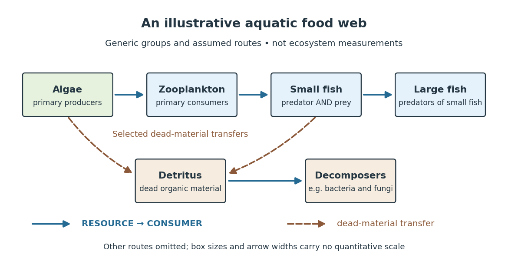
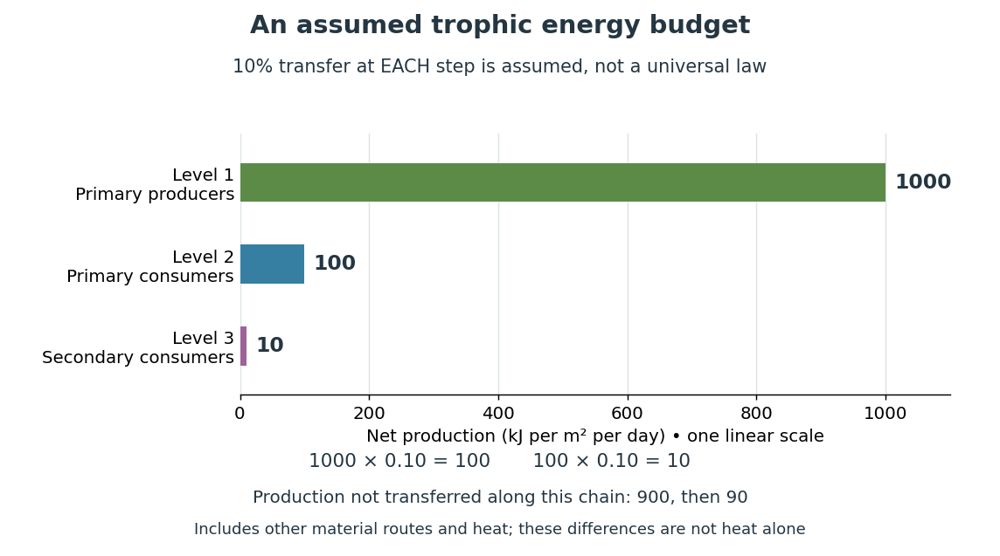
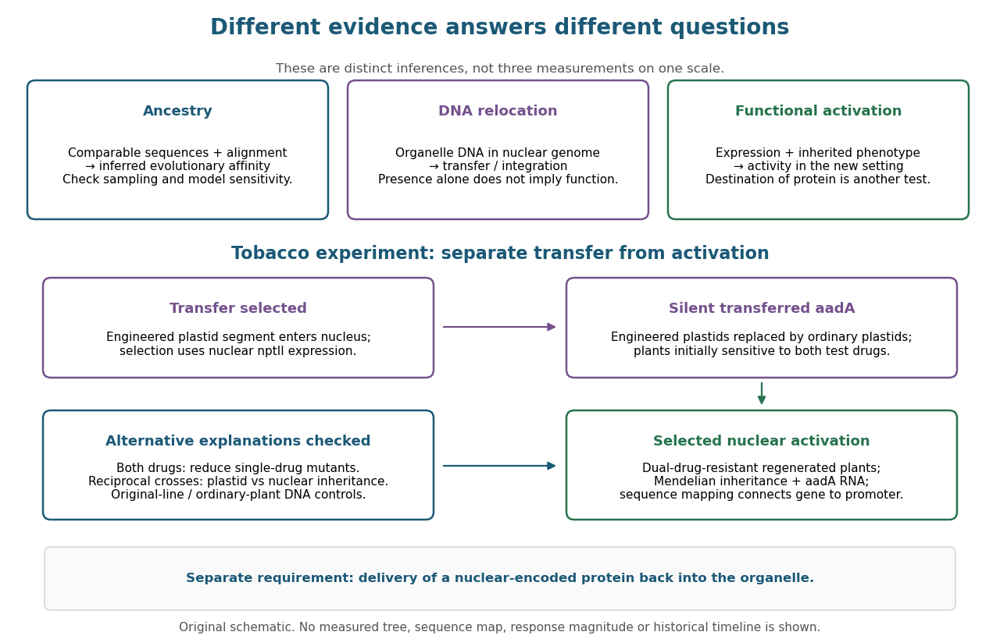

# Ecology

↑ **Parent:** [Biology](biology.md)

The goal of [ecology](ecology.md) is to explain where [organisms](organism.md) live, how many there are, and how their interactions with one another and their surroundings change those patterns. Living partners include [prey](#prey), [predators](#predator) and [parasites](#parasite); nonliving conditions include [light](optics.md#light), [temperature](temperature.md) and [water](chemical-substance.md#water). An [ecosystem](#ecosystem) brings these interacting parts into one study system. See [Clark, Douglas and Choi, Biology 2e, 44.1: the scope of ecology](https://openstax.org/books/biology-2e/pages/44-1-the-scope-of-ecology).

Start with an invented aquatic [food web](mathematical-biology.md#food-web): photosynthetic [algae](organism.md#algae) feed [zooplankton](#zooplankton), which feed small [fish](organism.md#fish), which feed large [fish](organism.md#fish). That [food chain](mathematical-biology.md#food-chain) has four feeding positions and three feeding arrows. Dead material also reaches [decomposers](#decomposer) through [detritus](#detritus), so the [food web](mathematical-biology.md#food-web) branches rather than forming a single ladder.

**[Figure 1](#image-an-illustrative-aquatic-food-web-feeding-arrows-point-from-resource-to-consumer). An illustrative aquatic food web: feeding arrows point from resource to consumer**. Original schematic, not a measured [ecosystem](#ecosystem). Solid arrows mean RESOURCE → CONSUMER; dashed arrows mean transfer of dead material to [detritus](#detritus). Box sizes and arrow widths do not represent abundance or transfer rates. [Algae](organism.md#algae), [zooplankton](#zooplankton), small [fish](organism.md#fish) and large [fish](organism.md#fish) are generic groups, not identified [species](biology.md#species). Selected dead-material transfers are shown; further feeding and recycling routes are omitted.

The appeal of [ecology](ecology.md) is that an [organism](organism.md)'s surroundings include other [organisms](organism.md) that change those surroundings. [Photosynthesis](biology.md#photosynthesis) links [light](optics.md#light) to living material; [predation](#predation) transfers that material between [organisms](organism.md); [decomposers](#decomposer) return its constituent [chemical elements](chemical-substance.md#chemical-element) to forms that can be used again. These connections help explain why changing one part of an [ecosystem](#ecosystem) can affect distant parts of its [food web](mathematical-biology.md#food-web), although an arrow alone does not predict the size or even the direction of an indirect change. [Population dynamics](mathematical-biology.md#population-dynamics) supplies quantitative tools when the question concerns changing counts.

In 1866, Ernst Haeckel's _Generelle Morphologie der Organismen_ included a section titled _Oecologie und Chorologie_ in volume 2, beginning on page 286. This places the terminology of [ecology](ecology.md) in an early systematic treatment of [organisms](organism.md) and their relationships. See [Haeckel, Generelle Morphologie der Organismen, volume 2 (1866), contents and p. 286](https://books.google.com/books?id=tKFbIVgJS8wC). A later quantitative landmark is Raymond L. Lindeman's 1942 treatment of [ecosystems](#ecosystem) through feeding relationships and [energy flow](#energy-flow-ecology). See [Lindeman, The Trophic-Dynamic Aspect of Ecology, Ecology 23 (1942), 399–417](https://doi.org/10.2307/1930126).

**Table of contents**

- [Nitrogen fixation](#nitrogen-fixation)
- [Life history theory](#life-history-theory)
- [Crypsis](#crypsis)
  - [Camouflage](#camouflage)
- [Palatability](#palatability)
- [Conservation biology](#conservation-biology)
  - [Species eradication](#species-eradication)
  - [Biosecurity](#biosecurity)
- [Biological invasion](#biological-invasion)
- [Introduced species](#introduced-species)
  - [Invasive species](#invasive-species)
- [Ecological character displacement](#ecological-character-displacement)
- [Niche overlap](#niche-overlap)
- [Resource partitioning](#resource-partitioning)
- [Dispersal](#dispersal)
  - [Natal dispersal](#natal-dispersal)
- [Metabolic cross-feeding](#metabolic-cross-feeding)
- [Symbiosis](#symbiosis)
  - [Arbuscular mycorrhiza](#arbuscular-mycorrhiza)
  - [Obligate symbiosis](#obligate-symbiosis)
- [Ecological interdependence](#ecological-interdependence)
- [Mutualism](#mutualism)
  - [Reciprocal reward in symbiosis](#reciprocal-reward-in-symbiosis)
  - [Host sanction](#host-sanction)
  - [By-product mutualism](#by-product-mutualism)
- [Behavioural ecology](#behavioural-ecology)
  - [Interaction frequency](#interaction-frequency)
  - [Cooperation](#cooperation)
    - [Public good in biology](#public-good-in-biology)
    - [Partner recognition](#partner-recognition)
    - [Reputation](#reputation)
    - [Partner fidelity feedback](#partner-fidelity-feedback)
    - [Direct reciprocity](#direct-reciprocity)
    - [Partner choice](#partner-choice)
      - [Biological market](#biological-market)
    - [Altruism](#altruism)
- [Bioturbation](#bioturbation)
- [Interspecific competition](#interspecific-competition)
  - [Ecological competition coefficient](#ecological-competition-coefficient)
- [Habitat fragmentation](#habitat-fragmentation)
- [Herbivore](#herbivore)
- [Extinction](#extinction)
- [Vapour-pressure deficit](#vapour-pressure-deficit)
- [Free-air carbon dioxide enrichment](#free-air-carbon-dioxide-enrichment)
- [Eddy covariance](#eddy-covariance)
- [Biodiversity](#biodiversity)
  - [Species richness](#species-richness)
- [Response diversity](#response-diversity)
- [Transgressive overyielding](#transgressive-overyielding)
- [Selection effect in biodiversity experiments](#selection-effect-in-biodiversity-experiments)
- [Complementarity effect](#complementarity-effect)
- [Mass-ratio hypothesis](#mass-ratio-hypothesis)
- [Niche differentiation](#niche-differentiation)
- [Plant functional trait](#plant-functional-trait)
  - [Water-use efficiency](#water-use-efficiency)
  - [Wood density](#wood-density)
  - [Leaf mass per area](#leaf-mass-per-area)
  - [Specific leaf area](#specific-leaf-area)
  - [Leaf economics spectrum](#leaf-economics-spectrum)
- [Life-history trade-off](#life-history-trade-off)
- [Population (biology)](#population-biology)
- [Ecosystem](#ecosystem)
  - [Net ecosystem production](#net-ecosystem-production)
  - [Net primary production](#net-primary-production)
  - [Carbon storage](#carbon-storage)
    - [Carbon sequestration](#carbon-sequestration)
  - [Ecosystem multifunctionality](#ecosystem-multifunctionality)
  - [Primary producer](#primary-producer)
  - [Consumer (food chain)](#consumer-food-chain)
    - [Decomposer](#decomposer)
    - [Omnivore](#omnivore)
  - [Detritus](#detritus)
  - [Trophic level](#trophic-level)
  - [Energy flow (ecology)](#energy-flow-ecology)
  - [Plankton](#plankton)
    - [Zooplankton](#zooplankton)
    - [Phytoplankton](#phytoplankton)
- [Endosymbiosis](#endosymbiosis)
  - [Endosymbiont](#endosymbiont)
  - [Endosymbiotic theory](#endosymbiotic-theory)
    - [Evidence for bacterial ancestry of organelles](#evidence-for-bacterial-ancestry-of-organelles)
    - [Endosymbiotic gene transfer](#endosymbiotic-gene-transfer)
      - [Functional plastid-to-nucleus gene transfer experiment](#functional-plastid-to-nucleus-gene-transfer-experiment)
- [Parasitism](#parasitism)
  - [Evolutionary reversion to free living](#evolutionary-reversion-to-free-living)
  - [Obligate parasite](#obligate-parasite)
  - [Host dependence](#host-dependence)
  - [Parasitoid](#parasitoid)
  - [Host (biology)](#host-biology)
  - [Parasite](#parasite)
    - [Corallicolid](#corallicolid)
    - [Cryptosporidium parvum](#cryptosporidium-parvum)
    - [Plasmodium falciparum](#plasmodium-falciparum)
    - [Apicomplexan parasite](#apicomplexan-parasite)
    - [Macroparasite](#macroparasite)
      - [Within-host parasite burden](#within-host-parasite-burden)
    - [Microparasite](#microparasite)
- [Predation](#predation)
  - [Functional response](#functional-response)
    - [Holling type II functional response](#holling-type-ii-functional-response)
  - [Prey](#prey)
  - [Predator](#predator)
- [Ecologist](#ecologist)
  - [List of ecologists](#list-of-ecologists)
    - [Robert M. May](#robert-m-may)
      - [Work by Robert M. May](#work-by-robert-m-may)
    - [C. S. Holling](#c-s-holling)
    - [Allan D. McDevitt](#allan-d-mcdevitt)
    - [L. M. Gosling](#l-m-gosling)
    - [Digger B. Jackson](#digger-b-jackson)
    - [Chas A. Holt](#chas-a-holt)
    - [Simon J. Goodman](#simon-j-goodman)
    - [Rosalind Bryce](#rosalind-bryce)
    - [Emma Sheehy](#emma-sheehy)
    - [Daniel M. Tompkins](#daniel-m-tompkins)
    - [Wannes Hubau](#wannes-hubau)
      - [Work by Wannes Hubau](#work-by-wannes-hubau)
    - [Brendan Choat](#brendan-choat)
      - [Work by Brendan Choat](#work-by-brendan-choat)
    - [Richard A. Betts](#richard-a-betts)
      - [Work by Richard A. Betts](#work-by-richard-a-betts)
    - [Mingkai Jiang](#mingkai-jiang)
      - [Work by Mingkai Jiang](#work-by-mingkai-jiang)
    - [Richard J. Norby](#richard-j-norby)
      - [Work by Richard J. Norby](#work-by-richard-j-norby)
    - [Yude Pan](#yude-pan)
      - [Work by Yude Pan](#work-by-yude-pan)
    - [David Tilman](#david-tilman)
      - [Work by David Tilman](#work-by-david-tilman)
    - [Andy Hector](#andy-hector)
      - [Work by Andy Hector](#work-by-andy-hector)
    - [Michel Loreau](#michel-loreau)
      - [Work by Michel Loreau](#work-by-michel-loreau)
    - [Sandra Díaz](#sandra-diaz)
      - [Work by Sandra Díaz](#work-by-sandra-diaz)
    - [S. Joseph Wright](#s-joseph-wright)
      - [Work by S. Joseph Wright](#work-by-s-joseph-wright)
    - [Ian J. Wright](#ian-j-wright)
      - [Work by Ian J. Wright](#work-by-ian-j-wright)
    - [Stuart H. Hurlbert](#stuart-h-hurlbert)
      - [Work by Stuart H. Hurlbert](#work-by-stuart-h-hurlbert)

## Nitrogen fixation

↑ **Parent:** [Ecology](ecology.md)

Conversion of molecular nitrogen into biologically accessible reduced nitrogen. Symbiotic fixation costs energy and must be distinguished from nitrate uptake.

## Life history theory

↑ **Parent:** [Ecology](ecology.md)

## Crypsis

↑ **Parent:** [Ecology](ecology.md)

Reduction in detection through resemblance to the visual or other sensory background. It is distinct from recognition as a defended organism after detection.

### Camouflage

↑ **Parent:** [Crypsis](#crypsis)

## Palatability

↑ **Parent:** [Ecology](ecology.md)

Acceptability of an item as food to a specified consumer. Chemical concentration, willingness to attack, willingness to swallow and subsequent illness are different measurements.

## Conservation biology

↑ **Parent:** [Ecology](ecology.md)

### Species eradication

↑ **Parent:** [Conservation biology](#conservation-biology)

Complete removal of a target population from a defined area, requiring sustained surveillance to distinguish absence from nondetection.

### Biosecurity

↑ **Parent:** [Conservation biology](#conservation-biology)

Measures reducing introduction or spread of organisms through a specified pathway.

## Biological invasion

↑ **Parent:** [Ecology](ecology.md)

Establishment and spread of organisms into a new region, with effects dependent on community context and introduction history.

## Introduced species

↑ **Parent:** [Ecology](ecology.md)

A species moved by humans beyond its natural geographic range. Introduction is defined relative to location, not only national boundaries.

### Invasive species

↑ **Parent:** [Introduced species](#introduced-species)

An introduced species whose establishment and spread cause adverse effects under the specified ecological definition. Presence outside the native range does not alone establish an impact.

## Ecological character displacement

↑ **Parent:** [Ecology](ecology.md)

Evolutionary divergence associated with interactions between coexisting lineages. Testing it requires alternatives to pre-existing differences and environmental sorting.

## Niche overlap

↑ **Parent:** [Ecology](ecology.md)

Overlap in a stated dimension of resource use or environmental requirements. Similarity of potential resource use is not a direct estimate of its demographic cost.

## Resource partitioning

↑ **Parent:** [Ecology](ecology.md)

Differential use of resources by coexisting organisms. It can reduce competition, but does not by itself measure the strength of competition that produced or currently accompanies it.

## Dispersal

↑ **Parent:** [Ecology](ecology.md)

Movement potentially connecting populations or colonizing habitat. Movement alone is not [gene flow](biology.md#gene-flow): migrants must contribute inherited material to later generations.

### Natal dispersal

↑ **Parent:** [Dispersal](#dispersal)

Movement between the natal site and the site of reproduction.

## Metabolic cross-feeding

↑ **Parent:** [Ecology](ecology.md)

Use of metabolites released or supplied by another organism. An initially incidental exchange can become specialized, but cross-feeding alone does not establish reciprocal dependence.

## Symbiosis

↑ **Parent:** [Ecology](ecology.md)

A persistent close association between organisms of different species. Such associations can be mutualistic, commensal or parasitic; symbiosis does not by itself mean mutual benefit.

### Arbuscular mycorrhiza

↑ **Parent:** [Symbiosis](#symbiosis)

A root-fungus association with branched fungal exchange structures, arbuscules, within root cortical cells. Nutrient transfer and host carbon allocation are regulated and context-dependent.

### Obligate symbiosis

↑ **Parent:** [Symbiosis](#symbiosis)

A close biological association on which at least one partner depends for persistence or reproduction under the specified conditions. Obligacy does not itself imply mutual benefit, reciprocity or [coevolution](biology.md#coevolution).

## Ecological interdependence

↑ **Parent:** [Ecology](ecology.md)

Dependence of interacting organisms on one another’s presence or activities in a specified environment. One-sided reliance should be distinguished from reciprocal dependence.

## Mutualism

↑ **Parent:** [Ecology](ecology.md)

An interaction providing net benefits to both participants under specified conditions. It need not be obligatory or free of [evolutionary conflict](biology.md#evolutionary-conflict).

### Reciprocal reward in symbiosis

↑ **Parent:** [Mutualism](#mutualism)

Conditional resource allocation in which a partner providing more service receives more resource. Reciprocal reward can help stabilize cooperation without guaranteeing equal exchange or universal host control.

### Host sanction

↑ **Parent:** [Mutualism](#mutualism)

A host response reducing the success of an established symbiont that provides less benefit. It differs from exclusion of a partner before association and need not imply conscious choice.

### By-product mutualism

↑ **Parent:** [Mutualism](#mutualism)

A mutual benefit arising as a consequence of actions favoured for an actor’s own immediate returns. It does not require delayed repayment.

## Behavioural ecology

↑ **Parent:** [Ecology](ecology.md)

Study of the ecological and evolutionary consequences of [animal behaviour](biology.md#animal-behaviour).

### Interaction frequency

↑ **Parent:** [Behavioural ecology](#behavioural-ecology)

The number or rate of social or ecological encounters. It differs from the fraction of a particular strategy in a population and from the probability of meeting the same partner again.

### Cooperation

↑ **Parent:** [Behavioural ecology](#behavioural-ecology)

A social interaction in which a participant provides a benefit to another; classifications distinguish immediate actor benefits from evolutionary [altruism](#altruism). Group benefit alone does not explain persistence of an individually costly contribution.

#### Public good in biology

↑ **Parent:** [Cooperation](#cooperation)

A resource or service whose effects can benefit others as well as its producer. The spatial scale of benefits, production cost and competitive setting determine exploitation incentives.

#### Partner recognition

↑ **Parent:** [Cooperation](#cooperation)

Discrimination among potential or previous partners. Repeat interactions support partner-specific responses only if the relevant information can be retained or reliably associated with a location.

#### Reputation

↑ **Parent:** [Cooperation](#cooperation)

Information about an individual’s past behaviour that can alter its later interactions, including interactions with different partners. Reputation-based explanations require a mechanism for acquiring and using that information.

#### Partner fidelity feedback

↑ **Parent:** [Cooperation](#cooperation)

A mechanism in which helping a persistent partner improves the actor’s later direct returns through that partner’s survival or productivity, without requiring an explicit repayment rule.

#### Direct reciprocity

↑ **Parent:** [Cooperation](#cooperation)

Conditional cooperation based on previous interaction with the same partner. Repeated-game support for cooperation depends on encounter continuation, observation and the competing strategies.

#### Partner choice

↑ **Parent:** [Cooperation](#cooperation)

Selection of interaction partners in a way that can favour useful contributions through access to future benefits. Its effects depend on available alternatives, information and switching costs.

##### Biological market

↑ **Parent:** [Partner choice](#partner-choice)

An interaction in which access to partners and exchange alternatives change the terms of [cooperation](#cooperation). Encounter rate and partner availability can have effects different from relationship persistence.

#### Altruism

↑ **Parent:** [Cooperation](#cooperation)

In evolutionary analysis, an action with a direct fitness cost to its actor and a benefit to another. The comparison depends on the specified alternative and timescale.

## Bioturbation

↑ **Parent:** [Ecology](ecology.md)

Biological disturbance and mixing of sediment, including burrowing. It modifies habitats and can destroy or change surfaces that otherwise preserve body impressions and [trace fossils](biology.md#trace-fossil).

## Interspecific competition

↑ **Parent:** [Ecology](ecology.md)

An interaction in which members of different species reduce one another's access to limiting resources. Shared location or a correlated population decline alone does not prove this mechanism.

### Ecological competition coefficient

↑ **Parent:** [Interspecific competition](#interspecific-competition)

A model-specific parameter describing how one population affects another. It cannot be read directly from the distance between skeletal forms.

## Habitat fragmentation

↑ **Parent:** [Ecology](ecology.md)

Division of habitat into smaller or more isolated patches. Effects of changed connectivity must be distinguished from effects of reduced total habitat area.

## Herbivore

↑ **Parent:** [Ecology](ecology.md)

An organism consuming plant material. Plant-part selection and digestive strategy can differ substantially among herbivores.

## Extinction

↑ **Parent:** [Ecology](ecology.md)

Loss of all members of a lineage. Local disappearance is an extirpation and must be distinguished from global extinction, especially when interpreting a regional fossil record.

## Vapour-pressure deficit

↑ **Parent:** [Ecology](ecology.md)

The difference between saturation and actual water-vapour pressure. It quantifies atmospheric drying demand and can increase under warming even when the change in rainfall is small.

## Free-air carbon dioxide enrichment

↑ **Parent:** [Ecology](ecology.md)

Experimental elevation of atmospheric [carbon dioxide](chemical-substance.md#carbon-dioxide) around vegetation without enclosing it in a chamber. Replicated ambient controls and complete carbon and nutrient budgets are needed to connect photosynthetic responses to net storage.

## Eddy covariance

↑ **Parent:** [Ecology](ecology.md)

An atmospheric flux method using covariance of rapid vertical-velocity and concentration fluctuations. Its footprint and transport assumptions matter; the measured exchange is not automatically a complete budget including harvested or dissolved exports.

## Biodiversity

↑ **Parent:** [Ecology](ecology.md)

Variation among living organisms and their biological organization. For ecosystem-function experiments, distinguish the number of species from their identities, relative abundances and functional differences.

### Species richness

↑ **Parent:** [Biodiversity](#biodiversity)

The number of species in a defined assemblage or sample. It differs from evenness, abundance and functional diversity; controlled richness experiments need replication of composition to separate these effects.

## Response diversity

↑ **Parent:** [Ecology](ecology.md)

Variation among species in their responses to environmental change, especially among species contributing similar ecosystem effects. Different responses can support persistence of functions across changing conditions.

## Transgressive overyielding

↑ **Parent:** [Ecology](ecology.md)

A mixture yielding more than its best monoculture comparator under matched conditions. It is stronger evidence against a pure best-species sampling explanation than exceeding a weighted monoculture average, but does not identify the physiological cause.

## Selection effect in biodiversity experiments

↑ **Parent:** [Ecology](ecology.md)

The component of a biodiversity-effect partition reflecting covariance between monoculture yield and mixture relative-yield change. The name does not imply evolutionary [natural selection](biology.md#natural-selection).[Additive partition](biology-bibliography.md#partitioning-selection-and-complementarity-in-biodiversity-experiments-by-michel-loreau-and-andy-hector)

## Complementarity effect

↑ **Parent:** [Ecology](ecology.md)

The average-relative-yield component of a biodiversity-effect partition. A positive value can arise from resource partitioning, facilitation or other mechanisms and is not uniquely diagnostic of one interaction.[Additive partition](biology-bibliography.md#partitioning-selection-and-complementarity-in-biodiversity-experiments-by-michel-loreau-and-andy-hector)

## Mass-ratio hypothesis

↑ **Parent:** [Ecology](ecology.md)

The hypothesis that abundant species' traits strongly influence ecosystem processes. It motivates separating effects of dominant-species identity from effects of species interactions or richness.

## Niche differentiation

↑ **Parent:** [Ecology](ecology.md)

Differences in ecological use or response that can reduce competition among species. Stable coexistence requires the relevant recovery-when-rare conditions, not merely the observation of different traits.

## Plant functional trait

↑ **Parent:** [Ecology](ecology.md)

A measurable characteristic relevant to plant performance or ecological effects. A convenient trait measurement is not automatically a direct assay of lifetime [genotype fitness](population-genetics.md#genotype-fitness).

### Water-use efficiency

↑ **Parent:** [Plant functional trait](#plant-functional-trait)

A ratio expressing carbon gain or biomass production relative to water use, under a specified measurement convention. Higher leaf-level efficiency does not guarantee greater whole-ecosystem carbon storage.

### Wood density

↑ **Parent:** [Plant functional trait](#plant-functional-trait)

Mass of wood per specified reference volume, with measurement conventions stated. It can associate with mechanical investment, transport and demographic performance without uniquely determining any one mechanism.

### Leaf mass per area

↑ **Parent:** [Plant functional trait](#plant-functional-trait)

Leaf dry mass divided by leaf area. Its construction-mass meaning must be kept distinct from whole-plant growth rate.

### Specific leaf area

↑ **Parent:** [Plant functional trait](#plant-functional-trait)

Leaf area per unit dry mass. It is the reciprocal of [leaf mass per area](#leaf-mass-per-area) when the same tissue and units are used.

### Leaf economics spectrum

↑ **Parent:** [Plant functional trait](#plant-functional-trait)

Coordinated variation in leaf construction, physiological rates and longevity, contrasting rapid returns with persistent, conservative tissues. Mass-based and area-based measurements differ.[Global comparative trait relationships](biology-bibliography.md#the-worldwide-leaf-economics-spectrum-by-ian-j-wright-and-others)

## Life-history trade-off

↑ **Parent:** [Ecology](ecology.md)

A constraint on jointly improving components such as growth, survival and reproduction under specified conditions. Variation in resource acquisition can mask negative relationships arising from allocation.

## Population (biology)

↑ **Parent:** [Ecology](ecology.md)

A [biological population](#population-biology) is a set of [organisms](organism.md) of a [species](biology.md#species) occupying a specified area or experimental setting at a specified time. State the boundary for the question being studied: a flask, a breeding locality, or a wider region connected by [gene flow](biology.md#gene-flow). A [biological population](#population-biology) need not be perfectly mixed or isolated.

## Ecosystem

↑ **Parent:** [Ecology](ecology.md)  
ⓦ [Wiki](https://en.wikipedia.org/wiki/Ecosystem)

An [ecosystem](#ecosystem) is a system of interacting [organisms](organism.md) and their nonliving surroundings. A pond study might include [algae](organism.md#algae), [fish](organism.md#fish), [bacteria](organism.md#bacteria), [water](chemical-substance.md#water), dissolved [chemical compounds](chemical-substance.md#chemical-compound) and incoming [light](optics.md#light). The useful step is to state the boundary and time interval: the pond surface, bottom and shoreline might enclose the study region, but [water](chemical-substance.md#water), [organisms](organism.md) and [energy](energy.md) can cross them. The chosen boundary specifies what counts as internal storage, input or output; it does not make the [ecosystem](#ecosystem) sealed. See [Clark, Douglas and Choi, Biology 2e, 46.1: ecosystems and their components](https://openstax.org/books/biology-2e/pages/46-1-ecology-of-ecosystems).

For a toy pond [water](chemical-substance.md#water) budget over one day, begin with $1000\,\mathrm{m^3}$, add $120\,\mathrm{m^3}$ crossing inward, and remove $90\,\mathrm{m^3}$ crossing outward. With all other transfers omitted by assumption, the final amount is $1000+120-90=1030\,\mathrm{m^3}$. The same bookkeeping asks whether a change inside an [ecosystem](#ecosystem) came from internal processes or exchanges with its surroundings. Changing the boundary to include an upstream reservoir changes which transfers are internal, while preserving the accounting.

### Net ecosystem production

↑ **Parent:** [Ecosystem](#ecosystem)

The difference between [gross primary production](biology.md#gross-primary-production) and both autotrophic and heterotrophic respiration. A full storage budget must additionally account for disturbance and lateral transfers.

### Net primary production

↑ **Parent:** [Ecosystem](#ecosystem)

Carbon production remaining after subtracting [autotrophic respiration](biology.md#autotrophic-respiration) from [gross primary production](biology.md#gross-primary-production). It need not remain stored, because consumers, decomposers and disturbance can return or export carbon.

### Carbon storage

↑ **Parent:** [Ecosystem](#ecosystem)

The amount of carbon held in a specified pool or system. It is a stock, distinct from gross uptake or its rate of net change; large old stocks can coexist with small current fluxes.

#### Carbon sequestration

↑ **Parent:** [Carbon storage](#carbon-storage)

Transfer of carbon into storage over a specified time horizon. Net sequestration requires uptake to exceed relevant losses under an explicit boundary; high photosynthesis alone does not establish it.

### Ecosystem multifunctionality

↑ **Parent:** [Ecosystem](#ecosystem)

Maintenance or assessment of multiple ecosystem functions together. Functions can depend on different traits or conflict, so performance in one process cannot stand in for every other process.

### Primary producer

↑ **Parent:** [Ecosystem](#ecosystem)

A [primary producer](#primary-producer) builds organic [chemical compounds](chemical-substance.md#chemical-compound) from inorganic sources. Photosynthetic [algae](organism.md#algae), [plants](organism.md#plant) and [cyanobacteria](organism.md#cyanobacteria) use [light](optics.md#light) [energy](energy.md) for this role through [photosynthesis](biology.md#photosynthesis) and [carbon fixation](biology.md#carbon-fixation). The role supplies new living material to a [food web](mathematical-biology.md#food-web); it does not mean that the [organism](organism.md) creates [energy](energy.md).

### Consumer (food chain)

↑ **Parent:** [Ecosystem](#ecosystem)  
ⓦ [Wiki](https://en.wikipedia.org/wiki/Consumer_(food_chain))

A [consumer](#consumer-food-chain) obtains organic material by feeding on other [organisms](organism.md) or their products. A [consumer](#consumer-food-chain) feeding on [primary producers](#primary-producer) is a primary [consumer](#consumer-food-chain); one feeding on primary [consumers](#consumer-food-chain) is a secondary [consumer](#consumer-food-chain). These names describe positions in a [food chain](mathematical-biology.md#food-chain), rather than permanent labels for a [species](biology.md#species).

#### Decomposer

↑ **Parent:** [Consumer (food chain)](#consumer-food-chain)  
ⓦ [Wiki](https://en.wikipedia.org/wiki/Decomposer)

A [decomposer](#decomposer) breaks down dead organic material and absorbs products of that breakdown; many [bacteria](organism.md#bacteria) and [fungi](organism.md#fungus) perform this role. [Decomposers](#decomposer) connect [detritus](#detritus) from different [trophic levels](#trophic-level) to material recycling, so placing all [decomposers](#decomposer) at one final step of every [food chain](mathematical-biology.md#food-chain) is misleading. See [Clark, Douglas and Choi, Biology 2e, 46.1: grazing and detrital food webs](https://openstax.org/books/biology-2e/pages/46-1-ecology-of-ecosystems).

#### Omnivore

↑ **Parent:** [Consumer (food chain)](#consumer-food-chain)  
ⓦ [Wiki](https://en.wikipedia.org/wiki/Omnivore)

An [omnivore](#omnivore) feeds on both [primary producers](#primary-producer) and [consumers](#consumer-food-chain). Its mixed diet explains why a [trophic level](#trophic-level) need not be a whole number or a fixed label throughout an [organism](organism.md)'s life.

### Detritus

↑ **Parent:** [Ecosystem](#ecosystem)  
ⓦ [Wiki](https://en.wikipedia.org/wiki/Detritus)

[Detritus](#detritus) is nonliving organic material, including dead remains and organic wastes. It is a resource for [decomposers](#decomposer), not itself an [organism](organism.md) or a [predator](#predator). In the illustrative [food web](mathematical-biology.md#food-web), the dashed arrow from [algae](organism.md#algae) to [detritus](#detritus) denotes a material transfer; the solid arrow from [detritus](#detritus) to [decomposers](#decomposer) denotes resource use.

### Trophic level

↑ **Parent:** [Ecosystem](#ecosystem)  
ⓦ [Wiki](https://en.wikipedia.org/wiki/Trophic_level)

A [trophic level](#trophic-level) describes feeding position relative to [primary producers](#primary-producer). Assign [primary producers](#primary-producer) level 1; in the illustrated [food chain](mathematical-biology.md#food-chain), [zooplankton](#zooplankton) occupy level 2, small [fish](organism.md#fish) level 3, and large [fish](organism.md#fish) level 4. Following a single feeding path adds one level at each step. The labels make dependence on the initial resource visible, but a branching [food web](mathematical-biology.md#food-web) can give an [organism](organism.md) several feeding paths. See [Clark, Douglas and Choi, Biology 2e, 46.1: feeding positions and branching food webs](https://openstax.org/books/biology-2e/pages/46-1-ecology-of-ecosystems).

An [omnivore](#omnivore) can obtain food from more than one [trophic level](#trophic-level). As an explicitly assumed diet-weighted example, suppose an [omnivore](#omnivore) gets half its assimilated food [energy](energy.md) from level-1 [primary producers](#primary-producer) and half from level-2 [consumers](#consumer-food-chain). Define its [trophic level](#trophic-level) as one plus the weighted [mean](expected-value.md) level of its food: $1+(1/2)1+(1/2)2=2.5$. This computed position depends on the specified diet and weighting convention; it is not an immutable property of the [species](biology.md#species). A different life stage or diet can change it.

### Energy flow (ecology)

↑ **Parent:** [Ecosystem](#ecosystem)  
ⓦ [Wiki](https://en.wikipedia.org/wiki/Energy_flow_(ecology))

[Energy flow](#energy-flow-ecology) tracks [energy](energy.md) entering an [ecosystem](#ecosystem), passing through [organisms](organism.md) and leaving its boundary. To see its quantitative effect, assume net production at one [trophic level](#trophic-level) is $P_1=1000\,\mathrm{kJ\,m^{-2}\,day^{-1}}$ and assume a transfer efficiency $\varepsilon=0.10$ at each of two successive steps. Here $P_i$ measures the [energy](energy.md) incorporated into new living material per unit [area](differential-geometry.md#surface-area) per day, after that level's own [cellular respiration](biology.md#cellular-respiration); it is not a count of [organisms](organism.md) or a standing stock. The [joule](physics.md#joule) supplies the [energy](energy.md) unit, with $1\,\mathrm{kJ}=1000\,\mathrm J$.

$$
P_{i+1}=\varepsilon P_i,\qquad P_2=100,\qquad P_3=10\quad\mathrm{kJ\,m^{-2}\,day^{-1}}.
$$

**[Figure 2](#image-an-assumed-energy-flow-budget-1000-→-100-→-10-kj-per-square-metre-per-day). An assumed energy flow budget: 1000 → 100 → 10 kJ per square metre per day**. Original toy calculation with 10 percent transfer efficiency assumed at both steps. Bars use one linear scale; the labels retain visibility of the smallest bar. The differences 900 and 90 are production not transferred along the selected [food chain](mathematical-biology.md#food-chain), not measurements of [heat](heat.md) alone. The example is separate from the four-position illustrative [food web](mathematical-biology.md#food-web).

Only $10/1000=0.01$, or one percent, of the initial production reaches level 3 in this toy [food chain](mathematical-biology.md#food-chain). The first step leaves $1000-100=900$ and the second $100-10=90$ outside the next level's new production. These differences can include uneaten material, wastes, and [energy](energy.md) released as [heat](heat.md) during [cellular respiration](biology.md#cellular-respiration); their separate amounts have not been assigned. [Detritus](#detritus) can still carry [energy](energy.md) to [decomposers](#decomposer). The 10 percent efficiency is an assumption, not a universal law: transfer efficiencies vary with the [organisms](organism.md), food and conditions. The production ratio $P_{i+1}/P_i$ also differs from the fraction of an individual meal converted into growth. See [Clark, Douglas and Choi, Biology 2e, 46.2: production and transfer efficiency](https://openstax.org/books/biology-2e/pages/46-2-energy-flow-through-ecosystems).

The shrinking budget explains why supporting another [trophic level](#trophic-level) requires enough production below it. It does not prove an exact maximum length for every [food chain](mathematical-biology.md#food-chain), particularly when a [food web](mathematical-biology.md#food-web) imports resources or has branching diets. Lindeman's 1942 paper grouped feeding relationships into [trophic levels](#trophic-level), compared transfers and [cellular respiration](biology.md#cellular-respiration), and emphasized the [ecosystem](#ecosystem) as a unit connecting living and nonliving components. That viewpoint made different [organisms](organism.md) comparable through a common [energy](energy.md) budget. See [Lindeman, The Trophic-Dynamic Aspect of Ecology (1942)](https://doi.org/10.2307/1930126).

Material recycling and [energy flow](#energy-flow-ecology) describe different bookkeeping. [Carbon](chemical-substance.md#carbon), [nitrogen](chemical-substance.md#nitrogen) and [phosphorus](chemical-substance.md#phosphorus) can be reused through [chemical reactions](chemical-reaction.md) and transfers between [organisms](organism.md) and their surroundings. [Energy](energy.md) transferred as [heat](heat.md) is conserved, but is no longer the same store of chemical [energy](energy.md) available to a [consumer](#consumer-food-chain); photosynthetic [primary producers](#primary-producer) need continuing [light](optics.md#light) input. A [decomposer](#decomposer) helps recycle material and also releases [heat](heat.md) through [metabolism](biology.md#metabolism). Thus loss from one feeding budget means transfer into other forms or routes, never destruction of [energy](energy.md). See [Clark, Douglas and Choi, Biology 2e, 46.3: material cycles](https://openstax.org/books/biology-2e/pages/46-3-biogeochemical-cycles). [Conservation of energy](mathematical-physics.md#conservation-of-energy) applies to the whole accounting.

### Plankton

↑ **Parent:** [Ecosystem](#ecosystem)  
ⓦ [Wiki](https://en.wikipedia.org/wiki/Plankton)

#### Zooplankton

↑ **Parent:** [Plankton](#plankton)  
ⓦ [Wiki](https://en.wikipedia.org/wiki/Zooplankton)

[Zooplankton](#zooplankton) are drifting aquatic [consumers](#consumer-food-chain), including small [animals](organism.md#animal). In the illustrative [food web](mathematical-biology.md#food-web), the chosen [zooplankton](#zooplankton) feed on [algae](organism.md#algae) and serve as [prey](#prey) for small [fish](organism.md#fish); this assumed diet is not a claim about every kind of [zooplankton](#zooplankton).

#### Phytoplankton

↑ **Parent:** [Plankton](#plankton)  
ⓦ [Wiki](https://en.wikipedia.org/wiki/Phytoplankton)

[Phytoplankton](#phytoplankton) are drifting aquatic [organisms](organism.md) that carry out [photosynthesis](biology.md#photosynthesis), including many [algae](organism.md#algae). They can supply food to [zooplankton](#zooplankton) in an [ecosystem](#ecosystem).

## Endosymbiosis

↑ **Parent:** [Ecology](ecology.md)

[Endosymbiosis](#endosymbiosis) is an ecological association in which one [organism](organism.md), the [endosymbiont](#endosymbiont), lives inside another. The definition specifies location, not that both partners benefit, nor that the internal partner has become an [organelle](biological-cell.md#organelle). An intracellular association can remain an association between distinct [organisms](organism.md). [Endosymbiotic theory](#endosymbiotic-theory) addresses a different question: how particular ancestral [bacteria](organism.md#bacteria) became inherited, functionally integrated [organelles](biological-cell.md#organelle) during [evolution](biology.md#evolution).

The striking consequence is that a [eukaryotic](organism.md#eukaryote) [biological cell](biological-cell.md) can combine histories: its nuclear lineage and its [mitochondria](biological-cell.md#mitochondria) need not have the same ancestry. [Mitochondria](biological-cell.md#mitochondria) have bacterial ancestry related to [Alphaproteobacteria](organism.md#alphaproteobacteria); the [plastids](biological-cell.md#plastid) of [plants](organism.md#plant) and many [algae](organism.md#algae), including [chloroplasts](biological-cell.md#chloroplast), have ancestry within [cyanobacteria](organism.md#cyanobacteria). These are ancestral lineages, not a claim that a named living bacterial [species](biology.md#species) is the literal ancestor. Present-day [bacteria](organism.md#bacteria) and [organelles](biological-cell.md#organelle) have both evolved since their shared ancestors. [Opening paragraphs and “The endosymbiont: when and who?”: bacterial origins and uncertainty about closest relatives](biology-bibliography.md#origin-and-evolution-of-plastids-and-photosynthesis-in-eukaryotes-by-geoffrey-i-mcfadden)

**[Figure 3](#image-from-an-internal-partner-to-an-integrated-organelle). From an internal partner to an integrated organelle**. Original conceptual schematic, not an observed historical sequence. Persistence, metabolic exchange, [endosymbiotic gene transfer](#endosymbiotic-gene-transfer), [organelle protein import](protein.md#organelle-protein-import) and coordination of division illustrate integration; they are not dated stages in a compulsory order. The illustrated partner is generic, and the host outline does not specify the ancestral host of [mitochondria](biological-cell.md#mitochondria). The protein-delivery arrow abbreviates nuclear [gene expression](molecular-genetics.md#gene-expression), [biological translation](molecular-genetics.md#translation-biology) in the [cytosol](biological-cell.md#cytosol) and [organelle protein import](protein.md#organelle-protein-import); it does not place [protein](protein.md) synthesis inside the [cell nucleus](biological-cell.md#cell-nucleus).

### Endosymbiont

↑ **Parent:** [Endosymbiosis](#endosymbiosis)

An [endosymbiont](#endosymbiont) is the internal partner in an [endosymbiosis](#endosymbiosis). Calling an [organism](organism.md) an [endosymbiont](#endosymbiont) does not by itself classify it as an [organelle](biological-cell.md#organelle) or imply an irreversible evolutionary transition.

### Endosymbiotic theory

↑ **Parent:** [Endosymbiosis](#endosymbiosis)

[Endosymbiotic theory](#endosymbiotic-theory) explains the bacterial origins of [mitochondria](biological-cell.md#mitochondria) and [plastids](biological-cell.md#plastid) through enduring internal associations and subsequent integration. Survival inside a [biological cell](biological-cell.md) is only part of the problem: exchange through [membrane transport](cell-membrane.md#membrane-transport), inherited division, [gene expression](molecular-genetics.md#gene-expression) and delivery of required [proteins](protein.md) must work together. The elegance is evolutionary reuse of an existing cellular capability, followed by changes that make the partners operate as one system. [Abstract and “How to tame your symbiont”: metabolic, genetic and division integration](biology-bibliography.md#origin-and-evolution-of-plastids-and-photosynthesis-in-eukaryotes-by-geoffrey-i-mcfadden)

The historical [On the origin of mitosing cells by Lynn Sagan](biology-bibliography.md#on-the-origin-of-mitosing-cells-by-lynn-sagan) (1967, abstract and Introduction, pp. 225–226) synthesized a symbiotic account of [eukaryotic](organism.md#eukaryote) origins and proposed tests using molecular evidence. Its Introduction explicitly acknowledged earlier proposals. It also hypothesized origins for other structures; the modern evidence for [mitochondria](biological-cell.md#mitochondria) and [plastids](biological-cell.md#plastid) should be assessed separately from the rest of that historical scheme.

#### Evidence for bacterial ancestry of organelles

↑ **Parent:** [Endosymbiotic theory](#endosymbiotic-theory)

Resemblance is a clue, not sufficient evidence of [common descent](biology.md#common-descent). A small size, two surrounding membranes, division, retained [DNA](polymer.md#deoxyribonucleic-acid) or bacterial-looking [ribosomes](biological-cell.md#ribosome) does not uniquely identify an ancestor. Internal membranes exist outside these [organelles](biological-cell.md#organelle), and a similar function can favor similar structures. The stronger question is whether independently examined molecular characters support the same historical relationship.

A concrete genomic observation is the mitochondrial sequence reported in 1997 for [Reclinomonas americana](organism.md#reclinomonas-americana): $69{,}034$ [base pairs](polymer.md#base-pair) containing 97 identified [genes](genetics.md#gene), including four for a bacterial-type multisubunit [RNA polymerase](molecular-genetics.md#rna-polymerase). This is a reported [genome](molecular-genetics.md#genome) inventory, not a calculation from the pictured shape of a [mitochondrion](biological-cell.md#mitochondria). Retention of such bacterial features strengthens the ancestry argument; a living [Reclinomonas americana](organism.md#reclinomonas-americana) is not itself an ancestral [eukaryote](organism.md#eukaryote). The inspected abstract supplies these observations but not the detailed sequencing protocol or contamination controls, so those details are not attributed to this report here. [Abstract, Nature 387 (1997), pp. 493–497: genome length, gene inventory and bacterial-type RNA polymerase](biology-bibliography.md#an-ancestral-mitochondrial-dna-resembling-a-eubacterial-genome-in-miniature-by-b-franz-lang-and-others)

A sequence-based investigation obtains [nucleotide sequences](polymer.md#nucleic-acid-sequence) by [DNA sequencing](molecular-genetics.md#dna-sequencing), identifies comparable [genes](genetics.md#gene), makes a [sequence alignment](molecular-genetics.md#sequence-alignment) and uses [phylogenetics](biology.md#phylogenetics) to infer relationships. The readout is a proposed relationship with support and uncertainty, not a photograph of an ancient encounter. Comparisons of [plastid](biological-cell.md#plastid) sequences with bacterial sequences support cyanobacterial ancestry, while the exact closest sampled cyanobacterial group has depended on the chosen data and inference. A bacterial affinity in one [gene](genetics.md#gene) is weaker than coherent evidence across several [genes](genetics.md#gene) and cellular systems. [“The endosymbiont: when and who?”: alternative phylogenetic placements and lateral gene transfer](biology-bibliography.md#origin-and-evolution-of-plastids-and-photosynthesis-in-eukaryotes-by-geoffrey-i-mcfadden)

For such an analysis, useful checks include distinguishing [organelle](biological-cell.md#organelle) [DNA](polymer.md#deoxyribonucleic-acid) from bacterial contamination, verifying sequence quality, comparing corresponding rather than unrelated [genes](genetics.md#gene), sampling several bacterial groups and testing sensitivity to the [sequence alignment](molecular-genetics.md#sequence-alignment) and evolutionary [mathematical model](mathematics.md#mathematical-model). These are methodological requirements, not a claim that this article has rerun a particular published analysis. [Horizontal gene transfer](biology.md#horizontal-gene-transfer), [gene](genetics.md#gene) loss and unequal evolutionary change can make an individual [gene](genetics.md#gene)'s history differ from a whole [organism](organism.md)'s history. A supported bacterial origin therefore need not identify an extant donor [species](biology.md#species), an exact date or the original mode of entry. [“The endosymbiont: when and who?”: ancient origin and confounding lateral transfer](biology-bibliography.md#origin-and-evolution-of-plastids-and-photosynthesis-in-eukaryotes-by-geoffrey-i-mcfadden)

#### Endosymbiotic gene transfer

↑ **Parent:** [Endosymbiotic theory](#endosymbiotic-theory)

[Endosymbiotic gene transfer](#endosymbiotic-gene-transfer) moves genetic material from an [endosymbiont](#endosymbiont) or its descendant [organelle](biological-cell.md#organelle) into the host [genome](molecular-genetics.md#genome), notably the nuclear [genome](molecular-genetics.md#genome). A transferred [DNA](polymer.md#deoxyribonucleic-acid) segment can remain silent. For a transferred [gene](genetics.md#gene) to replace an [organelle](biological-cell.md#organelle)-encoded function, nuclear [gene expression](molecular-genetics.md#gene-expression) must work and its [protein](protein.md) must reach the right compartment through [organelle protein import](protein.md#organelle-protein-import). Transfer of [DNA](polymer.md#deoxyribonucleic-acid) and transport of [proteins](protein.md) are distinct processes in opposite directions. [Introduction, p. 2869, and Discussion, p. 2875: transferred sequences and the additional targeting problem](biology-bibliography.md#experimental-reconstruction-of-functional-gene-transfer-from-the-tobacco-plastid-genome-to-the-nucleus-by-sandra-stegemann-and-ralph-bock)

[Gene](genetics.md#gene) loss and [endosymbiotic gene transfer](#endosymbiotic-gene-transfer) are different: absence from an [organelle](biological-cell.md#organelle) [genome](molecular-genetics.md#genome) does not by itself show that a functional nuclear copy exists. Conversely, an imported [protein](protein.md) may derive from a host [gene](genetics.md#gene) rather than a transferred [gene](genetics.md#gene). The surviving [organelle](biological-cell.md#organelle) [genome](molecular-genetics.md#genome) is therefore a partial record, not a complete inventory of either ancestral [bacteria](organism.md#bacteria) or the modern [organelle](biological-cell.md#organelle)'s machinery. [“How to tame your symbiont”: losses, transfers, host recruitment and repatriation of proteins](biology-bibliography.md#origin-and-evolution-of-plastids-and-photosynthesis-in-eukaryotes-by-geoffrey-i-mcfadden)

##### Functional plastid-to-nucleus gene transfer experiment

↑ **Parent:** [Endosymbiotic gene transfer](#endosymbiotic-gene-transfer)

[Experimental Reconstruction of Functional Gene Transfer from the Tobacco Plastid Genome to the Nucleus by Sandra Stegemann and Ralph Bock](biology-bibliography.md#experimental-reconstruction-of-functional-gene-transfer-from-the-tobacco-plastid-genome-to-the-nucleus-by-sandra-stegemann-and-ralph-bock) (2006, Results, pp. 2870–2874) separated relocation of [DNA](polymer.md#deoxyribonucleic-acid) from activation of a relocated [gene](genetics.md#gene). Engineered tobacco [chloroplasts](biological-cell.md#chloroplast) carried an nptII [gene](genetics.md#gene) with nuclear expression signals beside an aadA [gene](genetics.md#gene) with plastid expression signals. Selection on kanamycin recovered plants with the segment in the nuclear [genome](molecular-genetics.md#genome). Crosses then replaced the engineered [chloroplasts](biological-cell.md#chloroplast) with ordinary [chloroplasts](biological-cell.md#chloroplast): the nuclear segment remained, but the plants were initially sensitive to spectinomycin and streptomycin. The transferred aadA [gene](genetics.md#gene) was not yet functional in its new setting.

Leaf pieces were cultured on regeneration medium containing both drugs. Resistant regenerated plants supplied the functional readout. Using both drugs reduced selection of spontaneous plastid [mutations](genetics.md#mutation) conferring resistance mainly to one drug. Reciprocal crosses and selfing distinguished maternal plastid inheritance from nuclear [Mendelian segregation](genetics.md#mendelian-segregation); eight of sixteen initial candidates had the latter pattern. [Figure 1, Tables 1–2 and Results, pp. 2870–2871: selection, eliminated candidates and inheritance controls](biology-bibliography.md#experimental-reconstruction-of-functional-gene-transfer-from-the-tobacco-plastid-genome-to-the-nucleus-by-sandra-stegemann-and-ralph-bock)

The molecular readout came from [RNA](polymer.md#ribonucleic-acid) hybridization and [DNA sequencing](molecular-genetics.md#dna-sequencing). A [Northern blot](molecular-genetics.md#northern-blot) detected aadA [messenger RNA](polymer.md#messenger-rna) in activated lines, with different transcript sizes. Thermal asymmetric interlaced [polymerase chain reaction](molecular-genetics.md#polymerase-chain-reaction) recovered upstream [DNA](polymer.md#deoxyribonucleic-acid); products present in activated lines but absent in original-line and ordinary-plant controls were sequenced. The mapped rearrangements connected aadA to the upstream nuclear [gene promoter](molecular-genetics.md#promoter-genetics). Thus resistance, inheritance, [RNA](polymer.md#ribonucleic-acid) detection and changed [nucleotide sequences](polymer.md#nucleic-acid-sequence) supported activation of the transferred nuclear [gene](genetics.md#gene), rather than resistance alone. [Figures 3–4, Results, pp. 2872–2874, and “PCR and DNA sequencing”/“TAIL-PCR”, pp. 2876–2877](biology-bibliography.md#experimental-reconstruction-of-functional-gene-transfer-from-the-tobacco-plastid-genome-to-the-nucleus-by-sandra-stegemann-and-ralph-bock)

**[Figure 4](#image-separate-evidence-for-ancestry-dna-transfer-and-functional-activation). Separate evidence for ancestry, DNA transfer and functional activation**. Original evidence map and simplified experimental logic. Boxes summarize questions, readouts and controls; no measured [phylogenetic tree](biology.md#phylogenetic-tree), [nucleotide sequence](polymer.md#nucleic-acid-sequence), deletion map or quantitative response is copied. [Organelle protein import](protein.md#organelle-protein-import) remains a separate question beyond this tobacco experiment.

This engineered test demonstrates one route to functional nuclear [gene expression](molecular-genetics.md#gene-expression) after [plastid](biological-cell.md#plastid) [DNA](polymer.md#deoxyribonucleic-acid) transfer. It does not establish a natural transfer rate, replay ancient [endosymbiosis](#endosymbiosis) or demonstrate that the resulting [protein](protein.md) is imported into a [chloroplast](biological-cell.md#chloroplast). The authors explicitly identify acquisition of targeting information as an additional step not reproduced by this experiment. [Discussion, p. 2875: antibiotic selection and missing transit-peptide acquisition](biology-bibliography.md#experimental-reconstruction-of-functional-gene-transfer-from-the-tobacco-plastid-genome-to-the-nucleus-by-sandra-stegemann-and-ralph-bock)

## Parasitism

↑ **Parent:** [Ecology](ecology.md)

[Parasitism](#parasitism) is an interaction in which a [parasite](#parasite) obtains resources from a [host](#host-biology), reducing some component of the [host](#host-biology)'s performance. Its demographic effects depend on exposure, within-host processes and transmission opportunities.

### Evolutionary reversion to free living

↑ **Parent:** [Parasitism](#parasitism)

Evolution of host-independent growth from a host-dependent lineage. It requires replacing host-provided functions, not merely losing virulence or host-invasion genes.

### Obligate parasite

↑ **Parent:** [Parasitism](#parasitism)

An organism whose life cycle requires a host; survival of a transmission stage outside a host does not establish host-independent reproduction.

### Host dependence

↑ **Parent:** [Parasitism](#parasitism)

Dependence on host-provided resources, physical conditions, signals or transmission opportunities; the required functions vary greatly among parasite lineages.

### Parasitoid

↑ **Parent:** [Parasitism](#parasitism)

A [parasitoid](#parasitoid) develops on or in a [host](#host-biology) and eventually kills it. Host-parasitoid transmission therefore has different offspring accounting from ordinary [predation](#predation) or a nonlethal parasite-burden model.

### Host (biology)

↑ **Parent:** [Parasitism](#parasitism)

A biological [host](#host-biology) provides the environment or resources used by a [parasite](#parasite) or other associated organism.

### Parasite

↑ **Parent:** [Parasitism](#parasitism)

A [parasite](#parasite) is an organism benefiting from [parasitism](#parasitism). [Microparasite](#microparasite) and [macroparasite](#macroparasite) distinguish useful transmission-model descriptions of within-host multiplication and distributed [parasite](#parasite) burden.

#### Corallicolid

↑ **Parent:** [Parasite](#parasite)

A [corallicolid](#corallicolid) is a member of a coral-associated apicomplexan lineage. Retention of chlorophyll-biosynthesis genes without photosystem genes illustrates why a partial pigment pathway is not evidence for complete [photosynthesis](biology.md#photosynthesis); its physiological role requires further testing.

#### Cryptosporidium parvum

↑ **Parent:** [Parasite](#parasite)

[Cryptosporidium parvum](#cryptosporidium-parvum) is an apicomplexan parasite lacking an [apicoplast](biological-cell.md#apicoplast). Its organelle and metabolic inventory provides a comparison for lineages retaining a plastid.

#### Plasmodium falciparum

↑ **Parent:** [Parasite](#parasite)

[Plasmodium falciparum](#plasmodium-falciparum) is an apicomplexan parasite with stage-dependent metabolic requirements. Blood-stage chemical-rescue experiments identify an essential [apicoplast](biological-cell.md#apicoplast) output under defined culture conditions.

#### Apicomplexan parasite

↑ **Parent:** [Parasite](#parasite)

An [apicomplexan parasite](#apicomplexan-parasite) belongs to an evolutionary lineage containing organisms such as Plasmodium and Cryptosporidium. Plastid retention and metabolic requirements vary among lineages and life-cycle stages.

#### Macroparasite

↑ **Parent:** [Parasite](#parasite)

A [macroparasite](#macroparasite) is typically modelled using the number of [parasites](#parasite) carried by each [host](#host-biology). Adult parasitic worms illustrate why [within-host parasite burden](#within-host-parasite-burden), developmental stages, mating and [host](#host-biology) exposure heterogeneity matter beyond an infected/not-infected classification.

##### Within-host parasite burden

↑ **Parent:** [Macroparasite](#macroparasite)

The [within-host parasite burden](#within-host-parasite-burden) is the number of [parasites](#parasite), or a specified parasite-load measure, carried by one [host](#host-biology). A population's [mean](expected-value.md) burden and its infected-host [prevalence](mathematical-biology.md#prevalence) are different summaries of the burden distribution.

#### Microparasite

↑ **Parent:** [Parasite](#parasite)

A [microparasite](#microparasite) is typically modelled as multiplying rapidly within a [host](#host-biology), so infection status rather than the exact organism count is the first between-host state variable. [SIS model](mathematical-biology.md#sis-model), [SIR model](mathematical-biology.md#sir-model) and [SEIR model](mathematical-biology.md#seir-model) descriptions are examples. Additional within-host structure can still be required.

## Predation

↑ **Parent:** [Ecology](ecology.md)

[Predation](#predation) is the consumption of [prey](#prey) by a [predator](#predator), affecting the demographic rates of both populations.

In the usual animal-feeding sense, a [predator](#predator) kills and eats its [prey](#prey). This distinguishes the interaction from feeding on already-dead material and from the prolonged exploitation of a living [host](#host-biology) in [parasitism](#parasitism). In the illustrative [food web](mathematical-biology.md#food-web), a small [fish](organism.md#fish) eating [zooplankton](#zooplankton) is a [predator](#predator); a large [fish](organism.md#fish) eating that small [fish](organism.md#fish) makes the same small [fish](organism.md#fish) its [prey](#prey). These roles belong to a particular interaction. See [Clark, Douglas and Choi, Biology 2e, 45.6: predation and community interactions](https://openstax.org/books/biology-2e/pages/45-6-community-ecology).

For a toy count, suppose 50 small [fish](organism.md#fish) begin a day and 8 are eaten by large [fish](organism.md#fish). With births, other deaths and movement explicitly omitted, 42 small [fish](organism.md#fish) remain, and the fraction removed by [predation](#predation) is $8/50=0.16$. This measures removal of [prey](#prey), not production of new [predators](#predator). Food intake can support survival and reproduction, but eight meals do not imply eight new [predators](#predator); [energy flow](#energy-flow-ecology) and life-history details intervene. [Lotka-Volterra equations](dynamical-systems.md#lotka-volterra-equations) provide one idealized account of such [population dynamics](mathematical-biology.md#population-dynamics), rather than a guarantee that every interacting pair must cycle.

### Functional response

↑ **Parent:** [Predation](#predation)

The rate of consumption by an individual consumer as a function of resource abundance under specified conditions. Encounter, handling and satiation can generate different forms.

#### Holling type II functional response

↑ **Parent:** [Functional response](#functional-response)

A saturating consumption response with encounter coefficient $a$ and handling time $h$. In the simple model $f(N)=aN/(1+ahN)$, consumption tends to $1/h$ at high resource density.

### Prey

↑ **Parent:** [Predation](#predation)

[Prey](#prey) is an [organism](organism.md) consumed by a [predator](#predator) in [predation](#predation). The name describes the receiving end of that interaction: a small [fish](organism.md#fish) can be [prey](#prey) for a large [fish](organism.md#fish) while being a [predator](#predator) of [zooplankton](#zooplankton). In a [food web](mathematical-biology.md#food-web) drawn with resource-to-[consumer](#consumer-food-chain) arrows, a feeding arrow goes outward from the [prey](#prey) toward its [predator](#predator). This convention makes the route of food and [energy](energy.md) easy to follow.

### Predator

↑ **Parent:** [Predation](#predation)

A [predator](#predator) is an [organism](organism.md) that consumes [prey](#prey) through [predation](#predation). A [predator](#predator) need not occupy the highest [trophic level](#trophic-level) of an [ecosystem](#ecosystem), and the label does not specify its size or guarantee that it has no [predators](#predator) of its own. In the illustrative [food chain](mathematical-biology.md#food-chain), the small [fish](organism.md#fish) is a [predator](#predator) at level 3 and also [prey](#prey) for the large [fish](organism.md#fish) at level 4. Separating these relational labels from [species](biology.md#species) names prevents a misleading division of the world into permanent [predator](#predator) and [prey](#prey) categories.

## Ecologist

↑ **Parent:** [Ecology](ecology.md)

An [ecologist](#ecologist) studies [ecology](ecology.md).

### List of ecologists

↑ **Parent:** [Ecologist](#ecologist)

#### Robert M. May

↑ **Parent:** [List of ecologists](#list-of-ecologists)

##### Work by Robert M. May

↑ **Parent:** [Robert M. May](#robert-m-may)

#### C. S. Holling

↑ **Parent:** [List of ecologists](#list-of-ecologists)

#### Allan D. McDevitt

↑ **Parent:** [List of ecologists](#list-of-ecologists)

#### L. M. Gosling

↑ **Parent:** [List of ecologists](#list-of-ecologists)

#### Digger B. Jackson

↑ **Parent:** [List of ecologists](#list-of-ecologists)

#### Chas A. Holt

↑ **Parent:** [List of ecologists](#list-of-ecologists)

#### Simon J. Goodman

↑ **Parent:** [List of ecologists](#list-of-ecologists)

#### Rosalind Bryce

↑ **Parent:** [List of ecologists](#list-of-ecologists)

#### Emma Sheehy

↑ **Parent:** [List of ecologists](#list-of-ecologists)

#### Daniel M. Tompkins

↑ **Parent:** [List of ecologists](#list-of-ecologists)

#### Wannes Hubau

↑ **Parent:** [List of ecologists](#list-of-ecologists)

[https://www.nature.com/articles/s41586-020-2035-0](https://www.nature.com/articles/s41586-020-2035-0)

##### Work by Wannes Hubau

↑ **Parent:** [Wannes Hubau](#wannes-hubau)

#### Brendan Choat

↑ **Parent:** [List of ecologists](#list-of-ecologists)

[https://www.nature.com/articles/nature11688](https://www.nature.com/articles/nature11688)

##### Work by Brendan Choat

↑ **Parent:** [Brendan Choat](#brendan-choat)

#### Richard A. Betts

↑ **Parent:** [List of ecologists](#list-of-ecologists)

[https://pubmed.ncbi.nlm.nih.gov/11089969/](https://pubmed.ncbi.nlm.nih.gov/11089969/)

##### Work by Richard A. Betts

↑ **Parent:** [Richard A. Betts](#richard-a-betts)

#### Mingkai Jiang

↑ **Parent:** [List of ecologists](#list-of-ecologists)

[https://www.nature.com/articles/s41586-020-2128-9](https://www.nature.com/articles/s41586-020-2128-9)

##### Work by Mingkai Jiang

↑ **Parent:** [Mingkai Jiang](#mingkai-jiang)

#### Richard J. Norby

↑ **Parent:** [List of ecologists](#list-of-ecologists)

[https://pubmed.ncbi.nlm.nih.gov/20974944/](https://pubmed.ncbi.nlm.nih.gov/20974944/)

##### Work by Richard J. Norby

↑ **Parent:** [Richard J. Norby](#richard-j-norby)

#### Yude Pan

↑ **Parent:** [List of ecologists](#list-of-ecologists)

[https://pubmed.ncbi.nlm.nih.gov/21764754/](https://pubmed.ncbi.nlm.nih.gov/21764754/)

##### Work by Yude Pan

↑ **Parent:** [Yude Pan](#yude-pan)

#### David Tilman

↑ **Parent:** [List of ecologists](#list-of-ecologists)

[https://www.nature.com/articles/nature04742](https://www.nature.com/articles/nature04742)

##### Work by David Tilman

↑ **Parent:** [David Tilman](#david-tilman)

#### Andy Hector

↑ **Parent:** [List of ecologists](#list-of-ecologists)

[https://pubmed.ncbi.nlm.nih.gov/11452308/](https://pubmed.ncbi.nlm.nih.gov/11452308/)

##### Work by Andy Hector

↑ **Parent:** [Andy Hector](#andy-hector)

#### Michel Loreau

↑ **Parent:** [List of ecologists](#list-of-ecologists)

[https://pubmed.ncbi.nlm.nih.gov/11452308/](https://pubmed.ncbi.nlm.nih.gov/11452308/)

##### Work by Michel Loreau

↑ **Parent:** [Michel Loreau](#michel-loreau)

<h4 id="sandra-diaz">Sandra Díaz</h4>

↑ **Parent:** [List of ecologists](#list-of-ecologists)

[https://www.nature.com/articles/nature16489](https://www.nature.com/articles/nature16489)

<h5 id="work-by-sandra-diaz">Work by Sandra Díaz</h5>

↑ **Parent:** [Sandra Díaz](#sandra-diaz)

#### S. Joseph Wright

↑ **Parent:** [List of ecologists](#list-of-ecologists)

[https://pubmed.ncbi.nlm.nih.gov/21302837/](https://pubmed.ncbi.nlm.nih.gov/21302837/)

##### Work by S. Joseph Wright

↑ **Parent:** [S. Joseph Wright](#s-joseph-wright)

#### Ian J. Wright

↑ **Parent:** [List of ecologists](#list-of-ecologists)

[https://pubmed.ncbi.nlm.nih.gov/15103368/](https://pubmed.ncbi.nlm.nih.gov/15103368/)

##### Work by Ian J. Wright

↑ **Parent:** [Ian J. Wright](#ian-j-wright)

#### Stuart H. Hurlbert

↑ **Parent:** [List of ecologists](#list-of-ecologists)

Identity and discipline: [https://biology.sdsu.edu/emeritus/](https://biology.sdsu.edu/emeritus/)

**[Figure 5](#image-portrait-of-stuart-h-hurlbert). Portrait of Stuart H. Hurlbert**. Externally hosted portrait identified at [https://biology.sdsu.edu/emeritus/.](https://biology.sdsu.edu/emeritus/.)

##### Work by Stuart H. Hurlbert

↑ **Parent:** [Stuart H. Hurlbert](#stuart-h-hurlbert)

## ↑ Ancestors (2)

1. [Biology](biology.md)
2. [Codex Wiki](README.md)

## ← Incoming links (5)

- [Biology](biology.md)
- [Ecologist](#ecologist)
- [Ecology](ecology.md)
- [Germination](organism.md#germination)
- [Replication in experimental design](design-of-experiments.md#replication-in-experimental-design)
