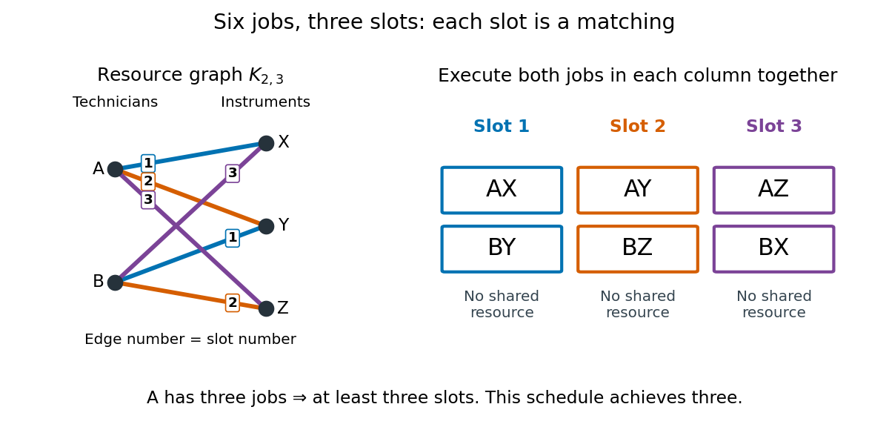

# Edge coloring as scheduling

↑ **Parent:** [Proper edge coloring](proper-edge-coloring.md)

Suppose each job occupies two distinct resources for one whole slot, and each resource can serve at most one job in that slot. Make resources [vertices](vertex-graph-theory.md) and jobs [edges](edge-of-a-graph.md). Two jobs conflict exactly when their [edges](edge-of-a-graph.md) share a [vertex](vertex-graph-theory.md), so a valid schedule is a [proper edge colouring](proper-edge-coloring.md). Each slot is a [matching in a graph](matching-graph-theory-split.md); the [chromatic index](chromatic-index.md) is the minimum number of slots. The colour labels specify the slots, rather than physical colours. This model assumes all jobs are available initially, with equal duration, interchangeable slots and no additional conflicts. The school-timetable motivation in [Graph Theory by Reinhard Diestel](graph-theory-by-reinhard-diestel.md) (author-hosted Colouring preview, opening paragraphs, pp. 123–124) uses this resource-pair interpretation.

Here is a complete example. Two technicians $A,B$ must each use three instruments $X,Y,Z$ once. Each job needs its technician and its instrument simultaneously. The six jobs are the [edges](edge-of-a-graph.md) of the [complete bipartite graph](complete-bipartite-graph.md) $K_{2,3}$:

$$
E=\{AX,AY,AZ,BX,BY,BZ\},\qquad
M_1=\{AX,BY\},\quad M_2=\{AY,BZ\},\quad M_3=\{AZ,BX\}.
$$

Within each $M_i$, the two jobs use different technicians and different instruments, so $M_i$ is a [matching in a graph](matching-graph-theory-split.md). The three [matchings in a graph](matching-graph-theory-split.md) together cover every job exactly once. Technician $A$ has three jobs, so fewer than three slots cannot suffice; the displayed schedule uses three. This is an optimal [proper edge colouring](proper-edge-coloring.md) with [chromatic index](chromatic-index.md) three, witnessed by both a schedule and a resource-workload lower bound.

**[Figure 2](#image-six-jobs-on-a-complete-bipartite-graph-become-three-scheduling-slots-each-a-matching-in-a-graph). Six jobs on a complete bipartite graph become three scheduling slots, each a matching in a graph**. The [vertices](vertex-graph-theory.md) are resources, and each numbered [edge](edge-of-a-graph.md) is one job. The slot table uses the same colour labels as the [proper edge colouring](proper-edge-coloring.md). A technician or instrument appears at most once within a column. Crossings of drawn [edges](edge-of-a-graph.md) introduce no resource and no conflict.

Repeated jobs requiring the same resource pair become distinct parallel [edges](edge-of-a-graph.md) of a [multigraph](multigraph.md), rather than one [edge](edge-of-a-graph.md). Additional restrictions change the problem: prescribed allowed slots lead to [list edge coloring](list-edge-coloring.md), while unequal durations, deadlines, or jobs needing more than two resources require a richer [scheduling](scheduling.md) model. Selecting a largest [matching in a graph](matching-graph-theory-split.md) solves a single-round question; a shortest complete schedule must organize all jobs across rounds.

## ↑ Ancestors (8)

1. [Proper edge coloring](proper-edge-coloring.md)
2. [Edge coloring](edge-coloring.md)
3. [Graph coloring](graph-coloring-split.md)
4. [Graph theory](graph-theory-split.md)
5. [Foundations of mathematics](foundations-of-mathematics-split.md)
6. [Area of mathematics](area-of-mathematics.md)
7. [Mathematics](mathematics-split.md)
8. [Codex Wiki](split.md)
