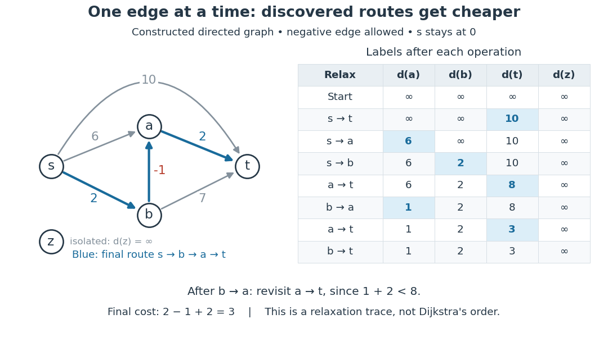

# Edge relaxation

↑ **Parent:** [Dijkstra algorithm](dijkstra-algorithm.md)

Edge relaxation tests whether extending a recorded route by one [directed edge](directed-edge.md) improves a [tentative distance](tentative-distance.md). For a single source $s$ and an original [directed edge](directed-edge.md) $u\to v$ of weight $w_{uv}$, form the candidate $q=d(u)+w_{uv}$. If $d(u)$ is finite and $q<d(v)$, replace $d(v)$ by $q$ and record the [shortest-path predecessor](shortest-path-predecessor.md) $\pi(v)=u$. Otherwise leave both unchanged. The [minimum](minimum-of-a-subset-of-a-total-order.md) formula in the header gives the resulting label in either case. The authored implementation uses this strict comparison and records the incoming [directed edge](directed-edge.md).[Sedgewick and Wayne, DijkstraSP.java, relax method](https://raw.githubusercontent.com/kevin-wayne/algs4/master/src/main/java/edu/princeton/cs/algs4/DijkstraSP.java)

**[Figure 6](#image-edge-relaxation-lowers-discovered-route-costs-including-across-a-negative-weight-directed-edge). Edge relaxation lowers discovered-route costs, including across a negative-weight directed edge**.

The table lists labels _after_ each specified operation, keeping $d(s)=0$ throughout this constructed acyclic [graph](graph-split.md). Relaxing $a\to t$ first offers $6+2=8$. Relaxing $b\to a$ then offers $2-1=1$, lowering $a$ from $6$ to $1$; revisiting $a\to t$ now offers $1+2=3$. Finally $b\to t$ offers $2+7=9$, so the label $3$ stays. Changing a label can make a previously checked outgoing [directed edge](directed-edge.md) worth checking again. This trace illustrates the operation itself, with a deliberately specified order, rather than a run of the [Dijkstra algorithm](dijkstra-algorithm.md).

A single [edge relaxation](edge-relaxation.md) does not require nonnegative weights: its candidate is the cost of a real extended [directed walk](directed-walk.md), even when the last [directed edge](directed-edge.md) has negative weight. Nonnegative weights are needed by the [Dijkstra algorithm](dijkstra-algorithm.md) to make its selected minimum [tentative distance](tentative-distance.md) permanent. The [Bellman-Ford algorithm](bellman-ford-algorithm.md) permits negative weights and revisits labels; its authored implementation also checks for reachable negative-cost [directed cycles](directed-cycle.md).[Sedgewick and Wayne, DijkstraSP.java, nonnegative-weight precondition](https://raw.githubusercontent.com/kevin-wayne/algs4/master/src/main/java/edu/princeton/cs/algs4/DijkstraSP.java)[Algorithms, 4th edition by Robert Sedgewick and others; Sedgewick and Wayne, BellmanFordSP.java, signed weights and cycle detection](algorithms-4th-edition-by-robert-sedgewick-and-others/bellmanfordsp-java.md)

For the all-to-one convention of the [Bellman inequalities](bellman-inequalities.md), relax the same original [directed edge](directed-edge.md) $i\to j$ by $d_i\gets\min\{d_i,c_{ij}+d_j\}$. This prepends $i\to j$ to a discovered route from $j$ to $r$, and improves the tail label $d_i$, not the head label $d_j$. Skip the operation when $d_j=\infty$. In exact arithmetic, a full pass over all relevant [directed edges](directed-edge.md) with no improvement establishes all their [Bellman inequalities](bellman-inequalities.md); combined with the discovered-route [upper bounds](upper-bound-in-a-partially-ordered-set.md), this certifies finite distances. One unsuccessful operation establishes only that this particular candidate did not improve its label at that moment.

## ↑ Ancestors (7)

1. [Dijkstra algorithm](dijkstra-algorithm.md)
2. [Shortest path problem](shortest-path-problem-split.md)
3. [Graph theory](graph-theory-split.md)
4. [Foundations of mathematics](foundations-of-mathematics-split.md)
5. [Area of mathematics](area-of-mathematics.md)
6. [Mathematics](mathematics-split.md)
7. [Codex Wiki](split.md)

## ← Incoming links (7)

- [All-to-one Bellman-Ford recurrence](all-to-one-bellman-ford-recurrence.md)
- [Bellman-Ford algorithm](bellman-ford-algorithm.md)
- [Bellman inequalities](bellman-inequalities.md)
- [Dijkstra algorithm](dijkstra-algorithm.md)
- [Edge relaxation](edge-relaxation.md)
- [Shortest-path predecessor](shortest-path-predecessor.md)
- [Tentative distance](tentative-distance.md)
