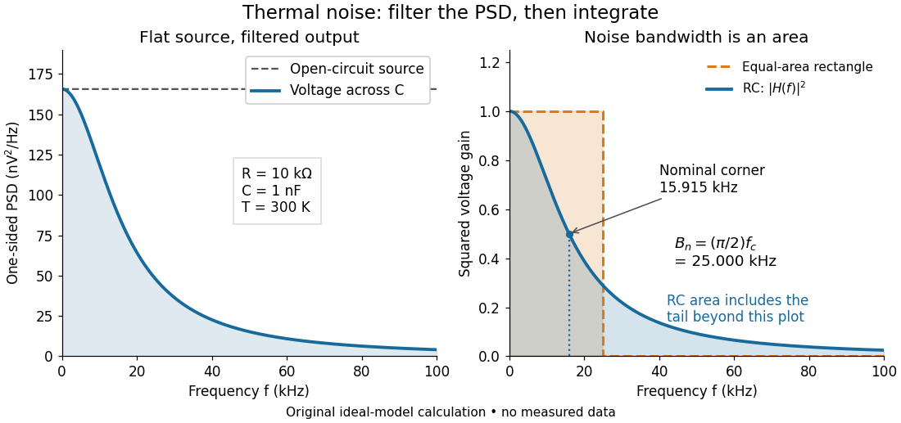

# Effective noise bandwidth

↑ **Parent:** [Thermal electrical noise](thermal-electrical-noise.md)

For a [linear filter](linear-filter.md) with chosen nonzero reference voltage gain $H_0$, define its effective noise bandwidth by

$$
B_{\rm n}=\frac{1}{|H_0|^2}\int_0^\infty |H(f)|^2\,df.
$$

This is the width of an ideal rectangular [linear filter](linear-filter.md) with gain magnitude $|H_0|$ passing the same mean square of input [white noise](white-noise.md). Consequently

$$
v_{o,\rm rms}=|H_0|\sqrt{4k_{\rm B}TRB_{\rm n}}.
$$

Use the full voltage transfer from the [open-circuit voltage](open-circuit-voltage.md) source to the readout, including any [electrical load](electrical-load.md), when applying this formula. A nominal [signal bandwidth](signal-bandwidth.md) stated between two [cutoff frequencies](cutoff-frequency.md) does not specify the integral: gradual tails and a nonuniform passband matter. For an ideal rectangular unit-gain passband $[f_1,f_2]$, $B_{\rm n}=f_2-f_1$. For an unloaded [RC low-pass filter](rc-low-pass-filter.md) with $H_0=1$ and [cutoff frequency](cutoff-frequency.md) $f_c=1/(2\pi RC)$,

$$
B_{\rm n}=\int_0^\infty\frac{df}{1+(f/f_c)^2}
=\frac\pi2 f_c=\frac1{4RC}.
$$

The last equality follows by substituting $x=f/f_c$ and integrating $1/(1+x^2)$ as $\arctan x$. Using the nominal $f_c$ as the noise bandwidth underestimates the [variance](variance-split.md) by a factor $\pi/2$, or the [root mean square](root-mean-square.md) voltage by $\sqrt{\pi/2}$.

**[Figure 18](#image-equal-area-bandwidth-for-filtered-thermal-electrical-noise). Equal-area bandwidth for filtered thermal electrical noise**. Original analytical illustration for $T=300\,\mathrm K$, $R=10\,\mathrm{k}\Omega$, and $C=1\,\mathrm{nF}$. The left panel shows the one-sided [open-circuit voltage](open-circuit-voltage.md) [power spectral density](power-spectral-density.md) and the output spectrum of an unloaded [RC low-pass filter](rc-low-pass-filter.md). The right panel compares the squared [frequency response](frequency-response.md) with an equal-area ideal rectangular [linear filter](linear-filter.md); the shaded RC area continues beyond the plotted range. The nominal corner is $15.915\,\mathrm{kHz}$, whereas the [effective noise bandwidth](effective-noise-bandwidth.md) is $25\,\mathrm{kHz}$. Calculated curves, not measured data.

## ↑ Ancestors (6)

1. [Thermal electrical noise](thermal-electrical-noise.md)
2. [Noise (signal processing)](noise-signal-processing.md)
3. [Signal](signal.md)
4. [Signal processing](signal-processing.md)
5. [Electrical engineering](electrical-engineering-split.md)
6. [Codex Wiki](split.md)

## ← Incoming links (11)

- [Bandwidth (signal processing)](bandwidth-signal-processing.md)
- [Boxcar averaging of Poisson shot noise](boxcar-averaging-of-poisson-shot-noise.md)
- [Effective noise bandwidth](effective-noise-bandwidth.md)
- [Filtered shot noise](filtered-shot-noise.md)
- [Solution](past-exam-of-the-physics-a-course-of-the-university-of-cambridge/2015/paper-1/section-d/d13/c/solution.md)
- [Solution](past-exam-of-the-physics-a-course-of-the-university-of-cambridge/2016/paper-1/section-a/5/solution.md)
- [Solution](past-exam-of-the-physics-a-course-of-the-university-of-cambridge/2016/paper-1/section-d/d13/b/solution.md)
- [Solution](past-exam-of-the-physics-a-course-of-the-university-of-cambridge/2018/paper-1/section-d/d13/c/solution.md)
- [Solution](past-exam-of-the-physics-a-course-of-the-university-of-cambridge/2019/paper-1/section-d/d13/b/solution.md)
- [Solution](past-exam-of-the-physics-b-course-of-the-university-of-cambridge/2019/paper-2/section-c/c13/solution.md)
- [Resistor-capacitor equilibrium noise](resistor-capacitor-equilibrium-noise.md)
