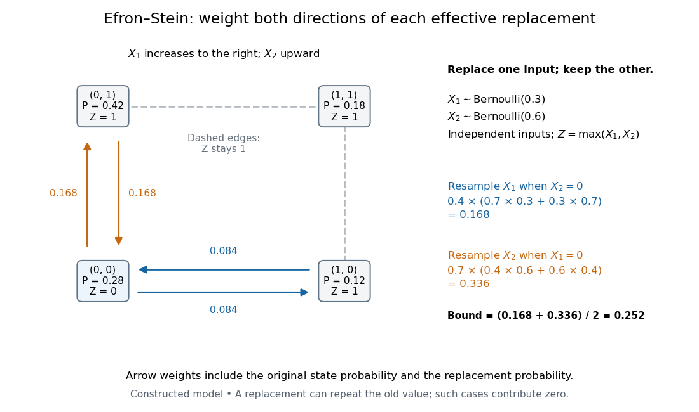
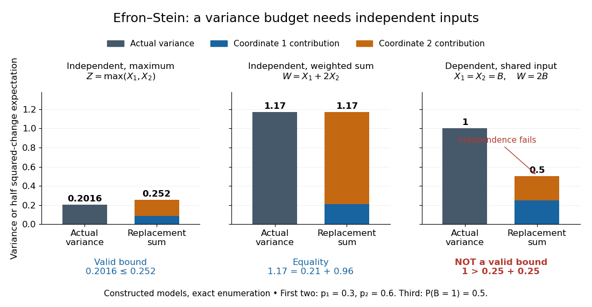

<h1 id="efron-stein-inequality">Efron–Stein inequality</h1>

↑ **Parent:** [Concentration inequality](concentration-inequality.md)  
ⓦ [Wiki](https://en.wikipedia.org/wiki/Efron–Stein_inequality)

The [Efron–Stein inequality](efron-stein-inequality.md) bounds the [variance](variance-split.md) of a complicated output by the effect of replacing one input at a time. Let $X_1,\ldots,X_n$ be mutually [independent random variables](independent-random-variables.md), not necessarily identically distributed, and $Z=f(X_1,\ldots,X_n)$ for a [measurable function](measurable-function.md) $f$, with $\mathbb E Z^2<\infty$. Take $X_1',\ldots,X_n'$ with $X_i'$ having the same [probability distribution](probability-distribution-split.md) as $X_i$, all $2n$ inputs mutually [independent](independent-random-variables.md). Define

$$
Z_i'=f(X_1,\ldots,X_{i-1},X_i',X_{i+1},\ldots,X_n).
$$

Use the same [function](function-split.md) $f$, keeping every other input fixed. Then

$$
\boxed{\operatorname{Var}(Z)\leq\frac12\sum_{i=1}^n\mathbb E[(Z-Z_i')^2].}
$$

The [expected value](expected-value-split.md) averages over both the original inputs and their replacements. An infinite right side gives a trivial bound; under the stated [square-integrable](square-integrable-function.md) condition every term is finite.[Lecture 7a: Efron Stein inequality, slides 1–2 and 7, PDF pp. 2–3 and 8: independent inputs, conditional-variance bound and independent-copy form](lecture-7a-efron-stein-inequality-by-purnamrita-sarkar.md)

For a concrete four-state example, take [independent](independent-random-variables.md) [Bernoulli random variables](bernoulli-distribution.md) with $\mathbb P(X_1=1)=0.3$ and $\mathbb P(X_2=1)=0.6$, and set $Z=\max\{X_1,X_2\}$. This output records whether either input is one. The states $(0,0),(1,0),(0,1),(1,1)$ have respective [probabilities](probability.md) $0.28,0.12,0.42,0.18$, so

$$
\mathbb P(Z=1)=0.72,\qquad \operatorname{Var}(Z)=0.72(1-0.72)=0.2016.
$$

Replacing $X_1$ changes $Z$ only when $X_2=0$ and $X_1'\ne X_1$. A fresh [Bernoulli](bernoulli-distribution.md) draw can repeat the old value: the replacement is not a forced flip. By [independence](independent-random-variables.md), the [expected value](expected-value-split.md) of the squared change is

$$
\mathbb E[(Z-Z_1')^2]=0.4\,[0.7(0.3)+0.3(0.7)]=0.168.
$$

Similarly,

$$
\mathbb E[(Z-Z_2')^2]=0.7\,[0.4(0.6)+0.6(0.4)]=0.336.
$$

Thus [Efron–Stein inequality](efron-stein-inequality.md) gives $0.2016\leq(0.168+0.336)/2=0.252$. The larger second contribution reflects both its replacement [probability](probability.md) and how often the other input leaves the output sensitive to it.

**[Figure 8](#image-four-weighted-states-explain-the-efron-stein-inequality-resampling-contributions). Four weighted states explain the Efron–Stein inequality resampling contributions**. Original constructed model: [independent](independent-random-variables.md) [Bernoulli random variables](bernoulli-distribution.md) with parameters $0.3$ and $0.6$, and $Z=\max\{X_1,X_2\}$. Each node shows its joint [probability](probability.md). Directed arrow labels are joint [probabilities](probability.md) of the original state and replacement value, rather than conditional transition probabilities. Only solid edges change $Z$; same-state replacements and the dashed edges contribute zero. Both directions count before the factor $1/2$.

For the same inputs, consider instead $W=X_1+2X_2$. The [variance of a sum](variance-of-a-sum.md) of [independent random variables](independent-random-variables.md) gives

$$
\operatorname{Var}(W)=0.3(0.7)+4(0.6)(0.4)=1.17.
$$

Here $\mathbb E[(W-W_1')^2]=0.42$ and $\mathbb E[(W-W_2')^2]=1.92$, so the [Efron–Stein inequality](efron-stein-inequality.md) is exact: $(0.42+1.92)/2=1.17$. More generally, for $W=c+\sum_i g_i(X_i)$ with [square-integrable](square-integrable-function.md) summands, each contribution $\frac12\mathbb E[(W-W_i')^2]$ equals $\operatorname{Var}(g_i(X_i))$ and these [variances](variance-split.md) add exactly.

**[Independence](independent-random-variables.md) is essential.** Let $X_1=X_2=B$ for a single [Bernoulli random variable](bernoulli-distribution.md) with parameter $1/2$, and take $W=X_1+X_2=2B$. Its [variance](variance-split.md) is one. If each coordinate is nevertheless replaced by an [independent](independent-random-variables.md) draw from its marginal [Bernoulli distribution](bernoulli-distribution.md), each squared-change [expected value](expected-value-split.md) is $1/2$, giving the false proposed upper bound $1/2$. Replacement now creates off-diagonal states $(0,1)$ and $(1,0)$ that the original input never visits. The original coordinates fail the hypothesis of [Efron–Stein inequality](efron-stein-inequality.md).

**[Figure 9](#image-the-efron-stein-inequality-can-be-loose-exact-or-inapplicable-when-independence-fails). The Efron–Stein inequality can be loose, exact, or inapplicable when independence fails**. Exact enumeration in three constructed models: the four-state maximum has [variance](variance-split.md) $0.2016$ and bound $0.252$; the weighted [sum](sum.md) on the same [independent](independent-random-variables.md) inputs has [variance](variance-split.md) and bound $1.17$; the dependent model $X_1=X_2=B$ has [variance](variance-split.md) one but marginal replacement produces $0.5$, which is not a valid bound. Stacked contributions are half the squared-change [expected values](expected-value-split.md). The third panel deliberately violates the theorem's assumption.

The attraction is local calculation: a [function](function-split.md) may involve many inputs, yet changing one can have a simple effect. Each half squared-change [expected value](expected-value-split.md) supplies a coordinate's contribution to an upper budget for the total [variance](variance-split.md). Applying [Chebyshev's inequality](chebyshev-s-inequality.md) then bounds a [tail probability](tail-probability.md) using that budget. These contributions need not partition the actual [variance](variance-split.md), as the maximum example shows.

The name commemorates [Bradley Efron](bradley-efron.md) and [Charles M. Stein](charles-m-stein.md). Their 1981 paper [The Jackknife Estimate of Variance](https://projecteuclid.org/journals/annals-of-statistics/volume-9/issue-3/The-Jackknife-Estimate-of-Variance/10.1214/aos/1176345462.full) appeared in The Annals of Statistics, volume 9, issue 3, pp. 586–596.[Publications: The Jackknife Estimate of Variance, Efron and Stein, 1981, 9(3), 586–596](bradley-efron-s-profile-stanford-university.md)

**Table of contents**

- [Variance tensorization](variance-tensorization.md)

## ↑ Ancestors (7)

1. [Concentration inequality](concentration-inequality.md)
2. [Probability inequality](probability-inequality-split.md)
3. [Probability theory](probability-theory-split.md)
4. [Probability and statistics](probability-and-statistics-split.md)
5. [Area of mathematics](area-of-mathematics.md)
6. [Mathematics](mathematics-split.md)
7. [Codex Wiki](split.md)

## ← Incoming links (7)

- [Efron–Stein inequality](efron-stein-inequality.md)
- [Solution](past-exam-of-the-mathematics-course-of-the-university-of-cambridge/2022/iii/paper-208/2/a/solution.md)
- [Solution](past-exam-of-the-mathematics-course-of-the-university-of-cambridge/2022/iii/paper-208/2/b/solution.md)
- [Solution](past-exam-of-the-mathematics-course-of-the-university-of-cambridge/2022/iii/paper-208/2/d/solution.md)
- [Solution](past-exam-of-the-mathematics-course-of-the-university-of-cambridge/2023/iii/paper-208/4/a/solution.md)
- [Solution](past-exam-of-the-mathematics-course-of-the-university-of-cambridge/2024/iii/paper-208/4/b/solution.md)
- [Variance tensorization](variance-tensorization.md)
