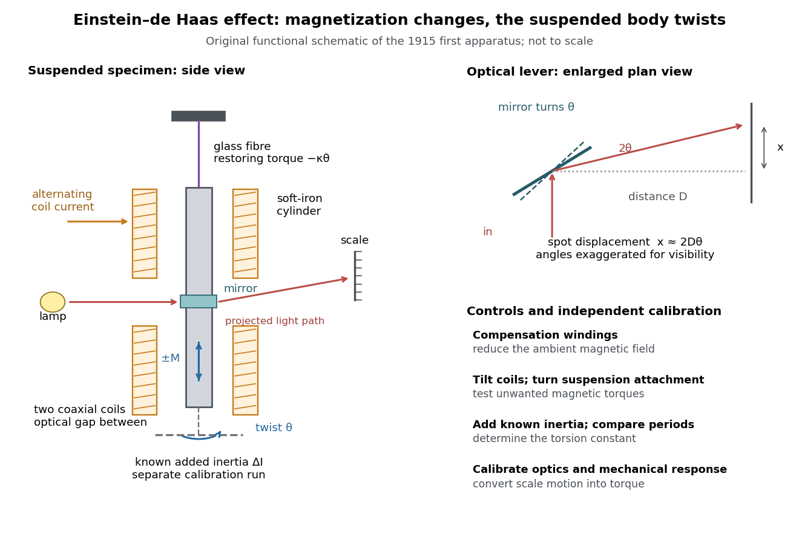

# Einstein-de Haas experiment

↑ **Parent:** [Einstein-de Haas effect](einstein-de-haas-effect.md)

In 1915, [Albert Einstein](albert-einstein.md) and [Wander Johannes de Haas](wander-johannes-de-haas.md) suspended a soft-[iron](iron.md) cylinder by glass fibre between coaxial coils. Alternating [magnetization](magnetization.md) drove torsional [resonance](resonance.md); a mirror reflected lamplight onto a scale. They compensated Earth's [magnetic field](magnetic-field-split.md), tilted the coils, and rotated the suspension attachment to test unwanted [magnetic dipole torques](magnetic-dipole-torque.md). Added known [moment of inertia](moment-of-inertia.md) calibrated the mechanical response.[§§4–5, pp. 702–706: apparatus, controls, calibration](experimental-proof-of-the-existence-of-ampere-s-molecular-currents-by-albert-einstein-and-wander-johannes-de-haas.md)

**[Figure 12](#image-einstein-de-haas-experiment-suspended-magnet-drive-and-optical-readout). Einstein-de Haas experiment: suspended magnet, drive and optical readout**. Original functional schematic of the first apparatus, rather than a scale reconstruction. The split coaxial coils leave an optical gap. The enlarged plan view explains the [optical lever](optical-lever.md); the calibration bar is attached for a separate calibration run. Compensation windings are represented by their function.

Their paper acknowledges a failed [phase](phase-waves.md) determination and claims only ten-percent precision for the revised measurement. Its agreement with the orbital [gyromagnetic ratio](gyromagnetic-ratio.md) prediction was not a direct discovery of [spin](spin.md).[§6, pp. 706–707: phase failure; §7, pp. 707–711: resonance, precision](experimental-proof-of-the-existence-of-ampere-s-molecular-currents-by-albert-einstein-and-wander-johannes-de-haas.md) Comparing that orbital [gyromagnetic ratio](gyromagnetic-ratio.md) prediction with the [electron spin g-factor](electron-spin-g-factor.md) explains why a successful qualitative demonstration of [angular momentum](angular-momentum.md) transfer can coexist with an inadequate quantitative interpretation. The stated precision is the authors' estimate; it does not establish that all [systematic errors](systematic-error.md) were bounded by that amount.

The general control problem follows directly from the model. Unwanted [magnetic dipole torque](magnetic-dipole-torque.md) can drive the same mechanical [resonance](resonance.md) as the desired reaction [torque](torque.md). In the ideal geometry $m_z$ and $B_z$ alone produce no axial [cross product](cross-product.md), but transverse [magnetic dipole moments](magnetic-dipole-moment.md), stray transverse [magnetic fields](magnetic-field-split.md) and imperfect alignment can. Nulling stray [magnetic fields](magnetic-field-split.md) and deliberately varying alignment test this contribution. Merely observing a large resonant twist cannot identify its cause.

For a nearly instantaneous magnetic response, a sinusoidal [magnetization](magnetization.md) makes $m_z$ follow the drive while $-\dot m_z/\gamma$ is in [phase quadrature](phase-quadrature.md). An ordinary magnetic contribution proportional to $m_z$ is then distinguishable by [phase](phase-waves.md), after removing the mechanical [frequency response](frequency-response.md). [Hysteresis](hysteresis.md) or delayed magnetic response can spoil this simple separation. The measured [magnetization](magnetization.md), rather than the coil [electric current](electric-current.md) alone, must set the reference. Mechanical vibration, [magnetostriction](magnetostriction.md) coupled through imperfect geometry, and changing suspension properties require separate checks; none is eliminated simply by reversing the coil [electric current](electric-current.md).

## ↑ Ancestors (7)

1. [Einstein-de Haas effect](einstein-de-haas-effect.md)
2. [Magnetic dipole moment](magnetic-dipole-moment.md)
3. [Magnetic vector potential](magnetic-vector-potential.md)
4. [Electromagnetism](electromagnetism-split.md)
5. [Branches of physics](branches-of-physics.md)
6. [Physics](physics-split.md)
7. [Codex Wiki](split.md)

## ← Incoming links (1)

- [Einstein-de Haas experiment](einstein-de-haas-experiment.md)
