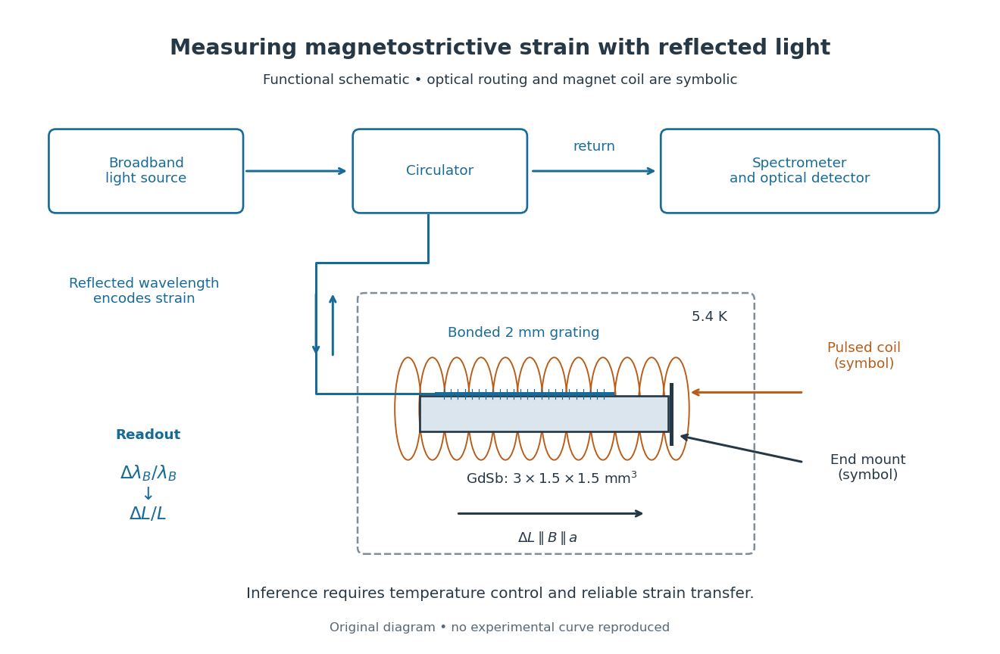
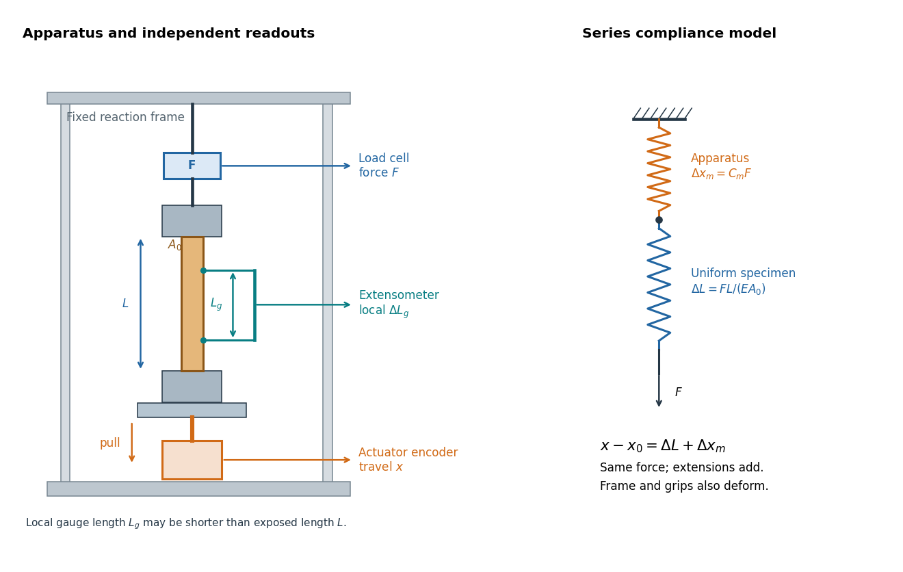

# Elasticity (physics)

↑ **Parent:** [Continuum mechanics](continuum-mechanics.md)  
ⓦ [Wiki](https://en.wikipedia.org/wiki/Elasticity_(physics))

Elasticity studies reversible deformation and the stresses produced by it.

**Table of contents**

- [Elastic modulus](#elastic-modulus)
- [Buckling](#buckling)
  - [Buckling of a synthetic film](#buckling-of-a-synthetic-film)
- [Eigenstrain](#eigenstrain)
- [Magnetoelastic coupling](#magnetoelastic-coupling)
- [Elastic deformation](#elastic-deformation)
- [Perfectly bonded elastic interface](#perfectly-bonded-elastic-interface)
  - [Torsion and tilt stiffness of a bonded elastic disk](#torsion-and-tilt-stiffness-of-a-bonded-elastic-disk)
- [Static elastic equilibrium](#static-elastic-equilibrium)
- [Elastic beam](#elastic-beam)
  - [Euler strut](#euler-strut)
  - [Euler elastica](#euler-elastica)
    - [Tensile elastica loop](#tensile-elastica-loop)
  - [Cantilever](#cantilever)
    - [Self-weight deflection of a square cantilever](#self-weight-deflection-of-a-square-cantilever)
- [Dead loading](#dead-loading)
- [Magnetostriction](#magnetostriction)
  - [Strain-mediated magnetoelectric coupling](#strain-mediated-magnetoelectric-coupling)
  - [Magnetostrictive actuator](#magnetostrictive-actuator)
  - [Magnetostrictive strain](#magnetostrictive-strain)
    - [Volume magnetostriction](#volume-magnetostriction)
    - [Saturation magnetostriction](#saturation-magnetostriction)
  - [Isotropic linear magnetostriction vanishes](#isotropic-linear-magnetostriction-vanishes)
  - [Saturated isotropic magnetostrictive strain](#saturated-isotropic-magnetostrictive-strain)
    - [Magnetic reversal and domain averaging](#magnetic-reversal-and-domain-averaging)
  - [Pulsed-field optical magnetostriction experiment](#pulsed-field-optical-magnetostriction-experiment)
  - [Quadratic magnetostriction and frequency doubling](#quadratic-magnetostriction-and-frequency-doubling)
  - [Free strain and blocked magnetostrictive stress](#free-strain-and-blocked-magnetostrictive-stress)
- [Betti identity for elastodynamic fields](#betti-identity-for-elastodynamic-fields)
- [Shear modulus](#shear-modulus)
- [Finite elasticity](#finite-elasticity)
  - [Inflation and extension of an incompressible tube](#inflation-and-extension-of-an-incompressible-tube)
  - [Constrained second-variation stability in elasticity](#constrained-second-variation-stability-in-elasticity)
  - [Torque and axial force of a twisted incompressible cylinder](#torque-and-axial-force-of-a-twisted-incompressible-cylinder)
    - [Nominal end traction of a twisted neo-Hookean cylinder](#nominal-end-traction-of-a-twisted-neo-hookean-cylinder)
  - [Twist and inflation of an incompressible tube](#twist-and-inflation-of-an-incompressible-tube)
    - [Neo-Hookean tube pressure under twist and inflation](#neo-hookean-tube-pressure-under-twist-and-inflation)
  - [Inextensible fibre constraint](#inextensible-fibre-constraint)
    - [Two-family inextensible-fibre pure stretch](#two-family-inextensible-fibre-pure-stretch)
    - [Incompressible inextensible-fibre plane strain](#incompressible-inextensible-fibre-plane-strain)
      - [Triangular equilibrium construction for inextensible-fibre plane strain](#triangular-equilibrium-construction-for-inextensible-fibre-plane-strain)
  - [Hyperelastic material](#hyperelastic-material)
    - [Compatibility condition for pure nonlinear transverse waves](#compatibility-condition-for-pure-nonlinear-transverse-waves)
      - [Compatible nonlinear shear energy](#compatible-nonlinear-shear-energy)
    - [Saint Venant–Kirchhoff hyperelastic energy](#saint-venant-kirchhoff-hyperelastic-energy)
    - [Lamé parameters from hyperelastic energy Hessian](#lame-parameters-from-hyperelastic-energy-hessian)
    - [Inflation pressure of a thin incompressible elastic balloon](#inflation-pressure-of-a-thin-incompressible-elastic-balloon)
    - [Incremental elastic moduli](#incremental-elastic-moduli)
      - [Elastic normal-mode energy identity](#elastic-normal-mode-energy-identity)
      - [Strong ellipticity in elasticity](#strong-ellipticity-in-elasticity)
      - [Acoustic tensor](#acoustic-tensor)
        - [Strong ellipticity](#strong-ellipticity)
    - [Constraint reaction in hyperelastic stress](#constraint-reaction-in-hyperelastic-stress)
      - [Equibiaxial nominal tension of an incompressible sheet](#equibiaxial-nominal-tension-of-an-incompressible-sheet)
    - [Mooney-Rivlin solid](#mooney-rivlin-solid)
    - [Neo-Hookean solid](#neo-hookean-solid)
      - [Homogeneous tensile bifurcation of a neo-Hookean cube](#homogeneous-tensile-bifurcation-of-a-neo-hookean-cube)
    - [Strain energy density](#strain-energy-density)
      - [Nonnegative isotropic elastic strain energy](#nonnegative-isotropic-elastic-strain-energy)
  - [Material isotropy](#material-isotropy)
    - [Coaxiality of isotropic elastic stress](#coaxiality-of-isotropic-elastic-stress)
      - [Equivariance of isotropic principal stresses](#equivariance-of-isotropic-principal-stresses)
      - [Universal simple-shear normal-stress identity](#universal-simple-shear-normal-stress-identity)
- [Elastic filament](#elastic-filament)
  - [Filament torsional stiffness](#filament-torsional-stiffness)
  - [Intrinsic curvature of an elastic filament](#intrinsic-curvature-of-an-elastic-filament)
    - [Free-end curvature boundary layer](#free-end-curvature-boundary-layer)
    - [Force-extension of an intrinsically curved filament](#force-extension-of-an-intrinsically-curved-filament)
      - [Smooth-curvature high-force extension law](#smooth-curvature-high-force-extension-law)
    - [Quenched intrinsic curvature](#quenched-intrinsic-curvature)
  - [Spatially varying tension in filament bending](#spatially-varying-tension-in-filament-bending)
  - [Thermal covariance of an elastic filament](#thermal-covariance-of-an-elastic-filament)
    - [Rigid-motion-projected thermal covariance of a free filament](#rigid-motion-projected-thermal-covariance-of-a-free-filament)
      - [Curvature-noise representation of a free filament](#curvature-noise-representation-of-a-free-filament)
      - [Free-filament variance with fixed translation and tilt](#free-filament-variance-with-fixed-translation-and-tilt)
    - [Zero-energy filament mode](#zero-energy-filament-mode)
  - [Clamped--clamped bending mode](#clamped-clamped-bending-mode)
  - [Self-adjoint endpoint conditions for filament bending](#self-adjoint-endpoint-conditions-for-filament-bending)
    - [Free-end bending boundary conditions](#free-end-bending-boundary-conditions)
      - [Free-free bending spectrum](#free-free-bending-spectrum)
        - [Stable characteristic equation for free-free bending modes](#stable-characteristic-equation-for-free-free-bending-modes)
  - [Tip-force compliance of a cantilever](#tip-force-compliance-of-a-cantilever)
- [Elastic energy](#elastic-energy)
  - [Minimum potential energy principle in elasticity](#minimum-potential-energy-principle-in-elasticity)
- [Linear elasticity](#linear-elasticity)
  - [Elasticity tensor](#elasticity-tensor)
  - [Uniaxial strain modulus](#uniaxial-strain-modulus)
  - [Area expansion under uniaxial compression](#area-expansion-under-uniaxial-compression)
  - [Radial equilibrium of a thick elastic cylinder](#radial-equilibrium-of-a-thick-elastic-cylinder)
    - [Lamé stress distribution in a pressurized cylindrical wall](#lame-stress-distribution-in-a-pressurized-cylindrical-wall)
  - [Plane stress](#plane-stress)
  - [Isotropic elastic modulus relation](#isotropic-elastic-modulus-relation)
  - [Proportional limit](#proportional-limit)
  - [Mean stress and strain boundary identities](#mean-stress-and-strain-boundary-identities)
    - [Equilibrium contraction of a self-gravitating elastic sphere](#equilibrium-contraction-of-a-self-gravitating-elastic-sphere)
  - [Elastic strain Green operator](#elastic-strain-green-operator)
    - [Isotropic elastic strain Green kernel](#isotropic-elastic-strain-green-kernel)
      - [Constant-shear bulk-modulus inclusion](#constant-shear-bulk-modulus-inclusion)
    - [Directional elastic strain Green operator](#directional-elastic-strain-green-operator)
    - [Elastic polarization](#elastic-polarization)
  - [Bulk modulus](#bulk-modulus)
    - [Hydrostatic volume strain from Young's modulus and Poisson's ratio](#hydrostatic-volume-strain-from-young-s-modulus-and-poisson-s-ratio)
    - [Adiabatic bulk modulus](#adiabatic-bulk-modulus)
  - [Antiplane shear](#antiplane-shear)
    - [Steadily moving antiplane shear](#steadily-moving-antiplane-shear)
    - [Complex stress potential for antiplane shear](#complex-stress-potential-for-antiplane-shear)
      - [Hilbert problem for an antiplane crack](#hilbert-problem-for-an-antiplane-crack)
        - [Cauchy solution for a steadily moving semi-infinite antiplane crack](#cauchy-solution-for-a-steadily-moving-semi-infinite-antiplane-crack)
          - [Homogeneous stress-intensity field of a semi-infinite antiplane crack](#homogeneous-stress-intensity-field-of-a-semi-infinite-antiplane-crack)
        - [Antiplane ligament Cauchy solution](#antiplane-ligament-cauchy-solution)
        - [Finite antiplane crack Cauchy solution](#finite-antiplane-crack-cauchy-solution)
  - [Elastic stiffness tensor](#elastic-stiffness-tensor)
    - [Independent elastic stiffness counts](#independent-elastic-stiffness-counts)
      - [Twofold elastic symmetry](#twofold-elastic-symmetry)
  - [Bending moment](#bending-moment)
    - [Neutral axis](#neutral-axis)
  - [Elastic membrane](#elastic-membrane)
    - [Equal-phase two-wave membrane modes](#equal-phase-two-wave-membrane-modes)
      - [Evanescent membrane response below cutoff](#evanescent-membrane-response-below-cutoff)
  - [Euler-Bernoulli beam equation](#euler-bernoulli-beam-equation)
    - [Simply supported beam normal modes](#simply-supported-beam-normal-modes)
      - [Initial curvature incompatibility at a moment-free beam end](#initial-curvature-incompatibility-at-a-moment-free-beam-end)
    - [Clamped-beam Green function](#clamped-beam-green-function)
      - [Reciprocity of the clamped-beam Green function](#reciprocity-of-the-clamped-beam-green-function)
    - [Euler's critical load](#euler-s-critical-load)
      - [Initially curved compressed beam](#initially-curved-compressed-beam)
        - [Sinusoidal imperfection amplification of a column](#sinusoidal-imperfection-amplification-of-a-column)
    - [Compressed Euler-Bernoulli beam and its endpoint-dependent buckling threshold](#compressed-euler-bernoulli-beam-and-its-endpoint-dependent-buckling-threshold)
    - [Schrodinger factorization of the elastic beam equation](#schrodinger-factorization-of-the-elastic-beam-equation)
  - [Second moment of area](#second-moment-of-area)
    - [Polar second moment of area](#polar-second-moment-of-area)
    - [Rectangular section second moment of area](#rectangular-section-second-moment-of-area)
  - [Poisson's ratio](#poisson-s-ratio)
  - [Young's modulus](#young-s-modulus)
    - [Centrifugal strain of a thin elastic hoop](#centrifugal-strain-of-a-thin-elastic-hoop)
    - [Tensile modulus experiment](#tensile-modulus-experiment)
      - [Machine compliance](#machine-compliance)
        - [Two-length machine compliance separation](#two-length-machine-compliance-separation)
          - [Worked two-length tensile compliance example](#worked-two-length-tensile-compliance-example)
      - [Linear reversibility and yield in tensile tests](#linear-reversibility-and-yield-in-tensile-tests)
  - [Fracture toughness](#fracture-toughness)
    - [Griffith fracture criterion](#griffith-fracture-criterion)
    - [Energy release rate](#energy-release-rate)
      - [Critical energy release rate](#critical-energy-release-rate)
    - [Leak-before-break criterion](#leak-before-break-criterion)
      - [Yield-limited leak-before-break thickness](#yield-limited-leak-before-break-thickness)
    - [Strain energy release rate](#strain-energy-release-rate)
    - [Crack-tip plastic zone](#crack-tip-plastic-zone)
    - [Stress intensity factor](#stress-intensity-factor)
    - [Intergranular fracture](#intergranular-fracture)
    - [Cleavage fracture](#cleavage-fracture)
    - [Ductile-to-brittle transition](#ductile-to-brittle-transition)
  - [Hooke's law](#hooke-s-law)
    - [Transverse stiffness of a stretched spring](#transverse-stiffness-of-a-stretched-spring)
    - [Zero-natural-length spring](#zero-natural-length-spring)
    - [Spring](#spring)
      - [Zero-rest-length spring](#zero-rest-length-spring)
      - [Series and parallel spring stiffness](#series-and-parallel-spring-stiffness)
      - [Central spring stiffness matrix](#central-spring-stiffness-matrix)
      - [Torsion spring](#torsion-spring)
        - [Torsion of a solid circular shaft](#torsion-of-a-solid-circular-shaft)
      - [Spring constant](#spring-constant)
  - [Elastic plate](#elastic-plate)
    - [Line-forced fluid-loaded bending plate](#line-forced-fluid-loaded-bending-plate)
    - [Flexural wave](#flexural-wave)
      - [Flexural-gravity wave](#flexural-gravity-wave)
        - [Elastic-cover frequency ratio for water waves](#elastic-cover-frequency-ratio-for-water-waves)
        - [Minimum phase speed of a flexural-gravity wave](#minimum-phase-speed-of-a-flexural-gravity-wave)
        - [Dispersion relation of a floating elastic plate](#dispersion-relation-of-a-floating-elastic-plate)
        - [Group-velocity minimum of a flexural-gravity wave](#group-velocity-minimum-of-a-flexural-gravity-wave)
    - [Viscous peeling of an elastic plate](#viscous-peeling-of-an-elastic-plate)
    - [Axisymmetric clamped-plate deflection](#axisymmetric-clamped-plate-deflection)
    - [Bending stiffness](#bending-stiffness)
  - [Nondegenerate one-dimensional elastic material](#nondegenerate-one-dimensional-elastic-material)
  - [Displacement field (mechanics)](#displacement-field-mechanics)
    - [Lagrangian fluid displacement](#lagrangian-fluid-displacement)
    - [Displacement gradient tensor](#displacement-gradient-tensor)
  - [Lamé parameter](#lame-parameter)
    - [Poisson solid](#poisson-solid)
  - [Isotropic linear-elastic energy density](#isotropic-linear-elastic-energy-density)
  - [Navier-Cauchy equation](#navier-cauchy-equation)
    - [Uniform extension of a one-dimensional elastic body](#uniform-extension-of-a-one-dimensional-elastic-body)
  - [Elastic wave in an isotropic solid](#elastic-wave-in-an-isotropic-solid)
    - [Shear-horizontal wave](#shear-horizontal-wave)
      - [SH input impedance](#sh-input-impedance)
        - [SH impedance Riccati equation](#sh-impedance-riccati-equation)
          - [Uniform-layer SH impedance update](#uniform-layer-sh-impedance-update)
            - [Reflection from a layered SH impedance](#reflection-from-a-layered-sh-impedance)
          - [Complex-frequency SH flux monotonicity](#complex-frequency-sh-flux-monotonicity)
      - [Causal vertical wavenumber branch](#causal-vertical-wavenumber-branch)
      - [Guided shear-horizontal mode](#guided-shear-horizontal-mode)
    - [Mode conversion at a planar elastic interface](#mode-conversion-at-a-planar-elastic-interface)
      - [Solid-fluid P-wave transmission coefficient](#solid-fluid-p-wave-transmission-coefficient)
      - [Snell law for elastic and acoustic waves](#snell-law-for-elastic-and-acoustic-waves)
    - [Acoustic impedance](#acoustic-impedance)
      - [Normal acoustic impedance](#normal-acoustic-impedance)
        - [Surface acoustic impedance](#surface-acoustic-impedance)
          - [Passive acoustic impedance](#passive-acoustic-impedance)
      - [Acoustic transmission through a uniform layer](#acoustic-transmission-through-a-uniform-layer)
        - [Coherent acoustic layer above a rough reflector](#coherent-acoustic-layer-above-a-rough-reflector)
      - [Displacement reflection from an interface between two inviscid elastic liquids](#displacement-reflection-from-an-interface-between-two-inviscid-elastic-liquids)
- [Elastic-wave energy flux](#elastic-wave-energy-flux)
  - [P-SV directional impedance matrix](#p-sv-directional-impedance-matrix)
    - [P-SV characteristic reconstruction](#p-sv-characteristic-reconstruction)
  - [Reflection of an SV-wave from a rigid plane](#reflection-of-an-sv-wave-from-a-rigid-plane)
    - [Evanescent reflected P-wave at a rigid plane](#evanescent-reflected-p-wave-at-a-rigid-plane)
      - [Unit-modulus SV reflection with evanescent P conversion](#unit-modulus-sv-reflection-with-evanescent-p-conversion)
    - [Rigid boundary condition for an elastic wave](#rigid-boundary-condition-for-an-elastic-wave)
  - [Wavevector](#wavevector)
    - [Hamiltonian ray-tracing equations](#hamiltonian-ray-tracing-equations)
      - [WKB method](#wkb-method)
        - [Eikonal equation](#eikonal-equation)
      - [Total derivative along a ray](#total-derivative-along-a-ray)
  - [Evanescent wave](#evanescent-wave)

## Elastic modulus

↑ **Parent:** [Elasticity (physics)](elasticity-physics.md)  
ⓦ [Wiki](https://en.wikipedia.org/wiki/Elastic_modulus)

A coefficient relating an appropriate stress and strain in the linear elastic regime. [Young's modulus](#young-s-modulus), [shear modulus](#shear-modulus) and [bulk modulus](#bulk-modulus) describe different deformation modes.

## Buckling

↑ **Parent:** [Elasticity (physics)](elasticity-physics.md)

Loss of stability of a loaded configuration toward a bent or folded form. The threshold and deformation mode depend on geometry, material properties and boundary conditions.

### Buckling of a synthetic film

↑ **Parent:** [Buckling](#buckling)

A flat, unsupported film's bending and [tension](force.md#tension) energies give modal stiffness $\kappa q^4+\sigma q^2$. Negative [tension](force.md#tension) represents compression, destabilizing sufficiently long waves. A finite sheet restricts allowed [wave numbers](wave-equation.md#wavenumber), while a supporting foundation adds stiffness and can select a wrinkle wavelength. This is generic continuum mechanics, independent of biological membrane structure.

## Eigenstrain

↑ **Parent:** [Elasticity (physics)](elasticity-physics.md)

An [eigenstrain](#eigenstrain) is a local preferred deformation in the absence of [stress](continuum-mechanics.md#stress). Constraints or incompatibility can make the actual [strain](continuum-mechanics.md#strain) differ from it, generating [stress](continuum-mechanics.md#stress). [Magnetostrictive strain](#magnetostrictive-strain) is one example.

## Magnetoelastic coupling

↑ **Parent:** [Elasticity (physics)](elasticity-physics.md)

[Magnetoelastic coupling](#magnetoelastic-coupling) links a material's magnetic state to its [strain](continuum-mechanics.md#strain) and [stress](continuum-mechanics.md#stress). [Magnetostriction](#magnetostriction) describes a resulting deformation; mechanical loading can also change the magnetic state.

## Elastic deformation

↑ **Parent:** [Elasticity (physics)](elasticity-physics.md)

An elastic deformation is recoverable when the deforming loads are removed. In a local elastic constitutive model the [stress](continuum-mechanics.md#stress) depends on the present deformation. When this response also derives from a stored [elastic energy](#elastic-energy), the material is a [hyperelastic material](#hyperelastic-material). In the small-deformation approximation, the relevant kinematic variable is the [infinitesimal strain tensor](continuum-mechanics.md#infinitesimal-strain-tensor).

## Perfectly bonded elastic interface

↑ **Parent:** [Elasticity (physics)](elasticity-physics.md)

A [perfectly bonded elastic interface](#perfectly-bonded-elastic-interface) has continuous [displacement field](#displacement-field-mechanics) and continuous [traction](continuum-mechanics.md#traction), with the same chosen normal on both sides. For piecewise affine [displacement fields](#displacement-field-mechanics), the difference of their gradients annihilates every tangential vector, and hence has the form $a\otimes n$. Their [infinitesimal strain tensors](continuum-mechanics.md#infinitesimal-strain-tensor) differ by $\operatorname{sym}(a\otimes n)$.

### Torsion and tilt stiffness of a bonded elastic disk

↑ **Parent:** [Perfectly bonded elastic interface](#perfectly-bonded-elastic-interface)

A circular elastic layer of thickness $h\ll a$ bonded between rigid faces develops [shear strain](continuum-mechanics.md#shear-strain) $r\phi/h$ under a relative twist $\phi$. Integrating the [shear stress](viscous-fluid-flow.md#shear-stress) times its moment arm gives $K_V=GJ_p/h$. A small relative tilt produces longitudinal [strain](continuum-mechanics.md#strain) $y\theta/h$; when lateral deformation is constrained, the corresponding normal traction gives $K_H=MI/h$. The [polar second moment of area](#polar-second-moment-of-area) is $J_p=\pi a^4/2$ and the diametric [second moment of area](#second-moment-of-area) is $I=\pi a^4/4$. Edge relaxation limits this thin-layer approximation, especially in a nearly incompressible material.

## Static elastic equilibrium

↑ **Parent:** [Elasticity (physics)](elasticity-physics.md)

A symmetric [stress tensor](continuum-mechanics.md#cauchy-stress-tensor) is in [static elastic equilibrium](#static-elastic-equilibrium) when its divergence balances the prescribed [body force](fluid-mechanics.md#body-force). Its boundary [traction](continuum-mechanics.md#traction) is $t_i=\sigma_{ij}n_j$. With zero [body force](fluid-mechanics.md#body-force), [integration by parts](calculus.md#integration-by-parts) gives $\int_\Omega\sigma:\operatorname{sym}\nabla v=\int_{\partial\Omega}t\cdot v$. This is the weak [principle of virtual work](classical-mechanics.md#virtual-work) for a static elastic body.

## Elastic beam

↑ **Parent:** [Elasticity (physics)](elasticity-physics.md)

An [elastic beam](#elastic-beam) is a slender body that supports bending moments and transverse loads. In the small-slope Euler-Bernoulli approximation its bending moment is $M=EIy_{xx}$, and transverse momentum balance gives $\rho Ay_{tt}+EIy_{xxxx}=q$ for a uniform beam under distributed force per length $q$. Here $I$ is the [second moment of area](#second-moment-of-area); boundary conditions specify the end constraints and applied moments and forces.

### Euler strut

↑ **Parent:** [Elastic beam](#elastic-beam)

An [Euler strut](#euler-strut) is an initially straight slender elastic column loaded in axial compression. Its lateral stability depends on [bending stiffness](#bending-stiffness), [length](physics.md#length) and endpoint constraints. [Euler buckling](#euler-s-critical-load) predicts a loss of straight-configuration stability before material failure only in the appropriate slender elastic regime; it is distinct from crushing or plastic yielding of a short column.

### Euler elastica

↑ **Parent:** [Elastic beam](#elastic-beam)

The planar equilibrium of an inextensible slender beam can have large tangent [angle](geometry-and-topology.md#angle) while retaining small elastic [strain](continuum-mechanics.md#strain) across its thickness. For constant horizontal compressive [force](force.md) $F$, moment balance and [curvature](differential-geometry.md#curvature) $\theta'=d\theta/ds$ give the displayed nonlinear equation. Multiplication by $\theta'$ gives the first integral $EI\theta'^2/2-F\cos\theta=C$. A tensile load has $F<0$ in this convention.

#### Tensile elastica loop

↑ **Parent:** [Euler elastica](#euler-elastica)

An ideal zero-thickness planar loop under tension $T$ is a separatrix of the elastica equation. Its tangent turns from zero to $2\pi$, the same physical orientation at both ends. With $\alpha=\sqrt{T/(EI)}$, integration gives $x=s-2\tanh(\alpha s)/\alpha$ and $y=2\operatorname{sech}(\alpha s)/\alpha$. Its height is $2\sqrt{EI/T}$. Self-contact and finite beam thickness are absent from this ideal crossing solution.

### Cantilever

↑ **Parent:** [Elastic beam](#elastic-beam)  
ⓦ [Wiki](https://en.wikipedia.org/wiki/Cantilever)

A beam fixed at one end and free at the other. A transverse end force $F$ gives bending moment $M(x)=F(L-x)$ and, for a rectangular section, maximum bending stress $6FL/(wh^2)$ at the fixed end. Longitudinal tension and compression are greatest on opposite outer fibres.

#### Self-weight deflection of a square cantilever

↑ **Parent:** [Cantilever](#cantilever)

A uniform square section has [second moment of area](#second-moment-of-area) $a^4/12$ and gravitational load per length $\rho g a^2$. Euler-Bernoulli bending therefore gives $y''''=12\rho g/(Ea^2)$, with zero displacement and slope at the clamp and zero moment and shear at the free end. Integrating gives the displayed tip deflection and $y(x)=\rho g x^2(x^2-4lx+6l^2)/(2Ea^2)$. Small slope and [strain](continuum-mechanics.md#strain) are required.

## Dead loading

↑ **Parent:** [Elasticity (physics)](elasticity-physics.md)

In an elastic [boundary value problem](boundary-value-problem.md), a dead load is a prescribed force independent of the incremental displacement. A dead reference [traction](continuum-mechanics.md#traction) has $\delta t^0=0$, even when the current face changes orientation. This differs from a follower load, whose direction follows the moving body, and from the structural-engineering use of the same phrase for permanent self-weight. Under pure dead [tractions](continuum-mechanics.md#traction), a constant incremental translation remains a zero-frequency mode unless a displacement condition fixes it.

## Magnetostriction

↑ **Parent:** [Elasticity (physics)](elasticity-physics.md)

[Magnetostriction](#magnetostriction) is a change of a material's shape or dimensions associated with its [magnetization](electromagnetism.md#magnetization). A [magnetic field](magnetic-field.md) can therefore produce [strain](continuum-mechanics.md#strain) without a contact [force](force.md). The resulting [magnetoelastic coupling](#magnetoelastic-coupling) lets a [ferromagnet](electromagnetism.md#ferromagnet) convert changes of magnetic state into mechanical motion; a constraint can instead turn the preferred deformation into [stress](continuum-mechanics.md#stress). [James Prescott Joule](physicist.md#james-prescott-joule) published his study of [iron](chemical-substance.md#iron) and [steel](chemical-substance.md#steel) bars in 1847.[1847, volume 30, pp. 76–87](physics-bibliography.md#on-the-effects-of-magnetism-upon-the-dimensions-of-iron-and-steel-bars-by-james-prescott-joule)

The surprising point is that reversing the [magnetization](electromagnetism.md#magnetization) need not reverse the deformation. A material can prefer a longer axis along either $+\mathbf m$ or $-\mathbf m$: an axis has no arrow. [Isotropic linear magnetostriction vanishes](#isotropic-linear-magnetostriction-vanishes) excludes one particular [linear](vector-space.md#linearity) constitutive term, while [saturated isotropic magnetostrictive strain](#saturated-isotropic-magnetostrictive-strain) supplies a nonzero response with a [quadratic dependence](polynomial.md#quadratic-dependence) on the magnetic direction. The [pulsed-field optical magnetostriction experiment](#pulsed-field-optical-magnetostriction-experiment) shows how an actual length change can be resolved, and [quadratic magnetostriction and frequency doubling](#quadratic-magnetostriction-and-frequency-doubling) separates an illustrative response law from a measured material curve.

### Strain-mediated magnetoelectric coupling

↑ **Parent:** [Magnetostriction](#magnetostriction)

Coupling in which a magnetic material's preferred [strain](continuum-mechanics.md#strain) transfers mechanical [stress](continuum-mechanics.md#stress) to a piezoelectric constituent, producing an electrical response. It depends on interfaces, elastic load sharing and electrical boundary conditions; a composite's measured [voltage](random-walk.md#voltage) is not by itself an intrinsic single-phase magnetoelectric coefficient.

### Magnetostrictive actuator

↑ **Parent:** [Magnetostriction](#magnetostriction)

A [magnetostrictive actuator](#magnetostrictive-actuator) uses [magnetostriction](#magnetostriction) to produce displacement or [force](force.md). Its free motion and its blocked [stress](continuum-mechanics.md#stress) are different boundary conditions, as shown in [free strain and blocked magnetostrictive stress](#free-strain-and-blocked-magnetostrictive-stress).

### Magnetostrictive strain

↑ **Parent:** [Magnetostriction](#magnetostriction)

[Magnetostrictive strain](#magnetostrictive-strain) is the preferred [strain](continuum-mechanics.md#strain) associated with a specified magnetic state relative to a stated reference. The measured [strain](continuum-mechanics.md#strain) also depends on mechanical constraints.

#### Volume magnetostriction

↑ **Parent:** [Magnetostrictive strain](#magnetostrictive-strain)

[Volume magnetostriction](#volume-magnetostriction) is the relative [volume](geometry-and-topology.md#volume) change associated with a magnetic-state change. To first order it is the [trace](linear-algebra.md#matrix-trace) of the [magnetostrictive strain](#magnetostrictive-strain). Zero [trace](linear-algebra.md#matrix-trace) is an additional restriction, not a consequence of [isotropy](continuum-mechanics.md#isotropy) alone.

#### Saturation magnetostriction

↑ **Parent:** [Magnetostrictive strain](#magnetostrictive-strain)

In the [saturated isotropic magnetostrictive strain](#saturated-isotropic-magnetostrictive-strain) convention, [saturation magnetostriction](#saturation-magnetostriction) is the longitudinal relative length change from a random-domain reference to alignment. A parallel-to-perpendicular length difference instead equals $3\lambda_s/2$ in that model.

### Isotropic linear magnetostriction vanishes

↑ **Parent:** [Magnetostriction](#magnetostriction)

Under proper rotations a third-rank [isotropic tensor](multilinear-algebra.md#isotropic-tensor) is proportional to the [Levi-Civita symbol](multivariable-calculus.md#levi-civita-symbol). Its contraction with a field vector is antisymmetric in the two stress indices. A physical symmetric stress therefore vanishes in this linear constitutive model. Under the full orthogonal [group](group.md) an ordinary isotropic third-rank [tensor](multilinear-algebra.md#tensor) is already zero; the orientation-sensitive Levi-Civita [tensor](multilinear-algebra.md#tensor) requires the usual pseudotensor distinction.

### Saturated isotropic magnetostrictive strain

↑ **Parent:** [Magnetostriction](#magnetostriction)

Consider a mechanically free [isotropic](continuum-mechanics.md#isotropy) model of a saturated [ferromagnet](electromagnetism.md#ferromagnet), at fixed [temperature](temperature.md) and fixed magnitude of [magnetization](electromagnetism.md#magnetization). Let $\mathbf m=\mathbf M/M_s$ be a [unit vector](vector-space.md#unit-vector), where $M_s$ is the [saturation magnetization](statistical-physics.md#saturation-magnetization). The [magnetostrictive strain](#magnetostrictive-strain) is an [infinitesimal strain tensor](continuum-mechanics.md#infinitesimal-strain-tensor), measured relative to a reference with randomly oriented [magnetic domains](electromagnetism.md#magnetic-domain). This reference convention matters: it sets the orientational average of the preferred [strain](continuum-mechanics.md#strain) to zero. Define $\lambda_s$, the [saturation magnetostriction](#saturation-magnetostriction), as the longitudinal relative length change in this model.

[Rotational symmetry](linear-algebra.md#rotational-symmetry) permits a symmetric second-rank [tensor](multilinear-algebra.md#tensor) made from $\mathbf m$ of the form $a\delta_{ij}+b m_i m_j$, where $\delta_{ij}$ is the [Kronecker delta](multilinear-algebra.md#kronecker-delta). If we restrict attention to a change of shape with zero first-order [volume](geometry-and-topology.md#volume) change, its [trace](linear-algebra.md#matrix-trace) gives $3a+b=0$. Requiring the longitudinal component to equal $\lambda_s$ gives $a+b=\lambda_s$. Hence

$$
\varepsilon^{\rm mag}_{ij}=\frac{3\lambda_s}{2}\left(m_i m_j-\frac{\delta_{ij}}{3}\right),\qquad
\varepsilon_\parallel=\lambda_s,\qquad
\varepsilon_\perp=-\frac{\lambda_s}{2}.
$$

The [tensor product](multilinear-algebra.md#tensor-product) $\mathbf m\otimes\mathbf m$ is symmetric and unchanged under $\mathbf m\mapsto-\mathbf m$. It uses two copies of the magnetic direction, so the third-rank [isotropic tensor](multilinear-algebra.md#isotropic-tensor) obstruction in [isotropic linear magnetostriction vanishes](#isotropic-linear-magnetostriction-vanishes) does not apply. More generally, a small-[magnetization](electromagnetism.md#magnetization) expansion can contain $a M^2\delta_{ij}+b M_iM_j$; [isotropy](continuum-mechanics.md#isotropy) alone does not require its [trace](linear-algebra.md#matrix-trace) to vanish. The displayed saturated formula isolates the volume-preserving orientational contribution, rather than asserting that every material has zero [volume magnetostriction](#volume-magnetostriction).

Along a measuring [unit vector](vector-space.md#unit-vector) $\mathbf n$, with $\mathbf n\cdot\mathbf m=\cos\theta$, the fractional length change is

$$
\frac{\Delta L_{\mathbf n}}{L}=n_i\varepsilon^{\rm mag}_{ij}n_j
=\frac{\lambda_s}{2}(3\cos^2\theta-1).
$$

For a stipulated $\lambda_s=20\times10^{-6}$ and reference length $L=100\,\mathrm{mm}$, alignment gives $+2\,\mathrm{\mu m}$ and a perpendicular orientation gives $-1\,\mathrm{\mu m}$. Rotating from perpendicular to parallel therefore changes the length by $3\,\mathrm{\mu m}$, even though the saturated longitudinal value relative to the random reference is $2\,\mathrm{\mu m}$. A negative $\lambda_s$ reverses these elongation and contraction signs.

The [eigenvalues](linear-operator-theory.md#eigenvalue) of this [infinitesimal strain tensor](continuum-mechanics.md#infinitesimal-strain-tensor) are $\lambda_s,-\lambda_s/2,-\lambda_s/2$, so $\Delta V/V=\operatorname{tr}\varepsilon^{\rm mag}=0$ to first order. This is not exact finite [incompressibility](fluid-mechanics.md#incompressible-flow): using the illustrative [deformation gradient](continuum-mechanics.md#deformation-gradient) $F=I+\varepsilon^{\rm mag}$ gives

$$
\det F=(1+\lambda_s)(1-\lambda_s/2)^2
=1-\frac34\lambda_s^2+\frac14\lambda_s^3.
$$

A finite-deformation law would need higher-order corrections if exact [volume](geometry-and-topology.md#volume) conservation were required.

#### Magnetic reversal and domain averaging

↑ **Parent:** [Saturated isotropic magnetostrictive strain](#saturated-isotropic-magnetostrictive-strain)

A full $180^\circ$ reversal leaves [saturated isotropic magnetostrictive strain](#saturated-isotropic-magnetostrictive-strain) unchanged. A $90^\circ$ rotation generally changes it. In the simplest unconstrained orientation average over [magnetic domains](electromagnetism.md#magnetic-domain), replace $m_i m_j$ by $\langle m_i m_j\rangle$, not by $\langle m_i\rangle\langle m_j\rangle$. Equal populations pointing along $+z$ and $-z$ have zero net [magnetization](electromagnetism.md#magnetization) but the same preferred [strain](continuum-mechanics.md#strain) as a single domain along $z$. An isotropic orientation distribution instead has $\langle m_i m_j\rangle=\delta_{ij}/3$ and zero average preferred [strain](continuum-mechanics.md#strain). Elastic compatibility between real [magnetic domains](electromagnetism.md#magnetic-domain) can modify the macroscopic response.

Reversing an applied [magnetic field](magnetic-field.md) does not guarantee that all microscopic orientations retrace the same path. [Hysteresis](critical-phenomenon.md#hysteresis), [magnetic domain-wall pinning](electromagnetism.md#magnetic-domain-wall-pinning), and changes in domain populations can alter the measured curve. The reversal identity concerns the same pair of magnetic states with opposite local [magnetization](electromagnetism.md#magnetization); it is not a universal prediction that an arbitrary experimental sweep is a single-valued even function of applied [magnetic field](magnetic-field.md).

### Pulsed-field optical magnetostriction experiment

↑ **Parent:** [Magnetostriction](#magnetostriction)

A $3\times1.5\times1.5\,\mathrm{mm^3}$ [single crystal](thermodynamics.md#single-crystal) of [gadolinium antimonide](chemical-substance.md#gadolinium-antimonide) carried a $2\,\mathrm{mm}$ [fibre Bragg grating](optical-instrument.md#fiber-bragg-grating) cyanoacrylate-bonded along its $a$ axis. The pulsed [magnetic field](magnetic-field.md) paralleled that axis. Broadband light, a circulator and a spectrometer resolved reflected-wavelength shifts at $5.4\,\mathrm K$. Pre-pulse readings measured noise; low fibre [thermal expansion](thermodynamics.md#thermal-expansion) reduced thermal background. A residual post-pulse shift indicated possible heating. Spectral distortion checked bond uniformity, while the fibre's smaller cross-section limited loading; bonding was not assumed force-free. Longitudinal [strain](continuum-mechanics.md#strain) showed a kink near $32.6\,\mathrm T$.[PDF pp. 2–4, Figs. 1–2](physics-bibliography.md#high-resolution-magnetostriction-measurements-in-pulsed-magnetic-fields-using-fibre-bragg-gratings-by-ramzy-daou-and-others)

**[Figure 1](#image-functional-optical-chain-for-measuring-magnetostrictive-strain). Functional optical chain for measuring magnetostrictive strain**. Original schematic of the bonded-sensor experiment. The magnet coil and optical routing are functional symbols, not a reconstruction of winding geometry or instrument placement.[PDF Fig. 1 and methods](physics-bibliography.md#high-resolution-magnetostriction-measurements-in-pulsed-magnetic-fields-using-fibre-bragg-gratings-by-ramzy-daou-and-others)

The distinction between readout and inference is essential. The [fibre Bragg grating](optical-instrument.md#fiber-bragg-grating) senses a change of reflected [wavelength](wave-equation.md#wavelength); interpreting this as the specimen's [strain](continuum-mechanics.md#strain) requires good strain transfer and a controlled [temperature](temperature.md). A useful independent control would compare a bonded sensor with a nearby unloaded sensor through the same pulse. Another would vary bond stiffness or specimen cross-section to test loading. These are proposed checks, not additional procedures claimed for the experiment above. The pulsed magnet's winding details were not specified in the inspected account.

This experiment measures one longitudinal component of [strain](continuum-mechanics.md#strain). Establishing the first-order [volume](geometry-and-topology.md#volume) change would require three orthogonal normal components under the same conditions. GdSb also has its own [antiferromagnetism](electromagnetism.md#antiferromagnetism) and field-dependent magnetic structure: this measured curve does not establish the simple saturated [isotropic](continuum-mechanics.md#isotropy) law. Its role here is to make the measurement chain and its limitations concrete.

### Quadratic magnetostriction and frequency doubling

↑ **Parent:** [Magnetostriction](#magnetostriction)

As an original stipulated low-field model, take the axial [magnetic field intensity](electromagnetism.md#magnetic-field-intensity) $H$ in $\mathrm{A/m}$ and prescribe

$$
q(H)=\kappa H^2,\qquad
\varepsilon_{zz}=q(H),\qquad
\varepsilon_{xx}=\varepsilon_{yy}=-\frac{q(H)}2,
\qquad \kappa=5\times10^{-14}\,\mathrm{m^2/A^2}.
$$

All [strain](continuum-mechanics.md#strain) components are dimensionless, and their [trace](linear-algebra.md#matrix-trace) vanishes. This is an even, quasistatic, unsaturated toy law with a fixed measuring axis. It is distinct from the fixed-magnitude directional model in [saturated isotropic magnetostrictive strain](#saturated-isotropic-magnetostrictive-strain). In particular, one must not replace local unit [magnetization](electromagnetism.md#magnetization) by normalized net [magnetization](electromagnetism.md#magnetization) in a many-domain specimen and assume this law follows.

For $H(t)=H_0\sin(2\pi ft)$, $H_0=20\,\mathrm{kA/m}$, and $f=50\,\mathrm{Hz}$, a [trigonometric identity](geometry-and-topology.md#trigonometric-identity) gives

$$
q(t)=\frac{\kappa H_0^2}{2}[1-\cos(4\pi ft)]
=10^{-5}[1-\cos(2\pi(100\,\mathrm{Hz})t)].
$$

The axial [strain](continuum-mechanics.md#strain) ranges from zero to $20\times10^{-6}$, with mean $10\times10^{-6}$ and a $100\,\mathrm{Hz}$ component of amplitude $10\times10^{-6}$. The [cosine](geometry-and-topology.md#cosine) coefficient is negative with the chosen time origin. For $L=100\,\mathrm{mm}$ the length ranges from zero to $2\,\mathrm{\mu m}$ relative to $H=0$. There is no $50\,\mathrm{Hz}$ term in this unbiased model.

**[Figure 2](#image-stipulated-angular-reversal-and-frequency-responses-of-magnetostrictive-strain). Stipulated angular, reversal, and frequency responses of magnetostrictive strain**. Original calculations, not experimental data: the angular panel uses a saturated isotropic model with positive saturation magnetostriction; the other panels use a separately stipulated quadratic field law. Microstrain denotes a relative length change of one part per million.

A static bias $H_b$ changes the conclusion. Expanding $\kappa[H_b+H_0\sin(2\pi ft)]^2$ produces a fundamental-frequency term $2\kappa H_bH_0\sin(2\pi ft)$ as well as the doubled-frequency term. This is an incremental [linear response](statistical-physics.md#linear-response-theory) about a state with a chosen magnetic axis; it does not contradict [isotropic linear magnetostriction vanishes](#isotropic-linear-magnetostriction-vanishes) at an unbiased isotropic reference. Real [hysteresis](critical-phenomenon.md#hysteresis), [thermal expansion](thermodynamics.md#thermal-expansion) from [Joule heating](electric-charge.md#joule-heating), and mechanical [resonance](dynamical-systems.md#resonance) can add further components or change their phases. Frequency alone cannot identify the cause of motion: [Joule heating](electric-charge.md#joule-heating) also contains an even-in-[electric current](electric-charge.md#electric-current) contribution.

### Free strain and blocked magnetostrictive stress

↑ **Parent:** [Magnetostriction](#magnetostriction)

An [eigenstrain](#eigenstrain) is the deformation a material would prefer locally without applied [stress](continuum-mechanics.md#stress). In a one-dimensional [linear elasticity](#linear-elasticity) model, let $E$ be [Young's modulus](#young-s-modulus), take tension as positive [stress](continuum-mechanics.md#stress), and write $\sigma=E(\varepsilon-\varepsilon^{\rm mag})$. A free rod has $\sigma=0$ and follows $\varepsilon=\varepsilon^{\rm mag}$. A perfectly blocked rod has $\varepsilon=0$ and $\sigma=-E\varepsilon^{\rm mag}$. Thus positive preferred elongation produces compressive [stress](continuum-mechanics.md#stress) when blocked.

For stipulated $E=100\,\mathrm{GPa}$, cross-sectional area $A=1\,\mathrm{mm^2}$, and $\varepsilon^{\rm mag}=20\times10^{-6}$, blocking gives $\sigma=-2\,\mathrm{MPa}$ and axial [force](force.md) $F=\sigma A=-2\,\mathrm N$. This idealization ignores changes of [magnetization](electromagnetism.md#magnetization) caused by the load itself. A real [magnetostrictive actuator](#magnetostrictive-actuator) therefore needs both magnetic and mechanical constitutive information: a free-length measurement alone does not determine its loaded motion.

## Betti identity for elastodynamic fields

↑ **Parent:** [Elasticity (physics)](elasticity-physics.md)

For two Fourier [elastic wave](wave-equation.md#elastic-wave) fields with the same real [elastic stiffness tensor](#elastic-stiffness-tensor), its major symmetry cancels the cross-strain terms in the [divergence](multivariable-calculus.md#divergence) displayed above. The force-balance equations supply the remaining volume terms, and the [divergence theorem](multivariable-calculus.md#divergence-theorem) gives their boundary integral of reciprocal [tractions](continuum-mechanics.md#traction). Taking one field to be a [complex conjugate](complex-analysis.md#complex-conjugate) gives energy-work identities and weighted modal [orthogonality](inner-product.md#orthogonal-vectors). The bilinear identity uses no [complex conjugation](complex-analysis.md#complex-conjugation) until that field is chosen explicitly.

## Shear modulus

↑ **Parent:** [Elasticity (physics)](elasticity-physics.md)  
ⓦ [Wiki](https://en.wikipedia.org/wiki/Shear_modulus)

## Finite elasticity

↑ **Parent:** [Elasticity (physics)](elasticity-physics.md)

### Inflation and extension of an incompressible tube

↑ **Parent:** [Finite elasticity](#finite-elasticity)

For reference radii $a_0,b_0$, current inner radius $a$ and uniform axial stretch $z>0$, [incompressibility](fluid-mechanics.md#incompressible-flow) integrates to $r^2=a^2+(R^2-a_0^2)/z$. The [principal stretches](continuum-mechanics.md#principal-stretch) are $r_{,R}=1/(z\lambda)$, $\lambda=r/R$ and $z$. Write $\widehat W(\lambda,z)=W((z\lambda)^{-1},\lambda,z)$ and $\mathcal E=2\pi\int_{a_0}^{b_0}\widehat W R\,dR$ per reference length. [Virtual work](classical-mechanics.md#virtual-work) gives $p=\mathcal E_{,a}/(2\pi az)$ and the total axial wall load $N_{\rm wall}=\mathcal E_{,z}$, both derivatives holding the other displayed parameter fixed. For pressurized closed ends the independently applied axial load is $N_{\rm ext}=N_{\rm wall}-\pi a^2p$. The distinction follows from the axial [pressure](pressure.md) power $\pi a^2p\dot z$.

### Constrained second-variation stability in elasticity

↑ **Parent:** [Finite elasticity](#finite-elasticity)

For an equilibrium with $P_{Ii}=W_{,F_{iI}}+q\phi_{,F_{iI}}$ and dead loads, the constrained [second variation](calculus-of-variations.md#second-variation) on $\phi_{,F}:\delta F=0$ is

$$
\mathcal Q[\delta F]=\int_\Omega(W_{,FF}+q\phi_{,FF})[\delta F,\delta F]\,dX.
$$

Indeed, a constraint-preserving perturbation path has $\phi_{,F}:\delta^2F=-\phi_{,FF}[\delta F,\delta F]$, and stationarity of the total potential supplies the multiplier term. Linearized kinetic energy plus $\mathcal Q/2$ is conserved. Positivity gives the usual energy-norm linear stability; control in a specified displacement norm additionally requires the corresponding coercivity and treatment of rigid-motion modes.

### Torque and axial force of a twisted incompressible cylinder

↑ **Parent:** [Finite elasticity](#finite-elasticity)

For axial stretch $\lambda$ and twist per reference length $\alpha$, the deformation in local cylindrical orthonormal bases has

$$
F=\begin{pmatrix}\lambda^{-1/2}&0&0\\0&\lambda^{-1/2}&\alpha R\lambda^{-1/2}\\0&0&\lambda\end{pmatrix}.
$$

The [principal stretches](continuum-mechanics.md#principal-stretch) follow from the eigenvalues of $F^TF$. For a cylinder of reference radius $A$, stored energy per reference length is $\mathcal E=2\pi\int_0^A W(F)R\,dR$. Reversible power $M\dot\alpha+N\dot\lambda=\dot{\mathcal E}$ gives torque $M=\mathcal E_{,\alpha}$ and axial force $N=\mathcal E_{,\lambda}$. The relevant derivative holds the reference twist fixed, not the twist per current length.

#### Nominal end traction of a twisted neo-Hookean cylinder

↑ **Parent:** [Torque and axial force of a twisted incompressible cylinder](#torque-and-axial-force-of-a-twisted-incompressible-cylinder)

For axial stretch $\lambda$ and twist $\alpha$ per reference length, an incompressible [neo-Hookean solid](#neo-hookean-solid) has current radius $a=R/\sqrt\lambda$. In local cylindrical orthonormal bases the [deformation gradient](continuum-mechanics.md#deformation-gradient) is $A=\begin{pmatrix}\lambda^{-1/2}&0&0\\0&\lambda^{-1/2}&\alpha r\\0&0&\lambda\end{pmatrix}$. The [Cauchy stress tensor](continuum-mechanics.md#cauchy-stress-tensor) is $\mu AA^T+qI$. Radial equilibrium gives $q'=\mu\alpha^2r$, and a traction-free curved surface gives $q=-\mu/\lambda+\mu\alpha^2(r^2-a^2)/2$. The nominal end [traction](continuum-mechanics.md#traction) is the displayed [vector](vector-space.md#vector), measured per reference area. Its moment about the axis is $\int(x_1t_2-x_2t_1)dS_0=\mu\alpha\int r^2dS_0=\mu\pi R^4\alpha/(2\lambda)$. This calculation uses current moment arms with reference-area [tractions](continuum-mechanics.md#traction).

### Twist and inflation of an incompressible tube

↑ **Parent:** [Finite elasticity](#finite-elasticity)

In cylindrical orthonormal bases the [deformation gradient](continuum-mechanics.md#deformation-gradient) is $F=\begin{pmatrix}\rho/r&0&0\\0&r/\rho&\alpha r\\0&0&1\end{pmatrix}$ and has unit [determinant](multilinear-algebra.md#determinant). One [principal stretch](continuum-mechanics.md#principal-stretch) is $\rho/r$; the squares of the other two are the roots of $z^2-[(r/\rho)^2+\alpha^2r^2+1]z+(r/\rho)^2=0$. The reference-volume energy per height is $E=2\pi\int\rho W\,d\rho$. [Virtual work](classical-mechanics.md#virtual-work) gives end [torque](momentum.md#torque) $M=\partial_\alpha E$ and inner pressure $p=(2\pi a)^{-1}\partial_aE$ at fixed reference radii and height.

#### Neo-Hookean tube pressure under twist and inflation

↑ **Parent:** [Twist and inflation of an incompressible tube](#twist-and-inflation-of-an-incompressible-tube)

Here $b^2=b_0^2+a^2-a_0^2$. Substitute the [neo-Hookean solid](#neo-hookean-solid) energy into the [twist and inflation of an incompressible tube](#twist-and-inflation-of-an-incompressible-tube) work identity. Differentiating with respect to $a$ gives the integrand $\mu\rho[\rho^{-2}-\rho^2/(\rho^2+c)^2+\alpha^2]$, with $c=a^2-a_0^2$. Integrating between the two reference radii proves the displayed pressure when the outer surface is traction free.

### Inextensible fibre constraint

↑ **Parent:** [Finite elasticity](#finite-elasticity)

A unit reference fibre direction $m_0$ retains its length under this constraint on the [deformation gradient](continuum-mechanics.md#deformation-gradient). Its reaction contributes an undetermined tension along the current fibre direction, independently of the pressure reaction enforcing [incompressibility](fluid-mechanics.md#incompressible-flow).

#### Two-family inextensible-fibre pure stretch

↑ **Parent:** [Inextensible fibre constraint](#inextensible-fibre-constraint)

For two distinct reference fibre directions $l_\pm=(\cos\theta,\pm\sin\theta,0)$, with $0<\theta<\pi/2$, consider the volume-preserving deformation with [right stretch tensor](continuum-mechanics.md#right-stretch-tensor) $U=\operatorname{diag}(\lambda^{-1/2}\alpha,\lambda^{-1/2}\alpha^{-1},\lambda)$, with positive $\lambda,\alpha$. The [inextensible fibre constraint](#inextensible-fibre-constraint) gives $\alpha^2\cos^2\theta+\alpha^{-2}\sin^2\theta=\lambda$. Setting $b=\alpha^2$ gives a quadratic with the displayed roots. There are two distinct positive branches for $\lambda>\sin2\theta$. The smallest possible axial stretch is $\lambda=\sin2\theta$, at which $\alpha^2=\tan\theta$ and $(Ul_+)\cdot(Ul_-)=0$. Since both image fibres have unit length, their mutual area cannot exceed one; their area is $\sin2\theta/\lambda$, which gives the same lower bound. Coincident or antiparallel fibres at the angle endpoints do not give the two-family orthogonality conclusion.

#### Incompressible inextensible-fibre plane strain

↑ **Parent:** [Inextensible fibre constraint](#inextensible-fibre-constraint)

Let $e=(\cos\theta,\sin\theta)$ be the current fibre direction and $n=(-\sin\theta,\cos\theta)$. [Inextensibility](mathematical-biology.md#inextensible-filament) fixes the first column of the [deformation gradient](continuum-mechanics.md#deformation-gradient) to $e$, and [incompressibility](fluid-mechanics.md#incompressible-flow) fixes the second to $\gamma e+n$. Commuting mixed derivatives gives $\gamma_{,1}=\theta_{,1}$ and $\theta_{,2}=\gamma\theta_{,1}$. Thus $\gamma=\theta+f(X_2)$, and curves tangent to $(-\gamma,1)$ map to straight transverse curves with constant $\theta$.

##### Triangular equilibrium construction for inextensible-fibre plane strain

↑ **Parent:** [Incompressible inextensible-fibre plane strain](#incompressible-inextensible-fibre-plane-strain)

Write the [Cauchy stress tensor](continuum-mechanics.md#cauchy-stress-tensor) in the local fibre frame as $\sigma=s\,e\otimes e+h(e\otimes n+n\otimes e)+t\,n\otimes n$. The compatible geometry has $\nabla\theta=\kappa e$, $\nabla\cdot e=0$ and $\nabla\cdot n=-\kappa$. With zero [body force](fluid-mechanics.md#body-force), [force balance](force.md#force-balance) becomes $e\cdot\nabla s=2\kappa h-n\cdot\nabla h$ and $n\cdot\nabla t-\kappa t=-e\cdot\nabla h-\kappa s$. For specified [shear stress](viscous-fluid-flow.md#shear-stress) $h$, the first equation determines $s$ along fibres, then the second determines $t$ along transverse curves. Pressure and fibre tension supply these two normal constraint reactions. This is a local stress construction; boundary tractions must be chosen consistently with its integration data.

### Hyperelastic material

↑ **Parent:** [Finite elasticity](#finite-elasticity)  
ⓦ [Wiki](https://en.wikipedia.org/wiki/Hyperelastic_material)

A hyperelastic material derives its elastic [stress](continuum-mechanics.md#stress) from a [strain energy density](#strain-energy-density). In reference-volume units its [first Piola-Kirchhoff stress tensor](continuum-mechanics.md#first-piola-kirchhoff-stress-tensor) is the derivative of that density with respect to the [deformation gradient](continuum-mechanics.md#deformation-gradient).

#### Compatibility condition for pure nonlinear transverse waves

↑ **Parent:** [Hyperelastic material](#hyperelastic-material)

For a plane material-coordinate [elastic wave](wave-equation.md#elastic-wave) with $u=(0,w(X_1,t),0)$, set $q=w_{,X_1}$. The longitudinal equation is $0=\partial_{X_1}P_{11}(1,q,0)$. Arbitrary nonuniform pure transverse profiles thus require the displayed constitutive compatibility, which does not follow from [isotropy](continuum-mechanics.md#isotropy) alone. If it holds and $\tau'(q)>0$, the shear equation closes as $\rho_0w_{tt}=\partial_{X_1}\tau(q)$ with speed $c(q)^2=\tau'(q)/\rho_0$.

##### Compatible nonlinear shear energy

↑ **Parent:** [Compatibility condition for pure nonlinear transverse waves](#compatibility-condition-for-pure-nonlinear-transverse-waves)

An explicit objective [isotropic](continuum-mechanics.md#isotropy) example is $\mathcal W=\mu(S-1)/2+h(S-1)^2/4+(\lambda+\mu)(J-1)^2/2$, with $J=\det A$, $S=\operatorname{tr}(A^{\mathsf T}A)-2J$, and $\lambda,\mu>0$, $h\ge0$. On $A=[(a,q,0)^{\mathsf T},e_2,e_3]$, $S-1=(a-1)^2+q^2$ and $J=a$, so $P_{11}=0$ at $a=1$ while the shear [nominal stress](continuum-mechanics.md#nominal-stress-tensor) is the displayed cubic. The natural-state quadratic energy has [Lamé parameters](#lame-parameter) $\lambda,\mu$, and the shear speed is $\sqrt{(\mu+3hq^2)/\rho_0}$.

<h4 id="saint-venant-kirchhoff-hyperelastic-energy">Saint Venant–Kirchhoff hyperelastic energy</h4>

↑ **Parent:** [Hyperelastic material](#hyperelastic-material)

This objective [isotropic](continuum-mechanics.md#isotropy) constitutive model uses the [Green-Lagrange strain tensor](continuum-mechanics.md#green-lagrange-strain-tensor) $E=(A^{\mathsf T}A-I)/2$. It reproduces [linear elasticity](#linear-elasticity) at small strain. Under simple shear $A=[(1,q,0)^{\mathsf T},e_2,e_3]$, its longitudinal [nominal stress](continuum-mechanics.md#nominal-stress-tensor) is $(\lambda+2\mu)q^2/2$. Nonuniform finite shear therefore generates longitudinal acceleration, even though the corresponding infinitesimal transverse mode is uncoupled.

<h4 id="lame-parameters-from-hyperelastic-energy-hessian">Lamé parameters from hyperelastic energy Hessian</h4>

↑ **Parent:** [Hyperelastic material](#hyperelastic-material)

At a stress-free natural reference state, an objective [isotropic](continuum-mechanics.md#isotropy) [hyperelastic material](#hyperelastic-material) with energy $W$ per unit mass has $\rho_0[W(I+H)-W(I)]=\lambda(\operatorname{tr}e)^2/2+\mu e:e+O(|H|^3)$, where $e=\operatorname{sym}H$. Twice differentiating gives the displayed [Lamé parameters](#lame-parameter) and the usual [elastic stiffness tensor](#elastic-stiffness-tensor). A prestressed reference requires initial-stress corrections.

#### Inflation pressure of a thin incompressible elastic balloon

↑ **Parent:** [Hyperelastic material](#hyperelastic-material)

At leading thin-shell order, a spherical balloon with reference radius $a_0$, thickness $h_0$ and current radius $a=\lambda a_0$ has reference [elastic energy](#elastic-energy) $4\pi a_0^2h_0W(\lambda,\lambda,\lambda^{-2})$. Equating its differential to pressure work $p\,4\pi a^2da$ gives the displayed pressure difference. Its thickness becomes $h_0\lambda^{-2}$ by [incompressibility](fluid-mechanics.md#incompressible-flow). The same result follows from the spherical membrane [force](force.md) balance $p=2h\sigma_t/a$, with current tangential [Cauchy stress tensor](continuum-mechanics.md#cauchy-stress-tensor) component $\sigma_t=\lambda N$ and the [equibiaxial nominal tension of an incompressible sheet](#equibiaxial-nominal-tension-of-an-incompressible-sheet). Thin-shell validity requires $h/a\ll1$.

#### Incremental elastic moduli

↑ **Parent:** [Hyperelastic material](#hyperelastic-material)

For unconstrained [hyperelastic material](#hyperelastic-material), the [Hessian](multivariable-calculus.md#hessian-matrix) of the [strain energy density](#strain-energy-density) gives $\delta N_{\alpha i}=c_{\alpha i\beta j}\delta A_{j\beta}$. Commuting the second derivatives gives major symmetry $c_{\alpha i\beta j}=c_{\beta j\alpha i}$. These material-coordinate moduli linearize about a finite base deformation; they need not have the minor symmetries of a small-strain [elastic stiffness tensor](#elastic-stiffness-tensor). Material constraints require their additional reaction increments and admissibility equations.

##### Elastic normal-mode energy identity

↑ **Parent:** [Incremental elastic moduli](#incremental-elastic-moduli)

For a static base state with zero incremental [body force](fluid-mechanics.md#body-force), homogeneous incremental [tractions](continuum-mechanics.md#traction) or homogeneous [Dirichlet boundary conditions](differential-equation.md#dirichlet-boundary-condition) eliminate the boundary term in [integration by parts](calculus.md#integration-by-parts). The displayed [Rayleigh quotient](linear-operator-theory.md#rayleigh-quotient) then gives real squared frequencies because of major symmetry. Positive moduli give strictly positive squared frequencies for modes with nonzero displacement gradient. Pure [dead loading](#dead-loading) leaves constant translations at zero; fixed displacement conditions remove those modes.

##### Strong ellipticity in elasticity

↑ **Parent:** [Incremental elastic moduli](#incremental-elastic-moduli)

Strong ellipticity requires the displayed inequality for every nonzero displacement vector $m$ and material direction $\nu$. Equivalently, every [acoustic tensor](#acoustic-tensor) is [positive-definite](bilinear-form.md#positive-definite-bilinear-form). It is weaker than positivity of the moduli on all matrices. A [quadratic minor null Lagrangian](calculus-of-variations.md#quadratic-minor-null-lagrangian) vanishes on rank-one matrices, so adding such a term does not change the acoustic tensor or this condition.

##### Acoustic tensor

↑ **Parent:** [Incremental elastic moduli](#incremental-elastic-moduli)

The acoustic tensor determines the [plane waves](wave-function.md#plane-wave) of a locally uniform incremental elastic medium. For a unit material direction $\nu$, its [eigenvalues](linear-operator-theory.md#eigenvalue) are $\rho_0c^2$ and its [eigenvectors](linear-operator-theory.md#eigenvector) are displacement polarizations. Major symmetry of the [incremental elastic moduli](#incremental-elastic-moduli) makes $Q$ a real [symmetric matrix](linear-algebra.md#symmetric-matrix). Positivity on every [rank-one matrix](vector-space.md#rank-one-matrix) $m\otimes\nu$ makes all its wave speeds real and nonzero.

###### Strong ellipticity

↑ **Parent:** [Acoustic tensor](#acoustic-tensor)

The elastic stiffness satisfies $c_{ijkl}a_ip_ja_kp_l>0$ for every nonzero [polarization](wave.md#polarization-waves) $a$ and propagation [vector](vector-space.md#vector) $p$. It makes the [elastic acoustic tensor](#acoustic-tensor) positive definite, ensuring positive squared wave [speeds](classical-mechanics.md#speed). Positive [strain](continuum-mechanics.md#strain) [energy](energy.md) is a sufficient stronger condition in ordinary [linear elasticity](#linear-elasticity).

#### Constraint reaction in hyperelastic stress

↑ **Parent:** [Hyperelastic material](#hyperelastic-material)

For a regular material constraint $F(A)=0$, admissible rates of the [deformation gradient](continuum-mechanics.md#deformation-gradient) lie in the kernel of $F_{,A}$. The difference between the [nominal stress](continuum-mechanics.md#nominal-stress-tensor) and the derivative of the [strain energy density](#strain-energy-density) annihilates that tangent space by [virtual work](classical-mechanics.md#virtual-work), so it is a [Lagrange multiplier](mathematical-optimization.md#lagrange-multiplier) times $F_{,A}$. For [incompressibility](fluid-mechanics.md#incompressible-flow), the derivative of the [determinant](multilinear-algebra.md#determinant) is its [cofactor matrix](linear-algebra.md#cofactor-matrix), and the material-first reaction is $qA^{-1}$ when $\det A=1$.

##### Equibiaxial nominal tension of an incompressible sheet

↑ **Parent:** [Constraint reaction in hyperelastic stress](#constraint-reaction-in-hyperelastic-stress)

A thin isotropic [hyperelastic material](#hyperelastic-material) subject to [incompressibility](fluid-mechanics.md#incompressible-flow), with equal in-plane [principal stretches](continuum-mechanics.md#principal-stretch) $\lambda$ has transverse stretch $\lambda^{-2}$. With unloaded transverse faces, $N_{33}=W_3+q\lambda^2=0$. Hence $N_{11}=N_{22}=W_1-\lambda^{-3}W_3$, using isotropy to set $W_1=W_2$. The derivative along the constrained path is $W_1+W_2-2\lambda^{-3}W_3$, proving the displayed formula. The two equal nominal tensions do work $2N\,d\lambda$ per reference volume, exactly the change in [strain energy density](#strain-energy-density).

#### Mooney-Rivlin solid

↑ **Parent:** [Hyperelastic material](#hyperelastic-material)  
ⓦ [Wiki](https://en.wikipedia.org/wiki/Mooney–Rivlin_solid)

An incompressible [Mooney-Rivlin solid](#mooney-rivlin-solid) has [strain energy density](#strain-energy-density) $W=C_1(I_1-3)+C_2(I_2-3)$, with [right Cauchy-Green deformation tensor](continuum-mechanics.md#right-cauchy-green-deformation-tensor) $C=F^TF$, $I_1=\operatorname{tr}C$ and $I_2=\operatorname{tr}C^{-1}$ when $\det C=1$. It extends the [neo-Hookean solid](#neo-hookean-solid) by a second invariant. A convention $W=\mu_1(I_1-3)/2-\mu_2(I_2-3)/2$ means $C_1=\mu_1/2$, $C_2=-\mu_2/2$; the minus sign must be retained when comparing material constants.

#### Neo-Hookean solid

↑ **Parent:** [Hyperelastic material](#hyperelastic-material)  
ⓦ [Wiki](https://en.wikipedia.org/wiki/Neo-Hookean_solid)

For an incompressible neo-Hookean solid, a convenient [strain energy density](#strain-energy-density) is $W=\mu(\operatorname{tr}C-3)/2$, where $C$ is the [right Cauchy-Green deformation tensor](continuum-mechanics.md#right-cauchy-green-deformation-tensor). An additive constant in $W$ does not affect the [stress](continuum-mechanics.md#stress). The [shear modulus](#shear-modulus) $\mu$ fixes the small-strain stiffness.

##### Homogeneous tensile bifurcation of a neo-Hookean cube

↑ **Parent:** [Neo-Hookean solid](#neo-hookean-solid)

For the volume-preserving family $F=\operatorname{diag}(\lambda,\lambda^{-1/2},\lambda^{-1/2})$, equal dead nominal tension $T$ gives potential

$$
\Pi(\lambda)=\frac\mu2(\lambda^2+2\lambda^{-1}-3)-T(\lambda+2\lambda^{-1/2}-3).
$$

Its derivative factors as $\Pi'=(1-\lambda^{-3/2})[\mu(\lambda+\lambda^{-1/2})-T]$. The nontrivial branch has a fold at $\lambda=2^{-2/3}$, $T/\mu=3\,2^{-2/3}$, and meets the trivial branch at $T/\mu=2$. Stability in this one-parameter family is determined by $\Pi''$, not by branch count alone. At $T/\mu=2$ there is only one nontrivial positive solution, $\lambda=(3-\sqrt5)/2$; the other branch value is $\lambda=1$.

#### Strain energy density

↑ **Parent:** [Hyperelastic material](#hyperelastic-material)

##### Nonnegative isotropic elastic strain energy

↑ **Parent:** [Strain energy density](#strain-energy-density)

In three-dimensional isotropic [linear elasticity](#linear-elasticity), decompose the symmetric strain as $e=pI+d$ with $p=\operatorname{tr}(e)/3$ and $\operatorname{tr}d=0$. The stored energy is $E=\mu\sum_{ij}d_{ij}^2+\tfrac32(3\lambda+2\mu)p^2$. Its nonnegativity for every strain is equivalent to the displayed inequalities: the traceless and purely volumetric test strains prove necessity, and the sum of squares proves sufficiency.

### Material isotropy

↑ **Parent:** [Finite elasticity](#finite-elasticity)

Material isotropy makes the elastic response independent of a rotation of reference material directions: $\sigma(FR)=\sigma(F)$ for proper rotations $R$. Combined with [material frame indifference](continuum-mechanics.md#material-frame-indifference), it yields [coaxiality of isotropic elastic stress](#coaxiality-of-isotropic-elastic-stress).

#### Coaxiality of isotropic elastic stress

↑ **Parent:** [Material isotropy](#material-isotropy)

The [polar decomposition in continuum mechanics](continuum-mechanics.md#polar-decomposition-in-continuum-mechanics) and [material isotropy](#material-isotropy) remove the reference rotation from an elastic [Cauchy stress tensor](continuum-mechanics.md#cauchy-stress-tensor). Half-turns around principal stretch axes leave the diagonal [left stretch tensor](continuum-mechanics.md#left-stretch-tensor) fixed, so [material frame indifference](continuum-mechanics.md#material-frame-indifference) forces the stress's off-diagonal entries to vanish in those axes. Rotations within repeated-stretch eigenspaces also force isotropic stress there. Consequently stress and the [left Cauchy-Green deformation tensor](continuum-mechanics.md#left-cauchy-green-deformation-tensor) are [coaxial symmetric tensors](linear-algebra.md#coaxial-symmetric-tensors).

##### Equivariance of isotropic principal stresses

↑ **Parent:** [Coaxiality of isotropic elastic stress](#coaxiality-of-isotropic-elastic-stress)

For an objective [material isotropy](#material-isotropy) law, permutation of the [principal stretches](continuum-mechanics.md#principal-stretch) permutes the labelled [principal stresses](continuum-mechanics.md#principal-stress). This follows by conjugating the [left stretch tensor](continuum-mechanics.md#left-stretch-tensor) with signed permutation [rotation matrices](linear-algebra.md#rotation-matrix). Each principal stress is symmetric in the other two stretches, but need not be symmetric in all three. The law $\sigma=V^2$ provides the example $\sigma_i=\lambda_i^2$. In an invariant representation $\sigma=\beta_0I+\beta_1V+\beta_2V^2$, the scalar coefficients are symmetric functions of the unordered stretches.

##### Universal simple-shear normal-stress identity

↑ **Parent:** [Coaxiality of isotropic elastic stress](#coaxiality-of-isotropic-elastic-stress)

For [simple shear](continuum-mechanics.md#simple-shear), $B=\begin{pmatrix}1+\gamma^2&\gamma\\\gamma&1\end{pmatrix}$. The off-diagonal entry of $\sigma B-B\sigma$ is $\gamma(\sigma_{11}-\sigma_{22})-\gamma^2\sigma_{12}$. [Coaxiality of isotropic elastic stress](#coaxiality-of-isotropic-elastic-stress) therefore proves the identity for $\gamma\ne0$. At $\gamma=0$, [material isotropy](#material-isotropy) makes the stress isotropic, proving the same identity.

## Elastic filament

↑ **Parent:** [Elasticity (physics)](elasticity-physics.md)

An elastic filament is a slender elastic body modeled by a centerline and bending rigidities. Its [elastic energy](#elastic-energy) penalizes curvature. In a small-deflection representation $(x,y(x),z(x))$, the bending energy is quadratic in $y^{\prime\prime}$ and $z^{\prime\prime}$. Compression can cause [Euler buckling of an elastic filament](mathematical-biology.md#euler-buckling-of-an-elastic-filament).

### Filament torsional stiffness

↑ **Parent:** [Elastic filament](#elastic-filament)

For an isotropic elastic rod with shear modulus $G_s$, polar second moment of area $J_p$, and twist rate $\Omega$, the torque is $C\Omega$ and the energy per length is $C\Omega^2/2$. For a circular section of radius $r$, $J_p=\pi r^4/2$. This material twist stiffness is distinct from the energy of bending filament centerlines into a helix.

### Intrinsic curvature of an elastic filament

↑ **Parent:** [Elastic filament](#elastic-filament)

The intrinsic [signed curvature](differential-geometry.md#signed-curvature) is the curvature of a stress-free filament, measured along material [arc length](riemannian-geometry.md#arc-length). An [elastic filament](#elastic-filament) with actual curvature $\kappa$ stores bending energy $\frac B2\int(\kappa-\kappa_0)^2ds$, with [filament bending modulus](mathematical-biology.md#filament-bending-modulus) $B$. In a planar small-slope [Monge representation](mathematical-biology.md#monge-representation), $\kappa\simeq\zeta''$ and the leading energy is quadratic in $\zeta''-\kappa_0$.

#### Free-end curvature boundary layer

↑ **Parent:** [Intrinsic curvature of an elastic filament](#intrinsic-curvature-of-an-elastic-filament)

Moment-free ends require $\zeta''=\kappa_0$ there, so a highly stretched finite filament can retain curvature in boundary layers of width $\ell=\sqrt{B/F}$. For constant intrinsic curvature $\kappa$, zero transverse end forces give slope $\zeta'(x)=\kappa\ell\sinh[(x-L/2)/\ell]/\cosh[L/(2\ell)]$. Direct integration yields

$$
\mathcal L-L=\frac{\kappa^2\ell^3}2\left[\tanh a-a\operatorname{sech}^2a\right],\qquad a=L/(2\ell).
$$

Its large-force deficit is $\kappa^2\ell^3/2$, of order $F^{-3/2}$, even though the smooth bulk curvature derivative vanishes. This shows why endpoint assumptions matter in [force-extension of an intrinsically curved filament](#force-extension-of-an-intrinsically-curved-filament).

#### Force-extension of an intrinsically curved filament

↑ **Parent:** [Intrinsic curvature of an elastic filament](#intrinsic-curvature-of-an-elastic-filament)

For a planar [elastic filament](#elastic-filament) under positive constant extension force $F$, the quadratic force-controlled energy is

$$
\mathcal H=\frac12\int\left[B(\zeta''-\kappa_0)^2+F(\zeta')^2\right]dx.
$$

The [higher-order Euler-Lagrange equation](analysis.md#higher-order-euler-lagrange-equation) is $B\zeta''''-F\zeta''=B\kappa_0''$. On a periodic interval or in a bulk [Fourier transform](fourier-transform.md) treatment, every nonzero mode obeys the displayed transfer relation. The length deficit is $\frac12\int(\zeta')^2dx$, so its ensemble value is determined by the [power spectrum](probability-and-statistics.md#power-spectrum) of the [quenched intrinsic curvature](#quenched-intrinsic-curvature). Boundary conditions must be specified for a finite filament.

##### Smooth-curvature high-force extension law

↑ **Parent:** [Force-extension of an intrinsically curved filament](#force-extension-of-an-intrinsically-curved-filament)

For a stationary [quenched intrinsic curvature](#quenched-intrinsic-curvature) with [power spectrum](probability-and-statistics.md#power-spectrum) $S_\kappa(q)$ and finite second spectral moment, the bulk deficit satisfies

$$
\frac{\langle\mathcal L-L\rangle}{L}=\frac{B^2}2\int\frac{dq}{2\pi}\frac{q^2S_\kappa(q)}{(F+Bq^2)^2}
\sim\frac{B^2}{2F^2}\int\frac{dq}{2\pi}q^2S_\kappa(q).
$$

The moment is $\langle(\kappa_0')^2\rangle$ for mean-square differentiable curvature. Infinite-moment disorder and finite endpoint boundary layers can change the exponent, so this is a smooth bulk law rather than a universal law for all random polymers.

#### Quenched intrinsic curvature

↑ **Parent:** [Intrinsic curvature of an elastic filament](#intrinsic-curvature-of-an-elastic-filament)

Quenched [intrinsic curvature of an elastic filament](#intrinsic-curvature-of-an-elastic-filament) is fixed during a mechanical experiment, although different filaments can have different random intrinsic shapes. Ensemble averaging is then over these shapes after mechanical minimization. It differs from averaging over time-dependent thermal bending fluctuations in a [worm-like chain](mathematical-biology.md#worm-like-chain).

### Spatially varying tension in filament bending

↑ **Parent:** [Elastic filament](#elastic-filament)

Adding $\frac12\int\sigma(x)(h')^2dx$ to the quadratic bending energy of an [elastic filament](#elastic-filament) contributes $-(\sigma h')'$ to its [variational derivative](hamiltonian-mechanics.md#variational-derivative). The endpoint term is $Ah''\eta'+(\sigma h'-Ah''')\eta$. If the real [filament tension](mathematical-biology.md#filament-tension) vanishes at both ends, the usual [self-adjoint endpoint conditions for filament bending](#self-adjoint-endpoint-conditions-for-filament-bending) remain valid. A complete [eigenfunction expansion](algebra.md#eigenfunction-expansion) diagonalizes the energy even when the [eigenfunctions](linear-operator-theory.md#eigenfunction) have no explicit formula. Thermal [equipartition theorem](canonical-ensemble.md#equipartition-theorem) arguments require positive eigenvalues after fixing any [kernel](kernel-of-a-linear-map.md); strong compression can violate this requirement.

### Thermal covariance of an elastic filament

↑ **Parent:** [Elastic filament](#elastic-filament)

For a positive quadratic bending operator $K$ with a real [orthonormal basis](inner-product.md#orthonormal-basis) of [eigenfunctions](linear-operator-theory.md#eigenfunction), the [equipartition theorem](canonical-ensemble.md#equipartition-theorem) gives $C(x,y)=k_BT\sum_nW_n(x)W_n(y)/\mu_n$, where $KW_n=\mu_nW_n$. This is the inverse-operator [Green function](green-s-function.md) multiplied by [Boltzmann constant](thermodynamics.md#boltzmann-constant) and [temperature](temperature.md). Unconstrained [zero-energy filament modes](#zero-energy-filament-mode) prevent a normalizable [canonical ensemble](canonical-ensemble.md), and negative modes signal an unstable quadratic model.

For both ends clamped and $K=A\partial_x^4$, the diagonal is $C(x,x)=k_BT x^3(L-x)^3/(3AL^3)$. This differs from a clamped-free tip [variance](variance.md). The center [variance](variance.md) is $k_BT L^3/(192A)$.

#### Rigid-motion-projected thermal covariance of a free filament

↑ **Parent:** [Thermal covariance of an elastic filament](#thermal-covariance-of-an-elastic-filament)

Free bending has two [zero-energy filament modes](#zero-energy-filament-mode), so it does not define an unrestricted normalizable thermal height distribution. Fix the mean displacement and linear tilt, or project out that affine kernel. On the positive complement, the [equipartition theorem](canonical-ensemble.md#equipartition-theorem) gives independent Gaussian mode [variances](variance.md) $k_BT/(Ak_n^4)$ for normalized modes. The resulting [covariance](variance.md#covariance) is the bending operator pseudoinverse multiplied by $k_BT$. It depends on how the rigid motion is fixed.

##### Curvature-noise representation of a free filament

↑ **Parent:** [Rigid-motion-projected thermal covariance of a free filament](#rigid-motion-projected-thermal-covariance-of-a-free-filament)

The quadratic bending energy makes curvature a [white noise](time-series.md#white-noise) field in the generalized thermal description. Integrate it twice, then subtract the affine least-squares projection to fix translation and tilt. With $u=x/L$ and $t=s/L$, the dimensionless kernel is $(u-t)_+-(1-t)^2/2-(1-3t^2+2t^3)(u-1/2)$. Its second spatial derivative is the source delta and its mean and first moment are zero. Its squared integral yields the [free-filament variance with fixed translation and tilt](#free-filament-variance-with-fixed-translation-and-tilt).

##### Free-filament variance with fixed translation and tilt

↑ **Parent:** [Rigid-motion-projected thermal covariance of a free filament](#rigid-motion-projected-thermal-covariance-of-a-free-filament)

For the frame fixed by zero mean height and zero first height moment, the [variance](variance.md) profile is $P(u)=1/105-11u/105+13u^2/35-u^3/3-u^4/3+3u^5/5-u^6/5$. It obeys $P(1-u)=P(u)$, $P(0)=1/105$ and $P(1/2)=1/320$. Integrating a [white noise](time-series.md#white-noise) curvature field twice, subtracting its affine projection and integrating the squared kernel proves the profile. These free-end conditions must not be confused with physically clamping the ends.

#### Zero-energy filament mode

↑ **Parent:** [Thermal covariance of an elastic filament](#thermal-covariance-of-an-elastic-filament)

A zero-energy mode lies in the [kernel](kernel-of-a-linear-map.md) of the quadratic [elastic filament](#elastic-filament) operator. For pure bending, zero curvature makes the displacement affine. Free-free endpoints therefore leave translation and tilt modes, while slope-constrained, force-free endpoints leave only translation. Both clamped-clamped and hinged-hinged endpoints remove these modes. An unrestricted modal amplitude has constant [Boltzmann distribution](thermodynamics.md#boltzmann-distribution) weight, so no normalizable [canonical ensemble](canonical-ensemble.md) or finite displacement [variance](variance.md) exists. Fixing the rigid degrees of freedom allows the [equipartition theorem](canonical-ensemble.md#equipartition-theorem) on the positive complement.

<h3 id="clamped-clamped-bending-mode">Clamped--clamped bending mode</h3>

↑ **Parent:** [Elastic filament](#elastic-filament)

A [normal mode](wave-equation.md#normal-mode) of a uniformly bending [elastic filament](#elastic-filament) fixed in position and slope at both ends satisfies $W''''=k^4W$. With $\beta=kL>0$, the allowed [wavenumbers](wave-equation.md#wavenumber) solve $\cos\beta\cosh\beta=1$. The first root is $4.730040745$ and $\beta_n=(n+\tfrac12)\pi+O(e^{-(n+1/2)\pi})$ for $n\geq1$. The apparent root at zero is not an [eigenfunction](linear-operator-theory.md#eigenfunction): the zero-eigenvalue cubic polynomial satisfying all four [clamped boundary conditions](differential-equation.md#clamped-boundary-condition) is identically zero. This spectrum differs from that of a filament clamped only at one end.

### Self-adjoint endpoint conditions for filament bending

↑ **Parent:** [Elastic filament](#elastic-filament)

For the [elastic filament](#elastic-filament) operator $K=A\partial_x^4$, two [integration by parts](calculus.md#integration-by-parts) operations give boundary form $A[\overline u v'''-\overline{u'}v''+\overline{u''}v'-\overline{u'''}v]$. Four elementary homogeneous choices at each endpoint are $h=h'=0$ (clamped), $h=h''=0$ (hinged), $h''=h'''=0$ (free), and $h'=h'''=0$ (slope-constrained and transverse-force-free). Each defines a [self-adjoint operator](linear-operator-theory.md#self-adjoint-operator) on a finite interval when imposed at both ends. More general real [Robin boundary conditions](differential-equation.md#robin-boundary-condition) also give [self-adjointness](linear-operator-theory.md#self-adjoint-operator); the four choices are not an exhaustive classification of all boundary subspaces.

#### Free-end bending boundary conditions

↑ **Parent:** [Self-adjoint endpoint conditions for filament bending](#self-adjoint-endpoint-conditions-for-filament-bending)

Variation of the small-slope bending energy of an [elastic filament](#elastic-filament) gives endpoint work $A[h^{(2)}\delta h^{(1)}-h^{(3)}\delta h]$. Arbitrary endpoint displacement and slope variations force the bending moment and transverse force to vanish. These are $h^{(2)}=h^{(3)}=0$. They define a [self-adjoint](linear-operator-theory.md#self-adjoint-operator) nonnegative fourth-order bending operator on a finite interval; its kernel contains rigid translation and tilt.

##### Free-free bending spectrum

↑ **Parent:** [Free-end bending boundary conditions](#free-end-bending-boundary-conditions)

Nonzero bending modes have the [sine](geometry-and-topology.md#sine), [cosine](geometry-and-topology.md#cosine), [hyperbolic sine](calculus.md#hyperbolic-sine) and [hyperbolic cosine](calculus.md#hyperbolic-cosine) form. Free conditions at the first end identify the [cosine](geometry-and-topology.md#cosine) and [hyperbolic cosine](calculus.md#hyperbolic-cosine) coefficients, and likewise the [sine](geometry-and-topology.md#sine) coefficients. The remaining boundary determinant is $2(1-\cos q\cosh q)$. Its first positive roots are about $4.73004,7.85320,10.99561$. The complete basis additionally includes two [zero-energy filament modes](#zero-energy-filament-mode), constant translation and affine tilt; these are absent from the finite-coefficient formula at $k=0$.

###### Stable characteristic equation for free-free bending modes

↑ **Parent:** [Free-free bending spectrum](#free-free-bending-spectrum)

Writing the characteristic equation with reciprocal [hyperbolic cosine](calculus.md#hyperbolic-cosine) avoids exponentially large products. For the positive roots indexed from one, $q_n=(n+1/2)\pi+2(-1)^{n+1}e^{-(n+1/2)\pi}+O(e^{-2(n+1/2)\pi})$. The apparent root at zero represents the separate affine kernel, not another positive bending mode. Evaluating hyperbolic pieces of high modes with decaying exponential forms also avoids cancellation.

### Tip-force compliance of a cantilever

↑ **Parent:** [Elastic filament](#elastic-filament)

For a clamped [elastic filament](#elastic-filament) of [filament bending modulus](mathematical-biology.md#filament-bending-modulus) $A$, a transverse tip force $f$ gives $h(x)=fx^2(3L-x)/(6A)$ in the small-slope model. Thus $h(L)/f=L^3/(3A)$. This differs from the effective tip stiffness under a distributed load. The zero-load Gaussian response reproduces the [thermal bending fluctuations of a clamped filament](mathematical-biology.md#thermal-bending-fluctuations-of-a-clamped-filament), $\langle h(L)^2\rangle=k_BTL^3/(3A)$ for one transverse coordinate.

## Elastic energy

↑ **Parent:** [Elasticity (physics)](elasticity-physics.md)

Elastic energy is the recoverable energy stored by deforming an elastic material. In the small-deflection model of an [elastic filament](#elastic-filament), the bending contribution is a positive quadratic functional of the curvatures, such as $\tfrac12\int(Ay''^2+Bz''^2)\,dx$. Work by applied loads must also be included when minimizing the total potential energy.

### Minimum potential energy principle in elasticity

↑ **Parent:** [Elastic energy](#elastic-energy)

Let a convex [strain energy density](#strain-energy-density) have derivative equal to the actual [stress tensor](continuum-mechanics.md#cauchy-stress-tensor). Under mixed displacement and [traction](continuum-mechanics.md#traction) data, any equilibrated [stress](continuum-mechanics.md#stress) $\sigma_0$ with the prescribed [body force](fluid-mechanics.md#body-force) and boundary [tractions](continuum-mechanics.md#traction) represents the external work. For any compatible trial [strain](continuum-mechanics.md#strain) $\varepsilon'$, the convex supporting-plane inequality gives $W(\varepsilon')-W(\varepsilon)\ge\sigma:(\varepsilon'-\varepsilon)$. The integral of $(\sigma-\sigma_0):(\varepsilon'-\varepsilon)$ vanishes by [integration by parts](calculus.md#integration-by-parts). Thus the actual [strain](continuum-mechanics.md#strain) minimizes $\int(W-\sigma_0:\varepsilon)$.

## Linear elasticity

↑ **Parent:** [Elasticity (physics)](elasticity-physics.md)  
ⓦ [Wiki](https://en.wikipedia.org/wiki/Linear_elasticity)

Linear elasticity approximates strain and stress to first order in a small displacement field.

### Elasticity tensor

↑ **Parent:** [Linear elasticity](#linear-elasticity)

The [elasticity tensor](#elasticity-tensor) relates [stress](continuum-mechanics.md#stress) to infinitesimal [strain](continuum-mechanics.md#strain) by $\sigma_{ij}=C_{ijkl}\epsilon_{kl}$. In conservative [linear](vector-space.md#linearity) elasticity, the minor symmetries reflect symmetric [stress](continuum-mechanics.md#stress) and [strain](continuum-mechanics.md#strain), while the major symmetry $C_{ijkl}=C_{klij}$ expresses the existence of an elastic energy [density](fluid-mechanics.md#density).

### Uniaxial strain modulus

↑ **Parent:** [Linear elasticity](#linear-elasticity)

The [uniaxial strain modulus](#uniaxial-strain-modulus) relates longitudinal [normal stress](continuum-mechanics.md#normal-stress) to longitudinal [strain](continuum-mechanics.md#strain) when both transverse normal strains vanish. For isotropic [linear elasticity](#linear-elasticity), solving the transverse compliance equations gives the transverse stresses $\nu\tau_1/(1-\nu)$ and hence the displayed modulus in terms of [Young's modulus](#young-s-modulus) and [Poisson's ratio](#poisson-s-ratio). It differs from [Young's modulus](#young-s-modulus), which applies when the transverse stresses vanish. Their difference is crucial for thin elastic layers bonded to rigid faces.

### Area expansion under uniaxial compression

↑ **Parent:** [Linear elasticity](#linear-elasticity)

For a thin sheet of initial face [area](differential-geometry.md#surface-area) $A$, compressed normally by [force](force.md) $F$ between frictionless plates, each lateral [strain](continuum-mechanics.md#strain) is $\nu F/(EA)$. To first order the [area](differential-geometry.md#surface-area) of either broad face increases by $2\nu F/E$; total two-face [area](differential-geometry.md#surface-area) changes twice as much.

### Radial equilibrium of a thick elastic cylinder

↑ **Parent:** [Linear elasticity](#linear-elasticity)

An axisymmetric small radial displacement $R(r)$ gives radial [strain](continuum-mechanics.md#strain) $R'$ and hoop [strain](continuum-mechanics.md#strain) $R/r$. Radial force balance on an annular wedge gives $\tau_r'+(\tau_r-\tau_\phi)/r=0$. Under [plane stress](#plane-stress), isotropic [Hooke's law](#hooke-s-law) gives $\tau_r=E(R'+\nu R/r)/(1-\nu^2)$ and $\tau_\phi=E(R/r+\nu R')/(1-\nu^2)$. Substitution into equilibrium gives the displayed displacement equation. Its power-law exponents are $+1$ and $-1$, so $R=c_1r+c_2/r$. The hoop-stress solution is not based on treating a thick wall as a membrane.

<h4 id="lame-stress-distribution-in-a-pressurized-cylindrical-wall">Lamé stress distribution in a pressurized cylindrical wall</h4>

↑ **Parent:** [Radial equilibrium of a thick elastic cylinder](#radial-equilibrium-of-a-thick-elastic-cylinder)

For inner and outer radii $a,b$, with internal and external [pressures](pressure.md) $p_1,p_0$, the boundary tractions are $\tau_r(a)=-p_1$ and $\tau_r(b)=-p_0$. The [radial equilibrium of a thick elastic cylinder](#radial-equilibrium-of-a-thick-elastic-cylinder) gives $P=(p_1a^2-p_0b^2)/(b^2-a^2)$ and $Q=(p_1-p_0)a^2b^2/(b^2-a^2)$. The radial compressive pressure is $p(r)=-P+Q/r^2$. Since hoop stress is monotone in $r$ when $Q\neq0$, its maximum absolute value is the larger of $|P+Q/a^2|$ and $|P+Q/b^2|$. With negligible external pressure, its maximum is the tensile inner-wall value $p_1(a^2+b^2)/(b^2-a^2)$. The stress distribution itself is independent of elastic moduli in this linear homogeneous axisymmetric model; its associated displacement depends on them.

### Plane stress

↑ **Parent:** [Linear elasticity](#linear-elasticity)

A [stress tensor](continuum-mechanics.md#cauchy-stress-tensor) state with all traction components involving one normal direction zero. In an isotropic solid, its two remaining normal stresses obey $\tau_x=E(e_x+\nu e_y)/(1-\nu^2)$ and $\tau_y=E(e_y+\nu e_x)/(1-\nu^2)$. The out-of-plane [strain](continuum-mechanics.md#strain) need not vanish: $e_z=-\nu(\tau_x+\tau_y)/E$. Constraining the out-of-plane deformation instead would be a different boundary condition.

### Isotropic elastic modulus relation

↑ **Parent:** [Linear elasticity](#linear-elasticity)

Under uniform compressive [pressure](pressure.md) $p$, isotropic [Hooke's law](#hooke-s-law) gives each normal [strain](continuum-mechanics.md#strain) as $-p(1-2\nu)/E$. The volume strain is three times this, so the [bulk modulus](#bulk-modulus) is $B=E/[3(1-2\nu)]$, where $E$ is [Young's modulus](#young-s-modulus) and $\nu$ is [Poisson's ratio](#poisson-s-ratio). Positivity of $E$ and finite $B$ gives $\nu<1/2$. Positive [shear modulus](#shear-modulus) $G_s=E/[2(1+\nu)]$ adds the lower bound $\nu>-1$. Negative [Poisson's ratio](#poisson-s-ratio) is allowed; the bulk relation alone does not supply the lower bound.

### Proportional limit

↑ **Parent:** [Linear elasticity](#linear-elasticity)

The [proportional limit](#proportional-limit) bounds the loading interval over which [stress](continuum-mechanics.md#stress) is proportional to [strain](continuum-mechanics.md#strain). It does not by itself establish the last load that permits complete recovery of [elastic deformation](#elastic-deformation).

### Mean stress and strain boundary identities

↑ **Parent:** [Linear elasticity](#linear-elasticity)

Apply the [divergence theorem](multivariable-calculus.md#divergence-theorem) to $\partial_k(x_i\sigma_{jk})$ and use momentum balance $\sigma_{jk,k}=\rho(a_j-b_j)$ and stress symmetry to obtain the displayed mean [stress](continuum-mechanics.md#stress) identity. Applying the same theorem to the [infinitesimal strain tensor](continuum-mechanics.md#infinitesimal-strain-tensor) gives $V\overline e_{ij}=\frac12\int_S(u_in_j+u_jn_i)\,dS$. The acceleration term cannot be dropped during a transient.

#### Equilibrium contraction of a self-gravitating elastic sphere

↑ **Parent:** [Mean stress and strain boundary identities](#mean-stress-and-strain-boundary-identities)

For a uniform traction-free sphere, first-order self-gravity is $b=-gx/a$. Static averaging gives $\overline\sigma=-\rho gaI/5$. Homogeneous [linear elasticity](#linear-elasticity) then gives $\overline e=-\rho gaI/(15\kappa)$. The boundary strain identity identifies $\overline e=u(a)I/a$, proving the displayed positive radius decrease. The local strain is not uniform, and the cancellation of the [shear modulus](#shear-modulus) concerns only the mean contraction.

### Elastic strain Green operator

↑ **Parent:** [Linear elasticity](#linear-elasticity)

For a homogeneous comparison [elastic stiffness tensor](#elastic-stiffness-tensor) $C^0$, the [elastic strain Green operator](#elastic-strain-green-operator) maps an [elastic polarization](#elastic-polarization) to minus the induced [infinitesimal strain tensor](continuum-mechanics.md#infinitesimal-strain-tensor). In a bounded domain the induced [displacement field](#displacement-field-mechanics) has zero boundary data; in an infinite medium it is the decaying perturbation. The defining [static elastic equilibrium](#static-elastic-equilibrium) equation is $\nabla\cdot(C^0\operatorname{sym}\nabla u+\tau)=0$. The bounded-domain operator is self-adjoint, annihilates constant [elastic polarizations](#elastic-polarization), has zero mean output, and satisfies $\Gamma C^0\Gamma=\Gamma$.

#### Isotropic elastic strain Green kernel

↑ **Parent:** [Elastic strain Green operator](#elastic-strain-green-operator)

For a three-dimensional isotropic comparison material, the contraction of its [elastic strain Green operator](#elastic-strain-green-operator) is the displayed [distributional derivative](distribution-theory.md#distributional-derivative). Its double trace is $\Gamma_{iikk}=\delta/L$, because $\Delta|x|^{-1}=-4\pi\delta$. Away from zero the contraction is $(\delta_{ij}|x|^2-3x_ix_j)/(4\pi L|x|^5)$; the full [distribution](distribution-theory.md#distribution-mathematical-analysis) also includes $\delta_{ij}\delta/(3L)$. This contact term must not be discarded when computing hydrostatic [strain](continuum-mechanics.md#strain).

##### Constant-shear bulk-modulus inclusion

↑ **Parent:** [Isotropic elastic strain Green kernel](#isotropic-elastic-strain-green-kernel)

When only the [bulk modulus](#bulk-modulus) differs from an isotropic matrix, the [elastic polarization](#elastic-polarization) is spherical: $\tau=(\kappa-\kappa^0)\operatorname{tr}(\varepsilon)I$. The double trace of the [isotropic elastic strain Green kernel](#isotropic-elastic-strain-green-kernel) makes the trace equation local, giving the displayed formula. Individual [strain](continuum-mechanics.md#strain) components still depend on a nonlocal potential of the spherical polarization, so the complete [infinitesimal strain tensor](continuum-mechanics.md#infinitesimal-strain-tensor) is not generally a local multiple of its reference value.

#### Directional elastic strain Green operator

↑ **Parent:** [Elastic strain Green operator](#elastic-strain-green-operator)

Let $B_na=\operatorname{sym}(a\otimes n)$; its adjoint on symmetric [stress tensors](continuum-mechanics.md#cauchy-stress-tensor) is $B_n^T\tau=\tau n$. Then $B_n^TCB_n$ is the [acoustic tensor](#acoustic-tensor). The [directional elastic strain Green operator](#directional-elastic-strain-green-operator) satisfies the resolvent identity $\widetilde\Gamma_r(C^r-C^s)\widetilde\Gamma_s=\widetilde\Gamma_s-\widetilde\Gamma_r$, by the elementary inverse identity $K_r^{-1}(K_r-K_s)K_s^{-1}=K_s^{-1}-K_r^{-1}$.

#### Elastic polarization

↑ **Parent:** [Elastic strain Green operator](#elastic-strain-green-operator)

The [elastic polarization](#elastic-polarization) is the excess [stress](continuum-mechanics.md#stress) relative to a homogeneous comparison [elastic stiffness tensor](#elastic-stiffness-tensor). In heterogeneous [linear elasticity](#linear-elasticity), $\tau=(C-C^0)\varepsilon$. The comparison [static elastic equilibrium](#static-elastic-equilibrium) equation gives the integral equation $\varepsilon=\varepsilon^0-\Gamma\tau$, where $\varepsilon^0$ is the reference [strain](continuum-mechanics.md#strain) under the same external loading.

### Bulk modulus

↑ **Parent:** [Linear elasticity](#linear-elasticity)

The [bulk modulus](#bulk-modulus) relates hydrostatic compressive pressure to fractional volume compression. In [isotropic](continuum-mechanics.md#isotropy) three-dimensional [linear elasticity](#linear-elasticity), the spherical part of the [stress tensor](continuum-mechanics.md#cauchy-stress-tensor) is $\kappa\operatorname{tr}(\varepsilon)I$, so uniform dilation has [strain energy density](#strain-energy-density) $\kappa(\operatorname{tr}\varepsilon)^2/2$. Positive [bulk modulus](#bulk-modulus) and positive [shear modulus](#shear-modulus) make the isotropic [elastic stiffness tensor](#elastic-stiffness-tensor) positive on nonzero symmetric [strains](continuum-mechanics.md#strain).

<h4 id="hydrostatic-volume-strain-from-young-s-modulus-and-poisson-s-ratio">Hydrostatic volume strain from Young's modulus and Poisson's ratio</h4>

↑ **Parent:** [Bulk modulus](#bulk-modulus)

For an isotropic linearly elastic solid, equal compressive principal [stresses](continuum-mechanics.md#stress) $-p$ produce three equal normal [strains](continuum-mechanics.md#strain) $-(1-2\nu)p/E$. Adding them gives the displayed [volume](geometry-and-topology.md#volume) [strain](continuum-mechanics.md#strain), or [bulk modulus](#bulk-modulus) $K=E/[3(1-2\nu)]$. It is a small-strain relation using the [pressure](pressure.md) change, not an arbitrary absolute [pressure](pressure.md) reference.

#### Adiabatic bulk modulus

↑ **Parent:** [Bulk modulus](#bulk-modulus)

The [pressure](pressure.md) response to compression at fixed entropy, $K_S=\rho(\partial P/\partial\rho)_S$. Seismic compressions are commonly approximately adiabatic; a background [density](fluid-mechanics.md#density) gradient follows the corresponding derivative only when composition and entropy assumptions also apply.

### Antiplane shear

↑ **Parent:** [Linear elasticity](#linear-elasticity)  
ⓦ [Wiki](https://en.wikipedia.org/wiki/Antiplane_shear)

Antiplane shear has displacement normal to a plane and independent of that normal coordinate. In an isotropic linear elastic body, $\sigma_{13}=\mu w_{,1}$ and $\sigma_{23}=\mu w_{,2}$, together with their symmetric partners, are the only nonzero [stress tensor](continuum-mechanics.md#cauchy-stress-tensor) entries. Static balance without [body force](fluid-mechanics.md#body-force) reduces to the [Laplace equation](partial-differential-equation.md#laplace-equation) for $w$.

#### Steadily moving antiplane shear

↑ **Parent:** [Antiplane shear](#antiplane-shear)

For subsonic motion $|V|<c$, an [antiplane shear](#antiplane-shear) [displacement](classical-mechanics.md#displacement) $w(x_1-Vt,x_2)$ satisfies $\beta^2w_{xx}+w_{x_2x_2}=0$. The displayed rescaling makes it a [harmonic function](partial-differential-equation.md#harmonic-function) of $(x,y)$, so locally $w=\operatorname{Re}H(x+iy)$ for a [holomorphic function](holomorphic-function.md) $H$. Set $F=\beta H$. The [Cauchy-Riemann equations](analysis.md#cauchy-riemann-equations) then give $\mu F'=\beta\sigma_{13}-i\sigma_{23}$. Keeping this potential normalization explicit avoids losing a factor of $\beta$ in the dynamic [stress](continuum-mechanics.md#stress) field. At sonic or supersonic speeds the elliptic harmonic reduction does not apply.

#### Complex stress potential for antiplane shear

↑ **Parent:** [Antiplane shear](#antiplane-shear)

A [harmonic conjugate](partial-differential-equation.md#harmonic-conjugate) $\phi$ satisfying $\phi_{,1}=w_{,2}$ and $\phi_{,2}=-w_{,1}$ makes $F=\phi+iw$ a [holomorphic function](holomorphic-function.md). Its derivative packages the two [antiplane shear](#antiplane-shear) stresses into the displayed complex field. On multiply connected domains a global potential additionally requires the appropriate periods to vanish; prescribed displacement jumps can instead be represented by branches of the potential.

##### Hilbert problem for an antiplane crack

↑ **Parent:** [Complex stress potential for antiplane shear](#complex-stress-potential-for-antiplane-shear)

For a crack on the real axis under applied shear traction $p$, write $G=\mu F'$ for the additional [complex stress potential for antiplane shear](#complex-stress-potential-for-antiplane-shear) derivative. Reflection of the induced displacement gives $G^- =\overline{G^+}$. Traction-free crack faces therefore require $G^++G^-=-2p$; intact portions have $G^+=G^-$. This is a scalar [Riemann-Hilbert problem](boundary-value-problem.md#riemann-hilbert-problem). Endpoint regularity, single-valued displacement and the absence of additional remote loads fix its homogeneous terms.

###### Cauchy solution for a steadily moving semi-infinite antiplane crack

↑ **Parent:** [Hilbert problem for an antiplane crack](#hilbert-problem-for-an-antiplane-crack)

For the moving semi-infinite crack, take the [branch cut](analysis.md#branch-cut) of $\sqrt z$ on the negative real axis and $\sqrt x>0$ ahead of the tip. With [steadily moving antiplane shear](#steadily-moving-antiplane-shear), face [tractions](continuum-mechanics.md#traction) $\sigma_{23}^{\pm}=-f(x)$ imply $\operatorname{Im}F'^{\pm}=f/\mu$. The antisymmetric [displacement](classical-mechanics.md#displacement) response gives $F'^-=-\overline{F'^+}$. Hence $G=\sqrt zF'$ has jump $G^+-G^-=-2\sqrt{-x}f(x)/\mu$. The [Sokhotski–Plemelj theorem](holomorphic-function.md#sokhotski-plemelj-theorem) gives the displayed [Cauchy integral](complex-analysis.md#cauchy-transform), assuming convergence and no extra remote homogeneous loading. For $x>0$ it is purely imaginary, so $\sigma_{23}=\int_{-\infty}^0\sqrt{-s}f(s)/(x-s)\,ds/(\pi\sqrt x)$. At fixed co-moving loading this ahead-of-tip [stress](continuum-mechanics.md#stress) is independent of speed; the [displacement](classical-mechanics.md#displacement) still has the factor $1/\beta$.

###### Homogeneous stress-intensity field of a semi-infinite antiplane crack

↑ **Parent:** [Cauchy solution for a steadily moving semi-infinite antiplane crack](#cauchy-solution-for-a-steadily-moving-semi-infinite-antiplane-crack)

For real $C$, this analytic homogeneous field has real boundary values on both faces of the negative-axis crack, so it adds no face shear [traction](continuum-mechanics.md#traction). Ahead of the tip it adds [stress](continuum-mechanics.md#stress) $-\mu C/\sqrt x$. Its [stress](continuum-mechanics.md#stress) tends to zero at infinity, but its primitive grows like $\sqrt z$, producing unbounded remote [displacement](classical-mechanics.md#displacement) and infinite total [elastic energy](#elastic-energy). Thus merely requiring vanishing far [stress](continuum-mechanics.md#stress) does not uniquely fix the face-loaded crack solution. Excluding an added remote stress-intensity field, for example through the localized-load bounded-displacement far condition, removes this homogeneous ambiguity. Ordinary inverse-square-root tip [stress](continuum-mechanics.md#stress) remains allowed and has finite energy in any bounded neighbourhood of the tip.

###### Antiplane ligament Cauchy solution

↑ **Parent:** [Hilbert problem for an antiplane crack](#hilbert-problem-for-an-antiplane-crack)

For two semi-infinite cracks separated by a ligament, choose $\chi(z)=\sqrt{a^2-z^2}>0$ on the ligament. Its upper crack values are $-i\sqrt{t^2-a^2}$ on the right and $+i\sqrt{t^2-a^2}$ on the left. Multiplication by $\chi$ converts the [Hilbert problem for an antiplane crack](#hilbert-problem-for-an-antiplane-crack) to an additive jump; the [Sokhotski–Plemelj theorem](holomorphic-function.md#sokhotski-plemelj-theorem) gives the displayed solution, assuming convergence. A homogeneous term $C/\chi$ transfers an extra resultant $\pi C$ through the ligament and has logarithmic displacement at infinity. The usual correction with no additional remote resultant excludes it. The far-field normalization is essential to uniqueness.

###### Finite antiplane crack Cauchy solution

↑ **Parent:** [Hilbert problem for an antiplane crack](#hilbert-problem-for-an-antiplane-crack)

Choose $\chi(z)=\sqrt{z^2-a^2}\sim z$ at infinity, cut on the finite crack. Its upper crack value is $i\sqrt{a^2-t^2}$, so $H=\chi G$ has jump $-2i\sqrt{a^2-t^2}p(t)$. The [Sokhotski–Plemelj theorem](holomorphic-function.md#sokhotski-plemelj-theorem) gives the displayed [Cauchy integral](complex-analysis.md#cauchy-transform) solution. It decays as $z^{-2}$ for integrable weighted traction. A possible homogeneous term $C/\chi$ would give a logarithmic displacement period; it is removed for a dislocation-free finite crack with no extra remote loading.

### Elastic stiffness tensor

↑ **Parent:** [Linear elasticity](#linear-elasticity)

An [elastic stiffness tensor](#elastic-stiffness-tensor) maps a small [displacement gradient tensor](#displacement-gradient-tensor) to the [stress tensor](continuum-mechanics.md#cauchy-stress-tensor). Minor symmetries in each index pair ensure symmetric [stress](continuum-mechanics.md#stress) and dependence only on symmetric [strain](continuum-mechanics.md#strain); major symmetry $c_{ijpq}=c_{pqij}$ follows from an [elastic energy](#elastic-energy) and underlies reciprocity. Stability requires positive [elastic energy](#elastic-energy) on nonzero strains. In an isotropic material, $c_{ijpq}=\lambda\delta_{ij}\delta_{pq}+\mu(\delta_{ip}\delta_{jq}+\delta_{iq}\delta_{jp})$, with [Lamé parameters](#lame-parameter) $\lambda,\mu$.

#### Independent elastic stiffness counts

↑ **Parent:** [Elastic stiffness tensor](#elastic-stiffness-tensor)

The two minor symmetries of the [elastic stiffness tensor](#elastic-stiffness-tensor) make it a map between six-dimensional spaces of symmetric [strain](continuum-mechanics.md#strain) and [stress](continuum-mechanics.md#stress). An [elastic energy](#elastic-energy) gives major symmetry, so the matrix of this map is symmetric and has 21 independent entries. For a symmetry operation acting on strains with parity spaces of dimensions $m$ and $6-m$, invariance eliminates the mixed block and leaves $m(m+1)/2+(6-m)(7-m)/2$ independent coefficients.

##### Twofold elastic symmetry

↑ **Parent:** [Independent elastic stiffness counts](#independent-elastic-stiffness-counts)

A rotation through $\pi$ about the third coordinate axis preserves the [strain](continuum-mechanics.md#strain) components $e_{11},e_{22},e_{33},e_{12}$ and reverses $e_{13},e_{23}$. A symmetry-invariant [elastic stiffness tensor](#elastic-stiffness-tensor) cannot couple the two parity spaces. Its independent symmetric blocks therefore contain $4\cdot5/2+2\cdot3/2=13$ coefficients. A twofold axis alone does not impose invariance under every rotation about that axis.

### Bending moment

↑ **Parent:** [Linear elasticity](#linear-elasticity)  
ⓦ [Wiki](https://en.wikipedia.org/wiki/Bending_moment)

A bending moment is an internal [torque](momentum.md#torque) transmitted across a cut through a beam or [elastic plate](#elastic-plate). For a slender linear elastic beam, $M=EI\kappa$ up to sign convention, where $E$ is [Young's modulus](#young-s-modulus), $I$ the [second moment of area](#second-moment-of-area), and $\kappa$ the centreline [curvature](differential-geometry.md#curvature). The corresponding bending response of an [elastic plate](#elastic-plate) is described by its [bending stiffness](#bending-stiffness) and curvature tensor.

#### Neutral axis

↑ **Parent:** [Bending moment](#bending-moment)  
ⓦ [Wiki](https://en.wikipedia.org/wiki/Neutral_axis)

The [neutral axis](#neutral-axis) is the line in the cross-section of an [elastic beam](#elastic-beam) where longitudinal bending [strain](continuum-mechanics.md#strain) vanishes. For a homogeneous beam in pure bending, zero resultant longitudinal [force](force.md) gives $\int_Az\,dA=0$, so the [neutral axis](#neutral-axis) passes through the [centroid](euclidean-geometry.md#centroid). Fibres on its opposite sides are stretched and compressed. The [second moment of area](#second-moment-of-area) about this axis controls the relation between [bending moment](#bending-moment) and [curvature](differential-geometry.md#curvature).

### Elastic membrane

↑ **Parent:** [Linear elasticity](#linear-elasticity)

An elastic membrane is a thin deformable sheet whose transverse restoring force is supplied by in-plane tension. For uniform tension $T$ and mass per area $m$, a two-dimensional small-displacement model has $m\eta_{tt}=T\eta_{xx}-[p]$, where the pressure jump is defined from the lower fluid to the upper fluid. Fluid loading modifies its traveling modes through the [acoustic wave on a tensioned massive membrane](linear-acoustics.md#acoustic-wave-on-a-tensioned-massive-membrane).

#### Equal-phase two-wave membrane modes

↑ **Parent:** [Elastic membrane](#elastic-membrane)

Two equal [complex amplitudes](wave.md#complex-amplitude) with opposite transverse [wavevector](#wavevector) components sum to a [cosine](geometry-and-topology.md#cosine) across a strip with edges $y=\pm a/2$. Identical phases satisfy the edge condition only for the odd transverse indices displayed. Equal magnitudes with opposite phase give the [sine](geometry-and-topology.md#sine) family; together the families form all Dirichlet strip modes $n\pi/a$, $n\ge1$. The lowest axial [phase velocity](dispersion-relation.md#phase-velocity) exceeds the unrestricted membrane wave [speed](classical-mechanics.md#speed), while its [group velocity](dispersion-relation.md#group-velocity) is smaller; neither should be substituted for the other.

##### Evanescent membrane response below cutoff

↑ **Parent:** [Equal-phase two-wave membrane modes](#equal-phase-two-wave-membrane-modes)

Below the lowest strip cutoff, the axial [wavevector](#wavevector) is imaginary. A localized harmonic drive produces a displacement decaying as $e^{-\kappa|z-z_0|}$ away from the source in the dominant lowest mode. Cross-sections still oscillate in time, but there is no far-field travelling axial wave. Several more rapidly decaying transverse modes can contribute near the source. For a symmetric central point drive, transverse modes vanishing at the centre are not excited.

### Euler-Bernoulli beam equation

↑ **Parent:** [Linear elasticity](#linear-elasticity)

The Euler-Bernoulli beam equation models transverse linear bending waves in a slender beam. The normalized equation has $c_b=1$ and may be reduced by the [Schrodinger factorization of the elastic beam equation](#schrodinger-factorization-of-the-elastic-beam-equation). Prescribing displacement and curvature at an endpoint supplies two boundary traces for its fourth spatial derivative.

#### Simply supported beam normal modes

↑ **Parent:** [Euler-Bernoulli beam equation](#euler-bernoulli-beam-equation)

A uniform [elastic beam](#elastic-beam) with endpoint conditions $y=y_{xx}=0$ has [normal modes](wave-equation.md#normal-mode) $\sin(n\pi x/L)$ for positive integers $n$. Substitute $y=Xe^{-i\omega t}$ into $EIy_{xxxx}+\rho_\ell y_{tt}=0$ and impose the four endpoint conditions to obtain the displayed spectrum. Here $\rho_\ell$ is [mass](classical-mechanics.md#mass) per unit [length](physics.md#length), $I$ is a [second moment of area](#second-moment-of-area), and $EI$ is [bending stiffness](#bending-stiffness). [frequencies](wave.md#frequency) proportional to $n^2$ distinguish [flexural waves](#flexural-wave) from the nondispersive ideal stretched string.

##### Initial curvature incompatibility at a moment-free beam end

↑ **Parent:** [Simply supported beam normal modes](#simply-supported-beam-normal-modes)

A prescribed initial beam profile may vanish at a pivot while having nonzero endpoint [curvature](differential-geometry.md#curvature). If the post-release pivot is moment-free, its [bending moment](#bending-moment) condition is $EIy_{xx}=0$. The data then cannot have a classical solution with continuous [curvature](differential-geometry.md#curvature) at the initial boundary corners. A finite-energy [weak solution](partial-differential-equation.md#weak-solution) can still represent release from preparing end moments. For example $y_0=ax(x-L)$ has odd [sine](geometry-and-topology.md#sine) coefficients proportional to $n^{-3}$; $\sum n^4|A_n|^2$ converges, giving finite bending [energy](energy.md). The [displacement](classical-mechanics.md#displacement) series takes the prescribed initial shape, but termwise endpoint second [derivatives](calculus.md#derivative) cannot be identified with its interior [curvature](differential-geometry.md#curvature) limit. This conservative beam evolution does not have the immediate smoothing of a [heat equation](diffusion-equation.md#heat-equation).

#### Clamped-beam Green function

↑ **Parent:** [Euler-Bernoulli beam equation](#euler-bernoulli-beam-equation)

For a unit-length [elastic beam](#elastic-beam) with unit bending stiffness, the [Green function](green-s-function.md) of $D_x^4$ with $G=G_x=0$ at both endpoints is the displayed kernel. It is piecewise cubic and continuous through its second [derivative](calculus.md#derivative), while $G_{xxx}(\xi+,\xi)-G_{xxx}(\xi-,\xi)=1$. A constructive form is $G=ax^2+bx^3+(x-\xi)_+^3/6$, with $a=\xi(1-\xi)^2/2$ and $b=-(1-\xi)^2(1+2\xi)/6$. The right endpoint conditions determine these coefficients. Thus $y(x)=\int_0^1G(x,\xi)f(\xi)d\xi$ solves the clamped static beam problem.

##### Reciprocity of the clamped-beam Green function

↑ **Parent:** [Clamped-beam Green function](#clamped-beam-green-function)

The [clamped-beam Green function](#clamped-beam-green-function) is symmetric. Its explicit formula depends only on $x_<=\min(x,\xi)$ and $x_>=\max(x,\xi)$. More generally, two [integrations by parts](calculus.md#integration-by-parts) give $\int uv''''dx=\int u''v''dx=\int u''''v\,dx$ when $u=u'=v=v'=0$ at both endpoints. Applying this identity to two point-load responses shows that the displacement at one point caused by a unit force at a second equals the displacement at the second caused by a unit force at the first.

<h4 id="euler-s-critical-load">Euler's critical load</h4>

↑ **Parent:** [Euler-Bernoulli beam equation](#euler-bernoulli-beam-equation)  
ⓦ [Wiki](https://en.wikipedia.org/wiki/Euler's_critical_load)

A straight slender [elastic beam](#elastic-beam) under axial compression loses stability when bending can decrease its total [potential energy](energy.md#potential-energy). With pinned ends a distance $L$ apart, its quadratic potential is $\tfrac12\int_0^L[EI_A(y'')^2-P(y')^2]dx$. Stationarity gives $EI_Ay''''+Py''=0$, with $y=y''=0$ at each end. The first nontrivial mode is $\sin(\pi x/L)$, at $P_{\rm cr}=\pi^2EI_A/L^2$. More generally $P_{\rm cr}=\pi^2EI_A/(K L)^2$, with an effective-length factor $K$ determined by endpoint [constraints](classical-mechanics.md#constraint-mechanics): $K=1$ for pinned-pinned, $2$ for fixed-free and $1/2$ for fixed-fixed. Real imperfections remove the perfectly sharp onset, and short columns can yield before this elastic instability.

##### Initially curved compressed beam

↑ **Parent:** [Euler's critical load](#euler-s-critical-load)

For a pin-ended slender beam with unstressed profile $y_0$, [bending moment](#bending-moment) depends on [curvature](differential-geometry.md#curvature) change: $M=EI(y-y_0)$. An axial dead load gives $EI(y-y_0)=-Fy$ in the small-slope model.

###### Sinusoidal imperfection amplification of a column

↑ **Parent:** [Initially curved compressed beam](#initially-curved-compressed-beam)

With $y_0=Y\sin(\pi x/L)$ and $F_c=\pi^2EI/L^2$, the equilibrium branch connected to zero load has $y=Y\sin(\pi x/L)/(1-F/F_c)$. The pole as $F$ approaches $F_c$ marks breakdown of the small-deflection model, not a physically infinite beam deflection.

#### Compressed Euler-Bernoulli beam and its endpoint-dependent buckling threshold

↑ **Parent:** [Euler-Bernoulli beam equation](#euler-bernoulli-beam-equation)

Positive compression $\alpha$ contributes negative quadratic [potential energy](energy.md#potential-energy) $-\alpha\phi_x^2/2$, while positive [bending stiffness](#bending-stiffness) $\beta$ contributes $\beta\phi_{xx}^2/2$. A [plane wave](wave-function.md#plane-wave) has $\omega^2=(\beta k^4-\alpha k^2)/\rho$, so sufficiently long waves grow exponentially. For displacement-fixed, moment-free endpoints at $0,l$, the [natural boundary conditions for a free endpoint](analysis.md#natural-boundary-conditions-for-a-free-endpoint) on the slope give $\phi_{xx}=0$ as well as $\phi=0$. The modes are $\sin(n\pi x/l)$, and the first [Euler buckling of an elastic filament](mathematical-biology.md#euler-buckling-of-an-elastic-filament) threshold is $\alpha_c=\beta\pi^2/l^2$. For truly clamped ends, $\phi=\phi_x=0$, the threshold is instead $4\pi^2\beta/l^2$, with first static mode $1-\cos(2\pi x/l)$. More generally,

$$
\alpha_c=\beta\inf_{\phi\ne0}\frac{\int_0^l\phi_{xx}^2dx}{\int_0^l\phi_x^2dx},
$$

with the infimum taken over the specified endpoint class. At threshold there is a static zero mode and a marginal linear-in-time partner in the linear dynamics; above it the straight configuration is unstable.

#### Schrodinger factorization of the elastic beam equation

↑ **Parent:** [Euler-Bernoulli beam equation](#euler-bernoulli-beam-equation)

Writing $q=u+iv$ in the [free Schrodinger equation](mathematical-physics.md#free-schrodinger-equation) gives $u_t=-v_{xx}$ and $v_t=u_{xx}$, hence $u_{tt}+u_{xxxx}=0$. To encode initial velocity $u_1$, choose the decaying primitive $v_0(x)=-\int_x^\infty(s-x)u_1(s)ds$. A prescribed endpoint curvature becomes the time derivative of the imaginary boundary trace. This turns the normalized [Euler-Bernoulli beam equation](#euler-bernoulli-beam-equation) into a complex second-order boundary problem.

### Second moment of area

↑ **Parent:** [Linear elasticity](#linear-elasticity)  
ⓦ [Wiki](https://en.wikipedia.org/wiki/Second_moment_of_area)

The second moment of area of a cross-section about an axis is $I=\int y^2\,dA$, where $y$ is the perpendicular distance from that axis. Its dimensions are length to the fourth power. For a circular section of radius $a$, polar integration gives $I=\int_0^a r^3dr\int_0^{2\pi}\sin^2\theta d\theta=\pi a^4/4$. A slender rod with [Young's modulus](#young-s-modulus) $E$ has [filament bending modulus](mathematical-biology.md#filament-bending-modulus) $B=EI$: the axial [strain](continuum-mechanics.md#strain) caused by [curvature](differential-geometry.md#curvature) $\kappa$ is $-y\kappa$, and integrating the [linear elasticity](#linear-elasticity) energy density $E y^2\kappa^2/2$ over the section gives $B\kappa^2/2$ per unit length.

#### Polar second moment of area

↑ **Parent:** [Second moment of area](#second-moment-of-area)

The polar second moment of a planar area about a perpendicular axis is the integral of squared distance from that axis over area. It has units $\mathrm{m^4}$ and equals the sum of second moments about two perpendicular in-plane axes through the same origin. For a disk of radius $a$, $J_p=\int_0^a2\pi r^3\,dr=\pi a^4/2$. It is geometric, not a mass [moment of inertia](rigid-body-dynamics.md#moment-of-inertia); a uniform cylinder has axial mass moment $\rho LJ_p$.

#### Rectangular section second moment of area

↑ **Parent:** [Second moment of area](#second-moment-of-area)

For a rectangular cross-section of horizontal width $a$ and vertical thickness $b$, the [second moment of area](#second-moment-of-area) about its horizontal [centroid](euclidean-geometry.md#centroid) axis is $I=a\int_{-b/2}^{b/2}z^2\,dz=ab^3/12$. Thus increasing vertical thickness is especially effective at reducing the [curvature](differential-geometry.md#curvature) caused by a given [bending moment](#bending-moment).

<h3 id="poisson-s-ratio">Poisson's ratio</h3>

↑ **Parent:** [Linear elasticity](#linear-elasticity)  
ⓦ [Wiki](https://en.wikipedia.org/wiki/Poisson's_ratio)

Poisson's ratio is minus the transverse strain divided by longitudinal strain under uniaxial loading in isotropic [linear elasticity](#linear-elasticity).

<h3 id="young-s-modulus">Young's modulus</h3>

↑ **Parent:** [Linear elasticity](#linear-elasticity)  
ⓦ [Wiki](https://en.wikipedia.org/wiki/Young's_modulus)

Young's modulus is the ratio of axial [stress](continuum-mechanics.md#stress) to axial [strain](continuum-mechanics.md#strain) in uniaxial [linear elasticity](#linear-elasticity). For an isotropic plate, the bending rigidity is $E t^3/[12(1-\nu^2)]$, with thickness $t$ and [Poisson's ratio](#poisson-s-ratio) $\nu$.

A [tensile modulus experiment](#tensile-modulus-experiment) asks how much a specimen stretches under an axial [force](force.md), while allowing its sides to contract freely. For initial cross-sectional [area](differential-geometry.md#surface-area) $A_0$ and an [extensometer](engineering.md#extensometer) spanning initial [gauge length](engineering.md#gauge-length) $L_g$, define [engineering stress](continuum-mechanics.md#engineering-stress) $\sigma=F/A_0$ and [engineering strain](continuum-mechanics.md#engineering-strain) $\varepsilon=\Delta L_g/L_g$. In the proportional range,

$$
E=\frac{d\sigma}{d\varepsilon}=\frac{L_g}{A_0}\frac{dF}{d(\Delta L_g)}.
$$

The ratio $\sigma/\varepsilon$ agrees with this [derivative](calculus.md#derivative) when the line passes through the unloaded origin. A fitted offset should not be mistaken for a material property. [Young's modulus](#young-s-modulus) has units of [pressure](pressure.md): $1\ \mathrm{Pa}=1\ \mathrm{N\,m^{-2}}$. By contrast, the [spring constant](#spring-constant) of a uniform tensile specimen of length $L$ is $k_s=EA_0/L$, with units $\mathrm{N\,m^{-1}}$. Two rods made of the same material can therefore have very different [spring constants](#spring-constant) while sharing [Young's modulus](#young-s-modulus).

The normalization removes a useful geometrical ambiguity: doubling $L$ doubles the extension at a given [force](force.md), whereas doubling $A_0$ halves it. For a round specimen $A_0=\pi d^2/4$; for a rectangular one $A_0=wt$, using initial diameter $d$, width $w$ and thickness $t$. Diameter error matters twice at first order: $\delta A_0/A_0\simeq2\delta d/d$. Specify material direction, [temperature](temperature.md) and loading rate when comparing [Young's modulus](#young-s-modulus). Lateral restraint changes the [stress](continuum-mechanics.md#stress) state and can prevent this experiment from measuring the uniaxial modulus.

The name commemorates [Thomas Young](physicist.md#thomas-young), whose formulation of a measure of [elasticity](elasticity-physics.md) is recorded by the Royal Society. This attribution alone does not establish priority for every modern definition or experimental method.[Royal Society person record NA7947, Activity: formulation of a measure of elasticity called Young's Modulus](physics-bibliography.md#young-thomas-1773-1829-physician-physicist-and-egyptologist-by-royal-society)

#### Centrifugal strain of a thin elastic hoop

↑ **Parent:** [Young's modulus](#young-s-modulus)

A small arc of a rotating thin hoop needs inward [force](force.md) per length $\rho A\omega^2r$. Its circumferential [tension](force.md#tension) supplies this through curvature, giving [tension](force.md#tension) $\rho A\omega^2r^2$ and tensile [stress](continuum-mechanics.md#stress) $\rho\omega^2r^2$. [Hooke's law](#hooke-s-law) converts that [stress](continuum-mechanics.md#stress) to circumferential [strain](continuum-mechanics.md#strain), which equals fractional radius change. Small [strain](continuum-mechanics.md#strain), a slender cross-section and uniaxial [linear elasticity](#linear-elasticity) are required; the cross-sectional area cancels at leading order.

#### Tensile modulus experiment

↑ **Parent:** [Young's modulus](#young-s-modulus)

MIT's Spring 2004 laboratory assignment Properties of Heat Treated Steel gives a concrete [tensile testing](engineering.md#tensile-testing) protocol. Record transducer channels and calibration factors; measure specimen diameter and length, and the [extensometer](engineering.md#extensometer) [gauge length](engineering.md#gauge-length) with its locking pin inserted. Zero the [load cell](physics.md#load-cell), pin the threaded grips into their adapters, and attach the [extensometer](engineering.md#extensometer) centrally. Apply the specified seating load, record actuator position, then acquire readings every second while moving at about $0.05\ \mathrm{cm\,min^{-1}}$. The handout derives [engineering stress](continuum-mechanics.md#engineering-stress) from [load cell](physics.md#load-cell) [force](force.md), [engineering strain](continuum-mechanics.md#engineering-strain) from [extensometer](engineering.md#extensometer) deformation, and [Young's modulus](#young-s-modulus) by [linear regression](linear-regression.md) below the [proportional limit](#proportional-limit); it warns that actuator-derived [strain](continuum-mechanics.md#strain) includes apparatus deformation.[Laboratory assignment 10, printed pp. 2–3: Procedure for Tension Tests; Calculations](physics-bibliography.md#properties-of-heat-treated-steel-by-massachusetts-institute-of-technology)

For a modulus-focused measurement, select a load window after seating, hold [temperature](temperature.md) and loading rate consistent, and record [force](force.md), local extension and [crosshead displacement](engineering.md#crosshead-displacement) together. Fit $F=F_0+k_g\Delta L_g$ within that window and calculate $E=k_gL_g/A_0$. Inspect the [regression residuals](probability-and-statistics.md#regression-residual) for curvature; repeat at a lower maximum load and include unloading to check [elastic deformation](#elastic-deformation). These are diagnostic additions to the cited protocol, whose full test continues through failure. The handout's seating load is specific to its specimens and apparatus, rather than a universal preload.

**[Figure 3](#image-three-readouts-in-a-tensile-experiment-force-local-extension-and-actuator-travel). Three readouts in a tensile experiment: force, local extension and actuator travel**. Original functional schematic. The load cell reads the axial force; two extensometer contacts define the gauge length inside the specimen. A separate actuator displacement readout spans a load path that includes the specimen and deformable grips and frame. The adjacent series model separates specimen extension from machine extension. Shapes are schematic and are not a dimensional reconstruction of MIT's apparatus.

An [extensometer](engineering.md#extensometer) measures the change between its contact points; [crosshead displacement](engineering.md#crosshead-displacement) measures travel of the machine's moving member. The manufacturer Instron explicitly distinguishes local [strain](continuum-mechanics.md#strain) from travel that includes machine deformation and [machine compliance](#machine-compliance).[FAQs: How does a clip-on extensometer work?; When should I use a clip-on extensometer instead of crosshead displacement?](physics-bibliography.md#static-axial-clip-on-extensometers-by-instron) The [gauge length](engineering.md#gauge-length) $L_g$ can be shorter than the uniform length $L$ between grips. Thus even a perfectly rigid machine generally has $\Delta L_g\ne x$: the local instrument sees only its own segment. Do not divide one channel's extension by the other channel's reference length.

Grips must transmit axial [force](force.md) without slip. Misalignment adds [bending moment](#bending-moment) and makes opposite sides experience different axial [strains](continuum-mechanics.md#strain); an instrument on just one side may then report a biased modulus. A changing extension offset, hysteresis between loading and unloading, or load-dependent fitted slope is evidence to investigate seating, slip or material response. A straight line over a short interval alone does not identify which is responsible.

##### Machine compliance

↑ **Parent:** [Tensile modulus experiment](#tensile-modulus-experiment)

[Machine compliance](#machine-compliance) is the extra load-path [displacement](classical-mechanics.md#displacement) per applied [force](force.md) attributed to the apparatus in a specified measurement model. Its units are $\mathrm{m\,N^{-1}}$, the reciprocal units of a [spring constant](#spring-constant). Here $C_m$ includes the frame, [load cell](physics.md#load-cell), adapters and grips insofar as their deformation contributes to the recorded [crosshead displacement](engineering.md#crosshead-displacement) $x$. It is a property of that configuration and readout, rather than a universal constant of the testing machine.

Assume a uniform specimen with initial length $L$, constant $A_0$ and [Young's modulus](#young-s-modulus) $E$, small axial [elastic deformation](#elastic-deformation), quasistatic loading, no slip, and a linear, length-independent apparatus response over the chosen [force](force.md) window. Equilibrium makes the same [force](force.md) act through specimen and apparatus, while their extensions add. The two [springs](#spring) in series therefore give

$$
x=x_0+\frac{FL}{EA_0}+C_mF,\qquad
q(L)=\frac{dx}{dF}=\frac{L}{EA_0}+C_m,
\qquad k_{\mathrm{obs}}=\frac1{q(L)}.
$$

The offset $x_0$ describes the displacement origin after seating; the slope $q$ describes total compliance. Fitting an intercept avoids forcing an arbitrary zero through the origin, but cannot repair slip or a curved response.

If all of $x-x_0$ is incorrectly attributed to specimen extension, the inferred modulus is

$$
E_{\mathrm{app}}=\frac{L}{A_0q(L)}
=\frac{E}{1+EA_0C_m/L}.
$$

For positive $C_m$, this is too small. The fractional bias is most serious for a short, thick, stiff specimen because its own compliance $L/(EA_0)$ is small. A local [extensometer](engineering.md#extensometer) instead has $d(\Delta L_g)/dF=L_g/(EA_0)$ in this ideal model, excluding deformation outside its contacts.

A shaped specimen requires more care. With varying initial cross-sectional [area](differential-geometry.md#surface-area) $A(s)$ and uniform $E$, its axial compliance is $\int ds/[EA(s)]$ in the one-dimensional approximation. Shoulder and end deformation must be included explicitly or remain identical between tests and be absorbed into an effective intercept. Changing only the [extensometer](engineering.md#extensometer) [gauge length](engineering.md#gauge-length) on an unchanged specimen does not change its total compliance and cannot perform a [two-length machine compliance separation](#two-length-machine-compliance-separation).

###### Two-length machine compliance separation

↑ **Parent:** [Machine compliance](#machine-compliance)

Prepare two uniform specimens with the same material, direction and $A_0$, but different deforming lengths $L_1,L_2$. Keep grip engagement, adapters, loading window and measurement configuration equivalent. Determine $q_i=dx_i/dF$ separately by [linear regression](linear-regression.md) with its own displacement intercept. Subtracting the two series equations eliminates the common [machine compliance](#machine-compliance):

$$
q_2-q_1=\frac{L_2-L_1}{EA_0},\qquad
E=\frac{L_2-L_1}{A_0(q_2-q_1)},\qquad
C_m=\frac{L_2q_1-L_1q_2}{L_2-L_1}.
$$

This is an [inverse problem](inverse-problem.md): one length supplies only one equation for two unknowns, while two distinct lengths separate the length-dependent specimen contribution from the constant contribution. In a graph of compliance against length, the slope is $1/(EA_0)$ and the vertical intercept is $C_m$. It is the compliance, not $k_{\mathrm{obs}}$, that is linear in $L$.

The [dimensional analysis](mathematical-physics.md#dimensional-analysis) is revealing: $[q_2-q_1]=\mathrm{m/N}$, so $[(L_2-L_1)/(A_0(q_2-q_1))]=\mathrm{N/m^2}$. For $L_2>L_1$, the ideal model requires $q_2>q_1$. A negative fitted $C_m$ challenges the common-intercept assumptions or the measurements. Two lengths determine two parameters exactly, so they cannot test the assumed straight line; three or more lengths allow [regression residuals](probability-and-statistics.md#regression-residual) to reveal departures. Nearly equal lengths amplify slope errors through the small difference $q_2-q_1$. If the actual apparatus compliances differ by $\Delta C_m$, the inferred length slope becomes $1/(EA_0)+\Delta C_m/(L_2-L_1)$.

###### Worked two-length tensile compliance example

↑ **Parent:** [Two-length machine compliance separation](#two-length-machine-compliance-separation)

The following values are stipulated arithmetic inputs, not measurements of a material. Take $A_0=2.00\ \mathrm{mm^2}$ and lengths $L_1=50.0\ \mathrm{mm}$, $L_2=100.0\ \mathrm{mm}$. At [forces](force.md) $F=(0,100,200,300,400)\ \mathrm{N}$, stipulate [crosshead displacements](engineering.md#crosshead-displacement)

$$
\begin{aligned}
x_1&=(0.005,0.040,0.075,0.110,0.145)\ \mathrm{mm},\\
x_2&=(0.008,0.068,0.128,0.188,0.248)\ \mathrm{mm}.
\end{aligned}
$$

The two different initial offsets deliberately test the use of intercepts. [Linear regression](linear-regression.md) of $x_i=a_i+q_iF$ gives $a_1=0.005\ \mathrm{mm}$, $a_2=0.008\ \mathrm{mm}$ and

$$
q_1=3.50\times10^{-4}\ \mathrm{mm/N},\qquad
q_2=6.00\times10^{-4}\ \mathrm{mm/N}.
$$

Their reciprocal [spring constants](#spring-constant) are $k_{\mathrm{obs},1}=2.85714\ \mathrm{kN/mm}$ and $k_{\mathrm{obs},2}=1.66667\ \mathrm{kN/mm}$. The compliance-versus-length slope is

$$
m=\frac{6.00\times10^{-4}-3.50\times10^{-4}}{100.0-50.0}\ \mathrm{N^{-1}}
=5.00\times10^{-6}\ \mathrm{N^{-1}},
$$

so the recovered [Young's modulus](#young-s-modulus) and [machine compliance](#machine-compliance) are

$$
E=\frac1{A_0m}=100000\ \mathrm{N/mm^2}=100\ \mathrm{GPa},\qquad
C_m=q_1-mL_1=1.00\times10^{-4}\ \mathrm{mm/N}.
$$

The corresponding apparatus [spring constant](#spring-constant) is $1/C_m=10.0\ \mathrm{kN/mm}$.

**[Figure 4](#image-stipulated-displacement-fits-separate-length-dependent-compliance-from-apparatus-compliance). Stipulated displacement fits separate length-dependent compliance from apparatus compliance**. Original calculated example, not experimental material data. Left: independent linear displacement fits at lengths 50 and 100 millimetres retain their different offsets. Right: the line through the two compliance values has slope 1/(EA0) and intercept Cm. The dashed segment extrapolates the model to zero length; it is not a third observation.

Check the reconstruction at $400\ \mathrm{N}$. The machine contribution is $C_mF=0.040\ \mathrm{mm}$, and the two specimen contributions are $0.100\ \mathrm{mm}$ and $0.200\ \mathrm{mm}$. Adding the respective offsets gives the stipulated $0.145\ \mathrm{mm}$ and $0.248\ \mathrm{mm}$. An [extensometer](engineering.md#extensometer) spanning $L_g=25.0\ \mathrm{mm}$ on either ideal uniform specimen would instead read $0.050\ \mathrm{mm}$ extension: [engineering strain](continuum-mechanics.md#engineering-strain) $0.00200$, at [engineering stress](continuum-mechanics.md#engineering-stress) $200\ \mathrm{N/mm^2}=200\ \mathrm{MPa}$. Their ratio is again $100\ \mathrm{GPa}$. Ignoring [machine compliance](#machine-compliance) gives apparent moduli $71.43\ \mathrm{GPa}$ and $83.33\ \mathrm{GPa}$ even after removing the offsets. No [yield point](continuum-mechanics.md#yield-point) or real material identity is implied by these stipulated linear inputs.

##### Linear reversibility and yield in tensile tests

↑ **Parent:** [Tensile modulus experiment](#tensile-modulus-experiment)

[Linearity](vector-space.md#linearity) and reversibility answer different questions. The [proportional limit](#proportional-limit) ends the interval in which axial [stress](continuum-mechanics.md#stress) is proportional to axial [strain](continuum-mechanics.md#strain). [Elastic deformation](#elastic-deformation) means that deformation is recovered after unloading; a nonlinear response can still be elastic. Conversely, a short straight portion of a loading curve does not by itself demonstrate recovery.

To check recovery, unload and examine the local [extensometer](engineering.md#extensometer) [strain](continuum-mechanics.md#strain) relative to its initial value, allowing for instrument resolution, drift and any time dependence. A residual extension can indicate [plasticity in continuum mechanics](continuum-mechanics.md#plasticity-physics), but grip slip can produce a residual in [crosshead displacement](engineering.md#crosshead-displacement) without the same local residual. Compare the channels before assigning the effect to the specimen. [Yield point](continuum-mechanics.md#yield-point) concerns the onset of irreversible deformation; a specified offset [proof stress](continuum-mechanics.md#proof-stress) is an operational convention rather than [Young's modulus](#young-s-modulus). For example, a $0.2\%$ offset [proof stress](continuum-mechanics.md#proof-stress) is the intersection of the loading curve with $\sigma=E(\varepsilon-0.002)$, using the correctly referenced [strain](continuum-mechanics.md#strain). Report the fitted [stress](continuum-mechanics.md#stress)/[strain](continuum-mechanics.md#strain) window and the unloading evidence alongside the modulus, so that apparatus seating, departure from [linearity](vector-space.md#linearity) and onset of [plasticity in continuum mechanics](continuum-mechanics.md#plasticity-physics) remain distinguishable.

### Fracture toughness

↑ **Parent:** [Linear elasticity](#linear-elasticity)  
ⓦ [Wiki](https://en.wikipedia.org/wiki/Fracture_toughness)

Fracture toughness measures a material's resistance to crack advance. In a thin [elastic plate](#elastic-plate) model, the threshold for advance can be represented by a prescribed front [curvature](differential-geometry.md#curvature) $\kappa_f$. Such a curvature parameter is not numerically interchangeable with a bulk fracture-toughness parameter without specifying the fracture model.

#### Griffith fracture criterion

↑ **Parent:** [Fracture toughness](#fracture-toughness)

Crack growth becomes energetically possible when the [energy release rate](#energy-release-rate) reaches its critical value. For fixed crack geometry this gives a brittle-failure [stress](continuum-mechanics.md#stress) scaling as $\sigma_f\propto\sqrt{EG_c}$.

#### Energy release rate

↑ **Parent:** [Fracture toughness](#fracture-toughness)

The decrease in potential energy per increment of crack [area](differential-geometry.md#surface-area) under specified loading constraints. Its critical value $G_c$ is a crack-growth threshold, not energy stored per specimen [volume](geometry-and-topology.md#volume).

##### Critical energy release rate

↑ **Parent:** [Energy release rate](#energy-release-rate)

The threshold [energy release rate](#energy-release-rate) for propagation of a specified crack under specified environmental and loading conditions.

#### Leak-before-break criterion

↑ **Parent:** [Fracture toughness](#fracture-toughness)

A requirement that a crack penetrate a pressure boundary and produce a detectable leak before unstable fracture. A simple screening comparison uses critical crack size versus wall thickness, but the result depends on crack geometry and on whether [stress](continuum-mechanics.md#stress) or pressure is held fixed.

##### Yield-limited leak-before-break thickness

↑ **Parent:** [Leak-before-break criterion](#leak-before-break-criterion)

A conservative material-screening upper bound obtained by requiring wall penetration before fast fracture even at a stated yield-limited [stress](continuum-mechanics.md#stress). Substituting a thickness-dependent pressure [stress](continuum-mechanics.md#stress) instead yields a different fixed-pressure inequality; the two comparisons must not be conflated.

#### Strain energy release rate

↑ **Parent:** [Fracture toughness](#fracture-toughness)

The reduction in a mechanical system's potential energy per incremental crack area under specified loading conditions. In small-scale-yielding linear elasticity, mode-I [plane strain](continuum-mechanics.md#plane-strain) gives $G=K_I^2/E'$ with $E'=E/(1-\nu^2)$. The critical value includes the dissipative processes associated with crack advance.

#### Crack-tip plastic zone

↑ **Parent:** [Fracture toughness](#fracture-toughness)

A region of irreversible deformation near a crack tip where an elastic singular-field extrapolation would exceed the material's local yielding response. Its size depends on loading and constraint. Plastic work and blunting can raise resistance to crack extension.

#### Stress intensity factor

↑ **Parent:** [Fracture toughness](#fracture-toughness)

An amplitude characterizing a near-tip linear-elastic crack field for a specified loading mode. The mode-I opening factor scales as the displayed expression for a suitable crack geometry factor $Y$. It is not itself the local [stress](continuum-mechanics.md#stress), and large-scale plasticity can invalidate a linear-elastic characterization.

#### Intergranular fracture

↑ **Parent:** [Fracture toughness](#fracture-toughness)

Crack propagation predominantly along [grain boundaries](physical-chemistry.md#grain-boundary). Boundary cavities, chemical segregation and environmental attack are possible contributors; fracture appearance alone does not establish which caused failure.

#### Cleavage fracture

↑ **Parent:** [Fracture toughness](#fracture-toughness)

Brittle crack propagation associated with separation along particular crystallographic planes. Cleavage facets and river patterns can help identify the mechanism, while establishing its cause requires material, loading and exposure evidence.

#### Ductile-to-brittle transition

↑ **Parent:** [Fracture toughness](#fracture-toughness)

A change from predominantly ductile deformation and fracture to predominantly brittle fracture as [temperature](temperature.md) decreases under specified loading and specimen conditions. A quoted transition [temperature](temperature.md) depends on its criterion: absorbed impact energy, fracture appearance and [fracture toughness](#fracture-toughness) need not give the same number. In ferritic [steel](chemical-substance.md#steel), [irradiation hardening](engineering.md#irradiation-hardening) can raise the transition [temperature](temperature.md).

<h3 id="hooke-s-law">Hooke's law</h3>

↑ **Parent:** [Linear elasticity](#linear-elasticity)  
ⓦ [Wiki](https://en.wikipedia.org/wiki/Hooke's_law)

Hooke's law states that the restoring force or stress is proportional to a sufficiently small displacement or strain. For a one-dimensional spring, $f=kx$ in magnitude.

#### Transverse stiffness of a stretched spring

↑ **Parent:** [Hooke's law](#hooke-s-law)

A taut [spring](#spring) of equilibrium [length](physics.md#length) $L$ and initial [tension](force.md#tension) $T_0$ whose ends acquire a small relative transverse displacement $y$ tilts through $y/L$. Its leading transverse [force](force.md) is therefore $-T_0y/L$. The [length](physics.md#length) change is quadratic in $y$, so using only incremental axial extension misses this first-order [force](force.md). A Hooke [spring](#spring) with natural [length](physics.md#length) $l_0$ has $T_0=k(L-l_0)$ and $k_\perp=k(1-l_0/L)$. The unstretched limit has no linear transverse stiffness under this geometry.

#### Zero-natural-length spring

↑ **Parent:** [Hooke's law](#hooke-s-law)

An ideal spring with stiffness $k>0$ and zero natural length has extension equal to the distance between its endpoints. Its [elastic potential energy](#elastic-energy) is exactly $k|\mathbf r_2-\mathbf r_1|^2/2$, and its force on endpoint 2 is $-k(\mathbf r_2-\mathbf r_1)$. Thus its Cartesian stiffness is isotropic and constant. Coupled systems of such springs have exactly linear displacement equations after a constant force, such as gravity, is absorbed into the [equilibrium](dynamical-systems.md#equilibrium-point-of-a-dynamical-system) position. This special model differs from an ordinary finite-natural-length spring, whose transverse small-motion stiffness depends on its tension and equilibrium length.

#### Spring

↑ **Parent:** [Hooke's law](#hooke-s-law)

A linear [spring](#spring) stores [elastic energy](#elastic-energy) $kx^2/2$ when displaced by $x$ from its relaxed position. The external [force](force.md) maintaining that [displacement](classical-mechanics.md#displacement) is $kx$; its [restoring force](force.md#restoring-force) on the moving attachment has the opposite sign. Its [spring constant](#spring-constant) $k$ has units [force](force.md) per length.

##### Zero-rest-length spring

↑ **Parent:** [Spring](#spring)

A [zero-rest-length spring](#zero-rest-length-spring) has quadratic [potential energy](energy.md#potential-energy) in its actual length $s$, with no subtracted natural length. It is a useful idealization, not an ordinary unstretched [spring](#spring) of arbitrary length. For an end-to-end [spring](#spring) on a two-link pendulum, changing the natural length changes the quadratic bending stiffness about the straight configuration.

##### Series and parallel spring stiffness

↑ **Parent:** [Spring](#spring)

Identical linear [springs](#spring) of stiffness $k$ have equivalent stiffness $2k$ in parallel and $k/2$ in series. Parallel [springs](#spring) have equal [displacement](classical-mechanics.md#displacement) and add [forces](force.md); series [springs](#spring) carry equal [force](force.md) and add extensions. A [mass](classical-mechanics.md#mass) $m$ attached to an equivalent massless [spring](#spring) has [angular frequency](lagrangian-mechanics.md#angular-frequency) $\sqrt{k_{\rm eff}/m}$.

##### Central spring stiffness matrix

↑ **Parent:** [Spring](#spring)

For point masses joined by unstretched central [springs](#spring) obeying [Hooke's law](#hooke-s-law), let $n_{ij}$ be the equilibrium [unit vector](vector-space.md#unit-vector) along an edge and $u_i$ the small [displacement](classical-mechanics.md#displacement) of its endpoint. The leading extension is $n_{ij}\cdot(u_j-u_i)$, so its quadratic [elastic potential energy](#elastic-energy) is $k_{ij}[n_{ij}\cdot(u_j-u_i)]^2/2$. Consequently the block [stiffness matrix](finite-element-method.md#stiffness-matrix) has off-diagonal blocks $K_{ij}=-k_{ij}n_{ij}n_{ij}^T$ and diagonal blocks $K_{ii}=\sum_jk_{ij}n_{ij}n_{ij}^T$, with absent edges contributing zero. It is [symmetric](set-theory.md#symmetric-relation) and [positive semidefinite](quadratic-form.md#positive-semidefinite-matrix). The [normal modes](wave-equation.md#normal-mode) solve $Kq=\omega^2Mq$, where $M$ is the [mass matrix](finite-element-method.md#mass-matrix). Rigid translations and infinitesimal rotations are [rigid-motion zero modes of a spring framework](linear-operator-theory.md#rigid-motion-zero-modes-of-a-spring-framework). A prestressed spring can add transverse quadratic terms, so the unstretched assumption matters.

##### Torsion spring

↑ **Parent:** [Spring](#spring)  
ⓦ [Wiki](https://en.wikipedia.org/wiki/Torsion_spring)

An ideal linear torsion spring exerts a restoring [torque](momentum.md#torque) proportional to the relative [angle](geometry-and-topology.md#angle) between its two ends. Integrating the torque gives its [elastic potential energy](#elastic-energy). A spring connecting two rotating bodies contributes $\kappa(\theta_2-\theta_1)^2/2$ to the [potential energy](energy.md#potential-energy); a spring connected to a fixed frame is obtained by setting one angle to zero. The coefficient $\kappa$ is the [torsional spring constant](classical-mechanics.md#torsion-constant).

###### Torsion of a solid circular shaft

↑ **Parent:** [Torsion spring](#torsion-spring)

A circular shaft twisted uniformly through small end angle $\phi$ over length $L$ has local engineering [shear strain](continuum-mechanics.md#shear-strain) $r\phi/L$ at radius $r$. Its [shear stress](viscous-fluid-flow.md#shear-stress) is $Gr\phi/L$, so the integrated [torque](momentum.md#torque) is $C=\int_A r(Gr\phi/L)\,dA=GJ_p\phi/L$, using the [polar second moment of area](#polar-second-moment-of-area). The restoring torque has the opposite sign to the imposed twist. The stored elastic [energy](energy.md) is $C\phi/2=GJ_p\phi^2/(2L)$. The circular cross-section is important: general noncircular sections can warp and have a different torsion constant.

##### Spring constant

↑ **Parent:** [Spring](#spring)

The spring constant is the positive proportionality coefficient in the ideal [spring](#spring) [restoring force](force.md#restoring-force) $F=-kx$. Its SI unit is newtons per metre. With a constant attached [mass](classical-mechanics.md#mass) $m$, it sets the [angular frequency](lagrangian-mechanics.md#angular-frequency) $\omega=\sqrt{k/m}$ of [simple harmonic motion](classical-mechanics.md#simple-harmonic-motion). Doubling $k$ doubles the restoring [force](force.md) at a fixed [displacement](classical-mechanics.md#displacement), but increases that [angular frequency](lagrangian-mechanics.md#angular-frequency) only by a factor $\sqrt2$.

### Elastic plate

↑ **Parent:** [Linear elasticity](#linear-elasticity)  
ⓦ [Wiki](https://en.wikipedia.org/wiki/Elastic_plate)

An elastic plate is a thin elastic body whose leading deformation is bending of its middle surface.

#### Line-forced fluid-loaded bending plate

↑ **Parent:** [Elastic plate](#elastic-plate)

An [elastic plate](#elastic-plate) coupled to one compressible fluid half-space has an outgoing [Fourier transform](fourier-transform.md) kernel $D$, where $\gamma^2=k^2-\omega^2/c_0^2$. A harmonic line [force](force.md) $F_0$ produces displacement transform $F_0\gamma/D$. Propagating acoustic components have $\gamma=-i\sqrt{\omega^2/c_0^2-k^2}$, whereas guided components decay normally to the plate. The outgoing prescription separates [acoustic energy flux](continuum-mechanics.md#acoustic-energy-flux) from guided-wave energy transport.

#### Flexural wave

↑ **Parent:** [Elastic plate](#elastic-plate)

For a thin plate with areal mass $m$ and [bending stiffness](#bending-stiffness) $B$, small free transverse disturbances satisfy $m\eta_{tt}+B\nabla^4\eta=0$. A [plane wave](wave-function.md#plane-wave) of tangential [wavenumber](wave-equation.md#wavenumber) $k$ therefore satisfies

$$
\omega^2=(B/m)k^4.
$$

The frequency is quadratic in [wavenumber](wave-equation.md#wavenumber), so these waves are dispersive. Matching this free-wave relation cancels the plate's inertial and bending response in an acoustic transmission problem.

##### Flexural-gravity wave

↑ **Parent:** [Flexural wave](#flexural-wave)

A flexural-gravity wave bends a floating [elastic plate](#elastic-plate) while displacing the underlying water. For a uniform plate with areal mass $m$ and [bending stiffness](#bending-stiffness) $D$ above inviscid deep water of [mass density](fluid-mechanics.md#density) $\rho_w$, put $\alpha=m/\rho_w$ and $\beta=D/\rho_w$. Combining the plate equation with the water's [kinematic boundary condition](fluid-mechanics.md#kinematic-boundary-condition) gives the displayed [dispersion relation](dispersion-relation.md). Both [gravitational acceleration](newton-s-law-of-universal-gravitation.md#gravitational-acceleration) and plate bending restore displacement; water and plate inertia resist acceleration. It assumes small amplitude, no prestress and negligible shear deformation of the plate.

###### Elastic-cover frequency ratio for water waves

↑ **Parent:** [Flexural-gravity wave](#flexural-gravity-wave)

In the specified thin-sheet deep-water model, bending stiffness adds restoring force while sheet [mass](classical-mechanics.md#mass) adds inertia. Their ratio to an uncovered [gravity-capillary wave](surface-tension.md#gravity-capillary-wave) gives the displayed expression. Added inertia first lowers [frequency](wave.md#frequency) at small [wavenumber](wave-equation.md#wavenumber); at formally large [wavenumber](wave-equation.md#wavenumber) bending produces a [frequency](wave.md#frequency) ratio proportional to $k^{1/2}$. That formal asymptote must not be extrapolated past the range where a thin-sheet continuum description is valid.

###### Minimum phase speed of a flexural-gravity wave

↑ **Parent:** [Flexural-gravity wave](#flexural-gravity-wave)

Write $\beta=D/\rho_w$ and $\alpha=m/\rho_w$ in the [dispersion relation of a floating elastic plate](#dispersion-relation-of-a-floating-elastic-plate). A stationary point of squared [phase velocity](dispersion-relation.md#phase-velocity) satisfies $\beta k^4(3+2\alpha k)=g(1+2\alpha k)$. If plate inertia is neglected, its solution is $k=(g/(3\beta))^{1/4}$. A steadily translating load can resonate only when its speed matches a [phase velocity](dispersion-relation.md#phase-velocity); this threshold differs from the [group-velocity minimum of a flexural-gravity wave](#group-velocity-minimum-of-a-flexural-gravity-wave).

###### Dispersion relation of a floating elastic plate

↑ **Parent:** [Flexural-gravity wave](#flexural-gravity-wave)

For [bending stiffness](#bending-stiffness) $D$ and mass per area $m$, a [plane wave](wave-function.md#plane-wave) of surface displacement $\eta$ satisfies $m\eta_{tt}+D\nabla_H^4\eta=p$. An inviscid deep-water [velocity potential](fluid-mechanics.md#velocity-potential) has vertical dependence $e^{kz}$; the [kinematic boundary condition](fluid-mechanics.md#kinematic-boundary-condition) and linear [Bernoulli equation](euler-equations-for-an-inviscid-fluid.md#bernoulli-equation) give $p=(\rho_w\omega^2/k-\rho_wg)\eta$. Eliminating $p$ gives the displayed [dispersion relation](dispersion-relation.md). With water depth $d$, replace it by $\omega^2=(gk+Dk^5/\rho_w)\tanh(kd)/[1+(m/\rho_w)k\tanh(kd)]$.

###### Group-velocity minimum of a flexural-gravity wave

↑ **Parent:** [Flexural-gravity wave](#flexural-gravity-wave)

The [group velocity](dispersion-relation.md#group-velocity) of a [flexural-gravity wave](#flexural-gravity-wave) diverges on the long-wave gravity branch and on the short-wave bending branch, and therefore has a positive minimum between them when the [bending stiffness](#bending-stiffness) is positive. This minimum bounds the propagation speed of narrow [wave packets](dispersion-relation.md#wave-packet) within the ideal model. It does not by itself determine a wind-generation threshold: steady forcing requires matching [phase velocity](dispersion-relation.md#phase-velocity), while dissipation and coupling determine growth.

#### Viscous peeling of an elastic plate

↑ **Parent:** [Elastic plate](#elastic-plate)

A fluid advancing under an [elastic plate](#elastic-plate) can be resisted mainly by [lubrication theory](viscous-fluid-flow.md#lubrication-theory) flow near its front. For front gap $h_f$ and peeling length $l_p$, the elastic pressure gradient is of order $Bh_f/l_p^5$, while the gap [volume flux](fluid-mechanics.md#volumetric-flow-rate) is of order $Bh_f^4/(\mu l_p^5)$. Mass balance therefore gives peeling speed $U_p\sim Bh_f^3/(\mu l_p^5)$.

#### Axisymmetric clamped-plate deflection

↑ **Parent:** [Elastic plate](#elastic-plate)

A circular [elastic plate](#elastic-plate) with [bending stiffness](#bending-stiffness) $B$, constant excess pressure $p$ and [clamped boundary conditions](differential-equation.md#clamped-boundary-condition) at radius $R$ obeys $B\nabla_r^4h=p$, where $\nabla_r^2=r^{-1}\partial_r(r\partial_r)$. Its regular solution is $h=p(R^2-r^2)^2/(64B)$. Consequently its enclosed volume is $V=\pi pR^6/(192B)$, and its edge [curvature](differential-geometry.md#curvature) is $h_{rr}(R)=pR^2/(8B)=24V/(\pi R^4)$.

#### Bending stiffness

↑ **Parent:** [Elastic plate](#elastic-plate)  
ⓦ [Wiki](https://en.wikipedia.org/wiki/Bending_stiffness)

Bending stiffness is the coefficient relating plate curvature to bending moment. In linear thin-plate theory a transverse displacement $\zeta$ produces a restoring load $B\nabla^4\zeta$.

### Nondegenerate one-dimensional elastic material

↑ **Parent:** [Linear elasticity](#linear-elasticity)

For the one-dimensional reduction of isotropic [linear elasticity](#linear-elasticity), nondegeneracy means that the effective longitudinal modulus $\lambda+2\mu$ is nonzero. The static [Navier-Cauchy equation](#navier-cauchy-equation) then forces the displacement to be affine.

### Displacement field (mechanics)

↑ **Parent:** [Linear elasticity](#linear-elasticity)  
ⓦ [Wiki](https://en.wikipedia.org/wiki/Displacement_field_(mechanics))

A displacement field $\mathbf u(\mathbf x)$ gives the change in position of each material point from a reference configuration.

#### Lagrangian fluid displacement

↑ **Parent:** [Displacement field (mechanics)](#displacement-field-mechanics)

The Lagrangian fluid displacement $\boldsymbol\xi$ compares neighbouring fluid trajectories. Linear [velocity](classical-mechanics.md#velocity) [perturbations](asymptotic-expansion.md#perturbation) about a steady flow $\mathbf U$ obey $\delta\mathbf u=(\partial_t+\mathbf U\cdot\nabla)\boldsymbol\xi-(\boldsymbol\xi\cdot\nabla)\mathbf U$. For a background scalar $f_0$, its material [perturbation](asymptotic-expansion.md#perturbation) is $\Delta f=\delta f+\boldsymbol\xi\cdot\nabla f_0$. In an axisymmetric [normal mode](wave-equation.md#normal-mode) about cylindrical rotation, the radial and vertical [velocities](classical-mechanics.md#velocity) are $-i\omega\xi_r$ and $-i\omega\xi_z$. The displacement of a [free surface](fluid-mechanics.md#free-surface) is needed to impose the [Lagrangian pressure perturbation](fluid-mechanics.md#lagrangian-pressure-perturbation) condition.

// Target: astrophysics.bigb

#### Displacement gradient tensor

↑ **Parent:** [Displacement field (mechanics)](#displacement-field-mechanics)

The displacement gradient has components $(\nabla\mathbf u)_{ij}=\partial_i u_j$ and records local changes of the displacement field.

This tensor is a local derivative of the [displacement field](#displacement-field-mechanics); it enters the deformation gradient and strain measures.

<h3 id="lame-parameter">Lamé parameter</h3>

↑ **Parent:** [Linear elasticity](#linear-elasticity)

The two Lamé parameters $\lambda$ and $\mu$ determine the linear isotropic relation between stress and strain; $\mu$ is the shear modulus.

#### Poisson solid

↑ **Parent:** [Lamé parameter](#lame-parameter)

An isotropic [linear elasticity](#linear-elasticity) material with equal positive [Lamé parameters](#lame-parameter) has [Poisson's ratio](#poisson-s-ratio) $1/4$ and the displayed compressional/shear speed ratio. This simplifying model fixes the relative amplitudes in the [tensile-crack radiation pattern](wave-equation.md#tensile-crack-radiation-pattern); it does not describe every stable isotropic solid.

### Isotropic linear-elastic energy density

↑ **Parent:** [Linear elasticity](#linear-elasticity)

For the two-dimensional convention $\nabla\mathbf u=(\partial_i u_j)$, the energy density

$$
W=\frac\mu2\nabla\mathbf u:\nabla\mathbf u^T
+\frac{\lambda+\mu}{2}(\nabla\cdot\mathbf u)^2
$$

produces the static isotropic elastic equations by variation.

### Navier-Cauchy equation

↑ **Parent:** [Linear elasticity](#linear-elasticity)

In a homogeneous isotropic elastic body without body forces, static equilibrium of the displacement field is

$$
\mu\nabla^2\mathbf u
+(\lambda+\mu)\nabla(\nabla\cdot\mathbf u)=0.
$$

This is the static, homogeneous-isotropic displacement form of [linear elasticity](#linear-elasticity).

#### Uniform extension of a one-dimensional elastic body

↑ **Parent:** [Navier-Cauchy equation](#navier-cauchy-equation)

For a one-dimensional body with endpoints displaced by zero and $\Delta$, the static Navier-Cauchy equation reduces to $u''=0$ and gives the uniform strain solution $u(x)=\Delta x/L$.

### Elastic wave in an isotropic solid

↑ **Parent:** [Linear elasticity](#linear-elasticity)

For density $\rho$ and [Lamé parameters](#lame-parameter) $\lambda,\mu$, the displacement satisfies

$$
\rho\mathbf u_{tt}
=(\lambda+\mu)\nabla(\nabla\cdot\mathbf u)+\mu\nabla^2\mathbf u.
$$

Its longitudinal and transverse wave speeds are

$$
c_P=\sqrt{\frac{\lambda+2\mu}{\rho}},
\qquad
c_S=\sqrt{\frac{\mu}{\rho}}.
$$

#### Shear-horizontal wave

↑ **Parent:** [Elastic wave in an isotropic solid](#elastic-wave-in-an-isotropic-solid)

A shear-horizontal wave propagating in the $x$ direction has displacement perpendicular to the sagittal $xy$ plane, for example $\mathbf u=w(x,y,t)\mathbf e_z$. It is divergence-free and obeys the scalar shear-wave equation $w_{tt}=c_S^2(w_{xx}+w_{yy})$.

##### SH input impedance

↑ **Parent:** [Shear-horizontal wave](#shear-horizontal-wave)

The [SH input impedance](#sh-input-impedance) is the negative ratio of vertical [traction](continuum-mechanics.md#traction) to particle [velocity](classical-mechanics.md#velocity) for a [shear-horizontal wave](#shear-horizontal-wave) field, with positive depth and tension-positive [traction](continuum-mechanics.md#traction). A superposition of upward and downward waves generally has a depth-dependent complex ratio. A downward progressive wave in a uniform medium has $Z=\mu p_\beta$, while the upward wave has $Z=-\mu p_\beta$. The input ratio includes reflection from deeper structure and can have poles at [velocity](classical-mechanics.md#velocity) nodes.

###### SH impedance Riccati equation

↑ **Parent:** [SH input impedance](#sh-input-impedance)

With $e^{ikx-i\omega t}$ phasors, positive depth $z$, [shear modulus](#shear-modulus) $\mu=\rho\beta^2$, vertical [traction](continuum-mechanics.md#traction) $T$ and particle [velocity](classical-mechanics.md#velocity) $V$, the shear-wave equations give $V'=-i\omega T/\mu$ and $T'=-i\omega\mu p_\beta^2V$, where $p_\beta^2=\beta^{-2}-k^2/\omega^2$. Define $Z=-T/V$ wherever $V\ne0$. Differentiation gives the displayed [Riccati equation](analysis.md#riccati-equation) and $V'=i\omega ZV/\mu$. A pole of $Z$ can be an ordinary zero of $V$, not a singular physical wavefield.

###### Uniform-layer SH impedance update

↑ **Parent:** [SH impedance Riccati equation](#sh-impedance-riccati-equation)

In a uniform layer, put $q=\mu p_\beta$, $\kappa=\omega p_\beta$ and $d=z-z_r$. Initial impedance $Z_r$ gives the displayed fractional-linear solution and $V(z)=V_r[\cos\kappa d+i(Z_r/q)\sin\kappa d]$. Expanding into exponentials yields forward and backward [shear-horizontal waves](#shear-horizontal-wave). Negative $d$ propagates a bottom load upward. If the denominator vanishes, the nonsingular pair $(V,T)$ must be propagated through the impedance pole.

###### Reflection from a layered SH impedance

↑ **Parent:** [Uniform-layer SH impedance update](#uniform-layer-sh-impedance-update)

Set the lower [half-space](geometry-and-topology.md#half-space) load to $q_b=\mu_bp_{\beta,b}$ using the [causal vertical wavenumber branch](#causal-vertical-wavenumber-branch), which excludes a wave arriving from depth infinity. Apply the [uniform-layer SH impedance update](#uniform-layer-sh-impedance-update) upwards through every layer, keeping particle [velocity](classical-mechanics.md#velocity) and [traction](continuum-mechanics.md#traction) continuous. For upper [half-space](geometry-and-topology.md#half-space) impedance $q_a$, incident [velocity](classical-mechanics.md#velocity) $V_0$ and reflected [velocity](classical-mechanics.md#velocity) $RV_0$, the top values are $V=V_0(1+R)$ and $T=-q_aV_0(1-R)$. Their ratio gives the displayed [reflection coefficient](partial-differential-equation.md#reflection-coefficient), incorporating every underlying interface and multiple reflection.

###### Complex-frequency SH flux monotonicity

↑ **Parent:** [SH impedance Riccati equation](#sh-impedance-riccati-equation)

For positive real [mass density](fluid-mechanics.md#density) and [shear modulus](#shear-modulus), real $k$ and $\operatorname{Im}\omega>0$, the displayed [derivative](calculus.md#derivative) of $S_z=-\tfrac12\operatorname{Re}(V^*T)$ follows from the two first-order shear equations. Every nontrivial solution has strictly decreasing $S_z$. Since $S_z=\tfrac12\operatorname{Re}Z|V|^2$, positive-real impedance at a deeper point remains positive at all shallower points; negative-real impedance at a shallower point remains negative deeper down. A zero field is the necessary exception to strictness. At complex [frequency](wave.md#frequency) this is a spectral flux diagnostic, reducing to a physical cycle average on the real axis.

##### Causal vertical wavenumber branch

↑ **Parent:** [Shear-horizontal wave](#shear-horizontal-wave)

For real horizontal [wavenumber](wave-equation.md#wavenumber) $k$, positive real [wave speed](wave-equation.md#wave-speed) $\beta$ and $\omega=u+iv$ with $v>0$, write $k_\beta=a+ib$ with $k_\beta^2=\omega^2/\beta^2-k^2$. Its imaginary part gives $ab=uv/\beta^2$. The number $b$ cannot vanish, and $\operatorname{Re}(k_\beta/\omega)=v[b+u^2/(\beta^2b)]/|\omega|^2$ has the sign of $b$. The branch $b>0$ makes $e^{ik_\beta z}$ decay towards increasing depth and analytically continues the outgoing propagating or evanescent branch to the upper [frequency](wave.md#frequency) half-plane.

##### Guided shear-horizontal mode

↑ **Parent:** [Shear-horizontal wave](#shear-horizontal-wave)

Between parallel boundaries, a guided shear-horizontal mode has a discrete transverse wavenumber $q_n$ and dispersion relation $\omega_n^2=c_S^2(k^2+q_n^2)$. Its cutoff frequency is $c_Sq_n$.

#### Mode conversion at a planar elastic interface

↑ **Parent:** [Elastic wave in an isotropic solid](#elastic-wave-in-an-isotropic-solid)

An obliquely incident in-plane P- or SV-wave generally produces reflected and transmitted P- and SV-waves. Continuity of displacement and traction supplies four scalar conditions for their four amplitudes, while frequency and tangential wavenumber are shared.

##### Solid-fluid P-wave transmission coefficient

↑ **Parent:** [Mode conversion at a planar elastic interface](#mode-conversion-at-a-planar-elastic-interface)

For incidence from a solid with compressional/shear speeds $\alpha,\beta$ into a fluid of sound speed $\alpha_f$, let $E=\cos^22\theta_S+(\beta^2/\alpha^2)\sin2\theta_P\sin2\theta_S$. The displayed coefficient multiplies the transmitted [displacement field](#displacement-field-mechanics) potential relative to the incident [P wave](wave-equation.md#p-wave) potential, using the same retarded-time waveform. [Snell law for elastic and acoustic waves](#snell-law-for-elastic-and-acoustic-waves) matches the tangential slowness. Continuity of normal [displacement field](#displacement-field-mechanics), zero tangential [traction](continuum-mechanics.md#traction), and continuity of normal [traction](continuum-mechanics.md#traction) give the coefficient. It is not a displacement-amplitude coefficient: longitudinal [displacement field](#displacement-field-mechanics) acquires an additional ratio $\alpha/\alpha_f$.

##### Snell law for elastic and acoustic waves

↑ **Parent:** [Mode conversion at a planar elastic interface](#mode-conversion-at-a-planar-elastic-interface)

Phase matching at a planar interface preserves frequency and tangential wavenumber. Thus waves of speeds $c_j$ and angles $\theta_j$ from the normal satisfy

$$
\frac{\sin\theta_j}{c_j}=\text{constant}.
$$

#### Acoustic impedance

↑ **Parent:** [Elastic wave in an isotropic solid](#elastic-wave-in-an-isotropic-solid)  
ⓦ [Wiki](https://en.wikipedia.org/wiki/Acoustic_impedance)

The acoustic impedance of a fluid is $Z=\rho c$. For a progressive plane acoustic wave, pressure amplitude $P$ and velocity amplitude $U$ in its propagation direction satisfy $P=ZU$. At an oblique planar interface, zero reflection requires a matching condition involving the normal impedances $Z/\cos\theta$ or, equivalently for displacement amplitudes, $Z\cos\theta$.

##### Normal acoustic impedance

↑ **Parent:** [Acoustic impedance](#acoustic-impedance)

The normal acoustic impedance of a progressive [acoustic wave](fluid-mechanics.md#acoustic-wave) at a planar boundary is the pressure amplitude divided by the normal-velocity amplitude. For propagation angle $\theta$ from the normal,

$$
Z_n=\frac{\rho c}{\cos\theta}=\frac{\rho\omega}{k_n}.
$$

The distinction from the [acoustic impedance](#acoustic-impedance) $\rho c$ matters at oblique incidence: interface reflection depends on the ratio of normal impedances. For an evanescent outgoing wave $k_n$ is imaginary and the normal impedance is reactive, giving no mean normal [acoustic energy flux](continuum-mechanics.md#acoustic-energy-flux).

###### Surface acoustic impedance

↑ **Parent:** [Normal acoustic impedance](#normal-acoustic-impedance)

At an acoustic boundary, the [surface acoustic impedance](#surface-acoustic-impedance) is the [pressure](pressure.md) amplitude divided by the [velocity](classical-mechanics.md#velocity) amplitude directed into that boundary. With upward surface [velocity](classical-mechanics.md#velocity) $-V$ and harmonic convention $e^{i\omega t}$, it is $Z=P/V$. Reflection compares this impedance with the incident fluid's [normal acoustic impedance](#normal-acoustic-impedance). The [velocity](classical-mechanics.md#velocity) orientation and harmonic convention must be fixed before interpreting signs of inertial, elastic, and radiation terms.

###### Passive acoustic impedance

↑ **Parent:** [Surface acoustic impedance](#surface-acoustic-impedance)

With [pressure](pressure.md) amplitude $P=ZV$ and [velocity](classical-mechanics.md#velocity) $V$ directed into a boundary, the mean absorbed [acoustic energy flux](continuum-mechanics.md#acoustic-energy-flux) is $\tfrac12\operatorname{Re}(PV^*)=\tfrac12\operatorname{Re}Z|V|^2$. A passive boundary cannot supply net energy, so $\operatorname{Re}Z\geq0$ at a real frequency. Its reflection from a propagating [acoustic plane wave](physics.md#acoustic-plane-wave) has magnitude at most one. A pole continued to a complex incidence angle or frequency must be interpreted separately from real-frequency passive scattering.

##### Acoustic transmission through a uniform layer

↑ **Parent:** [Acoustic impedance](#acoustic-impedance)

A layer of impedance $Z_1$, wavenumber $k_1$, and thickness $L$ between identical media of impedance $Z_0$ has pressure-amplitude transmission coefficient

$$
|T|=\left[\cos^2(k_1L)+\frac14\left(\frac{Z_1}{Z_0}+\frac{Z_0}{Z_1}\right)^2\sin^2(k_1L)\right]^{-1/2}.
$$

It transmits perfectly at the layer resonances $k_1L=n\pi$, irrespective of the impedance mismatch.

###### Coherent acoustic layer above a rough reflector

↑ **Parent:** [Acoustic transmission through a uniform layer](#acoustic-transmission-through-a-uniform-layer)

In a coherent specular model, let $r_b$ be the effective lower pressure reflection coefficient referenced to $z=0$, and let the planar upper interface lie at $z=d$. With layer and upper normal impedances $Z_1,Z_2$, $r_{12}=(Z_2-Z_1)/(Z_2+Z_1)$ and $t_{21}=2Z_1/(Z_1+Z_2)$. Summing repeated round trips gives the displayed downward amplitude at the upper interface. The mean layer field is $De^{i\alpha x}[e^{-i\beta(z-d)}+r_be^{2i\beta d}e^{i\beta(z-d)}]$. Feedback through diffuse roughness channels must be neglected in this scalar model or included in a context-dependent effective reflection coefficient.

##### Displacement reflection from an interface between two inviscid elastic liquids

↑ **Parent:** [Acoustic impedance](#acoustic-impedance)

For a P-wave incident at angle $\theta$ from a liquid $(\rho,c,\lambda)$ onto $(\rho',c',\lambda')$, with transmitted angle $\theta'$ obeying [Snell law for elastic and acoustic waves](#snell-law-for-elastic-and-acoustic-waves),

$$
R=\frac{\lambda'\sin2\theta-\lambda\sin2\theta'}
{\lambda'\sin2\theta+\lambda\sin2\theta'}.
$$

No reflection is equivalent to $\rho'c'\cos\theta=\rho c\cos\theta'$.

## Elastic-wave energy flux

↑ **Parent:** [Elasticity (physics)](elasticity-physics.md)

For displacement velocity $\dot u$ and stress $\sigma$, the instantaneous elastic-energy flux is

$$
P_i=-\sigma_{ij}\dot u_j.
$$

For complex harmonic amplitudes, its average over one temporal period is

$$
\langle P_i\rangle=-\frac12\operatorname{Re}(\widehat\sigma_{ij}\widehat{\dot u}_j^*).
$$

### P-SV directional impedance matrix

↑ **Parent:** [Elastic-wave energy flux](#elastic-wave-energy-flux)

For real [frequency](wave.md#frequency) $\omega>0$ and both vertical wavenumbers $p=k_\alpha>0$, $s=k_\beta>0$, let $D=k^2+ps$, $A=\rho\omega p/D$, $B=\rho\omega s/D$, and $C=k(2\mu D-\rho\omega^2)/(\omega D)$. With [traction](continuum-mechanics.md#traction) $\mathbf t=(\sigma_{xz},\sigma_{zz})$ and particle [velocity](classical-mechanics.md#velocity) $\mathbf v=(v_x,v_z)$, each directional [P wave](wave-equation.md#p-wave)/[SV-wave](wave-equation.md#sv-wave) field obeys $\mathbf t=-Z_\pm\mathbf v$. Direct displacement-potential substitution yields $Z_-=-Z_+^\dagger$. The [Hermitian part](hilbert-space.md#hermitian-part-of-a-matrix) of $Z_+$ is positive diagonal; thus forward/backward fluxes have opposite signs and mixed directional flux cross terms cancel.

#### P-SV characteristic reconstruction

↑ **Parent:** [P-SV directional impedance matrix](#p-sv-directional-impedance-matrix)

For a mixture of forward and backward [elastic waves](wave-equation.md#elastic-wave), $\mathbf v=\mathbf v^++\mathbf v^-$ and $\mathbf t=-Z_+\mathbf v^+-Z_-\mathbf v^-$. The diagonal inverse displayed above gives $\mathbf v^+=-(Z_+-Z_-)^{-1}(\mathbf t+Z_-\mathbf v)$ and $\mathbf v^-=(Z_+-Z_-)^{-1}(\mathbf t+Z_+\mathbf v)$. It is well-defined when both modes propagate strictly away from grazing. At a vanishing vertical [wavenumber](wave-equation.md#wavenumber) its singularity signals a failure of this strict directional split.

### Reflection of an SV-wave from a rigid plane

↑ **Parent:** [Elastic-wave energy flux](#elastic-wave-energy-flux)

An incident SV-wave generally reflects as both an SV-wave and a P-wave. A rigid boundary determines their amplitudes by requiring both displacement components to vanish, while phase matching preserves frequency and tangential wavenumber.

#### Evanescent reflected P-wave at a rigid plane

↑ **Parent:** [Reflection of an SV-wave from a rigid plane](#reflection-of-an-sv-wave-from-a-rigid-plane)

For incident SV angle $\theta$, tangential phase matching gives $\sin\phi=(c_P/c_S)\sin\theta$ for the reflected P-wave. It is evanescent when $\sin\theta>c_S/c_P$.

##### Unit-modulus SV reflection with evanescent P conversion

↑ **Parent:** [Evanescent reflected P-wave at a rigid plane](#evanescent-reflected-p-wave-at-a-rigid-plane)

When the converted P-wave is evanescent, its amplitude decays away from the boundary and the reflected SV amplitude has modulus one. The P field stores reactive energy near the boundary but carries zero mean normal power.

#### Rigid boundary condition for an elastic wave

↑ **Parent:** [Reflection of an SV-wave from a rigid plane](#reflection-of-an-sv-wave-from-a-rigid-plane)

At a perfectly rigid plane, every component of the displacement field vanishes.

### Wavevector

↑ **Parent:** [Elastic-wave energy flux](#elastic-wave-energy-flux)  
ⓦ [Wiki](https://en.wikipedia.org/wiki/Wavevector)

A wavevector points in the direction of phase propagation; its magnitude is the wavenumber and its scalar product with position gives the spatial phase.

#### Hamiltonian ray-tracing equations

↑ **Parent:** [Wavevector](#wavevector)

For a slowly varying local dispersion relation $\omega=\Omega(\mathbf k;\mathbf x,t)$, wave-packet rays obey

$$
\dot x_i=\frac{\partial\Omega}{\partial k_i},
\qquad
\dot k_i=-\frac{\partial\Omega}{\partial x_i},
\qquad
\dot\omega=\frac{\partial\Omega}{\partial t}.
$$

##### WKB method

↑ **Parent:** [Hamiltonian ray-tracing equations](#hamiltonian-ray-tracing-equations)

The WKB method seeks a rapidly oscillating field in the form

$$
\phi(x,t)=A(x,t;\varepsilon)e^{i\theta(x,t)/\varepsilon},
\qquad 0<\varepsilon\ll1,
$$

and determines the phase and slowly varying amplitude order by order in $\varepsilon$.

###### Eikonal equation

↑ **Parent:** [WKB method](#wkb-method)  
ⓦ [Wiki](https://en.wikipedia.org/wiki/Eikonal_equation)

The leading WKB phase obeys an eikonal equation. For a local dispersion relation $\omega=\Omega(k;x,t)$ and $k=\nabla\theta$, it is

$$
-\partial_t\theta=\Omega(\nabla\theta;x,t).
$$

##### Total derivative along a ray

↑ **Parent:** [Hamiltonian ray-tracing equations](#hamiltonian-ray-tracing-equations)

Along a ray $\mathbf x(t)$, the derivative of a field $f(\mathbf x,t)$ is

$$
\frac{df}{dt}
=\frac{\partial f}{\partial t}
+\dot{\mathbf x}\cdot\nabla f.
$$

### Evanescent wave

↑ **Parent:** [Elastic-wave energy flux](#elastic-wave-energy-flux)  
ⓦ [Wiki](https://en.wikipedia.org/wiki/Evanescent_wave)

An evanescent wave has an imaginary component of its wavevector and therefore decays exponentially in that direction instead of transporting energy away as a propagating wave.

## ↑ Ancestors (4)

1. [Continuum mechanics](continuum-mechanics.md)
2. [Branches of physics](physics.md#branches-of-physics)
3. [Physics](physics.md)
4. [Codex Wiki](README.md)
