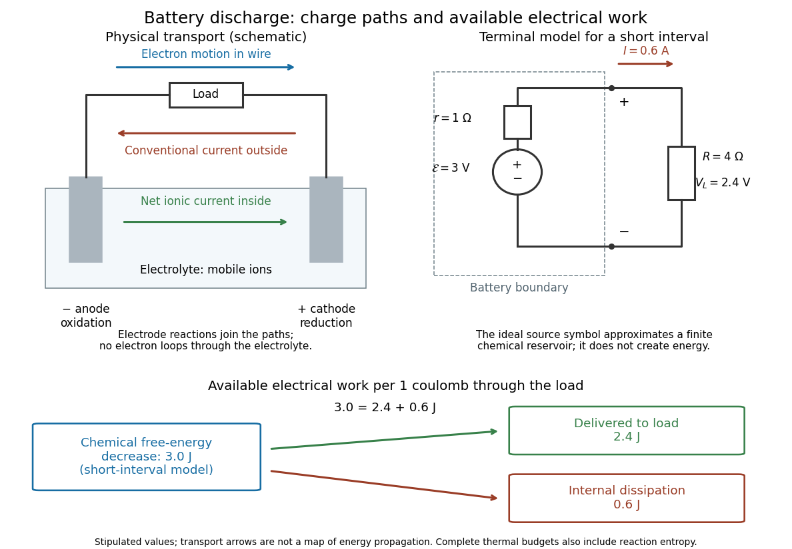

# Electric battery

↑ **Parent:** [Electrical circuit](electrical-circuit-split.md)  
ⓦ [Wiki](https://en.wikipedia.org/wiki/Electric_battery)

An [electric battery](electric-battery.md) converts the available chemical [Gibbs free energy](gibbs-free-energy.md) of one or more [galvanic cells](galvanic-cell.md) into electrical [work](work.md) delivered to an [electrical load](electrical-load.md). The reacting materials are a finite reservoir: a [battery](electric-battery.md) can sustain a terminal [electric potential difference](electric-potential-difference.md) while discharging, but cannot supply [energy](energy-split.md) indefinitely. Unlike a [capacitor](capacitor.md), whose [capacitor energy](capacitor-energy.md) resides in an [electric field](electric-field-split.md), a [battery](electric-battery.md) chiefly stores its available [energy](energy-split.md) in the chemical state of its materials. The detailed [half-reactions](half-reaction.md) and apparatus of a [Daniell cell](daniell-cell.md) explain this conversion at the [electrode](electrode.md) level.

During discharge, [electrons](electron.md) move through metallic wires from the negative [anode](anode.md), through the [electrical load](electrical-load.md), to the positive [cathode](cathode.md); external [conventional current](conventional-current.md) points the other way. Inside the [battery](electric-battery.md), [ions](ion.md) carry [electric current](electric-current.md) through the [electrolyte](electrolyte.md), and [redox](redox.md) [chemical reactions](chemical-reaction-split.md) connect ionic transport to electronic transport at the [electrodes](electrode.md). The same [electron](electron.md) does not make a lap through both wire and [electrolyte](electrolyte.md). [Electric charge conservation](charge-conservation.md) closes the circuit; changing chemical composition supplies the [energy](energy-split.md). See [galvanic cell](galvanic-cell.md) for the two transport paths and [electrolyte](electrolyte.md) for how oppositely moving [ions](ion.md) contribute to one net [electric current](electric-current.md).

**[Figure 11](#image-battery-discharge-charge-paths-equivalent-circuit-and-work-per-coulomb). Battery discharge: charge paths, equivalent circuit and work per coulomb**. Original schematic and stipulated calculation, not a particular commercial [battery](electric-battery.md) or measured cell. Left: external [electron](electron.md) motion and internal ionic [conventional current](conventional-current.md) connect the two [electrodes](electrode.md). Right: a short-interval model with [electromotive force](electromotive-force.md) $\mathcal E=3\,\mathrm V$, [battery internal resistance](battery-internal-resistance.md) $r=1\,\Omega$ and [electrical load](electrical-load.md) $R=4\,\Omega$. Bottom: each [coulomb](coulomb.md) transported corresponds to $3\,\mathrm J$ of available source [work](work.md), split into $2.4\,\mathrm J$ delivered to the [electrical load](electrical-load.md) and $0.6\,\mathrm J$ of internal dissipation. Arrows describe transport and an energy budget, not the route of a particular [electron](electron.md) or the propagation of an [electric field](electric-field-split.md).

The source's [electromotive force](electromotive-force.md) $\mathcal E$ measures its driving [work](work.md) per unit [electric charge](electric-charge-split.md), in [volts](volt.md); the loaded terminal [electric potential difference](electric-potential-difference.md) $V_L$ measures the electrical [work](work.md) per unit [electric charge](electric-charge-split.md) delivered outside the [battery](electric-battery.md). They agree in an ideal lossless source, or approximately near open circuit, but generally differ during discharge.[§10.1, Introduction to Electromotive Force, work per charge and terminal voltage](university-physics-volume-2-by-samuel-j-ling-and-others.md)

In the ideal fixed-voltage model used in [fixed-voltage capacitor energy balance](fixed-voltage-capacitor-energy-balance.md), a [battery](electric-battery.md) maintains a prescribed terminal [electric potential difference](electric-potential-difference.md) while [electric charge](electric-charge-split.md) flows to or from the [capacitor](capacitor.md). This is a constraint for that calculation, not an inexhaustible reservoir. The [fixed-voltage capacitor energy balance](fixed-voltage-capacitor-energy-balance.md) also accounts for electrical [energy](energy-split.md) returned to the source; an actual cell can accept sustained charging only if its chemistry and operating conditions permit it.

**Table of contents**

- [Lithium-air battery](lithium-air-battery.md)
- [Microbattery](microbattery.md)
- [Rechargeable battery](rechargeable-battery.md)
- [Specific capacity](specific-capacity.md)
- [Zinc-air battery](zinc-air-battery.md)
- [Lead-acid battery](lead-acid-battery.md)
  - [Sulfation](sulfation.md)
- [Lithium-ion battery](lithium-ion-battery.md)
- [Theoretical specific capacity](theoretical-specific-capacity.md)
- [Conversion electrode](conversion-electrode.md)
- [Primary battery](primary-battery.md)
  - [Lithium iron disulfide battery](lithium-iron-disulfide-battery.md)
  - [Battery capacity](battery-capacity.md)
  - [Battery self-discharge](battery-self-discharge.md)
  - [Battery separator](battery-separator.md)
  - [Lithium–carbon monofluoride battery](lithium-carbon-monofluoride-battery.md)
- [Battery internal resistance](battery-internal-resistance.md)
- [Battery load power and efficiency](battery-load-power-and-efficiency.md)
- [Finite battery charge reservoir](finite-battery-charge-reservoir.md)
- [Battery voltage measurement experiment](battery-voltage-measurement-experiment.md)

## ↑ Ancestors (5)

1. [Electrical circuit](electrical-circuit-split.md)
2. [Electromagnetism](electromagnetism-split.md)
3. [Branches of physics](branches-of-physics.md)
4. [Physics](physics-split.md)
5. [Codex Wiki](split.md)

## ← Incoming links (3)

- [Electric battery](electric-battery.md)
- [Solution](past-exam-of-the-mphil-in-micro-and-nanotechnology-enterprise-course-of-the-university-of-cambridge/2019/paper-1/section-a-iii/7/ii/solution.md)
- [Solution](past-exam-of-the-mphil-in-micro-and-nanotechnology-enterprise-course-of-the-university-of-cambridge/2019/paper-1/section-b/11/ii/solution.md)
